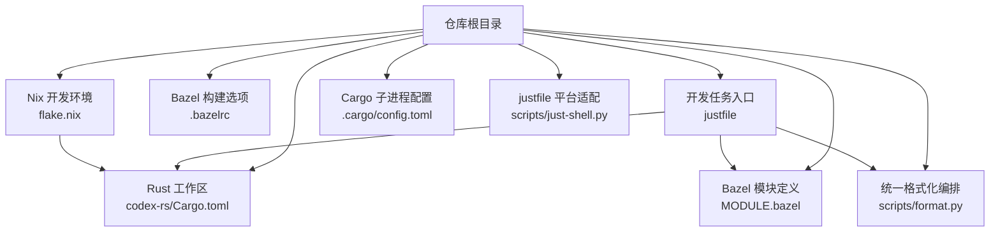
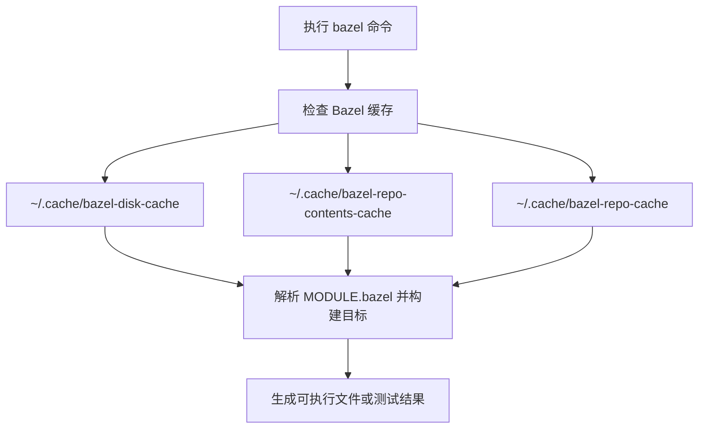
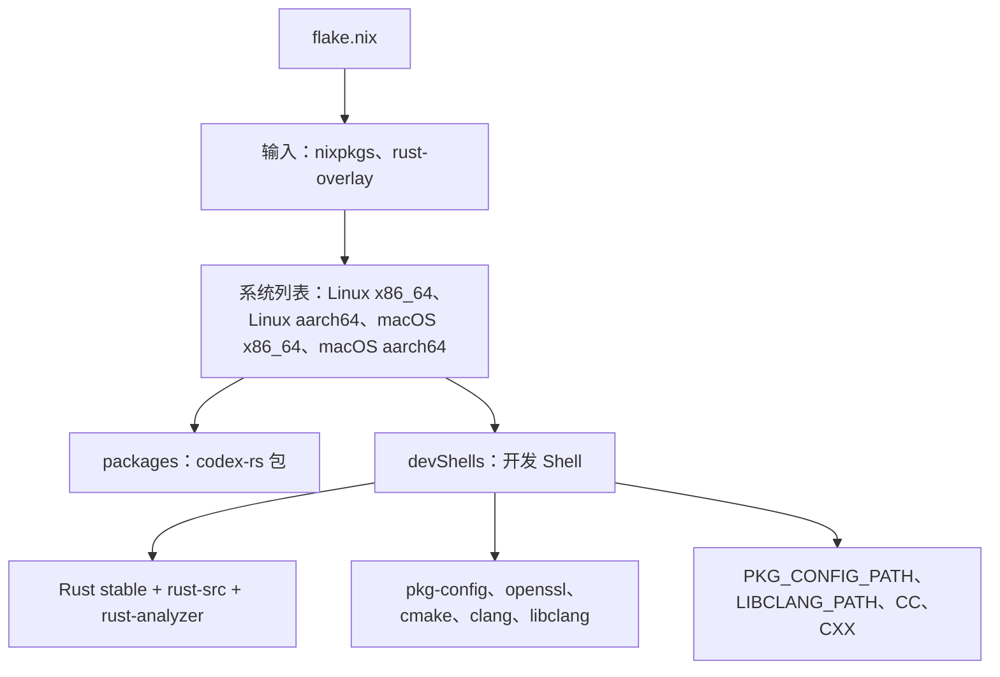
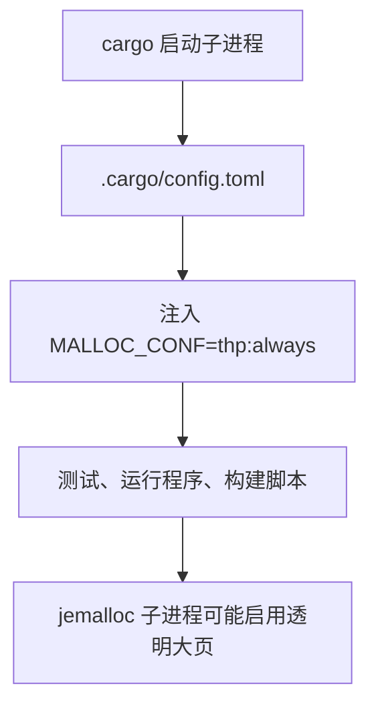
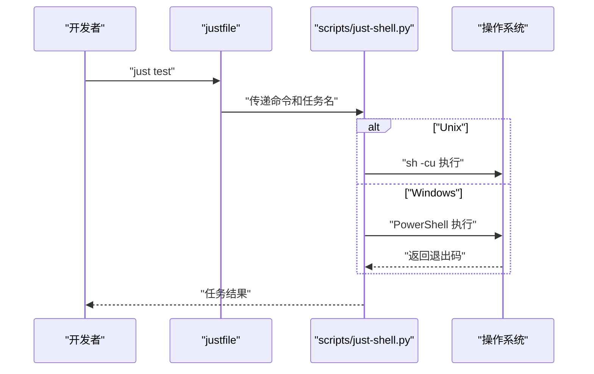

# 开发环境搭建

<cite>
**本文引用的文件**   
- [flake.nix](file://flake.nix)
- [justfile](file://justfile)
- [.cargo/config.toml](file://.cargo/config.toml)
- [codex-rs/rust-toolchain.toml](file://codex-rs/rust-toolchain.toml)
- [scripts/just-shell.py](file://scripts/just-shell.py)
- [scripts/format.py](file://scripts/format.py)
- [MODULE.bazel](file://MODULE.bazel)
- [.bazelrc](file://.bazelrc)
- [README.md](file://README.md)
- [docs/install.md](file://docs/install.md)
</cite>

## 目录
1. [简介](#简介)
2. [项目结构概览](#项目结构概览)
3. [Rust 工具链安装与配置](#rust-工具链安装与配置)
4. [Bazel 构建系统安装与配置](#bazel-构建系统安装与配置)
5. [Nix Flake 开发环境](#nix-flake-开发环境)
6. [Cargo 工作区与 .cargo 配置](#cargo-工作区与-cargo-配置)
7. [Justfile 开发任务说明](#justfile-开发任务说明)
8. [跨平台注意事项](#跨平台注意事项)
9. [常见问题排查](#常见问题排查)
10. [环境验证清单](#环境验证清单)
11. [结论](#结论)

## 简介
本文面向需要在本地开发 Codex CLI 的开发者，聚焦以下目标：
- 安装并锁定 Rust 工具链，包括 rustup、rustc、cargo 及必要组件。
- 安装和配置 Bazel 构建系统，理解仓库使用的 MODULE.bazel 依赖管理方式。
- 使用 Nix flake 快速获得一致的开发环境。
- 理解 `.cargo/config.toml` 对 Cargo 子进程的影响。
- 掌握 `justfile` 中常用开发任务，如安装、格式化、静态检查、测试和基准测试。
- 提供常见环境问题排查方法和最终环境验证清单。

该文档只基于仓库中的配置文件和脚本进行说明，不引入仓库之外的实现假设。

## 项目结构概览
仓库是一个多语言、多构建系统的工程：
- Rust 工作区位于 `codex-rs`，由 `codex-rs/Cargo.toml` 描述。
- 根级存在 `justfile`，用于统一开发任务。
- 根级存在 `MODULE.bazel` 和 `.bazelrc`，用于 Bazel 模块管理与构建选项。
- 根级存在 `flake.nix`，提供跨平台开发 Shell。
- `.cargo/config.toml` 为整个仓库的 Cargo 子进程设置环境变量。
- `scripts/format.py` 是统一的格式化工具编排脚本。
- `scripts/just-shell.py` 是 `justfile` 在 Windows 与非 Windows 平台之间的命令转发适配器。

**图表来源**
- [justfile:1-10](file://justfile#L1-L10)
- [codex-rs/Cargo.toml:1-10](file://codex-rs/Cargo.toml#L1-L10)
- [MODULE.bazel:3-22](file://MODULE.bazel#L3-L22)
- [.bazelrc:6-12](file://.bazelrc#L6-L12)
- [flake.nix:1-15](file://flake.nix#L1-L15)
- [.cargo/config.toml:1-5](file://.cargo/config.toml#L1-L5)
- [scripts/format.py:1-20](file://scripts/format.py#L1-L20)
- [scripts/just-shell.py:1-20](file://scripts/just-shell.py#L1-L20)

**章节来源**
- [justfile:1-10](file://justfile#L1-L10)
- [MODULE.bazel:3-22](file://MODULE.bazel#L3-L22)
- [flake.nix:1-15](file://flake.nix#L1-L15)
- [.cargo/config.toml:1-5](file://.cargo/config.toml#L1-L5)

## Rust 工具链安装与配置
### 固定工具链版本
项目通过 `codex-rs/rust-toolchain.toml` 固定 Rust 工具链：
- 工具链通道为 `1.95.0`。
- 包含组件 `clippy`、`rustfmt`、`rust-src`。

这意味着：
- 使用 `rustup` 时，会自动安装或切换到 `1.95.0`。
- 不需要手动指定 `--toolchain`，除非你明确需要覆盖默认行为。
- 如果 CI 或本地环境与仓库不一致，应优先以 `rust-toolchain.toml` 为准。

**章节来源**
- [codex-rs/rust-toolchain.toml:1-3](file://codex-rs/rust-toolchain.toml#L1-L3)

### 最小安装步骤
推荐按以下步骤安装 Rust 工具链：
1. 安装 rustup。
2. 初始化当前 shell 的 cargo 环境。
3. 让 `rustup` 根据 `rust-toolchain.toml` 安装 `1.95.0`。
4. 确认已安装 `clippy` 和 `rustfmt`。
5. 安装 `just`、`dotslash`、`cargo-nextest` 等开发辅助工具。

文档中还提供了直接从源码构建的最小命令序列，包括克隆仓库、进入 `codex-rs`、安装工具链、执行 `cargo build` 和运行示例命令。

**章节来源**
- [docs/install.md:11-50](file://docs/install.md#L11-L50)

### 版本要求总结
| 工具 | 要求或行为 |
| --- | --- |
| rustup | 用于安装和管理 Rust 工具链；会读取 `codex-rs/rust-toolchain.toml`。 |
| rustc | 固定为 `1.95.0`。 |
| cargo | 随 Rust 工具链安装，与工作区 `codex-rs/Cargo.toml` 配合。 |
| clippy | 作为 `rust-toolchain.toml` 的组件被启用。 |
| rustfmt | 作为 `rust-toolchain.toml` 的组件被启用。 |
| rust-src | 作为 `rust-toolchain.toml` 的组件被启用。 |
| just | 通过 `cargo install --locked just` 安装。 |
| cargo-nextest | 通过 `cargo install --locked cargo-nextest` 安装。 |
| dotslash | 用于执行仓库中锁定的第三方工具，例如 buildifier。 |

**章节来源**
- [codex-rs/rust-toolchain.toml:1-3](file://codex-rs/rust-toolchain.toml#L1-L3)
- [docs/install.md:23-35](file://docs/install.md#L23-L35)

## Bazel 构建系统安装与配置
### 构建系统定位
仓库同时支持直接通过 Cargo 构建，也支持通过 Bazel 构建：
- Cargo 路径：`cargo build`、`cargo run --bin codex`。
- Bazel 路径：`bazel test //...`、`bazel run //codex-rs/cli:codex`、`bazel build //codex-rs/cli:release_binaries`。

根级 `MODULE.bazel` 声明了 Bazel 模块依赖，包括 `bazel_lib`、`rules_rs`、`rules_foreign_cc`、`rules_python`、`llvm`、`windows_support`、`protobuf`、`aws-lc`、`openssl`、`zstd`、`bzip2`、`zlib`、`xz`、`alsa_lib` 等。这说明仓库不仅构建 Rust 代码，还集成大量 C/C++、Python、系统库和第三方规则。

**章节来源**
- [MODULE.bazel:3-22](file://MODULE.bazel#L3-L22)
- [MODULE.bazel:160-178](file://MODULE.bazel#L160-L178)
- [MODULE.bazel:497-549](file://MODULE.bazel#L497-L549)

### Bazel 缓存与全局配置
`.bazelrc` 设置了磁盘缓存、仓库内容缓存和仓库缓存路径，有助于提升重复构建速度。CI 相关配置还会引入 `ci-bazel`、`ci-windows`、`ci-linux`、`ci-macos` 等构建配置。

**图表来源**
- [.bazelrc:6-12](file://.bazelrc#L6-L12)

**章节来源**
- [.bazelrc:6-12](file://.bazelrc#L6-L12)
- [.bazelrc:124-125](file://.bazelrc#L124-L125)
- [.bazelrc:179-196](file://.bazelrc#L179-L196)

### Bazel 安装建议
仓库没有提供单一 `bazel-version.txt` 来强制 Bazel 主程序版本，因此建议：
1. 安装一个较新的 Bazel 主程序，使其能够解析 `MODULE.bazel` 中的 Bazel 模块依赖。
2. 如果 Bazel 无法解析模块，优先检查是否安装了足够新的 Bazel 版本。
3. 使用 `just bazel-test` 运行仓库测试，使用 `just bazel-lock-check` 或 `just bazel-lock-update` 维护 `MODULE.bazel.lock`。
4. 如果需要发布二进制，使用 `just build-for-release`。

**章节来源**
- [justfile:148-175](file://justfile#L148-L175)
- [justfile:177-181](file://justfile#L177-L181)
- [MODULE.bazel:3-22](file://MODULE.bazel#L3-L22)

## Nix Flake 开发环境
### Flake 的作用
`flake.nix` 定义了 OpenAI Codex CLI 的 Nix 开发环境，主要能力包括：
- 声明输入：`nixpkgs`、`rust-overlay`。
- 支持系统：`x86_64-linux`、`aarch64-linux`、`x86_64-darwin`、`aarch64-darwin`。
- 提供 `packages.default`：基于 `codex-rs` 的包输出。
- 提供 `devShells.default`：包含 Rust、OpenSSL、CMake、Clang、libclang 等开发依赖。

**图表来源**
- [flake.nix:1-20](file://flake.nix#L1-L20)
- [flake.nix:48-87](file://flake.nix#L48-L87)

**章节来源**
- [flake.nix:1-20](file://flake.nix#L1-L20)
- [flake.nix:48-87](file://flake.nix#L48-L87)

### macOS 与 Linux 特定要求
Nix 开发 Shell 显式安装：
- `pkg-config`
- `openssl`
- `cmake`
- `llvmPackages.clang`
- `llvmPackages.libclang.lib`

并将 OpenSSL 的 pkg-config 路径注入 `PKG_CONFIG_PATH`，将 libclang 动态库路径注入 `LIBCLANG_PATH`，同时将 `CC` 和 `CXX` 设置为 `clang` 和 `clang++`，以避免某些原生依赖编译时出现 GCC 警告。

Windows 不在 Nix flake 支持的系统中，因此 Windows 开发更依赖 `justfile` 的 PowerShell 适配和 Windows 专用脚本。

**章节来源**
- [flake.nix:48-87](file://flake.nix#L48-L87)

### Windows 与 Nix
当前 `flake.nix` 未包含 `x86_64-win32`、`aarch64-windows` 等 Windows 系统。若要在 Windows 上使用 Nix，需要自行扩展 `systems` 列表并处理 Windows 下的依赖差异；否则更推荐使用 `justfile` 提供的 Windows 安装逻辑。

**章节来源**
- [flake.nix:9-16](file://flake.nix#L9-L16)

## Cargo 工作区与 .cargo 配置
### 工作区位置
Rust 工作区位于 `codex-rs`，由 `codex-rs/Cargo.toml` 声明 workspace members。根目录的 `justfile` 默认将工作目录设为 `codex-rs`，因此大多数 `just` 任务会在这个目录下执行 Cargo 命令。

**章节来源**
- [justfile:1-3](file://justfile#L1-L3)
- [codex-rs/Cargo.toml:1-10](file://codex-rs/Cargo.toml#L1-L10)

### .cargo/config.toml 的作用
根目录 `.cargo/config.toml` 设置了 Cargo 子进程的环境变量：
- `MALLOC_CONF=thp:always`，向兼容 jemalloc 的子进程请求透明大页。
- `force=false`，表示如果子进程已经显式设置 `MALLOC_CONF`，则不会覆盖。
- 这会影响 `cargo run`、`cargo test` 以及所有由 Cargo 启动的子进程。

**图表来源**
- [.cargo/config.toml:1-5](file://.cargo/config.toml#L1-L5)

**章节来源**
- [.cargo/config.toml:1-5](file://.cargo/config.toml#L1-L5)

## Justfile 开发任务说明
`justfile` 是仓库的主要开发任务入口，它将 Cargo、Bazel、Python 脚本和平台相关逻辑封装成统一命令。

### 基本任务
| 任务 | 作用 | 说明 |
| --- | --- | --- |
| `just help` | 显示帮助 | 列出可用任务。 |
| `just codex` | 运行 `codex` 二进制 | 等价于 `cargo run --bin codex`。 |
| `just exec` | 运行 `codex exec` | 等价于 `cargo run --bin codex -- exec ...`。 |
| `just file-search` | 运行文件搜索二进制 | 等价于 `cargo run --bin codex-file-search`。 |
| `just code-mode-host` | 运行代码模式主机二进制 | 等价于 `cargo run --bin codex-code-mode-host`。 |
| `just assemble-codex-package` | 组装本地 Codex 包 | 调用 `scripts/build_codex_package.py`。 |
| `just app-server-test-client` | 构建 CLI 并运行 app-server 测试客户端 | 先构建 `codex-cli`，再运行测试客户端。 |

**章节来源**
- [justfile:10-49](file://justfile#L10-L49)

### 格式化和代码质量
| 任务 | 作用 | 说明 |
| --- | --- | --- |
| `just fmt` | 格式化仓库代码 | 调用 `scripts/format.py`，统一处理 justfile、Rust、Bazel/Starlark、Python SDK 和 Python 脚本。 |
| `just fmt-check` | 检查格式化 | 不修改文件，仅检查是否符合格式。 |
| `just fix` | 自动修复 Clippy 问题 | 等价于 `cargo clippy --fix --tests --allow-dirty`。 |
| `just clippy` | 运行 Clippy | 等价于 `cargo clippy --tests`。 |
| `just argument-comment-lint` | 运行参数注释 lint | 可选择通过 Bazel 或预构建 linter 执行。 |
| `just argument-comment-lint-from-source` | 从源码运行参数注释 lint | 调用 `tools/argument-comment-lint/run.py`。 |

`scripts/format.py` 会分别调用：
- `just --unstable --fmt`
- `rustfmt --edition 2024`
- `buildifier`（通过 `dotslash`）
- Python SDK 相关的 Ruff 格式化流程。

**章节来源**
- [justfile:50-66](file://justfile#L50-L66)
- [scripts/format.py:28-120](file://scripts/format.py#L28-L120)

### 安装与测试
| 任务 | 作用 | 说明 |
| --- | --- | --- |
| `just install` | 安装开发依赖 | Unix 下检查活跃工具链并执行 `cargo fetch`；Windows 下确保 PowerShell 可用后执行相同逻辑。 |
| `just test` | 运行测试 | 通过 `cargo nextest run --no-fail-fast`，并设置 `RUST_MIN_STACK=8388608`。 |
| `just bench` | 运行基准测试 | 等价于 `cargo bench --workspace --bench '*'`。 |
| `just bench-smoke` | 基准冒烟测试 | 验证基准目标可以启动。 |
| `just bench-e2e` | Bazel 端到端宏基准 | 使用优化构建运行 `//codex-rs:e2e-benchmarks`。 |
| `just bench-e2e-smoke` | Bazel 端到端基准冒烟 | 使用 fastbuild 和 release cfg 路径验证基准。 |
| `just test-github-scripts` | 运行 GitHub Actions 脚本单元测试 | 通过 Python unittest 执行 `.github/scripts` 下的测试。 |

**章节来源**
- [justfile:64-118](file://justfile#L64-L118)

### Bazel 相关任务
| 任务 | 作用 | 说明 |
| --- | --- | --- |
| `just bazel-codex` | 使用 Bazel 运行 `codex` | 等价于 `bazel run //codex-rs/cli:codex`。 |
| `just bazel-code-mode-host` | 使用 Bazel 运行代码模式主机 | 等价于 `bazel run //codex-rs/code-mode-host:codex-code-mode-host`。 |
| `just bazel-lock-update` | 更新 Bazel 模块锁 | 等价于 `bazel mod deps --lockfile_mode=update`。 |
| `just bazel-lock-check` | 校验 Bazel 模块锁 | Unix 走脚本，Windows 走 `bazel mod deps --lockfile_mode=error`。 |
| `just bazel-test` | 运行 Bazel 测试 | 排除 `argument-comment-lint` 标签，使用 `--keep_going`。 |
| `just bazel-clippy` | 通过 Bazel 配置运行 Clippy | 使用 `--config=clippy`。 |
| `just bazel-argument-comment-lint` | 通过 Bazel 配置运行参数注释 lint | 使用 `--config=argument-comment-lint`。 |
| `just build-for-release` | 构建发布二进制 | 等价于 `bazel build //codex-rs/cli:release_binaries`。 |

**章节来源**
- [justfile:120-181](file://justfile#L120-L181)

### Justfile 平台适配机制
`justfile` 使用 `scripts/just-shell.py` 作为 shell 适配器：
- Unix：使用 `sh -cu` 执行命令。
- Windows：查找 `pwsh.exe` 或 `pwsh`，并通过 PowerShell 执行命令。
- Windows 上如果找不到 PowerShell，`just install` 会通过 winget 尝试安装 PowerShell。

**图表来源**
- [justfile:1-10](file://justfile#L1-L10)
- [scripts/just-shell.py:18-72](file://scripts/just-shell.py#L18-L72)

**章节来源**
- [justfile:1-10](file://justfile#L1-L10)
- [scripts/just-shell.py:18-72](file://scripts/just-shell.py#L18-L72)

## 跨平台注意事项
### macOS 与 Linux
- 推荐通过 Nix flake 获取开发环境。
- 也可以直接使用 `docs/install.md` 中的命令安装 Rust、just、dotslash、cargo-nextest。
- OpenSSL、pkg-config、cmake、clang、libclang 由 Nix 提供。
- Bazel 构建会使用 `.bazelrc` 中的缓存路径。

**章节来源**
- [flake.nix:48-87](file://flake.nix#L48-L87)
- [docs/install.md:11-50](file://docs/install.md#L11-L50)
- [.bazelrc:6-12](file://.bazelrc#L6-L12)

### Windows
- 官方文档建议通过 WSL2 在 Windows 环境下开发。
- `justfile` 的 Windows 安装逻辑会检测并安装 PowerShell。
- Windows 上的 `just test`、`bazel-codex`、`bazel-code-mode-host`、`bazel-lock-check` 都使用 PowerShell 语法。
- Nix flake 当前不支持 Windows 系统，Windows 开发更适合依赖 `justfile`。

**章节来源**
- [docs/install.md:7-10](file://docs/install.md#L7-L10)
- [justfile:64-78](file://justfile#L64-L78)
- [justfile:120-175](file://justfile#L120-L175)
- [flake.nix:9-16](file://flake.nix#L9-L16)

## 常见问题排查
### Rust 工具链问题
- **现象**：`cargo` 报工具链版本不一致。  
  **原因**：本地 `rustup` 未同步到 `codex-rs/rust-toolchain.toml` 指定的 `1.95.0`。  
  **解决**：重新运行 rustup 安装流程，或执行 `rustup show active-toolchain` 确认版本。

**章节来源**
- [codex-rs/rust-toolchain.toml:1-3](file://codex-rs/rust-toolchain.toml#L1-L3)
- [justfile:64-68](file://justfile#L64-L68)

### Windows 缺少 PowerShell
- **现象**：运行 `just test` 或 `just install` 时报缺少 PowerShell。  
  **原因**：`scripts/just-shell.py` 在 Windows 上需要 `pwsh.exe` 或 `pwsh`。  
  **解决**：运行 `just install`，它会在缺失时尝试通过 winget 安装 PowerShell；也可手动安装 PowerShell。

**章节来源**
- [scripts/just-shell.py:36-58](file://scripts/just-shell.py#L36-L58)
- [justfile:64-78](file://justfile#L64-L78)

### Nix 环境缺少 OpenSSL 或 libclang
- **现象**：Rust crate 编译原生依赖时报找不到 OpenSSL、pkg-config、libclang。  
  **原因**：未使用 Nix flake 提供的开发 Shell，或手动修改了 `PKG_CONFIG_PATH`、`LIBCLANG_PATH`。  
  **解决**：使用 `nix develop` 进入 flake 提供的开发环境，不要手动覆盖这些变量。

**章节来源**
- [flake.nix:64-87](file://flake.nix#L64-L87)

### Bazel 模块锁校验失败
- **现象**：`just bazel-lock-check` 报错，提示 `MODULE.bazel.lock` 过期。  
  **原因**：Bazel 模块依赖发生变化，但锁文件未更新。  
  **解决**：运行 `just bazel-lock-update` 更新锁文件，然后提交更新的锁文件。

**章节来源**
- [justfile:148-157](file://justfile#L148-L157)

### 格式检查失败
- **现象**：`just fmt-check` 或 CI 报告文件格式不符合要求。  
  **原因**：Rust、Bazel/Starlark、Python SDK 或 justfile 未被统一格式化。  
  **解决**：运行 `just fmt` 统一格式化，再重新检查。

**章节来源**
- [justfile:50-56](file://justfile#L50-L56)
- [scripts/format.py:28-120](file://scripts/format.py#L28-L120)

### jemalloc 行为异常
- **现象**：内存行为与预期不同，或在某些环境中性能异常。  
  **原因**：`.cargo/config.toml` 设置了 `MALLOC_CONF=thp:always`，会影响 jemalloc 子进程。  
  **解决**：如需禁用，可在具体子进程中显式设置 `MALLOC_CONF`，因为配置允许子进程覆盖。

**章节来源**
- [.cargo/config.toml:1-5](file://.cargo/config.toml#L1-L5)

## 环境验证清单
完成环境搭建后，可按以下清单逐项验证：

| 检查项 | 验证命令或行为 | 期望结果 |
| --- | --- | --- |
| Rust 工具链版本 | `rustup show active-toolchain` | 显示 `1.95.0`。 |
| Rust 组件 | `rustup component list --installed` | 包含 `clippy`、`rustfmt`、`rust-src`。 |
| Cargo 工作区 | `cargo check -p codex-cli` | 能解析 workspace 并成功检查。 |
| Just 任务 | `just help` | 列出安装、格式化、测试、Bazel 等任务。 |
| 安装任务 | `just install` | Unix 执行 `rustup show active-toolchain` 和 `cargo fetch`；Windows 执行 PowerShell 相关逻辑。 |
| 格式化任务 | `just fmt-check` | 无格式差异或主动修复后通过。 |
| Clippy | `just clippy` | 通过或按需修复。 |
| 测试任务 | `just test` | 通过 nextest 运行测试。 |
| Bazel 测试 | `just bazel-test` | 能解析 `MODULE.bazel` 并运行测试。 |
| Bazel 锁校验 | `just bazel-lock-check` | 锁文件有效。 |
| Nix 开发 Shell | `nix develop` | 能进入包含 Rust、OpenSSL、CMake、Clang、libclang 的环境。 |
| 根级 README | 阅读根目录 README | 了解 Codex CLI 的安装和使用入口。 |

**章节来源**
- [codex-rs/rust-toolchain.toml:1-3](file://codex-rs/rust-toolchain.toml#L1-L3)
- [justfile:10-181](file://justfile#L10-L181)
- [flake.nix:48-87](file://flake.nix#L48-L87)
- [README.md:12-40](file://README.md#L12-L40)

## 结论
Codex CLI 的开发环境围绕三个核心展开：
- Rust 工具链由 `codex-rs/rust-toolchain.toml` 固定为 `1.95.0`，并通过 rustup 自动管理。
- Bazel 通过 `MODULE.bazel` 管理复杂依赖，`.bazelrc` 提供缓存和 CI 配置，`justfile` 提供统一入口。
- Nix flake 提供跨 macOS 和 Linux 的一致开发 Shell，Windows 更适合使用 `justfile` 的 PowerShell 适配。

对于新加入的开发者，推荐顺序是：
1. 安装 rustup 并让工具链对齐 `1.95.0`。
2. 安装 `just`、`cargo-nextest`、`dotslash`。
3. 根据平台选择 Nix 或直接使用 `just`。
4. 用 `just fmt`、`just clippy`、`just test` 验证环境。
5. 用 `just bazel-test` 和 `just bazel-lock-check` 验证 Bazel 环境。