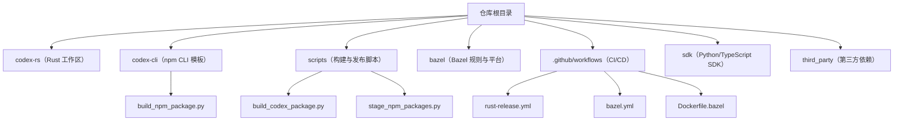
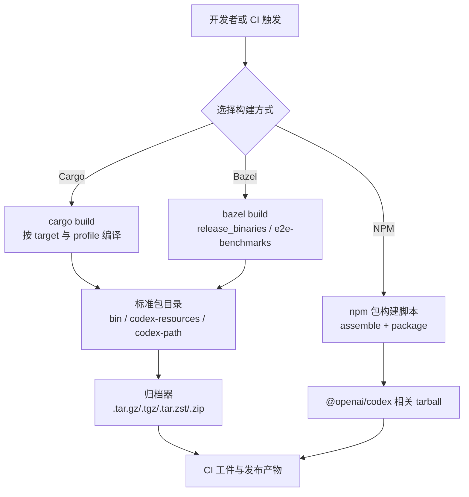
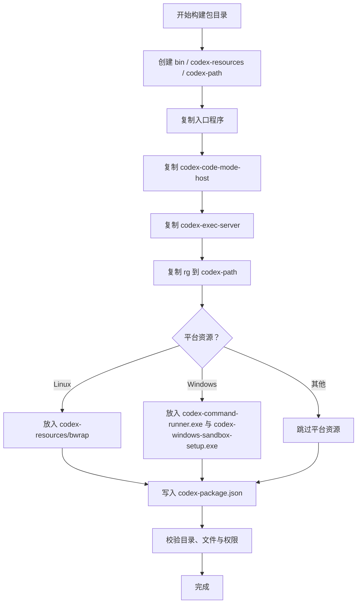
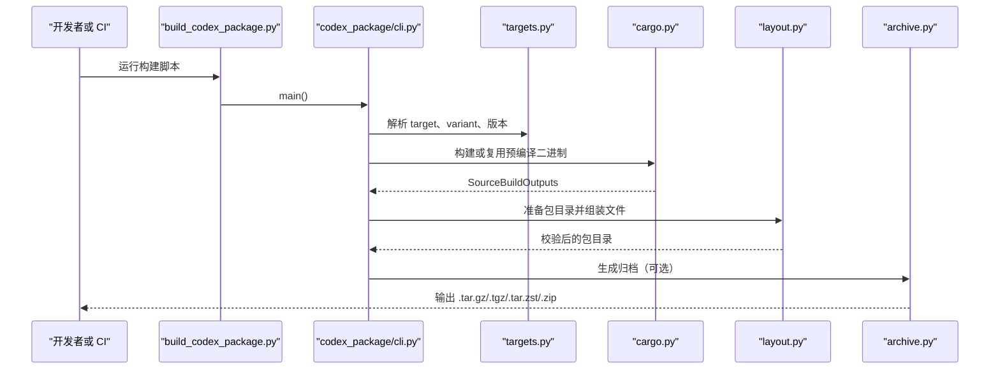
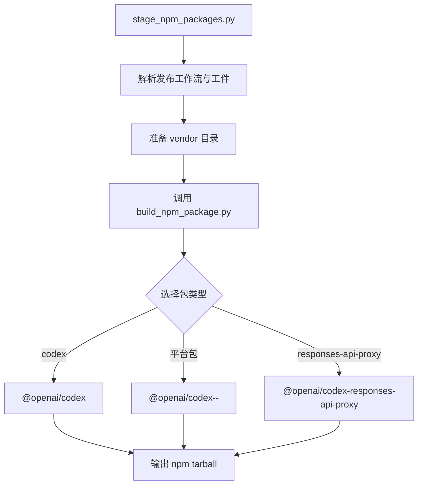
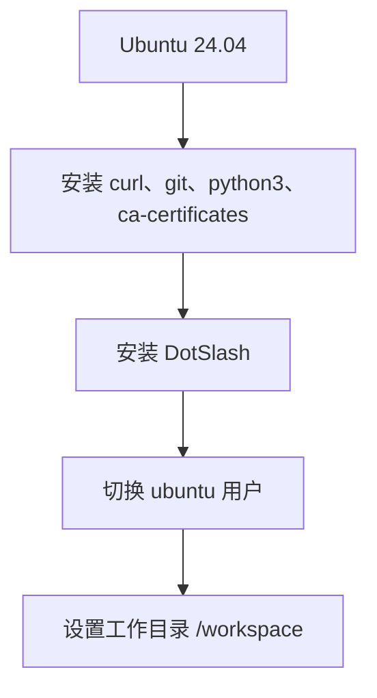
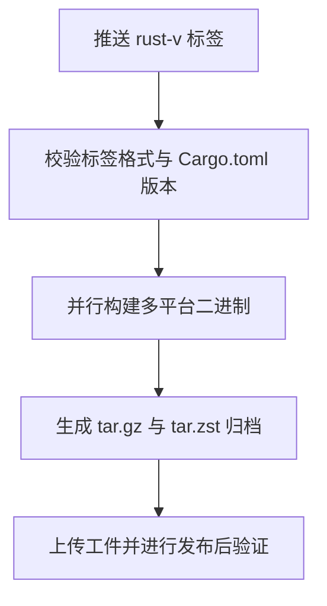
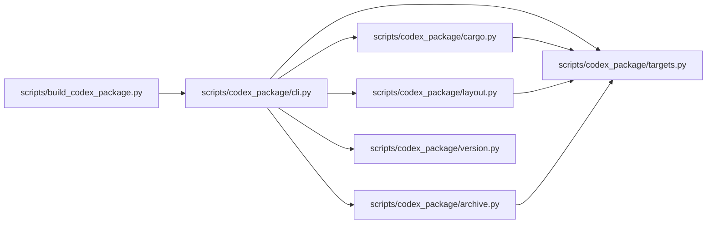

# 构建与部署

<cite>
**本文引用的文件**   
- [scripts/build_codex_package.py](file://scripts/build_codex_package.py)
- [scripts/codex_package/cli.py](file://scripts/codex_package/cli.py)
- [scripts/codex_package/archive.py](file://scripts/codex_package/archive.py)
- [scripts/codex_package/cargo.py](file://scripts/codex_package/cargo.py)
- [scripts/codex_package/layout.py](file://scripts/codex_package/layout.py)
- [scripts/codex_package/targets.py](file://scripts/codex_package/targets.py)
- [scripts/codex_package/version.py](file://scripts/codex_package/version.py)
- [codex-cli/scripts/build_npm_package.py](file://codex-cli/scripts/build_npm_package.py)
- [scripts/stage_npm_packages.py](file://scripts/stage_npm_packages.py)
- [codex-rs/Cargo.toml](file://codex-rs/Cargo.toml)
- [package.json](file://package.json)
- [codex-cli/package.json](file://codex-cli/package.json)
- [justfile](file://justfile)
- [bazel/platforms/release_binaries.bzl](file://bazel/platforms/release_binaries.bzl)
- [bazel/extensions/codex_release_archive.bzl](file://bazel/extensions/codex_release_archive.bzl)
- [.github/workflows/rust-release.yml](file://.github/workflows/rust-release.yml)
- [.github/workflows/bazel.yml](file://.github/workflows/bazel.yml)
- [.github/workflows/Dockerfile.bazel](file://.github/workflows/Dockerfile.bazel)
- [scripts/codex_package/smoke_tests/test_codex_package.py](file://scripts/codex_package/smoke_tests/test_codex_package.py)
</cite>

## 目录
1. [简介](#简介)
2. [项目结构](#项目结构)
3. [核心构建组件](#核心构建组件)
4. [架构总览](#架构总览)
5. [详细组件分析](#详细组件分析)
6. [依赖关系分析](#依赖关系分析)
7. [性能考虑](#性能考虑)
8. [故障排除指南](#故障排除指南)
9. [结论](#结论)
10. [附录：命令速查](#附录命令速查)

## 简介
本指南面向开发者与维护者，说明如何在本机构建 Codex，以及如何在持续集成环境中生成多平台二进制、打包 npm 包、构建容器镜像并发布。仓库同时支持三种主要构建方式：
- Cargo 直接构建 Rust 代码。
- Bazel 统一构建、测试与发布规则。
- NPM 包构建脚本，用于把多平台原生二进制装配成 `@openai/codex` 系列 npm 包。

其中，`scripts/build_codex_package.py` 是“标准 Codex 包”的入口；它负责选择目标平台、调用 Cargo 编译所需可执行文件、组装包目录、生成元数据，并可选地输出压缩归档。npm 包构建由 `codex-cli/scripts/build_npm_package.py` 驱动，最终由 `scripts/stage_npm_packages.py` 在 CI 中编排发布。

## 项目结构
仓库采用多语言、多子模块组织：
- `codex-rs/`：Rust 工作区，包含 CLI、服务端、工具、扩展等大量 crate。
- `codex-cli/`：Node.js 侧的 CLI 脚手架和 npm 包模板。
- `scripts/`：构建、发布、安装和测试脚本。
- `bazel/`：Bazel 自定义规则与平台定义。
- `.github/workflows/`：CI/CD 流水线。
- `sdk/`：Python 和 TypeScript SDK。
- `third_party/`：V8、SQLite、OpenSSL 等第三方依赖的 Bazel 集成。

**图示来源**
- [justfile:1-20](file://justfile#L1-L20)
- [scripts/build_codex_package.py:1-16](file://scripts/build_codex_package.py#L1-L16)
- [codex-cli/scripts/build_npm_package.py:1-60](file://codex-cli/scripts/build_npm_package.py#L1-L60)
- [scripts/stage_npm_packages.py:1-60](file://scripts/stage_npm_packages.py#L1-L60)
- [.github/workflows/rust-release.yml:1-40](file://.github/workflows/rust-release.yml#L1-L40)
- [.github/workflows/bazel.yml:1-40](file://.github/workflows/bazel.yml#L1-L40)
- [.github/workflows/Dockerfile.bazel:1-20](file://.github/workflows/Dockerfile.bazel#L1-L20)

**章节来源**
- [justfile:1-20](file://justfile#L1-L20)
- [package.json:1-39](file://package.json#L1-L39)
- [codex-rs/Cargo.toml:1-80](file://codex-rs/Cargo.toml#L1-L80)

## 核心构建组件
本节聚焦三类构建产物与对应脚本：
1. **标准 Codex 包**：通过 `scripts/build_codex_package.py` 生成，内部使用 `scripts/codex_package/*` 模块完成目标解析、Cargo 构建、目录布局、符号剥离和归档。
2. **NPM 包**：通过 `codex-cli/scripts/build_npm_package.py` 组装主包与各平台原生二进制包，再由 `scripts/stage_npm_packages.py` 协调发布。
3. **Bazel 构建**：通过 `bazel/platforms/release_binaries.bzl` 定义跨平台 release 目标，并通过 `bazel/extensions/codex_release_archive.bzl` 消费已发布的稳定包。

**章节来源**
- [scripts/build_codex_package.py:1-16](file://scripts/build_codex_package.py#L1-L16)
- [scripts/codex_package/cli.py:1-60](file://scripts/codex_package/cli.py#L1-L60)
- [codex-cli/scripts/build_npm_package.py:1-120](file://codex-cli/scripts/build_npm_package.py#L1-L120)
- [scripts/stage_npm_packages.py:1-120](file://scripts/stage_npm_packages.py#L1-L120)
- [bazel/platforms/release_binaries.bzl:1-30](file://bazel/platforms/release_binaries.bzl#L1-L30)
- [bazel/extensions/codex_release_archive.bzl:1-56](file://bazel/extensions/codex_release_archive.bzl#L1-L56)

## 架构总览
下图展示从源码到最终包的主要路径：开发者或 CI 触发构建后，可能进入 Cargo 路径、Bazel 路径或 npm 路径；所有原生二进制最终会落入标准包目录，并由归档器输出 `.tar.gz`、`.tgz`、`.tar.zst` 或 `.zip`。

**图示来源**
- [scripts/codex_package/cli.py:60-140](file://scripts/codex_package/cli.py#L60-L140)
- [scripts/codex_package/cargo.py:1-120](file://scripts/codex_package/cargo.py#L1-L120)
- [scripts/codex_package/layout.py:1-120](file://scripts/codex_package/layout.py#L1-L120)
- [scripts/codex_package/archive.py:1-118](file://scripts/codex_package/archive.py#L1-L118)
- [codex-cli/scripts/build_npm_package.py:60-160](file://codex-cli/scripts/build_npm_package.py#L60-L160)

## 详细组件分析

### 标准 Codex 包构建流程
`scripts/build_codex_package.py` 是一个薄入口，将 Python 脚本所在目录加入 `sys.path`，然后调用 `codex_package.cli.main()`。实际逻辑集中在 `scripts/codex_package` 子模块中。

#### 命令行参数与版本
CLI 支持以下关键参数：
- `--target`：指定 Rust target triple，默认根据主机平台自动选择。
- `--variant`：包变体，例如 `codex` 或 `codex-app-server`。
- `--package-version`：写入 `codex-package.json` 的版本号；默认从 workspace 读取。
- `--package-dir`：输出包目录，默认为临时目录。
- `--archive-output`：可重复传入，支持 `.tar.gz`、`.tgz`、`.tar.zst`、`.zip`。
- `--force`：覆盖已有目录或归档。
- `--cargo`、`--cargo-profile`：控制 Cargo 可执行文件和构建配置。
- `--strip`、`--strip-tool`：控制 Unix 二进制符号剥离策略。
- `--entrypoint-bin`、`--code-mode-host-bin`、`--exec-server-bin`、`--bwrap-bin`、`--codex-command-runner-bin`、`--codex-windows-sandbox-setup-bin`：允许传入预编译的可执行文件，避免重复编译。
- `--rg-bin`：本地 ripgrep 可执行文件替代方案。

版本号解析器要求语义化版本格式，若未提供则调用 `read_workspace_version()`，从 `codex-rs/Cargo.toml` 的 `[workspace.package]` 段读取 `version`。

**章节来源**
- [scripts/build_codex_package.py:1-16](file://scripts/build_codex_package.py#L1-L16)
- [scripts/codex_package/cli.py:1-120](file://scripts/codex_package/cli.py#L1-L120)
- [scripts/codex_package/version.py:1-29](file://scripts/codex_package/version.py#L1-L29)
- [codex-rs/Cargo.toml:60-80](file://codex-rs/Cargo.toml#L60-L80)

#### 目标与平台
`targets.py` 强制要求环境变量 `CODEX_REPO_ROOT` 指向仓库根，随后定义：
- `TargetSpec`：描述 target triple、是否 Windows/Linux、DotSlash 平台名。
- `PackageVariant`：描述包变体的 Cargo 二进制名与可执行文件名。
- `PACKAGE_VARIANTS`：当前支持 `codex` 与 `codex-app-server`。
- `TARGET_SPECS`：支持 Linux、macOS、Windows 的 x86_64 与 arm64 组合。
- `HOST_RELEASE_TARGETS`：根据 `platform.system()` 和 `platform.machine()` 推导默认目标。
- `default_target()`：若主机不在映射表中，会抛出错误并列出支持的 target。

这意味着跨平台构建必须显式指定 `--target`，或在 CI 中使用受支持的 runner。

**章节来源**
- [scripts/codex_package/targets.py:1-170](file://scripts/codex_package/targets.py#L1-L170)

#### Cargo 构建
`cargo.py` 根据目标与变体决定需要编译哪些二进制：
- 入口点：`codex` 或 `codex-app-server`。
- 通用组件：`codex-code-mode-host`、`codex-exec-server`。
- Linux 专用：`bwrap`。
- Windows 专用：`codex-command-runner.exe`、`codex-windows-sandbox-setup.exe`。

当需要构建这些二进制时，脚本会在 `codex-rs` 目录下执行 `cargo build --target <target> --profile <profile>`，并在必要时注入 V8 相关的 Cargo 环境变量。构建完成后，它会从 `CARGO_TARGET_DIR` 下的目标目录查找输出文件；若传入预编译路径，则直接使用。

**章节来源**
- [scripts/codex_package/cargo.py:1-210](file://scripts/codex_package/cargo.py#L1-L210)

#### 包目录布局
`layout.py` 创建三个核心目录：
- `bin`：存放入口程序、`codex-code-mode-host`、`codex-exec-server`。
- `codex-resources`：存放平台资源，如 Linux 的 `bwrap`、Windows 的 `codex-command-runner.exe` 与 `codex-windows-sandbox-setup.exe`。
- `codex-path`：存放 ripgrep 可执行文件。

之后写入 `codex-package.json`，记录布局版本、版本、target、变体、入口路径、执行服务器路径、资源目录与 path 目录。验证函数会检查目录存在性、元数据字段一致性、必要文件是否存在，以及在非 Windows 平台上检查可执行权限。

**图示来源**
- [scripts/codex_package/layout.py:1-180](file://scripts/codex_package/layout.py#L1-L180)

**章节来源**
- [scripts/codex_package/layout.py:1-180](file://scripts/codex_package/layout.py#L1-L180)

#### 归档输出
`archive.py` 根据输出后缀选择归档格式：
- `.tar.gz` 或 `.tgz`：使用 Python 内置 gzip tar。
- `.tar.zst`：先构造普通 tar，再用外部 `zstd` 压缩；若系统没有 `zstd`，则尝试通过 DotSlash 运行仓库中的 zstd manifest。
- `.zip`：递归写入目录与文件。

归档器会拒绝输出路径位于包目录内的情况，并在文件已存在且未启用 `--force` 时报错。

**章节来源**
- [scripts/codex_package/archive.py:1-118](file://scripts/codex_package/archive.py#L1-L118)

#### 完整构建时序

**图示来源**
- [scripts/build_codex_package.py:1-16](file://scripts/build_codex_package.py#L1-L16)
- [scripts/codex_package/cli.py:60-200](file://scripts/codex_package/cli.py#L60-L200)
- [scripts/codex_package/cargo.py:1-120](file://scripts/codex_package/cargo.py#L1-L120)
- [scripts/codex_package/layout.py:1-120](file://scripts/codex_package/layout.py#L1-L120)
- [scripts/codex_package/archive.py:1-80](file://scripts/codex_package/archive.py#L1-L80)

### NPM 包构建与多平台原生组件
`codex-cli/scripts/build_npm_package.py` 负责 staging 和打包 `@openai/codex` 系列 npm 包。其关键设计包括：
- 维护一个 `CODEX_PLATFORM_PACKAGES` 映射，为 Linux、macOS、Windows 的 x86_64 与 arm64 分别定义 npm 包名、npm tag、Rust target triple、操作系统与 CPU。
- 支持 `--package` 选择要 staging 的包，包括 `codex`、各平台原生包、`codex-responses-api-proxy`、`codex-sdk`。
- 要求 `--version` 或 `--release-version`，二者同时提供时必须一致。
- 对需要原生组件的包，若未提供 `--vendor-src`，会报错提示必须先提供预装二进制目录。
- 对于 release staging，会根据包类型打印验证命令，例如 `node bin/codex.js --version` 或查看 `vendor` 目录。

`scripts/stage_npm_packages.py` 是 CI 层面的发布编排脚本，它会：
- 导入 `build_npm_package.py` 暴露的常量。
- 支持多个包名、工作流 URL、工件目录、输出目录。
- 解析 `rust-release` 工作流以找到匹配的发布分支和工件。
- 下载并安装原生组件到 `vendor` 目录，再调用 `build_npm_package.py` 生成 npm tarball。

**图示来源**
- [scripts/stage_npm_packages.py:1-120](file://scripts/stage_npm_packages.py#L1-L120)
- [codex-cli/scripts/build_npm_package.py:1-160](file://codex-cli/scripts/build_npm_package.py#L1-L160)

**章节来源**
- [codex-cli/scripts/build_npm_package.py:1-200](file://codex-cli/scripts/build_npm_package.py#L1-L200)
- [scripts/stage_npm_packages.py:1-200](file://scripts/stage_npm_packages.py#L1-L200)

### Bazel 构建与跨平台二进制
Bazel 侧提供两类重要能力：
1. **跨平台 release 二进制规则**：`bazel/platforms/release_binaries.bzl` 定义 `multiplatform_binaries(name, platforms)`，为每个 platform 生成 `platform_data` 目标，并把它们汇总到 `release_binaries` filegroup。
2. **稳定包兼容目标**：`bazel/extensions/codex_release_archive.bzl` 实现 `codex_release_archive` repository rule，从发布地址下载 `codex-package-x86_64-unknown-linux-musl.tar.gz`，并根据 `codex-package.json` 动态生成 `BUILD.bazel`，使后续规则可以直接消费已发布包的 entrypoint、二进制和资源。

仓库还通过 `justfile` 暴露 `build-for-release` 目标，调用 `bazel build //codex-rs/cli:release_binaries`。

**章节来源**
- [bazel/platforms/release_binaries.bzl:1-30](file://bazel/platforms/release_binaries.bzl#L1-L30)
- [bazel/extensions/codex_release_archive.bzl:1-56](file://bazel/extensions/codex_release_archive.bzl#L1-L56)
- [justfile:160-200](file://justfile#L160-L200)

### 容器化与 Docker
`.github/workflows/Dockerfile.bazel` 基于 Ubuntu 24.04，安装 curl、git、python3 和 ca-certificates，并安装 DotSlash，最后以普通用户 `ubuntu` 启动，工作目录为 `/workspace`。该镜像主要用于 Bazel CI 环境调试与构建。

**图示来源**
- [.github/workflows/Dockerfile.bazel:1-20](file://.github/workflows/Dockerfile.bazel#L1-L20)

**章节来源**
- [.github/workflows/Dockerfile.bazel:1-20](file://.github/workflows/Dockerfile.bazel#L1-L20)

### 版本管理与发布流程
版本来源如下：
- Rust workspace 版本位于 `codex-rs/Cargo.toml` 的 `[workspace.package]` 段。
- `scripts/codex_package/version.py` 通过正则匹配该段中的 `version`。
- CI 的 `rust-release.yml` 在标签触发时校验 Git 标签与 `Cargo.toml` 版本一致。
- NPM 包模板位于 `codex-cli/package.json`，但实际发布版本由 `build_npm_package.py` 的 `--version` 或 `--release-version` 覆盖。

发布流程关键点：
- 通过推送 `rust-v*.*.*` 标签触发 `rust-release` 工作流。
- 工作流首先验证标签名称和 Cargo.toml 版本。
- 构建矩阵覆盖 macOS、Linux musl 的 x86_64 与 arm64，并区分 primary 与 app-server bundle。
- Linux 构建 MUSL 链接的二进制，便于在多种发行版上运行。
- 归档阶段会生成 `codex-package-<target>.tar.gz` 与 `codex-package-<target>.tar.zst`。
- 后续步骤会处理签名、DMG、wheel、符号表、SHA256SUMS 等发布资产。

**图示来源**
- [.github/workflows/rust-release.yml:1-60](file://.github/workflows/rust-release.yml#L1-L60)
- [scripts/codex_package/version.py:1-29](file://scripts/codex_package/version.py#L1-L29)
- [codex-rs/Cargo.toml:60-80](file://codex-rs/Cargo.toml#L60-L80)

**章节来源**
- [.github/workflows/rust-release.yml:1-120](file://.github/workflows/rust-release.yml#L1-L120)
- [scripts/codex_package/version.py:1-29](file://scripts/codex_package/version.py#L1-L29)
- [codex-cli/package.json:1-22](file://codex-cli/package.json#L1-L22)

### CI/CD 流水线中的构建与部署
`rust-release.yml` 是 Rust 发布主流水线，负责：
- 标签校验。
- 多 runner、多 target、多 bundle 的并行构建。
- Linux 上安装 bwrap 构建依赖。
- 使用 hermetic Cargo home。
- 调用 `.github/scripts/build-codex-package-archive.sh` 生成标准包归档。
- 上传归档、符号、DMG、wheel 等工件。
- 生成 `codex-package_SHA256SUMS`。

`bazel.yml` 是 Bazel 测试与兼容性流水线，负责：
- 在 macOS、Linux、Windows 上运行 Bazel test。
- 准备 Bazel CI 环境。
- 检查 rusty_v8 MODULE.bazel checksum。
- 检查 `MODULE.bazel.lock`。
- 解析 exec-server 兼容发布并设置 `CODEX_COMPAT_RELEASES`。
- 分片运行 Windows 测试。

**章节来源**
- [.github/workflows/rust-release.yml:1-200](file://.github/workflows/rust-release.yml#L1-L200)
- [.github/workflows/bazel.yml:1-200](file://.github/workflows/bazel.yml#L1-L200)

### 端到端验证与冒烟测试
`scripts/codex_package/smoke_tests/test_codex_package.py` 对解包后的标准包进行冒烟测试，包括：
- CLI 帮助、功能列表、补全命令。
- 版本与源码版本一致。
- executor 初始化与沙箱行为。
- Windows 下 elevated sandbox 的行为。

这说明标准包不仅包含二进制，还要保证运行时可被正确发现和执行。

**章节来源**
- [scripts/codex_package/smoke_tests/test_codex_package.py:1-120](file://scripts/codex_package/smoke_tests/test_codex_package.py#L1-L120)

## 依赖关系分析
下图展示核心构建模块之间的依赖关系：

**图示来源**
- [scripts/build_codex_package.py:1-16](file://scripts/build_codex_package.py#L1-L16)
- [scripts/codex_package/cli.py:1-60](file://scripts/codex_package/cli.py#L1-L60)
- [scripts/codex_package/cargo.py:1-40](file://scripts/codex_package/cargo.py#L1-L40)
- [scripts/codex_package/layout.py:1-20](file://scripts/codex_package/layout.py#L1-L20)
- [scripts/codex_package/archive.py:1-20](file://scripts/codex_package/archive.py#L1-L20)
- [scripts/codex_package/version.py:1-20](file://scripts/codex_package/version.py#L1-L20)
- [scripts/codex_package/targets.py:1-40](file://scripts/codex_package/targets.py#L1-L40)

**章节来源**
- [scripts/codex_package/cli.py:1-60](file://scripts/codex_package/cli.py#L1-L60)
- [scripts/codex_package/cargo.py:1-40](file://scripts/codex_package/cargo.py#L1-L40)
- [scripts/codex_package/layout.py:1-40](file://scripts/codex_package/layout.py#L1-L40)
- [scripts/codex_package/archive.py:1-40](file://scripts/codex_package/archive.py#L1-L40)
- [scripts/codex_package/targets.py:1-40](file://scripts/codex_package/targets.py#L1-L40)
- [scripts/codex_package/version.py:1-20](file://scripts/codex_package/version.py#L1-L20)

## 性能考虑
- **Cargo profile**：开发构建默认使用 `dev-small`，发布构建应使用 `release`。更小的 profile 适合快速迭代，release profile 更适合生产二进制体积和性能。
- **符号剥离**：`--strip auto` 会剥离 source-built release-profile 输入；`all` 还会剥离其他 profile 和预构建输入；`none` 保留符号以便调试。注意原始输入和第三方资源不会被修改。
- **CARGO_TARGET_DIR**：可通过环境变量自定义 Rust 目标目录，有利于隔离多次构建输出。
- **归档压缩**：`.tar.zst` 压缩率更高，但需要 `zstd` 或 DotSlash wrapper；`.tar.gz` 兼容性更好；`.zip` 适合 Windows 生态。
- **NPM 原生组件**：避免重复构建原生二进制，优先通过 `--vendor-src` 提供预构建产物，减少 CI 时间。

[本节为通用指导，不直接分析具体文件]

## 故障排除指南

### 无法找到 CODEX_REPO_ROOT
**现象**：运行标准包构建时报错，提示 `CODEX_REPO_ROOT must point to the repository root`。  
**原因**：`targets.py` 要求该环境变量指向仓库根。  
**解决**：通过 `just assemble-codex-package` 运行构建，justfile 会自动设置 `CODEX_REPO_ROOT`；或在手动调用脚本前导出该变量。

**章节来源**
- [scripts/codex_package/targets.py:1-20](file://scripts/codex_package/targets.py#L1-L20)
- [justfile:1-20](file://justfile#L1-L20)

### 不支持的主机平台
**现象**：`default_target()` 抛出错误，提示不支持的主机平台并列出支持的 targets。  
**原因**：`platform.system()` 与 `platform.machine()` 的组合不在 `HOST_RELEASE_TARGETS` 中。  
**解决**：显式传入 `--target`，例如 `x86_64-unknown-linux-musl`、`aarch64-apple-darwin`、`x86_64-pc-windows-msvc`。

**章节来源**
- [scripts/codex_package/targets.py:120-170](file://scripts/codex_package/targets.py#L120-L170)

### 缺少 zstd 导致 tar.zst 归档失败
**现象**：生成 `.tar.zst` 时报错，提示需要安装 `zstd` 或安装 DotSlash。  
**原因**：`archive.py` 优先查找系统 `zstd`，否则尝试 DotSlash wrapper。  
**解决**：安装 `zstd`，或通过 DotSlash 运行仓库中的 zstd manifest。

**章节来源**
- [scripts/codex_package/archive.py:60-118](file://scripts/codex_package/archive.py#L60-L118)

### 包目录不为空或被覆盖失败
**现象**：构建时报错提示包目录非空或需要 `--force`。  
**原因**：`layout.py` 默认保护已有目录，防止误覆盖。  
**解决**：删除旧目录或传入 `--force`。

**章节来源**
- [scripts/codex_package/layout.py:1-40](file://scripts/codex_package/layout.py#L1-L40)

### NPM 包构建缺少原生组件
**现象**：构建 `codex-linux-x64` 等平台包时报错，提示需要提供 `--vendor-src`。  
**原因**：平台包依赖预构建的原生二进制。  
**解决**：先在 CI 中下载对应平台的二进制，再通过 `--vendor-src` 指向 vendor 根目录。

**章节来源**
- [codex-cli/scripts/build_npm_package.py:100-180](file://codex-cli/scripts/build_npm_package.py#L100-L180)

### 版本号不一致
**现象**：发布流水线报告 Git 标签与 `Cargo.toml` 版本不一致。  
**原因**：`rust-release.yml` 严格校验标签 `rust-v<version>` 与 `codex-rs/Cargo.toml` 的 `[workspace.package].version`。  
**解决**：同步更新 `codex-rs/Cargo.toml` 后重新打标签。

**章节来源**
- [.github/workflows/rust-release.yml:20-60](file://.github/workflows/rust-release.yml#L20-L60)
- [codex-rs/Cargo.toml:60-80](file://codex-rs/Cargo.toml#L60-L80)

### Bazel 构建或测试不稳定
**现象**：Bazel CI 出现 flaky 测试，尤其是 Windows 或 ARM Linux。  
**原因**：工作流注释指出 ARM Bazel 测试曾不稳定，Windows 测试被拆分为 shard。  
**解决**：关注 `.github/workflows/bazel.yml` 中的分片与缓存策略，必要时调整 sharding 或恢复 ARM 测试前先定位问题。

**章节来源**
- [.github/workflows/bazel.yml:40-120](file://.github/workflows/bazel.yml#L40-L120)

## 结论
Codex 的构建体系围绕 Rust 工作区展开，通过 `scripts/build_codex_package.py` 统一生成标准包，并通过 Bazel 与 npm 脚本扩展出跨平台二进制、NPM 包和容器镜像。发布流程依赖严格的版本校验和多平台矩阵构建，确保 Linux、macOS、Windows 上的二进制与工具链一致。对于日常开发，推荐通过 `just` 和 Cargo 快速迭代；对于发布，应遵循标签与版本同步、使用 CI 矩阵构建、生成标准包归档并最终发布到 npm 与 GitHub Releases。

[本节为总结性内容，不直接分析具体文件]

## 附录：命令速查
- **本地 Cargo 构建**：
  - `cd codex-rs && cargo build --bin codex`
  - `cd codex-rs && cargo run --bin codex`
- **本地 Bazel 构建**：
  - `just bazel-codex`
  - `just build-for-release`
- **本地标准包构建**：
  - `just assemble-codex-package`
  - 手动调用：`python3 scripts/build_codex_package.py --target <target> --variant codex --package-version <semver> --archive-output dist/codex-package-<target>.tar.gz --archive-output dist/codex-package-<target>.tar.zst`
- **NPM 包 staging**：
  - `python3 codex-cli/scripts/build_npm_package.py --package codex --version <semver> --staging-dir <dir>`
  - CI 发布：`python3 scripts/stage_npm_packages.py --release-version <semver> --package codex`
- **容器构建**：
  - `docker build -f .github/workflows/Dockerfile.bazel -t codex-bazel .`

**章节来源**
- [justfile:1-20](file://justfile#L1-L20)
- [justfile:160-200](file://justfile#L160-L200)
- [scripts/build_codex_package.py:1-16](file://scripts/build_codex_package.py#L1-L16)
- [codex-cli/scripts/build_npm_package.py:60-120](file://codex-cli/scripts/build_npm_package.py#L60-L120)
- [scripts/stage_npm_packages.py:60-120](file://scripts/stage_npm_packages.py#L60-L120)
- [.github/workflows/Dockerfile.bazel:1-20](file://.github/workflows/Dockerfile.bazel#L1-L20)