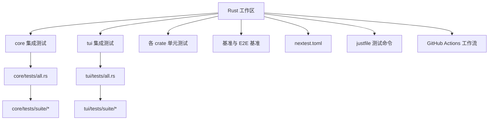
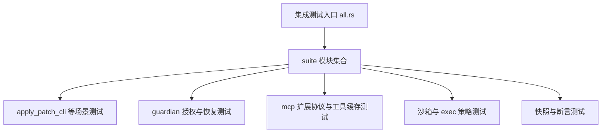
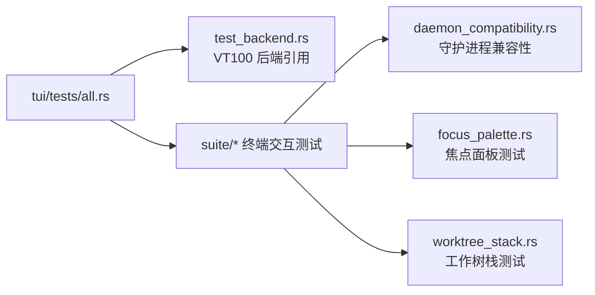
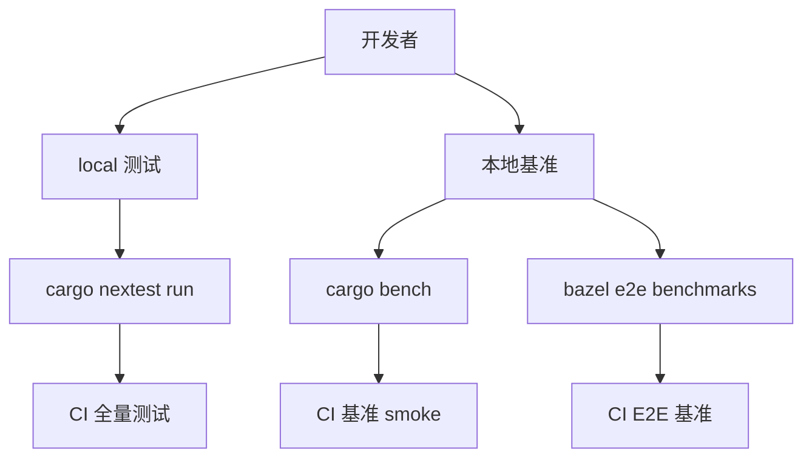
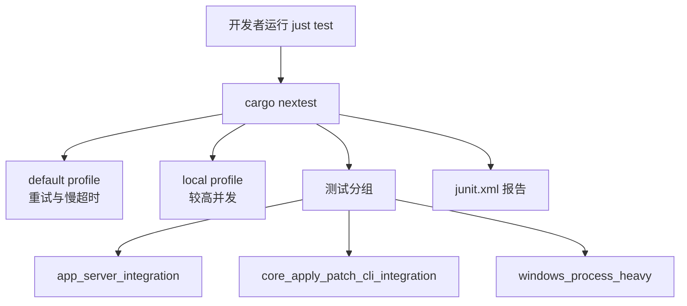
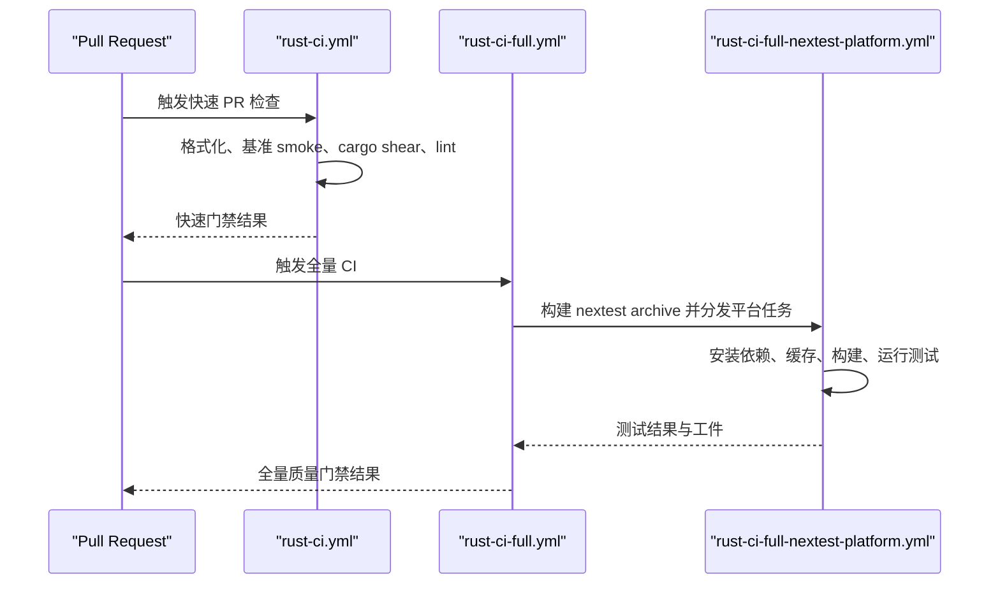

# 测试指南

<cite>
**本文引用的文件**   
- [codex-rs/.config/nextest.toml](file://codex-rs/.config/nextest.toml)
- [justfile](file://justfile)
- [.github/workflows/rust-ci.yml](file://.github/workflows/rust-ci.yml)
- [.github/workflows/rust-ci-full.yml](file://.github/workflows/rust-ci-full.yml)
- [.github/workflows/rust-ci-full-nextest-platform.yml](file://.github/workflows/rust-ci-full-nextest-platform.yml)
- [codex-rs/core/tests/all.rs](file://codex-rs/core/tests/all.rs)
- [codex-rs/tui/tests/all.rs](file://codex-rs/tui/tests/all.rs)
- [codex-rs/core/tests/common/lib.rs](file://codex-rs/core/tests/common/lib.rs)
- [codex-rs/core/tests/suite/apply_patch_cli.rs](file://codex-rs/core/tests/suite/apply_patch_cli.rs)
- [codex-rs/tui/tests/test_backend.rs](file://codex-rs/tui/tests/test_backend.rs)
- [codex-rs/tui/tests/suite/daemon_compatibility.rs](file://codex-rs/tui/tests/suite/daemon_compatibility.rs)
- [codex-rs/Cargo.toml](file://codex-rs/Cargo.toml)
</cite>

## 目录
1. [简介](#简介)
2. [项目测试结构](#项目测试结构)
3. [单元测试编写规范](#单元测试编写规范)
4. [集成测试组织方式](#集成测试组织方式)
5. [端到端测试与基准测试](#端到端测试与基准测试)
6. [Mock 数据与测试数据准备](#mock-数据与测试数据准备)
7. [Nextest 配置与运行方式](#nextest-配置与运行方式)
8. [CI/CD 中的测试流程与质量门禁](#cicd-中的测试流程与质量门禁)
9. [调试失败测试的技巧](#调试失败测试的技巧)
10. [常用测试工具清单](#常用测试工具清单)
11. [结论](#结论)

## 简介
本测试指南面向 codex-rs 仓库的 Rust 代码库，目标是帮助开发者快速理解并正确编写以下类型的测试：
- 单元测试：模块内、同步或异步函数级验证。
- 集成测试：跨模块协作、外部服务模拟、进程和终端交互。
- 端到端测试与基准测试：覆盖真实 CLI、TUI、Bazel 构建产物和性能回归。
- Mock 数据与测试夹具：使用临时目录、HTTP mock、快照对比和测试辅助库。
- Nextest 运行与 CI 质量门禁：本地开发到 GitHub Actions 的一致性体验。

## 项目测试结构
codex-rs 仓库采用多 crate 工作区结构，测试主要分布在以下位置：
- `codex-rs/<crate>/src/*_tests.rs`：单元测试。
- `codex-rs/<crate>/tests/*`：集成测试二进制入口。
- `codex-rs/core/tests`：核心业务集成测试，包含大量场景化测试套件。
- `codex-rs/tui/tests`：终端界面集成测试，依赖伪终端和 TUI 启动路径。
- `.github/workflows`：GitHub Actions 测试流水线。
- `codex-rs/.config/nextest.toml`：nextest 全局测试行为配置。
- `justfile`：本地开发常用命令，包括测试和基准。

**图示来源**
- [codex-rs/core/tests/all.rs:1-7](file://codex-rs/core/tests/all.rs#L1-L7)
- [codex-rs/tui/tests/all.rs:1-7](file://codex-rs/tui/tests/all.rs#L1-L7)
- [codex-rs/.config/nextest.toml:1-120](file://codex-rs/.config/nextest.toml#L1-L120)
- [justfile:1-205](file://justfile#L1-L205)

**章节来源**
- [codex-rs/core/tests/all.rs:1-7](file://codex-rs/core/tests/all.rs#L1-L7)
- [codex-rs/tui/tests/all.rs:1-7](file://codex-rs/tui/tests/all.rs#L1-L7)
- [codex-rs/.config/nextest.toml:1-120](file://codex-rs/.config/nextest.toml#L1-L120)
- [justfile:1-205](file://justfile#L1-L205)

## 单元测试编写规范
### 基本约定
- 使用标准 `#[test]` 标记同步单元测试。
- 使用 `#[tokio::test]` 标记异步单元测试，常见 flavor 包括：
  - `current_thread`：适合轻量、单线程异步逻辑。
  - `multi_thread`：需要多线程事件循环的场景，例如网络、IO、进程相关测试。
- 异步测试中避免阻塞等待；优先使用 tokio 提供的超时、断言和驱动方法。

### 典型模式
- 使用临时目录管理文件系统状态，避免测试间互相污染。
- 使用 `ctor::ctor` 在测试进程启动时执行一次性初始化，例如启用确定性进程 ID、统一 arg0 路径解析、设置快照根目录。
- 对平台相关逻辑使用条件编译或测试环境判断，例如 Windows、Wine、远程环境、无网络环境。

### 推荐实践
- 将共享测试逻辑放入 `tests/common` 或 crate 内的测试支持模块。
- 使用明确的错误上下文，便于定位失败原因。
- 避免在单元测试中启动完整后端服务；需要外部依赖时使用 mock HTTP 服务器或内存实现。
- 对于快照测试，确保快照路径与工作区根一致，并使用统一的快照更新策略。

**章节来源**
- [codex-rs/core/tests/common/lib.rs:1-150](file://codex-rs/core/tests/common/lib.rs#L1-L150)
- [codex-rs/Cargo.toml:352-352](file://codex-rs/Cargo.toml#L352-L352)
- [codex-rs/Cargo.toml:387-387](file://codex-rs/Cargo.toml#L387-L387)
- [codex-rs/Cargo.toml:531-542](file://codex-rs/Cargo.toml#L531-L542)

## 集成测试组织方式
### core 集成测试
`codex-rs/core/tests/all.rs` 是单一集成测试二进制入口，聚合 `suite` 子模块。该结构允许将大量复杂场景测试集中在一个可执行文件中，同时通过 nextest 分组控制并发和资源竞争。

关键特征：
- 所有核心集成测试位于 `core/tests/suite/*`。
- 测试通常围绕完整的 Codex 线程、会话、应用工具、权限策略、沙箱、MCP、Guardian 等子系统。
- 大量测试依赖 `core_test_support`，提供测试构建器、响应序列、SSE 模拟、事件等待、跳过条件等能力。

**图示来源**
- [codex-rs/core/tests/all.rs:1-7](file://codex-rs/core/tests/all.rs#L1-L7)
- [codex-rs/core/tests/suite/apply_patch_cli.rs:1-120](file://codex-rs/core/tests/suite/apply_patch_cli.rs#L1-L120)

**章节来源**
- [codex-rs/core/tests/all.rs:1-7](file://codex-rs/core/tests/all.rs#L1-L7)
- [codex-rs/core/tests/suite/apply_patch_cli.rs:1-120](file://codex-rs/core/tests/suite/apply_patch_cli.rs#L1-L120)

### tui 集成测试
`codex-rs/tui/tests/all.rs` 同样作为集成测试入口，聚合 `test_backend` 和 `suite`。其中：
- `test_backend` 通过 `#[path = "../src/test_backend.rs"]` 引入 TUI 内部的 VT100 后端测试实现，使集成测试能复用 UI 渲染层辅助类型。
- `suite` 目录包含终端交互、守护进程兼容性、目录信任、重连、屏幕阅读器、VT100 历史提交等端到端风格测试。

**图示来源**
- [codex-rs/tui/tests/all.rs:1-7](file://codex-rs/tui/tests/all.rs#L1-L7)
- [codex-rs/tui/tests/test_backend.rs:1-4](file://codex-rs/tui/tests/test_backend.rs#L1-L4)
- [codex-rs/tui/tests/suite/daemon_compatibility.rs:1-97](file://codex-rs/tui/tests/suite/daemon_compatibility.rs#L1-L97)

**章节来源**
- [codex-rs/tui/tests/all.rs:1-7](file://codex-rs/tui/tests/all.rs#L1-L7)
- [codex-rs/tui/tests/test_backend.rs:1-4](file://codex-rs/tui/tests/test_backend.rs#L1-L4)
- [codex-rs/tui/tests/suite/daemon_compatibility.rs:1-97](file://codex-rs/tui/tests/suite/daemon_compatibility.rs#L1-L97)

## 端到端测试与基准测试
### 端到端测试
端到端测试在项目中体现为两种形式：
1. **CLI/TUI 集成测试**：通过真实进程、伪终端、Unix Socket、WebSocket 与 TUI 交互，验证用户可见行为。
2. **Bazel 驱动的 E2E 基准**：使用优化构建或 release-like cfg 路径运行宏观基准，评估完整二进制性能。

典型端到端行为包括：
- 启动 CLI 或 TUI。
- 通过伪终端输入命令。
- 等待特定屏幕输出或警告。
- 与后台 app-server 或 daemon 通信。
- 验证快照、日志、退出状态、权限提示、模型选择等最终结果。

### 基准测试
仓库提供两类基准入口：
- `just bench`：调用 `cargo bench --workspace --bench '*'`，运行所有 Cargo benchmark target。
- `just bench-smoke`：以 `--test` 模式运行基准，只验证基准可以启动，不收集耗时数据。
- `just bench-e2e`：通过 Bazel 以优化编译模式运行 `//codex-rs:e2e-benchmarks`。
- `just bench-e2e-smoke`：通过 Bazel fastbuild 运行 E2E 基准 smoke test。

**图示来源**
- [justfile:1-205](file://justfile#L1-L205)

**章节来源**
- [justfile:1-205](file://justfile#L1-L205)

## Mock 数据与测试数据准备
### 测试辅助库
`core_test_support` 是 core 集成测试的核心基础设施，提供：
- `TestCodexBuilder` 和 `TestCodexHarness`：构建测试用 Codex 实例，自动管理环境变量、执行器、临时目录。
- 响应序列构造器：如 `ev_response_created`、`ev_assistant_message`、`ev_completed`、`mount_sse_sequence`。
- 事件等待工具：如 `wait_for_event`、`wait_for_event_with_timeout`。
- 平台与环境判断：如 `skip_if_no_network`、`skip_if_remote`、`is_wine_exec_test_environment`。
- 快照与正则断言：如 `assert_regex_match`。

### HTTP Mock
仓库广泛使用 `wiremock` 模拟后端 HTTP 服务，常见用法包括：
- 匹配请求方法与路径。
- 返回固定 JSON 响应或延迟响应。
- 用于模型发现、认证、遥测、MCP、app-server 等网络依赖隔离。

### 临时目录与文件系统
- 使用 `tempfile::TempDir` 创建测试专用临时目录。
- 使用 `insta` 进行快照测试，并通过 `ctor` 在进程启动时设置 `INSTA_WORKSPACE_ROOT`，确保快照路径稳定。
- 对路径断言提供 `test_path_buf`、`test_absolute_path` 等跨平台辅助函数。

### 测试数据策略
- 小体积静态数据直接放在测试文件或 fixtures 目录。
- 大体积或跨测试共享的数据放在 `fixtures` 或测试支持 crate 中。
- 对外部服务响应使用 wiremock 生成动态 mock，而不是维护大量静态 JSON。
- 对 UI 输出使用快照断言，避免硬编码字符串比较导致误报。

**章节来源**
- [codex-rs/core/tests/common/lib.rs:1-150](file://codex-rs/core/tests/common/lib.rs#L1-L150)
- [codex-rs/core/tests/suite/apply_patch_cli.rs:1-120](file://codex-rs/core/tests/suite/apply_patch_cli.rs#L1-L120)
- [codex-rs/Cargo.toml:531-531](file://codex-rs/Cargo.toml#L531-L531)
- [codex-rs/Cargo.toml:594-594](file://codex-rs/Cargo.toml#L594-L594)

## Nextest 配置与运行方式
### 配置文件
`codex-rs/.config/nextest.toml` 定义了默认 profile、重试、慢超时、JUnit 输出、测试分组和平台特定行为。

关键配置要点：
- 默认 slow-timeout 为 30 秒，最多重试一次。
- 部分高成本测试单独延长超时，例如 daemon 启动、包复制、Windows 重型进程。
- 使用 `test-groups.*` 限制并发，避免资源竞争：
  - `app_server_protocol_codegen`：单线程。
  - `app_server_integration`：单线程。
  - `app_server_integration_local`：本地最多 4 线程。
  - `core_apply_patch_cli_integration`：单线程。
  - `windows_sandbox_legacy_sessions`、`windows_sandbox_accounts`：单线程。
  - `windows_process_heavy`：最多 2 线程。
- JUnit 报告输出到 `junit.xml`，便于 CI 可视化。
- 本地 profile 继承 default，但允许 app-server 集成测试使用更高并发。

### 本地运行
推荐使用 `just test`，其实际行为为：
- Unix：`RUST_MIN_STACK=8388608 NEXTEST_PROFILE=local cargo nextest run --no-fail-fast`
- Windows：设置相同环境变量后执行 `cargo nextest run --no-fail-fast`

这保证了：
- 栈大小足够，避免深层异步或递归测试崩溃。
- 使用 local nextest profile，获得更宽松但合理的并发和超时。
- 即使某个测试失败，也会继续运行其他测试，方便一次性看到全部问题。

### 分组与过滤
开发者可通过 nextest 过滤器缩小范围，例如按包、二进制、测试名过滤。仓库已为高风险测试定义分组，新测试应尽量加入已有分组，而不是随意提高全局并发。

**图示来源**
- [codex-rs/.config/nextest.toml:1-120](file://codex-rs/.config/nextest.toml#L1-L120)
- [justfile:1-205](file://justfile#L1-L205)

**章节来源**
- [codex-rs/.config/nextest.toml:1-120](file://codex-rs/.config/nextest.toml#L1-L120)
- [justfile:1-205](file://justfile#L1-L205)

## CI/CD 中的测试流程与质量门禁
### 快速 PR 检查
`.github/workflows/rust-ci.yml` 首先检测变更路径，然后运行：
- 格式化检查。
- Rust 基准 smoke test。
- `cargo shear` 依赖分析。
- argument-comment-lint 包测试。

这是轻量门禁，用于阻止明显格式、基准或 lint 问题进入主分支。

### 全量测试
`.github/workflows/rust-ci-full.yml` 是更完整的 CI 流程，包括：
- 格式化检查。
- benchmark smoke。
- `cargo shear`。
- argument-comment-lint。
- 多目标 voice inputs 构建。
- 多平台 lint/build matrix。

### Nextest 平台化测试
`.github/workflows/rust-ci-full-nextest-platform.yml` 负责构建 nextest archive，并在不同 runner、target、profile 上运行测试。关键特性包括：
- 安装 nextest。
- 安装 Linux 构建依赖。
- 暴露 MSVC SDK 环境（Windows ARM64）。
- 缓存 cargo home。
- 可选启用 sccache。
- 构建 nextest archive 并上传测试助手工件。
- 控制测试线程数、是否使用远程环境等输入参数。

**图示来源**
- [.github/workflows/rust-ci.yml:1-200](file://.github/workflows/rust-ci.yml#L1-L200)
- [.github/workflows/rust-ci-full.yml:1-200](file://.github/workflows/rust-ci-full.yml#L1-L200)
- [.github/workflows/rust-ci-full-nextest-platform.yml:1-200](file://.github/workflows/rust-ci-full-nextest-platform.yml#L1-L200)

**章节来源**
- [.github/workflows/rust-ci.yml:1-200](file://.github/workflows/rust-ci.yml#L1-L200)
- [.github/workflows/rust-ci-full.yml:1-200](file://.github/workflows/rust-ci-full.yml#L1-L200)
- [.github/workflows/rust-ci-full-nextest-platform.yml:1-200](file://.github/workflows/rust-ci-full-nextest-platform.yml#L1-L200)

## 调试失败测试的技巧
### 缩小测试范围
- 使用 nextest 过滤器只运行单个测试，避免全量运行带来的噪声。
- 对 Windows 相关测试，注意是否需要管理员权限、Developer Mode、Wine 或远程环境。
- 对 app-server 相关测试，注意 nextest 分组是否限制了并发；必要时先在本地确认资源竞争。

### 查看输出与报告
- 使用 `--no-fail-fast` 保留后续测试输出，一次性看到多个失败。
- 检查 `junit.xml`，尤其是 CI 中由 nextest 生成的 JUnit 报告。
- 对 TUI 测试，关注终端输出、快照差异、守护进程兼容性提示。

### 常见失败原因
- 异步测试未设置合适 tokio flavor 或 worker_threads。
- 测试共享全局状态，例如 Windows 账户、桌面、会话文件、elevated 进程。
- 外部服务未 mock 成功，导致网络或认证失败。
- 快照过期，未及时更新或快照路径不一致。
- 超时过短，尤其在 CI 或 Windows 平台上。

### 推荐调试步骤
1. 在本地使用 `just test` 复现失败。
2. 缩小到具体测试函数。
3. 增加日志或断点，观察事件顺序。
4. 检查 nextest 分组和超时配置。
5. 确认是否缺少必要依赖，例如 bubblewrap、alsa、MSVC SDK。
6. 如果是 TUI 或 CLI 行为，尝试直接运行对应二进制或脚本。

**章节来源**
- [codex-rs/.config/nextest.toml:1-120](file://codex-rs/.config/nextest.toml#L1-L120)
- [codex-rs/tui/tests/suite/daemon_compatibility.rs:1-97](file://codex-rs/tui/tests/suite/daemon_compatibility.rs#L1-L97)
- [justfile:1-205](file://justfile#L1-L205)

## 常用测试工具清单
| 工具 | 用途 | 典型位置 |
| --- | --- | --- |
| `cargo nextest` | 并行测试、分组、重试、JUnit 输出 | `codex-rs/.config/nextest.toml` |
| `just test` | 本地统一测试入口 | `justfile` |
| `cargo bench` | 基准测试 | `justfile` |
| `bazel test //codex-rs:e2e-benchmarks` | E2E 宏观基准 | `justfile` |
| `tempfile` | 临时目录与文件清理 | 各 crate 测试 |
| `wiremock` | HTTP mock 服务端 | app-server、cloud-config、chatgpt 等测试 |
| `ctor` | 进程级测试初始化 | `core/tests/common/lib.rs` |
| `insta` | 快照测试 | core 与 tui 测试 |
| `serial_test` | 串行测试 | Windows 敏感测试 |
| `assert_cmd` | CLI 命令行断言 | cli、apply-patch 测试 |
| `tokio::test` | 异步测试运行时 | 大量 async 测试 |

**章节来源**
- [codex-rs/Cargo.toml:352-352](file://codex-rs/Cargo.toml#L352-L352)
- [codex-rs/Cargo.toml:387-387](file://codex-rs/Cargo.toml#L387-L387)
- [codex-rs/Cargo.toml:531-542](file://codex-rs/Cargo.toml#L531-L542)
- [codex-rs/Cargo.toml:594-594](file://codex-rs/Cargo.toml#L594-L594)
- [codex-rs/core/tests/common/lib.rs:1-150](file://codex-rs/core/tests/common/lib.rs#L1-L150)

## 结论
codex-rs 的测试体系以 nextest 为核心，结合 Cargo、Bazel、GitHub Actions 形成从本地开发到 CI 的全链路质量保证。核心原则包括：
- 单元测试保持快速、确定、无外部依赖。
- 集成测试按功能域组织，使用 `core_test_support` 和 `wiremock` 隔离副作用。
- TUI 测试通过伪终端和快照验证用户可见行为。
- 端到端和基准测试分别覆盖 CLI/TUI 行为和性能回归。
- nextest 分组和超时配置是稳定性关键，新增测试应遵循现有分组策略。
- CI 通过快速门禁、全量测试、多平台构建共同保障合并质量。