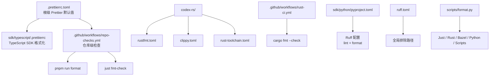
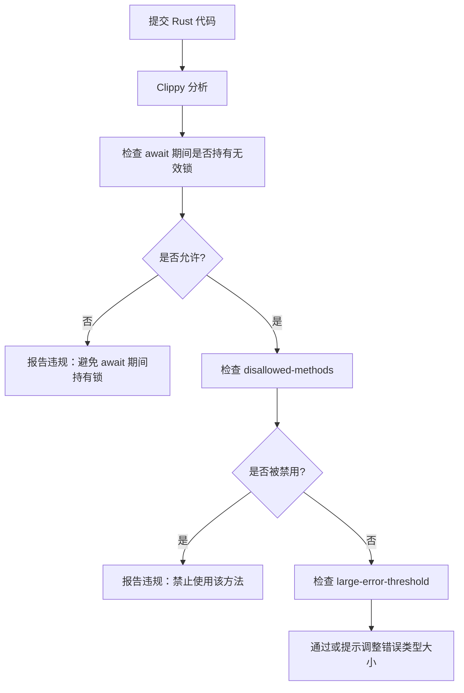
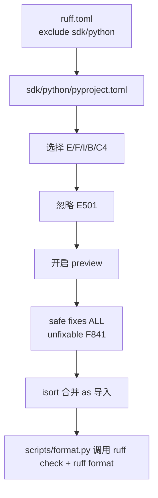
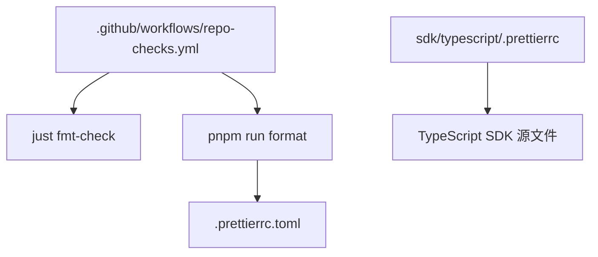
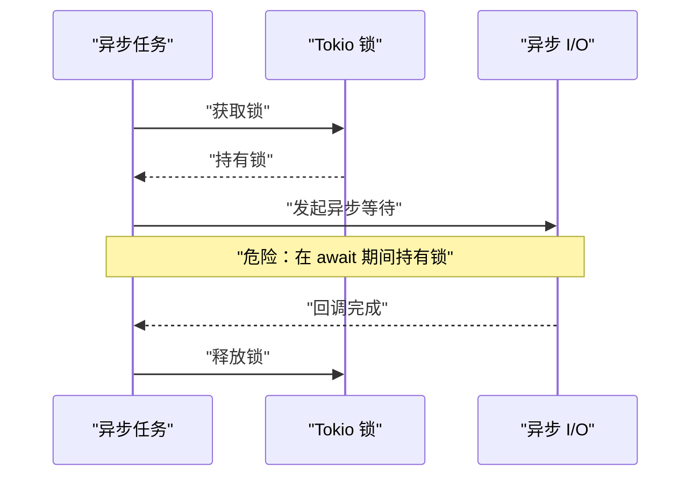
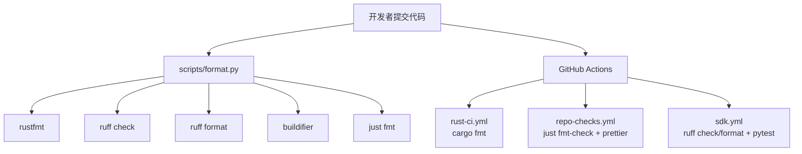

# 编码规范

<cite>
**本文引用的文件**   
- [codex-rs/rustfmt.toml](file://codex-rs/rustfmt.toml)
- [codex-rs/clippy.toml](file://codex-rs/clippy.toml)
- [codex-rs/rust-toolchain.toml](file://codex-rs/rust-toolchain.toml)
- [ruff.toml](file://ruff.toml)
- [sdk/python/pyproject.toml](file://sdk/python/pyproject.toml)
- [sdk/typescript/.prettierrc](file://sdk/typescript/.prettierrc)
- [.prettierrc.toml](file://.prettierrc.toml)
- [scripts/format.py](file://scripts/format.py)
- [.github/workflows/rust-ci.yml](file://.github/workflows/rust-ci.yml)
- [.github/workflows/repo-checks.yml](file://.github/workflows/repo-checks.yml)
- [.github/workflows/sdk.yml](file://.github/workflows/sdk.yml)
</cite>

## 目录
1. [引言](#引言)
2. [项目结构与质量工具边界](#项目结构与质量工具边界)
3. [Rust 格式化规则与命名约定](#rust-格式化规则与命名约定)
4. [Clippy 静态分析与自定义规则](#clippy-静态分析与自定义规则)
5. [Python 代码的 Ruff 配置](#python-代码的-ruff-配置)
6. [TypeScript 与根级 Prettier 配置](#typescript-与根级-prettier-配置)
7. [错误处理最佳实践](#错误处理最佳实践)
8. [异步编程规范](#异步编程规范)
9. [日志记录标准](#日志记录标准)
10. [代码审查检查清单](#代码审查检查清单)
11. [常见反模式与避免方法](#常见反模式与避免方法)
12. [代码质量工具集成指南](#代码质量工具集成指南)
13. [故障排查](#故障排查)
14. [结论](#结论)

## 引言
本编码规范面向 Codex 仓库中的 Rust、Python 和 TypeScript 代码，目标是在统一格式、一致风格、可靠错误处理和可维护异步模型的基础上，降低代码审查成本。文档重点覆盖：
- Rust：`rustfmt` 格式化规则、`clippy` 静态分析与自定义 lint。
- Python：`ruff` 格式化与 lint 配置。
- TypeScript：Prettier 格式化规则。
- 工作流中如何强制这些规则。
- 错误处理、异步编程、日志记录的通用实践。
- 代码审查清单、常见反模式、排错建议。

## 项目结构与质量工具边界
仓库使用多语言多包结构，并按语言或子系统组织配置：
- Rust 相关配置集中在 `codex-rs/`，包括 `rustfmt.toml`、`clippy.toml`、`rust-toolchain.toml`。
- Python SDK 位于 `sdk/python/`，通过 `pyproject.toml` 管理依赖、Ruff 配置与构建元数据。
- TypeScript SDK 位于 `sdk/typescript/`，使用 `.prettierrc` 控制格式化。
- 根级 `.prettierrc.toml` 为仓库中其他文本或 Markdown 类内容提供 Prettier 默认值。
- 根级 `ruff.toml` 仅用于排除不需要按仓库 Ruff 规则检查的路径。
- 统一的格式化入口是 `scripts/format.py`，它会并行调用 Just、Rust、Bazel/Starlark、Python SDK、Python 脚本等格式化器。
- GitHub Actions 工作流在 CI 中执行 `cargo fmt`、`just fmt-check`、Prettier、Ruff check/format 等命令。

**图表来源**
- [codex-rs/rustfmt.toml:1-4](file://codex-rs/rustfmt.toml#L1-L4)
- [codex-rs/clippy.toml:1-32](file://codex-rs/clippy.toml#L1-L32)
- [codex-rs/rust-toolchain.toml:1-3](file://codex-rs/rust-toolchain.toml#L1-L3)
- [ruff.toml:1-1](file://ruff.toml#L1-L1)
- [sdk/python/pyproject.toml:1-77](file://sdk/python/pyproject.toml#L1-L77)
- [sdk/typescript/.prettierrc:1-5](file://sdk/typescript/.prettierrc#L1-L5)
- [.prettierrc.toml:1-8](file://.prettierrc.toml#L1-L8)
- [scripts/format.py:1-221](file://scripts/format.py#L1-L221)
- [.github/workflows/rust-ci.yml:1-200](file://.github/workflows/rust-ci.yml#L1-L200)
- [.github/workflows/repo-checks.yml:1-78](file://.github/workflows/repo-checks.yml#L1-L78)
- [.github/workflows/sdk.yml:1-162](file://.github/workflows/sdk.yml#L1-L162)

**章节来源**
- [scripts/format.py:1-221](file://scripts/format.py#L1-L221)
- [.github/workflows/repo-checks.yml:1-78](file://.github/workflows/repo-checks.yml#L1-L78)
- [.github/workflows/rust-ci.yml:1-200](file://.github/workflows/rust-ci.yml#L1-L200)

## Rust 格式化规则与命名约定
### rustfmt 配置要点
仓库中 Rust 代码使用 `codex-rs/rustfmt.toml` 定义格式化行为，核心项包括：
- `edition = "2024"`：指定 Rust 2024 编辑期。
- `imports_granularity = "Item"`：要求导入粒度细化到具体项，而不是整模块导入；CI 也显式传入 `--config imports_granularity=Item` 以确保一致性。

该配置由以下位置共同约束：
- `scripts/format.py` 通过 `rustfmt --edition 2024 --config-path codex-rs/rustfmt.toml --config imports_granularity=Item,skip_children=true` 批量格式化 `.rs` 文件。
- `.github/workflows/rust-ci.yml` 中的 `general` job 执行 `cargo fmt -- --config imports_granularity=Item --check`。
- `codex-rs/rust-toolchain.toml` 锁定 Rust 工具链版本为 `1.95.0`，并启用 `clippy`、`rustfmt`、`rust-src` 组件。

### 命名约定
当前仓库没有单独的 Rust 命名约定配置文件。实际约定主要来自：
- Rust 官方风格指南。
- `clippy.toml` 中对特定 API 使用的限制（例如禁止直接使用某些颜色类型）。
- 工作流和脚本对 `rustfmt` 的统一调用方式。

因此，新增 Rust 代码应遵循：
- 使用 Rust 2024 编辑期。
- 使用 `Item` 粒度导入。
- 避免被 `clippy.toml` 明确禁止的方法。
- 保持函数、类型、模块、常量、变量与宏命名符合 Rust 社区惯例。

**章节来源**
- [codex-rs/rustfmt.toml:1-4](file://codex-rs/rustfmt.toml#L1-L4)
- [codex-rs/rust-toolchain.toml:1-3](file://codex-rs/rust-toolchain.toml#L1-L3)
- [scripts/format.py:38-68](file://scripts/format.py#L38-L68)
- [.github/workflows/rust-ci.yml:60-74](file://.github/workflows/rust-ci.yml#L60-L74)

## Clippy 静态分析与自定义规则
`codex-rs/clippy.toml` 定义了仓库级别的 Clippy 自定义规则与阈值，主要内容包括：

| 类别 | 配置项或规则 | 说明 |
|---|---|---|
| 测试宽松策略 | `allow-expect-in-tests = true` | 允许在测试中使用 `expect`。 |
| 测试宽松策略 | `allow-unwrap-in-tests = true` | 允许在测试中使用 `unwrap`。 |
| 异步持有无效类型 | `await-holding-invalid-types` | 列出不允许在 await 期间持有的锁守卫类型，如 `tokio::sync::MutexGuard`、`tokio::sync::RwLockReadGuard`、`tokio::sync::RwLockWriteGuard`。 |
| 禁用方法 | `disallowed-methods` | 禁止直接调用部分 ratatui 颜色 API、SQLx 连接池 API，引导开发者使用 ANSI 颜色和 codex-state 提供的 SQLite shim。 |
| 错误体大小 | `large-error-threshold = 256` | 放宽 `result_large_err` 的阈值，以容纳更丰富的错误变体。 |

### 关键规则解释
- **异步持有无效类型**：避免在持有 tokio 同步锁的同时进行异步等待，防止死锁或长时间占用锁。
- **ratatui 颜色限制**：禁止直接使用 `Color::Rgb`、`Color::Indexed`，以及硬编码白、黑、黄等样式；原因是终端主题差异下 ANSI 颜色更稳定。
- **SQLx 连接池限制**：禁止直接创建或修改 SQLx 连接池和连接，必须走 codex-state 提供的 SQLite shim，以保证数据库初始化、迁移和选项设置一致。
- **测试宽松**：单元测试中可以接受更直接的错误表达，但生产代码仍需严谨处理错误。

**图表来源**
- [codex-rs/clippy.toml:1-32](file://codex-rs/clippy.toml#L1-L32)

**章节来源**
- [codex-rs/clippy.toml:1-32](file://codex-rs/clippy.toml#L1-L32)

## Python 代码的 Ruff 配置
仓库中存在两个层面的 Python 配置：

1. **根级 `ruff.toml`**：只声明 `extend-exclude = ["sdk/python", "codex-rs/vendor"]`，表示仓库根级 Ruff 检查默认不扫描 Python SDK 和 vendor 目录。
2. **`sdk/python/pyproject.toml`**：Python SDK 的完整 Ruff 配置。

### Python SDK 的 Ruff 配置要点
- **目标版本**：`target-version = "py310"`。
- **行长度**：`line-length = 100`。
- **选择的规则集**：`select = ["E", "F", "I", "B", "C4"]`，即 pyflakes、flake8-bugbear、isort、flake8-comprehensions 等常用规则。
- **忽略规则**：`ignore = ["E501"]`，即不强制行长度，因为 Ruff formatter 负责换行。
- **预览模式**：`preview = true`。
- **自动修复范围**：`extend-safe-fixes = ["ALL"]`，`unfixable = ["F841"]`。
- **文件级忽略**：示例和特定测试文件忽略 `E402`。
- **isort 行为**：`combine-as-imports = true`。
- **依赖组**：`format` 依赖组包含 `ruff>=0.15.8`，并通过 `uv run --only-group format` 调用。

**图表来源**
- [ruff.toml:1-1](file://ruff.toml#L1-L1)
- [sdk/python/pyproject.toml:1-77](file://sdk/python/pyproject.toml#L1-L77)
- [scripts/format.py:108-143](file://scripts/format.py#L108-L143)

**章节来源**
- [ruff.toml:1-1](file://ruff.toml#L1-L1)
- [sdk/python/pyproject.toml:1-77](file://sdk/python/pyproject.toml#L1-L77)
- [scripts/format.py:108-143](file://scripts/format.py#L108-L143)

## TypeScript 与根级 Prettier 配置
### TypeScript SDK 的 Prettier 配置
`sdk/typescript/.prettierrc` 定义了 TypeScript SDK 的格式化规则：
- `printWidth = 100`
- `singleQuote = false`
- `trailingComma = "all"`

### 根级 Prettier 配置
`.prettierrc.toml` 提供仓库级默认值：
- `printWidth = 80`
- `quoteProps = "consistent"`
- `semi = true`
- `tabWidth = 2`
- `trailingComma = "all"`
- `proseWrap = "preserve"`：保留 Markdown 等 prose 内容的现有换行行为。

### 工作流中的 Prettier 检查
`.github/workflows/repo-checks.yml` 会执行：
- `just fmt-check`
- `pnpm run format`

这表明根级 Prettier 作为仓库级格式化任务的一部分运行。

**图表来源**
- [.github/workflows/repo-checks.yml:47-78](file://.github/workflows/repo-checks.yml#L47-L78)
- [.prettierrc.toml:1-8](file://.prettierrc.toml#L1-L8)
- [sdk/typescript/.prettierrc:1-5](file://sdk/typescript/.prettierrc#L1-L5)

**章节来源**
- [sdk/typescript/.prettierrc:1-5](file://sdk/typescript/.prettierrc#L1-L5)
- [.prettierrc.toml:1-8](file://.prettierrc.toml#L1-L8)
- [.github/workflows/repo-checks.yml:47-78](file://.github/workflows/repo-checks.yml#L47-L78)

## 错误处理最佳实践
根据 Clippy 配置和仓库风格，Rust 错误处理应遵循以下原则：
- 测试代码可以使用 `expect` 和 `unwrap`，但生产代码应避免静默失败。
- 错误类型可以较大，`large-error-threshold = 256` 允许更丰富的错误变体，便于区分不同失败原因。
- 不要直接绕过 codex-state 的 SQLite shim 创建或修改数据库连接池，否则可能破坏迁移、连接选项和数据一致性。
- 对于外部资源失败，应返回结构化错误，而不是用字符串或简单枚举掩盖原因。
- 错误信息应包含上下文，例如操作、资源路径、上游错误原因。

这些要求来源于：
- `clippy.toml` 中允许的测试宽松策略。
- `clippy.toml` 中对 SQLx 连接池方法的禁用。
- `clippy.toml` 中较大的错误体阈值。

**章节来源**
- [codex-rs/clippy.toml:1-32](file://codex-rs/clippy.toml#L1-L32)

## 异步编程规范
异步规范的核心是避免在持有同步锁时进行异步等待。`clippy.toml` 将以下类型加入 `await-holding_invalid_types`：
- `tokio::sync::MutexGuard`
- `tokio::sync::RwLockReadGuard`
- `tokio::sync::RwLockWriteGuard`

这意味着：
- 不要在 `await` 表达式之间长期持有互斥锁或读写锁。
- 需要跨异步调用共享状态时，优先使用消息传递、actor 模型、请求-响应通道或细粒度临界区。
- 如果确实需要长生命周期状态，应在进入异步边界前释放锁，或在临界区内完成必要同步操作后尽快退出。

**图表来源**
- [codex-rs/clippy.toml:4-8](file://codex-rs/clippy.toml#L4-L8)

**章节来源**
- [codex-rs/clippy.toml:4-8](file://codex-rs/clippy.toml#L4-L8)

## 日志记录标准
当前仓库中没有专门的日志级别或日志格式配置文件出现在已分析范围内。因此，日志记录应遵循以下通用原则：
- 区分调试日志、信息日志、警告日志和错误日志。
- 避免在高频路径中记录过大对象。
- 敏感信息不应写入日志。
- 日志应包含可定位上下文的字段，如模块名、线程或任务标识。
- 对于终端用户可见输出，遵循 clippy 对 ratatui 颜色的限制，避免硬编码颜色。

注意：若未来引入集中式日志框架，应在相应子模块中添加配置，并在 PR 中说明日志策略变更。

[本节为通用指导，不直接分析具体源代码文件]

## 代码审查检查清单
提交代码前应逐项确认：

### Rust
- [ ] 代码使用 Rust 2024 编辑期。
- [ ] 导入采用 `Item` 粒度。
- [ ] 未直接调用被 `clippy.toml` 禁用的 ratatui 颜色或 SQLx 连接池方法。
- [ ] 没有在 await 期间持有 tokio 同步锁。
- [ ] 错误类型足够表达失败原因，且未违反仓库约定的连接池访问方式。
- [ ] `cargo fmt` 与 `cargo clippy` 通过。

### Python
- [ ] Python SDK 代码通过 `ruff check` 和 `ruff format`。
- [ ] 行长度由 formatter 控制，不再依赖 `E501`。
- [ ] import 顺序和组合符合 isort 配置。
- [ ] 示例和测试文件的忽略规则不会掩盖真实问题。

### TypeScript 与根级文件
- [ ] TypeScript SDK 遵循 `.prettierrc` 的行宽、引号与尾逗号规则。
- [ ] 根级非 TypeScript 文件遵循 `.prettierrc.toml`。
- [ ] `just fmt-check` 与 `pnpm run format` 通过。

### 工作流与工具
- [ ] 本地可通过 `scripts/format.py` 或 `just fmt` 完成格式化。
- [ ] 变更不会导致 CI 中的 Rust、Python、TypeScript 格式化或 lint 步骤失败。

**章节来源**
- [codex-rs/rustfmt.toml:1-4](file://codex-rs/rustfmt.toml#L1-L4)
- [codex-rs/clippy.toml:1-32](file://codex-rs/clippy.toml#L1-L32)
- [sdk/python/pyproject.toml:1-77](file://sdk/python/pyproject.toml#L1-L77)
- [sdk/typescript/.prettierrc:1-5](file://sdk/typescript/.prettierrc#L1-L5)
- [.prettierrc.toml:1-8](file://.prettierrc.toml#L1-L8)
- [scripts/format.py:1-221](file://scripts/format.py#L1-L221)
- [.github/workflows/rust-ci.yml:60-74](file://.github/workflows/rust-ci.yml#L60-L74)
- [.github/workflows/repo-checks.yml:47-78](file://.github/workflows/repo-checks.yml#L47-L78)
- [.github/workflows/sdk.yml:120-162](file://.github/workflows/sdk.yml#L120-L162)

## 常见反模式与避免方法
### Rust 反模式
| 反模式 | 风险 | 避免方法 |
|---|---|---|
| 在 await 期间持有 Mutex 或 RwLock 守卫 | 可能导致死锁或锁竞争放大 | 缩小临界区，或使用消息传递、channel、state machine。 |
| 直接使用 `Color::Rgb`、`Color::Indexed` | 终端主题不可控，UI 表现不一致 | 使用 ANSI 颜色或仓库推荐的样式。 |
| 直接调用 SQLx 连接池方法 | 绕过 codex-state 的 SQLite shim，破坏迁移和连接选项 | 使用 codex-state 提供的 SQLite 抽象。 |
| 过度拆分导入或全量模块导入 | 影响可读性或隐藏依赖 | 使用 `Item` 粒度导入，保持清晰。 |
| 错误类型过小无法表达上下文 | 难以定位失败原因 | 使用结构化错误，必要时利用较大的错误体阈值。 |

### Python 反模式
| 反模式 | 风险 | 避免方法 |
|---|---|---|
| 手动管理 import 顺序 | 可读性差、团队协作不一致 | 使用 Ruff isort 规则。 |
| 同时依赖 linter 和 formatter 的行长度规则 | 冲突或重复检查 | 忽略 `E501`，让 formatter 负责换行。 |
| 在示例文件中触发不应忽略的规则 | 误报掩盖真实问题 | 仅在必要时使用 per-file ignores。 |

### TypeScript 反模式
| 反模式 | 风险 | 避免方法 |
|---|---|---|
| 混用单引号和双引号 | 提交 diff 噪音 | 遵循 `singleQuote = false`。 |
| 缺少尾逗号 | 数组、对象扩展时 diff 变大 | 使用 `trailingComma = "all"`。 |
| 行宽不一致 | 阅读困难 | 遵循 `printWidth = 100`。 |

**章节来源**
- [codex-rs/clippy.toml:1-32](file://codex-rs/clippy.toml#L1-L32)
- [sdk/python/pyproject.toml:49-73](file://sdk/python/pyproject.toml#L49-L73)
- [sdk/typescript/.prettierrc:1-5](file://sdk/typescript/.prettierrc#L1-L5)

## 代码质量工具集成指南
### Rust 工具
- **Rust 工具链**：`codex-rs/rust-toolchain.toml` 固定为 `1.95.0`，并启用 `clippy`、`rustfmt`、`rust-src`。
- **格式化**：
  - 本地推荐：`scripts/format.py` 或 `just fmt`。
  - CI 推荐：`.github/workflows/rust-ci.yml` 中的 `cargo fmt -- --config imports_granularity=Item --check`。
- **静态分析**：
  - 使用 Clippy，遵守 `clippy.toml` 的自定义规则。
  - 仓库还包含 argument-comment-lint 工具和相关工作流，用于检查参数注释匹配。

### Python 工具
- **Ruff**：
  - 根级 `ruff.toml` 排除 `sdk/python` 和 `codex-rs/vendor`。
  - `sdk/python/pyproject.toml` 配置 target version、行长度、规则集、isort 行为和依赖组。
  - `scripts/format.py` 对 Python SDK 先执行 lint fix，再执行 format。
- **工作流**：
  - `.github/workflows/sdk.yml` 对 Python SDK 执行 `ruff check`、`ruff format --check` 和 pytest。

### TypeScript 工具
- **Prettier**：
  - TypeScript SDK 使用 `sdk/typescript/.prettierrc`。
  - 根级 `.prettierrc.toml` 提供其他文本类内容的默认值。
  - `.github/workflows/repo-checks.yml` 执行 `pnpm run format`。

**图表来源**
- [scripts/format.py:1-221](file://scripts/format.py#L1-L221)
- [.github/workflows/rust-ci.yml:60-74](file://.github/workflows/rust-ci.yml#L60-L74)
- [.github/workflows/repo-checks.yml:47-78](file://.github/workflows/repo-checks.yml#L47-L78)
- [.github/workflows/sdk.yml:120-162](file://.github/workflows/sdk.yml#L120-L162)

**章节来源**
- [codex-rs/rust-toolchain.toml:1-3](file://codex-rs/rust-toolchain.toml#L1-L3)
- [scripts/format.py:1-221](file://scripts/format.py#L1-L221)
- [.github/workflows/rust-ci.yml:60-74](file://.github/workflows/rust-ci.yml#L60-L74)
- [.github/workflows/repo-checks.yml:47-78](file://.github/workflows/repo-checks.yml#L47-L78)
- [.github/workflows/sdk.yml:120-162](file://.github/workflows/sdk.yml#L120-L162)

## 故障排查
### 本地格式化失败
- 现象：`scripts/format.py` 或 `just fmt` 报错。
- 排查：
  - 确认 Rust 文件是否符合 `rustfmt.toml` 和 `imports_granularity=Item`。
  - 确认 Python SDK 是否满足 `sdk/python/pyproject.toml` 中 Ruff 配置。
  - 确认 TypeScript 或根级文件是否符合 Prettier 配置。
  - 查看 `scripts/format.py` 输出的分组失败名称，定位具体语言或工具。

### CI 中 Rust 格式化失败
- 现象：`.github/workflows/rust-ci.yml` 的 `general` job 失败。
- 排查：
  - 本地运行 `cargo fmt -- --config imports_granularity=Item --check`。
  - 检查是否使用了不被允许的导入方式。

### CI 中 Python 检查失败
- 现象：`.github/workflows/sdk.yml` 中 `ruff check` 或 `ruff format --check` 失败。
- 排查：
  - 在 `sdk/python` 下运行 `uv run --only-group dev ruff check .`。
  - 运行 `uv run --only-group dev ruff format --check .`。
  - 检查是否触发了 `E402` 等 per-file ignore 外的规则。

### CI 中 Prettier 失败
- 现象：`.github/workflows/repo-checks.yml` 中 `pnpm run format` 失败。
- 排查：
  - 本地运行 `pnpm run format`。
  - 确认 TypeScript SDK 是否遵循 `.prettierrc`。
  - 确认根级文本文件是否遵循 `.prettierrc.toml`。

**章节来源**
- [scripts/format.py:144-221](file://scripts/format.py#L144-L221)
- [.github/workflows/rust-ci.yml:60-74](file://.github/workflows/rust-ci.yml#L60-L74)
- [.github/workflows/sdk.yml:120-162](file://.github/workflows/sdk.yml#L120-L162)
- [.github/workflows/repo-checks.yml:47-78](file://.github/workflows/repo-checks.yml#L47-L78)

## 结论
Codex 仓库的编码规范以工具配置为核心：Rust 使用 `rustfmt` 和 `clippy`，Python SDK 使用 Ruff，TypeScript SDK 使用 Prettier，并通过 `scripts/format.py` 和 GitHub Actions 统一执行。贡献者应优先理解这些配置文件的作用，而不是记忆零散规则。提交前，建议本地运行 `scripts/format.py`，并根据语言使用对应工具的 check 模式验证；若 CI 失败，应按“故障排查”一节逐步定位具体工具和路径。