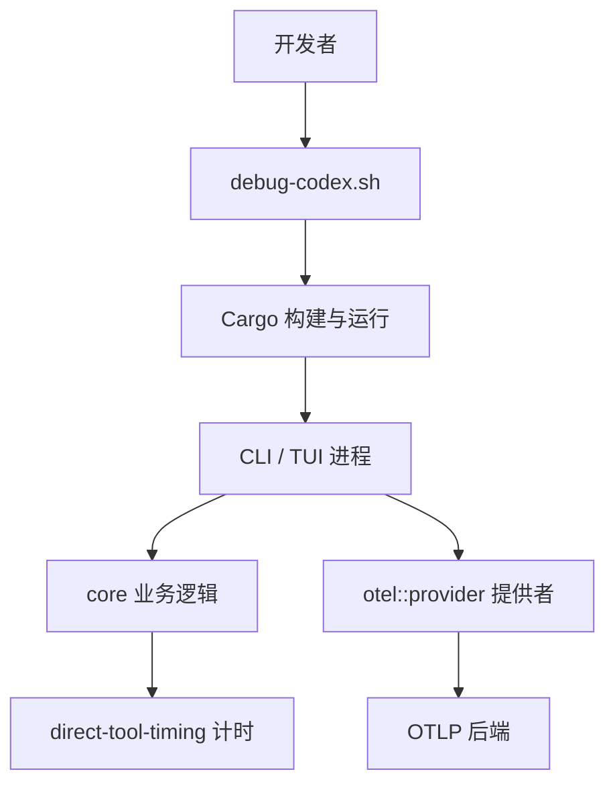
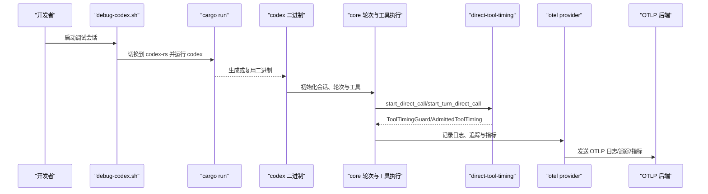
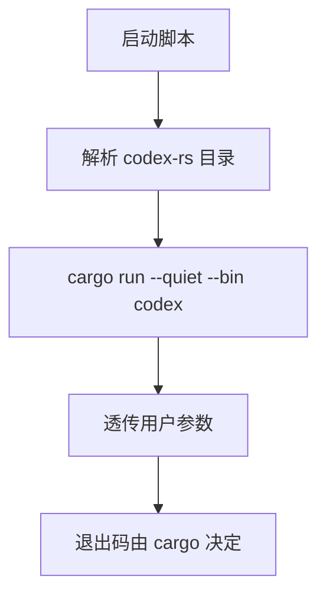
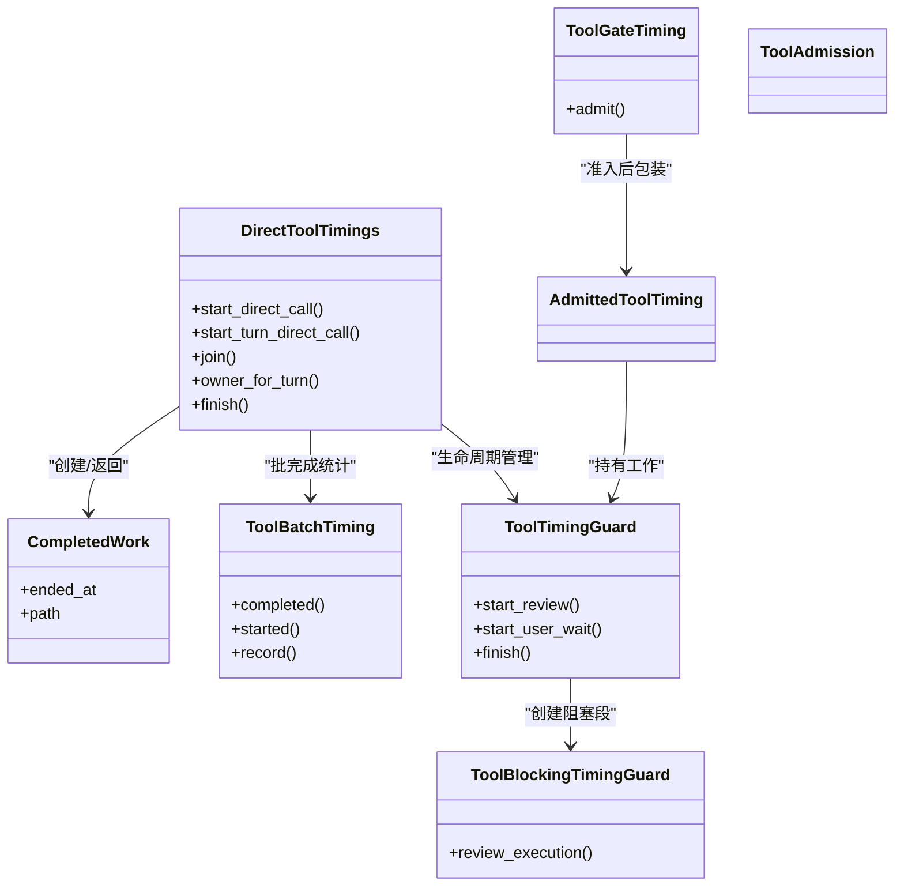
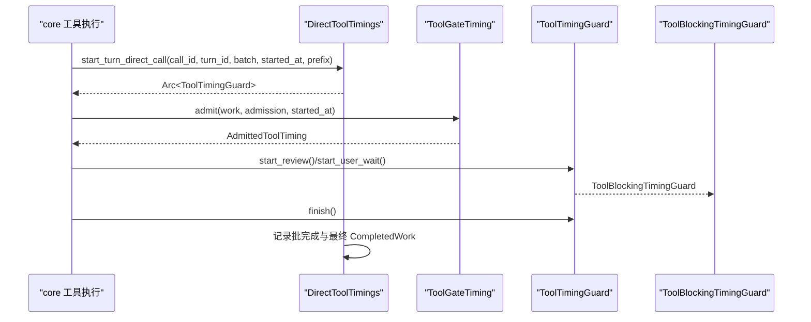
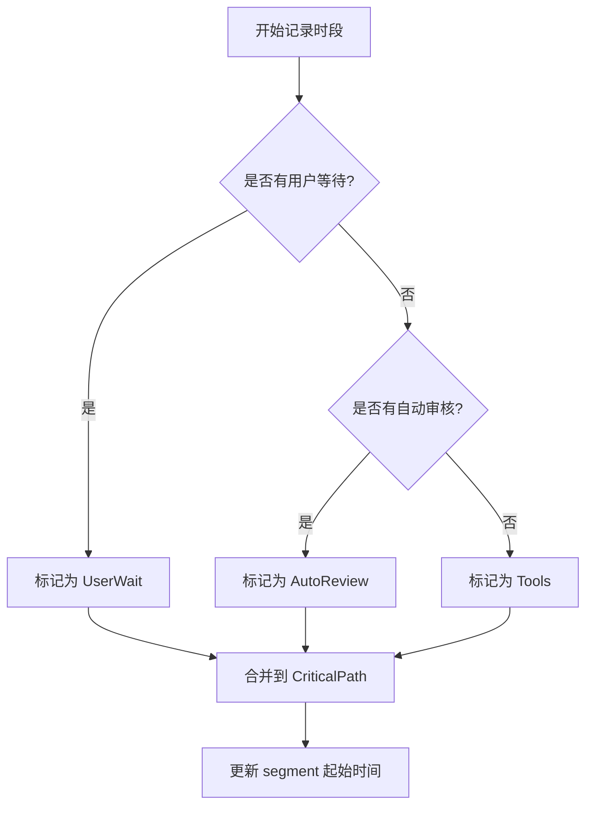
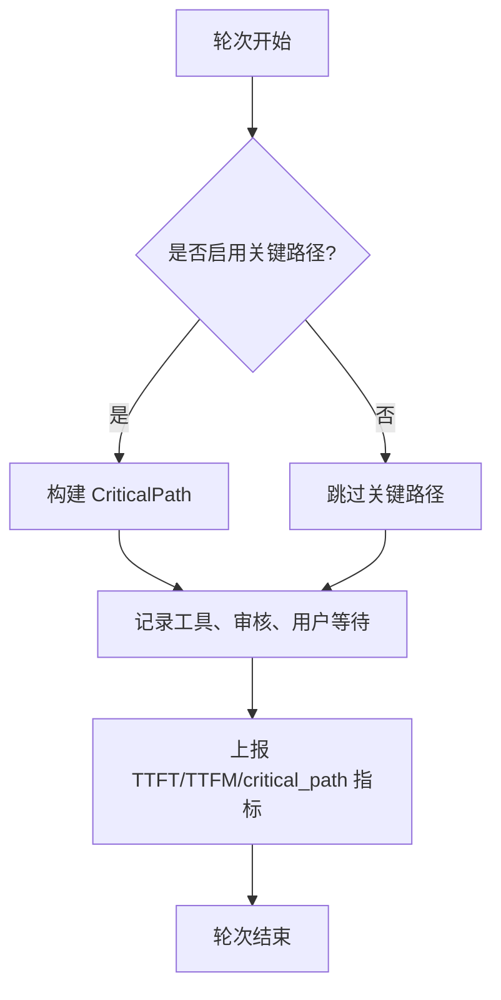
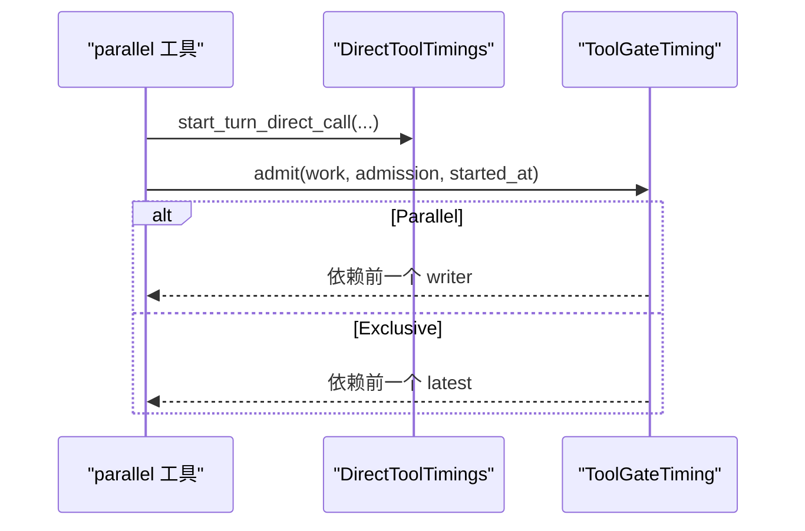
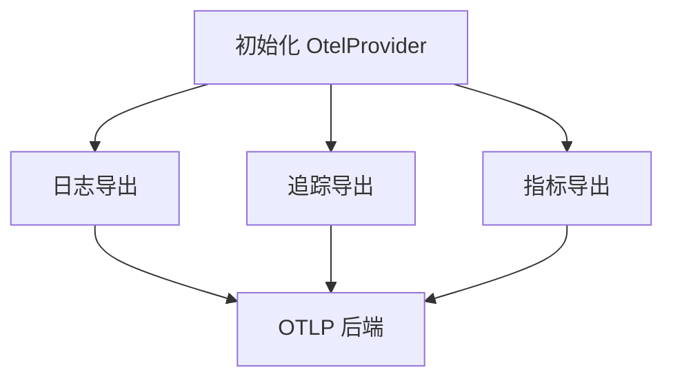
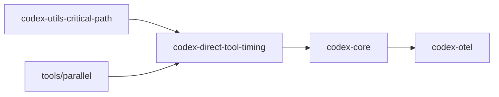

# 调试与性能分析

<cite>
**本文引用的文件**
- [scripts/debug-codex.sh](file://scripts/debug-codex.sh)
- [codex-rs/direct-tool-timing/Cargo.toml](file://codex-rs/direct-tool-timing/Cargo.toml)
- [codex-rs/direct-tool-timing/src/lib.rs](file://codex-rs/direct-tool-timing/src/lib.rs)
- [codex-rs/direct-tool-timing/src/recorder.rs](file://codex-rs/direct-tool-timing/src/recorder.rs)
- [codex-rs/direct-tool-timing/src/recorder/runtime.rs](file://codex-rs/direct-tool-timing/src/recorder/runtime.rs)
- [codex-rs/core/src/turn_timing.rs](file://codex-rs/core/src/turn_timing.rs)
- [codex-rs/core/src/tools/parallel.rs](file://codex-rs/core/src/tools/parallel.rs)
- [codex-rs/otel/README.md](file://codex-rs/otel/README.md)
- [codex-rs/otel/src/provider.rs](file://codex-rs/otel/src/provider.rs)
- [codex-rs/Cargo.toml](file://codex-rs/Cargo.toml)
</cite>

## 目录
1. [简介](#简介)
2. [项目结构](#项目结构)
3. [核心组件](#核心组件)
4. [架构总览](#架构总览)
5. [详细组件分析](#详细组件分析)
6. [依赖关系分析](#依赖关系分析)
7. [性能考虑](#性能考虑)
8. [故障排查指南](#故障排查指南)
9. [结论](#结论)
10. [附录：环境差异与参数配置](#附录环境差异与参数配置)

## 简介
本指南面向 Codex 的 Rust 代码库，聚焦以下目标：
- 如何使用 scripts/debug-codex.sh 进行交互式调试。
- 如何在 Rust 工程中配合 gdb、lldb、rust-gdb 定位崩溃和性能问题。
- 如何使用 direct-tool-timing 模块对直接工具调用、批处理、审核与用户等待进行细粒度时序分析。
- 如何采集和分析 OpenTelemetry（OTEL）遥测数据，包括日志、追踪与指标。
- 如何进行内存泄漏检测、CPU 热点定位，并给出优化建议与调优参数。
- 如何在开发、测试和生产环境中开展可操作的监控与分析。

## 项目结构
从调试与性能角度，仓库中与本指南直接相关的代码主要分布在：
- scripts/debug-codex.sh：封装 Cargo 运行入口，便于 VSCode 等 IDE 调试。
- codex-rs/direct-tool-timing：记录直接工具调用、批完成、执行门控与关键路径的工具包。
- codex-rs/core：将 direct-tool-timing 接入轮次级计时、TTFT/TTFM 指标与关键路径。
- codex-rs/otel：OpenTelemetry 集成，提供日志、追踪、指标的 Provider 与导出器。
- codex-rs/Cargo.toml：启用 tikv-jemallocator，为内存分析与堆采样奠定基础。

**图表来源**
- [scripts/debug-codex.sh:1-10](file://scripts/debug-codex.sh#L1-L10)
- [codex-rs/direct-tool-timing/src/lib.rs:1-13](file://codex-rs/direct-tool-timing/src/lib.rs#L1-L13)
- [codex-rs/core/src/turn_timing.rs:1-60](file://codex-rs/core/src/turn_timing.rs#L1-L60)
- [codex-rs/otel/README.md:1-40](file://codex-rs/otel/README.md#L1-L40)

**章节来源**
- [scripts/debug-codex.sh:1-10](file://scripts/debug-codex.sh#L1-L10)

## 核心组件
- 交互式调试入口：scripts/debug-codex.sh 会解析脚本所在目录，切换到 codex-rs，并通过 cargo run 启动 codex 二进制，同时透传原始参数。该设计让 IDE 始终使用最新构建的二进制，适合断点调试。
- 直接工具计时：direct-tool-timing 提供 DirectToolTimings、ToolBatchTiming、ToolGateTiming、ToolAdmission、ReviewExecution 等类型，用于记录工具调用生命周期、批处理完成、执行锁门控、自动审核与用户等待。
- 轮次级计时与关键路径：core 中的 turn_timing 将 direct-tool-timing 纳入 TurnTimingState，输出 turn_profile、TTFT、TTFM 等指标，并与 otel 集成。
- OTEL 集成：otel 提供 OtelProvider、SessionTelemetry、metrics 与 trace_context 能力，支持 OTLP HTTP/gRPC 日志、追踪与指标导出。

**章节来源**
- [scripts/debug-codex.sh:1-10](file://scripts/debug-codex.sh#L1-L10)
- [codex-rs/direct-tool-timing/src/lib.rs:1-13](file://codex-rs/direct-tool-timing/src/lib.rs#L1-L13)
- [codex-rs/core/src/turn_timing.rs:1-60](file://codex-rs/core/src/turn_timing.rs#L1-L60)
- [codex-rs/otel/README.md:1-40](file://codex-rs/otel/README.md#L1-L40)

## 架构总览
下图展示从开发者到 OTLP 后端的端到端链路，以及 direct-tool-timing 在核心工具执行路径中的位置。

**图表来源**
- [scripts/debug-codex.sh:1-10](file://scripts/debug-codex.sh#L1-L10)
- [codex-rs/direct-tool-timing/src/recorder.rs:150-235](file://codex-rs/direct-tool-timing/src/recorder.rs#L150-L235)
- [codex-rs/core/src/turn_timing.rs:1-60](file://codex-rs/core/src/turn_timing.rs#L1-L60)
- [codex-rs/otel/README.md:1-40](file://codex-rs/otel/README.md#L1-L40)

## 详细组件分析

### 交互式调试：scripts/debug-codex.sh
- 作用：设置严格模式；解析脚本所在目录；进入 codex-rs；以 cargo run --quiet 方式运行 codex 二进制，并转发所有参数。
- 典型用法：
  - 在 VSCode 中，将扩展配置项指向该脚本，以便调试时总是使用最新构建的二进制。
  - 在终端中，直接运行脚本并追加任何 Codex 子命令或参数。
- 调试建议：
  - 配合 IDE 的断点、条件断点和变量查看功能，优先在 core 的工具执行、guardian 决策、tools/parallel 等关键路径打断点。
  - 若需要观察 OTEL 导出行为，可在 OtelProvider 初始化处设置断点，确认 exporter 是否按预期构造。

**图表来源**
- [scripts/debug-codex.sh:1-10](file://scripts/debug-codex.sh#L1-L10)

**章节来源**
- [scripts/debug-codex.sh:1-10](file://scripts/debug-codex.sh#L1-L10)

### Rust 调试工具：gdb、lldb、rust-gdb
- 适用场景：
  - 程序崩溃、死锁、异步任务未正常结束、外部命令执行异常。
  - 需要查看线程栈、Rust 原生对象状态、底层 C/FFI 状态。
- 基本流程：
  - 构建带符号信息的目标二进制。
  - 通过 debug-codex.sh 或 cargo run 启动进程，获取 PID。
  - 使用 lldb（macOS）、gdb（Linux）或 rust-gdb（Rust 增强版 gdb）附加进程或重新运行。
- 常用技巧：
  - 先定位上层 Rust 调用栈，再下探到底层系统调用或 FFI。
  - 对异步运行时，关注 tokio 任务与锁竞争；结合日志定位具体 turn_id、conversation.id。
  - 对于多线程阻塞问题，打印各线程当前持有锁的位置与等待者。

本节为通用调试方法论，不直接分析具体源码文件。

### 直接工具计时：direct-tool-timing
该模块是性能分析的“手术刀”，重点记录：
- 单次直接工具调用：CompletedWork、DirectToolTimings、ToolTimingGuard。
- 批处理完成：ToolBatchTiming，跟踪最后一个完成的调用及其关键路径。
- 执行门控：ToolGateTiming、AdmittedToolTiming、ToolAdmission（并行或独占），用于对接执行锁。
- 阻塞段：ToolBlockingTimingGuard，区分自动审核与用户等待，并将这些时间段标记到 CriticalPath。

#### 数据结构与职责

**图表来源**
- [codex-rs/direct-tool-timing/src/lib.rs:1-13](file://codex-rs/direct-tool-timing/src/lib.rs#L1-L13)
- [codex-rs/direct-tool-timing/src/recorder.rs:1-120](file://codex-rs/direct-tool-timing/src/recorder.rs#L1-L120)
- [codex-rs/direct-tool-timing/src/recorder.rs:200-375](file://codex-rs/direct-tool-timing/src/recorder.rs#L200-L375)
- [codex-rs/direct-tool-timing/src/recorder/runtime.rs:1-90](file://codex-rs/direct-tool-timing/src/recorder/runtime.rs#L1-L90)

#### 执行序列：工具调用、审核与批完成

**图表来源**
- [codex-rs/direct-tool-timing/src/recorder.rs:150-235](file://codex-rs/direct-tool-timing/src/recorder.rs#L150-L235)
- [codex-rs/direct-tool-timing/src/recorder/runtime.rs:30-90](file://codex-rs/direct-tool-timing/src/recorder/runtime.rs#L30-L90)

#### 关键路径与阻塞段分配策略
- 如果存在活跃的用户等待，则对应时间段归为 UserWait。
- 否则如果有活跃自动审核，则归为 AutoReview。
- 其他时间归为 Tools；若无可用依赖历史，则记为 Unknown。
- 批处理的 latest 保存最近结束的 CompletedWork，用于后续下游等待建立因果依赖。

**图表来源**
- [codex-rs/direct-tool-timing/src/recorder.rs:120-190](file://codex-rs/direct-tool-timing/src/recorder.rs#L120-L190)

**章节来源**
- [codex-rs/direct-tool-timing/src/lib.rs:1-13](file://codex-rs/direct-tool-timing/src/lib.rs#L1-L13)
- [codex-rs/direct-tool-timing/src/recorder.rs:1-375](file://codex-rs/direct-tool-timing/src/recorder.rs#L1-L375)
- [codex-rs/direct-tool-timing/src/recorder/runtime.rs:1-90](file://codex-rs/direct-tool-timing/src/recorder/runtime.rs#L1-L90)

### 轮次级计时与关键路径：core/turn_timing
- TurnTimingState 持有 DirectToolTimings，并在轮次生命周期内记录 TTFT、TTFM、critical_path 等指标。
- 当 critical path 启用时，TurnProfileTimingGuard 会维护 CriticalPath，并将工具、审核、用户等待、overhead、unknown 等阶段聚合。
- record_terminal_turn_profile 会将关键路径耗时、采样计数等写入 tracing 事件，供 OTEL 日志或追踪消费。
- TTFT/TTFM 分别通过 session telemetry 上报，作为延迟类指标的关键观测点。

**图表来源**
- [codex-rs/core/src/turn_timing.rs:1-120](file://codex-rs/core/src/turn_timing.rs#L1-L120)

**章节来源**
- [codex-rs/core/src/turn_timing.rs:1-200](file://codex-rs/core/src/turn_timing.rs#L1-L200)

### 工具并行执行与门控：core/tools/parallel
- parallel 工具在执行前，根据上下文决定是否启用 DirectToolTiming。
- 通过 ToolAdmission 选择 Parallel 或 Exclusive 准入模式，从而与 ToolGateTiming 协作，将等待时间关联到前一个 writer 或 latest 完成结果。
- 这样可以在并发工具执行场景中，准确重建“谁在等谁”的因果链。

**图表来源**
- [codex-rs/core/src/tools/parallel.rs:30-35](file://codex-rs/core/src/tools/parallel.rs#L30-L35)
- [codex-rs/core/src/tools/parallel.rs:210-220](file://codex-rs/core/src/tools/parallel.rs#L210-L220)
- [codex-rs/core/src/tools/parallel.rs:310-320](file://codex-rs/core/src/tools/parallel.rs#L310-L320)
- [codex-rs/direct-tool-timing/src/recorder/runtime.rs:30-90](file://codex-rs/direct-tool-timing/src/recorder/runtime.rs#L30-L90)

**章节来源**
- [codex-rs/core/src/tools/parallel.rs:30-35](file://codex-rs/core/src/tools/parallel.rs#L30-L35)
- [codex-rs/core/src/tools/parallel.rs:210-220](file://codex-rs/core/src/tools/parallel.rs#L210-L220)
- [codex-rs/core/src/tools/parallel.rs:310-320](file://codex-rs/core/src/tools/parallel.rs#L310-L320)

### OTEL 遥测：日志、追踪与指标
- OTEL Provider：通过 OtelSettings 配置 environment、service_name、service_version、codex_home、exporter、trace_exporter、metrics_exporter、span_attributes、tracestate 等。
- 日志导出：支持 OTLP HTTP/gRPC；默认 exporter=none 不导出日志。可通过 otel.exporter 配置日志出口。
- Agent 响应日志：开启 otel.log_agent_responses=true 后可导出 final_answer 的助手消息，文本上限 65536 UTF-8 字节。
- Guardian 评估日志：开启 otel.log_guardian_assessments=true 后，同步 Guardian 审查完成后导出一次评估事件。
- 指标：支持 OTLP 指标导出；也支持 in-memory 指标用于测试；Statsig 指标可作为内部快捷选项。
- TraceContext：支持 W3C tracecontext 传播，并在 tracestate 中进行字段 upsert。

**图表来源**
- [codex-rs/otel/README.md:1-40](file://codex-rs/otel/README.md#L1-L40)
- [codex-rs/otel/README.md:40-120](file://codex-rs/otel/README.md#L40-L120)
- [codex-rs/otel/README.md:120-200](file://codex-rs/otel/README.md#L120-L200)
- [codex-rs/otel/src/provider.rs:10-40](file://codex-rs/otel/src/provider.rs#L10-L40)

**章节来源**
- [codex-rs/otel/README.md:1-200](file://codex-rs/otel/README.md#L1-L200)
- [codex-rs/otel/src/provider.rs:10-40](file://codex-rs/otel/src/provider.rs#L10-L40)

## 依赖关系分析
- direct-tool-timing 依赖 codex-utils-critical-path，用于 CriticalPath、WorkKind、ReviewExecution 等公共抽象。
- core 通过 TurnTimingState 组合 DirectToolTimings，并将关键路径与 OTTL 指标关联。
- tools/parallel 通过 ToolAdmission 与 ToolGateTiming 协作，使并发工具执行的等待关系可追溯。
- otel 提供日志、追踪、指标的统一导出入口，并被 core 和上层应用使用。

**图表来源**
- [codex-rs/direct-tool-timing/Cargo.toml:1-20](file://codex-rs/direct-tool-timing/Cargo.toml#L1-L20)
- [codex-rs/core/src/turn_timing.rs:1-60](file://codex-rs/core/src/turn_timing.rs#L1-L60)
- [codex-rs/core/src/tools/parallel.rs:30-35](file://codex-rs/core/src/tools/parallel.rs#L30-L35)

**章节来源**
- [codex-rs/direct-tool-timing/Cargo.toml:1-20](file://codex-rs/direct-tool-timing/Cargo.toml#L1-L20)
- [codex-rs/core/src/turn_timing.rs:1-60](file://codex-rs/core/src/turn_timing.rs#L1-L60)
- [codex-rs/core/src/tools/parallel.rs:30-35](file://codex-rs/core/src/tools/parallel.rs#L30-L35)

## 性能考虑
- 关键路径指标：
  - 通过 TurnProfileTimingGuard 启用关键路径，记录 inference、tools、auto_review、user_wait、overhead、unknown 等阶段耗时。
  - 在 record_terminal_turn_profile 中输出结构化事件，便于在 OTEL 后端检索与聚合。
- 工具执行瓶颈：
  - 使用 ToolGateTiming 与 ToolAdmission 识别并行与独占访问造成的等待。
  - 关注批处理最后一个完成项的 CompletedWork，避免误判长尾任务。
- 网络与模型调用：
  - 将 TTFT/TTFM 作为首令牌、首消息延迟指标，结合 conversation.id、turn_id 进行分桶分析。
- 内存与堆：
  - 工程启用 tikv-jemallocator，便于通过 jemalloc 相关工具进行堆采样与泄漏检测。
- 日志与遥测开销：
  - 在生产环境谨慎开启 agent_response 与 guardian_assessment 日志导出，注意敏感信息与体积限制。
  - 合理设置 exporter 超时、协议与 TLS 配置，避免遥测本身成为瓶颈。

本节为通用性能指导，不直接分析具体源码文件。

## 故障排查指南

### 常见问题与定位思路
- 工具调用无关键路径：
  - 检查是否启用了 critical path，以及 turn 是否处于有效生命周期。
  - 确认 DirectToolTimings.start_turn_direct_call 被正确调用，且 call_id 唯一。
- 批处理无法完成：
  - 检查 ToolBatchTiming.completed 的 pending 计数是否归零。
  - 核对每个 ToolTimingGuard 是否在 drop 或显式 finish 时被释放。
- 并发等待关系错误：
  - 检查 ToolAdmission 是 Parallel 还是 Exclusive，是否与执行锁语义一致。
  - 确认 Gate 的 writer/latest 状态更新顺序。
- OTEL 数据缺失：
  - 检查 OtelProvider 是否成功初始化，exporter 是否配置为 OTLP HTTP/gRPC。
  - 确认日志导出是否启用，agent_response、guardian_assessment 开关是否符合预期。

**章节来源**
- [codex-rs/direct-tool-timing/src/recorder.rs:150-235](file://codex-rs/direct-tool-timing/src/recorder.rs#L150-L235)
- [codex-rs/direct-tool-timing/src/recorder.rs:200-375](file://codex-rs/direct-tool-timing/src/recorder.rs#L200-L375)
- [codex-rs/direct-tool-timing/src/recorder/runtime.rs:30-90](file://codex-rs/direct-tool-timing/src/recorder/runtime.rs#L30-L90)
- [codex-rs/otel/README.md:40-200](file://codex-rs/otel/README.md#L40-L200)

### 日志分析方法
- 使用 RUST_LOG 控制日志级别，结合 EnvFilter 过滤子系统。
- 在 TUI 中启用 JSON 日志，便于结构化查询。
- 在 OTEL 后端检索 codex.turn_profile、agent_response、guardian_assessment 等事件，并结合 conversation.id、turn_id、model、client 元数据进行关联。

**章节来源**
- [codex-rs/tui/src/lib.rs:98](file://codex-rs/tui/src/lib.rs#L98)
- [codex-rs/otel/README.md:40-200](file://codex-rs/otel/README.md#L40-L200)

### 内存泄漏检测与 CPU 热点定位
- 内存泄漏：
  - 借助 tikv-jemallocator，使用 jemalloc 提供的堆采样与泄漏检测工具，结合环境变量或命令行参数捕获堆快照。
  - 关注长期持有的 Arc、Mutex、Weak 引用链，尤其是 DirectToolTimings、ToolTimingGuard、ToolBatchTiming 的生命周期。
- CPU 热点：
  - 使用 perf、flamegraph 或 pprof 生成火焰图，定位高频函数。
  - 重点关注工具执行、网络请求、JSON 序列化、沙箱执行、LLM 调用路径。
  - 结合 OTEL 指标与日志，将热点函数与 conversation.id、turn_id 关联，判断是否为特定会话或模型导致的瓶颈。

本节为通用性能与稳定性指导，不直接分析具体源码文件。

## 结论
- scripts/debug-codex.sh 提供了稳定、最新的二进制调试入口，适合 IDE 与手动调试。
- direct-tool-timing 是理解工具执行、批处理、审核与用户等待的关键，配合 core 的 TurnTimingState 可得到高质量的关键路径与延迟指标。
- OTEL 集成提供日志、追踪、指标的统一导出能力，支持生产环境可观测性。
- 内存与 CPU 分析应结合 jemalloc、perf/flamegraph/pprof 与 OTEL 指标，形成闭环诊断。
- 在不同环境中，应根据日志与遥测开销调整导出策略，确保可观测性与性能平衡。

## 附录：环境差异与参数配置

### 开发环境
- 使用 debug-codex.sh 启动，便于断点调试。
- 开启详细日志，必要时启用 agent_response 与 guardian_assessment 日志，但注意敏感信息。
- 关闭或降低遥测导出频率，避免影响交互体验。

### 测试环境
- 可使用 otel 的 in-memory 指标进行断言与验证。
- 固定 conversation.id、turn_id，便于复现与对比关键路径。

### 生产环境
- 仅启用必要的日志与指标导出，合理配置 OTLP 后端、超时、TLS。
- 谨慎开启敏感内容日志，遵循数据保留与脱敏策略。
- 定期分析 TTFT/TTFM、critical_path 指标，定位长尾与瓶颈。

**章节来源**
- [codex-rs/otel/README.md:40-200](file://codex-rs/otel/README.md#L40-L200)
- [codex-rs/Cargo.toml:530-540](file://codex-rs/Cargo.toml#L530-L540)