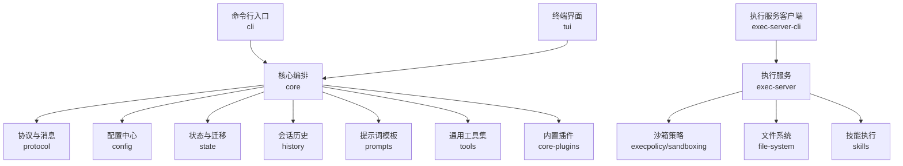
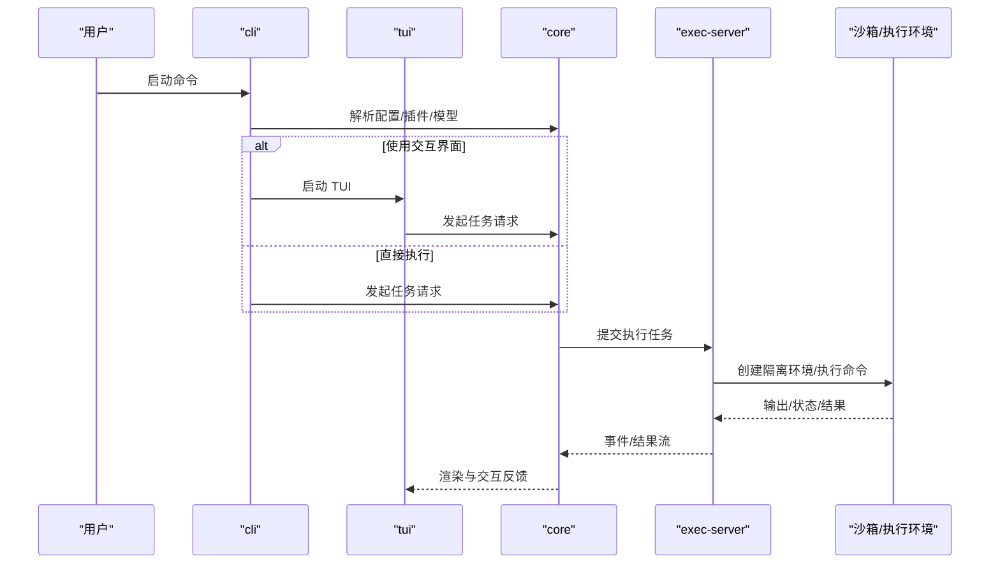
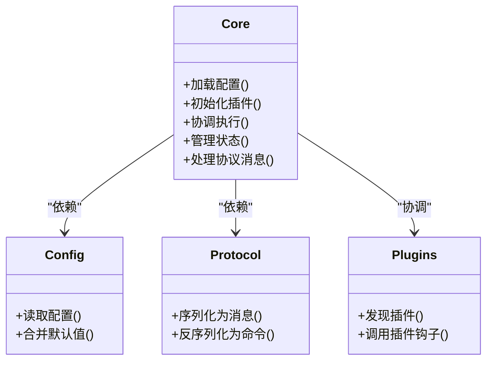
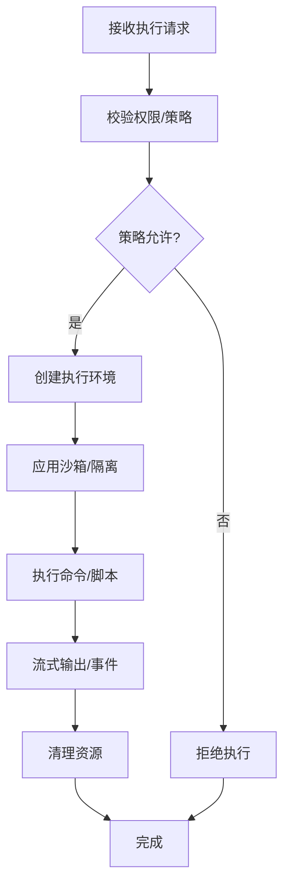
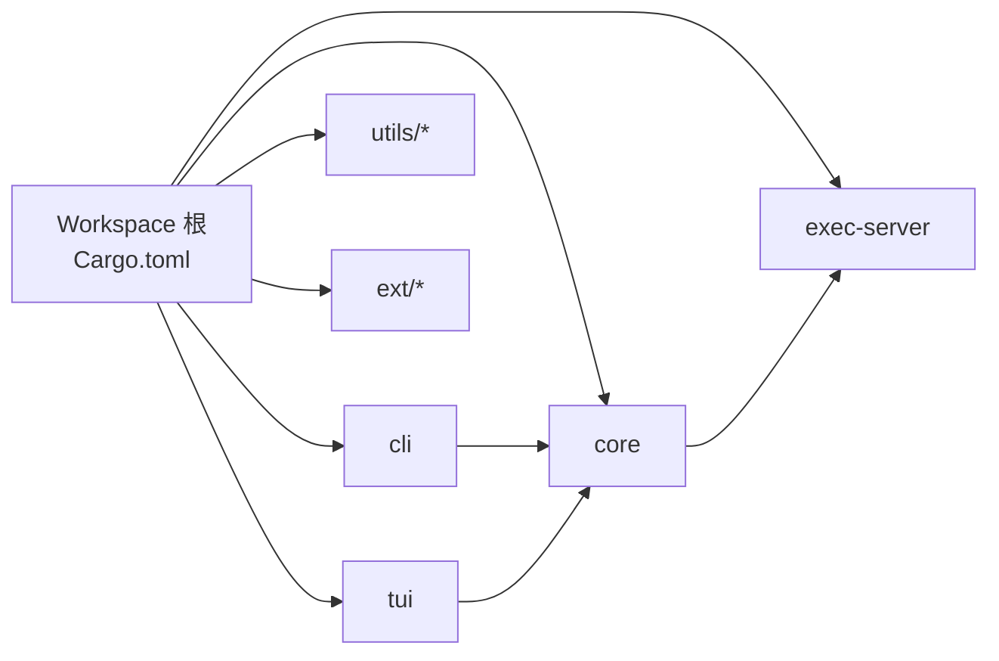
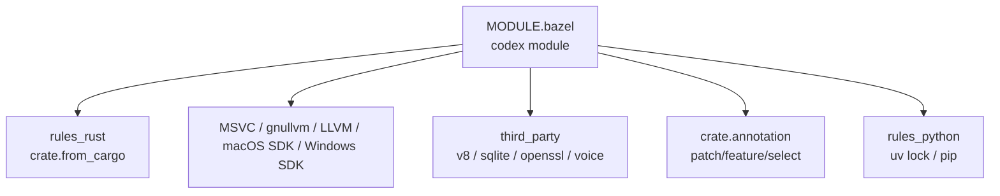
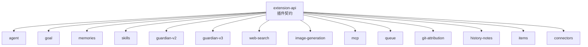

# 项目结构

<cite>
**本文引用的文件**
- [codex-rs/Cargo.toml](file://codex-rs/Cargo.toml)
- [MODULE.bazel](file://MODULE.bazel)
- [codex-rs/core/Cargo.toml](file://codex-rs/core/Cargo.toml)
- [codex-rs/cli/Cargo.toml](file://codex-rs/cli/Cargo.toml)
- [codex-rs/tui/Cargo.toml](file://codex-rs/tui/Cargo.toml)
- [codex-rs/exec-server/Cargo.toml](file://codex-rs/exec-server/Cargo.toml)
</cite>

## 目录
1. [引言](#引言)
2. [项目结构总览](#项目结构总览)
3. [核心组件](#核心组件)
4. [架构总览](#架构总览)
5. [详细组件分析](#详细组件分析)
6. [依赖关系分析](#依赖关系分析)
7. [Bazel 构建系统说明](#bazel-构建系统说明)
8. [utils 工具库组织结构](#utils-工具库组织结构)
9. [扩展系统 ext/ 插件架构](#扩展系统-ext-插件架构)
10. [新增 crate 指导原则与命名规范](#新增-crate-指导原则与命名规范)
11. [代码组织最佳实践与设计模式](#代码组织最佳实践与设计模式)
12. [性能考虑](#性能考虑)
13. [故障排查指南](#故障排查指南)
14. [结论](#结论)

## 引言
本文面向 codex-rs 仓库的结构化理解，重点说明 Cargo workspace 的组织方式、核心 crate 的职责边界、exec-server 的进程模型、CLI/TUI 的用户入口、Bazel MODULE.bazel 的工作流，以及 utils 和 ext 两大扩展维度的设计。目标是帮助读者快速定位模块职责，并给出添加新 crate 的可操作规范。

## 项目结构总览
codex-rs 是一个大型 Rust 工程，使用 Cargo workspace 管理大量 crate；同时通过顶层 MODULE.bazel 把 Rust 工作区与 Bazel 构建系统统一起来。整体可以分为以下几层：

- 用户入口层：cli、tui、exec-server-cli
- 业务编排层：core、core-plugins、protocol、config、state、history、prompts、tools
- 执行与沙箱层：exec、exec-server、execpolicy、sandboxing、linux-sandbox、windows-sandbox-rs、mxc-sandbox
- 网络与服务层：app-server、app-server-*、http-client、websocket-*、network-proxy、rmcp-client、realtime-webrtc
- 平台与基础设施层：model-provider、connectors、git-utils、file-system、worktree、login、secrets、keyring-store、otel、rollout
- 可观测性与诊断层：analytics、diagnostics、otel、response-debug-context
- 工具与通用库层：utils/*、ansi-escape、async-utils、build-info、features
- 扩展系统层：ext/*（插件）、core-plugins（内置插件）

**图表来源**
- [codex-rs/cli/Cargo.toml:1-152](file://codex-rs/cli/Cargo.toml#L1-L152)
- [codex-rs/tui/Cargo.toml:1-196](file://codex-rs/tui/Cargo.toml#L1-L196)
- [codex-rs/exec-server/Cargo.toml:1-115](file://codex-rs/exec-server/Cargo.toml#L1-L115)
- [codex-rs/core/Cargo.toml:1-193](file://codex-rs/core/Cargo.toml#L1-L193)

**章节来源**
- [codex-rs/Cargo.toml:1-696](file://codex-rs/Cargo.toml#L1-L696)

## 核心组件
- core：业务编排中枢，聚合配置、模型提供、插件、执行、协议、状态、提示词、技能等能力，是大多数上层 crate 的共同依赖。
- cli：主命令入口，负责参数解析、子命令分发、日志初始化、本地服务启动及与 TUI 或 exec-server 协作。
- tui：基于 ratatui 的终端界面，提供交互式对话、结果渲染、WebRTC/MCP 集成、沙箱摘要展示等。
- exec-server：独立的执行服务进程，暴露 WebSocket/HTTP 接口，负责命令执行、PTY、文件监控、沙箱隔离、技能运行等。

这些组件在 Cargo workspace 中通过统一的版本与依赖管理，避免重复声明外部 crate 版本。

**章节来源**
- [codex-rs/core/Cargo.toml:1-193](file://codex-rs/core/Cargo.toml#L1-L193)
- [codex-rs/cli/Cargo.toml:1-152](file://codex-rs/cli/Cargo.toml#L1-L152)
- [codex-rs/tui/Cargo.toml:1-196](file://codex-rs/tui/Cargo.toml#L1-L196)
- [codex-rs/exec-server/Cargo.toml:1-115](file://codex-rs/exec-server/Cargo.toml#L1-L115)

## 架构总览
从运行时角度看，典型调用路径如下：

该流程体现了“入口 → 编排 → 执行服务 → 隔离执行环境”的分层设计，便于替换 UI、替换执行后端或横向扩展插件能力。

**图表来源**
- [codex-rs/cli/Cargo.toml:1-152](file://codex-rs/cli/Cargo.toml#L1-L152)
- [codex-rs/tui/Cargo.toml:1-196](file://codex-rs/tui/Cargo.toml#L1-L196)
- [codex-rs/core/Cargo.toml:1-193](file://codex-rs/core/Cargo.toml#L1-L193)
- [codex-rs/exec-server/Cargo.toml:1-115](file://codex-rs/exec-server/Cargo.toml#L1-L115)

## 详细组件分析

### core：核心编排 crate
core 聚合了大量领域能力，包括：
- 配置加载与特性开关
- 模型提供与管理
- 插件系统与内置插件协调
- 协议编解码、消息路由
- 执行上下文与状态持久化
- 提示词与技能编排
- 可观测性、审计、遥测

其依赖覆盖了几乎所有子系统，体现出“装配器”角色。

**图表来源**
- [codex-rs/core/Cargo.toml:1-193](file://codex-rs/core/Cargo.toml#L1-L193)

**章节来源**
- [codex-rs/core/Cargo.toml:1-193](file://codex-rs/core/Cargo.toml#L1-L193)

### cli：命令行入口
cli 主要职责：
- 定义 clap 子命令与全局选项
- 初始化 tracing、日志、颜色、终端检测
- 启动 app-server 守护进程或与 exec-server 通信
- 根据模式选择进入 TUI 或直接执行
- 注入 build-info、features、rollout 等元数据

它既作为二进制目标，也暴露 lib 供测试与其他子命令复用。

**章节来源**
- [codex-rs/cli/Cargo.toml:1-152](file://codex-rs/cli/Cargo.toml#L1-L152)

### tui：终端界面
tui 基于 ratatui 构建，职责包括：
- 渲染对话、输出、差异、Mermaid 图等
- 与 app-server、exec-server 进行 WebSocket/HTTP 通信
- 集成 MCP、Realtime WebRTC、沙箱摘要、技能列表
- 提供键盘/鼠标交互、剪贴板、浏览器打开链接等功能
- 支持多平台原生能力（macOS、Linux、Windows）

它是一个富交互前端，但并不直接实现核心业务逻辑，而是调用 core 与相关服务 crate。

**章节来源**
- [codex-rs/tui/Cargo.toml:1-196](file://codex-rs/tui/Cargo.toml#L1-L196)

### exec-server：执行服务
exec-server 是独立的服务进程，职责包括：
- 提供 HTTP/WebSocket API
- 管理 PTY、命令生命周期、文件变化监听
- 使用 execpolicy 与 sandboxing 控制执行权限与隔离
- 集成 skills、shell-command、network-proxy、file-system
- 在 Linux 上启用 linux-sandbox，在 Windows 上使用 mxc-sandbox

**图表来源**
- [codex-rs/exec-server/Cargo.toml:1-115](file://codex-rs/exec-server/Cargo.toml#L1-L115)

**章节来源**
- [codex-rs/exec-server/Cargo.toml:1-115](file://codex-rs/exec-server/Cargo.toml#L1-L115)

## 依赖关系分析
Cargo workspace 将内部 crate 统一通过 `[workspace.dependencies]` 集中管理，并以 `codex-前缀` 别名引用，例如 `codex-core`、`codex-exec-server`、`codex-utils-*`。这带来以下好处：

- 版本号集中治理，避免各 crate 各自升级导致不一致
- 新增 crate 只需在 workspace members 中添加路径
- 外部 crate 版本集中在 workspace 层级，降低重复维护成本

**图表来源**
- [codex-rs/Cargo.toml:1-696](file://codex-rs/Cargo.toml#L1-L696)

**章节来源**
- [codex-rs/Cargo.toml:1-696](file://codex-rs/Cargo.toml#L1-L696)

## Bazel 构建系统说明
顶层 MODULE.bazel 将 Codex 定义为名为 `codex` 的 Bazel module，并引入 rules_rust、rules_foreign_cc、rules_python、llvm、v8、sqlite、openssl、zstd、bzip2、xz 等依赖。关键要点：

- 通过 `crate.from_cargo` 将 `codex-rs/Cargo.toml` 与 `Cargo.lock` 映射为 Bazel targets
- 对 rules_rs、protobuf、ring、aws-lc-sys、v8、libsqlite3-sys 等第三方 crate 做了 patch 与注解
- 配置了 MSVC、gnullvm、macOS SDK、Windows SDK、LLVM toolchain 等多平台工具链
- 通过 `crate.annotation_select` 按 target triple 切换 feature，例如 blake3 pure 模式、v8 sandbox feature
- 引入 third_party/v8、third_party/sqlite、third_party/openssl、third_party/voice 等本地化第三方源码
- 定义了 release archive、Wine 工具链、Python 工具链等辅助构建能力

**图表来源**
- [MODULE.bazel:1-1078](file://MODULE.bazel#L1-L1078)

**章节来源**
- [MODULE.bazel:1-1078](file://MODULE.bazel#L1-L1078)

## utils 工具库组织结构
utils 目录下包含大量小而专一的 crate，每个 crate 通常聚焦一个横切能力，例如：

- 路径与 URI：absolute-path、path-uri、path-utils
- 进程与环境：process、pty、home-dir、readiness、sleep-inhibitor
- 字符串与格式：string、redacted-string、output-truncation、json-to-toml
- 缓存与 IO：cache、head-tail-buffer、stream-parser、oss
- 平台与图像：image、rustls-provider、audio
- 插件与 CLI 辅助：plugins、cli、cargo-bin、approval-presets
- 其他：fuzzy-match、template、elapsed、critical-path、sandbox-summary、model-facing-id

这些 crate 通常只暴露稳定的公共 API，被 core、cli、tui、exec-server 等多个上层 crate 引用，形成横向复用层。

**章节来源**
- [codex-rs/Cargo.toml:1-696](file://codex-rs/Cargo.toml#L1-L696)

## 扩展系统 ext/ 插件架构
ext/ 下是插件生态，包含多种功能型扩展，例如：

- agent-message-board：代理消息板扩展
- connectors：连接器扩展
- extension-api：扩展 API 定义
- goal：目标规划扩展
- git-attribution：Git 贡献归属扩展
- guardian-reviewer/guardian-v2/guardian-v3：安全审查扩展
- history-notes：历史笔记扩展
- image-generation：图片生成扩展
- items：条目扩展
- memories：记忆扩展
- mcp：MCP 扩展
- queue：队列扩展
- skills：技能扩展
- web-search：网页搜索扩展

这些扩展通常遵循“API crate + 实现 crate”的模式：extension-api 定义契约，具体扩展实现业务逻辑，并由 core 或插件宿主加载。

**图表来源**
- [codex-rs/Cargo.toml:1-696](file://codex-rs/Cargo.toml#L1-L696)

**章节来源**
- [codex-rs/Cargo.toml:1-696](file://codex-rs/Cargo.toml#L1-L696)

## 新增 crate 指导原则与命名规范
1. **在 workspace 中注册**
   - 在 `codex-rs/Cargo.toml` 的 `members` 列表中新增相对路径
   - 在 `[workspace.dependencies]` 中新增带 `codex-` 前缀的别名
2. **命名规范**
   - 包名使用 kebab-case，如 `my-feature`
   - Cargo 别名使用 `codex-my-feature`
   - 内部 crate 尽量不暴露到 workspace 之外；若需要跨仓库共享，再考虑发布 crate
3. **依赖管理**
   - 优先使用 workspace 中已定义的依赖，避免重复版本
   - 对外部 crate 的版本变更应在 workspace 层统一调整
4. **目标与二进制**
   - 仅当确实需要提供可执行文件时才添加 `[[bin]]`
   - 普通库 crate 应只保留 `[lib]`
5. **平台相关依赖**
   - 使用 `target.'cfg(...)'.dependencies` 精确限定平台依赖
   - 避免在不必要的平台引入重型依赖
6. **测试与示例**
   - 单元测试放在 crate 内 `tests/` 或模块内 test
   - 示例代码放在 `examples/`，不要污染主 lib
7. **文档与元数据**
   - 提供 README.md 说明用途、依赖、配置项、示例用法
   - 在 Cargo.toml 中保持 edition、license 与 workspace 一致

**章节来源**
- [codex-rs/Cargo.toml:1-696](file://codex-rs/Cargo.toml#L1-L696)

## 代码组织最佳实践与设计模式
- **分层清晰**：入口层（cli/tui）→ 编排层（core）→ 服务层（exec-server/app-server）→ 基础设施层（filesystem/network/state）
- **协议先行**：跨进程通信使用 protocol 或专用 *-protocol crate，保证接口稳定
- **插件化**：可扩展能力通过 ext/* 或 core-plugins 解耦，核心只持有抽象
- **沙箱与安全**：执行类能力必须经过 execpolicy 与 sandboxing 控制，避免任意命令执行
- **可观测性**：通过 otel、tracing、analytics 贯穿核心链路，便于排障与性能分析
- **配置集中**：config crate 统一管理配置、默认值、特性开关，避免散落的环境变量
- **异步与错误**：统一使用 tokio、thiserror、anyhow，并在关键路径记录结构化日志
- **平台兼容**：使用 cfg 条件编译隔离 Windows/macOS/Linux 差异，减少运行时分支
- **构建可复现**：依赖版本集中在 workspace 与 MODULE.bazel，必要时用 patches 固定行为

**章节来源**
- [codex-rs/core/Cargo.toml:1-193](file://codex-rs/core/Cargo.toml#L1-L193)
- [codex-rs/cli/Cargo.toml:1-152](file://codex-rs/cli/Cargo.toml#L1-L152)
- [codex-rs/tui/Cargo.toml:1-196](file://codex-rs/tui/Cargo.toml#L1-L196)
- [codex-rs/exec-server/Cargo.toml:1-115](file://codex-rs/exec-server/Cargo.toml#L1-L115)
- [MODULE.bazel:1-1078](file://MODULE.bazel#L1-L1078)

## 性能考虑
- 执行服务应避免长时间阻塞 I/O，使用异步流式输出与背压
- 沙箱与策略检查应尽量前置，减少无效执行
- 大文件传输与压缩需平衡 CPU 与带宽，按需启用 zstd/deflate
- 日志采样与结构化追踪可减少生产开销
- 图形与 Markdown 渲染应做增量更新与懒加载，避免 TUI 卡顿
- 数据库与状态写入应批量化，避免频繁事务

[本节为通用建议，未直接分析具体文件]

## 故障排查指南
常见定位方向：
- 确认 cli/tui 是否正确启动并连接到 exec-server 或 app-server
- 检查 exec-server 是否成功创建 PTY 与沙箱环境
- 查看 otel/tracing 日志，定位协议解析、权限拒绝、网络超时
- 验证 config 中模型、代理、密钥、沙箱策略是否生效
- 在多平台环境下检查 platform-specific dependencies 是否匹配
- 在 Bazel 构建失败时，关注 MODULE.bazel 中 crate.annotation 与 patches 是否覆盖当前依赖

**章节来源**
- [codex-rs/exec-server/Cargo.toml:1-115](file://codex-rs/exec-server/Cargo.toml#L1-L115)
- [codex-rs/cli/Cargo.toml:1-152](file://codex-rs/cli/Cargo.toml#L1-L152)
- [MODULE.bazel:1-1078](file://MODULE.bazel#L1-L1078)

## 结论
codex-rs 通过 Cargo workspace 与 Bazel MODULE.bazel 双重构建体系，实现了大规模 Rust 工程的模块化、可移植与可维护性。core 作为编排中枢，cli/tui 作为用户入口，exec-server 作为执行后端，utils 提供横切能力，ext 提供插件扩展。新增 crate 时应遵循 workspace 注册、依赖集中、协议优先、插件解耦、平台隔离、可观测性完备等原则，以保持整个系统的长期健康演进。