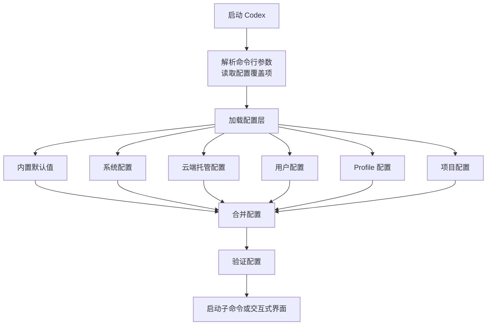
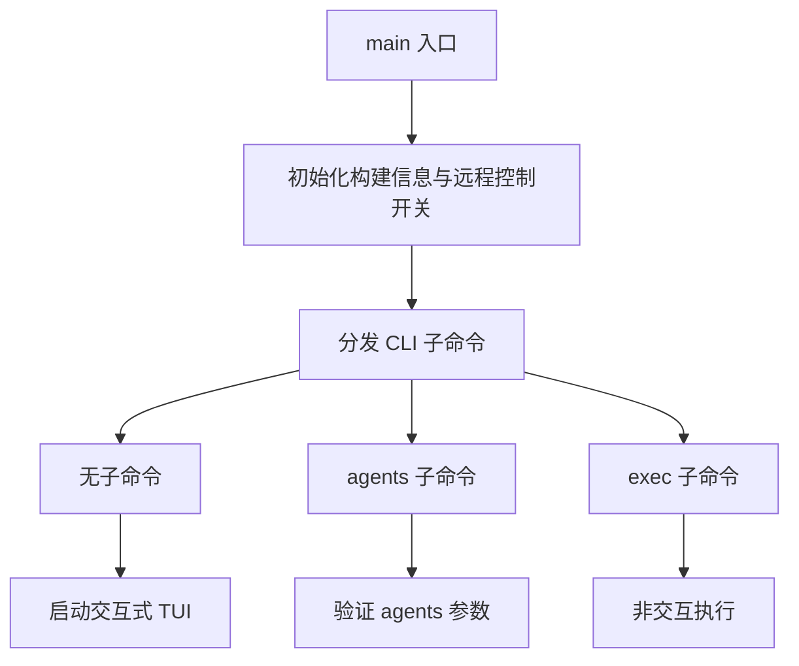

# 快速开始

<cite>
**本文引用的文件**   
- [README.md](file://codex-rs/README.md)
- [getting-started.md](file://docs/getting-started.md)
- [install.md](file://docs/install.md)
- [exec.md](file://docs/exec.md)
- [package.json](file://codex-cli/package.json)
- [main.rs](file://codex-rs/cli/src/main.rs)
- [loader/mod.rs](file://codex-rs/config/src/loader/mod.rs)
- [types.rs](file://codex-rs/config/src/types.rs)
- [config_toml.rs](file://codex-rs/config/src/config_toml.rs)
- [install.sh](file://scripts/install/install.sh)
- [install.ps1](file://scripts/install/install.ps1)
</cite>

## 目录

1. [简介](#简介)
2. [系统要求](#系统要求)
3. [安装方式](#安装方式)
4. [初始配置](#初始配置)
5. [基本使用场景](#基本使用场景)
6. [常用配置与环境变量](#常用配置与环境变量)
7. [故障排除](#故障排除)
8. [进阶说明](#进阶说明)
9. [结论](#结论)

## 简介

Codex CLI 是由 OpenAI 提供的本地编码代理命令行工具。它可以在你的本机终端中启动交互式界面，也可以以非交互模式执行任务；它可以与远程后端协作，也可以结合沙箱、代码执行、插件等能力完成更复杂的开发工作流。

仓库中的 Rust 实现是主程序入口，Node.js 包 `@openai/codex` 提供 JavaScript 侧的轻量入口脚本，实际核心逻辑由 Rust 二进制文件承担。

**章节来源**
- [README.md:1-3](file://codex-rs/README.md#L1-L3)
- [package.json:1-22](file://codex-cli/package.json#L1-L22)

## 系统要求

### 最低系统要求

| 项目 | 要求 |
|---|---|
| 操作系统 | macOS 12 及以上、Ubuntu 20.04 或 Debian 10 及以上，或 Windows 11（通过 WSL2） |
| Git | 可选但推荐；版本 2.23 及以上可启用内置 Pull Request 辅助功能 |
| 内存 | 至少 4 GB，推荐 8 GB |
| Node.js | 仅在使用 `codex-cli` 包装包时需要；该包声明引擎为 Node.js 16 及以上 |

如果你只运行官方发布的预编译二进制文件，通常不需要安装 Rust 编译器。只有从源码构建时才需要完整的 Rust 工具链和 workspace 辅助工具。

**章节来源**
- [install.md:4-13](file://docs/install.md#L4-L13)
- [package.json:1-22](file://codex-cli/package.json#L1-L22)

### 建议检查清单

在开始安装前，可以依次确认：

1. 操作系统版本是否符合要求。
2. 是否启用了网络访问，因为安装过程可能需要下载发布包。
3. 目标安装目录是否有写入权限。
4. 当前用户是否有权限把 `codex` 加入系统路径。
5. 如果是 Windows，请优先使用 WSL2 环境进行安装和日常使用。
6. 如果计划参与源码开发，请提前准备 Git、Rustup、just 和 dotslash 等工具。

**章节来源**
- [install.md:4-13](file://docs/install.md#L4-L13)

## 安装方式

### 一键安装脚本

#### Linux 与 macOS

可以使用仓库提供的 shell 安装脚本。脚本支持环境变量控制安装行为，例如指定版本、选择安装源、设置安装目录和非交互模式。

常见用法包括：

- 安装最新版本：
  ```bash
  curl -fsSL https://raw.githubusercontent.com/openai/codex/main/scripts/install/install.sh | sh
  ```

- 指定版本安装：
  ```bash
  CODEX_RELEASE=版本号 ./scripts/install/install.sh
  ```

- 非交互安装：
  ```bash
  CODEX_NON_INTERACTIVE=1 ./scripts/install/install.sh
  ```

- 自定义安装目录：
  ```bash
  CODEX_INSTALL_DIR=/你喜欢的目录 ./scripts/install/install.sh
  ```

脚本默认会尝试从 OpenAI 发布站点获取元数据，并在不可用时回退到 GitHub Releases。它会校验归档摘要，并把二进制安装到 `$HOME/.local/bin` 或由 `CODEX_INSTALL_DIR` 指定的目录。

#### Windows

Windows 平台推荐使用 PowerShell 安装脚本：

```powershell
Invoke-WebRequest -Uri "https://raw.githubusercontent.com/openai/codex/main/scripts/install/install.ps1" -OutFile "codex-install.ps1"
.\codex-install.ps1
```

也可以通过环境变量控制行为：

| 环境变量 | 作用 |
|---|---|
| `CODEX_RELEASE` | 指定要安装的版本，例如 `latest` 或具体语义化版本 |
| `CODEX_NON_INTERACTIVE` | 设为 `1`、`true` 或 `yes` 可跳过交互提示 |
| `CODEX_INSTALLER_USE_RELEASES_OPENAI_COM` | 控制是否优先使用 OpenAI 发布站点 |

Windows 安装脚本会解析发行元数据、下载归档、校验 SHA-256，并安装打包产物。如果首选地址失败，脚本会尝试回退到 GitHub Releases。

**章节来源**
- [install.sh:1-1500](file://scripts/install/install.sh#L1-L1500)
- [install.ps1:1-1266](file://scripts/install/install.ps1#L1-L1266)

### npm / pnpm 安装

`codex-cli` 是一个 npm 包，名称为 `@openai/codex`。它通过 `bin/codex.js` 暴露 `codex` 命令，并依赖 Node.js 16 及以上版本。

你可以使用任意兼容的包管理器安装：

```bash
pnpm add -g @openai/codex
```

安装后，全局命令 `codex` 会调用 `bin/codex.js`。该脚本负责定位并调用实际的 Codex 二进制程序。

注意：这个 npm 包本身不包含 Rust 实现的完整运行时，因此它更适合配合官方安装流程使用。

**章节来源**
- [package.json:1-22](file://codex-cli/package.json#L1-L22)

### 从源码构建

适合需要修改源码、调试底层行为或参与贡献的开发者。

基本步骤如下：

1. 克隆仓库。
2. 进入 `codex-rs` 工作区根目录。
3. 安装 Rust 工具链。
4. 添加 `rustfmt` 和 `clippy` 组件。
5. 安装 just、dotslash 和 cargo-nextest。
6. 执行 `cargo build`。
7. 通过 `cargo run --bin codex` 启动 TUI。

示例流程：

```bash
git clone https://github.com/openai/codex.git
cd codex/codex-rs
curl --proto '=https' --tlsv1.2 -sSf https://sh.rustup.rs | sh -s -- -y
source "$HOME/.cargo/env"
rustup component add rustfmt
rustup component add clippy
cargo install --locked just
cargo install --locked dotslash
cargo install --locked cargo-nextest
cargo build
cargo run --bin codex -- "解释一下这个代码库"
```

日常开发还可使用根级 justfile 提供的辅助命令，例如格式化、修复和本地测试。

**章节来源**
- [install.md:14-47](file://docs/install.md#L14-L47)

## 初始配置

### 首次运行

第一次运行 `codex` 时，CLI 通常会引导你完成认证和基本选择，例如登录 OpenAI 账户、选择模型、接受使用策略或配置沙箱行为。

交互式会话会自动打开终端界面；非交互模式则适合在脚本、CI 或自动化流水线中使用。

### 配置文件位置

Codex 的配置采用多层合并机制。优先级从低到高大致包括：

1. 内置默认值
2. 系统配置
3. 云端托管配置
4. 用户配置
5. 已选 profile 配置
6. 当前工作目录配置
7. 项目 `.codex` 配置
8. Git 仓库根 `.codex` 配置

关键路径规则如下：

| 层级 | 路径 |
|---|---|
| 系统配置 | Unix 上为 `/etc/codex/config.toml`，Windows 上为 `%ProgramData%\OpenAI\Codex\config.toml` |
| 用户配置 | `${CODEX_HOME}/config.toml` |
| Profile 配置 | `${CODEX_HOME}/<name>.config.toml` |
| 当前目录配置 | `${PWD}/config.toml` |
| 项目配置 | 向上查找 `.codex/config.toml`，以及 Git 仓库根下的 `.codex/config.toml` |

`CODEX_HOME` 是 Codex 的用户数据目录，用于存放认证信息、日志、状态、主题、宠物皮肤等内容。

**章节来源**
- [loader/mod.rs:124-138](file://codex-rs/config/src/loader/mod.rs#L124-L138)
- [loader/mod.rs:128-135](file://codex-rs/config/src/loader/mod.rs#L128-L135)
- [types.rs:140-160](file://codex-rs/config/src/types.rs#L140-L160)

### 验证配置加载

如果你遇到配置不生效的问题，可以先确认：

1. 是否设置了 `CODEX_HOME`。
2. 用户目录下是否存在 `config.toml`。
3. 是否选择了 profile。
4. 当前项目是否存在 `.codex/config.toml`。
5. 配置语法是否为有效 TOML。
6. 是否被系统或企业托管配置覆盖。

如果需要查看运行时日志，可在启动时指定日志目录或使用 `RUST_LOG`。

**章节来源**
- [install.md:49-65](file://docs/install.md#L49-L65)
- [loader/mod.rs:124-138](file://codex-rs/config/src/loader/mod.rs#L124-L138)

## 基本使用场景

### 交互式会话

交互式模式是新手最容易上手的方式。启动后，你可以在终端中与 Codex 对话，让它解释代码、生成文件、重构模块、编写测试或回答开发问题。

典型流程：

1. 打开终端。
2. 输入 `codex`。
3. 输入自然语言描述你的需求。
4. 根据界面提示确认变更或继续下一步。

交互式模式适合探索性开发、学习代码库、讨论设计方案和逐步实现功能。

**章节来源**
- [getting-started.md:1-3](file://docs/getting-started.md#L1-L3)
- [main.rs:1042-1150](file://codex-rs/cli/src/main.rs#L1042-L1150)

### 非交互执行

非交互模式适合脚本化任务、批量处理或 CI 环境。该模式通常不会打开完整 TUI，而是直接执行命令并输出结果。

文档指出，非交互模式对应 `codex exec` 子命令；其默认日志级别为错误级别，但消息会直接打印到标准输出，因此通常不需要单独监控日志文件。

常见思路：

1. 将任务写成清晰指令。
2. 通过 `codex exec` 执行。
3. 将输出重定向到文件或管道。
4. 根据退出码判断成功或失败。

**章节来源**
- [exec.md:1-3](file://docs/exec.md#L1-L3)
- [install.md:59-65](file://docs/install.md#L59-L65)

### 代码审查

虽然本仓库没有给出专门用于“代码审查”的一行命令示例，但 Codex 的能力包含对代码的理解、分析和变更建议。你可以：

1. 在交互式会话中让 Codex 审查某个文件或整个目录。
2. 在非交互模式下提交审查任务。
3. 结合项目配置限制可写目录，提高安全性。
4. 使用沙箱隔离危险操作。

对于安全相关的审查场景，建议同时启用严格的审批策略、受控的工作区和沙箱。

**章节来源**
- [main.rs:1042-1150](file://codex-rs/cli/src/main.rs#L1042-L1150)

### 使用示例速查表

| 场景 | 建议方式 | 注意事项 |
|---|---|---|
| 初次体验 | 交互式会话 | 按提示完成认证和模型选择 |
| 脚本执行 | `codex exec` | 注意日志级别和退出码 |
| 代码审查 | 交互式或非交互 | 配合项目配置和沙箱更安全 |
| 批量任务 | 非交互 + 输出重定向 | 避免打开完整 TUI |
| 调试问题 | 设置日志目录或 `RUST_LOG` | 保留诊断信息 |

[本节为概念性总结，不直接分析具体代码文件]

## 常用配置与环境变量

### 关键环境变量

| 环境变量 | 用途 | 说明 |
|---|---|---|
| `CODEX_HOME` | 用户数据目录 | 默认通常是用户家目录下的 `.codex` |
| `CODEX_RELEASE` | 安装脚本版本 | 指定安装特定版本，`latest` 表示最新版 |
| `CODEX_NON_INTERACTIVE` | 安装脚本交互开关 | 值为 `1`、`true` 或 `yes` 时跳过提示 |
| `CODEX_INSTALL_DIR` | 安装目录 | 安装脚本使用的二进制安装路径 |
| `CODEX_INSTALLER_USE_RELEASES_OPENAI_COM` | 安装源偏好 | 控制是否优先使用 OpenAI 发布站点 |
| `RUST_LOG` | Rust 日志级别 | 控制底层日志输出格式和详细程度 |
| `log_dir` | 配置项 | 指定 TUI 文本日志目录 |

其中 `RUST_LOG` 是 Rust 生态常用的日志环境变量；Codex 作为 Rust 程序会遵循它的约定。TUI 默认会把诊断记录到有界本地存储中；显式设置 `log_dir` 后可导出纯文本日志方便排查。

**章节来源**
- [install.md:49-65](file://docs/install.md#L49-L65)
- [install.sh:1-1500](file://scripts/install/install.sh#L1-L1500)
- [install.ps1:1-1266](file://scripts/install/install.ps1#L1-L1266)

### 常用配置字段

由于完整配置结构非常庞大，快速开始阶段只需关注最基础字段：

| 配置类别 | 常见字段 | 作用 |
|---|---|---|
| 认证 | `auth_provider` | 选择认证提供方 |
| 模型 | `model`、`default_model` | 设置默认模型或提取/合并模型 |
| 日志 | `log_dir` | 设置 TUI 日志输出目录 |
| 数据库 | `sqlite_home` | 设置 SQLite 数据目录 |
| 沙箱 | `sandbox` | 配置沙箱行为 |
| 代码执行 | `code_execution` | 控制代码执行相关能力 |

这些字段大多定义在 `ConfigToml` 结构体及其关联类型中，并通过配置层合并机制生效。

**章节来源**
- [types.rs:87-1097](file://codex-rs/config/src/types.rs#L87-L1097)
- [config_toml.rs:228-381](file://codex-rs/config/src/config_toml.rs#L228-L381)

### 配置加载流程概览



**图表来源**
- [main.rs:1042-1150](file://codex-rs/cli/src/main.rs#L1042-L1150)
- [loader/mod.rs:124-138](file://codex-rs/config/src/loader/mod.rs#L124-L138)
- [loader/mod.rs:248-520](file://codex-rs/config/src/loader/mod.rs#L248-L520)

**章节来源**
- [loader/mod.rs:124-138](file://codex-rs/config/src/loader/mod.rs#L124-L138)
- [loader/mod.rs:248-520](file://codex-rs/config/src/loader/mod.rs#L248-L520)

## 故障排除

### 常见问题与解决思路

| 问题 | 可能原因 | 解决方法 |
|---|---|---|
| 找不到 `codex` 命令 | 安装目录未加入 PATH | 检查安装脚本输出的目录，手动添加到 PATH |
| 安装失败 | 网络不可用或发布源不可达 | 切换安装源或回退到 GitHub Releases |
| 权限不足 | 安装目录不可写 | 使用 `CODEX_INSTALL_DIR` 指向当前用户可写目录 |
| 版本异常 | 传入了非法版本字符串 | 使用 `latest` 或符合 `x.y.z[-alpha|-beta]` 的版本格式 |
| 配置不生效 | 被高优先级配置覆盖 | 检查系统配置、profile 和项目配置 |
| 日志太多或太少 | `RUST_LOG` 未正确设置 | 调整日志级别或显式设置 `log_dir` |
| 认证失败 | 未登录或令牌无效 | 重新登录并确认 `CODEX_HOME/auth.json` 可用 |
| 沙箱无法启动 | 系统缺少依赖或缺少权限 | 检查操作系统、WSL2、内核能力和安全策略 |

### 安装脚本相关问题

安装脚本会对版本号进行校验。如果不是 `latest`，则必须符合语义化版本格式，并允许 alpha 或 beta 预发布标识。

如果首选发布源无法下载或校验失败，脚本会尝试回退到 GitHub Releases。若仍失败，应检查：

- 网络连通性
- 防火墙或代理设置
- 证书校验
- 磁盘空间
- 目标目录权限

**章节来源**
- [install.sh:1-1500](file://scripts/install/install.sh#L1-L1500)
- [install.ps1:1-1266](file://scripts/install/install.ps1#L1-L1266)

### 日志与诊断

Codex 支持通过 `RUST_LOG` 控制 Rust 层的日志行为。TUI 默认会把诊断记录到本地有界存储中；非交互模式默认使用较少的日志输出，但会在控制台打印必要信息。

推荐的诊断步骤：

1. 明确你要排查的是安装问题、配置问题还是运行问题。
2. 如果是安装问题，先查看安装脚本输出。
3. 如果是 TUI 问题，设置 `log_dir` 并查看生成的日志文件。
4. 如果是非交互模式，观察标准输出和退出码。
5. 如需更详细的 Rust 层日志，再设置 `RUST_LOG`。

**章节来源**
- [install.md:49-65](file://docs/install.md#L49-L65)

## 进阶说明

### CLI 入口与子命令分发

Codex 的主入口位于 Rust CLI crate 的 `main` 函数中。程序启动后会初始化构建信息、处理远程控制开关，然后分发到不同子命令。

当没有指定子命令时，通常会进入交互式 TUI；某些子命令还有额外限制，例如 `codex agents` 不接受初始提示或图片，也不能对远程服务器应用本地 provider 或额外目录覆盖。



**图表来源**
- [main.rs:1042-1150](file://codex-rs/cli/src/main.rs#L1042-L1150)

**章节来源**
- [main.rs:1042-1150](file://codex-rs/cli/src/main.rs#L1042-L1150)

### 为什么建议初学者先使用交互式模式

交互式模式的优势在于：

- 可以通过终端界面直观看到 Codex 的计划、工具调用和文件变更。
- 可以在执行前确认高风险操作。
- 适合学习 Codex 的行为边界和提示词表达方式。
- 出错时更容易通过界面反馈定位问题。

当你熟悉之后，再过渡到非交互模式和脚本化流程会更稳妥。

[本节为概念性指导，不直接分析具体代码文件]

## 结论

对于大多数用户，推荐的最短路径是：

1. 确认系统版本和内存满足要求。
2. 使用官方安装脚本安装最新稳定版。
3. 首次运行 `codex`，完成认证和基础选择。
4. 先用交互式模式体验基本能力。
5. 需要自动化时再切换到 `codex exec`。
6. 遇到问题时先检查安装脚本输出、`CODEX_HOME`、配置层和日志。

如果你需要深入定制，请阅读配置文档、日志文档和源码中的 CLI 分发逻辑，并结合项目级配置、profile 和企业托管配置统一管理行为。

[本节为总结性内容，不直接分析具体代码文件]