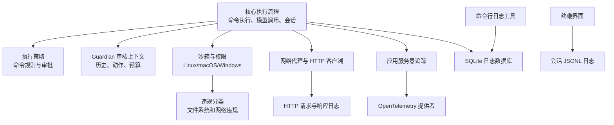
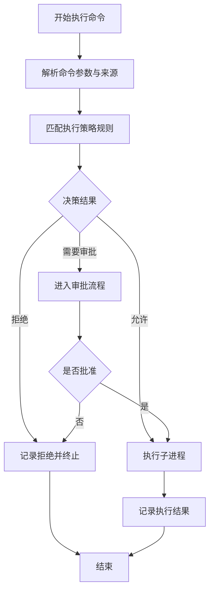
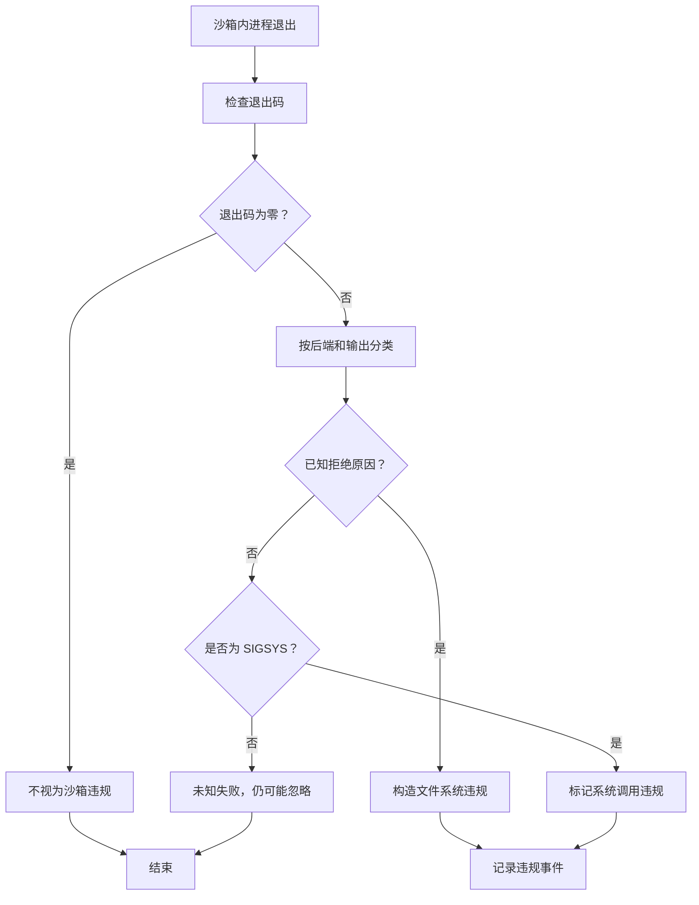
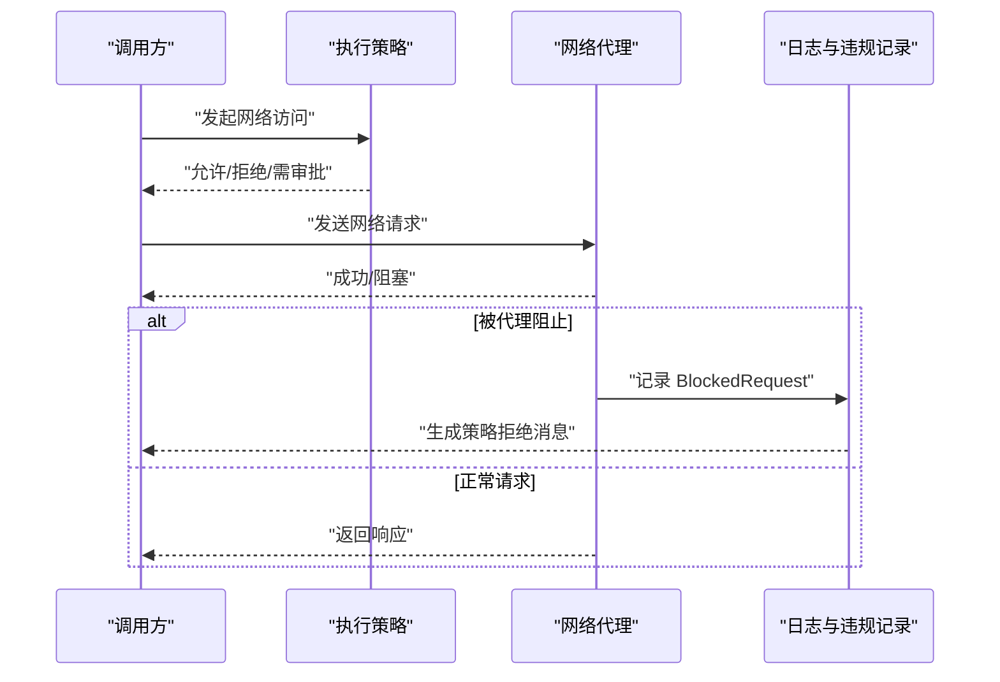
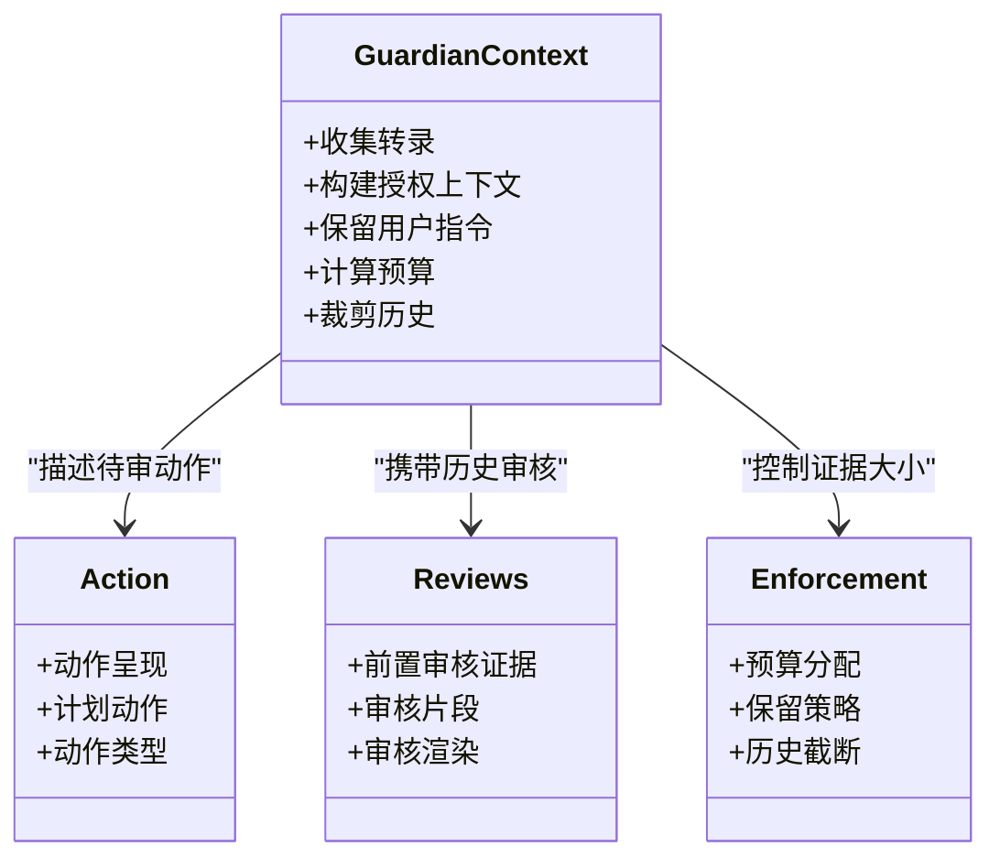
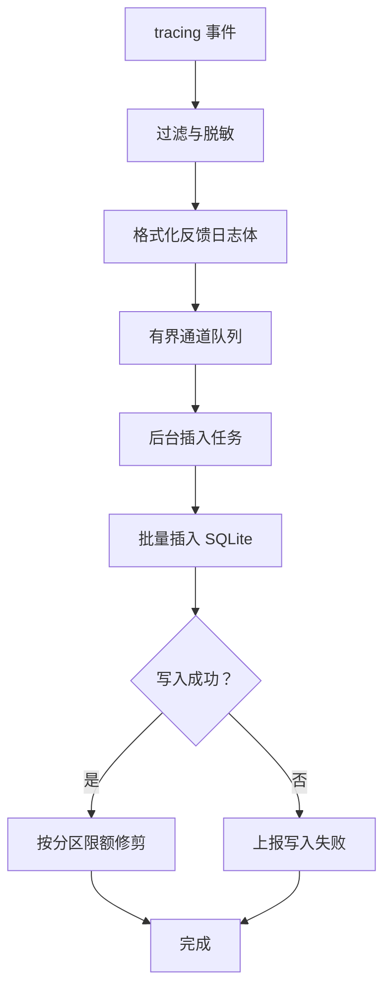
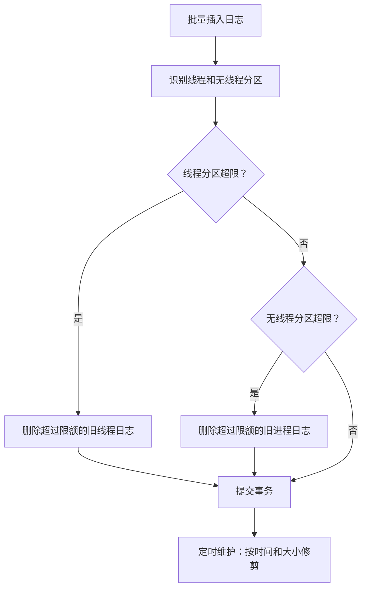
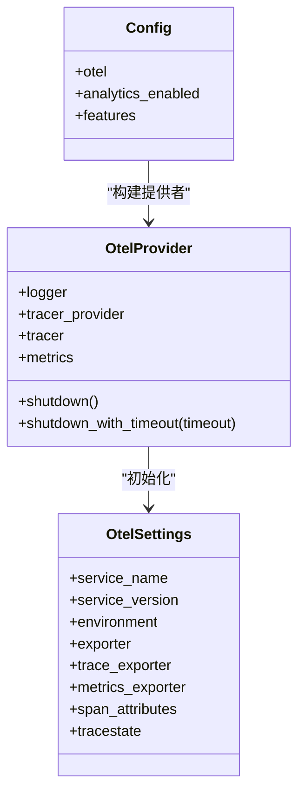
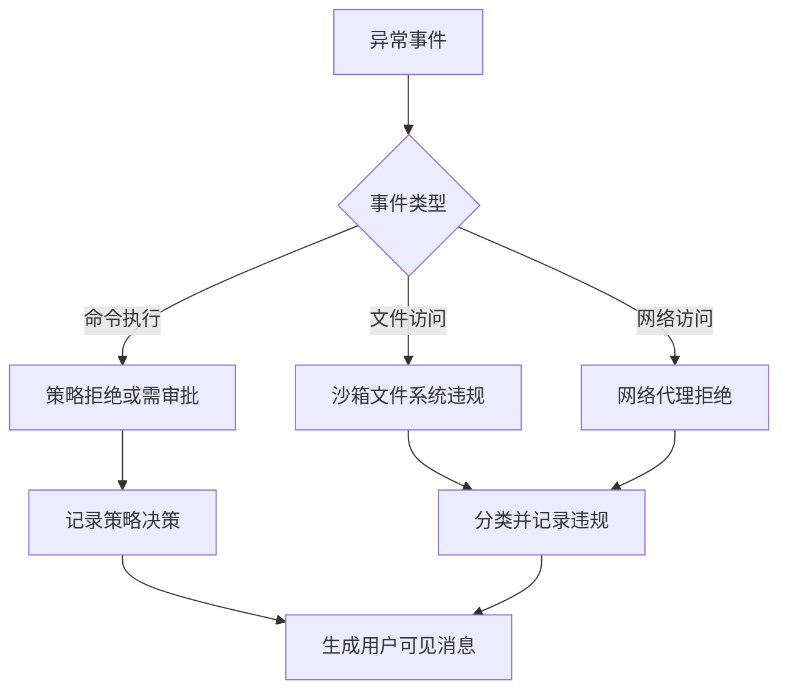
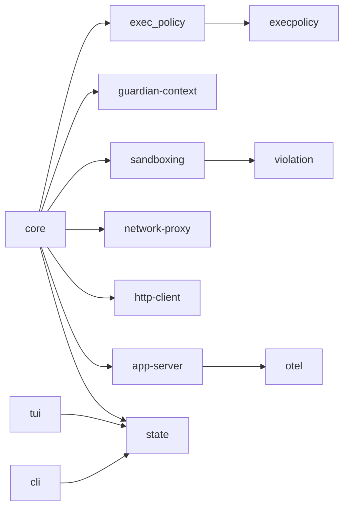

# 安全审计与日志

<cite>
**本文引用的文件**   
- [exec_policy.rs](file://codex-rs/core/src/exec_policy.rs)
- [policy.rs](file://codex-rs/execpolicy/src/policy.rs)
- [lib.rs](file://codex-rs/guardian-context/src/lib.rs)
- [enforcement.rs](file://codex-rs/guardian-context/src/enforcement.rs)
- [reviews.rs](file://codex-rs/guardian-context/src/reviews.rs)
- [guardian_review.rs](file://codex-rs/core/src/guardian_review.rs)
- [network_policy_decision.rs](file://codex-rs/core/src/network_policy_decision.rs)
- [violation.rs](file://codex-rs/sandboxing/src/violation.rs)
- [lib.rs](file://codex-rs/sandboxing/src/lib.rs)
- [client.rs](file://codex-rs/http-client/src/client.rs)
- [process_log_metadata.rs](file://codex-rs/network-proxy/src/process_log_metadata.rs)
- [app_server_tracing.rs](file://codex-rs/app-server/src/app_server_tracing.rs)
- [otel_init.rs](file://codex-rs/core/src/otel_init.rs)
- [lib.rs](file://codex-rs/otel/src/lib.rs)
- [provider.rs](file://codex-rs/otel/src/provider.rs)
- [log_db.rs](file://codex-rs/state/src/log_db.rs)
- [logs.rs](file://codex-rs/state/src/runtime/logs.rs)
- [logs_maintenance.rs](file://codex-rs/state/src/runtime/logs_maintenance.rs)
- [audit.rs](file://codex-rs/state/src/audit.rs)
- [session_log.rs](file://codex-rs/tui/src/session_log.rs)
- [process_exec_processor.rs](file://codex-rs/app-server/src/request_processors/process_exec_processor.rs)
- [logs_client.rs](file://codex-rs/cli/src/bin/logs_client.rs)
</cite>

## 目录

1. [引言](#引言)
2. [项目结构中的安全与日志组件](#项目结构中的安全与日志组件)
3. [执行过程安全审计机制](#执行过程安全审计机制)
4. [日志记录系统](#日志记录系统)
5. [安全事件检测与响应](#安全事件检测与响应)
6. [审计数据查询与分析工具](#审计数据查询与分析工具)
7. [合规性与数据保留策略](#合规性与数据保留策略)
8. [安全事件调查与取证指南](#安全事件调查与取证指南)
9. [依赖关系分析](#依赖关系分析)
10. [性能与可靠性考虑](#性能与可靠性考虑)
11. [故障排查](#故障排查)
12. [结论](#结论)

## 引言

本仓库的安全审计与日志体系由多个子系统共同组成：命令执行策略、沙箱与网络访问控制、Guardian 审核上下文、结构化追踪与遥测、SQLite 日志持久化、TUI 会话日志，以及面向运维的日志查询工具。其核心目标是：

- 在命令执行、文件操作和网络请求等关键路径上留下可审计痕迹。
- 将用户可见的反馈日志和诊断日志持久化到本地 SQLite。
- 通过 OpenTelemetry 输出追踪、指标和部分日志。
- 对异常行为进行分类、记录和上报，为调查提供证据链。
- 对日志容量和保留时间进行约束，避免无限增长。

该文档从代码实现出发，说明这些组件如何协作完成安全审计与日志记录，并给出使用建议、排查方法和合规性注意事项。

## 项目结构中的安全与日志组件

安全审计与日志相关的主要模块分布如下：

| 层级 | 模块 | 主要职责 |
|---|---|---|
| 执行策略层 | `core/exec_policy`、`execpolicy` | 解析和执行命令执行规则，决定允许、拒绝或要求审批。 |
| 审核上下文层 | `guardian-context` | 构建审核所需的历史、动作、预算、截断和证据。 |
| 沙箱与违规层 | `sandboxing` | 管理 Linux/macOS/Windows 沙箱，分类文件系统与网络违规。 |
| 网络代理层 | `network-proxy`、`http-client` | 记录进程归属元数据，封装 HTTP 请求日志和错误日志。 |
| 应用服务器层 | `app-server` | 建立请求级追踪跨度，关联客户端、传输方式和线程。 |
| 遥测层 | `otel` | 初始化 OpenTelemetry 提供者，桥接 tracing 与 OTLP。 |
| 状态存储层 | `state` | 将 tracing 事件写入 SQLite，维护日志分区、清理和只读审计查询。 |
| 终端界面层 | `tui` | 可选记录 TUI 会话 JSONL 日志。 |
| 命令行工具 | `cli` | 提供 `codex-state-logs` 查询本地日志数据库。 |

**图表来源**
- [exec_policy.rs:1-200](file://codex-rs/core/src/exec_policy.rs#L1-L200)
- [lib.rs:1-120](file://codex-rs/guardian-context/src/lib.rs#L1-L120)
- [lib.rs:1-110](file://codex-rs/sandboxing/src/lib.rs#L1-L110)
- [client.rs:1-180](file://codex-rs/http-client/src/client.rs#L1-L180)
- [app_server_tracing.rs:1-180](file://codex-rs/app-server/src/app_server_tracing.rs#L1-L180)
- [lib.rs:1-104](file://codex-rs/otel/src/lib.rs#L1-L104)
- [log_db.rs:1-200](file://codex-rs/state/src/log_db.rs#L1-L200)
- [session_log.rs:1-150](file://codex-rs/tui/src/session_log.rs#L1-L150)
- [logs_client.rs:1-150](file://codex-rs/cli/src/bin/logs_client.rs#L1-L150)

**章节来源**
- [exec_policy.rs:1-200](file://codex-rs/core/src/exec_policy.rs#L1-L200)
- [lib.rs:1-120](file://codex-rs/guardian-context/src/lib.rs#L1-L120)
- [lib.rs:1-110](file://codex-rs/sandboxing/src/lib.rs#L1-L110)
- [client.rs:1-180](file://codex-rs/http-client/src/client.rs#L1-L180)
- [app_server_tracing.rs:1-180](file://codex-rs/app-server/src/app_server_tracing.rs#L1-L180)
- [lib.rs:1-104](file://codex-rs/otel/src/lib.rs#L1-L104)
- [log_db.rs:1-200](file://codex-rs/state/src/log_db.rs#L1-L200)
- [session_log.rs:1-150](file://codex-rs/tui/src/session_log.rs#L1-L150)
- [logs_client.rs:1-150](file://codex-rs/cli/src/bin/logs_client.rs#L1-L150)

## 执行过程安全审计机制

### 命令执行审计

命令执行是安全审计的核心入口。`core/exec_policy` 负责加载策略、匹配程序名、前缀规则和危险命令启发式规则，最终返回允许、拒绝或需要审批的结果。

关键点如下：

- 策略模块提供程序级规则、网络规则、主机可执行路径映射和指纹比较能力。
- 核心执行策略层维护默认禁止前缀列表，用于识别常见 shell、脚本语言和包管理器命令。
- 命令来源可能来自原始参数，也可能经过 shell 降低，例如 PowerShell 的 `-Command` 参数。
- 未匹配命令会触发平台相关的危险命令启发式判断。
- 策略可以结合权限配置、沙箱级别和审批设置决定是否阻断。

**图表来源**
- [exec_policy.rs:1-200](file://codex-rs/core/src/exec_policy.rs#L1-L200)
- [policy.rs:1-200](file://codex-rs/execpolicy/src/policy.rs#L1-L200)

**章节来源**
- [exec_policy.rs:1-200](file://codex-rs/core/src/exec_policy.rs#L1-L200)
- [policy.rs:1-200](file://codex-rs/execpolicy/src/policy.rs#L1-L200)

### 文件操作审计

文件操作审计主要通过沙箱实现。沙箱支持多种后端：

- Linux：Bubblewrap、Landlock、seccomp。
- macOS：Seatbelt。
- Windows：受限令牌、Windows Sandbox、MXC。

当受控进程尝试访问被限制的文件时，系统会尝试将其分类为文件系统违规。分类逻辑会检查退出码、标准输出、标准错误和聚合输出，并识别如“operation not permitted”“permission denied”“read-only file system”“seccomp”“landlock”等关键词。

违规事件包含以下信息：

- 后端类型。
- 原因枚举。
- 可选路径。
- 输出片段。

此外，网络访问违规也会以统一事件形式记录，包括主机、协议、方法、模式、决策和来源。

**图表来源**
- [violation.rs:1-180](file://codex-rs/sandboxing/src/violation.rs#L1-L180)
- [lib.rs:1-110](file://codex-rs/sandboxing/src/lib.rs#L1-L110)

**章节来源**
- [violation.rs:1-180](file://codex-rs/sandboxing/src/violation.rs#L1-L180)
- [lib.rs:1-110](file://codex-rs/sandboxing/src/lib.rs#L1-L110)

### 网络请求审计

网络请求审计分为两个层面：

1. **策略层**：执行策略中的网络规则决定某个主机是否允许访问。
2. **代理层**：托管网络代理在发送请求时记录阻塞决策，并将其转换为人类可读消息和规范化违规事件。

网络策略决策转换会将协议映射为 HTTP、HTTPS、SOCKS5 TCP 或 SOCKS5 UDP，并将审批动作转换为允许或禁止。如果代理明确拒绝，则生成一条包含主机、原因和方法的提示消息；否则可能仅作为通用网络策略拦截。

**图表来源**
- [network_policy_decision.rs:1-106](file://codex-rs/core/src/network_policy_decision.rs#L1-L106)
- [client.rs:1-180](file://codex-rs/http-client/src/client.rs#L1-L180)
- [process_log_metadata.rs:1-17](file://codex-rs/network-proxy/src/process_log_metadata.rs#L1-L17)

**章节来源**
- [network_policy_decision.rs:1-106](file://codex-rs/core/src/network_policy_decision.rs#L1-L106)
- [client.rs:1-180](file://codex-rs/http-client/src/client.rs#L1-L180)
- [process_log_metadata.rs:1-17](file://codex-rs/network-proxy/src/process_log_metadata.rs#L1-L17)

### Guardian 审核上下文与命令审计

Guardian 审核上下文不是直接审计器，而是为同步和异步审核准备结构化证据。它收集对话转录、授权信息、已验证答案、保留指令、发送者消息和历史记录，并按预算和优先级截断。

在命令审计方面，Guardian 上下文关注：

- 动作呈现。
- 计划动作及动作类型。
- 审核历史。
- 预算与保留策略。
- 转录裁剪与成本估计。

这使上层审核系统能够基于一致的证据格式评估模型调用、工具调用和潜在敏感操作。

**图表来源**
- [lib.rs:1-120](file://codex-rs/guardian-context/src/lib.rs#L1-L120)
- [enforcement.rs:1-180](file://codex-rs/guardian-context/src/enforcement.rs#L1-L180)
- [reviews.rs:1-180](file://codex-rs/guardian-context/src/reviews.rs#L1-L180)
- [guardian_review.rs:1-16](file://codex-rs/core/src/guardian_review.rs#L1-L16)

**章节来源**
- [lib.rs:1-120](file://codex-rs/guardian-context/src/lib.rs#L1-L120)
- [enforcement.rs:1-180](file://codex-rs/guardian-context/src/enforcement.rs#L1-L180)
- [reviews.rs:1-180](file://codex-rs/guardian-context/src/reviews.rs#L1-L180)
- [guardian_review.rs:1-16](file://codex-rs/core/src/guardian_review.rs#L1-L16)

## 日志记录系统

### 结构化日志与追踪

项目使用 `tracing` 作为主要日志框架，并通过 `otel` 模块将追踪桥接到 OpenTelemetry。`state::log_db` 提供一个 `Layer`，把 tracing 事件转换为 `LogEntry`，放入有界后台队列，再批量写入 SQLite。

关键特性包括：

- 使用 `tracing_subscriber` 过滤器抑制高频或无关目标，如 SQLx、OTLP 内部日志、Tokio 调试事件。
- 为每个事件记录时间戳、纳秒精度、级别、目标、消息、线程 ID、进程 UUID、模块路径、文件和行号。
- 将事件附加到当前 span 的字段中，以便后续恢复完整上下文。
- 对 SQLite 写入失败使用非重入报告机制，避免日志系统自身引发递归写入。
- 对日志队列溢出进行遥测计数。

**图表来源**
- [log_db.rs:1-200](file://codex-rs/state/src/log_db.rs#L1-L200)
- [log_db.rs:200-450](file://codex-rs/state/src/log_db.rs#L200-L450)
- [logs.rs:1-200](file://codex-rs/state/src/runtime/logs.rs#L1-L200)

**章节来源**
- [log_db.rs:1-200](file://codex-rs/state/src/log_db.rs#L1-L200)
- [log_db.rs:200-450](file://codex-rs/state/src/log_db.rs#L200-L450)
- [logs.rs:1-200](file://codex-rs/state/src/runtime/logs.rs#L1-L200)

### 日志级别与默认过滤器

`log_db` 的默认过滤器不是简单开启所有级别，而是针对高噪声目标关闭或降级：

| 目标或范围 | 默认级别 | 原因 |
|---|---:|---|
| `h2`、`hyper_util` | WARN | 抑制底层 HTTP/2 高频日志 |
| `log`、`opentelemetry-otlp`、`opentelemetry-http` | OFF | 防止 OTLP 导出本身产生更多日志 |
| `sqlx`、`sqlx_core`、`sqlx_sqlite` | OFF | 防止数据库写事件产生更多写事件 |
| `tokio::`、`runtime::` | INFO | 抑制 Tokio 内部 DEBUG/TRACE 定时器事件 |
| `opentelemetry_sdk` | TRACE/DEBUG 过滤 | 减少 SDK 内部计时元事件 |
| `codex_http_client::transport` | DEBUG | 保留网络传输日志但不过度放大 |
| `codex_tui::streaming::controller` | DEBUG | 流式 UI 控制器避免每块日志淹没 SQLite |

这些规则确保 SQLite 日志库不会被系统内部高频事件压垮。

**章节来源**
- [log_db.rs:1-200](file://codex-rs/state/src/log_db.rs#L1-L200)

### 日志轮转与持久化存储

日志持久化由 `state::runtime::logs` 负责。每条日志包含：

- 秒级时间戳。
- 纳秒级时间戳。
- 级别。
- 目标。
- 反馈日志体。
- 线程 ID。
- 进程 UUID。
- 模块路径。
- 文件。
- 行号。
- 估算字节数。

插入后，系统会立即在同一事务中执行分区修剪。分区分为两类：

1. **线程日志**：按 `thread_id` 分组。
2. **无线程进程日志**：按 `process_uuid` 分组，也包括 `process_uuid IS NULL` 的单独分区。

修剪同时考虑累计字节数和行数，按时间倒序删除最旧记录。

此外，`logs_maintenance` 提供周期性维护：

- 默认保留 10 天。
- 默认数据库占用上限约 64 MiB。
- 首次扫描后进行 WAL checkpoint。
- 兼容旧版日志数据库位置。

**图表来源**
- [logs.rs:1-200](file://codex-rs/state/src/runtime/logs.rs#L1-L200)
- [logs_maintenance.rs:1-100](file://codex-rs/state/src/runtime/logs_maintenance.rs#L1-L100)

**章节来源**
- [logs.rs:1-200](file://codex-rs/state/src/runtime/logs.rs#L1-L200)
- [logs_maintenance.rs:1-100](file://codex-rs/state/src/runtime/logs_maintenance.rs#L1-L100)

### OpenTelemetry 与遥测

`otel` 模块暴露 `OtelProvider`，负责：

- 创建日志、追踪和指标提供者。
- 桥接 tracing 与 OpenTelemetry。
- 支持 Statsig、OTLP HTTP、OTLP gRPC 和禁用导出。
- 在独立工作线程中执行带超时的优雅关闭。
- 注入 W3C Trace Context。
- 记录进程启动、SQL 运行时遥测等基础指标。

`core::otel_init` 根据应用配置构建提供者，并处理分析同意对指标导出的影响。

**图表来源**
- [provider.rs:1-200](file://codex-rs/otel/src/provider.rs#L1-L200)
- [otel_init.rs:1-113](file://codex-rs/core/src/otel_init.rs#L1-L113)
- [lib.rs:1-104](file://codex-rs/otel/src/lib.rs#L1-L104)

**章节来源**
- [provider.rs:1-200](file://codex-rs/otel/src/provider.rs#L1-L200)
- [otel_init.rs:1-113](file://codex-rs/core/src/otel_init.rs#L1-L113)
- [lib.rs:1-104](file://codex-rs/otel/src/lib.rs#L1-L104)

### 应用服务器追踪

应用服务器为每个请求创建统一的 `app_server.request` 跨度，包含：

- RPC 系统、方法、传输方式。
- 请求 ID。
- 连接 ID。
- API 版本。
- 客户端名称和版本。
- 线程 ID。
- W3C Trace Context 父上下文。

这使得 stdio、Unix Socket、WebSocket 和内嵌调用的请求遥测具有可比性。

**章节来源**
- [app_server_tracing.rs:1-180](file://codex-rs/app-server/src/app_server_tracing.rs#L1-L180)

### TUI 会话日志

TUI 有一个可选的会话日志记录器，默认关闭。可通过环境变量启用：

- `CODEX_TUI_RECORD_SESSION=1`、`true`、`TRUE`、`yes`、`YES` 表示启用。
- `CODEX_TUI_SESSION_LOG_PATH` 指定日志路径。
- 默认路径位于配置日志目录，文件名包含 ISO 时间戳。
- 文件格式为 JSONL，每条一行。
- Unix 下文件权限设置为 `0o600`。

该日志主要用于调试 TUI 事件流，不应替代主日志数据库。

**章节来源**
- [session_log.rs:1-150](file://codex-rs/tui/src/session_log.rs#L1-L150)

## 安全事件检测与响应

### 异常行为识别

安全异常主要分为三类：

1. **命令执行异常**：由执行策略拒绝或需要审批。
2. **沙箱违规**：受控进程被操作系统、内核或平台沙箱机制拒绝。
3. **网络访问异常**：托管网络代理根据策略阻止请求。

沙箱违规分类会优先检查明显非沙箱错误，例如 shell 内置参数错误、权限不足、命令未找到，然后检查 seccomp 信号和输出关键词。网络违规会从 `BlockedRequest` 提取主机、协议、方法、模式和决策。

**图表来源**
- [exec_policy.rs:1-200](file://codex-rs/core/src/exec_policy.rs#L1-L200)
- [violation.rs:1-180](file://codex-rs/sandboxing/src/violation.rs#L1-L180)
- [network_policy_decision.rs:1-106](file://codex-rs/core/src/network_policy_decision.rs#L1-L106)

**章节来源**
- [exec_policy.rs:1-200](file://codex-rs/core/src/exec_policy.rs#L1-L200)
- [violation.rs:1-180](file://codex-rs/sandboxing/src/violation.rs#L1-L180)
- [network_policy_decision.rs:1-106](file://codex-rs/core/src/network_policy_decision.rs#L1-L106)

### 告警触发与自动阻断

仓库中没有单一集中式“告警引擎”，但存在多处自动阻断和告警点：

| 场景 | 自动行为 | 可观测性 |
|---|---|---|
| 执行策略拒绝命令 | 终止命令执行 | 策略日志、用户消息 |
| 沙箱文件系统操作被拒绝 | 分类为违规并记录 | 违规事件、stderr/stdout 片段 |
| 网络代理拒绝请求 | 阻断请求并生成策略消息 | 代理日志、违规事件 |
| SQLite 日志写入失败 | 上报失败但不递归写入 | 遥测和反馈缓冲 |
| 日志队列满 | 丢弃并记录丢弃原因 | 遥测计数 |
| 日志数据库过大 | 按时间和大小修剪 | 维护日志 |

对于“自动阻断”，应理解为策略和沙箱的直接拒绝；对于“告警”，更准确的说法是结构化日志、违规事件和遥测指标。

**章节来源**
- [log_db.rs:200-450](file://codex-rs/state/src/log_db.rs#L200-L450)
- [logs_maintenance.rs:1-100](file://codex-rs/state/src/runtime/logs_maintenance.rs#L1-L100)
- [violation.rs:1-180](file://codex-rs/sandboxing/src/violation.rs#L1-L180)
- [network_policy_decision.rs:1-106](file://codex-rs/core/src/network_policy_decision.rs#L1-L106)

## 审计数据查询与分析工具

### SQLite 日志数据库

主审计数据存储在 SQLite 日志数据库中。`state::log_db` 提供写入层，`state::runtime::logs` 提供插入和修剪逻辑，`state::audit` 提供只读审计查询。

适合审计的关键字段：

| 字段 | 用途 |
|---|---|
| `ts` | 秒级时间戳 |
| `ts_nanos` | 纳秒级时间戳 |
| `level` | 日志级别 |
| `target` | 日志目标模块 |
| `feedback_log_body` | 用户可见反馈日志内容 |
| `thread_id` | 会话线程标识 |
| `process_uuid` | 进程身份标识 |
| `module_path` | 模块路径 |
| `file` | 源文件 |
| `line` | 行号 |
| `estimated_bytes` | 估算字节数 |

### CLI 日志客户端

`cli/bin/logs_client.rs` 提供 `codex-state-logs` 命令，用于本地查询日志数据库。支持的筛选条件包括：

| 参数 | 含义 |
|---|---|
| `--codex-home` | 指定 CODEX_HOME |
| `--db` | 直接指定日志 SQLite 路径 |
| `--level` | 最低日志级别阈值 |
| `--from` | 起始时间，RFC3339 或 Unix 秒 |
| `--to` | 结束时间，RFC3339 或 Unix 秒 |
| `--module` | 按模块路径子串匹配 |
| `--file` | 按源文件路径子串匹配 |
| `--thread-id` | 按线程 ID 匹配 |
| `--search` | 按渲染日志体子串搜索 |
| `--threadless` | 包含无线程日志 |
| `--backfill` | 回补显示的行数 |
| `--poll-ms` | 轮询间隔毫秒 |
| `--compact` | 紧凑输出 |

典型用法示例：

- 查看最近 200 条 ERROR 以上日志：  
  `codex-state-logs --level error`
- 查找某线程在特定时间段的日志：  
  `codex-state-logs --thread-id <id> --from <start> --to <end>`
- 搜索模块路径中包含某关键字的记录：  
  `codex-state-logs --module codex_core::exec_policy`
- 实时跟踪新日志：  
  `codex-state-logs --poll-ms 500`

**章节来源**
- [log_db.rs:1-200](file://codex-rs/state/src/log_db.rs#L1-L200)
- [logs.rs:1-200](file://codex-rs/state/src/runtime/logs.rs#L1-L200)
- [audit.rs:1-65](file://codex-rs/state/src/audit.rs#L1-L65)
- [logs_client.rs:1-150](file://codex-rs/cli/src/bin/logs_client.rs#L1-L150)

### 只读状态审计

`state::audit` 提供最小化的只读审计接口，用于读取线程状态和 rollout 路径，而不创建、迁移或修复状态数据库。这适合外部审计工具或离线分析。

**章节来源**
- [audit.rs:1-65](file://codex-rs/state/src/audit.rs#L1-L65)

## 合规性与数据保留策略

### 数据保留策略

日志保留策略由两部分组成：

1. **分区保留**：每次插入后立即按线程或进程 UUID 修剪，防止单一线程或进程无限增长。
2. **全局保留**：定时任务按时间和数据库大小修剪。

默认值：

- 日志保留时间：10 天。
- 日志数据库占用预算：约 64 MiB。
- 日志队列容量：2048。
- 批量写入大小：512。
- 刷新间隔：10 秒。

这些值设计为保护本地磁盘和用户体验，而不是长期合规归档。若需要审计归档，应在部署侧复制日志数据库或使用外部导出管道。

### 隐私与敏感数据处理

代码中存在多处敏感数据防护：

- HTTP 客户端可选择禁用 URL 和响应头诊断。
- 日志过滤器屏蔽 SQLx、OTLP 内部日志和 Tokio 调试事件。
- Guardian 审核上下文对证据进行预算和截断，避免不必要的大负载。
- 沙箱违规输出仅保留有限字符片段。
- TUI 会话日志仅在显式启用时写入，且 Unix 下限制文件权限。

需要注意的是，日志中的 `message` 和 `feedback_log_body` 可能包含用户输入或工具输出，因此不应假设所有日志天然匿名。

**章节来源**
- [logs_maintenance.rs:1-100](file://codex-rs/state/src/runtime/logs_maintenance.rs#L1-L100)
- [log_db.rs:1-200](file://codex-rs/state/src/log_db.rs#L1-L200)
- [client.rs:1-180](file://codex-rs/http-client/src/client.rs#L1-L180)
- [violation.rs:1-180](file://codex-rs/sandboxing/src/violation.rs#L1-L180)
- [session_log.rs:1-150](file://codex-rs/tui/src/session_log.rs#L1-L150)

## 安全事件调查与取证指南

### 第一步：确定受影响进程和线程

优先通过进程 UUID 或线程 ID 缩小范围：

- 使用 `--thread-id` 定位会话线程。
- 使用 `--search` 搜索用户输入、命令片段或错误消息。
- 使用 `--module` 和 `--file` 定位具体模块。
- 使用 `--from` 和 `--to` 限定时间窗口。

如果事件涉及沙箱，还应关注进程 UUID，因为部分沙箱日志可能属于无线程进程。

### 第二步：区分策略拒绝与沙箱违规

- 如果命令从未执行，优先查看执行策略相关日志。
- 如果命令已执行但失败，优先查看沙箱违规和进程输出。
- 如果网络请求未到达远端，优先查看网络代理拒绝消息。

执行策略拒绝通常表现为命令被阻止或需要审批；沙箱违规通常表现为进程退出码非零且输出包含系统级拒绝信息。

### 第三步：关联追踪上下文

如果需要跨服务调查，应使用 W3C Trace Context：

- 检查 `app_server.request` 跨度。
- 检查传入请求中的 `traceparent` 和 `tracestate`。
- 检查 OpenTelemetry 导出是否启用。
- 确认下游系统能接收 OTLP HTTP 或 gRPC。

### 第四步：保存证据

建议保存以下内容：

- 受影响时间段内的日志数据库快照。
- 执行策略规则。
- 权限配置文件。
- 沙箱类型和后端信息。
- 网络代理配置。
- OpenTelemetry 导出配置。
- 如有 TUI 问题，保存会话 JSONL 日志。

注意：快照前应评估日志中是否包含敏感信息，并在必要时进行脱敏。

**章节来源**
- [app_server_tracing.rs:1-180](file://codex-rs/app-server/src/app_server_tracing.rs#L1-L180)
- [logs_client.rs:1-150](file://codex-rs/cli/src/bin/logs_client.rs#L1-L150)
- [log_db.rs:1-200](file://codex-rs/state/src/log_db.rs#L1-L200)
- [session_log.rs:1-150](file://codex-rs/tui/src/session_log.rs#L1-L150)

## 依赖关系分析

**图表来源**
- [exec_policy.rs:1-200](file://codex-rs/core/src/exec_policy.rs#L1-L200)
- [policy.rs:1-200](file://codex-rs/execpolicy/src/policy.rs#L1-L200)
- [lib.rs:1-120](file://codex-rs/guardian-context/src/lib.rs#L1-L120)
- [lib.rs:1-110](file://codex-rs/sandboxing/src/lib.rs#L1-L110)
- [client.rs:1-180](file://codex-rs/http-client/src/client.rs#L1-L180)
- [app_server_tracing.rs:1-180](file://codex-rs/app-server/src/app_server_tracing.rs#L1-L180)
- [lib.rs:1-104](file://codex-rs/otel/src/lib.rs#L1-L104)
- [log_db.rs:1-200](file://codex-rs/state/src/log_db.rs#L1-L200)
- [session_log.rs:1-150](file://codex-rs/tui/src/session_log.rs#L1-L150)
- [logs_client.rs:1-150](file://codex-rs/cli/src/bin/logs_client.rs#L1-L150)

**章节来源**
- [exec_policy.rs:1-200](file://codex-rs/core/src/exec_policy.rs#L1-L200)
- [policy.rs:1-200](file://codex-rs/execpolicy/src/policy.rs#L1-L200)
- [lib.rs:1-120](file://codex-rs/guardian-context/src/lib.rs#L1-L120)
- [lib.rs:1-110](file://codex-rs/sandboxing/src/lib.rs#L1-L110)
- [client.rs:1-180](file://codex-rs/http-client/src/client.rs#L1-L180)
- [app_server_tracing.rs:1-180](file://codex-rs/app-server/src/app_server_tracing.rs#L1-L180)
- [lib.rs:1-104](file://codex-rs/otel/src/lib.rs#L1-L104)
- [log_db.rs:1-200](file://codex-rs/state/src/log_db.rs#L1-L200)
- [session_log.rs:1-150](file://codex-rs/tui/src/session_log.rs#L1-L150)
- [logs_client.rs:1-150](file://codex-rs/cli/src/bin/logs_client.rs#L1-L150)

## 性能与可靠性考虑

### 日志写入性能

日志写入采用异步队列加批量插入的方式，避免同步 SQLite 写入阻塞主流程。默认队列容量为 2048，批量大小为 512，刷新间隔为 10 秒。在高并发环境下，如果写入速度跟不上生产速度，队列可能溢出，导致日志丢失。

建议监控：

- `has_write_failure` 标志。
- 日志队列丢弃遥测。
- SQLite 日志数据库文件大小。
- 定时维护日志。

### 遥测关闭开销

`OtelProvider` 的关闭操作可能阻塞，因此实现了独立的 shutdown worker，并支持超时关闭。如果 exporter 不可用或网络缓慢，应避免让进程退出等待遥测关闭。

**章节来源**
- [log_db.rs:200-450](file://codex-rs/state/src/log_db.rs#L200-L450)
- [provider.rs:1-200](file://codex-rs/otel/src/provider.rs#L1-L200)

## 故障排查

### 日志没有写入 SQLite

可能原因：

1. 日志层未初始化。
2. 过滤器关闭了目标模块。
3. SQLite 日志池不可用。
4. 队列已满，事件被丢弃。
5. 写入失败，但未重试。

排查步骤：

- 检查是否调用了日志层启动函数。
- 使用 `--level trace` 观察是否有过滤。
- 使用 `codex-state-logs` 确认数据库是否存在。
- 检查遥测中是否出现日志队列丢弃记录。

**章节来源**
- [log_db.rs:1-200](file://codex-rs/state/src/log_db.rs#L1-L200)
- [log_db.rs:200-450](file://codex-rs/state/src/log_db.rs#L200-L450)

### 日志数据库持续增长

可能原因：

1. 分区修剪未生效。
2. 定时维护未运行。
3. 日志写入量远超保留预算。
4. 多进程写入导致分区边界扩大。

排查步骤：

- 检查 `logs_maintenance` 是否运行。
- 检查 SQLite 文件占用空间。
- 检查 `estimated_bytes` 累积情况。
- 调整部署侧日志保留策略。

**章节来源**
- [logs.rs:1-200](file://codex-rs/state/src/runtime/logs.rs#L1-L200)
- [logs_maintenance.rs:1-100](file://codex-rs/state/src/runtime/logs_maintenance.rs#L1-L100)

### 无法追踪跨服务请求

可能原因：

1. 未启用 OpenTelemetry 导出。
2. 上游未传递 W3C Trace Context。
3. 下游不支持 OTLP。
4. 环境变量中的 trace context 无效。

排查步骤：

- 检查 `otel_init` 配置。
- 检查应用服务器跨度是否包含 `rpc.traceparent`。
- 检查 OTLP endpoint 可达性。
- 检查遥测导出是否因分析同意被关闭。

**章节来源**
- [otel_init.rs:1-113](file://codex-rs/core/src/otel_init.rs#L1-L113)
- [app_server_tracing.rs:1-180](file://codex-rs/app-server/src/app_server_tracing.rs#L1-L180)
- [provider.rs:1-200](file://codex-rs/otel/src/provider.rs#L1-L200)

### TUI 会话日志未生成

可能原因：

1. 未设置 `CODEX_TUI_RECORD_SESSION`。
2. 日志路径不可写。
3. 父目录创建失败。
4. 日志序列化失败。

排查步骤：

- 检查环境变量。
- 检查日志目录权限。
- 检查 TUI 警告日志。
- 临时将日志写到易访问目录验证。

**章节来源**
- [session_log.rs:1-150](file://codex-rs/tui/src/session_log.rs#L1-L150)

## 结论

该仓库的安全审计与日志系统是一个分层架构：

- 执行策略和沙箱负责实际阻断。
- Guardian 上下文负责为审核提供结构化证据。
- 网络和 HTTP 客户端负责请求级可观测性。
- tracing 和 OpenTelemetry 负责追踪和遥测。
- SQLite 日志数据库负责本地持久化。
- CLI 日志工具负责本地查询。
- TUI 会话日志提供辅助调试。

对于安全运营团队，建议：

1. 将 SQLite 日志数据库纳入定期备份。
2. 将 OpenTelemetry 导出接入集中式日志和追踪平台。
3. 对策略拒绝、沙箱违规和网络拒绝建立告警规则。
4. 对日志中的敏感信息进行脱敏策略。
5. 将本地日志保留策略与企业合规要求对齐，并通过外部归档满足长期保留需求。
6. 使用 `codex-state-logs` 作为日常调查入口，并结合 OpenTelemetry 做跨服务关联。