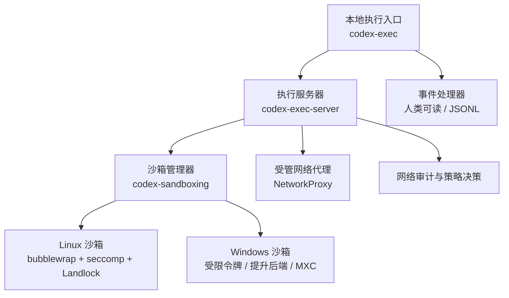
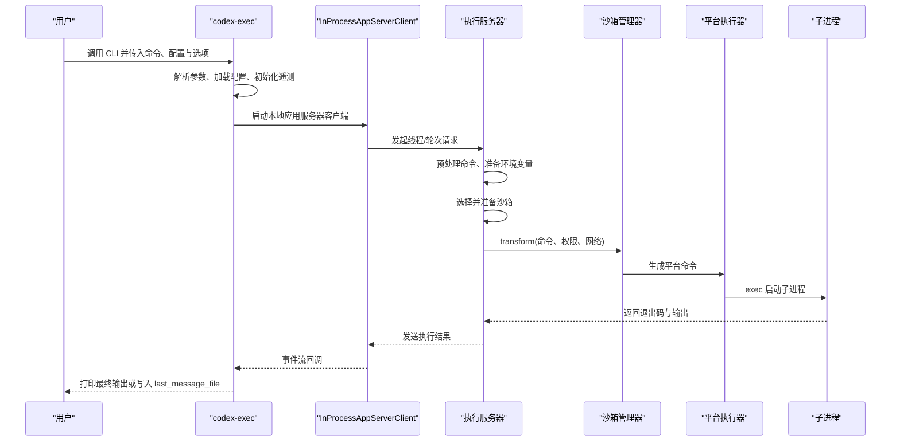
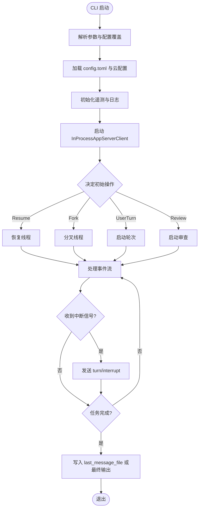
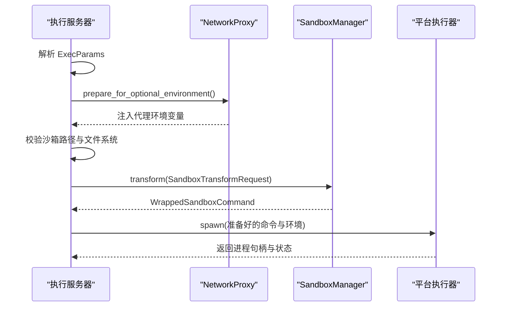
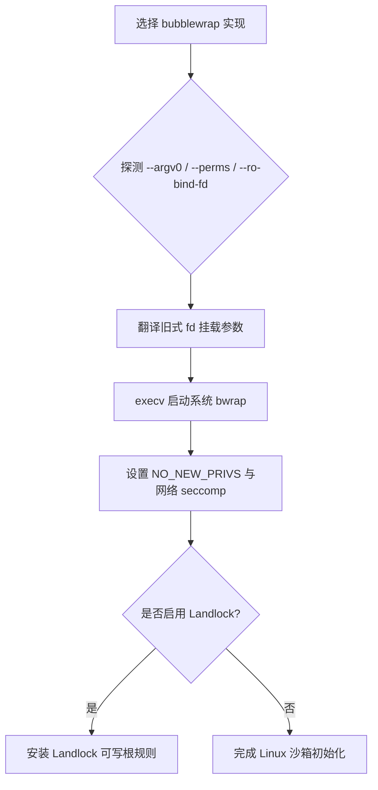
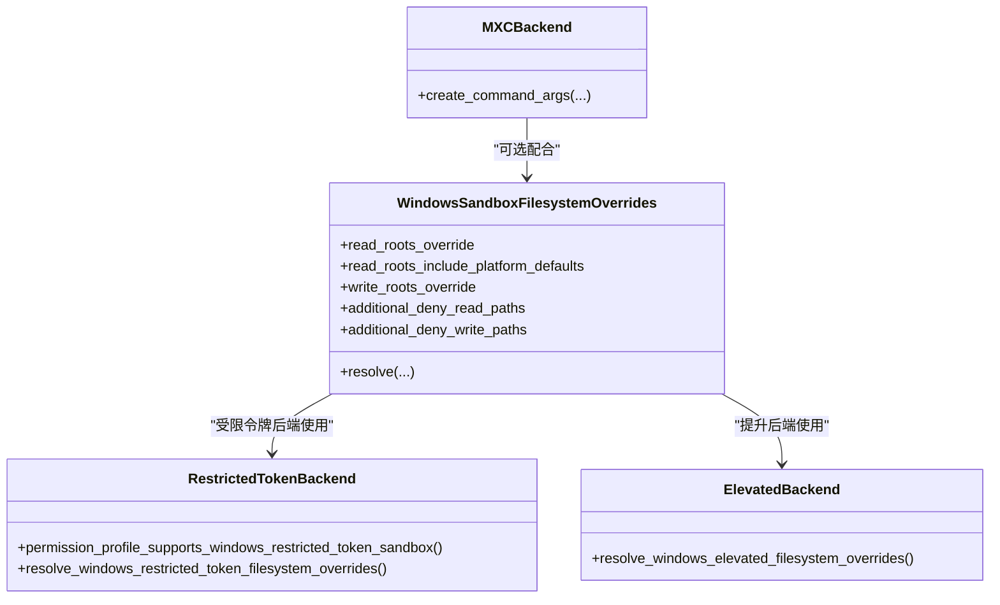
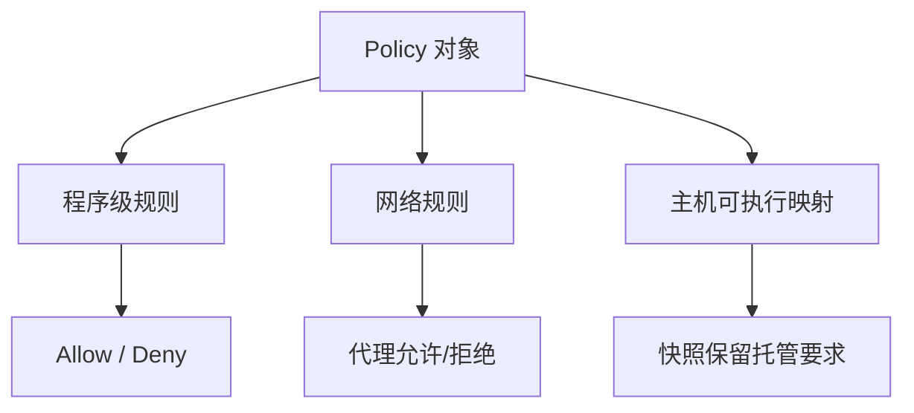
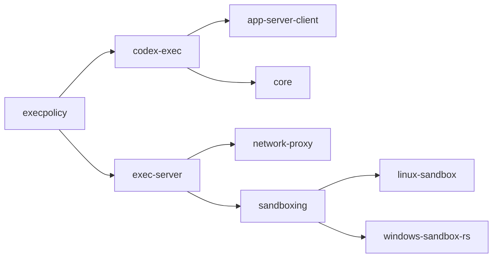
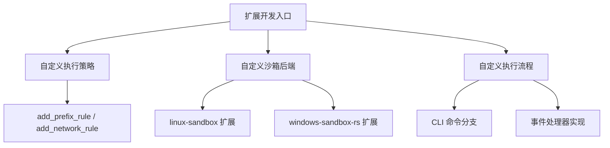

# 执行环境

<cite>
**本文引用的文件**   
- [exec/lib.rs](file://codex-rs/exec/src/lib.rs)
- [exec/main.rs](file://codex-rs/exec/src/main.rs)
- [exec/event_processor.rs](file://codex-rs/exec/src/event_processor.rs)
- [exec/worktree.rs](file://codex-rs/exec/src/worktree.rs)
- [exec/daybreak.rs](file://codex-rs/exec/src/daybreak.rs)
- [exec-server/server.rs](file://codex-rs/exec-server/src/server.rs)
- [exec-server/process_sandbox.rs](file://codex-rs/exec-server/src/process_sandbox.rs)
- [sandboxing/lib.rs](file://codex-rs/sandboxing/src/lib.rs)
- [sandboxing/manager.rs](file://codex-rs/sandboxing/src/manager.rs)
- [linux-sandbox/launcher.rs](file://codex-rs/linux-sandbox/src/launcher.rs)
- [linux-sandbox/seccomp.rs](file://codex-rs/linux-sandbox/src/seccomp.rs)
- [windows-sandbox-rs/lib.rs](file://codex-rs/windows-sandbox-rs/src/lib.rs)
- [windows-sandbox-rs/src/windows.rs](file://codex-rs/windows-sandbox-rs/src/windows.rs)
- [execpolicy/policy.rs](file://codex-rs/execpolicy/src/policy.rs)
</cite>

## 目录
1. [引言](#引言)
2. [项目结构](#项目结构)
3. [核心组件](#核心组件)
4. [架构总览](#架构总览)
5. [详细组件分析](#详细组件分析)
6. [依赖关系分析](#依赖关系分析)
7. [性能与资源特性](#性能与资源特性)
8. [故障诊断与监控](#故障诊断与监控)
9. [自定义执行策略与扩展指南](#自定义执行策略与扩展指南)
10. [结论](#结论)

## 引言
本文件面向需要在本地或远程执行环境中运行代码命令、沙箱进程、网络代理和权限策略的用户与维护者。文档聚焦以下目标：
- 解释 `codex-exec` 本地执行引擎的命令解析、会话启动、事件处理、输出写入和中断机制。
- 说明执行服务器如何准备命令、选择沙箱、配置受管网络和记录审计。
- 对比 Linux 沙箱（bubblewrap、seccomp、Landlock）与 Windows 沙箱（受限令牌、提升后端、MXC）的实现差异和安全边界。
- 梳理执行策略中的权限控制、资源限制和网络访问控制。
- 总结安全审计、日志记录和 OpenTelemetry 集成方式。
- 提供监控、诊断工具使用方法和扩展自定义执行策略的指南。

## 项目结构
执行环境由多个 Rust crate 组成，围绕“命令入口 → 执行服务器 → 平台沙箱 → 子进程”分层组织：
- `codex-exec`：本地 CLI 入口，负责配置加载、会话编排、事件处理和输出格式化。
- `codex-exec-server`：执行服务器，负责 RPC 路由、请求预处理、沙箱选择和进程调度。
- `codex-sandboxing`：跨平台沙箱抽象，封装 Linux/macOS/Linux 沙箱、Windows 沙箱选择与转换。
- `codex-linux-sandbox`：Linux 侧具体实现，包含 bubblewrap 选择、fd 挂载、seccomp 与 Landlock。
- `codex-windows-sandbox-rs`：Windows 侧实现，包含 ACL、WFP、提升服务、受限令牌等。
- `codex-execpolicy`：执行策略模型、规则匹配与网络规则定义。

**图表来源**
- [exec/main.rs:1-48](file://codex-rs/exec/src/main.rs#L1-L48)
- [exec-server/server.rs:1-119](file://codex-rs/exec-server/src/server.rs#L1-L119)
- [sandboxing/lib.rs:1-110](file://codex-rs/sandboxing/src/lib.rs#L1-L110)
- [linux-sandbox/launcher.rs:1-200](file://codex-rs/linux-sandbox/src/launcher.rs#L1-L200)
- [windows-sandbox-rs/lib.rs:1-200](file://codex-rs/windows-sandbox-rs/src/lib.rs#L1-L200)

**章节来源**
- [exec/main.rs:1-48](file://codex-rs/exec/src/main.rs#L1-L48)
- [exec-server/server.rs:1-119](file://codex-rs/exec-server/src/server.rs#L1-L119)

## 核心组件
- 本地执行入口
  - 解析顶层 CLI 参数，合并根级配置覆盖项，并委托给 `run_main`。
  - 支持以不同 arg0 分派到独立功能，例如在 `codex-linux-sandbox` 模式下直接运行 Linux 沙箱逻辑。
- 执行服务器
  - 提供统一的监听与传输层入口，内部构建请求分发、会话注册、遥测与 WebSocket 认证。
- 沙箱管理
  - 根据权限配置、平台能力与受管网络需求选择 Linux、macOS Seatbelt、Windows 受限令牌或 MXC 沙箱。
- Linux 沙箱
  - 通过 bubblewrap 进行文件系统隔离，必要时启用 PR_SET_NO_NEW_PRIVS、seccomp 网络过滤与 Landlock 文件系统规则。
- Windows 沙箱
  - 基于受限令牌或提升后端，结合 ACL、WFP、工作区权限与系统服务完成隔离。
- 执行策略
  - 维护程序级规则、网络规则和主机可执行映射，用于评估允许或拒绝行为。

**章节来源**
- [exec/main.rs:1-48](file://codex-rs/exec/src/main.rs#L1-L48)
- [exec-server/server.rs:1-119](file://codex-rs/exec-server/src/server.rs#L1-L119)
- [sandboxing/manager.rs:1-200](file://codex-rs/sandboxing/src/manager.rs#L1-L200)
- [linux-sandbox/launcher.rs:1-200](file://codex-rs/linux-sandbox/src/launcher.rs#L1-L200)
- [linux-sandbox/seccomp.rs:1-200](file://codex-rs/linux-sandbox/src/seccomp.rs#L1-L200)
- [windows-sandbox-rs/lib.rs:1-200](file://codex-rs/windows-sandbox-rs/src/lib.rs#L1-L200)
- [execpolicy/policy.rs:1-200](file://codex-rs/execpolicy/src/policy.rs#L1-L200)

## 架构总览
执行环境遵循“客户端入口 → 应用服务器客户端 → 执行服务器 → 沙箱管理器 → 平台执行器”的分层调用链。命令输入首先被转换为线程或任务，随后通过事件流回写用户界面或 JSONL 输出；实际命令执行由执行服务器准备环境变量、网络代理和沙箱约束后启动。

**图表来源**
- [exec/lib.rs:600-1200](file://codex-rs/exec/src/lib.rs#L600-L1200)
- [exec-server/server.rs:1-119](file://codex-rs/exec-server/src/server.rs#L1-L119)
- [exec-server/process_sandbox.rs:200-489](file://codex-rs/exec-server/src/process_sandbox.rs#L200-L489)
- [sandboxing/manager.rs:200-557](file://codex-rs/sandboxing/src/manager.rs#L200-L557)

**章节来源**
- [exec/lib.rs:600-1200](file://codex-rs/exec/src/lib.rs#L600-L1200)
- [exec-server/process_sandbox.rs:200-489](file://codex-rs/exec-server/src/process_sandbox.rs#L200-L489)

## 详细组件分析

### 本地执行引擎：命令执行、输出处理与中断
本地执行入口承担以下职责：
- 解析 CLI 参数，包括信任、忽略用户配置、颜色模式、JSON 模式、last_message_file、模型、OSS 模式、工作树等。
- 加载 `config.toml` 与云配置，设置默认工作目录、沙箱模式、权限配置文件、工作区根路径。
- 初始化 OpenTelemetry 追踪与日志层，建立根 span 并注入 thread.id、turn.id。
- 启动 InProcessAppServerClient，进入线程生命周期管理：新建线程、恢复历史线程或从源线程分叉。
- 根据操作类型（普通轮次、审查、仅分叉）构造初始事件，并通过事件处理器输出摘要。
- 监听 Ctrl+C，向服务端发送中断请求；循环消费服务器通知，直到任务完成或出现致命错误。
- 将最后一个 Agent 消息写入 `last_message_file`，并在 JSON 模式下输出结构化事件。

**图表来源**
- [exec/lib.rs:600-1404](file://codex-rs/exec/src/lib.rs#L600-L1404)
- [exec/event_processor.rs:1-47](file://codex-rs/exec/src/event_processor.rs#L1-L47)

**章节来源**
- [exec/lib.rs:600-1404](file://codex-rs/exec/src/lib.rs#L600-L1404)
- [exec/event_processor.rs:1-47](file://codex-rs/exec/src/event_processor.rs#L1-L47)

### 执行服务器：请求预处理、沙箱选择与进程调度
执行服务器入口提供 `run_main` 与带遥测的 `run_main_with_telemetry`，统一封装传输层、请求分发和 WebSocket 认证。实际命令执行流程如下：
- 接收执行参数，包括命令、工作目录、环境变量、可选 arg0、沙箱上下文、网络代理配置等。
- 准备受管网络代理，按平台选择共享入口或专用监听端口，注入代理相关环境变量。
- 校验沙箱运行时路径、文件系统路径和工作区根路径。
- 选择沙箱类型，并将命令、权限、网络与平台信息交给 `SandboxManager::transform`。
- 对 Windows 平台，可能替换 PowerShell 路径为沙箱兼容版本，并为受限令牌沙箱计算文件系统覆盖。
- 执行完整性检查，并最终返回准备好的执行请求。

**图表来源**
- [exec-server/server.rs:1-119](file://codex-rs/exec-server/src/server.rs#L1-L119)
- [exec-server/process_sandbox.rs:200-489](file://codex-rs/exec-server/src/process_sandbox.rs#L200-L489)
- [sandboxing/manager.rs:200-557](file://codex-rs/sandboxing/src/manager.rs#L200-L557)

**章节来源**
- [exec-server/server.rs:1-119](file://codex-rs/exec-server/src/server.rs#L1-L119)
- [exec-server/process_sandbox.rs:200-489](file://codex-rs/exec-server/src/process_sandbox.rs#L200-L489)

### Linux 沙箱：bubblewrap、seccomp 与 Landlock
Linux 沙箱的核心由三个层次组成：
- bubblewrap 选择与启动
  - 优先探测系统 bwrap，若不支持某些特性则回退到内置 bwrap。
  - 对旧版 fd 挂载参数进行兼容性翻译，确保只读 fd 绑定目标绝对且非标准描述符。
  - 当检测到 `--unshare-pid` 时插入 `--as-pid-1`，保证 PID 命名空间行为正确。
- seccomp 与 Landlock
  - 在需要时设置 `PR_SET_NO_NEW_PRIVS`，避免影响依赖 setuid 的部署。
  - 安装网络 seccomp 过滤器，禁止 ptrace、process_vm_*、io_uring 相关系统调用，并在 WSL2 中额外限制 VM socket。
  - 保留 Landlock 文件系统规则作为遗留路径，但当前对只读受限策略会拒绝 legacy 模式。
- 文件系统隔离
  - 实际文件系统读写限制由 bubblewrap 在 `linux_run_main` 中施加；seccomp 主要聚焦网络和进程逃逸防护。

**图表来源**
- [linux-sandbox/launcher.rs:1-252](file://codex-rs/linux-sandbox/src/launcher.rs#L1-L252)
- [linux-sandbox/seccomp.rs:1-200](file://codex-rs/linux-sandbox/src/seccomp.rs#L1-L200)

**章节来源**
- [linux-sandbox/launcher.rs:1-252](file://codex-rs/linux-sandbox/src/launcher.rs#L1-L252)
- [linux-sandbox/seccomp.rs:1-200](file://codex-rs/linux-sandbox/src/seccomp.rs#L1-L200)

### Windows 沙箱：受限令牌、提升后端与 MXC
Windows 沙箱支持多种后端：
- 受限令牌后端
  - 适用于非提升场景，限制写入能力并叠加 ACL deny-read/deny-write。
  - 对于拆分可写根、read-only carveouts 或需要直接强制的文件系统策略，受限令牌后端可能无法直接执行，从而拒绝运行无沙箱的命令。
- 提升后端
  - 管理员权限下可应用更严格的 read/write 根与 deny 路径，适合复杂策略。
- MXC（Microsoft Defender for Containers）
  - 当选择 MXC 时，通过 `codex-mxc-sandbox` 创建命令参数，要求 executor 本地代理可用。
- 网络代理路由
  - 原生 Windows 命令不携带沙箱 SID；MXC 使用专用监听端口；其他沙箱使用共享入口，并通过 restricting SID 限制访问。

**图表来源**
- [windows-sandbox-rs/src/windows.rs:1-200](file://codex-rs/windows-sandbox-rs/src/windows.rs#L1-L200)
- [sandboxing/manager.rs:200-557](file://codex-rs/sandboxing/src/manager.rs#L200-L557)

**章节来源**
- [windows-sandbox-rs/src/windows.rs:1-200](file://codex-rs/windows-sandbox-rs/src/windows.rs#L1-L200)
- [sandboxing/manager.rs:200-557](file://codex-rs/sandboxing/src/manager.rs#L200-L557)

### 执行策略：权限控制、资源限制与网络访问控制
执行策略模块维护三类关键内容：
- 程序级规则
  - 按可执行名或前缀匹配，决定是否允许某类命令。
- 网络规则
  - 针对主机地址与协议定义允许或拒绝的网络访问。
- 主机可执行映射
  - 将名称映射到绝对路径，帮助策略在传输快照中保持托管规则一致性。

策略在 CLI 启动阶段会被加载并用于警告与决策；在网络代理中，策略可进一步驱动代理路由与审计。

**图表来源**
- [execpolicy/policy.rs:1-200](file://codex-rs/execpolicy/src/policy.rs#L1-L200)

**章节来源**
- [execpolicy/policy.rs:1-200](file://codex-rs/execpolicy/src/policy.rs#L1-L200)

## 依赖关系分析
- `codex-exec` 依赖 `codex-app-server-client` 启动本地应用服务器，并依赖 `codex-core` 加载配置、初始化遥测与状态数据库。
- `codex-exec-server` 依赖 `codex-network-proxy` 管理代理生命周期、凭证遮蔽与网络策略审计。
- `codex-sandboxing` 是平台无关的沙箱抽象，具体实现由 `codex-linux-sandbox` 与 `codex-windows-sandbox-rs` 提供。
- `codex-execpolicy` 提供策略数据结构与匹配接口，供上层配置与代理使用。

**图表来源**
- [exec/lib.rs:201-600](file://codex-rs/exec/src/lib.rs#L201-L600)
- [exec-server/process_sandbox.rs:200-489](file://codex-rs/exec-server/src/process_sandbox.rs#L200-L489)
- [sandboxing/lib.rs:1-110](file://codex-rs/sandboxing/src/lib.rs#L1-L110)
- [execpolicy/policy.rs:1-200](file://codex-rs/execpolicy/src/policy.rs#L1-L200)

**章节来源**
- [exec/lib.rs:201-600](file://codex-rs/exec/src/lib.rs#L201-L600)
- [exec-server/process_sandbox.rs:200-489](file://codex-rs/exec-server/src/process_sandbox.rs#L200-L489)
- [sandboxing/lib.rs:1-110](file://codex-rs/sandboxing/src/lib.rs#L1-L110)
- [execpolicy/policy.rs:1-200](file://codex-rs/execpolicy/src/policy.rs#L1-L200)

## 性能与资源特性
- 事件处理
  - JSON 模式与人类可读模式分别使用不同的事件处理器，避免不必要的 ANSI 渲染与额外格式开销。
- 线程与通道容量
  - 本地执行使用默认通道容量，减少阻塞与内存增长。
- 沙箱准备
  - 沙箱管理器对 PathUri 与绝对路径转换延迟到执行边界，避免过早解析带来的 I/O 成本。
- 网络代理
  - 代理启动与关闭异步化，支持共享入口或专用监听，减少连接建立延迟。
- 遥测
  - OpenTelemetry 初始化包裹 panic 保护，避免导出器初始化失败阻断主流程；日志层默认抑制 OTEL 自诊断输出，除非显式开启。

[本节为通用性能讨论，不直接分析具体文件]

## 故障诊断与监控
- 日志与追踪
  - `exec` 使用 `tracing_subscriber` 格式化 stderr，默认过滤级别为 error，并可通过环境变量调整。
  - OpenTelemetry 初始化过程捕获 panic，失败时降级但不终止主流程；SQL 与进程启动事件会被记录。
- 最后消息文件
  - 如果未收到 Agent 最后消息，会在 stderr 发出警告并写入空内容到 `last_message_file`。
- 系统级警告
  - 在非人类输出模式下，若存在 bubblewrap 兼容性警告，会通过事件处理器输出。
- 网络代理审计
  - 执行服务器可为代理注入审计观察者，记录网络访问决策、凭据遮蔽状态与进程元数据。
- 线程与轮次标识
  - 根 span 记录 thread.id 与 turn.id，便于关联一次执行的完整链路。

**章节来源**
- [exec/lib.rs:201-600](file://codex-rs/exec/src/lib.rs#L201-L600)
- [exec/event_processor.rs:1-47](file://codex-rs/exec/src/event_processor.rs#L1-L47)
- [exec-server/process_sandbox.rs:200-489](file://codex-rs/exec-server/src/process_sandbox.rs#L200-L489)

## 自定义执行策略与扩展指南

### 扩展点总览
- 策略规则扩展
  - 通过 `Policy::add_prefix_rule` 添加程序前缀规则，通过 `Policy::add_network_rule` 添加网络规则。
  - 使用 `Policy::set_host_executable_paths` 指定主机可执行路径集合，提高策略匹配准确性。
- 沙箱后端扩展
  - 在 `SandboxManager::transform` 分支中添加新的 `SandboxType` 处理逻辑，例如新增平台后端或混合策略。
  - 对 Linux 沙箱，可在 `launcher.rs` 中增加新的 bubblewrap 特性探测与参数翻译；在 `seccomp.rs` 中扩展系统调用黑名单。
  - 对 Windows 沙箱，可在 `windows.rs` 中扩展 `WindowsSandboxFilesystemOverrides` 的解析逻辑，或在 `lib.rs` 中新增平台集成模块。
- 执行流程扩展
  - 在 `exec/lib.rs` 的 `run_main` 中增加新的 CLI 命令分支，或通过 `daybreak.rs` 的模式接入外部访问程序。
  - 在 `event_processor.rs` 中实现新的 `EventProcessor`，以适配新的输出格式或审计需求。

**图表来源**
- [execpolicy/policy.rs:1-200](file://codex-rs/execpolicy/src/policy.rs#L1-L200)
- [sandboxing/manager.rs:200-557](file://codex-rs/sandboxing/src/manager.rs#L200-L557)
- [linux-sandbox/launcher.rs:1-252](file://codex-rs/linux-sandbox/src/launcher.rs#L1-L252)
- [linux-sandbox/seccomp.rs:1-200](file://codex-rs/linux-sandbox/src/seccomp.rs#L1-L200)
- [windows-sandbox-rs/src/windows.rs:1-200](file://codex-rs/windows-sandbox-rs/src/windows.rs#L1-L200)
- [exec/event_processor.rs:1-47](file://codex-rs/exec/src/event_processor.rs#L1-L47)

**章节来源**
- [execpolicy/policy.rs:1-200](file://codex-rs/execpolicy/src/policy.rs#L1-L200)
- [sandboxing/manager.rs:200-557](file://codex-rs/sandboxing/src/manager.rs#L200-L557)
- [linux-sandbox/launcher.rs:1-252](file://codex-rs/linux-sandbox/src/launcher.rs#L1-L252)
- [linux-sandbox/seccomp.rs:1-200](file://codex-rs/linux-sandbox/src/seccomp.rs#L1-L200)
- [windows-sandbox-rs/src/windows.rs:1-200](file://codex-rs/windows-sandbox-rs/src/windows.rs#L1-L200)
- [exec/event_processor.rs:1-47](file://codex-rs/exec/src/event_processor.rs#L1-L47)

## 结论
执行环境通过清晰的模块化设计，将命令入口、执行服务器、平台沙箱和网络代理解耦。Linux 侧依赖 bubblewrap、seccomp 与 Landlock 形成纵深防御；Windows 侧通过受限令牌、提升后端与 MXC 适配不同安全等级。执行策略在程序级与网络级提供细粒度控制，OpenTelemetry 与日志层贯穿整个执行链路，便于监控与排障。扩展点分布在策略、沙箱后端和执行流程中，开发者可按需添加规则、平台后端或新的 CLI 行为。

[本节为总结性内容，不直接分析具体文件]