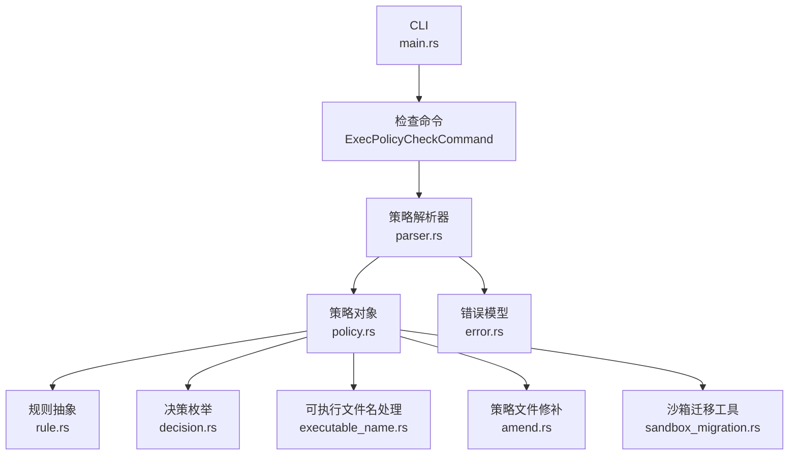
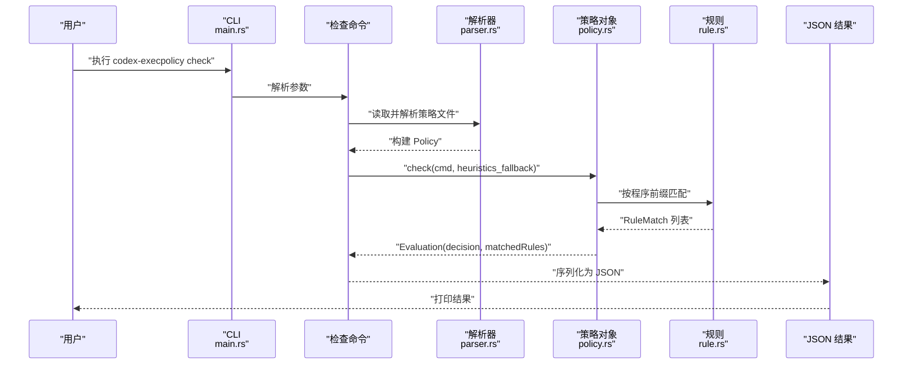
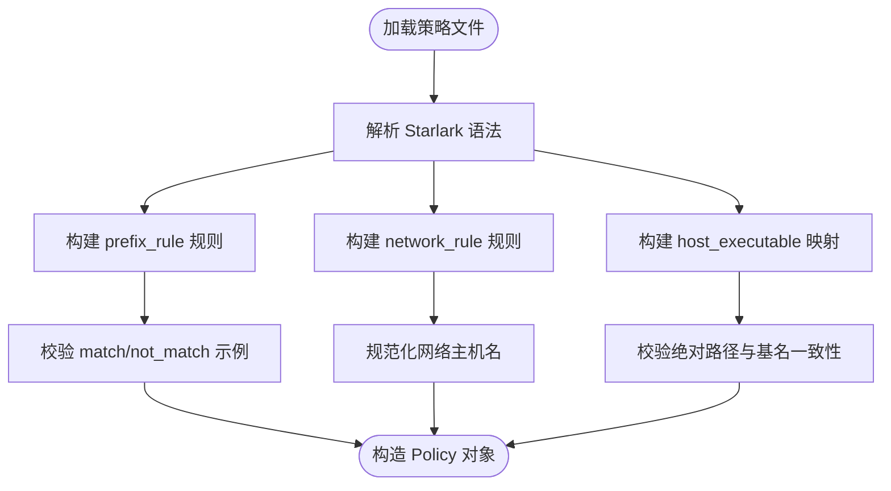
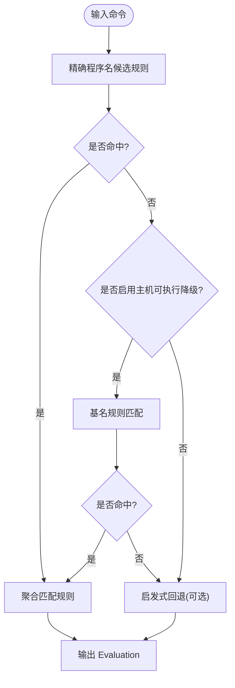
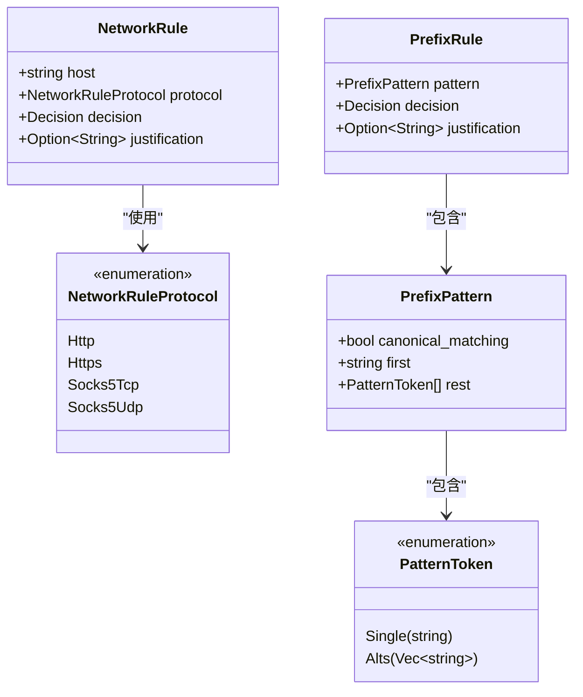
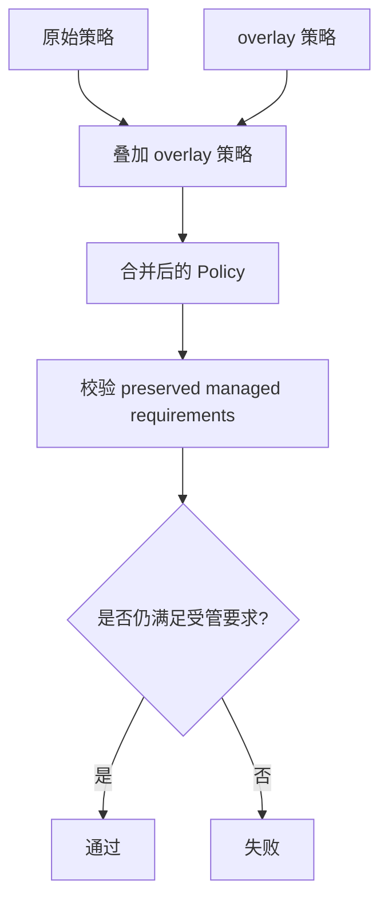
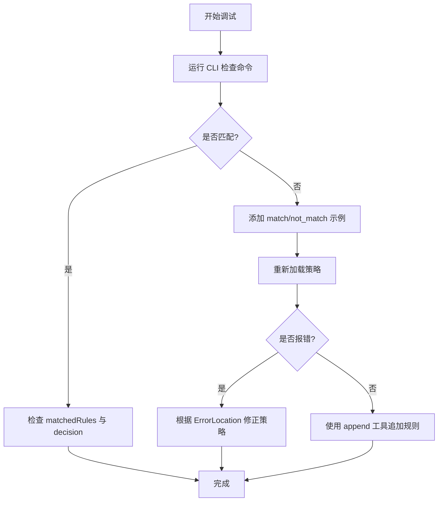
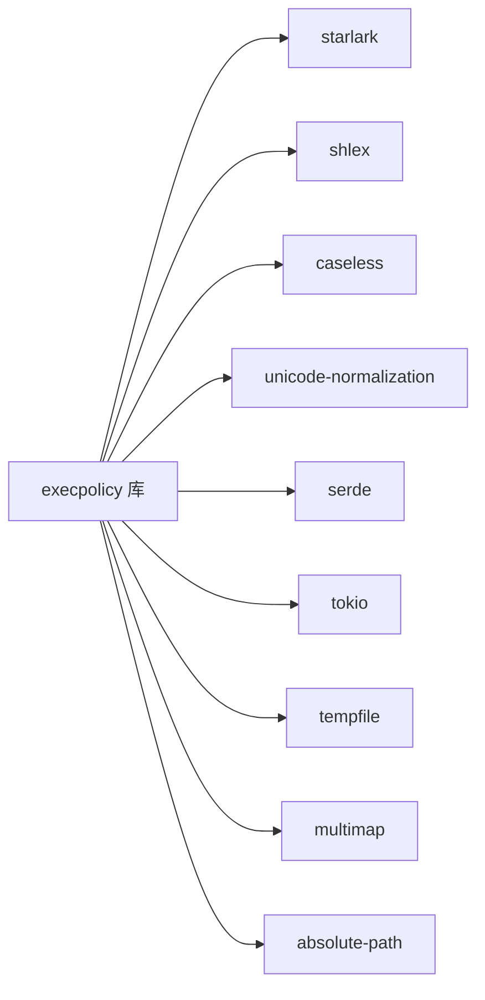

# 执行策略

<cite>
**本文引用的文件**
- [execpolicy.md](file://docs/execpolicy.md)
- [lib.rs](file://codex-rs/execpolicy/src/lib.rs)
- [main.rs](file://codex-rs/execpolicy/src/main.rs)
- [parser.rs](file://codex-rs/execpolicy/src/parser.rs)
- [policy.rs](file://codex-rs/execpolicy/src/policy.rs)
- [rule.rs](file://codex-rs/execpolicy/src/rule.rs)
- [decision.rs](file://codex-rs/execpolicy/src/decision.rs)
- [executable_name.rs](file://codex-rs/execpolicy/src/executable_name.rs)
- [amend.rs](file://codex-rs/execpolicy/src/amend.rs)
- [error.rs](file://codex-rs/execpolicy/src/error.rs)
- [sandbox_migration.rs](file://codex-rs/execpolicy/src/sandbox_migration.rs)
</cite>

## 目录
1. [引言](#引言)
2. [项目结构](#项目结构)
3. [核心组件](#核心组件)
4. [架构总览](#架构总览)
5. [详细组件分析](#详细组件分析)
6. [依赖关系分析](#依赖关系分析)
7. [性能与复杂度](#性能与复杂度)
8. [故障排查指南](#故障排查指南)
9. [结论](#结论)
10. [附录：自定义策略开发指南与最佳实践](#附录自定义策略开发指南与最佳实践)

## 引言
本文件面向“执行策略”子系统，目标是系统性说明 execpolicy 的配置系统、策略评估机制、权限控制规则、资源限制能力边界、以及 Guardian 集成现状。同时给出策略优先级、冲突解决、调试方法，以及扩展和自定义策略的开发指南。

execpolicy 是一个基于 Starlark 的轻量级执行策略引擎，用于在命令执行前进行白名单、审批与拒绝判定，并附带网络访问规则定义与主机可执行文件元数据管理。它提供命令行工具 `codex-execpolicy`，也暴露 Rust API 供上层调用。

**章节来源**
- [execpolicy.md:1-3](file://docs/execpolicy.md#L1-L3)

## 项目结构
execpolicy 位于 `codex-rs/execpolicy`，包含库、CLI、Starlark 解析器、策略数据结构、匹配与评估逻辑、错误模型、文件修补工具、沙箱迁移工具等。

**图表来源**
- [main.rs:1-18](file://codex-rs/execpolicy/src/main.rs#L1-L18)
- [parser.rs:1-120](file://codex-rs/execpolicy/src/parser.rs#L1-L120)
- [policy.rs:1-120](file://codex-rs/execpolicy/src/policy.rs#L1-L120)
- [rule.rs:1-120](file://codex-rs/execpolicy/src/rule.rs#L1-L120)
- [decision.rs:1-30](file://codex-rs/execpolicy/src/decision.rs#L1-L30)
- [executable_name.rs:1-29](file://codex-rs/execpolicy/src/executable_name.rs#L1-L29)
- [amend.rs:1-120](file://codex-rs/execpolicy/src/amend.rs#L1-L120)
- [sandbox_migration.rs:1-60](file://codex-rs/execpolicy/src/sandbox_migration.rs#L1-L60)
- [error.rs:1-101](file://codex-rs/execpolicy/src/error.rs#L1-L101)

**章节来源**
- [lib.rs:1-33](file://codex-rs/execpolicy/src/lib.rs#L1-L33)

## 核心组件
- CLI 入口：负责解析子命令并转发给策略检查命令。
- Starlark 策略解析器：将策略文件中的 `prefix_rule`、`network_rule`、`host_executable` 等声明解析为内部数据结构。
- 策略对象：集中存储程序前缀规则、网络规则、主机可执行文件映射，并提供匹配、合并、比较、编译网络域等功能。
- 规则抽象：统一描述前缀规则和网络规则，支持序列化与匹配接口。
- 决策枚举：统一的 allow、prompt、prompt-user、forbidden 语义。
- 可执行名处理：跨平台可执行名键值生成。
- 策略修补：以原子化方式向策略文件追加规则。
- 沙箱迁移：一次性清理旧版允许规则，避免后续版本误删用户策略。

**章节来源**
- [main.rs:1-18](file://codex-rs/execpolicy/src/main.rs#L1-L18)
- [parser.rs:1-120](file://codex-rs/execpolicy/src/parser.rs#L1-L120)
- [policy.rs:1-120](file://codex-rs/execpolicy/src/policy.rs#L1-L120)
- [rule.rs:1-120](file://codex-rs/execpolicy/src/rule.rs#L1-L120)
- [decision.rs:1-30](file://codex-rs/execpolicy/src/decision.rs#L1-L30)
- [executable_name.rs:1-29](file://codex-rs/execpolicy/src/executable_name.rs#L1-L29)
- [amend.rs:1-120](file://codex-rs/execpolicy/src/amend.rs#L1-L120)
- [sandbox_migration.rs:1-60](file://codex-rs/execpolicy/src/sandbox_migration.rs#L1-L60)

## 架构总览
execpolicy 的工作流分为三个阶段：加载策略、评估命令、输出结果。

**图表来源**
- [main.rs:1-18](file://codex-rs/execpolicy/src/main.rs#L1-L18)
- [parser.rs:1-120](file://codex-rs/execpolicy/src/parser.rs#L1-L120)
- [policy.rs:300-420](file://codex-rs/execpolicy/src/policy.rs#L300-L420)
- [rule.rs:240-319](file://codex-rs/execpolicy/src/rule.rs#L240-L319)

**章节来源**
- [main.rs:1-18](file://codex-rs/execpolicy/src/main.rs#L1-L18)
- [policy.rs:300-420](file://codex-rs/execpolicy/src/policy.rs#L300-L420)

## 详细组件分析

### 策略语言与配置系统
execpolicy 的策略语言是 Starlark 的子集，当前支持三类声明：

- `prefix_rule(pattern=..., decision?, justification?, match?, not_match?, canonical_matching?)`
- `network_rule(host=..., protocol=..., decision=..., justification?)`
- `host_executable(name=..., paths=[...])`

关键要点：
- `pattern` 是有序 token 数组，token 可以是字符串或字符串列表（表示备选）。
- `decision` 默认 `allow`，有效值为 `allow`、`prompt`、`forbidden`；网络规则中 `deny` 等价于 `forbidden`。
- `justification` 可选，用于解释规则原因，禁止空字符串。
- `match` / `not_match` 是在加载时校验的示例用例，支持字符串（经 shell 分词）或 token 数组。
- `canonical_matching=true` 启用 Unicode 规范大小写不敏感匹配，仅影响该规则 token 比较。
- `host_executable` 限定绝对路径与基名的对应关系，用于精确路径到基名规则的降级匹配。

**图表来源**
- [parser.rs:120-475](file://codex-rs/execpolicy/src/parser.rs#L120-L475)
- [rule.rs:201-319](file://codex-rs/execpolicy/src/rule.rs#L201-L319)
- [policy.rs:1-120](file://codex-rs/execpolicy/src/policy.rs#L1-L120)

**章节来源**
- [parser.rs:120-475](file://codex-rs/execpolicy/src/parser.rs#L120-L475)
- [rule.rs:201-319](file://codex-rs/execpolicy/src/rule.rs#L201-L319)

### 策略评估机制
评估过程遵循以下顺序：

1. **精确程序名匹配优先**：使用命令第一个 token 作为程序名，查找所有同名规则。
2. **主机可执行降级匹配**：若未命中且启用 `resolve_host_executables`，则将绝对路径转为基名，再匹配基名规则，并在结果中标记已解析的程序路径。
3. **启发式回退**：若无任何规则匹配且提供了启发式回退函数，则使用该函数返回的决策。
4. **多规则聚合**：对同一命令的所有匹配规则，取最严格的决策作为最终决策。

决策严重性顺序：`forbidden` > `prompt` > `prompt-user` > `allow`。

**图表来源**
- [policy.rs:300-595](file://codex-rs/execpolicy/src/policy.rs#L300-L595)
- [rule.rs:240-319](file://codex-rs/execpolicy/src/rule.rs#L240-L319)

**章节来源**
- [policy.rs:300-595](file://codex-rs/execpolicy/src/policy.rs#L300-L595)

### 权限控制策略
execpolicy 主要提供两类权限控制：

#### 命令执行白名单与审批
通过 `prefix_rule` 定义命令前缀匹配模式，决定命令是否需要审批或禁止。支持：
- 精确 token 匹配与备选 token。
- 可选的 Unicode 规范大小写不敏感匹配。
- 可选的 `justification` 用于展示拒绝或审批理由。
- 可选的 `match` / `not_match` 示例用例用于静态校验。

#### 网络访问控制
通过 `network_rule` 定义网络访问策略，支持协议：
- `http`
- `https`
- `socks5_tcp`
- `socks5_udp`

主机名必须为具体主机名或 IP 字面量，不允许通配符、路径、查询串、片段、空白字符。网络规则会编译出允许与拒绝的主机集合，用于上层网络访问控制。

**图表来源**
- [rule.rs:1-200](file://codex-rs/execpolicy/src/rule.rs#L1-L200)

**章节来源**
- [rule.rs:1-200](file://codex-rs/execpolicy/src/rule.rs#L1-L200)
- [parser.rs:200-475](file://codex-rs/execpolicy/src/parser.rs#L200-L475)

### 资源限制策略
在当前实现中，execpolicy **没有直接内置 CPU、内存、磁盘空间、执行时间等运行时资源限制**。其职责是“策略判断”，即决定是否允许、需要审批或拒绝命令与网络访问。

资源限制通常由上层执行环境、沙箱或进程管理器实现。execpolicy 提供的是：
- 命令白名单与拒绝策略。
- 网络访问白名单与拒绝策略。
- 通过 `get_allowed_prefixes()` 导出允许的白名单前缀，供上层做更细粒度的资源隔离或审计。

因此，CPU、内存、磁盘、超时等限制应视为 execpolicy 的上层约束，而不是本模块的职责范围。

**章节来源**
- [policy.rs:120-200](file://codex-rs/execpolicy/src/policy.rs#L120-L200)

### Guardian 策略集成
当前 execpolicy 模块本身不包含 Guardian 安全检查点、风险评估或自动拒绝机制的实现。Guardian 相关代码位于扩展模块（例如 `guardian-reviewer`、`guardian-v2`、`guardian-v3`），而 execpolicy 的职责是提供策略解析、匹配与评估结果。

从 execpolicy 的角度看，Guardian 集成可以理解为：
- execpolicy 输出 `Evaluation(decision, matchedRules)`。
- 上层 Guardian 可根据 `decision` 触发审批、人工确认或自动拒绝。
- execpolicy 提供 `justification` 字段，便于向用户解释拒绝或审批原因。

如果需要“自动拒绝机制”，应由上层根据 `decision == forbidden` 或其他业务风险阈值来决定，而不是由 execpolicy 自行终止外部流程。

**章节来源**
- [policy.rs:520-595](file://codex-rs/execpolicy/src/policy.rs#L520-L595)

### 策略优先级、冲突解决与合并
- 同一命令可能匹配多条规则，最终决策取所有匹配规则的“最严格”决策。
- 策略对象支持 `merge_overlay`，后覆盖的规则会替换同名程序下的已有规则。
- 网络规则通过允许/拒绝集合去重，后出现的允许或拒绝会覆盖之前的同主机条目。
- `preserves_managed_requirements` 用于校验快照策略是否仍然满足受管要求，包括：
  - 主机可执行映射一致。
  - 受管规则仍存在。
  - 精确路径匹配不会削弱基名降级保护。
  - 受管网络拒绝仍被保留。

**图表来源**
- [policy.rs:201-300](file://codex-rs/execpolicy/src/policy.rs#L201-L300)

**章节来源**
- [policy.rs:201-300](file://codex-rs/execpolicy/src/policy.rs#L201-L300)

### 调试方法
execpolicy 提供多种调试手段：

1. **CLI 输出结构化结果**
   - 使用 `codex-execpolicy check --rules ... cmd ...` 查看匹配的 rule 列表与最终决策。
   - 支持 `--pretty` 输出格式化 JSON。
   - 支持 `--resolve-host-executables` 启用绝对路径到基名规则的降级匹配。

2. **示例用例验证**
   - 在 `prefix_rule(match=..., not_match=...)` 中提供示例，加载时会强制校验。
   - 如果示例不匹配或意外匹配，会抛出明确的错误，并携带位置信息。

3. **错误定位**
   - Starlark 解析错误会附带文件名与行号列号。
   - 示例校验错误会附加 `ErrorLocation`，便于定位策略文件。

4. **策略文件修补**
   - 可通过 `blocking_append_allow_prefix_rule` 与 `blocking_append_network_rule` 追加规则。
   - 追加过程使用文件锁、去重、缺失换行修复，适合自动化流程。

**图表来源**
- [main.rs:1-18](file://codex-rs/execpolicy/src/main.rs#L1-L18)
- [parser.rs:300-475](file://codex-rs/execpolicy/src/parser.rs#L300-L475)
- [error.rs:1-101](file://codex-rs/execpolicy/src/error.rs#L1-L101)
- [amend.rs:1-200](file://codex-rs/execpolicy/src/amend.rs#L1-L200)

**章节来源**
- [main.rs:1-18](file://codex-rs/execpolicy/src/main.rs#L1-L18)
- [error.rs:1-101](file://codex-rs/execpolicy/src/error.rs#L1-L101)
- [amend.rs:1-200](file://codex-rs/execpolicy/src/amend.rs#L1-L200)

## 依赖关系分析
execpolicy 的核心依赖包括：

- Starlark 运行时：用于解析策略语言。
- shlex：用于示例字符串的分词。
- caseless、unicode-normalization：用于大小写与 Unicode 规范匹配。
- serde：用于序列化与反序列化。
- tokio：异步 I/O，主要用于沙箱迁移。
- tempfile：用于原子写入迁移标记。
- multimap：用于程序名到规则的多值映射。
- absolute-path：用于安全路径类型。

**图表来源**
- [Cargo.toml:1-36](file://codex-rs/execpolicy/Cargo.toml#L1-L36)

**章节来源**
- [Cargo.toml:1-36](file://codex-rs/execpolicy/Cargo.toml#L1-L36)

## 性能与复杂度
- 规则匹配时间复杂度近似为 O(R × P)，其中 R 为匹配到的规则数量，P 为规则前缀长度。
- 主机可执行降级匹配会增加一次路径解析与基名查找，但只在无精确匹配时触发。
- 网络规则编译为允许与拒绝集合，使用向量去重，时间复杂度近似 O(N)。
- 多命令批量评估会对每个命令重复匹配，整体复杂度近似 O(C × R × P)，C 为命令数。
- 启发式回退仅在无规则匹配时调用，避免对每条命令都执行额外逻辑。

优化建议：
- 尽量使用精确程序名前缀，减少候选规则数量。
- 合理使用 `canonical_matching`，仅在确实需要 Unicode 规范大小写不敏感时使用。
- 将高频命令放入明确的前缀规则，避免依赖启发式回退。
- 网络规则应尽可能精确到具体主机，避免宽泛允许导致上层难以审计。

[本节为通用性能讨论，不直接分析具体代码行]

## 故障排查指南
常见问题与处理方式：

| 问题 | 可能原因 | 处理方法 |
|---|---|---|
| 策略文件解析失败 | Starlark 语法错误或参数类型不正确 | 检查 `prefix_rule`、`network_rule`、`host_executable` 的参数类型与拼写 |
| 示例用例未匹配 | `match` 示例未被任何规则命中 | 调整 `pattern` 或补充新规则 |
| 示例用例意外匹配 | `not_match` 示例被某条规则命中 | 收紧规则或使用更具体的前缀 |
| 网络规则主机名无效 | 包含 scheme、路径、通配符、空白字符 | 改为具体主机名或 IP 字面量，去除多余后缀 |
| 主机可执行路径无效 | 非绝对路径或基名不一致 | 使用绝对路径并确保 basename 与 name 一致 |
| 追加规则失败 | 文件权限不足、目录不存在、文件被锁定 | 检查目录创建、文件权限、并发写入 |
| 迁移后策略被修改 | 旧版允许规则被清理 | 确认迁移已完成，避免重复清理 |

**章节来源**
- [error.rs:1-101](file://codex-rs/execpolicy/src/error.rs#L1-L101)
- [parser.rs:200-475](file://codex-rs/execpolicy/src/parser.rs#L200-L475)
- [amend.rs:1-200](file://codex-rs/execpolicy/src/amend.rs#L1-L200)
- [sandbox_migration.rs:1-123](file://codex-rs/execpolicy/src/sandbox_migration.rs#L1-L123)

## 结论
execpolicy 是一个专注“策略判断”的轻量引擎，核心能力包括：
- 基于 Starlark 的命令前缀规则。
- 主机可执行文件元数据与基名降级匹配。
- 网络访问规则与主机名规范化。
- 决策聚合与启发式回退。
- 策略文件修补与迁移工具。

它不负责 CPU、内存、磁盘、执行时间等资源限制，也不内建 Guardian 风险评估与自动拒绝流程。这些能力应由上层执行环境与 Guardian 模块组合实现。

对于运维与开发者而言，推荐：
- 用 `prefix_rule` 明确命令白名单与审批边界。
- 用 `network_rule` 明确网络访问范围。
- 用 `match` / `not_match` 保持策略可测试。
- 用 `justification` 记录策略原因。
- 用 CLI 与示例用例持续调试策略行为。

[本节为总结性内容，不直接分析具体代码行]

## 附录：自定义策略开发指南与最佳实践

### 开发步骤
1. **明确权限边界**
   - 列出允许执行的命令前缀。
   - 列出需要审批的命令场景。
   - 列出禁止的命令场景。
2. **定义网络访问**
   - 只允许必要域名或 IP。
   - 明确协议类型。
   - 为每条网络规则提供 `justification`。
3. **编写策略文件**
   - 使用 `prefix_rule` 定义命令规则。
   - 使用 `network_rule` 定义网络规则。
   - 使用 `host_executable` 限定绝对路径与基名。
4. **添加示例用例**
   - 在 `match` 中放入应命中的示例。
   - 在 `not_match` 中放入不应命中的示例。
5. **本地验证**
   - 使用 CLI 检查命令验证策略。
   - 使用 `--resolve-host-executables` 测试绝对路径降级。
6. **自动化追加**
   - 在 CI 或交互式流程中使用 `blocking_append_allow_prefix_rule` 与 `blocking_append_network_rule` 追加规则。

### 最佳实践
- 规则应尽量具体，避免过于宽泛的前缀。
- 对高风险命令使用 `forbidden` 或 `prompt-user`。
- 对需要人类判断的命令使用 `prompt`。
- 为所有重要规则添加 `justification`。
- 使用 `canonical_matching` 仅当确实需要 Unicode 规范大小写不敏感匹配。
- 使用 `host_executable` 限制可接受的二进制路径，防止基名攻击。
- 定期审查网络规则，移除不再需要的允许项。
- 将策略变更纳入版本管理与评审流程。

### 常见陷阱
- 把网络规则写成 URL，应只写主机名。
- 使用通配符主机名，当前不被允许。
- 在 `not_match` 中遗漏边界情况。
- 依赖启发式回退代替明确规则。
- 忽略 `preserve_managed_requirements` 的保护语义，随意放宽基名规则。

[本节为概念性指导，不直接分析具体代码行]