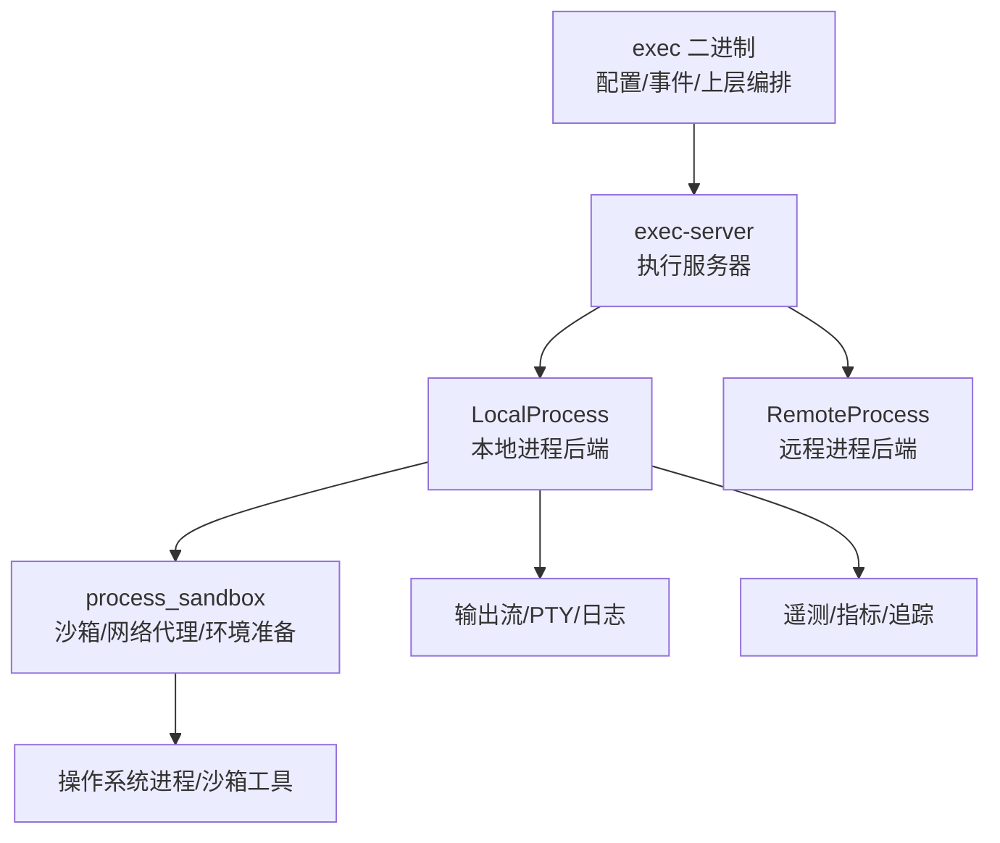
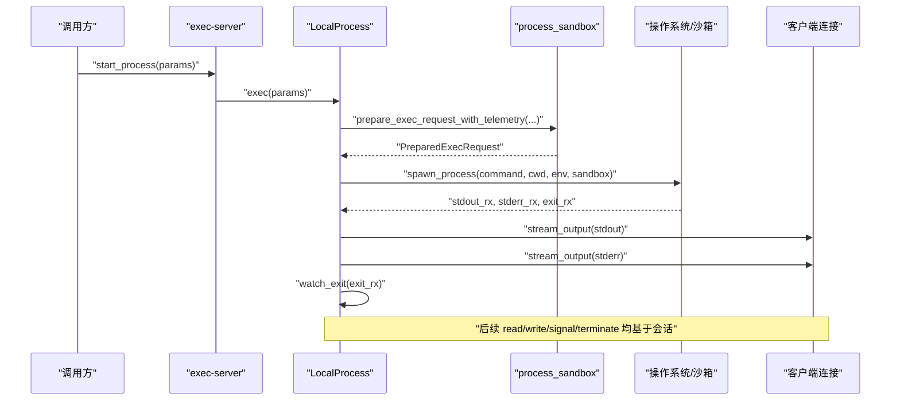
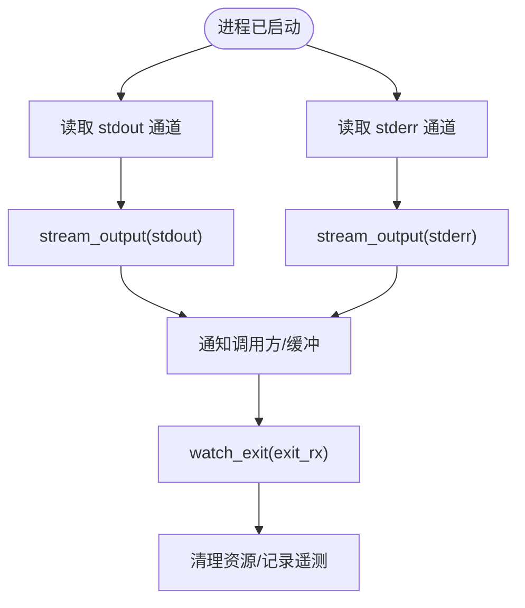
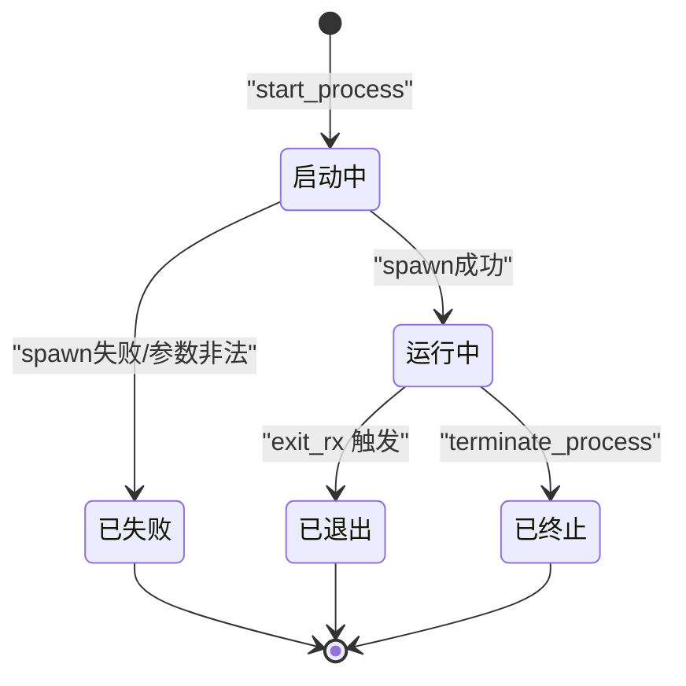
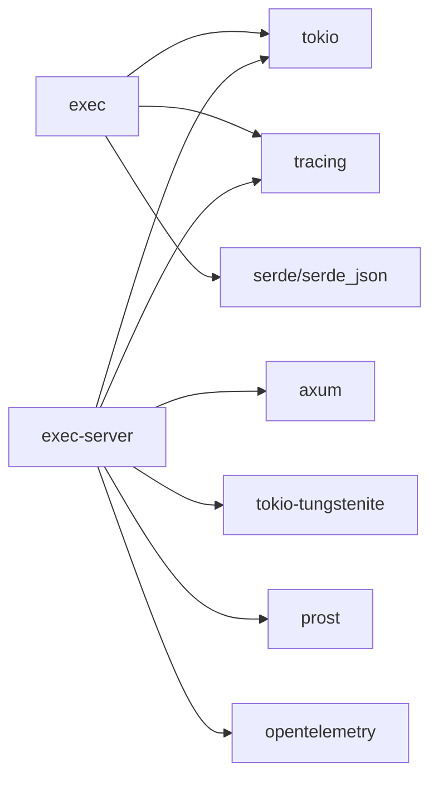
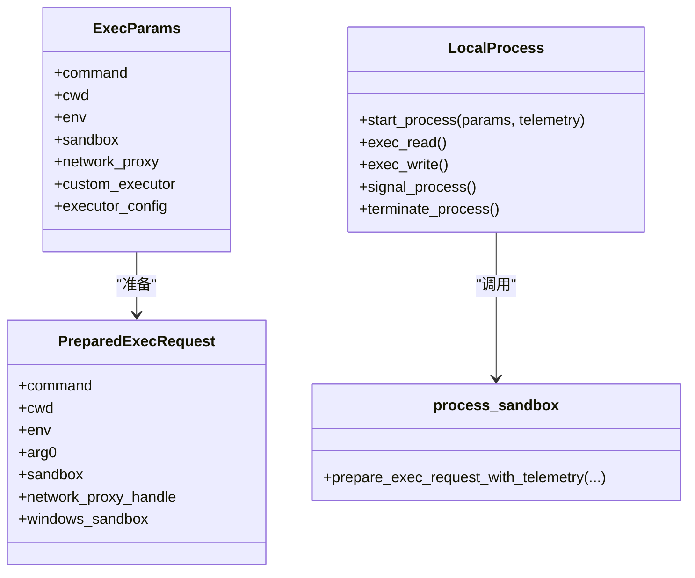

# 本地执行引擎

<cite>
**本文引用的文件**
- [codex-rs/exec/src/lib.rs](file://codex-rs/exec/src/lib.rs)
- [codex-rs/exec/Cargo.toml](file://codex-rs/exec/Cargo.toml)
- [codex-rs/exec-server/src/local_process.rs](file://codex-rs/exec-server/src/local_process.rs)
- [codex-rs/exec-server/src/process_sandbox.rs](file://codex-rs/exec-server/src/process_sandbox.rs)
- [codex-rs/exec-server/src/remote_process.rs](file://codex-rs/exec-server/src/remote_process.rs)
- [codex-rs/exec-server/src/server/process_handler.rs](file://codex-rs/exec-server/src/server/process_handler.rs)
- [codex-rs/exec-server/src/client_transport.rs](file://codex-rs/exec-server/src/client_transport.rs)
- [codex-rs/exec-server/Cargo.toml](file://codex-rs/exec-server/Cargo.toml)
</cite>

## 目录
1. [引言](#引言)
2. [项目结构](#项目结构)
3. [核心组件](#核心组件)
4. [架构总览](#架构总览)
5. [详细组件分析](#详细组件分析)
6. [依赖关系分析](#依赖关系分析)
7. [性能与优化](#性能与优化)
8. [故障排查](#故障排查)
9. [扩展指南：自定义命令执行器](#扩展指南自定义命令执行器)
10. [结论](#结论)

## 引言
本文面向“本地执行引擎”，聚焦代码库中负责在本地或受控沙箱内启动外部进程、管理其生命周期、处理标准输出/错误输出、信号与超时控制，以及与网络代理、权限策略、沙箱机制协作的实现。需要特别区分两个层次：
- `exec` 二进制包：对外暴露命令行与高层编排能力，负责配置加载、事件处理和与 exec-server 的交互。
- `exec-server`：实际进程执行服务器，封装本地进程创建、沙箱、PTY、网络代理、遥测、协议流式输出等底层逻辑。

因此，“本地执行”的完整链路通常由调用方进入 `exec`，再由 `exec` 通过 exec-server 提供的本地后端启动真实子进程；若使用远程后端，则由 `RemoteProcess` 将请求转发到远端执行服务器。

## 项目结构
围绕本地执行的关键路径如下：
- `codex-rs/exec`：CLI 入口、配置与事件处理器，依赖 `tokio` 的多线程运行时、信号、进程等特性。
- `codex-rs/exec-server`：进程执行服务，包含本地进程后端 `LocalProcess`、远程进程后端 `RemoteProcess`、沙箱准备 `process_sandbox`、服务器处理层 `server/process_handler` 等。

图示来源
- [codex-rs/exec/src/lib.rs:1-80](file://codex-rs/exec/src/lib.rs#L1-L80)
- [codex-rs/exec-server/src/local_process.rs:280-560](file://codex-rs/exec-server/src/local_process.rs#L280-L560)
- [codex-rs/exec-server/src/process_sandbox.rs:1-120](file://codex-rs/exec-server/src/process_sandbox.rs#L1-L120)

章节来源
- [codex-rs/exec/Cargo.toml:1-86](file://codex-rs/exec/Cargo.toml#L1-L86)
- [codex-rs/exec-server/Cargo.toml:1-115](file://codex-rs/exec-server/Cargo.toml#L1-L115)

## 核心组件
- `exec` 模块：提供 CLI、命令解析、事件处理器、与 exec-server 客户端集成、工作区与历史等高层功能。
- `LocalProcess`：本地执行后端，负责启动进程、管理会话、流式读取 stdout/stderr、写入 stdin、发送信号、终止进程、维护退出状态和通知。
- `process_sandbox`：在执行前准备命令、工作目录、环境变量、网络代理、权限与 Windows/Linux/macOS 沙箱上下文。
- `RemoteProcess`：远程执行后端，将进程操作委托给远端 exec-server 会话。
- `server/process_handler`：HTTP/RPC 层的进程接口转发，把 read/write/signal/terminate 请求委派给具体后端进程对象。

章节来源
- [codex-rs/exec/src/lib.rs:1-200](file://codex-rs/exec/src/lib.rs#L1-L200)
- [codex-rs/exec-server/src/local_process.rs:280-560](file://codex-rs/exec-server/src/local_process.rs#L280-L560)
- [codex-rs/exec-server/src/process_sandbox.rs:1-120](file://codex-rs/exec-server/src/process_sandbox.rs#L1-L120)
- [codex-rs/exec-server/src/remote_process.rs:1-137](file://codex-rs/exec-server/src/remote_process.rs#L1-L137)
- [codex-rs/exec-server/src/server/process_handler.rs:26-79](file://codex-rs/exec-server/src/server/process_handler.rs#L26-L79)

## 架构总览
本地执行的典型流程是：
1. 调用方（可能是 TUI、脚本或其他客户端）向 exec-server 发起进程执行请求。
2. exec-server 选择后端：本地 `LocalProcess` 或远程 `RemoteProcess`。
3. 本地后端先通过 `process_sandbox::prepare_exec_request_with_telemetry` 准备命令、工作目录、环境变量、网络代理、沙箱策略。
4. 调用 `codex_sandboxing::spawn_process` 真正启动子进程，并获取 stdout/stderr/exit 通道。
5. 后台协程流式消费 stdout/stderr，并通过 RPC/WebSocket 推送给调用方。
6. 监控 exit 通道，清理资源、更新进程状态、记录遥测。
7. 对 stdin 写入、信号、终止等操作进行幂等与安全校验。

图示来源
- [codex-rs/exec-server/src/local_process.rs:280-560](file://codex-rs/exec-server/src/local_process.rs#L280-L560)
- [codex-rs/exec-server/src/process_sandbox.rs:1-120](file://codex-rs/exec-server/src/process_sandbox.rs#L1-L120)

## 详细组件分析

### 进程创建与环境准备
- 参数校验：空 argv 会被拒绝；policy_decision_timeout_ms 为 0 会被拒绝；启用网络策略回调时要求非空且长度受限的 process_id。
- 环境准备：通过 `child_env(&params)` 构建子进程环境变量，再交给 `prepare_exec_request_with_telemetry` 注入网络代理、证书信任链、工作区根、Windows/Linux/macOS 沙箱所需权限与路径。
- 沙箱选择：根据 `params.sandbox` 决定 Linux seccomp、macOS Seatbelt、Windows Restricted Token 或 MXC；若无沙箱则为 None。
- 真实启动：调用 `codex_sandboxing::spawn_process`，传入命令、cwd、env、arg0、sandbox、windows_sandbox、TTY 与 stdin 开关。
- 启动失败处理：记录 SpawnFailed 遥测，移除 Starting 状态的进程条目，返回内部错误。

章节来源
- [codex-rs/exec-server/src/local_process.rs:280-420](file://codex-rs/exec-server/src/local_process.rs#L280-L420)
- [codex-rs/exec-server/src/process_sandbox.rs:1-120](file://codex-rs/exec-server/src/process_sandbox.rs#L1-L120)

### 输出处理系统
- 标准输出与错误输出：分别通过 `stream_output` 从 `spawned.stdout_rx` 与 `spawned.stderr_rx` 消费数据块，并根据是否启用 TTY 选择 `ExecOutputStream::Pty` 或 `ExecOutputStream::Stdout/Stderr`。
- 实时流式输出：每个输出通道都通过独立 tokio 任务拉取，并通过 RPC 通知队列推送到客户端；同时维护序列号、保留字节上限、最大块数，避免内存无限增长。
- 退出监控：`watch_exit` 监听 exit 通道，进程结束后清理 open_streams、关闭会话、记录遥测、触发最终通知。
- 输入管道：当 `params.tty` 或 `params.pipe_stdin` 为真时，stdin 打开；重复写入具备去重缓存，避免重连后重复写入相同字节。

图示来源
- [codex-rs/exec-server/src/local_process.rs:430-560](file://codex-rs/exec-server/src/local_process.rs#L430-L560)

章节来源
- [codex-rs/exec-server/src/local_process.rs:430-560](file://codex-rs/exec-server/src/local_process.rs#L430-L560)

### 超时控制机制
仓库中与“超时”直接相关的实现包括两类：
- 网络策略决策超时：`policy_decision_timeout_ms` 用于限制外部网络策略回调的响应时间；值为 0 被拒绝，其他正值会转换为 `Duration` 并配合 `CancellationToken` 取消。
- HTTP 客户端路由级超时：`route_aware_http_client` 中如果参数携带 `timeout_ms`，则对该 HTTP 请求设置超时。

当前本地执行后端没有统一的“硬超时/软超时”概念覆盖整个进程生命周期。常见建议：
- “硬超时”：在更上层使用 `tokio::time::timeout` 包裹整个执行任务，达到阈值后强制取消任务，但需确保子进程能被关闭。
- “软超时”：仅停止等待新输出或提前结束 UI 展示，但允许子进程继续运行直至自然退出。

由于代码未定义统一的 `hard_timeout`/`soft_timeout` 字段，如需实现该语义，应在 `ExecParams` 上游增加字段并在 `LocalProcess::start_process` 中结合 `tokio::time::timeout` 与 `session.terminate()` 协调。

章节来源
- [codex-rs/exec-server/src/local_process.rs:311-327](file://codex-rs/exec-server/src/local_process.rs#L311-L327)
- [codex-rs/exec-server/src/client_transport.rs:760-770](file://codex-rs/exec-server/src/client_transport.rs#L760-L770)
- [codex-rs/exec-server/src/client/route_aware_http_client.rs:197-198](file://codex-rs/exec-server/src/client/route_aware_http_client.rs#L197-L198)

### 信号处理与进程生命周期
- 信号发送：通过后端 `signal` 方法将 `ProcessSignal` 下发给底层会话；远程后端则转发到远端会话。
- 终止进程：`terminate_process` 调用会话终止；本地后端在启动失败、重复注册、重复终止等场景都会显式调用 `session.terminate()`。
- 生命周期：进程状态以 `ProcessEntry::Starting` 与 `ProcessEntry::Running` 表示；成功后插入 Running 表项，退出后清理并移除。
- 资源清理：`Drop` 在远程会话上取消网络策略决策并异步注销；本地会话通过 watch_exit 完成 stdout/stderr 通道关闭与遥测收尾。

图示来源
- [codex-rs/exec-server/src/local_process.rs:280-560](file://codex-rs/exec-server/src/local_process.rs#L280-L560)
- [codex-rs/exec-server/src/remote_process.rs:1-137](file://codex-rs/exec-server/src/remote_process.rs#L1-L137)

章节来源
- [codex-rs/exec-server/src/local_process.rs:280-560](file://codex-rs/exec-server/src/local_process.rs#L280-L560)
- [codex-rs/exec-server/src/remote_process.rs:1-137](file://codex-rs/exec-server/src/remote_process.rs#L1-L137)

### 环境变量与安全
- 环境变量构建：先通过 `child_env(&params)` 生成基础环境，再交给 `prepare_exec_request_with_telemetry` 注入网络代理相关变量、证书信任路径、工作区根等。
- 凭据掩码：网络代理支持凭据掩码失败模式；在某些平台与 shell 快照组合下，可开启凭据快照辅助。
- 沙箱权限：Linux/macOS/Windows 使用不同沙箱机制，统一通过 `SandboxType` 表达；Windows 还涉及 MXC、Restricted Token、文件系统重写等。

章节来源
- [codex-rs/exec-server/src/process_sandbox.rs:1-120](file://codex-rs/exec-server/src/process_sandbox.rs#L1-L120)

## 依赖关系分析
- `exec` 依赖 `tokio` 多线程运行时、信号、进程、tracing、serde_json、uuid 等，主要用于 CLI 编排与事件处理。
- `exec-server` 依赖 `axum`、WebSocket、tokio、tokio-util、tokio-tungstenite、protobuf、tracing、opentelemetry 等，用于 RPC/WebSocket 服务、流式传输与遥测。
- 平台相关依赖：Linux 引入 `codex-linux-sandbox`，Unix 引入 `rustix`/`libc`/`uds`，Windows 引入 `windows-sys`、`codex-mxc-sandbox`。

图示来源
- [codex-rs/exec/Cargo.toml:1-86](file://codex-rs/exec/Cargo.toml#L1-L86)
- [codex-rs/exec-server/Cargo.toml:1-115](file://codex-rs/exec-server/Cargo.toml#L1-L115)

章节来源
- [codex-rs/exec/Cargo.toml:1-86](file://codex-rs/exec/Cargo.toml#L1-L86)
- [codex-rs/exec-server/Cargo.toml:1-115](file://codex-rs/exec-server/Cargo.toml#L1-L115)

## 性能与优化
- 输出缓冲与保留上限：每个进程保留固定字节数与固定数量的输出块，防止长时间运行导致内存膨胀。
- 通道容量：通知通道、进程事件通道采用有界 channel，避免背压失控。
- 流式处理：stdout/stderr 分别用独立协程流式消费，降低阻塞风险。
- 网络策略回调：通过 `policy_decision_timeout_ms` 限制外部回调耗时，避免启动阶段被卡住。
- 重复写入保护：stdin write id 去重集合，避免客户端重连后重复写入。
- 遥测与指标：进程启动、退出、失败等关键节点记录遥测，便于定位性能瓶颈。

[本节为通用指导，不直接分析具体文件]

## 故障排查
常见问题与定位思路：
- 启动失败：检查 argv 是否为空、沙箱路径是否合法、MXC 是否可用、Windows/Linux/macOS 沙箱能力是否满足。查看 SpawnFailed 遥测。
- 输出丢失：确认 TTY 与 pipe_stdin 配置是否正确；检查 stdout/stderr 通道是否被关闭；观察 stream_output 是否仍在运行。
- 网络策略卡顿：确认 policy_decision_timeout_ms 是否合理；检查外部策略回调是否超时或无响应。
- 信号无效：确认进程已进入 Running 状态；检查信号类型是否受平台支持。
- 远程执行异常：检查 RemoteProcess 会话是否已建立；确认远端执行服务器可达且认证通过。

章节来源
- [codex-rs/exec-server/src/local_process.rs:280-560](file://codex-rs/exec-server/src/local_process.rs#L280-L560)
- [codex-rs/exec-server/src/remote_process.rs:1-137](file://codex-rs/exec-server/src/remote_process.rs#L1-L137)

## 扩展指南：自定义命令执行器
如果需要扩展“自定义命令执行器”，建议从以下角度入手：

1. 新增执行参数
   - 在 `ExecParams` 中添加自定义字段，例如 `custom_executor`、`executor_config`。
   - 在上游 CLI 或 SDK 中传递这些字段。

2. 在沙箱准备阶段注入
   - 修改 `prepare_exec_request_with_telemetry`，根据 `custom_executor` 调整命令、工作目录、环境变量。
   - 若自定义执行器需要特殊权限或沙箱策略，在 `PreparedExecRequest` 中补充对应字段。

3. 在后端启动时分支
   - 在 `LocalProcess::start_process` 中，根据预处理后的命令与沙箱类型决定是否走自定义执行路径。
   - 对于远程后端，需在 `RemoteProcess` 或会话协议中同步支持。

4. 输出与生命周期一致性
   - 自定义执行器仍需遵循现有 stdout/stderr/exit 通道模型，以便复用 `stream_output` 与 `watch_exit`。
   - 如需自定义信号行为，应映射到 `ProcessSignal` 或新增安全可控的信号枚举。

5. 遥测与诊断
   - 在启动、失败、退出等关键路径记录 ProcessTelemetryEvent，便于观测与排障。
   - 必要时扩展网络策略审计观察者，输出自定义决策日志。

图示来源
- [codex-rs/exec-server/src/local_process.rs:280-560](file://codex-rs/exec-server/src/local_process.rs#L280-L560)
- [codex-rs/exec-server/src/process_sandbox.rs:1-120](file://codex-rs/exec-server/src/process_sandbox.rs#L1-L120)

章节来源
- [codex-rs/exec-server/src/local_process.rs:280-560](file://codex-rs/exec-server/src/local_process.rs#L280-L560)
- [codex-rs/exec-server/src/process_sandbox.rs:1-120](file://codex-rs/exec-server/src/process_sandbox.rs#L1-L120)

## 结论
本地执行引擎的核心在于“安全、可观测、可流式”。`exec-server` 的 `LocalProcess` 承担实际进程生命周期管理，`process_sandbox` 负责命令与环境的安全准备，`RemoteProcess` 提供远程执行抽象。输出通过流式通道处理，信号与终止操作通过会话统一管理。当前代码未实现统一的“硬超时/软超时”语义，建议在 `ExecParams` 与 `LocalProcess::start_process` 中补充相应逻辑，并结合 `tokio::time::timeout` 与 `session.terminate()` 实现明确的生命周期控制。扩展自定义执行器时，应优先复用现有输出、遥测与沙箱机制，保证行为一致性与可观测性。