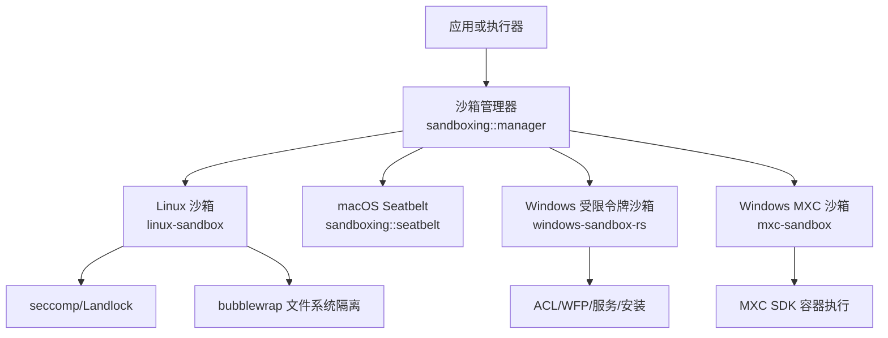
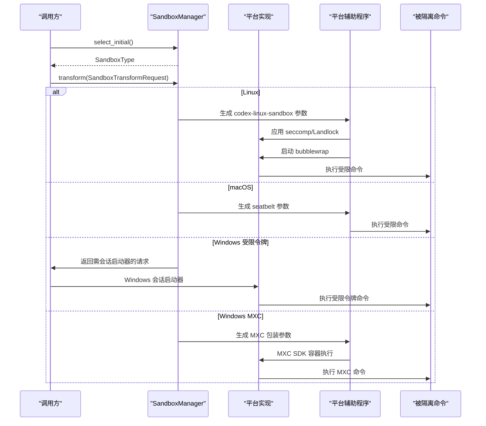
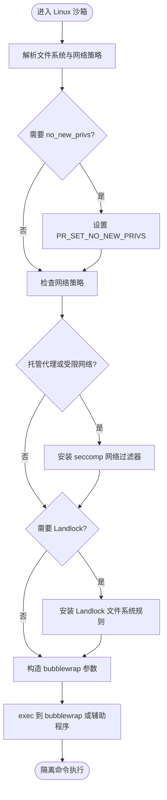
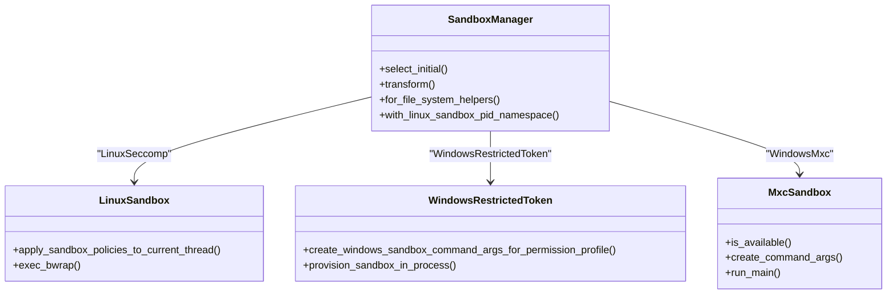
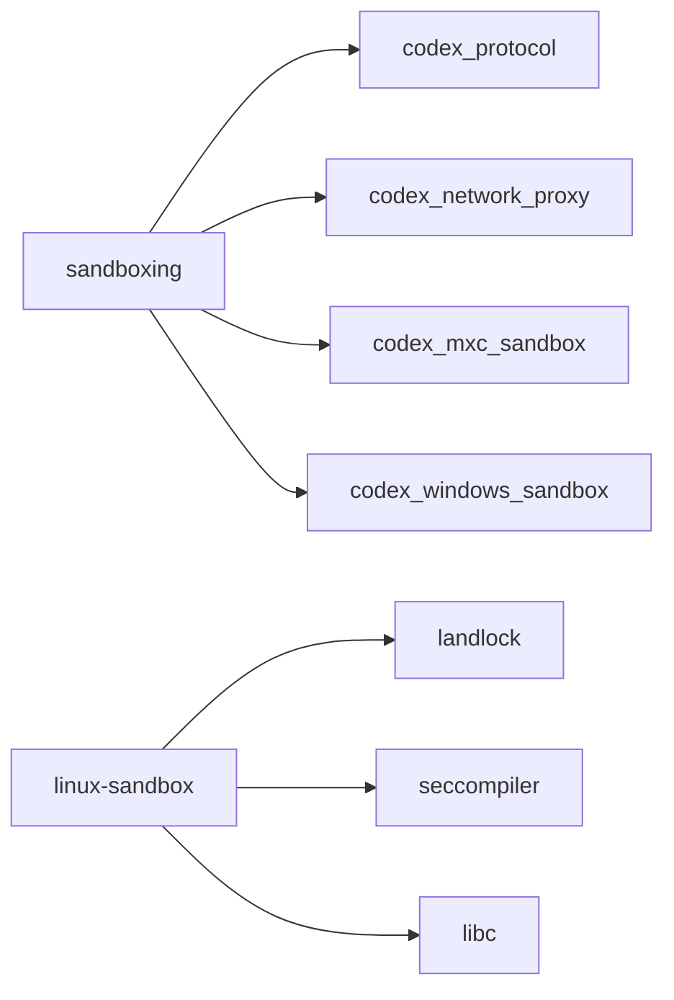

# 沙箱系统

<cite>
**本文引用的文件**   
- [codex-rs/sandboxing/src/lib.rs](file://codex-rs/sandboxing/src/lib.rs)
- [codex-rs/sandboxing/src/manager.rs](file://codex-rs/sandboxing/src/manager.rs)
- [codex-rs/sandboxing/src/launch.rs](file://codex-rs/sandboxing/src/launch.rs)
- [codex-rs/linux-sandbox/src/lib.rs](file://codex-rs/linux-sandbox/src/lib.rs)
- [codex-rs/linux-sandbox/src/launcher.rs](file://codex-rs/linux-sandbox/src/launcher.rs)
- [codex-rs/linux-sandbox/src/seccomp.rs](file://codex-rs/linux-sandbox/src/seccomp.rs)
- [codex-rs/linux-sandbox/src/bwrap.rs](file://codex-rs/linux-sandbox/src/bwrap.rs)
- [codex-rs/mxc-sandbox/src/lib.rs](file://codex-rs/mxc-sandbox/src/lib.rs)
- [codex-rs/mxc-sandbox/src/native.rs](file://codex-rs/mxc-sandbox/src/native.rs)
- [codex-rs/windows-sandbox-rs/src/lib.rs](file://codex-rs/windows-sandbox-rs/src/lib.rs)
- [codex-rs/windows-sandbox-rs/src/setup_provisioning.rs](file://codex-rs/windows-sandbox-rs/src/setup_provisioning.rs)
</cite>

## 目录
1. [简介](#简介)
2. [项目结构](#项目结构)
3. [核心组件](#核心组件)
4. [架构总览](#架构总览)
5. [详细组件分析](#详细组件分析)
6. [依赖关系分析](#依赖关系分析)
7. [性能与资源考虑](#性能与资源考虑)
8. [故障排除指南](#故障排除指南)
9. [安全最佳实践](#安全最佳实践)
10. [结论](#结论)

## 简介
本仓库的沙箱子系统以跨平台抽象层为核心，统一协调 Linux、macOS、Windows 三种平台的隔离实现，并在 Windows 上提供两种后端：传统受限令牌沙箱与 MXC（Microsoft eXecution Container）沙箱。其目标是让执行器在运行不受信任的命令时，尽可能通过文件系统权限控制、网络访问限制、进程级安全特性等机制降低逃逸风险。

整体设计遵循“策略在上、实现在下”的原则：上层使用 `PermissionProfile`、`FileSystemSandboxPolicy`、`NetworkSandboxPolicy` 表达允许读写路径和网络行为；中间层由 `sandboxing` 模块负责选择具体后端并生成可执行的包装命令；底层由各平台具体实现负责真正创建隔离环境。

## 项目结构
沙箱相关代码主要分布在四个 Rust crate 中：

| 路径 | 职责 |
|---|---|
| `codex-rs/sandboxing` | 跨平台沙箱抽象、策略解析、后端选择、通用启动封装 |
| `codex-rs/linux-sandbox` | Linux 具体实现：seccomp、Landlock、bubblewrap、WSL/WSLg 适配 |
| `codex-rs/mxc-sandbox` | Windows MXC 沙箱的轻量包装：参数编码、可用性判断、MXC SDK 调用 |
| `codex-rs/windows-sandbox-rs` | Windows 受限令牌沙箱：ACL、WFP、服务、安装配置、代理设置等 |

**图表来源**
- [codex-rs/sandboxing/src/lib.rs:1-110](file://codex-rs/sandboxing/src/lib.rs#L1-L110)
- [codex-rs/sandboxing/src/manager.rs:1-200](file://codex-rs/sandboxing/src/manager.rs#L1-L200)
- [codex-rs/linux-sandbox/src/lib.rs:1-52](file://codex-rs/linux-sandbox/src/lib.rs#L1-L52)
- [codex-rs/windows-sandbox-rs/src/lib.rs:1-200](file://codex-rs/windows-sandbox-rs/src/lib.rs#L1-L200)
- [codex-rs/mxc-sandbox/src/lib.rs:1-166](file://codex-rs/mxc-sandbox/src/lib.rs#L1-L166)

**章节来源**
- [codex-rs/sandboxing/src/lib.rs:1-110](file://codex-rs/sandboxing/src/lib.rs#L1-L110)
- [codex-rs/linux-sandbox/src/lib.rs:1-52](file://codex-rs/linux-sandbox/src/lib.rs#L1-L52)
- [codex-rs/mxc-sandbox/src/lib.rs:1-166](file://codex-rs/mxc-sandbox/src/lib.rs#L1-L166)
- [codex-rs/windows-sandbox-rs/src/lib.rs:1-200](file://codex-rs/windows-sandbox-rs/src/lib.rs#L1-L200)

## 核心组件
### 跨平台抽象层
`codex-rs/sandboxing` 暴露以下关键能力：
- 根据当前操作系统和权限策略选择沙箱类型：Linux 默认 `LinuxSeccomp`，macOS 默认 `MacosSeatbelt`，Windows 可选 `WindowsRestrictedToken` 或显式选择的 `WindowsMxc`。
- 将高层 `PermissionProfile` 转换为每个后端的实际执行参数。
- 处理托管网络代理注入、MITM CA 可读根目录、工作区根展开等通用逻辑。
- 返回 `WrappedSandboxCommand`，供上层直接 `spawn` 或通过平台特定会话启动器执行。

重要导出包括 `SandboxManager`、`SandboxType`、`SandboxTransformRequest`、`SandboxExecRequest`、`spawn_process`、违反事件记录 API 以及各平台特定的文件系统覆盖解析函数。

**章节来源**
- [codex-rs/sandboxing/src/lib.rs:1-110](file://codex-rs/sandboxing/src/lib.rs#L1-L110)
- [codex-rs/sandboxing/src/manager.rs:1-200](file://codex-rs/sandboxing/src/manager.rs#L1-L200)

### 启动封装
`launch.rs` 定义 `WrappedSandboxCommand`，用于把经过策略转换后的命令封装为可直接执行的进程对象。它明确禁止对 Windows 受限令牌沙箱走普通 `spawn`，因为该模式需要专用会话启动器。

**章节来源**
- [codex-rs/sandboxing/src/launch.rs:1-106](file://codex-rs/sandboxing/src/launch.rs#L1-L106)

## 架构总览
沙箱系统的控制流大致分为三个阶段：

1. **策略阶段**：调用方构造 `SandboxTransformRequest`，携带程序、参数、工作目录、环境变量、权限配置、是否强制托管网络等信息。
2. **后端选择与转换阶段**：`SandboxManager::select_initial` 决定是否需要沙箱；`transform` 根据后端生成包装命令。
3. **执行阶段**：上层根据后端类型决定是否直接使用 `Command`，还是交给 Windows 会话启动器或 Linux/macOS 辅助程序执行。

**图表来源**
- [codex-rs/sandboxing/src/manager.rs:200-883](file://codex-rs/sandboxing/src/manager.rs#L200-L883)
- [codex-rs/linux-sandbox/src/lib.rs:1-52](file://codex-rs/linux-sandbox/src/lib.rs#L1-L52)
- [codex-rs/mxc-sandbox/src/lib.rs:1-166](file://codex-rs/mxc-sandbox/src/lib.rs#L1-L166)
- [codex-rs/windows-sandbox-rs/src/lib.rs:1-200](file://codex-rs/windows-sandbox-rs/src/lib.rs#L1-L200)

## 详细组件分析

### Linux 沙箱：容器化隔离、文件系统权限控制、网络访问限制
Linux 沙箱由三层组成：

1. **进程内限制**：`seccomp.rs` 在当前线程启用 `PR_SET_NO_NEW_PRIVS`，并根据网络策略安装 seccomp 过滤器，拒绝 `ptrace`、`process_vm_*`、`io_uring_*` 等可能绕过限制的调用。当存在托管网络代理时，还会根据代理路由状态调整网络模式。
2. **遗留 Landlock 文件系统支持**：Landlock 仅作为遗留管道保留，主要用于某些非受控场景；当策略要求受限文件系统且未授予全磁盘写权限时，会尝试写入 Landlock 规则集。若内核不支持或规则未生效，则返回明确的沙箱错误。
3. **bubblewrap 文件系统隔离**：`bwrap.rs` 构建 bubblewrap 参数，实现“默认只读 + 显式可写根”的文件系统模型，并对 `.git`、`.agents`、`.codex` 等敏感子路径保持只读。它还处理 WSL/WSLg 的特殊路径掩蔽、PID 命名空间继承、网络命名空间隔离、合成挂载目标清理等。

**图表来源**
- [codex-rs/linux-sandbox/src/seccomp.rs:1-200](file://codex-rs/linux-sandbox/src/seccomp.rs#L1-L200)
- [codex-rs/linux-sandbox/src/bwrap.rs:1-200](file://codex-rs/linux-sandbox/src/bwrap.rs#L1-L200)

#### 关键实现要点
- **seccomp 模式**：区分受限网络、代理路由网络和 WSL VM socket 受限模式。托管代理即使策略允许全网络，也会保持“失败关闭”，避免通过代理泄露主机服务。
- **Landlock 限制**：仅允许读取整个文件系统，但写权限仅限于 `/dev/null` 和显式可写根；如果策略不允许全磁盘读，则明确拒绝 Legacy Landlock。
- **bubblewrap 能力探测**：`launcher.rs` 探测系统 bubblewrap 是否支持 `--argv0`、`--perms`、`--ro-bind-fd`，并据此选择系统二进制或打包二进制。
- **WSL/WSLg 适配**：隐藏 WSL interop 目录和 WSLg distro root，防止受限制命令通过别名访问宿主或 WSL 内部路径。

**章节来源**
- [codex-rs/linux-sandbox/src/seccomp.rs:1-200](file://codex-rs/linux-sandbox/src/seccomp.rs#L1-L200)
- [codex-rs/linux-sandbox/src/bwrap.rs:1-200](file://codex-rs/linux-sandbox/src/bwrap.rs#L1-L200)
- [codex-rs/linux-sandbox/src/launcher.rs:1-252](file://codex-rs/linux-sandbox/src/launcher.rs#L1-L252)
- [codex-rs/linux-sandbox/src/lib.rs:1-52](file://codex-rs/linux-sandbox/src/lib.rs#L1-L52)

### Windows 沙箱：受限令牌与 MXC 双后端
Windows 提供两个主要后端：

1. **受限令牌沙箱**：通过 Windows 安全令牌、ACL、WFP 防火墙过滤、用户账户、服务、安装配置等方式建立隔离。`setup_provisioning.rs` 负责安装沙箱所需的安全主体、ACL、防火墙规则和服务，并支持离线在线用户名、工作区读写根、代理端口等配置。
2. **MXC 沙箱**：通过 `mxc-sandbox` 调用 Microsoft eXecution Container SDK，以容器方式执行命令。它适合企业环境中需要更强语义化隔离的场景。

**图表来源**
- [codex-rs/sandboxing/src/manager.rs:200-883](file://codex-rs/sandboxing/src/manager.rs#L200-L883)
- [codex-rs/linux-sandbox/src/seccomp.rs:1-200](file://codex-rs/linux-sandbox/src/seccomp.rs#L1-L200)
- [codex-rs/windows-sandbox-rs/src/setup_provisioning.rs:1-200](file://codex-rs/windows-sandbox-rs/src/setup_provisioning.rs#L1-L200)
- [codex-rs/mxc-sandbox/src/lib.rs:1-166](file://codex-rs/mxc-sandbox/src/lib.rs#L1-L166)

#### Windows 受限令牌沙箱
- **安装与预配**：`setup_provisioning.rs` 管理沙箱用户、本地组、ACL、防火墙、服务注册、运行时二进制位置、长路径支持和撤销卸载流程。
- **执行入口**：`lib.rs` 暴露 `WindowsSandboxProvisioningSettings`、取消令牌、代理设置模式、安装记录、服务诊断等能力。
- **执行约束**：当强制托管网络时，必须使用 elevated 后端；否则转换阶段会返回准备错误。

**章节来源**
- [codex-rs/windows-sandbox-rs/src/lib.rs:1-200](file://codex-rs/windows-sandbox-rs/src/lib.rs#L1-L200)
- [codex-rs/windows-sandbox-rs/src/setup_provisioning.rs:1-200](file://codex-rs/windows-sandbox-rs/src/setup_provisioning.rs#L1-L200)

#### MXC 沙箱
MXC 沙箱更偏向“容器化执行”语义：
- **可用性检测**：仅在具备原生 MXC 安全环境时可用，不依赖旧版 AppContainer fallback。
- **参数编码**：将权限配置、工作目录、托管网络上下文和真实命令编码到环境变量中，再由 MXC 辅助程序解码并执行。
- **托管网络校验**：要求存在非零 loopback 端口，且不允许 `allow_local_binding=false`，因为本机环回访问是双向的。
- **执行入口**：`native.rs` 调用 MXC SDK 的 `BaseContainerRunner`，并以继承 stdio 的方式等待子进程退出。

**章节来源**
- [codex-rs/mxc-sandbox/src/lib.rs:1-166](file://codex-rs/mxc-sandbox/src/lib.rs#L1-L166)
- [codex-rs/mxc-sandbox/src/native.rs:1-40](file://codex-rs/mxc-sandbox/src/native.rs#L1-L40)

### macOS Seatbelt 与通用策略
虽然本文重点不在 macOS，但 `sandboxing` 模块仍承担 macOS Seatbelt 的后端选择和参数构造职责，例如进程终端继承、Unix Socket 白名单、可跟踪符号链接的用户家目录等。

**章节来源**
- [codex-rs/sandboxing/src/lib.rs:1-110](file://codex-rs/sandboxing/src/lib.rs#L1-L110)
- [codex-rs/sandboxing/src/manager.rs:501-883](file://codex-rs/sandboxing/src/manager.rs#L501-L883)

## 依赖关系分析
`sandboxing` 是聚合层，依赖其他 crate 完成平台细节：

- 依赖 `codex_protocol` 的权限模型、错误类型、沙箱策略。
- 依赖 `codex_network_proxy` 的托管网络上下文。
- 依赖 `codex_mxc_sandbox` 提供 Windows MXC 辅助入口。
- 依赖 `codex_windows_sandbox` 提供 Windows 受限令牌沙箱的参数构造和预配接口。
- Linux 侧依赖 `landlock`、`seccompiler`、libc 系统调用。

**图表来源**
- [codex-rs/sandboxing/src/lib.rs:1-110](file://codex-rs/sandboxing/src/lib.rs#L1-L110)
- [codex-rs/linux-sandbox/src/seccomp.rs:1-200](file://codex-rs/linux-sandbox/src/seccomp.rs#L1-L200)

**章节来源**
- [codex-rs/sandboxing/src/lib.rs:1-110](file://codex-rs/sandboxing/src/lib.rs#L1-L110)
- [codex-rs/linux-sandbox/src/seccomp.rs:1-200](file://codex-rs/linux-sandbox/src/seccomp.rs#L1-L200)

## 性能与资源考虑
- **最小必要隔离**：当文件系统策略允许全磁盘写时，Linux 侧可以跳过部分 bubblewrap 或 Landlock 路径，减少启动开销。
- **seccomp 按线程安装**：只在子线程或子进程中继承限制，避免影响 CLI 主进程。
- **bubblewrap 能力探测**：优先使用系统 bubblewrap，必要时回退到打包二进制，避免每次启动都重新下载或编译。
- **WSL/WSLg 特殊路径**：隐藏不必要的 interop 路径，可减少无关 I/O 和权限检查。
- **Windows 预配缓存**：安装和 ACL 预配通常是一次性操作，执行路径应尽量避免重复修改系统状态。

[本节为通用指导，不直接分析具体源码]

## 故障排除指南

### Linux 常见问题
- **bubblewrap 不可用**：如果既没有 PATH 中的系统 bubblewrap，也没有随 Codex 打包的二进制，启动会失败。应检查安装目录中的 resources 或 PATH 配置。
- **WSL1 不支持 bubblewrap**：当需要 bubblewrap 且处于 WSL1 时，转换阶段会返回不支持错误。建议升级到 WSL2。
- **Landlock 未生效**：如果内核不支持或未启用 Landlock，受限文件系统策略可能失败。此时应确认内核版本和 Landlock 支持情况。
- **WSLg 路径泄露**：若命令仍能访问 WSLg distro 根，需检查策略是否正确掩蔽了相关路径。

**章节来源**
- [codex-rs/linux-sandbox/src/launcher.rs:1-252](file://codex-rs/linux-sandbox/src/launcher.rs#L1-L252)
- [codex-rs/linux-sandbox/src/seccomp.rs:1-200](file://codex-rs/linux-sandbox/src/seccomp.rs#L1-L200)
- [codex-rs/linux-sandbox/src/bwrap.rs:1-200](file://codex-rs/linux-sandbox/src/bwrap.rs#L1-L200)

### Windows 常见问题
- **托管网络未启用**：如果要求托管网络但选择了非 elevated 后端，转换阶段会返回准备错误。
- **MXC 不可用**：当原生 MXC 安全环境不可用时，Windows MXC 后端无法使用，应回退到其他后端或修复 MXC 环境。
- **MXC 本地绑定限制**：MXC 要求 `allow_local_binding=true`，否则无法保证双向环回代理的正确性。
- **ACL 或 WFP 未正确安装**：如果命令能访问预期之外的路径或网络，应检查预配日志、服务状态、防火墙规则和用户权限。

**章节来源**
- [codex-rs/sandboxing/src/manager.rs:501-883](file://codex-rs/sandboxing/src/manager.rs#L501-L883)
- [codex-rs/mxc-sandbox/src/lib.rs:1-166](file://codex-rs/mxc-sandbox/src/lib.rs#L1-L166)
- [codex-rs/windows-sandbox-rs/src/setup_provisioning.rs:1-200](file://codex-rs/windows-sandbox-rs/src/setup_provisioning.rs#L1-L200)

## 安全最佳实践
1. **优先使用平台原生隔离**：Linux 优先 bubblewrap+seccomp，macOS 使用 Seatbelt，Windows 优先受限令牌或 MXC。
2. **最小文件系统权限**：不要轻易授予全磁盘写权限；明确列出可写根，并保持敏感目录只读。
3. **强制托管网络**：对外部网络请求使用托管代理，避免命令直接访问宿主网络或服务。
4. **禁用特权提升**：Linux 侧通过 `no_new_privs` 和 seccomp 阻止 setuid 和 ptrace 等危险调用。
5. **验证外部工具完整性**：Linux 打包 bubblewrap 时应确保二进制完整性，避免替换或篡改。
6. **Windows 预配最小化**：仅安装必要的 ACL、防火墙规则和用户权限，定期审计安装状态。
7. **MXC 不使用宽松学习模式**：原生 MXC 启动明确要求禁止 `permissiveLearningMode`。

[本节为通用指导，不直接分析具体源码]

## 结论
该沙箱系统以 `sandboxing` 模块为中心，将跨平台策略与 Linux、macOS、Windows 的具体实现解耦。Linux 通过 seccomp、Landlock 和 bubblewrap 组合实现进程级和网络级隔离；Windows 通过受限令牌、ACL、WFP 和 MXC 提供多种隔离强度；MXC 则为企业场景提供更接近容器的执行语义。通过统一的权限模型和转换流程，调用方可以用一致的方式声明和执行受限制命令，同时保留足够的平台特化能力应对复杂部署环境。