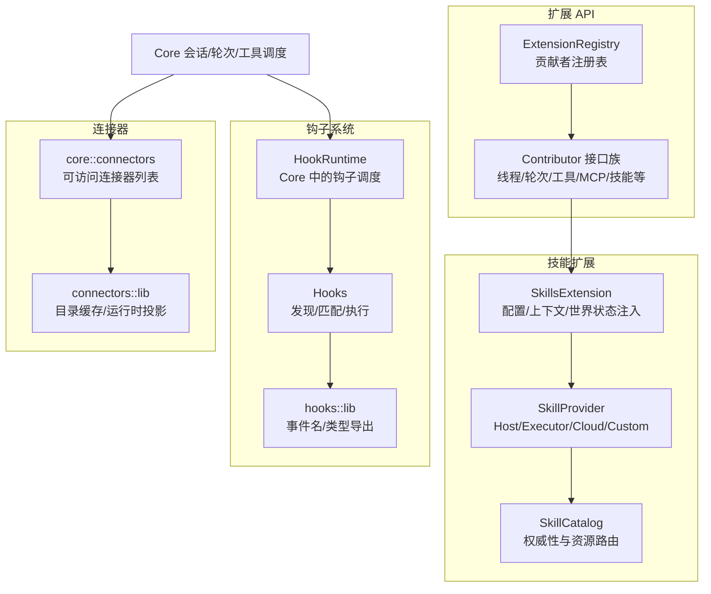
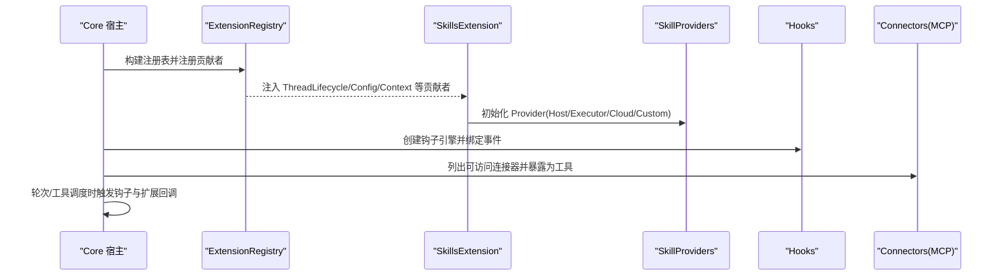
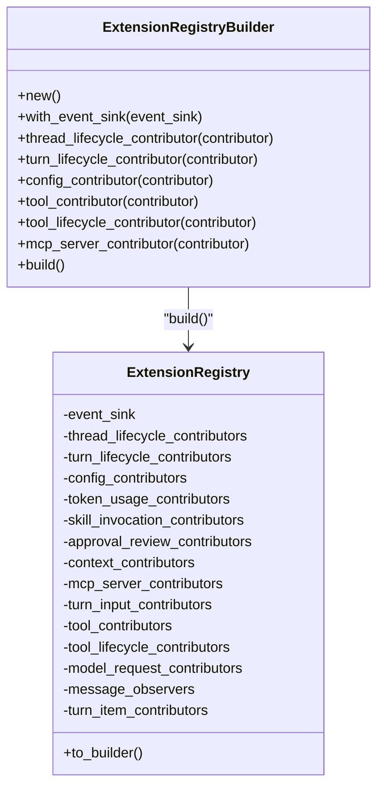
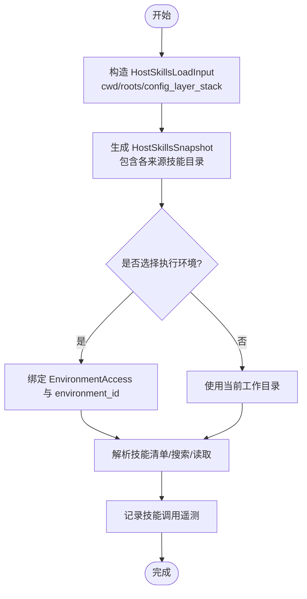
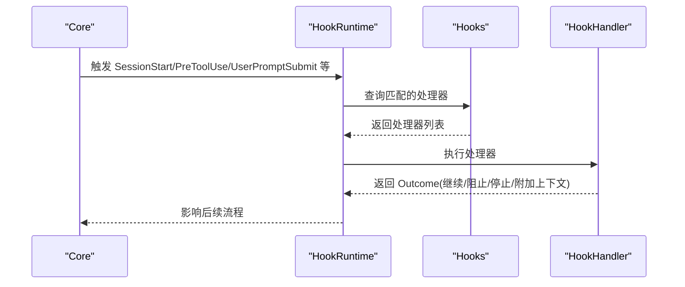
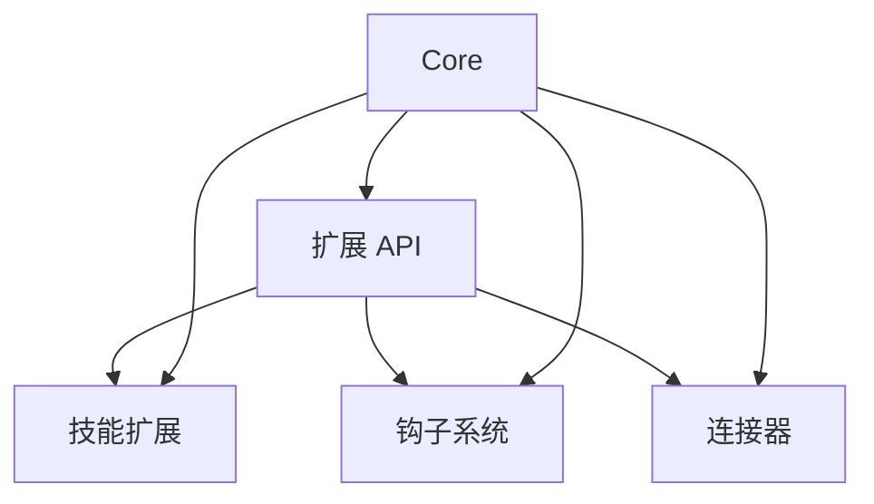

# 扩展系统

<cite>
**本文引用的文件**   
- [extension-api/src/lib.rs](file://codex-rs/ext/extension-api/src/lib.rs)
- [extension-api/src/registry.rs](file://codex-rs/ext/extension-api/src/registry.rs)
- [extension-api/src/contributors.rs](file://codex-rs/ext/extension-api/src/contributors.rs)
- [extension-api/src/contributors/thread_lifecycle.rs](file://codex-rs/ext/extension-api/src/contributors/thread_lifecycle.rs)
- [extension-api/src/contributors/tool_lifecycle.rs](file://codex-rs/ext/extension-api/src/contributors/tool_lifecycle.rs)
- [extension-api/src/contributors/skill_invocation.rs](file://codex-rs/ext/extension-api/src/contributors/skill_invocation.rs)
- [skills/src/lib.rs](file://codex-rs/ext/skills/src/lib.rs)
- [skills/src/provider.rs](file://codex-rs/ext/skills/src/provider.rs)
- [skills/src/catalog.rs](file://codex-rs/ext/skills/src/catalog.rs)
- [skills/src/extension.rs](file://codex-rs/ext/skills/src/extension.rs)
- [core/src/skills.rs](file://codex-rs/core/src/skills.rs)
- [core/src/plugins/mod.rs](file://codex-rs/core/src/plugins/mod.rs)
- [hooks/src/lib.rs](file://codex-rs/hooks/src/lib.rs)
- [hooks/src/registry.rs](file://codex-rs/hooks/src/registry.rs)
- [core/src/hook_runtime.rs](file://codex-rs/core/src/hook_runtime.rs)
- [core/src/connectors.rs](file://codex-rs/core/src/connectors.rs)
- [connectors/src/lib.rs](file://codex-rs/connectors/src/lib.rs)
</cite>

## 目录
1. [引言](#引言)
2. [项目结构](#项目结构)
3. [核心组件](#核心组件)
4. [架构总览](#架构总览)
5. [详细组件分析](#详细组件分析)
6. [依赖关系分析](#依赖关系分析)
7. [性能与可扩展性](#性能与可扩展性)
8. [安全模型与权限控制](#安全模型与权限控制)
9. [扩展示例与最佳实践](#扩展示例与最佳实践)
10. [故障排查指南](#故障排查指南)
11. [结论](#结论)

## 引言
本文件面向希望理解并开发 Codex 扩展系统的工程师。它从仓库代码出发，系统性说明插件架构、技能系统、钩子系统以及连接器集成机制，并给出生命周期、数据流、安全边界和扩展开发建议。文档不直接粘贴源代码，而是通过“章节来源”和“图表来源”精确指向实现位置，以便读者在源码中进一步验证。

## 项目结构
Codex 的扩展能力主要分布在以下模块：
- 扩展 API：定义扩展注册表、贡献者接口、会话/线程/工具生命周期回调、能力与安全上下文。
- 技能扩展：提供技能目录、提供者抽象、宿主适配、执行与遥测。
- 钩子引擎：声明、发现、匹配和执行生命周期钩子与事件钩子。
- 连接器层：通过 MCP 与外部应用/工具集成，并暴露为可发现工具。
- Core 集成点：将扩展能力接入会话、轮次、工具调度、MCP 管理和安全策略。

**图表来源**
- [extension-api/src/registry.rs:1-200](file://codex-rs/ext/extension-api/src/registry.rs#L1-L200)
- [extension-api/src/contributors.rs:1-200](file://codex-rs/ext/extension-api/src/contributors.rs#L1-L200)
- [skills/src/extension.rs:1-200](file://codex-rs/ext/skills/src/extension.rs#L1-L200)
- [skills/src/provider.rs:1-105](file://codex-rs/ext/skills/src/provider.rs#L1-L105)
- [skills/src/catalog.rs:1-200](file://codex-rs/ext/skills/src/catalog.rs#L1-L200)
- [hooks/src/lib.rs:1-139](file://codex-rs/hooks/src/lib.rs#L1-L139)
- [hooks/src/registry.rs:1-200](file://codex-rs/hooks/src/registry.rs#L1-L200)
- [core/src/hook_runtime.rs:1-200](file://codex-rs/core/src/hook_runtime.rs#L1-L200)
- [core/src/connectors.rs:1-200](file://codex-rs/core/src/connectors.rs#L1-L200)
- [connectors/src/lib.rs:1-200](file://codex-rs/connectors/src/lib.rs#L1-L200)

**章节来源**
- [extension-api/src/lib.rs:1-137](file://codex-rs/ext/extension-api/src/lib.rs#L1-L137)
- [skills/src/lib.rs:1-69](file://codex-rs/ext/skills/src/lib.rs#L1-L69)
- [hooks/src/lib.rs:1-139](file://codex-rs/hooks/src/lib.rs#L1-L139)
- [core/src/plugins/mod.rs:1-81](file://codex-rs/core/src/plugins/mod.rs#L1-L81)

## 核心组件
本节聚焦扩展系统的四个关键支柱：
- 扩展注册表与贡献者体系：以 trait 为中心的生命周期扩展点。
- 技能系统：按权威性和来源隔离的技能目录、提供者与资源读取。
- 钩子系统：声明式事件钩子的发现、匹配与执行。
- 连接器：通过 MCP 把外部应用/工具统一暴露为可发现工具。

**章节来源**
- [extension-api/src/registry.rs:1-200](file://codex-rs/ext/extension-api/src/registry.rs#L1-L200)
- [extension-api/src/contributors.rs:1-200](file://codex-rs/ext/extension-api/src/contributors.rs#L1-L200)
- [skills/src/provider.rs:1-105](file://codex-rs/ext/skills/src/provider.rs#L1-L105)
- [hooks/src/lib.rs:1-139](file://codex-rs/hooks/src/lib.rs#L1-L139)
- [connectors/src/lib.rs:1-200](file://codex-rs/connectors/src/lib.rs#L1-L200)

## 架构总览
扩展系统采用“宿主 + 扩展 + 贡献者 + 提供者 + 钩子 + 连接器”的分层设计：
- 宿主（Core）负责会话、轮次、工具调度和 MCP 管理。
- 扩展通过 ExtensionRegistryBuilder 注册贡献者，获得线程、轮次、工具、模型请求、消息、世界状态等扩展点。
- 技能扩展通过 SkillProvider 抽象聚合多来源技能，并通过 HostSkillsService 向 Core 暴露。
- 钩子系统以事件驱动方式在工具调用、会话开始/结束、用户提示提交等节点触发。
- 连接器通过 MCP 工具协议接入外部系统，并被 Core 过滤、合并后暴露为 DiscoverableTool。

**图表来源**
- [extension-api/src/registry.rs:1-200](file://codex-rs/ext/extension-api/src/registry.rs#L1-L200)
- [skills/src/extension.rs:1-200](file://codex-rs/ext/skills/src/extension.rs#L1-L200)
- [hooks/src/registry.rs:1-200](file://codex-rs/hooks/src/registry.rs#L1-L200)
- [core/src/connectors.rs:1-200](file://codex-rs/core/src/connectors.rs#L1-L200)

## 详细组件分析

### 插件架构与生命周期管理
扩展通过 `ExtensionRegistryBuilder` 集中注册各类贡献者，包括：
- 线程生命周期：ThreadLifecycleContributor
- 轮次生命周期：TurnLifecycleContributor
- 配置变更：ConfigContributor
- 令牌用量：TokenUsageContributor
- 技能调用观察：SkillInvocationContributor
- 审批审查：ApprovalReviewContributor
- 上下文注入：ContextContributor
- MCP 服务器：McpServerContributor
- 输入处理：TurnInputContributor
- 工具：ToolContributor / ToolLifecycleContributor
- 模型请求拦截：ModelRequestContributor
- 消息观察者：MessageLifecycleContributor
- 轮次项注入：TurnItemContributor

这些贡献者在构建阶段被收集，并在运行期由宿主按需分发。

**图表来源**
- [extension-api/src/registry.rs:1-200](file://codex-rs/ext/extension-api/src/registry.rs#L1-L200)

**章节来源**
- [extension-api/src/registry.rs:1-200](file://codex-rs/ext/extension-api/src/registry.rs#L1-L200)
- [extension-api/src/lib.rs:1-137](file://codex-rs/ext/extension-api/src/lib.rs#L1-L137)

### 技能系统：定义、注册、发现与执行
技能系统围绕“权威性 + 来源”进行隔离，避免跨来源路径越权。

- 技能提供者接口：`SkillProvider` 提供 list/read/search，支持 Host/Executor/Cloud/Custom 四种来源。
- 技能目录：`SkillCatalog` 维护条目、权威性与资源路由；`SkillAuthority`、`SkillPackageId`、`SkillResourceId` 用于严格路由。
- 宿主服务：`HostSkillsService` 暴露给 Core，配合 `PluginsManager` 加载插件技能根。
- 扩展集成：`SkillsExtension` 作为 Contributor 注入配置、上下文与世界状态，并在轮次中计算可用技能。

**图表来源**
- [core/src/skills.rs:1-200](file://codex-rs/core/src/skills.rs#L1-L200)
- [skills/src/provider.rs:1-105](file://codex-rs/ext/skills/src/provider.rs#L1-L105)
- [skills/src/catalog.rs:1-200](file://codex-rs/ext/skills/src/catalog.rs#L1-L200)

**章节来源**
- [skills/src/lib.rs:1-69](file://codex-rs/ext/skills/src/lib.rs#L1-L69)
- [skills/src/provider.rs:1-105](file://codex-rs/ext/skills/src/provider.rs#L1-L105)
- [skills/src/catalog.rs:1-200](file://codex-rs/ext/skills/src/catalog.rs#L1-L200)
- [core/src/skills.rs:1-200](file://codex-rs/core/src/skills.rs#L1-L200)
- [core/src/plugins/mod.rs:1-81](file://codex-rs/core/src/plugins/mod.rs#L1-L81)

#### 技能提供者与资源访问
`SkillProvider` 强制要求通过提供者自身的 read 接口访问资源，禁止将远程资源转换为本地路径。`SkillReadContext` 区分 Host/Executor/Cloud/Custom 三种读取上下文，确保文件系统或网络访问边界清晰。

**章节来源**
- [skills/src/provider.rs:1-105](file://codex-rs/ext/skills/src/provider.rs#L1-L105)
- [skills/src/catalog.rs:1-200](file://codex-rs/ext/skills/src/catalog.rs#L1-L200)

#### 技能扩展的 Contributor 角色
`SkillsExtension` 实现了多个 Contributor 接口，负责：
- 线程启动时保存 MCP 资源客户端与度量。
- 配置变化时更新线程状态。
- 注入线程/轮次上下文与世界状态，渲染可用技能说明。

**章节来源**
- [skills/src/extension.rs:1-200](file://codex-rs/ext/skills/src/extension.rs#L1-L200)

### 钩子系统：类型与使用场景
钩子系统分为两类：
- 生命周期钩子：如 SessionStart/SessionEnd、PreToolUse/PostToolUse、PreCompact/PostCompact、UserPromptSubmit、SubagentStart/SubagentStop、Stop、Interrupt。
- 事件钩子：通过 HookEventName 与匹配器决定处理器是否执行。

钩子引擎负责：
- 从配置与插件源发现处理器。
- 根据事件名与匹配器筛选处理器。
- 在 Core 的 HookRuntime 中执行，并可输出额外上下文、阻止继续、停止会话等。

**图表来源**
- [hooks/src/lib.rs:1-139](file://codex-rs/hooks/src/lib.rs#L1-L139)
- [hooks/src/registry.rs:1-200](file://codex-rs/hooks/src/registry.rs#L1-L200)
- [core/src/hook_runtime.rs:1-200](file://codex-rs/core/src/hook_runtime.rs#L1-L200)

**章节来源**
- [hooks/src/lib.rs:1-139](file://codex-rs/hooks/src/lib.rs#L1-L139)
- [hooks/src/registry.rs:1-200](file://codex-rs/hooks/src/registry.rs#L1-L200)
- [core/src/hook_runtime.rs:1-200](file://codex-rs/core/src/hook_runtime.rs#L1-L200)

### 连接器：适配器模式与外部系统集成
连接器通过 MCP 协议将外部应用/工具暴露为工具，Core 将其合并为可发现工具集。

- `connectors::lib` 负责目录缓存、元数据存储、运行时投影、策略评估。
- `core::connectors` 基于 Auth、EnvironmentManager、McpManager 获取可访问连接器，并与插件能力合并。
- 工具调度时，连接器工具可作为 McpToolSource::Connector 被追踪。

**图表来源**
- [connectors/src/lib.rs:1-200](file://codex-rs/connectors/src/lib.rs#L1-L200)
- [core/src/connectors.rs:1-200](file://codex-rs/core/src/connectors.rs#L1-L200)
- [extension-api/src/contributors/tool_lifecycle.rs:1-200](file://codex-rs/ext/extension-api/src/contributors/tool_lifecycle.rs#L1-L200)

**章节来源**
- [connectors/src/lib.rs:1-200](file://codex-rs/connectors/src/lib.rs#L1-L200)
- [core/src/connectors.rs:1-200](file://codex-rs/core/src/connectors.rs#L1-L200)
- [extension-api/src/contributors/tool_lifecycle.rs:1-200](file://codex-rs/ext/extension-api/src/contributors/tool_lifecycle.rs#L1-L200)

## 依赖关系分析
- 扩展 API 是扩展与宿主之间的契约层，解耦具体实现。
- 技能扩展依赖 executor 与 MCP 资源客户端，以提供跨来源技能。
- 钩子系统依赖 protocol 的事件命名与 hook runtime 的调度逻辑。
- 连接器依赖 MCP 管理器与环境管理器，最终被 Core 工具调度消费。

**图表来源**
- [extension-api/src/lib.rs:1-137](file://codex-rs/ext/extension-api/src/lib.rs#L1-L137)
- [skills/src/lib.rs:1-69](file://codex-rs/ext/skills/src/lib.rs#L1-L69)
- [hooks/src/lib.rs:1-139](file://codex-rs/hooks/src/lib.rs#L1-L139)
- [core/src/plugins/mod.rs:1-81](file://codex-rs/core/src/plugins/mod.rs#L1-L81)

**章节来源**
- [extension-api/src/lib.rs:1-137](file://codex-rs/ext/extension-api/src/lib.rs#L1-L137)
- [skills/src/lib.rs:1-69](file://codex-rs/ext/skills/src/lib.rs#L1-L69)
- [hooks/src/lib.rs:1-139](file://codex-rs/hooks/src/lib.rs#L1-L139)
- [core/src/plugins/mod.rs:1-81](file://codex-rs/core/src/plugins/mod.rs#L1-L81)

## 性能与可扩展性
- 技能快照：Core 对 HostSkillsSnapshot 做缓存，减少重复解析成本。
- 连接器目录缓存：connectors 模块使用内存与磁盘两级缓存，TTL 降低频繁 IO。
- 钩子执行：HookRuntime 将钩子结果转为 Protocol 事件，便于遥测与监控。
- 扩展贡献者顺序：注册顺序决定执行顺序，应避免阻塞型操作。

[无章节来源：本节为通用性能指导]

## 安全模型与权限控制
- 技能权威性与来源：SkillAuthority/SkillSourceKind 确保资源必须通过原提供者读取，防止路径伪造。
- 工具调用生命周期：ToolLifecycleContributor 提供 ToolCallOutcome、ToolTimingBoundary、CommandStartInput 等，限制敏感信息泄露与测量范围。
- 连接器策略：AppToolPolicyEvaluator 控制连接器启用与可见性。
- 钩子信任与模式：HooksConfig 包含 bypass_hook_trust 等开关，结合匹配器控制执行范围。
- 会话与线程作用域：ExtensionData 提供 session_store/thread_store/turn_store 三层隔离。

**章节来源**
- [skills/src/catalog.rs:1-200](file://codex-rs/ext/skills/src/catalog.rs#L1-L200)
- [extension-api/src/contributors/tool_lifecycle.rs:1-200](file://codex-rs/ext/extension-api/src/contributors/tool_lifecycle.rs#L1-L200)
- [connectors/src/lib.rs:1-200](file://codex-rs/connectors/src/lib.rs#L1-L200)
- [hooks/src/registry.rs:1-200](file://codex-rs/hooks/src/registry.rs#L1-L200)

## 扩展示例与最佳实践

### 开发环境搭建
- 使用 Rust 工作区与 Bazel 构建系统。
- 参考 skills 与 hooks 模块的组织方式，将扩展拆分为 provider/catalog/extension 等子模块。
- 通过 ExtensionRegistryBuilder 注册贡献者，避免在扩展内直接耦合 Core。

[无章节来源：本节为通用开发建议]

### API 参考要点
- 生命周期：ThreadLifecycleContributor、TurnLifecycleContributor、ToolLifecycleContributor。
- 上下文：ContextContributor、WorldStateSectionContribution。
- 技能：SkillProvider、HostSkillsService、SkillCatalogEntry。
- 钩子：HookEventName、Hooks、HookListEntry。
- 连接器：ConnectorDirectoryCacheContext、ConnectorRuntimeManager、DiscoverableTool。

**章节来源**
- [extension-api/src/contributors/thread_lifecycle.rs:1-84](file://codex-rs/ext/extension-api/src/contributors/thread_lifecycle.rs#L1-L84)
- [extension-api/src/contributors/tool_lifecycle.rs:1-200](file://codex-rs/ext/extension-api/src/contributors/tool_lifecycle.rs#L1-L200)
- [skills/src/provider.rs:1-105](file://codex-rs/ext/skills/src/provider.rs#L1-L105)
- [hooks/src/lib.rs:1-139](file://codex-rs/hooks/src/lib.rs#L1-L139)
- [connectors/src/lib.rs:1-200](file://codex-rs/connectors/src/lib.rs#L1-L200)

### 打包发布流程
- 使用 Bazel 目标构建扩展 crate。
- 通过 HostSkillsService 与 PluginsManager 将技能根纳入插件能力。
- 若涉及 MCP 服务器，通过 McpServerContributor 声明服务器与 selected_plugins。

**章节来源**
- [core/src/plugins/mod.rs:1-81](file://codex-rs/core/src/plugins/mod.rs#L1-L81)
- [extension-api/src/contributors.rs:1-200](file://codex-rs/ext/extension-api/src/contributors.rs#L1-L200)

### 实际扩展示例思路
- 自定义 SkillProvider：实现 list/read/search，绑定 Executor 或 Cloud 访问上下文。
- 自定义 HookHandler：监听 PreToolUse/PermissionRequest，注入审计日志或阻断高风险调用。
- 自定义 Connector：通过 MCP 暴露外部工具，并在 tool_lifecycle 中记录来源与耗时。

[无章节来源：本节为概念性示例，不直接对应具体源码片段]

### 最佳实践
- 保持贡献者为无状态或仅使用 ExtensionData 存储轻量状态。
- 避免在钩子中执行长时间 I/O，必要时异步化。
- 谨慎处理敏感参数与结果，不要在日志中输出明文。
- 使用 SkillAuthority/SkillResourceId 进行资源路由，不要拼接本地路径。
- 在工具生命周期中优先使用 ToolCallOutcome 与 ToolTimingBoundary 进行观测。

[无章节来源：本节为通用最佳实践]

## 故障排查指南
- 技能不可用：检查 HostSkillsLoadInput 的 cwd/roots/config_layer_stack 是否正确，确认 Provider 是否返回期望目录。
- 钩子未触发：核对 HookEventName 与匹配器字段，确认 HooksConfig 已启用 feature_enabled，且处理器未被过滤。
- 连接器未出现：确认 Features.apps_enabled_for_auth 条件、认证状态、MCP 管理器与 EnvironmentManager 是否正常初始化。
- 工具调用失败：查看 ToolCallOutcome 与 HookRuntime 的输出事件，定位是 policy 阻断还是 handler 异常。

**章节来源**
- [core/src/skills.rs:1-200](file://codex-rs/core/src/skills.rs#L1-L200)
- [hooks/src/registry.rs:1-200](file://codex-rs/hooks/src/registry.rs#L1-L200)
- [core/src/connectors.rs:1-200](file://codex-rs/core/src/connectors.rs#L1-L200)
- [extension-api/src/contributors/tool_lifecycle.rs:200-272](file://codex-rs/ext/extension-api/src/contributors/tool_lifecycle.rs#L200-L272)

## 结论
Codex 的扩展系统以扩展 API 为契约，通过贡献者模式将线程、轮次、工具、模型请求、上下文与世界状态等扩展点标准化。技能系统以权威性与来源隔离为核心，保障资源访问安全；钩子系统以事件驱动的方式提供灵活的可插拔行为；连接器则通过 MCP 统一接入外部系统。遵循本文给出的生命周期、数据流与安全边界建议，可以构建稳定、可观测、可扩展的第三方能力。