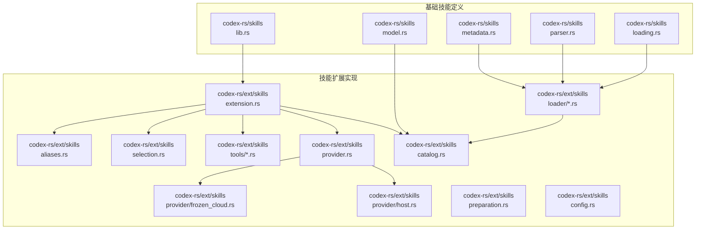
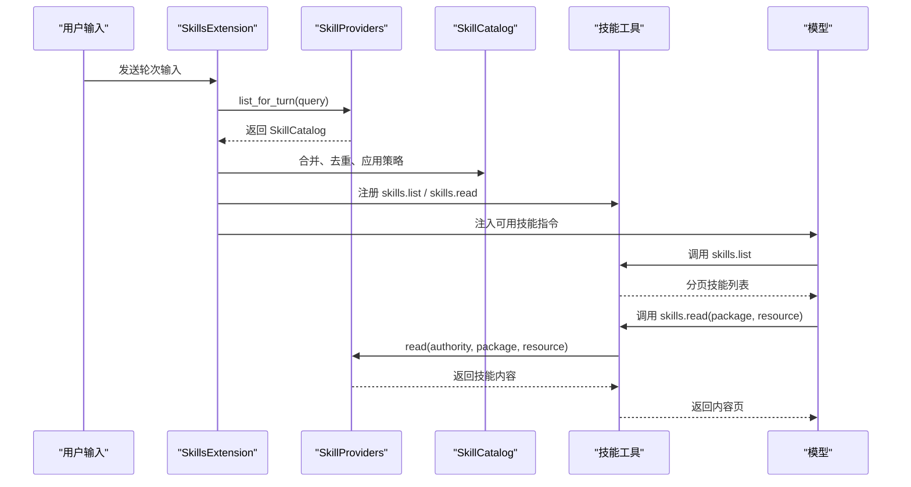
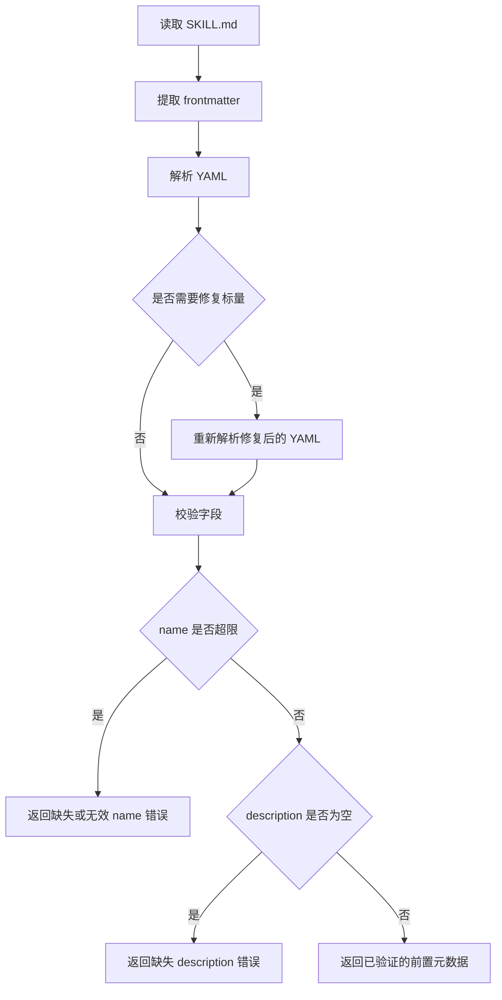
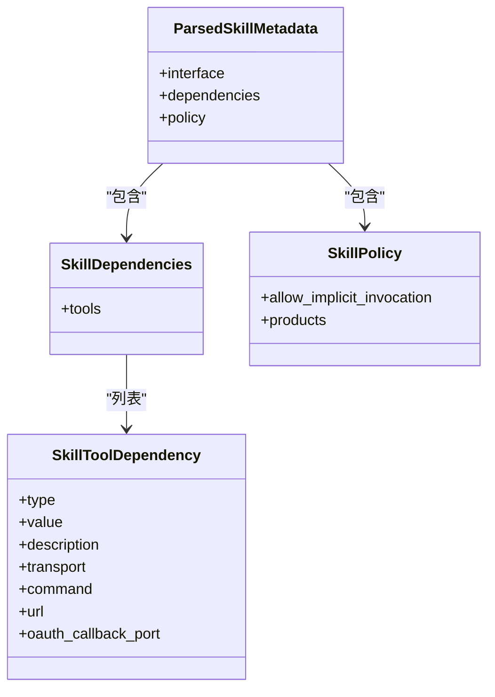
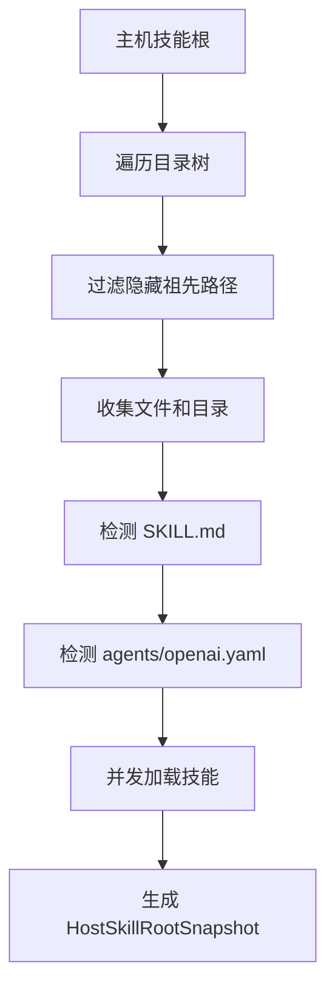
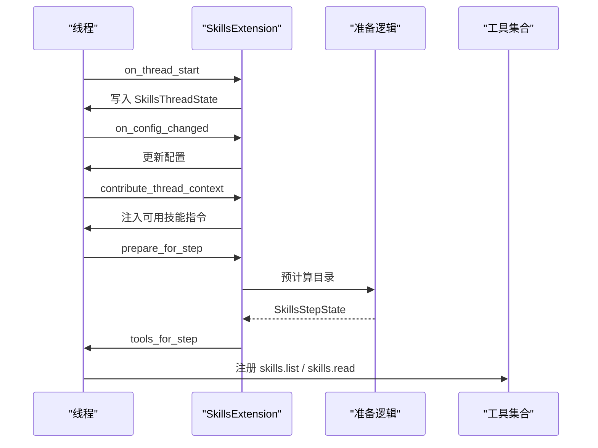
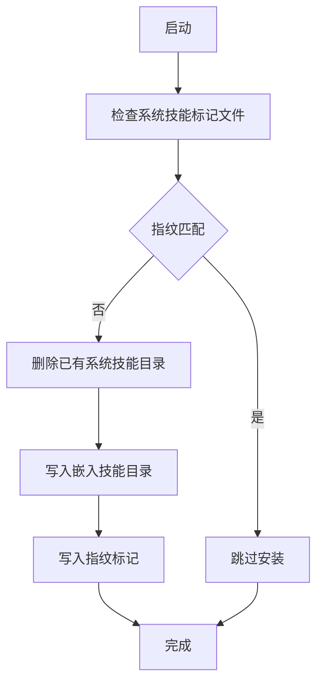
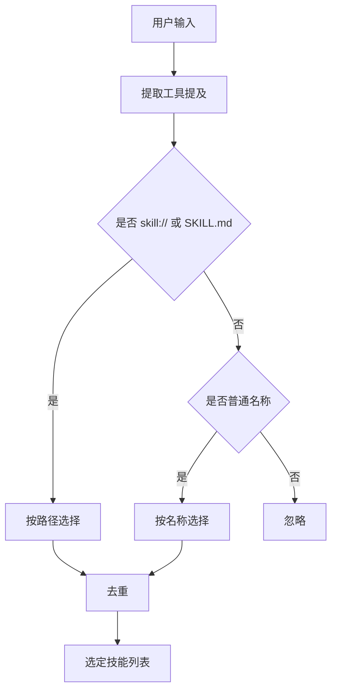
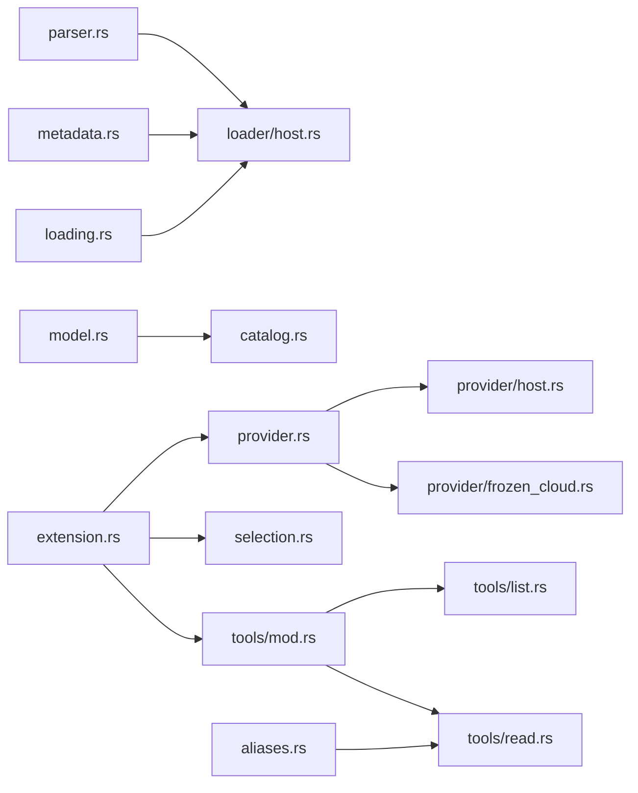

# 技能系统

<cite>
**本文引用的文件**   
- [skills.md](file://docs/skills.md)
- [lib.rs（基础 skills 库）](file://codex-rs/skills/src/lib.rs)
- [model.rs（技能模型）](file://codex-rs/skills/src/model.rs)
- [metadata.rs（元数据解析）](file://codex-rs/skills/src/metadata.rs)
- [parser.rs（SKILL.md 前置元数据解析）](file://codex-rs/skills/src/parser.rs)
- [loading.rs（加载接口与缓存抽象）](file://codex-rs/skills/src/loading.rs)
- [extension.rs（技能扩展入口）](file://codex-rs/ext/skills/src/extension.rs)
- [catalog.rs（目录、权限与资源标识）](file://codex-rs/ext/skills/src/catalog.rs)
- [provider.rs（技能提供者接口）](file://codex-rs/ext/skills/src/provider.rs)
- [host.rs（主机技能提供者）](file://codex-rs/ext/skills/src/provider/host.rs)
- [frozen_cloud.rs（离线云技能快照）](file://codex-rs/ext/skills/src/provider/frozen_cloud.rs)
- [mod.rs（加载器模块）](file://codex-rs/ext/skills/src/loader/mod.rs)
- [discovery.rs（文件系统发现）](file://codex-rs/ext/skills/src/loader/discovery.rs)
- [preparation.rs（步骤级准备逻辑）](file://codex-rs/ext/skills/src/preparation.rs)
- [config.rs（扩展配置）](file://codex-rs/ext/skills/src/config.rs)
- [selection.rs（显式技能选择）](file://codex-rs/ext/skills/src/selection.rs)
- [aliases.rs（别名与定位符）](file://codex-rs/ext/skills/src/aliases.rs)
- [tools/mod.rs（技能工具集合）](file://codex-rs/ext/skills/src/tools/mod.rs)
- [tools/list.rs（list 工具）](file://codex-rs/ext/skills/src/tools/list.rs)
- [tools/read.rs（read 工具）](file://codex-rs/ext/skills/src/tools/read.rs)
</cite>

## 目录
1. [引言](#引言)
2. [项目结构](#项目结构)
3. [核心组件](#核心组件)
4. [架构总览](#架构总览)
5. [详细组件分析](#详细组件分析)
6. [依赖关系分析](#依赖关系分析)
7. [性能与限制](#性能与限制)
8. [故障排查指南](#故障排查指南)
9. [结论](#结论)
10. [附录：技能开发指南](#附录技能开发指南)

## 引言
本文件系统性说明仓库中的“技能系统”。该系统由两层组成：
- 基础技能定义层 `codex-rs/skills`：描述技能的元数据结构、SKILL.md 前置元数据解析、策略与依赖模型，以及通用的加载接口和缓存抽象。
- 扩展实现层 `codex-rs/ext/skills`：将多个来源的技能合并为统一目录，提供清单与读取工具，负责在对话线程中注入可用技能、执行隐式或显式技能调用，并管理生命周期、缓存、版本与更新。

外部文档说明当前对外技能文档位于开发者站点；仓库内还包含若干示例技能，用于演示 SKILL.md、agents/openai.yaml 等结构。

**章节来源**
- [skills.md:1-3](file://docs/skills.md#L1-L3)

## 项目结构
技能系统的代码组织遵循“定义 + 实现”的分层方式：

**图表来源**
- [lib.rs（基础 skills 库）:1-60](file://codex-rs/skills/src/lib.rs#L1-L60)
- [extension.rs:1-60](file://codex-rs/ext/skills/src/extension.rs#L1-L60)
- [provider.rs:1-40](file://codex-rs/ext/skills/src/provider.rs#L1-L40)

**章节来源**
- [lib.rs（基础 skills 库）:1-60](file://codex-rs/skills/src/lib.rs#L1-L60)
- [extension.rs:1-60](file://codex-rs/ext/skills/src/extension.rs#L1-L60)

## 核心组件
- **技能元数据模型**：定义技能名称、描述、界面信息、依赖、策略、作用域和插件身份等。
- **SKILL.md 前置元数据解析**：从 SKILL.md 的 YAML frontmatter 提取 name、description、short-description。
- **agents/openai.yaml 元数据解析**：解析可选 interface、dependencies、policy，并进行长度与必填字段校验。
- **技能根加载接口**：定义跨来源的技能根加载请求、快照缓存抽象和错误结构。
- **技能目录与权威主体**：将不同来源的技能统一建模为 SkillCatalogEntry，并通过 Authority 区分 Host/Executor/Cloud/Custom。
- **技能提供者接口**：封装 list/read/search 能力，强制通过提供者读取资源，避免直接访问本地路径。
- **扩展入口与线程上下文**：注册工具、注入可用技能指令、处理隐式/显式技能调用。
- **技能工具**：向模型暴露 skills.list、skills.read 等函数，支持分页、预算控制和来源过滤。

**章节来源**
- [model.rs:1-113](file://codex-rs/skills/src/model.rs#L1-L113)
- [parser.rs:1-80](file://codex-rs/skills/src/parser.rs#L1-L80)
- [metadata.rs:1-60](file://codex-rs/skills/src/metadata.rs#L1-L60)
- [loading.rs:1-120](file://codex-rs/skills/src/loading.rs#L1-L120)
- [catalog.rs:1-60](file://codex-rs/ext/skills/src/catalog.rs#L1-L60)
- [provider.rs:1-105](file://codex-rs/ext/skills/src/provider.rs#L1-L105)
- [extension.rs:1-120](file://codex-rs/ext/skills/src/extension.rs#L1-L120)
- [tools/mod.rs:1-80](file://codex-rs/ext/skills/src/tools/mod.rs#L1-L80)

## 架构总览
技能系统以“提供者 + 目录 + 工具”为核心：
- 多个 SkillProvider 实现（Host、Executor、Frozen Cloud、未来 Custom）各自列出技能。
- extension 组合这些提供者，生成 SkillCatalog。
- 在对话线程中，extension 注入可用技能指令，并根据用户输入选择技能。
- 模型通过 skills.list 与 skills.read 工具浏览和读取技能内容。

**图表来源**
- [extension.rs:201-320](file://codex-rs/ext/skills/src/extension.rs#L201-L320)
- [provider.rs:60-105](file://codex-rs/ext/skills/src/provider.rs#L60-L105)
- [tools/list.rs:1-80](file://codex-rs/ext/skills/src/tools/list.rs#L1-L80)
- [tools/read.rs:1-80](file://codex-rs/ext/skills/src/tools/read.rs#L1-L80)

## 详细组件分析

### 技能定义格式与元数据规范

#### SKILL.md 前置元数据
SKILL.md 使用 YAML frontmatter 声明技能基本信息：
- name：技能名称，最大长度受约束。
- description：必需描述字段。
- metadata.short-description：可选短描述。

解析过程会：
- 提取首尾 `---` 包裹的 frontmatter。
- 对 scalar 值进行清理和修复，兼容部分第三方技能的非标准写法。
- 校验 name 非空且不超过长度上限，description 必须存在。

**图表来源**
- [parser.rs:1-80](file://codex-rs/skills/src/parser.rs#L1-L80)
- [parser.rs:201-225](file://codex-rs/skills/src/parser.rs#L201-L225)

**章节来源**
- [parser.rs:1-80](file://codex-rs/skills/src/parser.rs#L1-L80)
- [parser.rs:201-225](file://codex-rs/skills/src/parser.rs#L201-L225)

#### agents/openai.yaml 元数据
该文件用于声明可选的：
- interface：界面展示信息，例如 display_name、short_description、图标路径、品牌色、默认提示等。
- dependencies.tools：技能运行时依赖的工具列表，每个工具包含 type、value、description、transport、command、url、oauth.callback_port 等字段。
- policy：控制行为，包括 allow_implicit_invocation 和 products 产品范围限制。

解析规则：
- 缺少必填字段会被忽略并记录警告。
- 字符串字段有最大长度限制，超长将被忽略。
- OAuth 回调端口支持 callback_port 别名。

**图表来源**
- [metadata.rs:1-60](file://codex-rs/skills/src/metadata.rs#L1-L60)
- [metadata.rs:60-164](file://codex-rs/skills/src/metadata.rs#L60-L164)
- [model.rs:60-113](file://codex-rs/skills/src/model.rs#L60-L113)

**章节来源**
- [metadata.rs:1-164](file://codex-rs/skills/src/metadata.rs#L1-L164)
- [model.rs:1-113](file://codex-rs/skills/src/model.rs#L1-L113)

#### 完整技能元数据模型
最终宿主侧 SkillMetadata 包括：
- name、description、short_description
- interface、dependencies、policy
- path_to_skills_md、scope、plugin_id、remote_plugin_id

环境侧 EnvironmentSkillMetadata 则面向执行环境，保留关键元数据和策略判断方法。

**章节来源**
- [model.rs:1-60](file://codex-rs/skills/src/model.rs#L1-L60)

### 技能的注册机制与发现流程

#### 文件系统发现
主机端发现流程：
- 扫描 root 目录，限制最大深度、目录数量、条目数量。
- 识别 SKILL.md 作为技能入口。
- 识别 agents 目录和 openai.yaml 作为可选元数据来源。
- 根据 SkillScope 决定是否跟随符号链接、是否跳过隐藏目录。
- 并发加载技能，限制最大并发数。

**图表来源**
- [discovery.rs:1-120](file://codex-rs/ext/skills/src/loader/discovery.rs#L1-L120)
- [discovery.rs:120-229](file://codex-rs/ext/skills/src/loader/discovery.rs#L120-L229)
- [host.rs:120-200](file://codex-rs/ext/skills/src/loader/host.rs#L120-L200)

**章节来源**
- [mod.rs（加载器模块）:1-27](file://codex-rs/ext/skills/src/loader/mod.rs#L1-L27)
- [discovery.rs:1-229](file://codex-rs/ext/skills/src/loader/discovery.rs#L1-L229)
- [host.rs:120-200](file://codex-rs/ext/skills/src/loader/host.rs#L120-L200)

#### 多来源注册
技能来源分为：
- Host：宿主本地、用户、仓库、插件安装、下载或远程物化技能。
- Executor：执行环境拥有的技能。
- Cloud：云端拥有而非执行环境的技能。
- Custom：扩展私有来源类型。

每种来源通过 SkillAuthority 与 SkillSourceKind 标识，目录项保留来源特定的策略和读取路由。

**章节来源**
- [catalog.rs:1-60](file://codex-rs/ext/skills/src/catalog.rs#L1-L60)

### 执行引擎与工具链

#### 扩展入口与生命周期
SkillsExtension 在以下阶段参与：
- 线程启动时创建线程状态，记录 MCP 资源和指标。
- 配置变化时更新线程状态。
- 上下文贡献时注入可用技能指令。
- 步骤准备时预计算目录和工具。
- 工具注册时暴露 skills.list、skills.read 等。
- 技能调用回调中记录隐式调用。

**图表来源**
- [extension.rs:120-240](file://codex-rs/ext/skills/src/extension.rs#L120-L240)
- [preparation.rs:1-60](file://codex-rs/ext/skills/src/preparation.rs#L1-L60)

**章节来源**
- [extension.rs:120-320](file://codex-rs/ext/skills/src/extension.rs#L120-L320)
- [preparation.rs:1-110](file://codex-rs/ext/skills/src/preparation.rs#L1-L110)

#### 技能工具
- skills.list：按权威主体列出技能，支持分页游标、响应字节预算、过大条目省略警告。
- skills.read：按 package 与 resource 读取技能内容，支持 legacy 与 v2 两种模式，v2 支持 source 过滤和安装位置信息。

两者都使用统一的工具命名空间、参数解析、序列化长度检查和遥测埋点。

**章节来源**
- [tools/mod.rs:1-120](file://codex-rs/ext/skills/src/tools/mod.rs#L1-L120)
- [tools/list.rs:1-120](file://codex-rs/ext/skills/src/tools/list.rs#L1-L120)
- [tools/read.rs:1-120](file://codex-rs/ext/skills/src/tools/read.rs#L1-L120)

### 生命周期管理：加载、缓存、版本管理与更新策略

#### 内置系统技能安装
系统内置技能通过 include_dir 嵌入二进制，并在 CODEX_HOME/skills/.system 下安装：
- 首次或指纹变化时清空旧目录并写入新内容。
- 使用 marker 文件保存嵌入目录指纹，避免每次启动重复安装。
- 错误类型 SystemSkillsError 包装 IO 操作失败。

**图表来源**
- [lib.rs（基础 skills 库）:60-160](file://codex-rs/skills/src/lib.rs#L60-L160)

**章节来源**
- [lib.rs（基础 skills 库）:60-160](file://codex-rs/skills/src/lib.rs#L60-L160)

#### 根加载缓存抽象
基础库提供 SkillRootLoader 与 SkillRootSnapshotCache：
- 调用方可传入已有快照以减少重复扫描。
- 相等性和哈希基于缓存分配对象身份，便于上层缓存键设计。
- 加载结果包含 LoadedSkillRoot、LoadedSkills 和错误。

**章节来源**
- [loading.rs:1-120](file://codex-rs/skills/src/loading.rs#L1-L120)

#### 版本管理与更新策略
- 系统技能通过嵌入目录指纹决定是否更新。
- 主机技能扫描结果被包装为 HostSkillRootSnapshot，包含文件系统和插件标识，避免重复加载。
- 扩展侧目录在步骤级别准备，线程状态维护配置、云技能可用性、最近调用等信息。
- 云技能支持 FrozenCloudSkillProvider 从静态快照加载，禁止搜索，限制快照大小和资源大小。

**章节来源**
- [host.rs:120-200](file://codex-rs/ext/skills/src/loader/host.rs#L120-L200)
- [preparation.rs:1-110](file://codex-rs/ext/skills/src/preparation.rs#L1-L110)
- [frozen_cloud.rs:1-164](file://codex-rs/ext/skills/src/provider/frozen_cloud.rs#L1-L164)

### 权限控制、安全验证与资源限制

#### 隐式调用权限
SkillPolicy.allow_implicit_invocation 控制技能是否允许隐式调用。未设置时默认为允许。不可隐式调用的技能会在目录渲染中被隐藏。

**章节来源**
- [model.rs:1-60](file://codex-rs/skills/src/model.rs#L1-L60)
- [host.rs:120-179](file://codex-rs/ext/skills/src/provider/host.rs#L120-L179)

#### 产品范围限制
SkillPolicy.products 限制技能适用于哪些产品。解析时使用 codex_protocol::protocol::Product，并在匹配时考虑空列表表示不限制。

**章节来源**
- [metadata.rs:1-60](file://codex-rs/skills/src/metadata.rs#L1-L60)
- [model.rs:60-113](file://codex-rs/skills/src/model.rs#L60-L113)

#### 资源读取授权
SkillProvider.read 要求调用方携带 Source-owned context：
- Host：需要 host_snapshot 与环境访问者。
- Executor：需要 EnvironmentAccess。
- Cloud：可使用 McpResourceClient。
- Custom：可由扩展自定义。

这防止通过目录 ID 直接构造任意本地路径读取。

**章节来源**
- [provider.rs:60-105](file://codex-rs/ext/skills/src/provider.rs#L60-L105)
- [host.rs:60-120](file://codex-rs/ext/skills/src/provider/host.rs#L60-L120)

#### 资源大小与响应预算
- 单个技能资源内容上限：provider 定义常量。
- 冻结云快照整体上限：64 MiB。
- 单条技能资源内容上限：约 1 MiB。
- skills.list 和 skills.read 响应均受字节预算限制，过大条目会被省略并给出警告。
- 游标包含指纹、偏移和预算，确保同一快照下分页一致性。

**章节来源**
- [frozen_cloud.rs:1-100](file://codex-rs/ext/skills/src/provider/frozen_cloud.rs#L1-L100)
- [tools/list.rs:80-200](file://codex-rs/ext/skills/src/tools/list.rs#L80-L200)
- [tools/read.rs:80-200](file://codex-rs/ext/skills/src/tools/read.rs#L80-L200)

### 显式技能选择与别名机制

#### 显式技能选择
系统从用户输入中提取 skill:// 路径或普通名称，并按以下顺序匹配：
- 显式 Skill 节点。
- Mention 中指向 SKILL.md 的路径。
- 文本中的工具提及路径。
- 文本中的普通名称，排除已被路径选中的名称。

**图表来源**
- [selection.rs:1-144](file://codex-rs/ext/skills/src/selection.rs#L1-L144)

**章节来源**
- [selection.rs:1-144](file://codex-rs/ext/skills/src/selection.rs#L1-L144)

#### 别名与定位符
SkillLocator 支持带前缀的来源别名：
- c：Cloud
- e：Executor
- r：Host（仅用于语义，实际解析器只识别 c/e/r 前缀加数字索引）
- 无来源时由目录解析器自动匹配。

别名状态在线程内维护，追加式分配，有根数量和字节预算限制。

**章节来源**
- [aliases.rs:1-200](file://codex-rs/ext/skills/src/aliases.rs#L1-L200)

## 依赖关系分析

**图表来源**
- [parser.rs:1-80](file://codex-rs/skills/src/parser.rs#L1-L80)
- [metadata.rs:1-60](file://codex-rs/skills/src/metadata.rs#L1-L60)
- [model.rs:1-60](file://codex-rs/skills/src/model.rs#L1-L60)
- [loading.rs:1-120](file://codex-rs/skills/src/loading.rs#L1-L120)
- [provider.rs:1-60](file://codex-rs/ext/skills/src/provider.rs#L1-L60)
- [extension.rs:1-120](file://codex-rs/ext/skills/src/extension.rs#L1-L120)
- [tools/mod.rs:1-80](file://codex-rs/ext/skills/src/tools/mod.rs#L1-L80)

**章节来源**
- [extension.rs:1-120](file://codex-rs/ext/skills/src/extension.rs#L1-L120)
- [provider.rs:1-105](file://codex-rs/ext/skills/src/provider.rs#L1-L105)
- [tools/mod.rs:1-120](file://codex-rs/ext/skills/src/tools/mod.rs#L1-L120)

## 性能与限制
- 并发限制：
  - 最大并发技能扫描数：64。
  - 每根最大目录数：2000。
  - 每根最大条目数：20000。
  - 最大扫描深度：6。
  - 主机加载器并发根扫描上限：8。
- 内容限制：
  - 单技能资源内容上限：约 1 MiB。
  - 冻结云快照上限：64 MiB。
  - skills.list 和 skills.read 响应受字节预算限制。
- 渲染限制：
  - 技能名称和路径渲染有字节上限。
  - 可用技能目录可省略描述，并可限制 token 预算。
- 别名限制：
  - 最大别名根数量：2048。
  - 别名映射字节预算：16 KiB。

**章节来源**
- [discovery.rs:1-60](file://codex-rs/ext/skills/src/loader/discovery.rs#L1-L60)
- [mod.rs（加载器模块）:18-27](file://codex-rs/ext/skills/src/loader/mod.rs#L18-L27)
- [provider.rs:40-60](file://codex-rs/ext/skills/src/provider.rs#L40-L60)
- [frozen_cloud.rs:60-120](file://codex-rs/ext/skills/src/provider/frozen_cloud.rs#L60-L120)
- [aliases.rs:180-257](file://codex-rs/ext/skills/src/aliases.rs#L180-L257)
- [config.rs:1-20](file://codex-rs/ext/skills/src/config.rs#L1-L20)

## 故障排查指南
常见错误与诊断要点：
- SKILL.md 解析失败：
  - 缺少 frontmatter。
  - YAML 非法。
  - 缺少 description。
  - name 超限。
- agents/openai.yaml 解析失败：
  - dependencies.tools.type 或 value 缺失。
  - 字符串字段超过最大长度。
  - OAuth 回调端口为空或非数值。
- 主机技能加载失败：
  - 无法遍历目录。
  - 扫描达到限制。
  - 技能路径不存在。
- 技能读取失败：
  - 包不可用。
  - 资源不可用。
  - 来源不可用。
  - 别名未解析。
- 列表响应过小：
  - 技能元数据过大导致条目省略。
  - 响应预算不足，返回游标以便继续。

建议排查顺序：
1. 检查 SKILL.md 前置元数据是否合法。
2. 检查 agents/openai.yaml 必填字段与长度。
3. 确认技能路径是否在 Host/Executor/Cloud 范围内。
4. 使用 skills.list 查看目录，再使用 skills.read 指定 package 和 resource。
5. 关注警告消息，尤其是扫描限制、响应预算和过大条目省略。

**章节来源**
- [parser.rs:20-80](file://codex-rs/skills/src/parser.rs#L20-L80)
- [metadata.rs:60-164](file://codex-rs/skills/src/metadata.rs#L60-L164)
- [discovery.rs:60-120](file://codex-rs/ext/skills/src/loader/discovery.rs#L60-L120)
- [host.rs:60-120](file://codex-rs/ext/skills/src/provider/host.rs#L60-L120)
- [tools/list.rs:120-200](file://codex-rs/ext/skills/src/tools/list.rs#L120-L200)
- [tools/read.rs:120-200](file://codex-rs/ext/skills/src/tools/read.rs#L120-L200)

## 结论
技能系统通过清晰的职责分层实现可扩展的技能生态：
- 基础层定义技能元数据、策略与加载接口。
- 扩展层聚合多来源技能，提供统一目录、工具和安全读取。
- 生命周期管理覆盖内置技能安装、扫描缓存、步骤级准备和线程状态。
- 权限控制与资源限制保障技能调用安全可控。
- 工具链使模型能够浏览和读取技能，同时支持分页、预算和来源过滤。

对于开发者而言，应优先保证 SKILL.md 和 agents/openai.yaml 的合法性，合理使用 policy 控制隐式调用和产品范围，并通过 skills.list 与 skills.read 调试技能可见性与内容读取。

## 附录：技能开发指南

### 开发环境搭建
- 使用仓库提供的示例技能作为参考结构。
- 在技能目录中创建 SKILL.md 并填写前置元数据。
- 如需界面信息和依赖声明，添加 agents/openai.yaml。
- 使用内置系统技能安装逻辑或手动放置技能到对应目录。

**章节来源**
- [lib.rs（基础 skills 库）:1-60](file://codex-rs/skills/src/lib.rs#L1-L60)

### API 参考
- 基础库导出：
  - 解析 SKILL.md 前置元数据。
  - 解析 agents/openai.yaml 元数据。
  - 技能根加载请求与快照缓存抽象。
  - 技能错误、已加载技能、隐式技能访问探测等。
- 扩展库导出：
  - 技能扩展配置。
  - 安装入口与提供者。
  - 技能提供者源、服务输入与请求。
  - 线程状态、工具指标、环境技能需求验证。

**章节来源**
- [lib.rs（基础 skills 库）:1-60](file://codex-rs/skills/src/lib.rs#L1-L60)
- [ext lib.rs:1-69](file://codex-rs/ext/skills/src/lib.rs#L1-L69)

### 测试方法
- 单元测试分布在各模块 tests 子目录。
- 基础库 parser、metadata、loading、model 等均有独立测试。
- 扩展库 catalog、render、host、frozen_cloud、loader、tools 等也有测试与集成测试。
- 可通过运行仓库测试框架验证解析、发现、目录合并、工具行为和遥测。

**章节来源**
- [parser_tests.rs](file://codex-rs/skills/src/parser_tests.rs)
- [metadata.rs 测试路径引用](file://codex-rs/skills/src/metadata.rs)
- [host_tests.rs](file://codex-rs/ext/skills/src/provider/host_tests.rs)
- [frozen_cloud_tests.rs](file://codex-rs/ext/skills/src/provider/frozen_cloud_tests.rs)

### 打包发布流程
- 系统技能随二进制嵌入，安装到 CODEX_HOME/skills/.system。
- 用户技能可放置在宿主目录、仓库目录或插件目录。
- 云技能可通过 MCP 资源或冻结快照提供。
- 发布时应校验 SKILL.md 和 agents/openai.yaml，并确保策略与依赖符合预期。

**章节来源**
- [lib.rs（基础 skills 库）:60-160](file://codex-rs/skills/src/lib.rs#L60-L160)
- [frozen_cloud.rs:60-164](file://codex-rs/ext/skills/src/provider/frozen_cloud.rs#L60-L164)

### 实际技能示例与集成模式
仓库中包含多个示例技能：
- imagegen：图像生成相关脚本与参考文档。
- openai-docs：OpenAI 文档抓取与模型信息查询脚本。
- review-agent：代码审查相关示例。
- skill-creator：技能创建辅助脚本。
- skill-installer：从 GitHub 安装技能示例。

这些示例展示了 scripts、references、assets、agents 等目录的组织方式，可作为技能开发的模板。

**章节来源**
- [lib.rs（基础 skills 库）:1-20](file://codex-rs/skills/src/lib.rs#L1-L20)