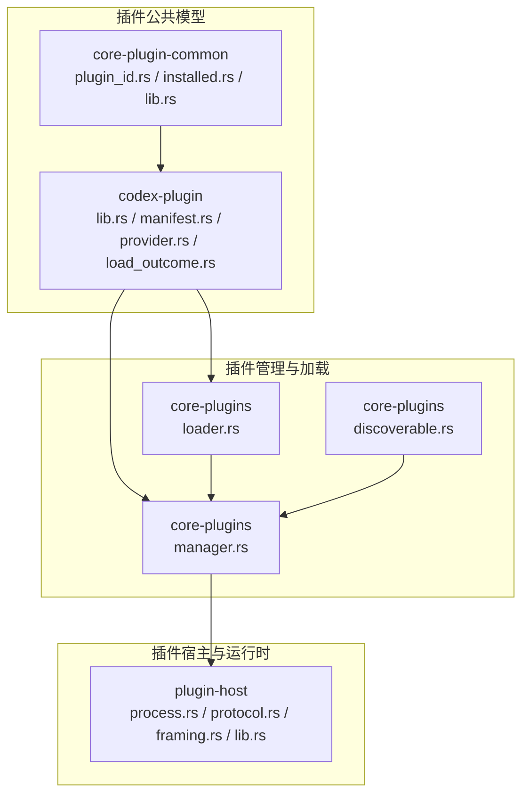
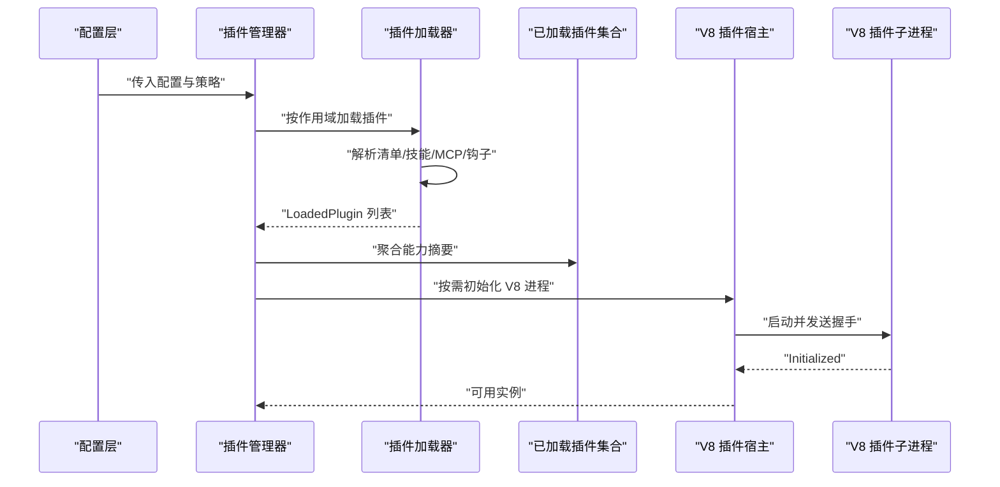
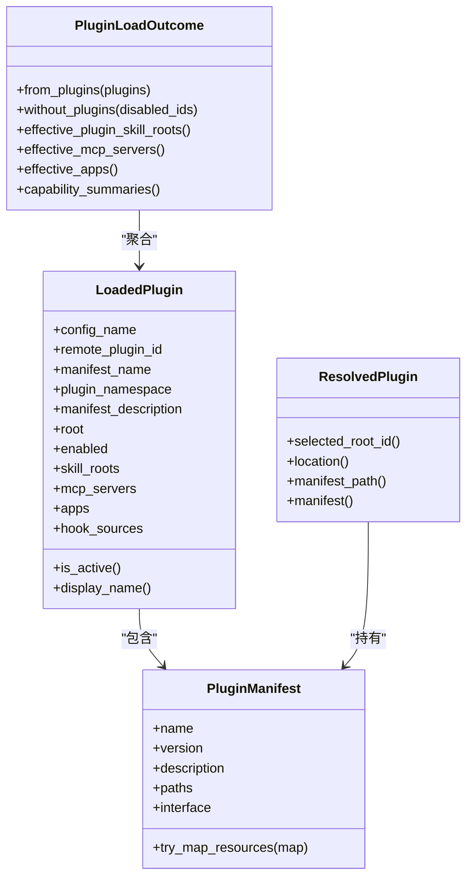
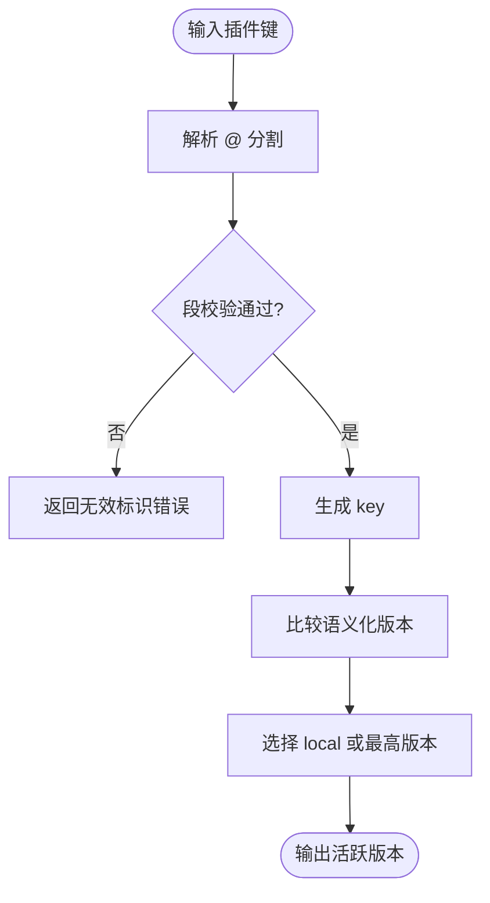
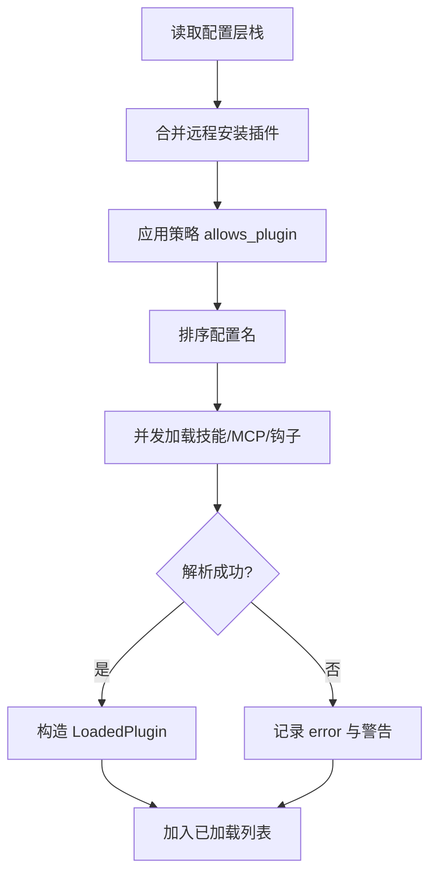
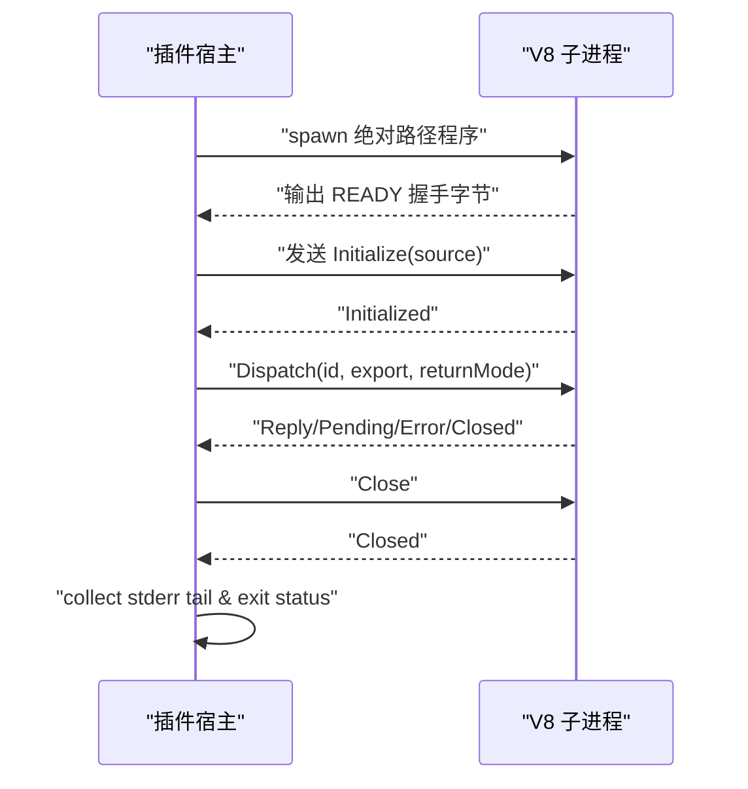
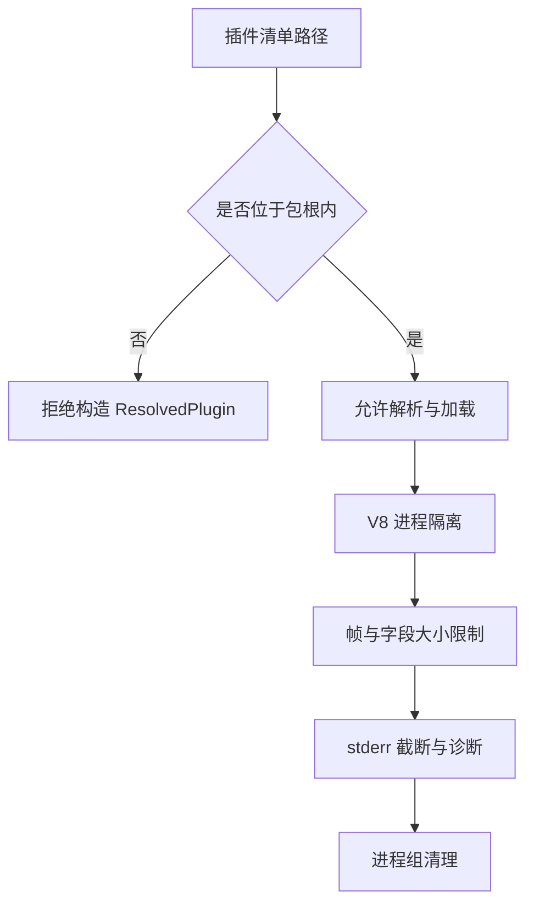

# 插件架构

<cite>
**本文引用的文件**   
- [codex-rs/plugin/src/lib.rs](file://codex-rs/plugin/src/lib.rs)
- [codex-rs/plugin/src/manifest.rs](file://codex-rs/plugin/src/manifest.rs)
- [codex-rs/plugin/src/provider.rs](file://codex-rs/plugin/src/provider.rs)
- [codex-rs/plugin/src/load_outcome.rs](file://codex-rs/plugin/src/load_outcome.rs)
- [codex-rs/core-plugin-common/src/lib.rs](file://codex-rs/core-plugin-common/src/lib.rs)
- [codex-rs/core-plugin-common/src/plugin_id.rs](file://codex-rs/core-plugin-common/src/plugin_id.rs)
- [codex-rs/core-plugin-common/src/installed.rs](file://codex-rs/core-plugin-common/src/installed.rs)
- [codex-rs/core-plugins/src/loader.rs](file://codex-rs/core-plugins/src/loader.rs)
- [codex-rs/core-plugins/src/manager.rs](file://codex-rs/core-plugins/src/manager.rs)
- [codex-rs/core-plugins/src/discoverable.rs](file://codex-rs/core-plugins/src/discoverable.rs)
- [codex-rs/plugin-host/src/lib.rs](file://codex-rs/plugin-host/src/lib.rs)
- [codex-rs/plugin-host/src/process.rs](file://codex-rs/plugin-host/src/process.rs)
- [codex-rs/plugin-host/src/framing.rs](file://codex-rs/plugin-host/src/framing.rs)
- [codex-rs/plugin-host/src/protocol.rs](file://codex-rs/plugin-host/src/protocol.rs)
</cite>

## 目录
1. [引言](#引言)
2. [项目结构](#项目结构)
3. [核心组件](#核心组件)
4. [架构总览](#架构总览)
5. [详细组件分析](#详细组件分析)
6. [依赖关系分析](#依赖关系分析)
7. [性能与资源特性](#性能与资源特性)
8. [插件开发指南](#插件开发指南)
9. [安全模型、权限控制与沙箱](#安全模型权限控制与沙箱)
10. [故障排查](#故障排查)
11. [结论](#结论)

## 引言
本仓库的插件体系围绕“宿主进程 + 独立 V8 插件子进程”的双端模型构建。Rust 侧负责插件发现、清单解析、能力汇总、安装卸载、远程市场同步以及配置策略；V8 子进程通过长度分隔的 JSON 协议执行脚本，并返回结果或错误。文档将解释插件的生命周期、接口约定、通信机制、宿主进程隔离策略、错误处理，并提供面向插件作者的实践建议与安全边界说明。

## 项目结构
该仓库中与插件系统直接相关的代码主要分布在以下 Rust crate：
- `codex-plugin`：插件包元数据、标识符、已加载插件聚合结果和资源定位器。
- `core-plugin-common`：稳定的插件标识解析、版本比较和安装元数据规则。
- `core-plugins`：插件加载、缓存、市场、安装、启用/禁用、能力导出与策略应用。
- `plugin-host`：V8 插件进程的 IPC 封装、握手、帧格式与退出诊断。

**图表来源**
- [codex-rs/plugin/src/lib.rs:1-97](file://codex-rs/plugin/src/lib.rs#L1-L97)
- [codex-rs/plugin/src/manifest.rs:1-194](file://codex-rs/plugin/src/manifest.rs#L1-L194)
- [codex-rs/plugin/src/provider.rs:1-108](file://codex-rs/plugin/src/provider.rs#L1-L108)
- [codex-rs/plugin/src/load_outcome.rs:1-277](file://codex-rs/plugin/src/load_outcome.rs#L1-L277)
- [codex-rs/core-plugin-common/src/lib.rs:1-7](file://codex-rs/core-plugin-common/src/lib.rs#L1-L7)
- [codex-rs/core-plugin-common/src/plugin_id.rs:1-83](file://codex-rs/core-plugin-common/src/plugin_id.rs#L1-L83)
- [codex-rs/core-plugin-common/src/installed.rs:1-88](file://codex-rs/core-plugin-common/src/installed.rs#L1-L88)
- [codex-rs/core-plugins/src/loader.rs:1-200](file://codex-rs/core-plugins/src/loader.rs#L1-L200)
- [codex-rs/core-plugins/src/manager.rs:1-200](file://codex-rs/core-plugins/src/manager.rs#L1-L200)
- [codex-rs/core-plugins/src/discoverable.rs:1-200](file://codex-rs/core-plugins/src/discoverable.rs#L1-L200)
- [codex-rs/plugin-host/src/lib.rs:1-14](file://codex-rs/plugin-host/src/lib.rs#L1-L14)
- [codex-rs/plugin-host/src/process.rs:1-200](file://codex-rs/plugin-host/src/process.rs#L1-L200)
- [codex-rs/plugin-host/src/framing.rs:1-13](file://codex-rs/plugin-host/src/framing.rs#L1-L13)
- [codex-rs/plugin-host/src/protocol.rs:1-88](file://codex-rs/plugin-host/src/protocol.rs#L1-L88)

**章节来源**
- [codex-rs/plugin/src/lib.rs:1-97](file://codex-rs/plugin/src/lib.rs#L1-L97)
- [codex-rs/plugin-host/src/lib.rs:1-14](file://codex-rs/plugin-host/src/lib.rs#L1-L14)
- [codex-rs/core-plugins/src/loader.rs:1-200](file://codex-rs/core-plugins/src/loader.rs#L1-L200)

## 核心组件
- 插件包模型与能力摘要：定义插件名称、版本、描述、技能、MCP 服务、应用连接器、钩子等元数据，并将这些内容汇总为模型友好的能力摘要。
- 已解析插件描述符：把清单中的路径替换为“环境 + URI”的资源定位器，确保资源位于包根内。
- 已加载插件集合：合并多个插件的能力，去重技能根，生成有效的 MCP 服务表和应用连接器列表。
- 插件标识与安装规则：提供稳定标识解析、段校验、语义化版本比较、活跃版本选择与远程安装元数据校验。
- 插件加载器：从配置层栈读取插件、应用策略、并发加载文件系统与技能、解析钩子与 MCP 配置、生成 `LoadedPlugin`。
- 插件管理器：统一暴露安装、卸载、启用/禁用、能力查询、工具建议发现、远程市场同步等高层 API。
- V8 插件宿主：启动受限的辅助进程，进行握手、长度分隔帧编码、请求分发、结果回传、进程组清理与诊断收集。

**章节来源**
- [codex-rs/plugin/src/load_outcome.rs:1-277](file://codex-rs/plugin/src/load_outcome.rs#L1-L277)
- [codex-rs/plugin/src/provider.rs:1-108](file://codex-rs/plugin/src/provider.rs#L1-L108)
- [codex-rs/core-plugin-common/src/plugin_id.rs:1-83](file://codex-rs/core-plugin-common/src/plugin_id.rs#L1-L83)
- [codex-rs/core-plugin-common/src/installed.rs:1-88](file://codex-rs/core-plugin-common/src/installed.rs#L1-L88)
- [codex-rs/core-plugins/src/loader.rs:1-200](file://codex-rs/core-plugins/src/loader.rs#L1-L200)
- [codex-rs/core-plugins/src/manager.rs:1-200](file://codex-rs/core-plugins/src/manager.rs#L1-L200)
- [codex-rs/plugin-host/src/process.rs:1-200](file://codex-rs/plugin-host/src/process.rs#L1-L200)

## 架构总览
插件系统由三层组成：
1. **插件包与公共模型层**：描述插件元数据、能力、资源和标识。
2. **插件管理加载层**：读取配置、应用策略、发现与加载插件、维护能力视图。
3. **V8 插件宿主层**：以独立进程运行插件脚本，提供严格的 IPC 边界与资源限制。

**图表来源**
- [codex-rs/core-plugins/src/loader.rs:1-200](file://codex-rs/core-plugins/src/loader.rs#L1-L200)
- [codex-rs/core-plugins/src/manager.rs:1-200](file://codex-rs/core-plugins/src/manager.rs#L1-L200)
- [codex-rs/plugin-host/src/process.rs:1-200](file://codex-rs/plugin-host/src/process.rs#L1-L200)
- [codex-rs/plugin-host/src/protocol.rs:1-88](file://codex-rs/plugin-host/src/protocol.rs#L1-L88)

## 详细组件分析

### 插件包模型与能力摘要
- 清单模型支持技能、MCP 服务器、应用连接器、钩子、开发者信息与展示资源。
- 清单资源映射允许在解析阶段将真实路径转换为受控的资源定位器。
- 已加载插件聚合后提供：
  - 是否启用的判断。
  - 显示名称、命名空间、描述规范化。
  - 有效技能根、MCP 服务表、应用连接器 ID 列表。
  - 钩子源与加载警告。

**图表来源**
- [codex-rs/plugin/src/load_outcome.rs:1-277](file://codex-rs/plugin/src/load_outcome.rs#L1-L277)
- [codex-rs/plugin/src/manifest.rs:1-194](file://codex-rs/plugin/src/manifest.rs#L1-L194)
- [codex-rs/plugin/src/provider.rs:1-108](file://codex-rs/plugin/src/provider.rs#L1-L108)

**章节来源**
- [codex-rs/plugin/src/manifest.rs:1-194](file://codex-rs/plugin/src/manifest.rs#L1-L194)
- [codex-rs/plugin/src/provider.rs:1-108](file://codex-rs/plugin/src/provider.rs#L1-L108)
- [codex-rs/plugin/src/load_outcome.rs:1-277](file://codex-rs/plugin/src/load_outcome.rs#L1-L277)

### 插件标识与安装规则
- 插件标识采用 `<plugin>@<marketplace>` 形式，并校验各段字符与路径穿越风险。
- 安装版本选择遵循语义化版本比较，默认 `local` 优先，否则取最新版本。
- 远程安装元数据有固定 schema 版本，解析失败会明确报错。

**图表来源**
- [codex-rs/core-plugin-common/src/plugin_id.rs:1-83](file://codex-rs/core-plugin-common/src/plugin_id.rs#L1-L83)
- [codex-rs/core-plugin-common/src/installed.rs:1-88](file://codex-rs/core-plugin-common/src/installed.rs#L1-L88)

**章节来源**
- [codex-rs/core-plugin-common/src/plugin_id.rs:1-83](file://codex-rs/core-plugin-common/src/plugin_id.rs#L1-L83)
- [codex-rs/core-plugin-common/src/installed.rs:1-88](file://codex-rs/core-plugin-common/src/installed.rs#L1-L88)

### 插件加载流程
加载器根据配置层栈与策略决定哪些插件参与加载，并按配置名顺序消费并行任务，以保证重复 MCP 名称的前置优先级一致。它负责：
- 合并远程安装插件与本地配置。
- 应用 `allows_plugin` 策略。
- 并发加载技能、MCP、钩子和应用声明。
- 生成 `LoadedPlugin` 并记录错误与警告。

**图表来源**
- [codex-rs/core-plugins/src/loader.rs:1-200](file://codex-rs/core-plugins/src/loader.rs#L1-L200)

**章节来源**
- [codex-rs/core-plugins/src/loader.rs:1-200](file://codex-rs/core-plugins/src/loader.rs#L1-L200)

### 插件管理器
插件管理器是对外入口，整合市场、存储、远程同步、能力导出、工具建议发现等逻辑。其关键职责包括：
- 列出市场与可安装插件。
- 安装、升级、移除插件。
- 基于配置计算有效插件集合与能力摘要。
- 为工具建议提供插件发现视图，并考虑已安装应用连接器的匹配策略。

**章节来源**
- [codex-rs/core-plugins/src/manager.rs:1-200](file://codex-rs/core-plugins/src/manager.rs#L1-L200)
- [codex-rs/core-plugins/src/discoverable.rs:1-200](file://codex-rs/core-plugins/src/discoverable.rs#L1-L200)

### V8 插件宿主与进程隔离
V8 插件宿主以独立进程运行插件脚本，并通过长度分隔帧进行 JSON 通信。

关键点：
- 最大帧长 1 MiB，单个消息字段有上限（源码、结果、方法名、待处理 Promise、并发轮次、脚本错误字节）。
- 握手期望子进程先输出固定就绪字节序列。
- 输入写端设置背压边界为 1，避免子进程停止读取时积压大量帧。
- 标准错误被后台任务截取最后 16 KiB，作为诊断尾部。
- 关闭时会终止进程组（Unix）或 JobObject（Windows），并回收子进程状态。
- 最多允许 32 个插件实例。

**图表来源**
- [codex-rs/plugin-host/src/protocol.rs:1-88](file://codex-rs/plugin-host/src/protocol.rs#L1-L88)
- [codex-rs/plugin-host/src/process.rs:1-200](file://codex-rs/plugin-host/src/process.rs#L1-L200)
- [codex-rs/plugin-host/src/framing.rs:1-13](file://codex-rs/plugin-host/src/framing.rs#L1-L13)
- [codex-rs/plugin-host/src/lib.rs:1-14](file://codex-rs/plugin-host/src/lib.rs#L1-L14)

**章节来源**
- [codex-rs/plugin-host/src/lib.rs:1-14](file://codex-rs/plugin-host/src/lib.rs#L1-L14)
- [codex-rs/plugin-host/src/process.rs:1-200](file://codex-rs/plugin-host/src/process.rs#L1-L200)
- [codex-rs/plugin-host/src/process.rs:201-281](file://codex-rs/plugin-host/src/process.rs#L201-L281)
- [codex-rs/plugin-host/src/framing.rs:1-13](file://codex-rs/plugin-host/src/framing.rs#L1-L13)
- [codex-rs/plugin-host/src/protocol.rs:1-88](file://codex-rs/plugin-host/src/protocol.rs#L1-L88)

## 依赖关系分析
- `codex-plugin` 依赖公共标识、配置、协议与路径工具，定义跨模块共享的插件数据结构。
- `core-plugin-common` 提供稳定且无副作用的标识与版本规则，被插件系统与缓存共同使用。
- `core-plugins` 依赖 `codex-plugin` 提供的模型，并组合市场、存储、HTTP、登录、技能、钩子、MCP 等子系统。
- `plugin-host` 不依赖业务插件实现，仅定义与 V8 子进程之间的最小 ABI。

**图表来源**
- [codex-rs/core-plugin-common/src/lib.rs:1-7](file://codex-rs/core-plugin-common/src/lib.rs#L1-L7)
- [codex-rs/plugin/src/lib.rs:1-97](file://codex-rs/plugin/src/lib.rs#L1-L97)
- [codex-rs/core-plugins/src/loader.rs:1-200](file://codex-rs/core-plugins/src/loader.rs#L1-L200)
- [codex-rs/core-plugins/src/manager.rs:1-200](file://codex-rs/core-plugins/src/manager.rs#L1-L200)
- [codex-rs/plugin-host/src/lib.rs:1-14](file://codex-rs/plugin-host/src/lib.rs#L1-L14)

**章节来源**
- [codex-rs/core-plugin-common/src/lib.rs:1-7](file://codex-rs/core-plugin-common/src/lib.rs#L1-L7)
- [codex-rs/plugin/src/lib.rs:1-97](file://codex-rs/plugin/src/lib.rs#L1-L97)
- [codex-rs/core-plugins/src/loader.rs:1-200](file://codex-rs/core-plugins/src/loader.rs#L1-L200)
- [codex-rs/core-plugins/src/manager.rs:1-200](file://codex-rs/core-plugins/src/manager.rs#L1-L200)
- [codex-rs/plugin-host/src/lib.rs:1-14](file://codex-rs/plugin-host/src/lib.rs#L1-L14)

## 性能与资源特性
- 并发加载：插件加载器对独立的文件系统、技能与 MCP 加载进行并发，同时保持配置名消费顺序，保证 MCP 名称冲突时的确定性。
- 背压保护：V8 插件宿主写入端设置背压边界为 1，防止子进程不再消费时产生无限增长。
- 内存限制：协议层定义了源码、结果、方法名、Promise 数、并发轮次、脚本错误大小的上限，并以帧大小上限保护整体内存占用。
- 诊断截断：stderr 只保留最近 16 KiB，避免不可信子进程日志撑满宿主内存。
- 实例上限：插件宿主最多允许 32 个实例，防止无界进程创建。

**章节来源**
- [codex-rs/core-plugins/src/loader.rs:1-200](file://codex-rs/core-plugins/src/loader.rs#L1-L200)
- [codex-rs/plugin-host/src/process.rs:1-200](file://codex-rs/plugin-host/src/process.rs#L1-L200)
- [codex-rs/plugin-host/src/protocol.rs:1-88](file://codex-rs/plugin-host/src/protocol.rs#L1-L88)
- [codex-rs/plugin-host/src/lib.rs:1-14](file://codex-rs/plugin-host/src/lib.rs#L1-L14)

## 插件开发指南

### 设计模式与生命周期
- 设计模式：
  - “清单驱动”：插件通过清单声明技能、MCP、钩子与应用连接器。
  - “能力摘要”：宿主与上层 UI/模型侧只消费聚合后的能力摘要，不直接遍历插件内部结构。
  - “进程隔离”：V8 脚本在独立子进程中执行，宿主通过严格协议调用。
- 生命周期：
  1. 发现：扫描配置与市场，得到候选插件。
  2. 解析：解析清单、技能、MCP、钩子与应用声明。
  3. 加载：生成 `LoadedPlugin`，记录错误与警告。
  4. 聚合：合并有效技能根、MCP 与服务、应用连接器。
  5. 执行：通过 V8 宿主派发导出函数，获取同步或异步结果。
  6. 卸载：从配置移除、从缓存与状态中清理，并关闭相关进程。

### 接口与通信规范
- 插件清单：
  - 基础字段：名称、版本、描述、关键词。
  - 资源路径：技能、入门技能、MCP 服务器、应用、钩子。
  - 界面字段：显示名、短/长描述、开发者、分类、能力标签、网站、隐私政策、服务条款、默认提示、品牌色、图标与截图。
- V8 协议：
  - 帧格式：小端长度分隔帧，最大帧 1 MiB。
  - 握手：子进程先输出固定就绪字节。
  - 消息：
    - 主机消息：Initialize、Dispatch、Close。
    - 运行时消息：Initialized、Pending、Reply、Error、Closed。
  - 错误：脚本错误包含消息、行号、列号与是否截断标志，宿主会在调试输出中脱敏显示。

### 开发与调试技巧
- 使用清单声明最小可用能力，逐步增加技能与 MCP。
- 在本地配置中启用目标插件，观察能力摘要与有效 MCP 列表。
- 当 V8 子进程崩溃时，查看宿主的 `stderr_tail` 与退出状态。
- 利用 Pending 消息区分同步与异步调用，避免阻塞宿主 IO。
- 严格控制脚本错误文本长度，避免超过协议上限导致截断。

### 打包与发布
- 本地插件：放在配置的插件目录，清单与资源需满足路径约束。
- 市场插件：通过市场与远程安装流程获得，安装元数据会被持久化并校验。
- 版本管理：使用语义化版本，默认 `local` 优先，否则选择最高版本。

### 最佳实践
- 清单资源路径必须位于包根内，避免越权访问。
- 对敏感信息（如用户令牌）不要放入清单或脚本错误文本。
- 使用 `returnMode` 合理选择同步或异步调用，减少阻塞。
- 在钩子中只做轻量工作，避免长时间运行影响主流程。
- 为脚本错误提供可理解但安全的提示信息。

**章节来源**
- [codex-rs/plugin/src/manifest.rs:1-194](file://codex-rs/plugin/src/manifest.rs#L1-L194)
- [codex-rs/plugin-host/src/protocol.rs:1-88](file://codex-rs/plugin-host/src/protocol.rs#L1-L88)
- [codex-rs/core-plugin-common/src/installed.rs:1-88](file://codex-rs/core-plugin-common/src/installed.rs#L1-L88)

## 安全模型、权限控制与沙箱

### 进程隔离
- V8 插件在独立子进程中运行，宿主通过长度分隔帧与有限字段大小限制通信负载。
- 子进程标准错误被截断到 16 KiB，避免日志注入。
- 关闭宿主会终止整个进程组（Unix）或 JobObject（Windows），避免僵尸进程。

### 资源限制
- 最大帧 1 MiB。
- 单次结果、源码、方法名、Promise 数量、并发轮次、脚本错误字节均有上限。
- 插件实例上限 32。
- 写端背压边界为 1，防止未消费帧堆积。

### 权限控制
- 插件标识与版本段经过严格校验，禁止路径穿越与非法字符。
- 清单资源必须位于包根内，否则构造已解析插件时会报错。
- 策略层可通过 `allows_plugin` 控制插件是否参与加载。
- 工具建议发现中存在允许名单与策略过滤，避免无关插件进入建议列表。

### 沙箱机制
- 当前代码库未实现通用 V8 沙箱引擎，而是通过进程隔离、协议边界与资源上限提供“软沙箱”。
- 如需更强隔离，应在外部容器或操作系统级沙箱中运行 V8 插件子进程，并由宿主负责进程生命周期与资源配额。

**图表来源**
- [codex-rs/plugin/src/provider.rs:1-108](file://codex-rs/plugin/src/provider.rs#L1-L108)
- [codex-rs/plugin-host/src/process.rs:1-200](file://codex-rs/plugin-host/src/process.rs#L1-L200)
- [codex-rs/plugin-host/src/framing.rs:1-13](file://codex-rs/plugin-host/src/framing.rs#L1-L13)
- [codex-rs/core-plugin-common/src/plugin_id.rs:1-83](file://codex-rs/core-plugin-common/src/plugin_id.rs#L1-L83)

**章节来源**
- [codex-rs/plugin/src/provider.rs:1-108](file://codex-rs/plugin/src/provider.rs#L1-L108)
- [codex-rs/plugin-host/src/process.rs:1-200](file://codex-rs/plugin-host/src/process.rs#L1-L200)
- [codex-rs/plugin-host/src/protocol.rs:1-88](file://codex-rs/plugin-host/src/protocol.rs#L1-L88)
- [codex-rs/core-plugin-common/src/plugin_id.rs:1-83](file://codex-rs/core-plugin-common/src/plugin_id.rs#L1-L83)

## 故障排查
- 插件无法加载：
  - 检查清单路径是否位于包根内。
  - 查看 `LoadedPlugin.error` 与 `hook_load_warnings`。
  - 确认 `allows_plugin` 策略未禁用该插件。
- V8 子进程握手失败：
  - 检查子进程是否输出了预期就绪字节。
  - 查看 `stderr_tail` 与 `group_termination_error`。
- 脚本错误：
  - 关注 `scriptError.message`、行号、列号与截断标志。
  - 避免在错误消息中包含敏感信息。
- 性能问题：
  - 检查是否存在过多并发轮次或未消费帧。
  - 调整钩子与 MCP 初始化逻辑，避免阻塞。

**章节来源**
- [codex-rs/plugin/src/load_outcome.rs:1-277](file://codex-rs/plugin/src/load_outcome.rs#L1-L277)
- [codex-rs/plugin-host/src/process.rs:1-200](file://codex-rs/plugin-host/src/process.rs#L1-L200)
- [codex-rs/plugin-host/src/process.rs:201-281](file://codex-rs/plugin-host/src/process.rs#L201-L281)
- [codex-rs/plugin-host/src/protocol.rs:1-88](file://codex-rs/plugin-host/src/protocol.rs#L1-L88)

## 结论
该插件系统通过清晰的清单模型、稳定的标识与版本规则、分层加载与聚合、以及严格的 V8 进程隔离与协议边界，实现了可扩展且相对安全的插件生态。对于插件作者而言，重点在于正确声明清单、遵守路径与消息大小限制、合理使用异步调用，并在钩子与 MCP 初始化中保持轻量。对于宿主集成方，应充分利用策略控制、能力摘要与诊断信息，确保系统在扩展性与安全性之间取得平衡。