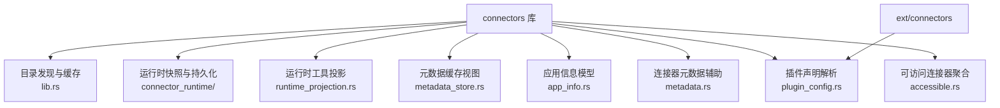
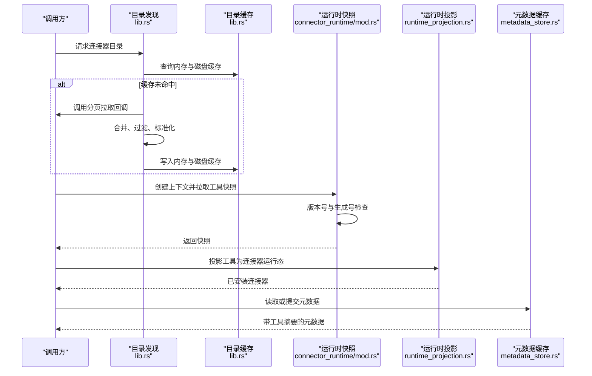
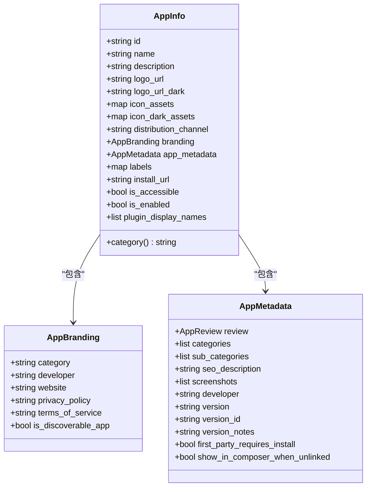
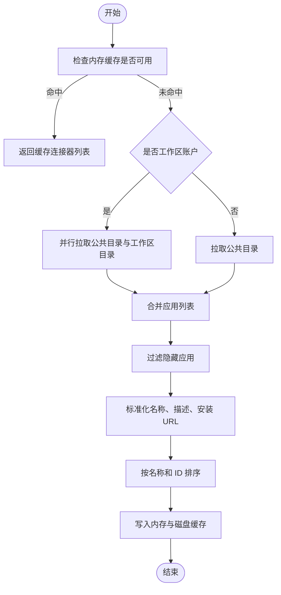
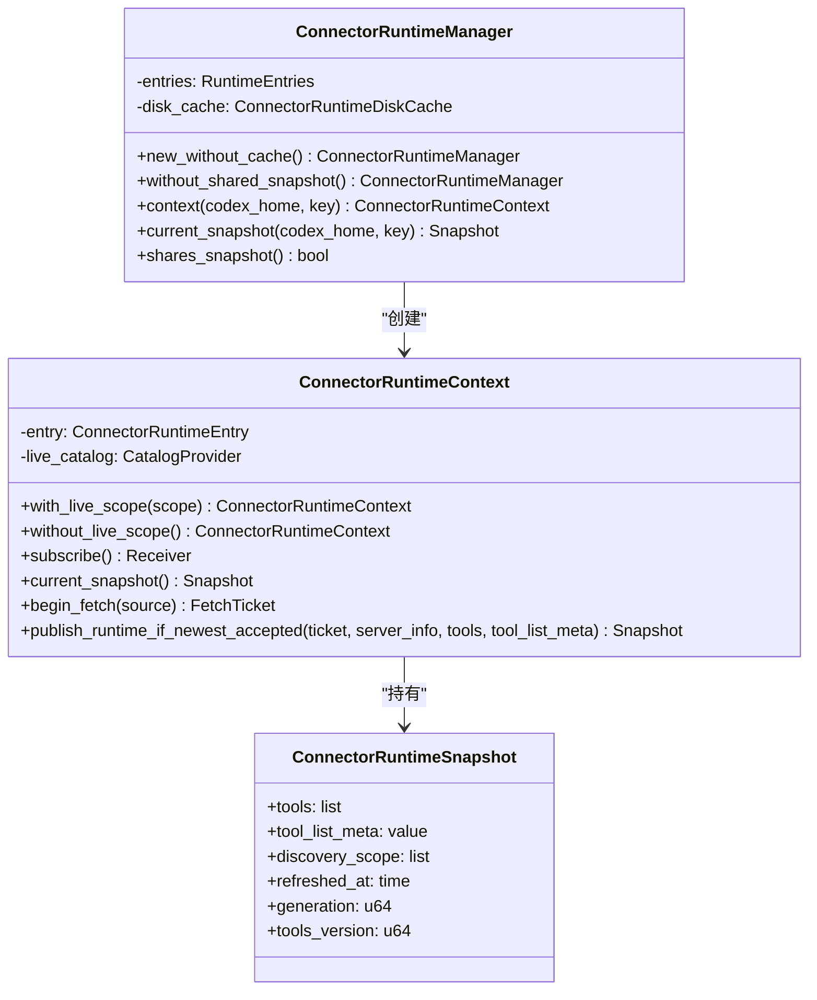
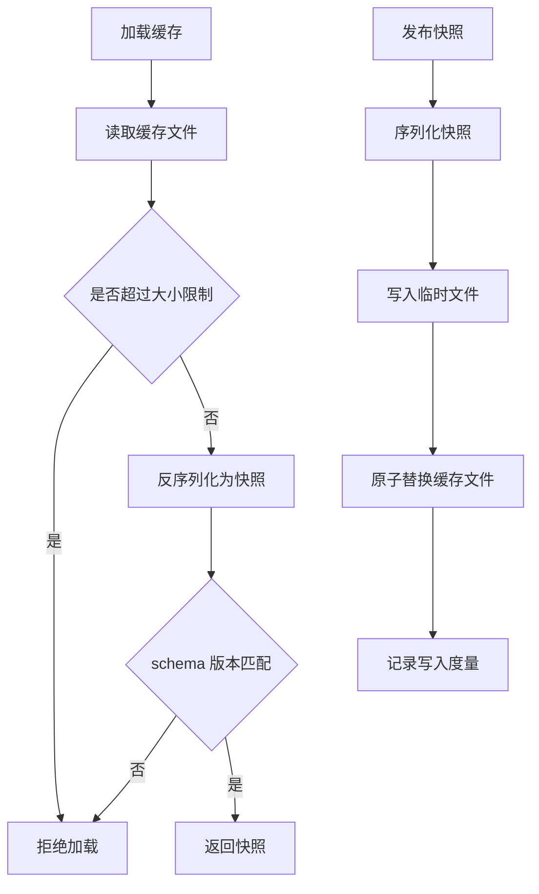
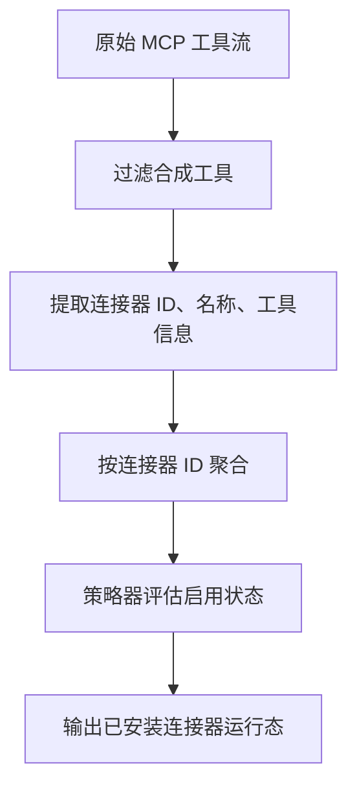
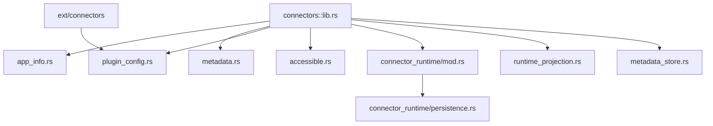

# 连接器框架

<cite>
**本文引用的文件**   
- [codex-rs/connectors/src/lib.rs](file://codex-rs/connectors/src/lib.rs)
- [codex-rs/connectors/src/connector_runtime/mod.rs](file://codex-rs/connectors/src/connector_runtime/mod.rs)
- [codex-rs/connectors/src/connector_runtime/persistence.rs](file://codex-rs/connectors/src/connector_runtime/persistence.rs)
- [codex-rs/connectors/src/runtime_projection.rs](file://codex-rs/connectors/src/runtime_projection.rs)
- [codex-rs/connectors/src/metadata_store.rs](file://codex-rs/connectors/src/metadata_store.rs)
- [codex-rs/connectors/src/app_info.rs](file://codex-rs/connectors/src/app_info.rs)
- [codex-rs/connectors/src/metadata.rs](file://codex-rs/connectors/src/metadata.rs)
- [codex-rs/connectors/src/plugin_config.rs](file://codex-rs/connectors/src/plugin_config.rs)
- [codex-rs/connectors/src/accessible.rs](file://codex-rs/connectors/src/accessible.rs)
- [codex-rs/connectors/Cargo.toml](file://codex-rs/connectors/Cargo.toml)
- [codex-rs/ext/connectors/src/lib.rs](file://codex-rs/ext/connectors/src/lib.rs)
</cite>

## 目录
1. [简介](#简介)
2. [项目结构](#项目结构)
3. [核心组件](#核心组件)
4. [架构总览](#架构总览)
5. [详细组件分析](#详细组件分析)
6. [依赖关系分析](#依赖关系分析)
7. [性能考虑](#性能考虑)
8. [故障排查指南](#故障排查指南)
9. [结论](#结论)
10. [附录：连接器开发指南](#附录连接器开发指南)

## 简介
本仓库中的“连接器框架”并非传统意义上的网络协议适配器集合，而是围绕“连接器应用（Connector Apps）”的目录发现、元数据缓存、运行时快照与工具投影所构建的一套可插拔系统。它通过以下设计实现外部系统集成：

- **适配器模式**：将远端连接器目录、插件声明、MCP 工具运行时等异构来源统一适配为 `AppInfo`、`InstalledConnectorRuntime` 等内部模型，供上层 UI、策略和会话层使用。
- **注册与发现**：通过目录分页拉取、工作区目录合并、插件声明解析等方式发现连接器；并通过策略器决定连接器与工具的启用状态。
- **生命周期管理**：以进程内 `ConnectorRuntimeManager` 和 `ConnectorRuntimeContext` 为核心，提供按账户和工作区分片的快照共享、磁盘冷启动持久化、版本号和生成号控制，以及可选的实时目录订阅。
- **扩展点**：新增 HTTP/MCP/WebSocket 等外部协议时，应实现或复用已有的 MCP 客户端、HTTP 客户端与认证模块，把工具列表映射到连接器的运行时投影。

该框架本身不直接定义“HTTP 连接器接口”或“WebSocket 连接器接口”，而是把“连接器”抽象为“一个具备唯一标识的应用及其工具集合”。具体协议的连接、重连、超时由调用方（例如 MCP 客户端、TUI 会话层）实现，连接器框架负责发现、缓存、快照和可见性。

## 项目结构
`codex-rs/connectors` 是一个独立的 Rust crate，其职责是连接器领域的数据模型、目录发现、元数据缓存和运行时快照。关键组织方式如下：

- 顶层 `lib.rs`：导出公共类型、目录发现逻辑、内存缓存、安装 URL 构造与名称规范化。
- `connector_runtime/`：进程内连接器运行时快照管理器、上下文、持久化与度量。
- `runtime_projection.rs`：从原始 MCP 工具投影出“已安装连接器运行态”。
- `metadata_store.rs`：进程级连接器元数据缓存视图。
- `app_info.rs`：连接器应用信息模型。
- `metadata.rs`：连接器显示标签、提及 slug、安装 URL 辅助函数。
- `plugin_config.rs`：解析插件声明文件，产出连接器声明。
- `accessible.rs`：聚合“可访问连接器”并注入展示名称和安装链接。
- `ext/connectors`：插件连接器提供者入口。

**图示来源**
- [codex-rs/connectors/src/lib.rs:1-80](file://codex-rs/connectors/src/lib.rs#L1-L80)
- [codex-rs/connectors/src/connector_runtime/mod.rs:1-60](file://codex-rs/connectors/src/connector_runtime/mod.rs#L1-L60)
- [codex-rs/connectors/src/runtime_projection.rs:1-30](file://codex-rs/connectors/src/runtime_projection.rs#L1-L30)
- [codex-rs/connectors/src/metadata_store.rs:1-40](file://codex-rs/connectors/src/metadata_store.rs#L1-L40)
- [codex-rs/connectors/src/app_info.rs:1-30](file://codex-rs/connectors/src/app_info.rs#L1-L30)
- [codex-rs/connectors/src/metadata.rs:1-20](file://codex-rs/connectors/src/metadata.rs#L1-L20)
- [codex-rs/connectors/src/plugin_config.rs:1-20](file://codex-rs/connectors/src/plugin_config.rs#L1-L20)
- [codex-rs/connectors/src/accessible.rs:1-20](file://codex-rs/connectors/src/accessible.rs#L1-L20)
- [codex-rs/ext/connectors/src/lib.rs:1-6](file://codex-rs/ext/connectors/src/lib.rs#L1-L6)

**章节来源**
- [codex-rs/connectors/Cargo.toml:1-31](file://codex-rs/connectors/Cargo.toml#L1-L31)
- [codex-rs/connectors/src/lib.rs:1-80](file://codex-rs/connectors/src/lib.rs#L1-L80)

## 核心组件
连接器框架的核心由五类组件构成：

| 组件 | 职责 | 关键类型或函数 |
|---|---|---|
| 连接器应用信息 | 描述连接器的身份、品牌、元数据和可见性 | `AppInfo`、`AppBranding`、`AppMetadata` |
| 目录发现与缓存 | 分页拉取连接器目录，合并工作区与公共目录，写入内存和磁盘缓存 | `list_all_connectors_with_options`、`cached_directory_connectors` |
| 运行时快照 | 管理账户/工作区维度的连接器工具快照、版本号和实时订阅 | `ConnectorRuntimeManager`、`ConnectorRuntimeContext`、`ConnectorRuntimeSnapshot` |
| 运行时投影 | 把 MCP 工具行投影为“已安装连接器运行态” | `installed_connector_runtime`、`ConnectorRuntimeTool` |
| 元数据缓存 | 按后端地址和身份隔离缓存连接器元数据及工具摘要 | `ConnectorMetadataStore`、`ConnectorMetadata` |

这些组件共同实现了“连接器即应用”的适配器视角：外部系统暴露的是连接器 ID、名称、工具列表和元数据；框架把它们转换为统一的 `AppInfo` 和运行时投影，再交给上层策略和 UI。

**章节来源**
- [codex-rs/connectors/src/app_info.rs:1-111](file://codex-rs/connectors/src/app_info.rs#L1-L111)
- [codex-rs/connectors/src/lib.rs:80-200](file://codex-rs/connectors/src/lib.rs#L80-L200)
- [codex-rs/connectors/src/connector_runtime/mod.rs:60-140](file://codex-rs/connectors/src/connector_runtime/mod.rs#L60-L140)
- [codex-rs/connectors/src/runtime_projection.rs:1-103](file://codex-rs/connectors/src/runtime_projection.rs#L1-L103)
- [codex-rs/connectors/src/metadata_store.rs:1-144](file://codex-rs/connectors/src/metadata_store.rs#L1-L144)

## 架构总览
连接器框架的整体流程可以概括为：

1. **发现阶段**：从目录 API 分页获取连接器应用列表，过滤隐藏项，合并重复 ID，标准化名称和描述，计算安装 URL。
2. **缓存阶段**：将目录结果写入进程内内存缓存和磁盘缓存，后续请求命中 TTL 后直接返回。
3. **运行时阶段**：根据当前认证身份创建 `ConnectorRuntimeContext`，读取或持久化工具快照，支持按 discovery scope 发布实时变更。
4. **投影阶段**：把原始工具行投影为连接器维度，结合策略器判断是否启用、是否可调。
5. **元数据阶段**：按需从批量 API 加载连接器元数据，并缓存工具摘要。

**图示来源**
- [codex-rs/connectors/src/lib.rs:120-220](file://codex-rs/connectors/src/lib.rs#L120-L220)
- [codex-rs/connectors/src/connector_runtime/mod.rs:140-260](file://codex-rs/connectors/src/connector_runtime/mod.rs#L140-L260)
- [codex-rs/connectors/src/runtime_projection.rs:40-103](file://codex-rs/connectors/src/runtime_projection.rs#L40-L103)
- [codex-rs/connectors/src/metadata_store.rs:60-144](file://codex-rs/connectors/src/metadata_store.rs#L60-L144)

## 详细组件分析

### 连接器应用信息模型
`AppInfo` 是连接器框架中最核心的应用级数据结构。它包含连接器 ID、名称、描述、图标、分发渠道、品牌信息、应用元数据、标签、安装链接、可访问标记、启用标记和插件显示名称。它不是网络协议类型，而是连接器领域建模后的内部表示。

关键点：
- `is_accessible` 用于区分“可直接访问”的连接器和普通目录连接器。
- `is_enabled` 默认启用，可由上层策略覆盖。
- `category()` 方法优先从品牌分类获取，否则回退到应用元数据中的分类。
- 安装 URL 通过名称 slug 和连接器 ID 构造，基础域名来自环境变量。

**图示来源**
- [codex-rs/connectors/src/app_info.rs:1-111](file://codex-rs/connectors/src/app_info.rs#L1-L111)

**章节来源**
- [codex-rs/connectors/src/app_info.rs:1-111](file://codex-rs/connectors/src/app_info.rs#L1-L111)
- [codex-rs/connectors/src/metadata.rs:1-31](file://codex-rs/connectors/src/metadata.rs#L1-L31)

### 连接器目录发现与缓存
目录发现负责从远端连接器目录拉取应用列表，并处理分页、隐藏应用过滤、ID 合并、名称与描述标准化、安装 URL 补全和排序。

主要流程：
1. 若允许使用缓存且未强制刷新，则优先返回内存中未过期的连接器列表。
2. 若为工作区账户，并行拉取公共目录与工作区目录。
3. 对每个页面向回调 `fetch_page` 发起请求，累积应用列表。
4. 合并相同 ID 的应用，保留更丰富的名称、描述、图标、品牌和元数据。
5. 过滤隐藏应用，转换为目标 `AppInfo`，设置安装 URL，并排序。
6. 写入内存缓存和磁盘缓存。

**图示来源**
- [codex-rs/connectors/src/lib.rs:120-220](file://codex-rs/connectors/src/lib.rs#L120-L220)
- [codex-rs/connectors/src/lib.rs:220-360](file://codex-rs/connectors/src/lib.rs#L220-L360)

**章节来源**
- [codex-rs/connectors/src/lib.rs:80-200](file://codex-rs/connectors/src/lib.rs#L80-L200)
- [codex-rs/connectors/src/lib.rs:200-360](file://codex-rs/connectors/src/lib.rs#L200-L360)

### 连接器运行时快照与生命周期
连接器运行时快照是框架中最重要的生命周期组件。它以账户和工作区身份为键，维护进程内共享的工具快照，并提供磁盘持久化和可选的实时目录订阅。

核心概念：
- `ConnectorRuntimePayload`：任意可序列化、可比较、可克隆的负载类型，通常是工具列表。
- `ConnectorRuntimeContextKey`：账户 ID、ChatGPT 用户 ID 和工作区标志组成的上下文键。
- `ConnectorRuntimeManager`：进程级管理器，按身份创建或复用 `ConnectorRuntimeEntry`。
- `ConnectorRuntimeContext`：绑定一个连接器身份的运行时上下文，支持订阅、快照查询、工具拉取与发布。
- `ConnectorRuntimeSnapshot`：不可变快照，包含工具数组、工具列表元数据、发现作用域、刷新时间、版本号和生成号。

生命周期要点：
- 初始化时可按需从磁盘加载历史快照。
- 每次拉取生成新的 `generation`，避免陈旧结果覆盖最新快照。
- 如果快照内容与前次相同但 generation 更大，会复用前次存储以减少写入。
- 可通过 `with_live_scope` 加入实时目录订阅；也可通过 `without_live_scope` 退出共享。
- 快照发布时会写磁盘缓存，同时记录度量指标。

**图示来源**
- [codex-rs/connectors/src/connector_runtime/mod.rs:60-220](file://codex-rs/connectors/src/connector_runtime/mod.rs#L60-L220)
- [codex-rs/connectors/src/connector_runtime/mod.rs:220-523](file://codex-rs/connectors/src/connector_runtime/mod.rs#L220-L523)

**章节来源**
- [codex-rs/connectors/src/connector_runtime/mod.rs:1-200](file://codex-rs/connectors/src/connector_runtime/mod.rs#L1-L200)
- [codex-rs/connectors/src/connector_runtime/mod.rs:200-523](file://codex-rs/connectors/src/connector_runtime/mod.rs#L200-L523)

### 运行时快照持久化
持久化层负责将连接器运行时快照和 MCP 服务器信息安全地写入磁盘。关键特性包括：

- 按身份哈希生成缓存路径，避免非 UTF-8 Unix 路径导致不同身份被哈希冲突。
- 读写操作有文件大小上限，防止恶意或异常大缓存破坏进程。
- 写入采用临时文件加原子替换的方式，减少损坏风险。
- 支持 schema 版本，旧格式不会被误读为新格式。
- 失败写入仅告警，不影响主流程；度量记录写入耗时和状态。

**图示来源**
- [codex-rs/connectors/src/connector_runtime/persistence.rs:1-120](file://codex-rs/connectors/src/connector_runtime/persistence.rs#L1-L120)
- [codex-rs/connectors/src/connector_runtime/persistence.rs:120-200](file://codex-rs/connectors/src/connector_runtime/persistence.rs#L120-L200)

**章节来源**
- [codex-rs/connectors/src/connector_runtime/persistence.rs:1-200](file://codex-rs/connectors/src/connector_runtime/persistence.rs#L1-L200)

### 运行时工具投影与连接器启用策略
运行时投影的作用是把 MCP 工具层的原始工具行投影为“连接器维度”的已安装状态。它忽略合成工具，提取连接器 ID、名称、工具名、标题、破坏性提示、开放世界提示和可见性，然后结合策略器判断连接器是否启用、是否可调用。

关键点：
- `ConnectorRuntimeTool` 是 MCP 工具到连接器投影的最小字段集。
- `installed_connector_runtime` 按连接器 ID 聚合，决定是否 callable。
- 策略评估基于配置层栈，支持连接器级别和工具级别的启用控制。
- `connector_tool_is_synthetic` 可从连接器元数据判断是否为合成链接助手。

**图示来源**
- [codex-rs/connectors/src/runtime_projection.rs:1-103](file://codex-rs/connectors/src/runtime_projection.rs#L1-L103)

**章节来源**
- [codex-rs/connectors/src/runtime_projection.rs:1-103](file://codex-rs/connectors/src/runtime_projection.rs#L1-L103)

### 连接器元数据缓存
`ConnectorMetadataStore` 提供进程级连接器元数据缓存视图。它与目录缓存分开，专注于后端批量 API 返回的连接器元数据和工具摘要。

特点：
- 按后端基础地址、账户 ID、ChatGPT 用户 ID 和工作区标志划分缓存作用域。
- `fresh_records` 只返回未过期且满足工具摘要要求的记录。
- `commit` 不会用无工具摘要的响应覆盖已有含工具摘要的记录。
- 过期记录保留在缓存中，避免失败刷新污染现有状态。

**章节来源**
- [codex-rs/connectors/src/metadata_store.rs:1-144](file://codex-rs/connectors/src/metadata_store.rs#L1-L144)

### 插件声明解析与可访问连接器
插件声明解析从插件应用的 JSON 配置中提取连接器声明，将其映射为 `AppDeclaration`，并清理分类字段。可访问连接器聚合则把多个工具来源合并为连接器展示条目，注入安装链接并按可访问性、名称和 ID 排序。

**章节来源**
- [codex-rs/connectors/src/plugin_config.rs:1-50](file://codex-rs/connectors/src/plugin_config.rs#L1-L50)
- [codex-rs/connectors/src/accessible.rs:1-78](file://codex-rs/connectors/src/accessible.rs#L1-L78)
- [codex-rs/ext/connectors/src/lib.rs:1-6](file://codex-rs/ext/connectors/src/lib.rs#L1-L6)

## 依赖关系分析
连接器框架的依赖关系体现为“领域模型 + 运行时快照 + 外部集成桥接”的分层结构：

**图示来源**
- [codex-rs/connectors/src/lib.rs:1-80](file://codex-rs/connectors/src/lib.rs#L1-L80)
- [codex-rs/connectors/src/connector_runtime/mod.rs:1-60](file://codex-rs/connectors/src/connector_runtime/mod.rs#L1-L60)
- [codex-rs/connectors/src/connector_runtime/persistence.rs:1-40](file://codex-rs/connectors/src/connector_runtime/persistence.rs#L1-L40)
- [codex-rs/connectors/src/runtime_projection.rs:1-20](file://codex-rs/connectors/src/runtime_projection.rs#L1-L20)
- [codex-rs/connectors/src/metadata_store.rs:1-20](file://codex-rs/connectors/src/metadata_store.rs#L1-L20)
- [codex-rs/ext/connectors/src/lib.rs:1-6](file://codex-rs/ext/connectors/src/lib.rs#L1-L6)

耦合度方面：
- `lib.rs` 高度聚合目录发现、缓存、URL 构造和模型转换，属于连接器领域的协调层。
- `connector_runtime` 模块与 `persistence` 解耦为“快照逻辑”和“磁盘 IO”，便于测试和替换。
- `runtime_projection` 与策略器耦合，但保持对 MCP 工具模型的适配边界清晰。
- `metadata_store` 与目录缓存独立，避免工具摘要和目录列表互相污染。

**章节来源**
- [codex-rs/connectors/src/lib.rs:1-80](file://codex-rs/connectors/src/lib.rs#L1-L80)
- [codex-rs/connectors/src/connector_runtime/mod.rs:1-100](file://codex-rs/connectors/src/connector_runtime/mod.rs#L1-L100)

## 性能考虑
连接器框架在性能和可扩展性上做了以下设计：

| 优化点 | 说明 |
|---|---|
| 内存缓存 TTL | 连接器目录缓存默认 TTL 为 3600 秒，减少重复目录请求。 |
| 进程内 Arc 引用 | 连接器列表和快照使用 `Arc` 共享，避免多次复制。 |
| 分页与并行 | 工作区账户场景下，公共目录与工作区目录并行拉取。 |
| 快照版本号 | `tools_version` 只在工具定义变化时推进，有助于复用已准备调用。 |
| 生成号保护 | `generation` 保证新快照不被陈旧结果覆盖。 |
| 磁盘缓存上限 | 缓存文件有最大字节限制，避免异常大文件影响进程。 |
| 度量指标 | 快照发布和缓存写入记录耗时，便于观测性能退化。 |
| 可选共享快照 | 支持无共享快照模式，适合不需要进程内共享的场景。 |

这些机制共同保证了连接器发现和运行时工具快照在高并发和多账户场景下的稳定性与一致性。

[本节为通用性能指导，不直接分析具体代码片段]

## 故障排查指南
当连接器相关功能出现异常时，可重点检查以下位置和行为：

| 问题 | 可能原因 | 排查建议 |
|---|---|---|
| 连接器列表为空 | 目录缓存过期或被过滤 | 检查 `force_refetch`、隐藏应用过滤、分页 token 处理。 |
| 快照未更新 | 生成号小于等于上次接受值 | 确认 `begin_fetch` 生成新 ticket，且 `publish_runtime_if_newest_accepted` 被调用。 |
| 磁盘缓存无法加载 | schema 版本不匹配或文件过大 | 检查缓存文件路径、schema 版本常量、文件大小限制。 |
| 元数据缺少工具摘要 | 先返回了无工具摘要的响应 | 使用 `commit` 时跳过覆盖已有摘要的逻辑。 |
| 连接器未被启用 | 策略器禁用 | 检查 `AppToolPolicyEvaluator` 的配置层栈和连接器 ID。 |
| 实时订阅无效 | 未设置 live scope | 调用 `with_live_scope` 而非 `without_live_scope`。 |

**章节来源**
- [codex-rs/connectors/src/lib.rs:120-220](file://codex-rs/connectors/src/lib.rs#L120-L220)
- [codex-rs/connectors/src/connector_runtime/mod.rs:260-420](file://codex-rs/connectors/src/connector_runtime/mod.rs#L260-L420)
- [codex-rs/connectors/src/connector_runtime/persistence.rs:80-200](file://codex-rs/connectors/src/connector_runtime/persistence.rs#L80-L200)
- [codex-rs/connectors/src/metadata_store.rs:60-144](file://codex-rs/connectors/src/metadata_store.rs#L60-L144)
- [codex-rs/connectors/src/runtime_projection.rs:40-103](file://codex-rs/connectors/src/runtime_projection.rs#L40-L103)

## 结论
连接器框架以“连接器即应用”的适配器视角，将目录发现、插件声明、MCP 工具运行时和元数据统一为可缓存、可投影、可订阅的内部模型。它的核心价值不在于定义 HTTP 或 WebSocket 协议接口，而在于：

- 提供一致的连接器应用模型 `AppInfo`。
- 提供进程内共享、版本可控、磁盘持久的运行时快照。
- 提供从 MCP 工具到连接器运行态的投影能力。
- 提供可配置的连接器启用策略和元数据缓存。

对于新增外部协议适配器，推荐做法是：在协议层实现连接、超时、重试和认证，再把工具列表映射到连接器框架期望的运行时投影和快照结构。

[本节为总结性内容，不直接分析具体文件]

## 附录：连接器开发指南

### 适配器模式与外部系统集成
连接器框架的适配器体现在以下几个方面：

- 目录适配器：将远端目录响应转换为 `AppInfo`。
- 插件适配器：将插件 JSON 配置转换为连接器声明。
- MCP 工具适配器：将 MCP 工具行投影为连接器运行态。
- 元数据适配器：将批量 API 返回的连接器元数据缓存为 `ConnectorMetadata`。

开发者在接入新外部系统时，应避免把协议细节扩散到连接器领域模型中，而应在适配层完成协议解码、错误转换和数据归一化。

### 连接器接口与注册机制
连接器框架没有全局“连接器接口”供所有协议实现；它更强调“连接器应用”的注册和发现：

- 连接器通过目录 API 注册，或由插件声明注册。
- 框架通过 `list_all_connectors_with_options` 发现连接器。
- 插件通过 `parse_plugin_app_config` 注册连接器声明。
- 可访问连接器通过 `collect_accessible_connectors` 聚合。

因此，“注册”更多是“声明 + 发现”，而不是运行时动态装载二进制模块。

### 连接器生命周期管理
连接器生命周期由调用方和框架共同承担：

| 阶段 | 调用方责任 | 框架责任 |
|---|---|---|
| 初始化 | 提供认证信息和目录拉取回调 | 创建上下文、加载历史快照 |
| 连接 | 实现协议连接、握手、认证 | 不直接参与，仅消费工具列表 |
| 连接池 | 由协议客户端管理 | 不管理连接池 |
| 超时处理 | 由 HTTP/WebSocket 客户端配置 | 不直接处理网络超时 |
| 重连策略 | 由调用方实现指数退避或业务重试 | 通过快照版本和生成号保证一致性 |
| 销毁 | 关闭协议连接 | 上下文随引用计数释放 |

这意味着：如果你需要 HTTP 连接器或 WebSocket 连接器，应分别实现连接层，并把成功拉取的连接器工具交给 `ConnectorRuntimeContext.publish_runtime_if_newest_accepted`。

### HTTP 连接器集成模式
推荐模式：

1. 使用项目中的 HTTP 客户端模块发起目录请求和 MCP 工具请求。
2. 将目录响应映射为 `AppInfo` 列表。
3. 将 MCP 工具列表映射为 `ConnectorRuntimePayload`。
4. 使用 `begin_fetch` 创建 ticket，成功后调用 `publish_runtime_if_newest_accepted`。
5. 使用 `subscribe` 订阅实时目录更新。

注意：连接器框架不负责 HTTP 超时、代理、证书和重试；这些应由 HTTP 客户端层处理。

### WebSocket 连接器集成模式
推荐模式：

1. 使用 WebSocket 客户端建立长连接。
2. 处理认证、心跳、断线事件。
3. 将 WebSocket 消息解码为 MCP 工具或其他连接器数据。
4. 将稳定化的工具列表提交到连接器运行时快照。
5. 在断线重连时重新拉取工具列表，并递增 generation。

同样，WebSocket 的重连策略和背退算法应由连接层实现，而不是连接器框架。

### 其他协议适配器实现方法
对于自定义协议，应遵循：

- 协议解码器：将原始字节或文本转换为结构化对象。
- 错误转换器：将协议错误转换为 anyhow 或领域错误。
- 工具投影器：将协议工具映射为连接器工具。
- 快照发布者：将稳定化工具列表提交到 `ConnectorRuntimeContext`。
- 观察者订阅者：如需实时推送，可使用 `with_live_scope` 和 `subscribe`。

### 安全认证
连接器框架自身不实现 OAuth、Bearer Token、Workload Identity 等认证机制；它依赖：

- `codex-login` 提供的认证上下文。
- 调用方的 HTTP/WebSocket 客户端认证头。
- MCP 客户端的 OAuth 和认证流程。

连接器框架关注的是“谁在使用连接器”，通过 `ConnectorRuntimeContextKey` 区分个人账户、工作区账户和用户身份。

### 错误处理
连接器框架的错误处理原则是：

- 目录缓存加载失败时返回空结果，不阻断主流程。
- 磁盘缓存写入失败时记录警告，但不让失败传播到工具列表。
- 元数据提交时跳过无工具摘要的响应，避免降级已有完整记录。
- 快照发布时使用生成号保护，防止陈旧结果覆盖新结果。

### 重试机制
连接器框架不提供网络重试；重试应放在协议层：

- HTTP 层：对 5xx、超时、连接失败进行指数退避重试。
- WebSocket 层：对断线、鉴权失败、服务端重启进行重连。
- 业务层：对幂等工具调用进行有限重试，对副作用调用避免自动重试。

### 性能优化策略
- 使用目录缓存 TTL 减少重复请求。
- 使用进程内 `Arc` 共享连接器列表和快照。
- 使用 `tools_version` 复用已准备调用。
- 使用 `without_shared_snapshot` 避免不必要的全局共享。
- 使用 `new_without_cache` 在测试或无盘场景中禁用磁盘缓存。
- 使用度量指标观察快照发布和缓存写入耗时。

### 实际连接器示例与集成模式
虽然仓库中没有直接给出“HTTP 连接器”“WebSocket 连接器”的完整示例，但集成模式可以从以下路径推导：

- 目录发现：参考 `list_all_connectors_with_options` 的分页拉取、合并和缓存逻辑。
- 运行时快照：参考 `ConnectorRuntimeContext.begin_fetch` 和 `publish_runtime_if_newest_accepted` 的生命周期。
- 工具投影：参考 `installed_connector_runtime` 的聚合与策略评估。
- 元数据缓存：参考 `ConnectorMetadataStore.fresh_records` 和 `commit` 的使用方式。

这些组合起来，就构成了一个完整的连接器集成方案：协议层负责连接和传输，连接器框架负责发现、缓存、快照和可见性。

**章节来源**
- [codex-rs/connectors/src/lib.rs:120-220](file://codex-rs/connectors/src/lib.rs#L120-L220)
- [codex-rs/connectors/src/connector_runtime/mod.rs:140-420](file://codex-rs/connectors/src/connector_runtime/mod.rs#L140-L420)
- [codex-rs/connectors/src/runtime_projection.rs:40-103](file://codex-rs/connectors/src/runtime_projection.rs#L40-L103)
- [codex-rs/connectors/src/metadata_store.rs:60-144](file://codex-rs/connectors/src/metadata_store.rs#L60-L144)