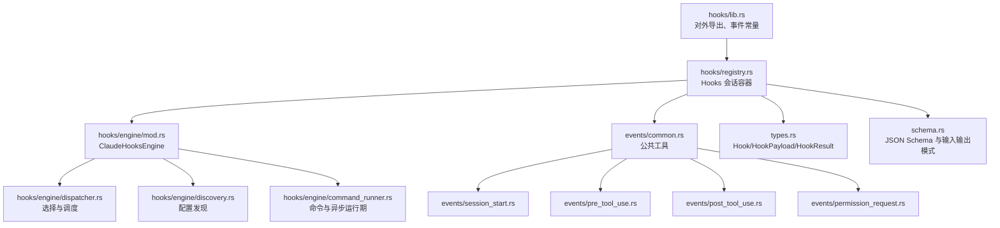
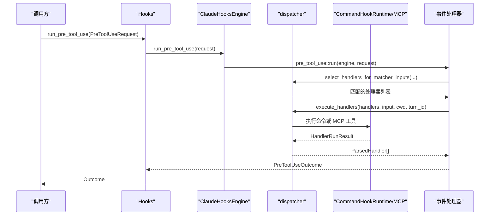
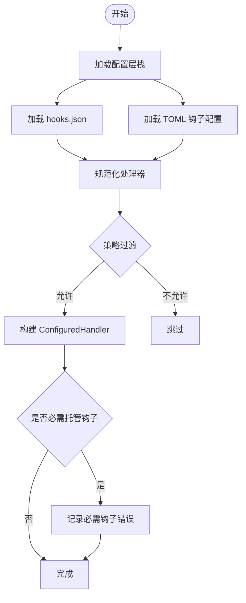
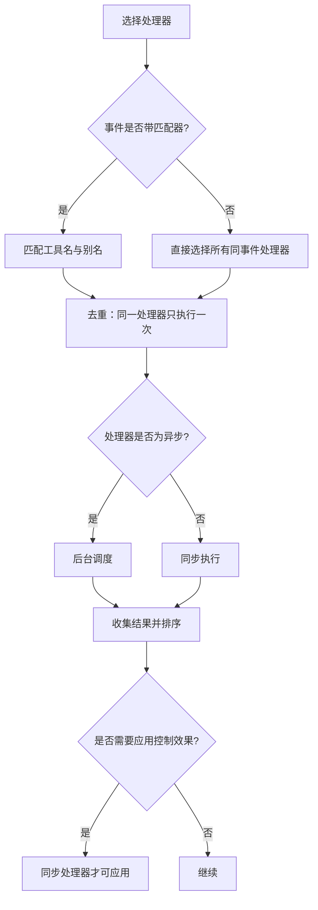
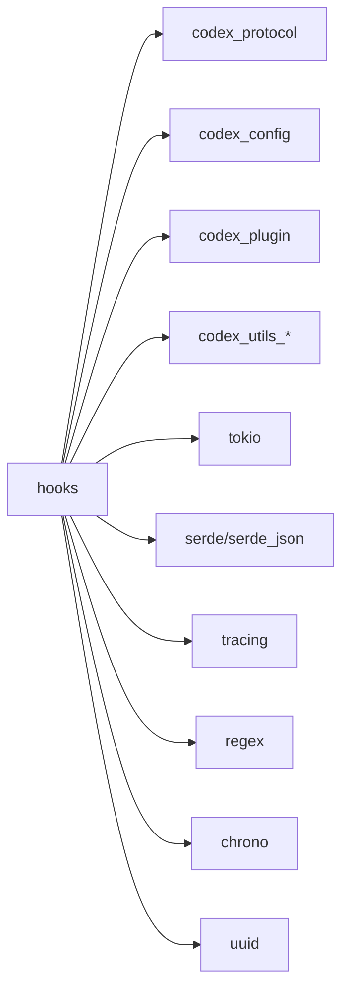

# 钩子系统

<cite>
**本文引用的文件**   
- [hooks/lib.rs](file://codex-rs/hooks/src/lib.rs)
- [hooks/types.rs](file://codex-rs/hooks/src/types.rs)
- [hooks/registry.rs](file://codex-rs/hooks/src/registry.rs)
- [hooks/engine/mod.rs](file://codex-rs/hooks/src/engine/mod.rs)
- [hooks/engine/dispatcher.rs](file://codex-rs/hooks/src/engine/dispatcher.rs)
- [hooks/engine/discovery.rs](file://codex-rs/hooks/src/engine/discovery.rs)
- [hooks/engine/command_runner.rs](file://codex-rs/hooks/src/engine/command_runner.rs)
- [hooks/events/common.rs](file://codex-rs/hooks/src/events/common.rs)
- [hooks/events/session_start.rs](file://codex-rs/hooks/src/events/session_start.rs)
- [hooks/events/pre_tool_use.rs](file://codex-rs/hooks/src/events/pre_tool_use.rs)
- [hooks/events/post_tool_use.rs](file://codex-rs/hooks/src/events/post_tool_use.rs)
- [hooks/events/permission_request.rs](file://codex-rs/hooks/src/events/permission_request.rs)
- [hooks/schema.rs](file://codex-rs/hooks/src/schema.rs)
</cite>

## 目录
1. [引言](#引言)
2. [项目结构](#项目结构)
3. [核心组件](#核心组件)
4. [架构总览](#架构总览)
5. [详细组件分析](#详细组件分析)
6. [依赖关系分析](#依赖关系分析)
7. [性能与并发特性](#性能与并发特性)
8. [调试、监控与排错](#调试监控与排错)
9. [钩子开发指南](#钩子开发指南)
10. [结论](#结论)

## 引言
本文件系统化梳理 `codex-rs/hooks` 模块中的钩子实现，覆盖钩子类型、触发时机、注册机制、执行顺序、错误处理、数据传递与上下文共享、性能优化和调试方法。该系统支持三类执行目标：命令型钩子、MCP 工具型钩子和内部代理型钩子；同时提供生命周期钩子（会话开始/结束）、事件钩子（模型请求、工具调用前后、权限审批、中断等）以及可扩展的自定义钩子扩展点。

## 项目结构
`codex-rs/hooks` 采用按职责分层组织：
- 顶层接口与对外导出：[lib.rs](file://codex-rs/hooks/src/lib.rs)
- 基础类型与载荷：[types.rs](file://codex-rs/hooks/src/types.rs)
- 会话级钩子容器与高层 API：[registry.rs](file://codex-rs/hooks/src/registry.rs)
- 引擎与处理器定义：[engine/mod.rs](file://codex-rs/hooks/src/engine/mod.rs)
- 匹配选择与调度：[engine/dispatcher.rs](file://codex-rs/hooks/src/engine/dispatcher.rs)
- 配置发现与声明生成：[engine/discovery.rs](file://codex-rs/hooks/src/engine/discovery.rs)
- 命令执行与异步任务管理：[engine/command_runner.rs](file://codex-rs/hooks/src/engine/command_runner.rs)
- 事件公共逻辑：[events/common.rs](file://codex-rs/hooks/src/events/common.rs)
- 具体事件处理器：session_start、pre_tool_use、post_tool_use、permission_request
- JSON Schema 与输入输出模式：[schema.rs](file://codex-rs/hooks/src/schema.rs)

**图表来源**
- [hooks/lib.rs:1-139](file://codex-rs/hooks/src/lib.rs#L1-L139)
- [hooks/registry.rs:1-421](file://codex-rs/hooks/src/registry.rs#L1-L421)
- [hooks/engine/mod.rs:1-571](file://codex-rs/hooks/src/engine/mod.rs#L1-L571)
- [hooks/engine/dispatcher.rs:1-683](file://codex-rs/hooks/src/engine/dispatcher.rs#L1-L683)
- [hooks/engine/discovery.rs:1-200](file://codex-rs/hooks/src/engine/discovery.rs#L1-L200)
- [hooks/engine/command_runner.rs:1-200](file://codex-rs/hooks/src/engine/command_runner.rs#L1-L200)
- [hooks/events/common.rs:1-200](file://codex-rs/hooks/src/events/common.rs#L1-L200)
- [hooks/events/session_start.rs:1-200](file://codex-rs/hooks/src/events/session_start.rs#L1-L200)
- [hooks/events/pre_tool_use.rs:1-200](file://codex-rs/hooks/src/events/pre_tool_use.rs#L1-L200)
- [hooks/events/post_tool_use.rs:1-200](file://codex-rs/hooks/src/events/post_tool_use.rs#L1-L200)
- [hooks/events/permission_request.rs:1-200](file://codex-rs/hooks/src/events/permission_request.rs#L1-L200)
- [hooks/schema.rs:1-200](file://codex-rs/hooks/src/schema.rs#L1-L200)

**章节来源**
- [hooks/lib.rs:1-139](file://codex-rs/hooks/src/lib.rs#L1-L139)

## 核心组件
- 钩子函数与结果
  - `HookFn`：可并行执行的异步函数，接收 `HookPayload`，返回 `HookResult`。
  - `HookResult`：成功、失败继续、失败中止三种语义，用于控制后续钩子是否继续执行。
  - `Hook`：封装名称与函数，提供统一的执行入口。
- 钩子载荷
  - `HookPayload`：包含会话标识、工作目录、客户端标识、触发时间、钩子事件。
  - `HookEvent`：当前暴露的是通用后代理事件，未来可扩展为多态事件载体。
- 会话钩子容器
  - `Hooks`：绑定线程环境、维护“后代理”历史钩子列表，并持有 `ClaudeHooksEngine`。
  - `HooksConfig`：功能开关、信任绕过、插件源、Shell 程序与参数、配置层栈等。
- 引擎与处理器
  - `ClaudeHooksEngine`：统一保存已发现的处理器、警告、运行时与 MCP 执行器，提供预览与运行方法。
  - `ConfiguredHandler`：描述一个已配置的钩子处理器，包括事件名、匹配器、超时、状态消息、上下文限制、来源路径、显示顺序、类型（命令或 MCP 工具）。
- 调度与发现
  - `select_handlers` / `execute_handlers`：基于事件名和匹配器选择处理器，并按同步/异步模式执行。
  - `discover_handlers`：从配置层栈、插件源、托管要求中加载钩子声明，生成处理器与清单条目。
- 命令运行期
  - `CommandHookRuntime`：管理命令执行、并发上限、异步任务集合、输出溢出与结果发送。
- 事件模块
  - 每个事件拥有请求结构体、预览函数、运行函数、解析器，统一通过 `dispatcher` 执行。

**章节来源**
- [hooks/types.rs:1-152](file://codex-rs/hooks/src/types.rs#L1-L152)
- [hooks/registry.rs:1-200](file://codex-rs/hooks/src/registry.rs#L1-L200)
- [hooks/engine/mod.rs:1-200](file://codex-rs/hooks/src/engine/mod.rs#L1-L200)
- [hooks/engine/dispatcher.rs:1-200](file://codex-rs/hooks/src/engine/dispatcher.rs#L1-L200)
- [hooks/engine/discovery.rs:1-200](file://codex-rs/hooks/src/engine/discovery.rs#L1-L200)
- [hooks/engine/command_runner.rs:1-200](file://codex-rs/hooks/src/engine/command_runner.rs#L1-L200)

## 架构总览
钩子系统以 `Hooks` 为会话边界，以 `ClaudeHooksEngine` 为执行中枢，通过 `discovery` 加载配置并生成 `ConfiguredHandler`，再由 `dispatcher` 根据事件名和匹配规则筛选处理器，最后由 `command_runner` 或 MCP 执行器执行。

**图表来源**
- [hooks/registry.rs:201-421](file://codex-rs/hooks/src/registry.rs#L201-L421)
- [hooks/engine/mod.rs:200-571](file://codex-rs/hooks/src/engine/mod.rs#L200-L571)
- [hooks/engine/dispatcher.rs:200-683](file://codex-rs/hooks/src/engine/dispatcher.rs#L200-L683)
- [hooks/events/pre_tool_use.rs:1-200](file://codex-rs/hooks/src/events/pre_tool_use.rs#L1-L200)

## 详细组件分析

### 钩子类型与触发时机
系统公开了以下事件常量：
- 生命周期钩子
  - `SessionStart`：会话启动、恢复、清理、压缩、分叉。
  - `SessionEnd`：会话结束。
- 模型相关钩子
  - `PreModelRequest` / `PostModelRequest`：模型请求前后。
- 工具调用钩子
  - `PreToolUse`：工具调用前，可阻止、重写输入、追加上下文。
  - `PermissionRequest`：权限审批路径，可给出允许/拒绝决策。
  - `PostToolUse`：工具调用后，可阻止、追加上下文、反馈消息。
- 压缩钩子
  - `PreCompact` / `PostCompact`：压缩前后可追加上下文。
- 用户交互与代理生命周期
  - `UserPromptSubmit`：用户提交提示词。
  - `SubagentStart` / `SubagentStop`：子代理开始与停止。
  - `Stop`：停止流程。
  - `Interrupt`：中断流程。

部分事件具有匹配器语义（如工具名、会话启动来源），其他事件忽略匹配器字段。

**章节来源**
- [hooks/lib.rs:14-70](file://codex-rs/hooks/src/lib.rs#L14-L70)
- [hooks/events/common.rs:120-200](file://codex-rs/hooks/src/events/common.rs#L120-L200)
- [hooks/events/session_start.rs:1-200](file://codex-rs/hooks/src/events/session_start.rs#L1-L200)

### 注册机制与发现流程
- 配置来源
  - 配置层栈（TOML 与 hooks.json）合并，支持托管要求、云托管配置、遗留配置等来源。
  - 插件源携带 `hooks.json` 或 TOML 声明，生成 `PluginHookDeclaration`。
- 发现过程
  - `discover_handlers` 遍历配置层，加载 JSON/TOML 钩子声明，规范化处理器，计算超时、状态消息、上下文限制。
  - 托管要求可标记为必需，未满足时收集错误并在会话初始化时阻断。
- 清单条目
  - 生成 `HookListEntry`，包含键、事件名、处理器类型、匹配器、超时、来源路径、显示顺序、启用状态、托管状态、信任状态等。
- 环境变量钩子
  - `with_environment_hooks` 将环境钩子添加到引擎处理器中，同时更新警告与显示顺序。

**图表来源**
- [hooks/engine/discovery.rs:1-200](file://codex-rs/hooks/src/engine/discovery.rs#L1-L200)
- [hooks/declarations.rs:1-102](file://codex-rs/hooks/src/declarations.rs#L1-L102)

**章节来源**
- [hooks/engine/discovery.rs:1-200](file://codex-rs/hooks/src/engine/discovery.rs#L1-L200)
- [hooks/declarations.rs:1-102](file://codex-rs/hooks/src/declarations.rs#L1-L102)

### 执行顺序与匹配规则
- 处理器选择
  - `select_handlers` 按事件名过滤，再按匹配器判断是否匹配。
  - 对于工具类事件，使用 `select_handlers_for_matcher_inputs`，先传入规范工具名，再传入别名列表，确保同一处理器仅执行一次。
- 执行顺序
  - 保持声明顺序（display_order）。
  - 同步处理器阻塞等待；异步处理器后台执行，不阻塞主流程。
  - 执行完成后按 configured_order 排序稳定报告。
- 特殊行为
  - `PreToolUse` 在多个处理器重写输入时，以完成顺序最晚的为准。
  - `PermissionRequest` 中任意拒绝优先于允许，否则保留最高优先级的允许。

**图表来源**
- [hooks/engine/dispatcher.rs:1-200](file://codex-rs/hooks/src/engine/dispatcher.rs#L1-L200)
- [hooks/events/pre_tool_use.rs:1-200](file://codex-rs/hooks/src/events/pre_tool_use.rs#L1-L200)
- [hooks/events/permission_request.rs:1-200](file://codex-rs/hooks/src/events/permission_request.rs#L1-L200)

**章节来源**
- [hooks/engine/dispatcher.rs:1-200](file://codex-rs/hooks/src/engine/dispatcher.rs#L1-L200)
- [hooks/events/pre_tool_use.rs:1-200](file://codex-rs/hooks/src/events/pre_tool_use.rs#L1-L200)
- [hooks/events/permission_request.rs:1-200](file://codex-rs/hooks/src/events/permission_request.rs#L1-L200)

### 错误处理策略
- 钩子函数层面
  - `HookResult::FailedContinue`：失败但继续后续钩子。
  - `HookResult::FailedAbort`：失败且中止操作。
- 处理器层面
  - 命令执行错误转换为 `HookRunStatus::Failed`，并将错误写入 `HookOutputEntry`。
  - 序列化失败会生成专门的失败事件，避免隐藏错误。
- 权限请求决策
  - 任何拒绝立即生效；若无拒绝则取最高优先级允许。
- 必需托管钩子
  - 若必需钩子加载失败，会话初始化阶段抛出错误。

**章节来源**
- [hooks/types.rs:1-152](file://codex-rs/hooks/src/types.rs#L1-L152)
- [hooks/events/common.rs:1-200](file://codex-rs/hooks/src/events/common.rs#L1-L200)
- [hooks/events/permission_request.rs:1-200](file://codex-rs/hooks/src/events/permission_request.rs#L1-L200)
- [hooks/engine/discovery.rs:1-200](file://codex-rs/hooks/src/engine/discovery.rs#L1-L200)

### 数据传递与上下文共享
- 全局载荷
  - `HookPayload`：会话 ID、工作目录、客户端、触发时间、钩子事件。
- 事件请求
  - 各事件有独立请求结构体，例如 `PreToolUseRequest`、`PostToolUseRequest`、`PermissionRequestRequest`、`SessionStartRequest`。
- 上下文追加
  - 钩子可通过 `append_additional_context` 追加对模型可见的上下文，由 `output_spill` 控制大小限制。
- 上下文对象
  - `HookContext`：文本与元数据，供外部消费。
- 子代理上下文
  - `SubagentHookContext`：标识子代理 ID 与类型，用于在子代理生命周期事件中传递。

**章节来源**
- [hooks/types.rs:1-152](file://codex-rs/hooks/src/types.rs#L1-L152)
- [hooks/context.rs:1-18](file://codex-rs/hooks/src/context.rs#L1-L18)
- [hooks/events/common.rs:1-200](file://codex-rs/hooks/src/events/common.rs#L1-L200)
- [hooks/events/session_start.rs:1-200](file://codex-rs/hooks/src/events/session_start.rs#L1-L200)
- [hooks/events/pre_tool_use.rs:1-200](file://codex-rs/hooks/src/events/pre_tool_use.rs#L1-L200)
- [hooks/events/post_tool_use.rs:1-200](file://codex-rs/hooks/src/events/post_tool_use.rs#L1-L200)
- [hooks/events/permission_request.rs:1-200](file://codex-rs/hooks/src/events/permission_request.rs#L1-L200)

### 钩子开发指南

#### 钩子接口定义
- 命令型钩子
  - 配置为命令字符串，支持额外环境变量、超时、异步标志。
  - 标准输入为 JSON，标准输出由解析器解析。
- MCP 工具型钩子
  - 配置为服务器名、工具名、输入映射。
  - 通过 `HookMcpExecutor` 执行。
- 内部代理型钩子
  - 由系统内置或托管策略注入，不在用户可见清单中展示。

**章节来源**
- [hooks/engine/mod.rs:1-200](file://codex-rs/hooks/src/engine/mod.rs#L1-L200)
- [hooks/engine/dispatcher.rs:200-400](file://codex-rs/hooks/src/engine/dispatcher.rs#L200-L400)

#### 参数说明与返回值处理
- 输入参数
  - 各事件请求结构体决定命令标准输入的字段，例如 `PreToolUseCommandInput`、`PostToolUseCommandInput`、`PermissionRequestCommandInput`、`SessionStartCommandInput`。
- 返回值处理
  - 命令输出由对应事件的解析器解析，提取控制字段（如阻止、停止、决策）、附加上下文、反馈消息等。
  - 非空系统消息作为警告输出。

**章节来源**
- [hooks/schema.rs:1-200](file://codex-rs/hooks/src/schema.rs#L1-L200)
- [hooks/events/pre_tool_use.rs:1-200](file://codex-rs/hooks/src/events/pre_tool_use.rs#L1-L200)
- [hooks/events/post_tool_use.rs:1-200](file://codex-rs/hooks/src/events/post_tool_use.rs#L1-L200)
- [hooks/events/permission_request.rs:1-200](file://codex-rs/hooks/src/events/permission_request.rs#L1-L200)

#### 异常处理
- 命令执行异常：转为失败状态与错误条目。
- 序列化异常：生成专门失败事件，附带错误信息。
- 必需钩子缺失：会话初始化阶段报错。

**章节来源**
- [hooks/events/common.rs:1-200](file://codex-rs/hooks/src/events/common.rs#L1-L200)
- [hooks/engine/discovery.rs:1-200](file://codex-rs/hooks/src/engine/discovery.rs#L1-L200)

#### 实际示例与使用场景
- 会话启动审计：在 `SessionStart` 中记录会话来源、模型与权限模式。
- 工具调用安全拦截：在 `PreToolUse` 中根据工具名与输入阻止危险操作，或改写输入。
- 权限审批增强：在 `PermissionRequest` 中结合外部策略返回允许或拒绝。
- 工具调用后反馈：在 `PostToolUse` 中收集反馈消息，追加到模型上下文。
- 压缩前后日志：在 `PreCompact`/`PostCompact` 中追加压缩相关上下文。

**章节来源**
- [hooks/events/session_start.rs:1-200](file://codex-rs/hooks/src/events/session_start.rs#L1-L200)
- [hooks/events/pre_tool_use.rs:1-200](file://codex-rs/hooks/src/events/pre_tool_use.rs#L1-L200)
- [hooks/events/post_tool_use.rs:1-200](file://codex-rs/hooks/src/events/post_tool_use.rs#L1-L200)
- [hooks/events/permission_request.rs:1-200](file://codex-rs/hooks/src/events/permission_request.rs#L1-L200)

## 依赖关系分析
- 外部依赖
  - `tokio`：进程、异步任务、超时、信号量。
  - `serde`/`serde_json`：序列化与反序列化。
  - `tracing`：日志与追踪。
  - `regex`：匹配器正则表达式。
  - `chrono`：时间戳。
  - `uuid`：唯一标识。
- 内部依赖
  - `codex_protocol`：协议类型、事件名、执行模式、运行摘要等。
  - `codex_config`：配置层栈、钩子配置、托管要求。
  - `codex_plugin`：插件源、执行器插件钩子。
  - `codex_utils_*`：绝对路径、输出截断、路径 URI、PTY。

**图表来源**
- [hooks/Cargo.toml:1-43](file://codex-rs/hooks/Cargo.toml#L1-L43)
- [hooks/engine/mod.rs:1-200](file://codex-rs/hooks/src/engine/mod.rs#L1-L200)
- [hooks/engine/discovery.rs:1-200](file://codex-rs/hooks/src/engine/discovery.rs#L1-L200)

**章节来源**
- [hooks/Cargo.toml:1-43](file://codex-rs/hooks/Cargo.toml#L1-L43)

## 性能与并发特性
- 并发上限
  - 异步钩子默认最大并发数为 8，通过信号量控制。
- 任务管理
  - `JoinSet` 管理异步任务，关闭时中止并等待全部完成。
- 输出溢出
  - 大上下文与反馈消息通过 `output_spiller` 溢出到文件，避免内存膨胀。
- 超时与阻塞
  - 同步处理器可应用控制效果；异步处理器不阻塞主流程。
  - `PermissionRequest` 的最大超时是所有同步处理器的最大值。
- 预览模式
  - 多数事件提供 `preview` 方法，仅计算匹配处理器而不执行，降低 UI 渲染开销。

**章节来源**
- [hooks/engine/command_runner.rs:1-200](file://codex-rs/hooks/src/engine/command_runner.rs#L1-L200)
- [hooks/engine/mod.rs:200-571](file://codex-rs/hooks/src/engine/mod.rs#L200-L571)
- [hooks/registry.rs:201-421](file://codex-rs/hooks/src/registry.rs#L201-L421)

## 调试、监控与排错
- 运行摘要
  - 每个处理器生成 `HookRunSummary`，包含状态、耗时、来源路径、显示顺序、条目等。
- 完成事件
  - 命令执行完成后发送 `HookCompletedEvent`，便于上层监听与持久化。
- 日志追踪
  - 使用 `tracing` 记录处理器来源、错误信息等。
- 常见故障定位
  - 检查匹配器是否正确，尤其是工具名与别名组合。
  - 确认命令标准输入是否符合事件 JSON Schema。
  - 查看 `HookOutputEntry` 中的错误与警告条目。
  - 验证必需托管钩子是否加载成功。

**章节来源**
- [hooks/engine/dispatcher.rs:200-683](file://codex-rs/hooks/src/engine/dispatcher.rs#L200-L683)
- [hooks/engine/command_runner.rs:1-200](file://codex-rs/hooks/src/engine/command_runner.rs#L1-L200)
- [hooks/events/common.rs:1-200](file://codex-rs/hooks/src/events/common.rs#L1-L200)

## 结论
`codex-rs/hooks` 提供了一个结构化、可扩展且具备强约束的钩子系统。它通过配置发现生成处理器，基于事件名与匹配器精确选择，并以同步/异步混合方式执行命令与 MCP 工具。系统在安全性（权限决策、必需钩子校验）、可观测性（运行摘要、完成事件、日志）与性能（并发上限、输出溢出、预览模式）方面均有明确设计。开发者应遵循事件请求结构与输出解析契约，合理使用匹配器与上下文追加能力，并注意异步钩子的非阻塞特性与控制效果的同步限制。