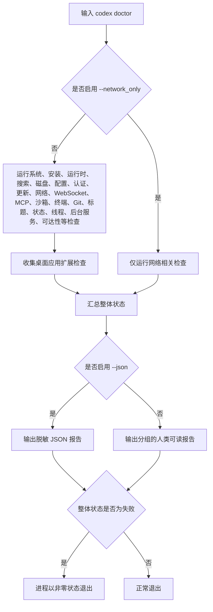
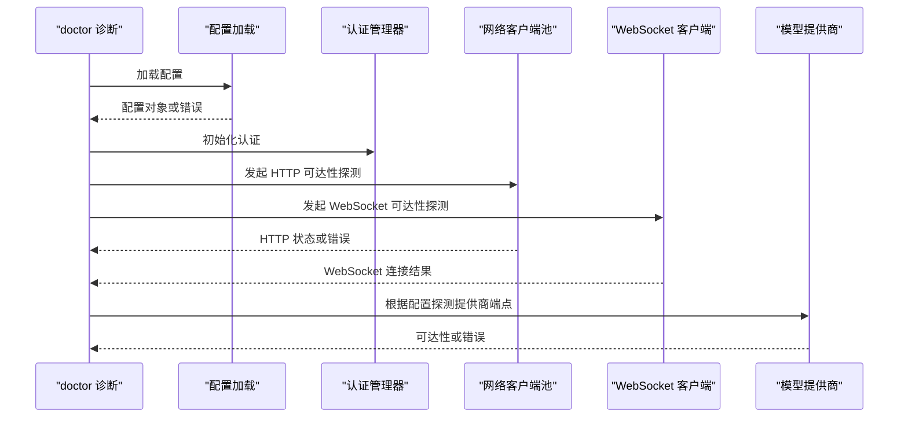
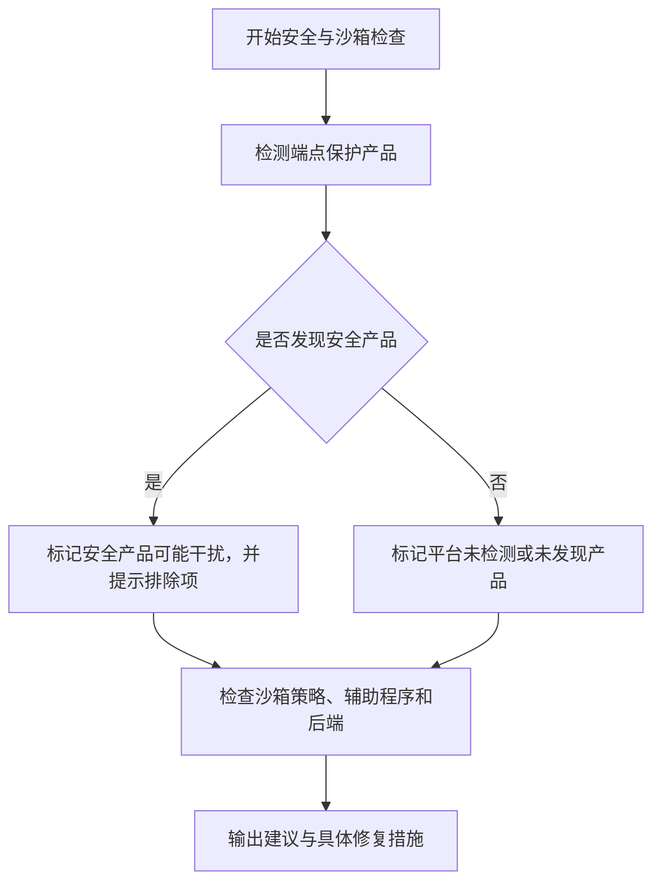
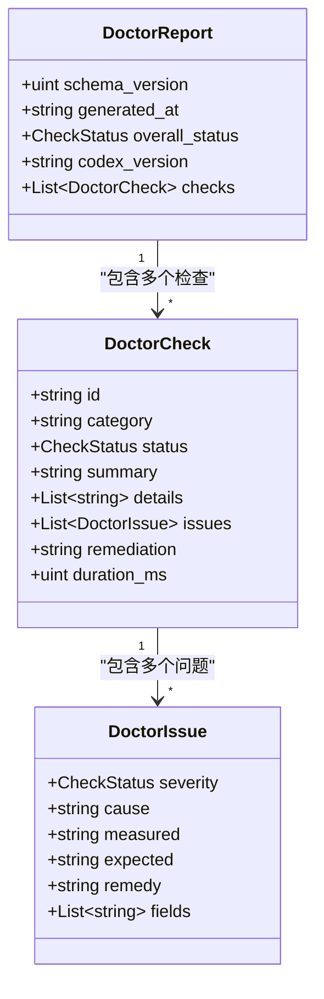
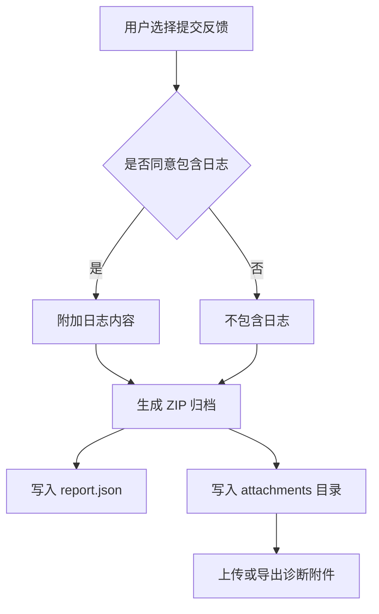

# 故障排除

<cite>
**本文引用的文件**   
- [codex-rs/cli/src/doctor.rs](file://codex-rs/cli/src/doctor.rs)
- [codex-rs/cli/src/doctor/output.rs](file://codex-rs/cli/src/doctor/output.rs)
- [codex-rs/cli/src/doctor/network.rs](file://codex-rs/cli/src/doctor/network.rs)
- [codex-rs/cli/src/doctor/sandbox.rs](file://codex-rs/cli/src/doctor/sandbox.rs)
- [codex-rs/cli/src/doctor/security.rs](file://codex-rs/cli/src/doctor/security.rs)
- [codex-rs/cli/src/main.rs](file://codex-rs/cli/src/main.rs)
- [docs/install.md](file://docs/install.md)
- [codex-rs/tui/src/app_event.rs](file://codex-rs/tui/src/app_event.rs)
- [codex-rs/feedback/src/archive.rs](file://codex-rs/feedback/src/archive.rs)
</cite>

## 目录
1. [引言](#引言)
2. [适用场景与快速定位](#适用场景与快速定位)
3. [诊断入口：doctor 命令](#诊断入口doctor-命令)
4. [安装与环境问题](#安装与环境问题)
5. [配置与权限问题](#配置与权限问题)
6. [网络连接与代理问题](#网络连接与代理问题)
7. [终端、沙箱与安全软件问题](#终端沙箱与安全软件问题)
8. [日志分析与性能分析](#日志分析与性能分析)
9. [错误消息解释与解决步骤](#错误消息解释与解决步骤)
10. [系统信息收集与诊断报告](#系统信息收集与诊断报告)
11. [远程协助与日志共享最佳实践](#远程协助与日志共享最佳实践)
12. [社区支持与问题反馈渠道](#社区支持与问题反馈渠道)
13. [结论](#结论)

## 引言
本指南面向在使用 Codex CLI、TUI、后台应用服务及沙箱时遇到问题的用户和运维人员。内容覆盖安装、配置、网络、权限、终端、安全软件、日志采集、性能分析和反馈提交等常见排障路径，并重点说明 `codex doctor`、日志文件、诊断 JSON 报告以及 TUI 内反馈工具的使用方法。

## 适用场景与快速定位
| 症状 | 优先检查项 | 推荐命令或操作 |
|---|---|---|
| 启动后提示配置错误或无法加载设置 | 配置文件语法、路径、行号 | `codex doctor --json` |
| 登录成功但模型调用失败 | 认证状态、网络可达性、代理、证书 | `codex doctor --network-only` |
| 终端输出异常、颜色错乱、标题不更新 | 终端检测、颜色环境变量、远程会话 | `codex doctor`，查看终端相关行 |
| 代码执行被拒绝或沙箱未就绪 | 沙箱策略、辅助程序、Windows 后端 | `codex doctor`，查看沙箱和安全端点保护 |
| 运行缓慢或长时间无响应 | 配置加载耗时、网络超时、线程与状态 | `codex doctor --json`，查看 `duration_ms` |
| 需要提交问题附件 | 本地日志、反馈 ZIP、敏感信息脱敏 | TUI 内反馈流程或本地保存诊断 ZIP |

## 诊断入口：doctor 命令
`codex doctor` 是核心诊断入口。它读取当前安装、配置、认证、终端、状态路径和网络可达性，但不主动修复环境；每个检查返回可读且可序列化的结果，人类视图用于快速扫描，JSON 视图用于支持工具和附件。

### 常用用法
| 目标 | 命令 | 说明 |
|---|---|---|
| 完整诊断 | `codex doctor` | 运行环境、配置、网络、终端、沙箱、状态等检查 |
| 仅网络诊断 | `codex doctor --network-only` | 只运行配置、网络环境、HTTP 与 WebSocket 可达性检查 |
| 机器可读报告 | `codex doctor --json` | 输出脱敏后的结构化诊断 JSON |
| 紧凑摘要 | `codex doctor --summary` | 只显示分组检查结果与最终计数 |
| 展开长列表 | `codex doctor --all` | 在详细人类输出中展开过长列表 |
| 禁用颜色 | `codex doctor --no_color` | 适合管道或非彩色终端 |
| ASCII 模式 | `codex doctor --ascii` | 使用 ASCII 状态标签与分隔符 |

### 命令选项与行为
- `--probe_filesystem_path`：内部隔离文件系统探测开关，会直接退出而不加载配置，适合在配置损坏时判断基本磁盘访问能力。
- `--json`：输出机器可读报告，包含 `schema_version`、`generated_at`、`overall_status`、`codex_version` 和按检查 ID 索引的 `checks`。
- `--network_only`：跳过大部分环境检查，只运行网络相关检查。
- `--feedback`：限制数据库完整性扫描，用于生成反馈附件时的轻量诊断。
- `--summary`：减少人类输出细节，便于快速汇总。
- `--all`：展开长列表。
- `--no_color` / `--ascii`：控制人类输出样式。

### 诊断结构概览

**图表来源**
- [codex-rs/cli/src/doctor.rs:330-420](file://codex-rs/cli/src/doctor.rs#L330-L420)
- [codex-rs/cli/src/doctor.rs:520-591](file://codex-rs/cli/src/doctor.rs#L520-L591)
- [codex-rs/cli/src/doctor.rs:756-809](file://codex-rs/cli/src/doctor.rs#L756-L809)

**章节来源**
- [codex-rs/cli/src/doctor.rs:1-260](file://codex-rs/cli/src/doctor.rs#L1-L260)
- [codex-rs/cli/src/doctor.rs:330-591](file://codex-rs/cli/src/doctor.rs#L330-L591)
- [codex-rs/cli/src/doctor.rs:756-920](file://codex-rs/cli/src/doctor.rs#L756-L920)
- [codex-rs/cli/src/main.rs:1723-1730](file://codex-rs/cli/src/main.rs#L1723-L1730)

## 安装与环境问题
### 最低系统与构建要求
- 操作系统：macOS 12+、Ubuntu 20.04+ / Debian 10+，或 Windows 11（通过 WSL2）。
- Git：可选但推荐，内置 PR 辅助功能需要 2.23+。
- 内存：至少 4 GB，推荐 8 GB。
- 源码构建需要 Rust 工具链、clippy、rustfmt、just、dotslash、cargo-nextest 等依赖。

### 常见问题
| 问题 | 可能原因 | 排查步骤 |
|---|---|---|
| `codex` 命令不可用 | 安装路径未加入 PATH，或未使用正确的 DotSlash 包装 | 确认安装包位置，重新运行安装脚本或使用完整路径 |
| 构建失败 | 缺少 Rust 组件、工具链版本不匹配、依赖缺失 | 参考文档中的构建步骤，确保已安装 rustfmt、clippy、just、dotslash、cargo-nextest |
| npm 管理安装缺少包根来源 | JS shim 未提供预期环境变量 | 重新安装或更新 Codex，使 `CODEX_MANAGED_PACKAGE_ROOT` 正确传递 |
| 开发模式更新命令不可用 | debug 构建不支持 `codex update` | 安装 release 版本再尝试更新 |

**章节来源**
- [docs/install.md:1-65](file://docs/install.md#L1-L65)
- [codex-rs/cli/src/main.rs:886-893](file://codex-rs/cli/src/main.rs#L886-L893)
- [codex-rs/cli/src/doctor.rs:914-991](file://codex-rs/cli/src/doctor.rs#L914-L991)

## 配置与权限问题
### 配置加载失败
当配置文件无法加载时，`doctor` 会记录类型化配置错误元数据，包括错误文件路径、起始行和列，而不是直接暴露原始配置值。这既保留诊断价值，又避免泄露敏感内容。

| 症状 | 诊断要点 | 处理建议 |
|---|---|---|
| 配置无法加载 | 查看 `config.load` 或 `config` 检查的错误、文件路径、行号、列号 | 修正指定文件的配置语法或字段 |
| 认证初始化失败 | 查看 `auth.load` 的诊断详情 | 先修复认证错误，再重新运行 `codex doctor` |
| 工作目录异常 | 检查 CLI 传入的工作目录与实际 `cwd` | 明确传入有效工作目录，或从项目根目录运行 |

### 权限与受管策略
- 沙箱策略会显示审批策略、文件系统沙箱模式、拒绝读取规则数量、托管来源等。
- 若检测到 Linux 沙箱辅助程序缺失，会标记警告。
- 企业托管策略可能强制更严格的文件系统或网络权限，需结合管理员策略调整。

**章节来源**
- [codex-rs/cli/src/doctor.rs:591-686](file://codex-rs/cli/src/doctor.rs#L591-L686)
- [codex-rs/cli/src/doctor/sandbox.rs:1-120](file://codex-rs/cli/src/doctor/sandbox.rs#L1-L120)

## 网络连接与代理问题
### 网络检查范围
网络诊断不仅检查 HTTP 请求，还会检查：
- 配置加载与生效网络配置。
- WebSocket 连接可达性。
- 模型提供商可达性。
- 代理环境变量、CA 证书路径、macOS 系统代理设置。
- 请求失败分类，例如 TLS 错误、代理认证失败、无效代理配置、解析失败、超时等。

### macOS 系统代理
如果系统代理自动或手动配置，但未被使用，且未显式启用受管代理，`doctor` 会给出 remediation 建议，指导是否启用尊重系统代理的功能。

### 常见错误映射
| 错误类别 | 含义 | 处理建议 |
|---|---|---|
| TLS handshake or certificate validation failed | TLS 握手或证书验证失败 | 检查 `CODEX_CA_CERTIFICATE`、`SSL_CERT_FILE`、中间证书链和服务器证书有效期 |
| proxy authentication required | 代理需要身份认证 | 配置正确的代理凭据或联系网络管理员 |
| invalid proxy configuration | 代理配置无效 | 修正代理地址、端口、协议或 NO_PROXY 规则 |
| system proxy configuration unavailable | 系统代理配置不可用 | 在 macOS 上检查系统代理设置，或在组织代理环境中启用对应功能 |
| unsupported proxy configuration | 代理协议不受支持 | 改用支持的代理方案 |
| proxy resolution failed | 代理名称解析失败 | 检查 DNS、代理主机名和代理配置 |
| request timed out | 请求超时 | 检查防火墙、代理延迟、远端服务和超时阈值 |
| connect failed | 连接失败 | 检查端口、路由、防火墙、代理连通性 |

**图表来源**
- [codex-rs/cli/src/doctor/network.rs:1-120](file://codex-rs/cli/src/doctor/network.rs#L1-L120)
- [codex-rs/cli/src/doctor.rs:330-420](file://codex-rs/cli/src/doctor.rs#L330-L420)

**章节来源**
- [codex-rs/cli/src/doctor/network.rs:1-224](file://codex-rs/cli/src/doctor/network.rs#L1-L224)
- [codex-rs/cli/src/doctor.rs:330-420](file://codex-rs/cli/src/doctor.rs#L330-L420)

## 终端、沙箱与安全软件问题
### 终端检测
`doctor` 会检查终端能力、颜色变量、远程终端标识、列宽、行高、terminfo 路径等。若终端为窄屏或远程环境，人类输出会自动简化部分展示。

### 沙箱问题
沙箱检查会输出：
- 审批策略。
- 文件系统沙箱模式。
- 拒绝读取规则数量。
- 托管文件系统来源。
- 网络沙箱策略。
- Linux 沙箱辅助程序是否存在。
- Windows 后端、受限读取限制、沙箱账户状态等。

常见处理：
- Linux：确认 `codex-linux-sandbox` 辅助程序存在并可执行。
- Windows：若需要受限读取且使用提升后端，请按照提示以管理员 shell 运行沙箱安装命令；若出现账户缺失、锁定、禁用或密码过期，请联系 IT 处理。

### 安全端点保护
`doctor` 会尝试检测 CrowdStrike Falcon、BeyondTrust Privilege Management、Microsoft Defender、SentinelOne、Jamf Protect 等安全产品，并在检测到防护软件时提示添加 Codex 应用程序及辅助程序的排除项。

**图表来源**
- [codex-rs/cli/src/doctor/security.rs:1-120](file://codex-rs/cli/src/doctor/security.rs#L1-L120)
- [codex-rs/cli/src/doctor/sandbox.rs:1-120](file://codex-rs/cli/src/doctor/sandbox.rs#L1-L120)

**章节来源**
- [codex-rs/cli/src/doctor/security.rs:1-254](file://codex-rst/cli/src/doctor/security.rs#L1-L254)
- [codex-rs/cli/src/doctor/sandbox.rs:1-260](file://codex-rs/cli/src/doctor/sandbox.rs#L1-L260)

## 日志分析与性能分析
### 日志位置与级别
- TUI 默认将诊断写入有界本地存储。
- 可通过 `log_dir` 显式启用纯文本 TUI 日志。
- 非交互模式 `codex exec` 默认日志级别为 `error`，但消息会内联打印。
- Rust 日志由 `RUST_LOG` 环境变量控制。

### 推荐日志采集方式
1. 设置日志目录：
   - 示例参数形式：`codex -c log_dir=./.codex-log`
2. 实时跟踪日志：
   - Linux/macOS：`tail -F ./.codex-log/codex-tui.log`
3. 配合 `RUST_LOG` 提高详细程度，例如捕获更多 warn 或 info 级别日志。
4. 若问题涉及 TUI 崩溃或会话，可在 TUI 内触发反馈流程，选择包含日志并生成 ZIP 附件。

### 性能分析线索
- `doctor` 报告中每个检查都有 `duration_ms`，可用于定位慢检查。
- 配置加载耗时会作为 detail 输出。
- 网络探测具有固定超时预算，超时通常表现为“请求超时”或“连接失败”。
- TUI 内反馈流程支持附带日志，ZIP 中包含报告与可选日志。

**章节来源**
- [docs/install.md:40-65](file://docs/install.md#L40-L65)
- [codex-rs/cli/src/doctor.rs:756-809](file://codex-rs/cli/src/doctor.rs#L756-L809)
- [codex-rs/cli/src/doctor.rs:891-920](file://codex-rs/cli/src/doctor.rs#L891-L920)
- [codex-rs/tui/src/app_event.rs:1775-1801](file://codex-rs/tui/src/app_event.rs#L1775-L1801)

## 错误消息解释与解决步骤
以下错误类别来自网络诊断、配置诊断、沙箱诊断和 TUI 事件流。实际错误文本可能因环境而异，但可按语义归类处理。

| 错误类别 | 典型含义 | 建议步骤 |
|---|---|---|
| 配置无法加载 | 配置文件格式、路径或 IO 错误 | 查看 `config.load` 中的 file/line/column，修复后重试 |
| 认证无法初始化 | 认证管理器构造失败 | 修复认证错误后再运行 `codex doctor` |
| TLS 握手或证书验证失败 | CA 证书链或服务器证书问题 | 检查 `CODEX_CA_CERTIFICATE`、`SSL_CERT_FILE`，确认证书有效 |
| 代理认证需要凭据 | 代理要求身份验证 | 配置代理用户名密码或通过组织代理网关 |
| 代理配置无效 | 代理地址、端口、协议错误 | 修正代理配置，避免拼写错误和不支持的协议 |
| 系统代理配置不可用 | 系统代理查询失败 | macOS 检查系统代理，或在组织中启用相应功能 |
| 请求超时 | 网络延迟或远端服务不可用 | 检查防火墙、代理、DNS、服务状态 |
| 连接失败 | TCP 层无法建立连接 | 检查端口、路由、代理、出站限制 |
| 沙箱辅助程序不存在 | Linux 沙箱辅助程序缺失 | 重新安装 Codex 或修复安装布局 |
| Windows 沙箱账户缺失或异常 | 本地沙箱账户缺失、锁定、禁用或密码过期 | 联系 IT 解锁或启用账户，并按提示重新运行沙箱安装 |
| 安全软件可能干扰 | 检测到端点保护产品但未验证排除项 | 添加 Codex 应用程序和辅助程序的安全软件排除项 |

**章节来源**
- [codex-rs/cli/src/doctor/network.rs:120-224](file://codex-rs/cli/src/doctor/network.rs#L120-L224)
- [codex-rs/cli/src/doctor.rs:591-686](file://codex-rs/cli/src/doctor.rs#L591-L686)
- [codex-rs/cli/src/doctor/sandbox.rs:120-260](file://codex-rs/cli/src/doctor/sandbox.rs#L120-L260)
- [codex-rs/cli/src/doctor/security.rs:1-254](file://codex-rs/cli/src/doctor/security.rs#L1-L254)

## 系统信息收集与诊断报告
### 人类可读报告
人类输出按环境、配置、桌面应用、更新、连接性、后台服务等分组，状态标记包括：
- 正常：绿色对勾或 `[ok]`。
- 更新：橙色向上箭头或 `[up]`。
- 注意或警告：橙色感叹号或 `[!!]`。
- 失败：红色叉号或 `[XX]`。
- 空闲：灰色圆圈或 `[--]`，常用于后台服务未运行的情况。

### JSON 报告
JSON 报告适合自动化处理和附件上传，关键字段包括：
- `schema_version`：报告架构版本。
- `generated_at`：生成时间戳。
- `overall_status`：整体状态。
- `codex_version`：当前 Codex 版本。
- `checks`：按检查 ID 索引的检查集合。
- 每个检查包含 `id`、`category`、`status`、`summary`、`details`、`issues`、`remediation`、`duration_ms`。

### 脱敏策略
- 人类输出的详细信息会在渲染前进行敏感信息脱敏。
- JSON 报告会对编辑器、分页器等环境变量做局部脱敏，避免将任意命令行参数或内联赋值随反馈上报。
- 重复的 detail label 会被聚合成数组，保持键稳定。

**图表来源**
- [codex-rs/cli/src/doctor.rs:206-260](file://codex-rs/cli/src/doctor.rs#L206-L260)
- [codex-rs/cli/src/doctor.rs:756-809](file://codex-rs/cli/src/doctor.rs#L756-L809)

**章节来源**
- [codex-rs/cli/src/doctor/output.rs:1-200](file://codex-rs/cli/src/doctor/output.rs#L1-L200)
- [codex-rs/cli/src/doctor.rs:756-920](file://codex-rs/cli/src/doctor.rs#L756-L920)

## 远程协助与日志共享最佳实践
### 共享前必须做的脱敏
- 不要直接粘贴原始配置文件、密钥、令牌、私有仓库 URL、个人路径或浏览器会话内容。
- 优先使用 `codex doctor --json` 输出，因为它已经对许多敏感字段做了脱敏。
- 如果必须分享终端输出，请隐藏 API key、access token、代理密码、证书路径和个人工作目录。

### 推荐共享材料
1. 操作系统与架构信息。
2. Codex 版本：可从 `codex doctor --json` 的 `codex_version` 获取。
3. `codex doctor --json` 输出。
4. 复现步骤与期望行为。
5. 相关日志片段，尽量控制在最近几分钟范围。
6. 如已在 TUI 中生成反馈 ZIP，可上传归档中的 `report.json` 和脱敏后的日志。

### 反馈 ZIP 结构
反馈归档会将报告与附件压缩到 ZIP 中，关键特性包括：
- 报告文件名为 `report.json`。
- 附件存储在 `attachments/{index}/{basename}`。
- 日志仅在用户同意包含日志时才加入。
- 附件数量有上限，避免过大归档。
- 归档使用 deflate 压缩。

**图表来源**
- [codex-rs/tui/src/app_event.rs:1775-1801](file://codex-rs/tui/src/app_event.rs#L1775-L1801)
- [codex-rs/feedback/src/archive.rs:1-106](file://codex-rs/feedback/src/archive.rs#L1-L106)

**章节来源**
- [codex-rs/tui/src/app_event.rs:1775-1801](file://codex-rs/tui/src/app_event.rs#L1775-L1801)
- [codex-rs/feedback/src/archive.rs:1-106](file://codex-rs/feedback/src/archive.rs#L1-L106)

## 社区支持与问题反馈渠道
### 在 TUI 中提交反馈
TUI 支持打开反馈入口，允许用户选择反馈类别、填写备注、选择是否包含日志，并提交到 app-server 提供的反馈接口。该流程会生成带上下文的诊断数据，便于团队复现和分析。

### 提交问题时应附带的信息
- 问题类别：安装、配置、网络、认证、终端、沙箱、安全软件、性能、功能异常。
- 是否影响生产任务。
- 是否可稳定复现。
- 是否已运行 `codex doctor --network-only`。
- 是否已运行 `codex doctor --json`。
- 是否已收集 TUI 日志或反馈 ZIP。

**章节来源**
- [codex-rs/tui/src/app_event.rs:1775-1801](file://codex-rs/tui/src/app_event.rs#L1775-L1801)

## 结论
故障排除应遵循“先诊断、后修改”的原则。首选 `codex doctor` 和 `codex doctor --network-only` 快速定位环境与网络问题；使用 `--json` 获取结构化数据；通过 `log_dir` 和 `RUST_LOG` 收集日志；在 TUI 内提交反馈时谨慎包含日志；对外共享前先脱敏。对于安全软件、代理、沙箱和权限类问题，优先依据 `doctor` 输出的 remediation 指引与组织管理员协作处理。