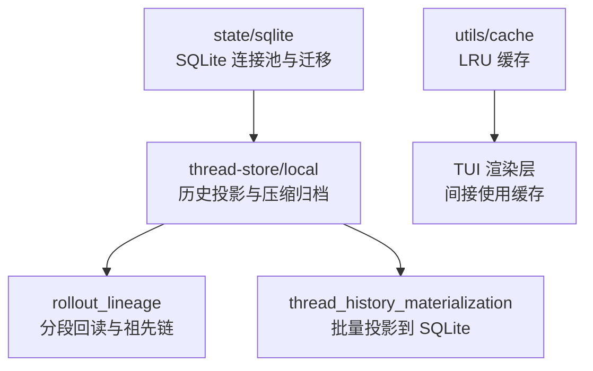
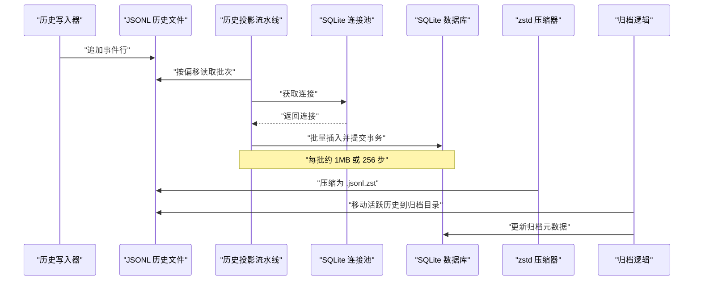
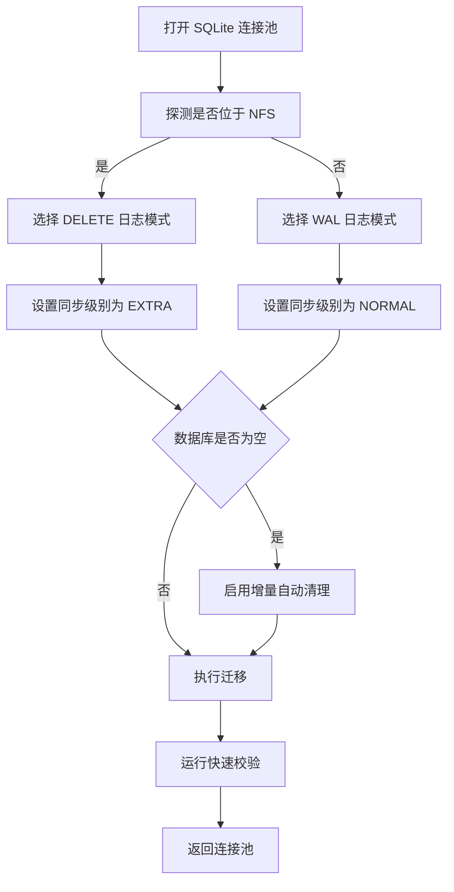
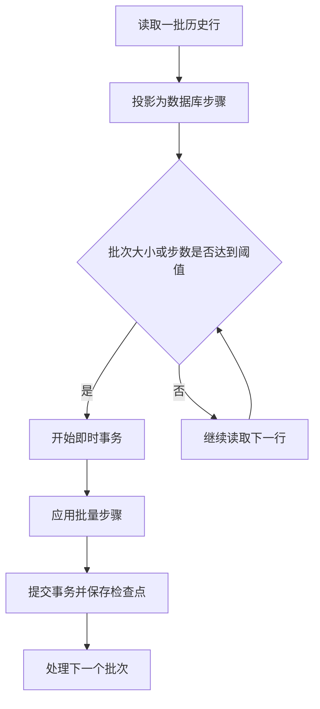
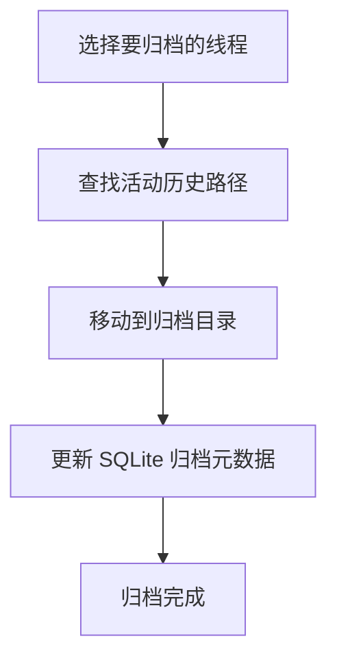
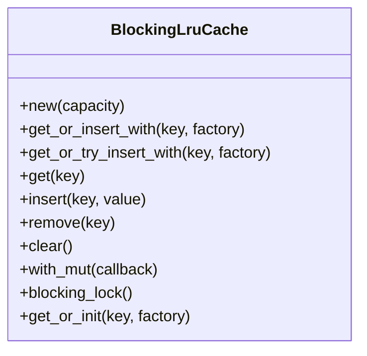
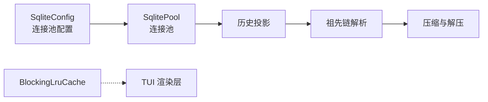

# 性能优化

<cite>
**本文引用的文件**   
- [sqlite.rs](file://codex-rs/state/src/sqlite.rs)
- [connection.rs](file://codex-rs/state/src/sqlite/connection.rs)
- [publish.rs](file://codex-rs/thread-store/src/local/rollout_migration/publish.rs)
- [rollout_lineage.rs](file://codex-rs/thread-store/src/local/rollout_lineage.rs)
- [thread_history_materialization.rs](file://codex-rs/thread-store/src/local/thread_history_materialization.rs)
- [thread_history_materialization_pipeline.rs](file://codex-rs/thread-store/src/local/thread_history_materialization_pipeline.rs)
- [lib.rs](file://codex-rs/utils/cache/src/lib.rs)
</cite>

## 目录
1. [引言](#引言)
2. [项目结构中的性能相关组件](#项目结构中的性能相关组件)
3. [核心性能组件](#核心性能组件)
4. [架构总览](#架构总览)
5. [详细组件分析](#详细组件分析)
6. [依赖关系分析](#依赖关系分析)
7. [性能考量与基准建议](#性能考量与基准建议)
8. [故障排查指南](#故障排查指南)
9. [结论](#结论)

## 引言
本文面向 Codex Rust 代码库中影响性能的关键子系统，重点覆盖以下方面：
- SQLite 连接池配置、事务策略和一致性模型
- 历史数据批量投影、索引式查找与压缩归档机制
- 内存缓存策略与生命周期管理
- 查询路径分析与慢查询定位方法
- 可观测指标与基准测试思路

该文档不直接粘贴源码，而是通过“章节来源”和“图表来源”指向具体实现位置，便于读者在仓库中进一步验证。

## 项目结构中的性能相关组件
从仓库结构看，与性能相关的核心代码集中在以下模块：
- `codex-rs/state`：统一的 SQLite 连接池、迁移、NFS 安全策略和快速校验。
- `codex-rs/thread-store`：本地线程存储，负责会话回放、历史投影、压缩与归档。
- `codex-rs/utils/cache`：通用 LRU 缓存工具。
- `codex-rs/message-board`：包含显式的 SQLite 索引定义，可作为索引设计参考。

**图表来源**
- [sqlite.rs:1-120](file://codex-rs/state/src/sqlite.rs#L1-L120)
- [connection.rs:1-122](file://codex-rs/state/src/sqlite/connection.rs#L1-L122)
- [thread_history_materialization.rs:1-80](file://codex-rs/thread-store/src/local/thread_history_materialization.rs#L1-L80)
- [rollout_lineage.rs:1-80](file://codex-rs/thread-store/src/local/rollout_lineage.rs#L1-L80)
- [lib.rs:1-40](file://codex-rs/utils/cache/src/lib.rs#L1-L40)

**章节来源**
- [sqlite.rs:1-120](file://codex-rs/state/src/sqlite.rs#L1-L120)
- [thread_history_materialization.rs:1-80](file://codex-rs/thread-store/src/local/thread_history_materialization.rs#L1-L80)
- [rollout_lineage.rs:1-80](file://codex-rs/thread-store/src/local/rollout_lineage.rs#L1-L80)
- [lib.rs:1-40](file://codex-rs/utils/cache/src/lib.rs#L1-L40)

## 核心性能组件
### SQLite 连接池与数据库策略
- 使用 SQLx 的 `SqlitePool`，默认最大连接数为 5。
- 写库启用 `busy_timeout`，重试 `SQLITE_BUSY`。
- 根据文件系统类型选择日志模式：
  - 普通本地文件系统默认使用 WAL。
  - NFS 或强制 DELETE 场景使用 DELETE 日志模式。
- DELETE 模式设置同步级别为 EXTRA；WAL 模式设置同步级别为 NORMAL。
- 空数据库初始化时启用增量自动清理，避免启动期全量 VACUUM。
- 打开只读池用于恢复或迁移读取，通常限制单连接。

**章节来源**
- [connection.rs:17-122](file://codex-rs/state/src/sqlite/connection.rs#L17-L122)
- [sqlite.rs:1-120](file://codex-rs/state/src/sqlite.rs#L1-L120)
- [sqlite.rs:260-613](file://codex-rs/state/src/sqlite.rs#L260-L613)

### 历史数据批量投影与批处理
- 历史数据以 JSONL 形式持久化，按行解析并投影到 SQLite。
- 投影过程采用“阻塞任务读取 + 短事务写入”的流水线：
  - 每批最多约 1MB 源数据或 256 步。
  - 每个完整记录边界提交一次检查点。
  - 读写之间通过通道缓冲两批，降低锁竞争。
- 支持断点续跑：按字节偏移和序数保存状态。

**章节来源**
- [thread_history_materialization.rs:1-120](file://codex-rs/thread-store/src/local/thread_history_materialization.rs#L1-L120)
- [thread_history_materialization_pipeline.rs:1-105](file://codex-rs/thread-store/src/local/thread_history_materialization_pipeline.rs#L1-L105)

### 历史压缩与归档
- 活跃历史与压缩历史共存，扩展名为 `.jsonl.zst`。
- 压缩使用 zstd，编码级别为 3，并在写入后做完整性校验。
- 归档将选中的活动历史移动到归档目录，同时更新 SQLite 元数据。
- 迁移流程使用临时文件和待完成日志，确保崩溃恢复后可继续。

**章节来源**
- [publish.rs:1-260](file://codex-rs/thread-store/src/local/rollout_migration/publish.rs#L1-L260)
- [publish.rs:260-275](file://codex-rs/thread-store/src/local/rollout_migration/publish.rs#L260-L275)
- [rollout_lineage.rs:280-640](file://codex-rs/thread-store/src/local/rollout_lineage.rs#L280-L640)

### 缓存策略与内存管理
- 提供基于 `lru::LruCache` 的 `BlockingLruCache`。
- 使用 Tokio 互斥保护，非异步环境退化为无操作。
- 支持容量为零时禁用缓存，以及内容哈希键生成。
- 提供延迟初始化辅助：共享一次性值，减少重复计算。

**章节来源**
- [lib.rs:1-167](file://codex-rs/utils/cache/src/lib.rs#L1-L167)

## 架构总览
下图展示从历史数据到 SQLite 的性能关键路径，以及连接池、压缩、归档与缓存之间的关系。

**图表来源**
- [thread_history_materialization_pipeline.rs:1-105](file://codex-rs/thread-store/src/local/thread_history_materialization_pipeline.rs#L1-L105)
- [thread_history_materialization.rs:120-200](file://codex-rs/thread-store/src/local/thread_history_materialization.rs#L120-L200)
- [publish.rs:120-220](file://codex-rs/thread-store/src/local/rollout_migration/publish.rs#L120-L220)
- [connection.rs:40-122](file://codex-rs/state/src/sqlite/connection.rs#L40-L122)

## 详细组件分析

### SQLite 连接池配置与事务优化
#### 连接池参数
- 最大连接数：5。
- busy_timeout：默认 5 秒，对写操作进行忙等待重试。
- synchronous：
  - WAL 模式：NORMAL。
  - DELETE 模式：EXTRA。
- auto_vacuum：空数据库设置为 INCREMENTAL，避免启动期昂贵维护。

#### 迁移与一致性
- 迁移在一个事务内执行，遇到 `SQLITE_BUSY` 会重试整个迁移。
- 只读池用于迁移或诊断读取，通常限制单连接，避免写锁争用。
- NFS 场景下强制 DELETE 日志模式，并通过 quick check 检测损坏并重建。

**图表来源**
- [connection.rs:17-122](file://codex-rs/state/src/sqlite/connection.rs#L17-L122)
- [sqlite.rs:260-613](file://codex-rs/state/src/sqlite.rs#L260-L613)

**章节来源**
- [connection.rs:17-122](file://codex-rs/state/src/sqlite/connection.rs#L17-L122)
- [sqlite.rs:260-613](file://codex-rs/state/src/sqlite.rs#L260-L613)

### 批量操作与索引优化技巧
#### 批量投影
- 投影流水线将历史行转换为 SQLite 更新步骤，并按字节大小或步骤数量分批。
- 每个批次对应一个短事务，提交前保存字节偏移和序数作为检查点。
- 这样既避免长事务导致锁持有时间过长，也保证中断后可恢复。

#### 索引设计参考
- `message-board` 模块定义了多列复合索引，例如按 board、channel、timestamp、seq 的组合索引。
- 这类索引适合“按主题和时间范围分页查询”的场景，可作为 thread-history 查询优化的参考。

**图表来源**
- [thread_history_materialization_pipeline.rs:30-105](file://codex-rs/thread-store/src/local/thread_history_materialization_pipeline.rs#L30-L105)
- [thread_history_materialization.rs:120-200](file://codex-rs/thread-store/src/local/thread_history_materialization.rs#L120-L200)

**章节来源**
- [thread_history_materialization_pipeline.rs:1-105](file://codex-rs/thread-store/src/local/thread_history_materialization_pipeline.rs#L1-L105)
- [thread_history_materialization.rs:120-200](file://codex-rs/thread-store/src/local/thread_history_materialization.rs#L120-L200)

### 历史数据压缩与归档机制
#### 压缩
- 压缩目标路径带 `.jsonl.zst` 后缀。
- 压缩完成后立即解码一遍输出，验证压缩体可读。
- 保留原始权限与修改时间，提高迁移与恢复的一致性。

#### 归档
- 归档会将选中的活动历史移动到归档目录。
- 更新 SQLite 中线程元数据的归档路径和时间戳。
- 删除线程时会同时清理活动历史和压缩历史。

**图表来源**
- [publish.rs:120-220](file://codex-rs/thread-store/src/local/rollout_migration/publish.rs#L120-L220)
- [rollout_lineage.rs:280-640](file://codex-rs/thread-store/src/local/rollout_lineage.rs#L280-L640)

**章节来源**
- [publish.rs:1-275](file://codex-rs/thread-store/src/local/rollout_migration/publish.rs#L1-L275)
- [rollout_lineage.rs:280-640](file://codex-rs/thread-store/src/local/rollout_lineage.rs#L280-L640)

### 缓存策略与内存管理优化
- `BlockingLruCache` 提供固定容量的 LRU 缓存，适合 UI 渲染、模型上下文片段等热点数据。
- 当容量为零时，API 仍可调用但不会缓存，便于运行时关闭缓存而不改变业务逻辑。
- `get_or_init` 使用一次性锁，让并发请求共享初始化过程，减少重复计算。
- 提供 SHA-1 摘要工具，可用于内容敏感型缓存键，避免路径变化导致的缓存污染。

**图表来源**
- [lib.rs:1-167](file://codex-rs/utils/cache/src/lib.rs#L1-L167)

**章节来源**
- [lib.rs:1-167](file://codex-rs/utils/cache/src/lib.rs#L1-L167)

## 依赖关系分析
- `state/sqlite` 是所有 SQLite 访问的统一入口，承担连接池、迁移、NFS 策略和快速校验。
- `thread-store/local` 依赖 `state/sqlite` 提供的连接池，把 JSONL 历史投影到 SQLite。
- `thread-store/local/rollout_lineage` 负责按 fork 指针追踪祖先历史，并支持压缩历史回读。
- `utils/cache` 是通用工具，被上层 UI 或渲染逻辑间接使用，不属于 SQLite 路径。

**图表来源**
- [sqlite.rs:1-120](file://codex-rs/state/src/sqlite.rs#L1-L120)
- [thread_history_materialization.rs:1-80](file://codex-rs/thread-store/src/local/thread_history_materialization.rs#L1-L80)
- [rollout_lineage.rs:1-80](file://codex-rs/thread-store/src/local/rollout_lineage.rs#L1-L80)
- [lib.rs:1-40](file://codex-rs/utils/cache/src/lib.rs#L1-L40)

**章节来源**
- [sqlite.rs:1-120](file://codex-rs/state/src/sqlite.rs#L1-L120)
- [thread_history_materialization.rs:1-80](file://codex-rs/thread-store/src/local/thread_history_materialization.rs#L1-L80)
- [rollout_lineage.rs:1-80](file://codex-rs/thread-store/src/local/rollout_lineage.rs#L1-L80)
- [lib.rs:1-40](file://codex-rs/utils/cache/src/lib.rs#L1-L40)

## 性能考量与基准建议
### SQLite 连接池调优
- 当前默认连接池大小为 5，适合多数单机工作负载。
- 如果存在大量并发投影或迁移，可评估增大最大连接数，但需观察磁盘 I/O 和锁竞争。
- NFS 环境下建议使用 DELETE 模式，避免 WAL 在多客户端下的不一致风险。

### 事务与批大小
- 投影批大小上限约为 1MB 或 256 步，可在高吞吐场景中保持较短事务。
- 若单个历史事件很大，批大小可能由事件体积主导，需要关注单次事务大小。
- 建议监控每个批次的写入时间和失败率，必要时调整批大小阈值。

### 历史压缩与归档
- 压缩级别 3 兼顾 CPU 与压缩比，适合后台离线压缩。
- 归档应尽量避免与活跃写入同时进行，以减少路径切换和元数据竞争。
- 建议在低峰时段执行大规模归档，并结合慢查询日志评估归档后的查询性能。

### 缓存使用建议
- 对热路径如 Markdown 渲染结果、高频查询结果使用 `BlockingLruCache`。
- 对易变数据使用内容哈希键，避免路径或版本变化引起的脏读。
- 容量较大时注意进程内存增长，配合定期清理和监控。

### 查询性能分析与慢查询优化
- 使用 state/sqlite 提供的只读池打开历史数据库，避免写锁干扰。
- 对于频繁过滤条件（如线程 ID、时间范围、主题），可参考 message-board 的多列复合索引设计。
- 结合日志与遥测，统计投影耗时、事务提交次数和失败重试次数。

### 基准测试方法
- 历史投影基准：测量从 JSONL 投影到 SQLite 的吞吐量和延迟。
- 压缩基准：测量不同压缩级别的 CPU 占用与压缩比。
- 归档基准：测量归档前后查询延迟和存储空间变化。
- 连接池基准：模拟多并发查询，观察忙等待、超时和错误分布。

[本节为通用指导，不直接分析具体文件]

## 故障排查指南
### SQLite 忙等待与迁移失败
- 现象：启动阶段出现 `SQLITE_BUSY` 或迁移超时。
- 原因：多个进程同时打开同一数据库，或 NFS 上日志模式不一致。
- 排查：
  - 检查是否启用了 NFS 强制 DELETE 模式。
  - 查看迁移事务是否因冲突被重试。
  - 确认只读池未误开启写操作。

**章节来源**
- [sqlite.rs:260-613](file://codex-rs/state/src/sqlite.rs#L260-L613)
- [connection.rs:17-122](file://codex-rs/state/src/sqlite/connection.rs#L17-L122)

### 历史投影卡住或中断
- 现象：历史投影长时间无进展，或重启后重复投影部分数据。
- 原因：源历史文件大小变化、祖先链不可读、批大小过大。
- 排查：
  - 检查投影检查点的字节偏移和序数。
  - 确认祖先历史路径有效且未被归档或删除。
  - 观察批大小是否因大事件而膨胀。

**章节来源**
- [thread_history_materialization.rs:120-200](file://codex-rs/thread-store/src/local/thread_history_materialization.rs#L120-L200)
- [thread_history_materialization_pipeline.rs:30-105](file://codex-rs/thread-store/src/local/thread_history_materialization_pipeline.rs#L30-L105)

### 压缩历史无法读取
- 现象：读取 `.jsonl.zst` 历史时报错。
- 原因：压缩体损坏、权限异常或迁移未完成。
- 排查：
  - 检查压缩文件是否存在并具备可读权限。
  - 查看迁移待完成日志，确认迁移是否中断。
  - 尝试重新解压或触发迁移恢复。

**章节来源**
- [publish.rs:120-220](file://codex-rs/thread-store/src/local/rollout_migration/publish.rs#L120-L220)
- [publish.rs:260-275](file://codex-rs/thread-store/src/local/rollout_migration/publish.rs#L260-L275)

### 缓存未命中或内存增长
- 现象：渲染或查询结果未命中缓存，或进程内存持续增长。
- 原因：缓存容量为零、键不稳定、对象过大。
- 排查：
  - 检查缓存容量是否被设置为零。
  - 确认缓存键是否稳定，必要时使用内容哈希。
  - 监控缓存命中率与条目数量。

**章节来源**
- [lib.rs:1-167](file://codex-rs/utils/cache/src/lib.rs#L1-L167)

## 结论
Codex 的性能优化围绕三个层面展开：
- 数据库层：通过 WAL/DELETE 日志模式、同步级别、忙等待重试和增量自动清理，平衡一致性与吞吐。
- 历史数据层：通过 JSONL 到 SQLite 的批量投影、断点续跑、压缩与归档，控制内存和磁盘增长。
- 应用层：通过 LRU 缓存和可观测指标，降低热点路径成本并支持持续优化。

在实际部署中，建议优先评估 NFS 场景、历史数据规模、并发投影压力和缓存命中率，再结合本指南中的监控与基准方法逐步调优。