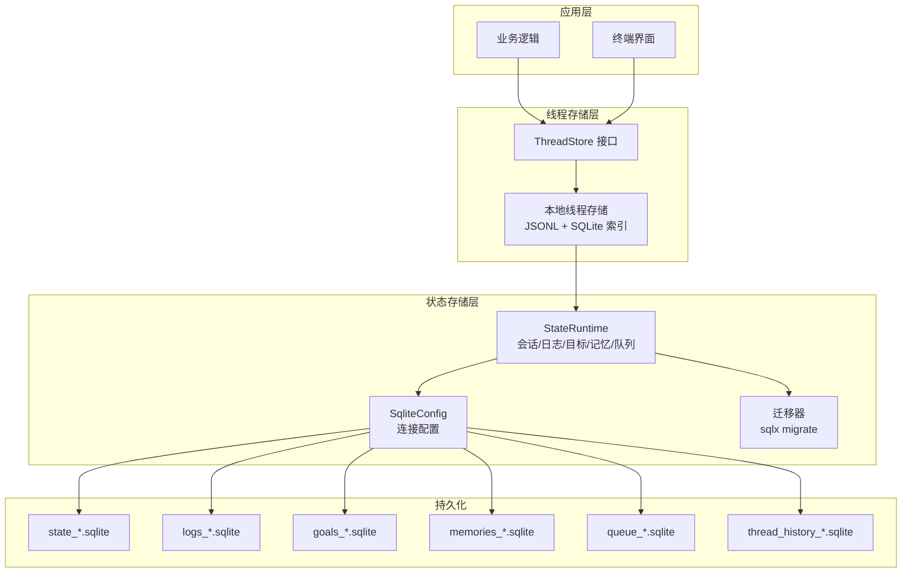
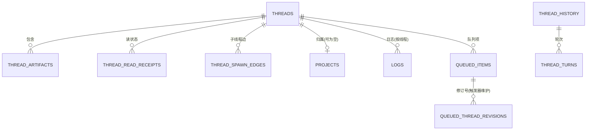
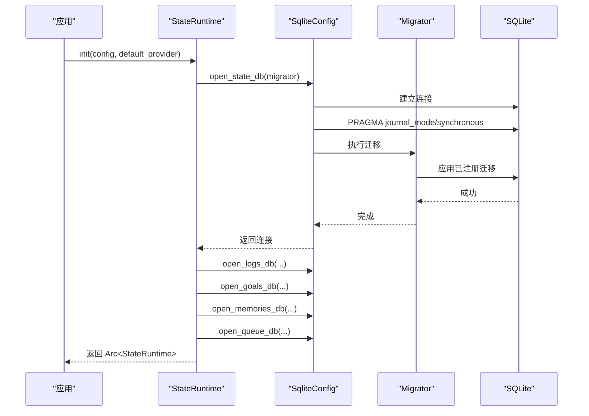
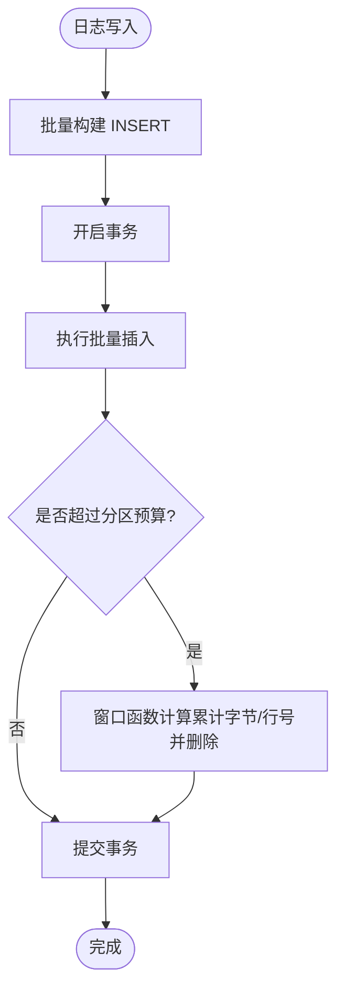
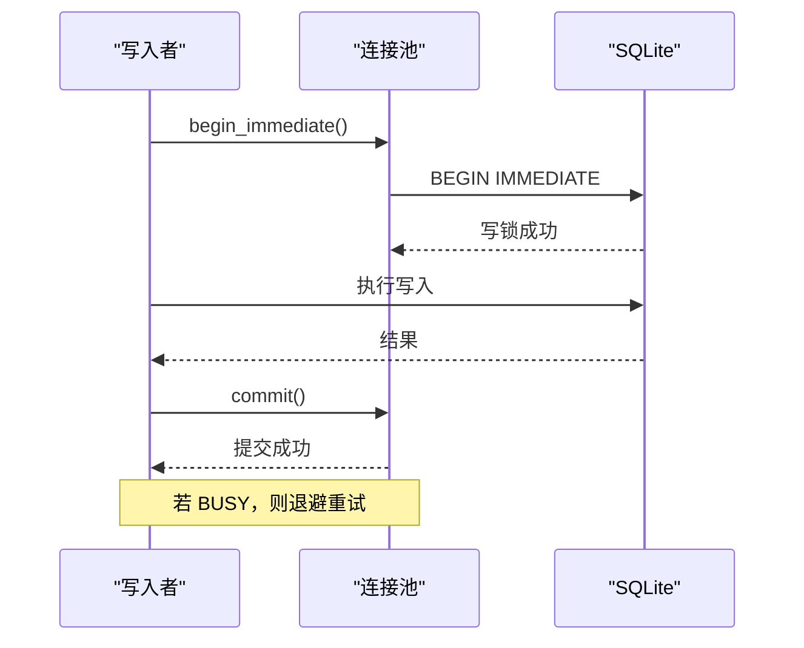
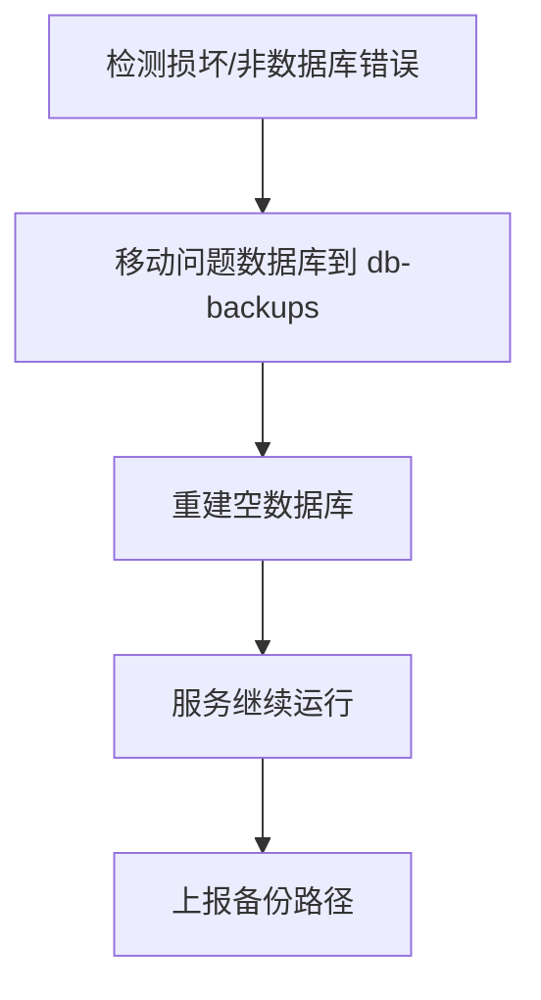
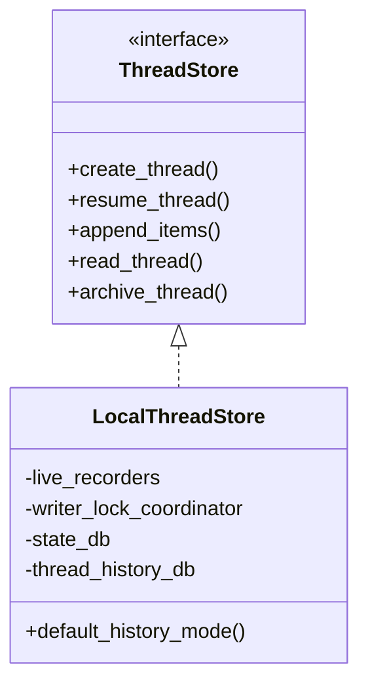
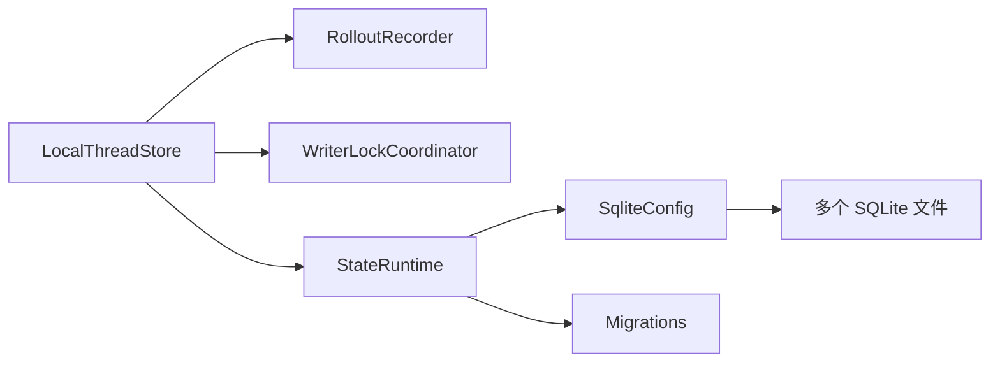

# 数据存储

<cite>
**本文引用的文件**   
- [state/lib.rs](file://codex-rs/state/src/lib.rs)
- [state/sqlite.rs](file://codex-rs/state/src/sqlite.rs)
- [state/migrations.rs](file://codex-rs/state/src/migrations.rs)
- [state/runtime.rs](file://codex-rs/state/src/runtime.rs)
- [state/sqlite/connection.rs](file://codex-rs/state/src/sqlite/connection.rs)
- [state/sqlite/busy_retry.rs](file://codex-rs/state/src/sqlite/busy_retry.rs)
- [state/runtime/recovery.rs](file://codex-rs/state/src/runtime/recovery.rs)
- [state/runtime/threads.rs](file://codex-rs/state/src/runtime/threads.rs)
- [state/runtime/logs.rs](file://codex-rs/state/src/runtime/logs.rs)
- [state/migrations/0049_projects.sql](file://codex-rs/state/migrations/0049_projects.sql)
- [state/migrations/0051_thread_artifacts.sql](file://codex-rs/state/migrations/0051_thread_artifacts.sql)
- [state/migrations/0061_thread_read_state.sql](file://codex-rs/state/migrations/0061_thread_read_state.sql)
- [state/migrations/0062_threads_attached_parent.sql](file://codex-rs/state/migrations/0062_threads_attached_parent.sql)
- [state/logs_migrations/0002_logs_feedback_log_body.sql](file://codex-rs/state/logs_migrations/0002_logs_feedback_log_body.sql)
- [state/queue_migrations/0002_queued_thread_revisions.sql](file://codex-rs/state/queue_migrations/0002_queued_thread_revisions.sql)
- [state/thread_history_migrations/0008_thread_turn_root.sql](file://codex-rs/state/thread_history_migrations/0008_thread_turn_root.sql)
- [thread-store/store.rs](file://codex-rs/thread-store/src/store.rs)
- [thread-store/local/mod.rs](file://codex-rs/thread-store/src/local/mod.rs)
</cite>

## 目录
1. [引言](#引言)
2. [项目结构](#项目结构)
3. [核心组件](#核心组件)
4. [架构总览](#架构总览)
5. [详细组件分析](#详细组件分析)
6. [依赖关系分析](#依赖关系分析)
7. [性能与查询优化](#性能与查询优化)
8. [故障排查指南](#故障排查指南)
9. [结论](#结论)

## 引言
本文件系统性地梳理 Codex 的数据存储层。系统以 SQLite 为核心持久化引擎，将“会话元数据、日志、目标、记忆、队列、线程历史”等实体拆分为多个数据库文件，并通过迁移脚本实现版本演进；同时提供本地线程存储抽象，把 JSONL 回放格式与可查询的 SQLite 索引结合，兼顾可读性与性能。文档重点覆盖：
- SQLite 表结构与实体关系（会话、历史、线程状态、项目、附件、读状态等）
- 迁移策略与版本管理
- 运行时状态管理（会话、线程、缓存、回收）
- 一致性保证与事务处理
- 备份恢复与数据清理
- 性能优化与查询建议
- 数据安全与隐私保护

## 项目结构
Codex 的数据存储由两个主要 crate 组成：
- `codex-state`：面向运行时的 SQLite 状态库，负责多数据库连接、迁移、日志分区、队列、目标、记忆、线程元数据等。
- `codex-thread-store`：线程存储抽象及本地实现，封装线程创建、读取、追加、归档、分片、回滚、滚动迁移等能力。



图表来源
- [state/sqlite.rs:1-200](file://codex-rs/state/src/sqlite.rs#L1-L200)
- [thread-store/local/mod.rs:1-120](file://codex-rs/thread-store/src/local/mod.rs#L1-L120)

章节来源
- [state/lib.rs:1-173](file://codex-rs/state/src/lib.rs#L1-L173)
- [thread-store/local/mod.rs:1-120](file://codex-rs/thread-store/src/local/mod.rs#L1-L120)

## 核心组件
- SqliteConfig：集中管理 SQLite 连接池、NFS 判断、WAL/DELETE 模式、自动清理与快速检查。
- StateRuntime：运行时入口，初始化并持有 state、logs、goals、memories、queue、thread_history 等多个数据库连接，暴露线程、日志、目标、记忆、队列等高层 API。
- ThreadStore 接口与 LocalThreadStore：统一线程存储语义，本地实现以 JSONL 为回放介质，SQLite 作为查询索引，并提供读写锁协调与生命周期管理。
- 迁移系统：按数据库域分别维护迁移集，支持向前兼容、旧版本修复与并行实例打开。

章节来源
- [state/sqlite.rs:1-200](file://codex-rs/state/src/sqlite.rs#L1-L200)
- [state/runtime.rs:1-200](file://codex-rs/state/src/runtime.rs#L1-L200)
- [thread-store/store.rs:1-200](file://codex-rs/thread-store/src/store.rs#L1-L200)
- [thread-store/local/mod.rs:1-120](file://codex-rs/thread-store/src/local/mod.rs#L1-L120)

## 架构总览
系统采用“多库分域 + 单进程共享连接池 + 迁移驱动版本演进”的架构。每个数据库承担明确职责：
- state：线程元数据、项目、附件、读状态、生成边等。
- logs：诊断日志与反馈体，按线程或进程隔离容量上限。
- goals：线程目标及其延续延迟标记。
- memories：记忆合并进度等实验性状态。
- queue：用户提交队列与线程修订号。
- thread_history：分页线程历史的物化表与实时项。

```mermaid
classDiagram
    class SqliteConfig {
        +home()
        +logs_home()
        +open_state_db()
        +open_logs_db()
        +open_goals_db()
        +open_memories_db()
        +open_queue_db()
        +open_thread_history_db()
    }

    class StateRuntime {
        +init()
        +insert_log()
        +get_thread()
        +mark_thread_paginated()
        +upsert_thread_spawn_edge()
    }

    class ThreadStore {
        <<interface>>
        +create_thread()
        +resume_thread()
        +append_items()
        +read_thread()
        +archive_thread()
    }

    class LocalThreadStore {
        +default_history_mode()
        -live_recorders
        -writer_lock_coordinator
        -state_db
        -thread_history_db
    }

    SqliteConfig --> StateRuntime : "提供连接"
    StateRuntime --> "state DB"
    StateRuntime --> "logs DB"
    StateRuntime --> "goals DB"
    StateRuntime --> "memories DB"
    StateRuntime --> "queue DB"
    StateRuntime --> "thread_history DB"
    ThreadStore <|.. LocalThreadStore
    LocalThreadStore --> StateRuntime : "可选状态索引"
```

图表来源
- [state/sqlite.rs:1-200](file://codex-rs/state/src/sqlite.rs#L1-L200)
- [state/runtime.rs:1-200](file://codex-rs/state/src/runtime.rs#L1-L200)
- [thread-store/local/mod.rs:1-120](file://codex-rs/thread-store/src/local/mod.rs#L1-L120)

## 详细组件分析

### SQLite 表结构与实体关系
围绕“线程”这一核心实体，系统构建了以下关键关系：
- 线程与项目：通过 `project_id` 外键关联，支持 NULL 值表示未归属项目。
- 线程与附件：通过 `thread_artifacts` 表以 `(thread_id, artifact_type, identity_key)` 唯一约束承载。
- 线程与读状态：通过 `thread_read_receipts` 记录首次未读轮次、版本与最后发布轮次。
- 线程与父子关系：通过 `attached_thread_parent_id` 直接父引用，以及 `thread_spawn_edges` 表达方向性生成边。
- 日志：按 `thread_id` 或 `process_uuid` 分区保留最近内容。
- 队列：`queued_items` 与 `queued_thread_revisions` 通过触发器维护线程最新修订号。
- 线程历史：`thread_turns` 等表承载分页历史，含根轮次字段。



图表来源
- [state/migrations/0049_projects.sql:1-30](file://codex-rs/state/migrations/0049_projects.sql#L1-L30)
- [state/migrations/0051_thread_artifacts.sql:1-12](file://codex-rs/state/migrations/0051_thread_artifacts.sql#L1-L12)
- [state/migrations/0061_thread_read_state.sql:1-8](file://codex-rs/state/migrations/0061_thread_read_state.sql#L1-L8)
- [state/migrations/0062_threads_attached_parent.sql:1-4](file://codex-rs/state/migrations/0062_threads_attached_parent.sql#L1-L4)
- [state/logs_migrations/0002_logs_feedback_log_body.sql:1-53](file://codex-rs/state/logs_migrations/0002_logs_feedback_log_body.sql#L1-L53)
- [state/queue_migrations/0002_queued_thread_revisions.sql:1-34](file://codex-rs/state/queue_migrations/0002_queued_thread_revisions.sql#L1-L34)
- [state/thread_history_migrations/0008_thread_turn_root.sql:1-1](file://codex-rs/state/thread_history_migrations/0008_thread_turn_root.sql#L1-L1)

#### 关键表说明
- threads：会话与线程元数据主表，包含创建时间、更新时间、最近使用时间、来源、模型信息、沙箱策略、预览、归档时间、所属分区、项目 ID、Daybreak 开关、Git 元信息、附件父指针等。
- projects / project_roots / project_idempotency_keys：项目与其根路径和幂等键，用于组织线程集合与幂等创建。
- thread_artifacts：线程附件载荷，按类型与身份键去重，附带创建时间索引。
- thread_read_receipts：独立于可重建线程元数据的读状态，仅真正删除时移除回执。
- logs：诊断日志与反馈体，带时间戳、级别、模块路径、线程/进程标识、估计字节数，并有多级索引。
- queued_items / queued_thread_revisions：队列项与每线程修订号，使用触发器自增修订号。
- thread_turns：线程历史中的轮次，新增根轮次字段用于定位轮次根节点。

章节来源
- [state/migrations/0049_projects.sql:1-30](file://codex-rs/state/migrations/0049_projects.sql#L1-L30)
- [state/migrations/0051_thread_artifacts.sql:1-12](file://codex-rs/state/migrations/0051_thread_artifacts.sql#L1-L12)
- [state/migrations/0061_thread_read_state.sql:1-8](file://codex-rs/state/migrations/0061_thread_read_state.sql#L1-L8)
- [state/migrations/0062_threads_attached_parent.sql:1-4](file://codex-rs/state/migrations/0062_threads_attached_parent.sql#L1-L4)
- [state/logs_migrations/0002_logs_feedback_log_body.sql:1-53](file://codex-rs/state/logs_migrations/0002_logs_feedback_log_body.sql#L1-L53)
- [state/queue_migrations/0002_queued_thread_revisions.sql:1-34](file://codex-rs/state/queue_migrations/0002_queued_thread_revisions.sql#L1-L34)
- [state/thread_history_migrations/0008_thread_turn_root.sql:1-1](file://codex-rs/state/thread_history_migrations/0008_thread_turn_root.sql#L1-L1)

### 数据迁移与版本管理
- 迁移定义：使用 sqlx 的编译期宏将各域的迁移目录绑定为静态 Migrator，包括 state、logs、goals、memories、queue、thread_history。
- 向后兼容：运行时 migrator 包装器忽略未知更新版本，允许旧二进制打开被新版本升级过的数据库。
- 特殊修复：对历史遗留的 recency 迁移版本进行修补，避免旧版二进制误判校验失败。
- 启动流程：在 `StateRuntime::init_inner` 中依次打开并迁移各数据库，失败时关闭已打开的连接以避免资源泄漏。



图表来源
- [state/runtime.rs:1-200](file://codex-rs/state/src/runtime.rs#L1-L200)
- [state/migrations.rs:1-123](file://codex-rs/state/src/migrations.rs#L1-L123)
- [state/sqlite/connection.rs:1-122](file://codex-rs/state/src/sqlite/connection.rs#L1-L122)

章节来源
- [state/migrations.rs:1-123](file://codex-rs/state/src/migrations.rs#L1-L123)
- [state/runtime.rs:1-200](file://codex-rs/state/src/runtime.rs#L1-L200)

### 状态管理与缓存策略
- 线程状态：
  - 获取与更新：提供 `get_thread`、`mark_thread_paginated`、`set_thread_preview_if_empty` 等方法，内部使用 busy-retry 写扩展保障并发安全。
  - 父子关系：通过 `upsert_thread_spawn_edge`、`list_thread_spawn_children*` 维护方向性生成边，支持按状态过滤与广度优先遍历。
  - 附加线程：通过 `attached_thread_parent_id` 支持直接父子关系查询。
- 日志状态：
  - 批量写入：`insert_logs` 使用批量插入并在同一事务内执行分区裁剪，防止只读窗口看到“已插入但未裁剪”的行。
  - 分区预算：按线程与无线程进程分别限制约 10 MiB 与固定行数，使用窗口函数计算累计字节与行号后删除过期数据。
- 缓存策略：
  - 连接池复用：各数据库使用独立连接池，减少跨域锁竞争。
  - WAL 与 DELETE 模式：根据文件系统特性选择 WAL 或 DELETE，NFS 强制 DELETE 并启用 EXTRA 同步。
  - 本地线程存储：LiveRecorderEntry 缓存活跃记录器、rollout id、历史模式与 writer lock，避免重复加载。



图表来源
- [state/runtime/logs.rs:1-220](file://codex-rs/state/src/runtime/logs.rs#L1-L220)

章节来源
- [state/runtime/threads.rs:1-220](file://codex-rs/state/src/runtime/threads.rs#L1-L220)
- [state/runtime/logs.rs:1-220](file://codex-rs/state/src/runtime/logs.rs#L1-L220)
- [thread-store/local/mod.rs:1-120](file://codex-rs/thread-store/src/local/mod.rs#L1-L120)

### 一致性与事务处理
- 事务边界：
  - 写操作优先使用 `BEGIN IMMEDIATE` 抢占写锁，配合重试机制处理 SQLITE_BUSY_*。
  - 日志插入与分区裁剪在同一事务内，保证原子性。
  - 队列修订号通过触发器与 `queued_thread_revisions` 保持一致。
- 冲突处理：
  - 针对 SQLITE_BUSY、SQLITE_BUSY_RECOVERY、SQLITE_BUSY_SNAPSHOT、SQLITE_BUSY_TIMEOUT 的有限重试。
  - NFS 场景下强制 DELETE 模式并设置 EXTRA 同步，降低跨进程写入风险。
- 完整性检查：
  - 启动阶段可进行 quick-check 与一致性探测，错误上报到遥测指标。



图表来源
- [state/sqlite/busy_retry.rs:1-191](file://codex-rs/state/src/sqlite/busy_retry.rs#L1-L191)
- [state/sqlite/connection.rs:1-122](file://codex-rs/state/src/sqlite/connection.rs#L1-L122)

章节来源
- [state/sqlite/busy_retry.rs:1-191](file://codex-rs/state/src/sqlite/busy_retry.rs#L1-L191)
- [state/runtime/logs.rs:1-220](file://codex-rs/state/src/runtime/logs.rs#L1-L220)
- [state/queue_migrations/0002_queued_thread_revisions.sql:1-34](file://codex-rs/state/queue_migrations/0002_queued_thread_revisions.sql#L1-L34)

### 备份恢复与数据清理
- 备份恢复：
  - 当检测到损坏或非数据库错误时，系统会将问题数据库及其旁路文件移动到 `db-backups` 目录下，其他数据库不受影响。
  - 提供 `collect_runtime_db_backups` 收集任务本地的备份清单，供上层汇报。
- 数据清理：
  - 日志按分区预算定期裁剪。
  - 线程附件、历史项等可通过上层清理回调或迁移脚本进行清理。
  - 本地线程存储支持数据清理钩子，便于归档或删除后释放空间。



图表来源
- [state/runtime/recovery.rs:1-200](file://codex-rs/state/src/runtime/recovery.rs#L1-L200)

章节来源
- [state/runtime/recovery.rs:1-200](file://codex-rs/state/src/runtime/recovery.rs#L1-L200)
- [thread-store/local/mod.rs:1-120](file://codex-rs/thread-store/src/local/mod.rs#L1-L120)

### 线程存储抽象与本地实现
- ThreadStore 接口定义了线程生命周期与历史记录访问的统一语义，默认历史模式为 legacy，允许实现覆盖。
- LocalThreadStore 基于 JSONL 回放格式与 SQLite 索引：
  - 活跃线程通过 RolloutRecorder 追加历史，同时投影元数据到 state DB。
  - 使用 `WriterLockCoordinator` 与 per-thread 锁协调 fork、删除、归档等生命周期操作。
  - 可选择挂载 state DB 与 thread_history DB，提高查询性能。



图表来源
- [thread-store/store.rs:1-200](file://codex-rs/thread-store/src/store.rs#L1-L200)
- [thread-store/local/mod.rs:1-120](file://codex-rs/thread-store/src/local/mod.rs#L1-L120)

章节来源
- [thread-store/store.rs:1-200](file://codex-rs/thread-store/src/store.rs#L1-L200)
- [thread-store/local/mod.rs:1-120](file://codex-rs/thread-store/src/local/mod.rs#L1-L120)

## 依赖关系分析
- StateRuntime 依赖 SqliteConfig 提供的多数据库连接与迁移器，依赖日志分区与队列、目标、记忆等运行时模块。
- LocalThreadStore 依赖 codex-rollout 的回放器与写锁协调器，并可选择依赖 StateDbHandle 与 thread_history DB。
- 迁移器在各数据库域内独立，避免跨域耦合。



图表来源
- [thread-store/local/mod.rs:1-120](file://codex-rs/thread-store/src/local/mod.rs#L1-L120)
- [state/runtime.rs:1-200](file://codex-rs/state/src/runtime.rs#L1-L200)
- [state/sqlite.rs:1-200](file://codex-rs/state/src/sqlite.rs#L1-L200)

章节来源
- [thread-store/local/mod.rs:1-120](file://codex-rs/thread-store/src/local/mod.rs#L1-L120)
- [state/runtime.rs:1-200](file://codex-rs/state/src/runtime.rs#L1-L200)
- [state/sqlite.rs:1-200](file://codex-rs/state/src/sqlite.rs#L1-L200)

## 性能与查询优化
- 连接与锁优化：
  - 多数据库独立连接池，降低跨域锁争用。
  - WAL 模式提升读并发，DELETE 模式在 NFS 上保证强一致。
- 日志写入优化：
  - 批量插入减少语句开销。
  - 窗口函数一次性计算累计字节与行号，避免多次扫描。
- 索引设计：
  - 线程列表与搜索使用组合索引，如按项目、归档状态、创建时间与 ID 排序。
  - 日志按时间戳、线程、进程 UUID 等多维索引加速范围查询。
- 查询建议：
  - 尽量使用覆盖索引查询，避免回表。
  - 对大表分页查询时，使用基于 ID 或时间戳的游标式分页。
  - 对附件与项目关系查询，先过滤再 JOIN，减少中间结果集。

[本节为通用指导，不直接分析具体文件]

## 故障排查指南
- 常见错误识别：
  - 损坏或非数据库错误：通过 `is_sqlite_corruption_error` 与 `runtime_db_path_for_corruption_error` 定位问题数据库路径。
  - 锁定与繁忙：通过 `sqlite_error_detail_is_lock` 与重试机制处理 SQLITE_BUSY_*。
- 恢复步骤：
  - 收集备份路径，确认 `db-backups` 是否存在问题文件。
  - 重启服务以重建空数据库，观察是否恢复正常。
- 日志与遥测：
  - 检查数据库初始化耗时与失败计数指标。
  - 关注日志批次写入大小与丢弃原因，评估分区预算是否合理。

章节来源
- [state/runtime/recovery.rs:1-200](file://codex-rs/state/src/runtime/recovery.rs#L1-L200)
- [state/sqlite/busy_retry.rs:1-191](file://codex-rs/state/src/sqlite/busy_retry.rs#L1-L191)
- [state/lib.rs:1-173](file://codex-rs/state/src/lib.rs#L1-L173)

## 结论
Codex 的数据存储系统以 SQLite 为核心，通过多库分域、迁移驱动版本演进、连接池与锁协调、日志分区裁剪与备份恢复等手段，实现了高可靠、高性能且可扩展的会话与线程数据管理。其设计在保持 JSONL 回放兼容性的同时，利用 SQLite 索引与事务能力满足复杂查询与一致性需求。未来可在索引精细化、分页策略与清理策略方面持续优化，以适配更大规模与更高吞吐的场景。