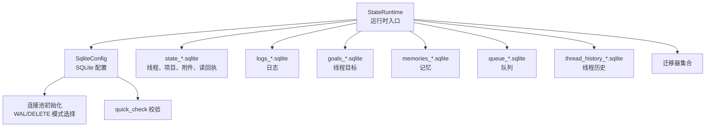
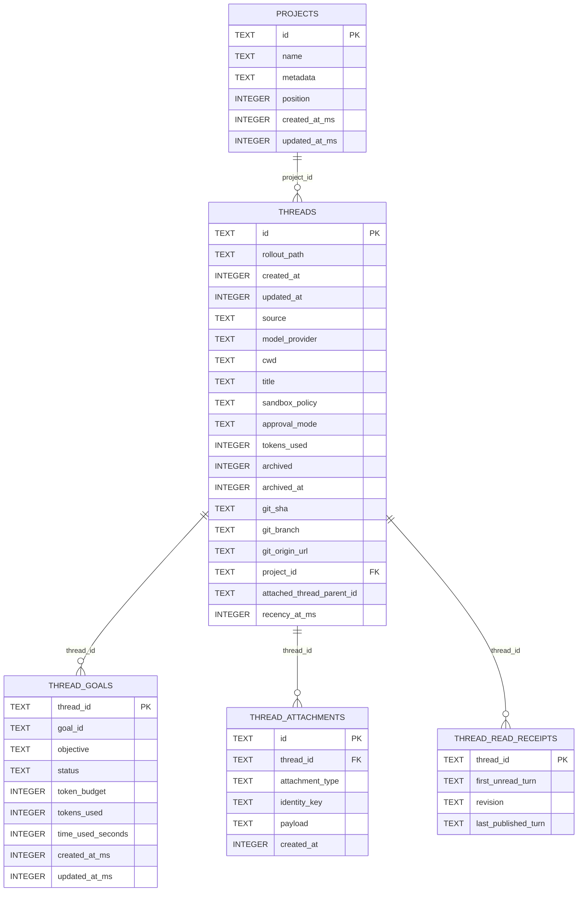
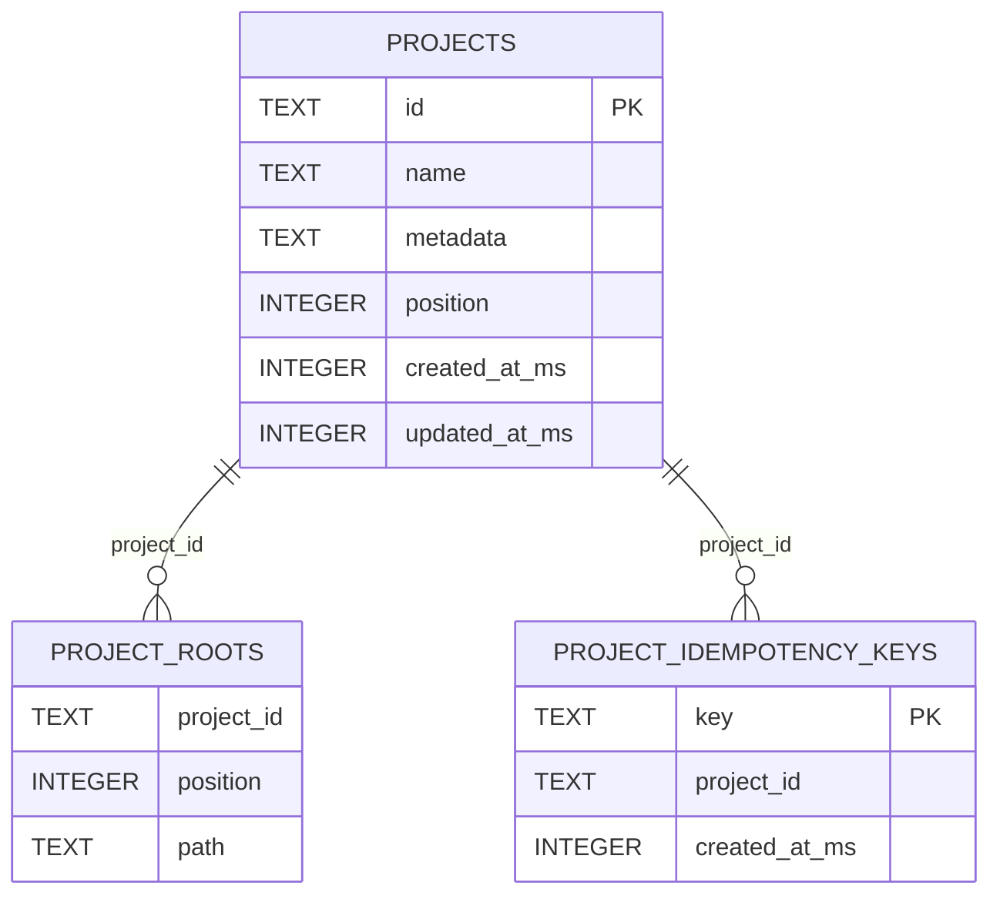
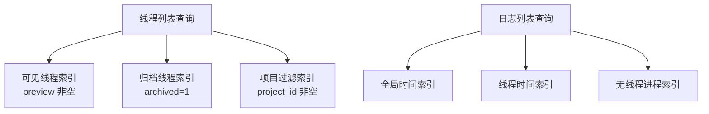
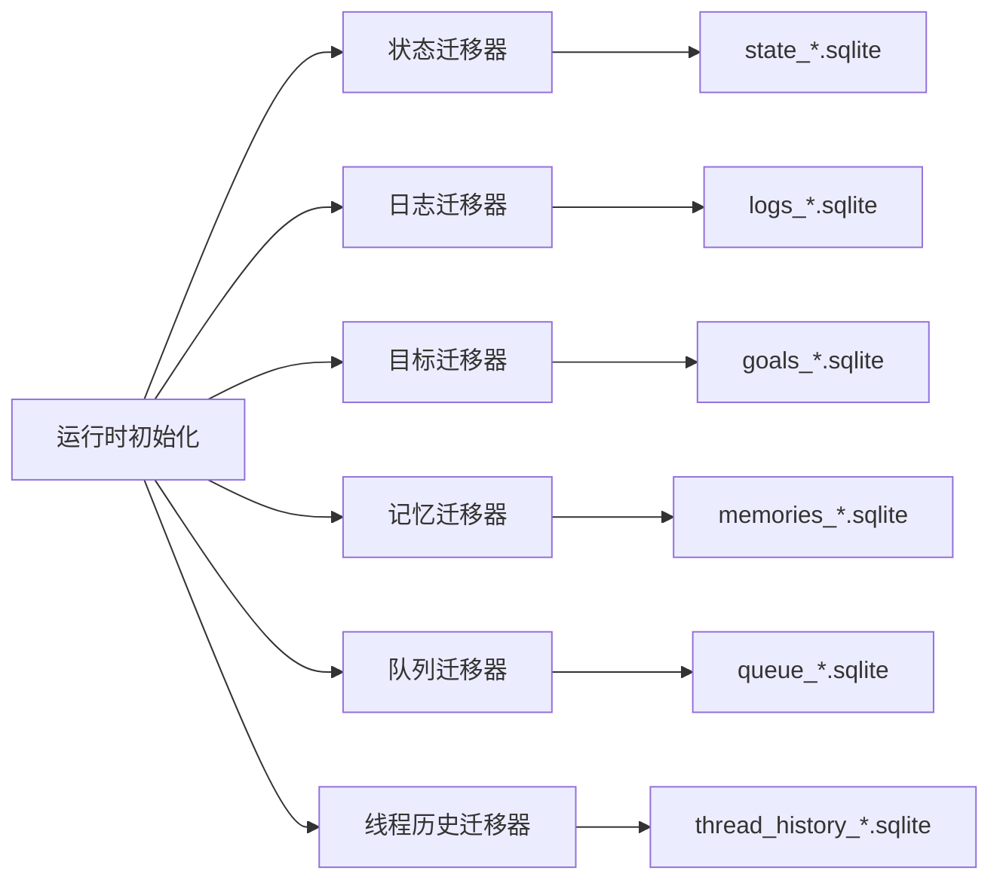
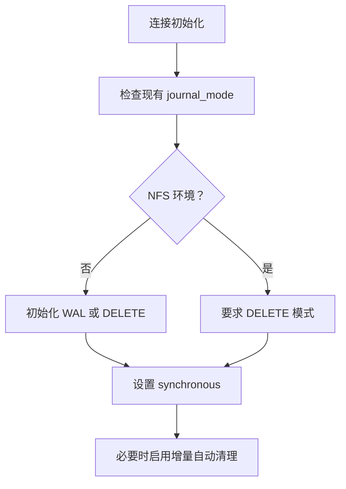
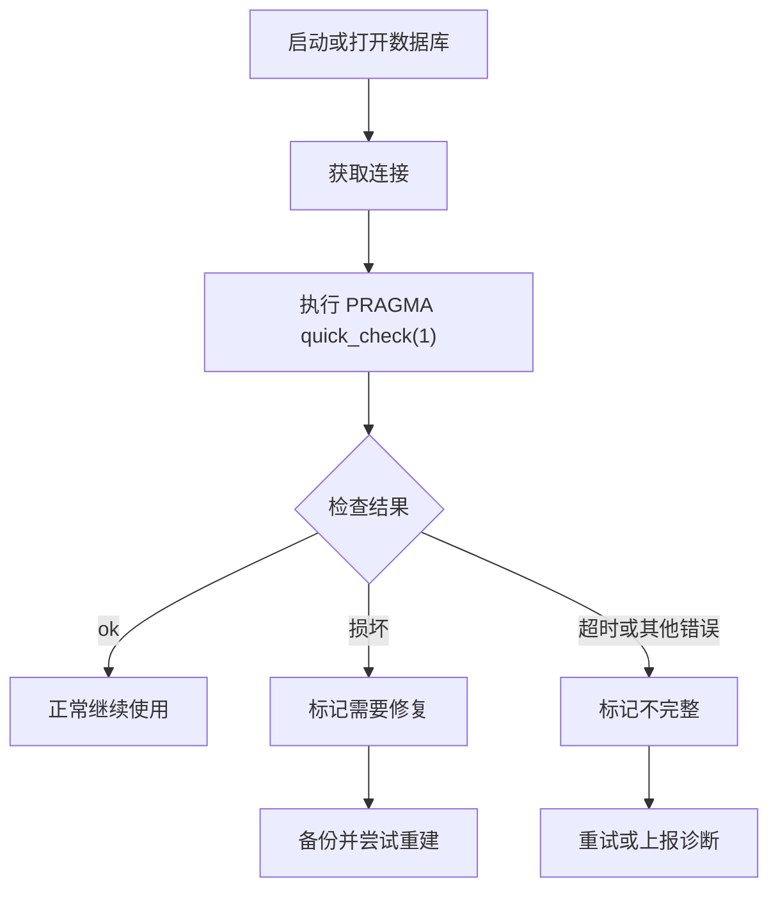

# 数据库设计

<cite>
**本文引用的文件**   
- [sqlite.rs](file://codex-rs/state/src/sqlite.rs)
- [connection.rs](file://codex-rs/state/src/sqlite/connection.rs)
- [validation.rs](file://codex-rs/state/src/sqlite/validation.rs)
- [migrations.rs](file://codex-rs/state/src/migrations.rs)
- [runtime.rs](file://codex-rs/state/src/runtime.rs)
- [model/mod.rs](file://codex-rs/state/src/model/mod.rs)
- [thread_metadata.rs](file://codex-rs/state/src/model/thread_metadata.rs)
- [project.rs](file://codex-rs/state/src/model/project.rs)
- [log.rs](file://codex-rs/state/src/model/log.rs)
- [projects.rs](file://codex-rs/state/src/runtime/projects.rs)
- [0001_threads.sql](file://codex-rs/state/migrations/0001_threads.sql)
- [0002_logs.sql](file://codex-rs/state/migrations/0002_logs.sql)
- [0011_logs_partition_prune_indexes.sql](file://codex-rs/state/migrations/0011_logs_partition_prune_indexes.sql)
- [0029_thread_goals.sql](file://codex-rs/state/migrations/0029_thread_goals.sql)
- [0036_threads_visible_sort_indexes.sql](file://codex-rs/state/migrations/0036_threads_visible线程_sort_indexes.sql)
- [0049_projects.sql](file://codex-rs/state/migrations/0049_projects.sql)
- [0051_thread_artifacts.sql](file://codex-rs/state/migrations/0051_thread_artifacts.sql)
- [0055_thread_attachments.sql](file://codex-rs/state/migrations/0055_thread_attachments.sql)
- [0058_threads_archive_sort_indexes.sql](file://codex-rs/state/migrations/0058_threads_archive_sort_indexes.sql)
- [0061_thread_read_state.sql](file://codex-rs/state/migrations/0061_thread_read_state.sql)
- [0062_threads_attached_parent.sql](file://codex-rs/state/migrations/0062_threads_attached_parent.sql)
</cite>

## 目录

1. [引言](#引言)
2. [项目结构](#项目结构)
3. [核心实体与表结构](#核心实体与表结构)
4. [主键、外键与索引设计](#主键外键与索引设计)
5. [字段类型与数据约束](#字段类型与数据约束)
6. [数据库版本管理与迁移策略](#数据库版本管理与迁移策略)
7. [查询优化建议](#查询优化建议)
8. [性能调优指导](#性能调优指导)
9. [故障排查与恢复](#故障排查与恢复)
10. [结论](#结论)

## 引言

本仓库的持久化层基于 SQLite，采用多数据库文件架构：状态存储、日志、目标、记忆、队列和线程历史分别落在独立文件中。这样做的核心目的是降低单库高并发写入时的锁竞争，同时把不同生命周期、不同访问模式的业务域拆成可独立维护的数据面。

从“项目(project)、线程(thread)、会话(session)、日志(log)”的角度看：

- **项目**是应用服务器侧的顶层业务分组，用于把多个线程组织到同一个工程或工作区中。
- **线程**是 Codex 的核心运行时实体，代表一次对话、任务或智能体执行过程。
- **会话**在代码中不是独立的持久化表；它主要体现为线程元数据中的来源、创建者、模型、工作目录、沙箱策略等上下文信息。
- **日志**记录线程内外的结构化事件，早期版本与线程共享状态库，后来迁移到独立的日志数据库并按线程或进程进行逻辑分区。

## 项目结构

`codex-rs/state` 模块是 SQLite 相关逻辑的主要归属。其关键分层如下：

| 层级 | 职责 | 对应文件或目录 |
|---|---|---|
| 配置与连接 | 管理 SQLite 路径、NFS 判断、WAL/DELETE 模式、同步级别、连接池 | `sqlite.rs`、`sqlite/connection.rs` |
| 迁移 | 注册并运行各数据库的 SQL 迁移脚本 | `migrations.rs`、`migrations/*.sql` |
| 运行时 API | 提供线程、项目、日志、目标、队列、记忆等高层操作 | `runtime.rs` 及其子模块 |
| 领域模型 | 描述 Rust 侧数据结构及行映射 | `model/*.rs` |
| 校验与恢复 | 快速完整性检查、错误分类、损坏修复 | `sqlite/validation.rs`、`runtime/recovery.rs` |

**图表来源**
- [sqlite.rs:1-200](file://codex-rs/state/src/sqlite.rs#L1-L200)
- [connection.rs:1-122](file://codex-rs/state/src/sqlite/connection.rs#L1-L122)
- [migrations.rs:1-123](file://codex-rs/state/src/migrations.rs#L1-L123)
- [runtime.rs:1-200](file://codex-rs/state/src/runtime.rs#L1-L200)

**章节来源**
- [sqlite.rs:1-200](file://codex-rs/state/src/sqlite.rs#L1-L200)
- [runtime.rs:1-200](file://codex-rs/state/src/runtime.rs#L1-L200)

## 核心实体与表结构

### 线程表

线程表是系统中最核心的表之一。它保存线程的唯一标识、文件系统路径、时间戳、来源、模型信息、工作目录、标题、沙箱策略、审批模式、令牌用量、归档状态、Git 信息等。后续迁移不断扩展了可见时间字段、项目关联、附加父线程、Daybreak 开关、名称、预览、段信息等内容。

| 字段类别 | 典型字段 | 语义说明 |
|---|---|---|
| 主键 | `id` | 线程唯一标识 |
| 文件系统 | `rollout_path`、`cwd` | 线程产物路径与工作目录 |
| 时间 | `created_at`、`updated_at`、`archived_at`、`recency_at_ms` | 创建、更新、归档与产品级“最近活跃”时间 |
| 来源与会话 | `source`、`model_provider`、`model`、`reasoning_effort`、`cli_version` | 会话来源、模型提供方、当前模型、推理强度、客户端版本 |
| 用户界面 | `title`、`name`、`preview`、`section`、`section_position` | 标题、名称、预览文本、用户选择的段及排序位置 |
| 权限与行为 | `sandbox_policy`、`approval_mode`、`tokens_used` | 沙箱策略、审批模式、累计令牌 |
| 项目关系 | `project_id` | 可选的外键，指向项目表 |
| 父子关系 | `attached_thread_parent_id` | 可选字段，表示被附加线程的父线程 |
| Git 信息 | `git_sha`、`git_branch`、`git_origin_url` | 可选 Git 提交、分支与来源地址 |
| 展示控制 | `daybreak_enabled` | 可选的用户偏好字段 |

线程还衍生出多个辅助表：

- **线程目标**：记录每个线程的目标 ID、目标描述、状态、令牌和时间预算。
- **线程附件**：早期叫“工件”，后重命名为附件，保存线程级别的二进制或结构化附件。
- **线程读回执**：记录线程的未读起始轮次、修订号和最后发布轮次，用于 UI 中的已读/未读状态。
- **线程部分与顺序**：通过线程元数据中的 JSON 字段和独立排序字段表达用户自定义分组与顺序。

**图表来源**
- [0001_threads.sql:1-25](file://codex-rs/state/migrations/0001_threads.sql#L1-L25)
- [0029_thread_goals.sql:1-11](file://codex-rs/state/migrations/0029_thread_goals.sql#L1-L11)
- [0049_projects.sql:1-30](file://codex-rs/state/migrations/0049_projects.sql#L1-L30)
- [0051_thread_artifacts.sql:1-12](file://codex-rs/state/migrations/0051_thread_artifacts.sql#L1-L12)
- [0055_thread_attachments.sql:1-6](file://codex-rs/state/migrations/0055_thread_attachments.sql#L1-L6)
- [0061_thread_read_state.sql:1-8](file://codex-rs/state/migrations/0061_thread_read_state.sql#L1-L8)
- [0062_threads_attached_parent.sql:1-4](file://codex-rs/state/migrations/0062_threads_attached_parent.sql#L1-L4)

**章节来源**
- [0001_threads.sql:1-25](file://codex-rs/state/migrations/0001_threads.sql#L1-L25)
- [0029_thread_goals.sql:1-11](file://codex-rs/state/migrations/0029_thread_goals.sql#L1-L11)
- [0049_projects.sql:1-30](file://codex-rs/state/migrations/0049_projects.sql#L1-L30)
- [0051_thread_artifacts.sql:1-12](file://codex-rs/state/migrations/0051_thread_artifacts.sql#L1-L12)
- [0055_thread_attachments.sql:1-6](file://codex-rs/state/migrations/0055_thread_attachments.sql#L1-L6)
- [0061_thread_read_state.sql:1-8](file://codex-rs/state/migrations/0061_thread_read_state.sql#L1-L8)
- [0062_threads_attached_parent.sql:1-4](file://codex-rs/state/migrations/0062_threads_attached_parent.sql#L1-L4)
- [thread_metadata.rs:1-200](file://codex-rs/state/src/model/thread_metadata.rs#L1-L200)

### 项目表

项目表用于保存应用服务器创建的工程对象，包括项目名称、JSON 元数据、显示顺序、创建时间和更新时间。项目根目录保存在 `project_roots` 表中，形成一对多关系。项目与线程之间是多对一关系：一个线程只能属于一个项目，但项目删除时线程字段设置为空而不是级联删除线程。

| 字段 | 类型 | 约束 | 说明 |
|---|---|---|---|
| `id` | `TEXT` | 主键 | 项目唯一标识 |
| `name` | `TEXT` | 非空 | 项目名称 |
| `metadata` | `TEXT` | 非空，默认空对象 | JSON 格式的扩展元数据 |
| `position` | `INTEGER` | 非空 | 用户在列表中的显示顺序 |
| `created_at_ms` | `INTEGER` | 非空 | 毫秒时间戳 |
| `updated_at_ms` | `INTEGER` | 非空 | 毫秒时间戳 |
| `project_id`(threads) | `TEXT` | 外键 | 指向项目，删除项目时设为空 |

项目根目录表使用复合主键 `(project_id, position)`，保证同一项目的根目录顺序稳定。项目去重通过 `project_idempotency_keys` 表实现，避免幂等创建产生重复项目。

**图表来源**
- [0049_projects.sql:1-30](file://codex-rs/state/migrations/0049_projects.sql#L1-L30)
- [project.rs:1-39](file://codex-rs/state/src/model/project.rs#L1-L39)

**章节来源**
- [0049_projects.sql:1-30](file://codex-rs/state/migrations/0049_projects.sql#L1-L30)
- [project.rs:1-39](file://codex-rs/state/src/model/project.rs#L1-L39)
- [projects.rs:1-200](file://codex-rs/state/src/runtime/projects.rs#L1-L200)

### 日志表

日志最初定义在状态库中，后来迁移到独立的日志数据库。日志表包含自增整数主键、秒级时间戳、纳秒时间戳、日志级别、目标模块、消息、模块路径、文件和行号。线程日志还通过 `thread_id` 和 `process_uuid` 区分线程内日志与全局日志。

| 字段 | 类型 | 说明 |
|---|---|---|
| `id` | `INTEGER` | 自增主键 |
| `ts` | `INTEGER` | 秒级时间戳 |
| `ts_nanos` | `INTEGER` | 纳秒偏移，用于同秒排序 |
| `level` | `TEXT` | 日志级别 |
| `target` | `TEXT` | 日志目标 |
| `message` | `TEXT` | 可选消息 |
| `module_path` | `TEXT` | 可选模块路径 |
| `file` | `TEXT` | 可选源文件 |
| `line` | `INTEGER` | 可选源码行号 |
| `thread_id` | `TEXT` | 可选线程标识 |
| `process_uuid` | `TEXT` | 可选进程标识 |

Rust 侧将日志抽象为 `LogEntry` 和 `LogRow`，其中 `LogQuery` 支持按级别、时间范围、模块、文件、线程和搜索词过滤，并支持分页和降序查询。

**章节来源**
- [0002_logs.sql:1-13](file://codex-rs/state/migrations/0002_logs.sql#L1-L13)
- [log.rs:1-57](file://codex-rs/state/src/model/log.rs#L1-L57)

### 其他核心表

| 表名 | 用途 | 关键字段 |
|---|---|---|
| `thread_goals` | 线程目标 | `thread_id`、`goal_id`、`objective`、`status`、`token_budget`、`tokens_used`、`time_used_seconds` |
| `thread_attachments` | 线程附件 | `id`、`thread_id`、`attachment_type`、`identity_key`、`payload`、`created_at` |
| `thread_read_receipts` | 线程读回执 | `thread_id`、`first_unread_turn`、`revision`、`last_published_turn` |
| `project_roots` | 项目根目录 | `project_id`、`position`、`path` |
| `project_idempotency_keys` | 项目幂等键 | `key`、`project_id`、`created_at_ms` |

**章节来源**
- [0029_thread_goals.sql:1-11](file://codex-rs/state/migrations/0029_thread_goals.sql#L1-L11)
- [0051_thread_artifacts.sql:1-12](file://codex-rs/state/migrations/0051_thread_artifacts.sql#L1-L12)
- [0055_thread_attachments.sql:1-6](file://codex-rs/state/migrations/0055_thread_attachments.sql#L1-L6)
- [0061_thread_read_state.sql:1-8](file://codex-rs/state/migrations/0061_thread_read_state.sql#L1-L8)
- [0049_projects.sql:1-30](file://codex-rs/state/migrations/0049_projects.sql#L1-L30)

## 主键、外键与索引设计

### 主键设计原则

1. **线程主键使用字符串标识符**：线程 ID 作为 `TEXT PRIMARY KEY`，便于跨进程、跨语言传播，也符合协议层 `ThreadId` 的设计。
2. **日志主键使用自增整数**：日志是高吞吐追加写入场景，自增整数主键能减少热点键冲突，提高插入效率。
3. **项目主键使用 UUID 字符串**：项目由应用服务器创建，使用 UUID 避免本地生成冲突。
4. **附件主键使用独立字符串**：附件需要稳定、可引用且可单独定位的标识。
5. **读回执和目标以业务键为主键**：`thread_id` 作为读回执和目标的主键，保证每个线程最多一条读状态或一条目标记录。

### 外键设计原则

| 关系 | 外键方向 | 删除语义 | 原因 |
|---|---|---|---|
| 项目 → 线程 | `threads.project_id` → `projects.id` | `ON DELETE SET NULL` | 删除项目不应删除线程，只断开归属关系 |
| 线程 → 目标 | `thread_goals.thread_id` → `threads.id` | `ON DELETE CASCADE` | 线程删除时目标自然失效 |
| 线程 → 附件 | `thread_attachments.thread_id` → `threads.id` | `ON DELETE CASCADE` | 附件依附于线程 |
| 线程 → 读回执 | `thread_read_receipts.thread_id` → `threads.id` | `ON DELETE CASCADE` | 读回执随线程销毁 |
| 项目 → 项目根 | `project_roots.project_id` → `projects.id` | `ON DELETE CASCADE` | 项目根目录随项目删除 |
| 项目 → 幂等键 | `project_idempotency_keys.project_id` → `projects.id` | 未显式声明级联 | 幂等键主要用于写入阶段查找，通常与项目生命周期一致 |

### 索引设计原则

索引围绕三类查询模式构建：

1. **线程列表排序**：按创建时间、更新时间、最近活跃时间排序，同时考虑归档状态和可见性。
2. **日志分区查询**：按 `thread_id`、`process_uuid` 和时序组合过滤。
3. **项目与附件排序**：按项目位置、项目最近活跃、附件创建时间排序。

| 索引 | 适用查询 | 设计要点 |
|---|---|---|
| `idx_threads_created_at` | 按创建时间倒序列出线程 | 基础排序索引 |
| `idx_threads_updated_at` | 按更新时间倒序列出线程 | 基础排序索引 |
| `idx_threads_archived` | 按归档状态过滤 | 轻量筛选 |
| `idx_threads_source` | 按来源过滤 | 来源维度查询 |
| `idx_threads_provider` | 按模型提供方过滤 | 提供方维度查询 |
| `idx_logs_ts` | 按全局时间倒序读取日志 | 日志主排序 |
| `idx_logs_thread_id_ts` | 按线程和时间读取日志 | 线程日志分区 |
| `idx_logs_process_uuid_threadless_ts` | 无线程日志按进程和时间读取 | 条件索引仅覆盖 `thread_id IS NULL` |
| `idx_threads_visible_created_at_ms` | 可见线程按创建时间排序 | 条件索引仅覆盖 `preview <> ''` |
| `idx_threads_visible_updated_at_ms` | 可见线程按更新时间排序 | 条件索引仅覆盖 `preview <> ''` |
| `idx_threads_archive_created_at_ms` | 归档线程按创建时间排序 | 条件索引仅覆盖 `archived = 1` |
| `idx_threads_archive_updated_at_ms` | 归档线程按更新时间排序 | 条件索引仅覆盖 `archived = 1` |
| `idx_threads_archive_recency_at_ms` | 归档线程按最近活跃时间排序 | 条件索引仅覆盖 `archived = 1` |
| `idx_projects_position` | 按项目显示顺序排序 | 复合排序索引 |
| `idx_threads_project_id` | 按项目过滤线程列表 | 条件索引仅覆盖 `project_id IS NOT NULL` |
| `idx_thread_attachments_thread_created_id` | 按线程和附件创建时间排序 | 复合排序索引 |
| `idx_threads_attached_parent` | 按附加父线程查询 | 条件索引仅覆盖非空值 |

**图表来源**
- [0001_threads.sql:1-25](file://codex-rs/state/migrations/0001_threads.sql#L1-L25)
- [0011_logs_partition_prune_indexes.sql:1-4](file://codex-rs/state/migrations/0011_logs_partition_prune_indexes.sql#L1-L4)
- [0036_threads_visible_sort_indexes.sql:1-7](file://codex-rs/state/migrations/0036_threads_visible_sort_indexes.sql#L1-L7)
- [0049_projects.sql:1-30](file://codex-rs/state/migrations/0049_projects.sql#L1-L30)
- [0058_threads_archive_sort_indexes.sql:1-12](file://codex-rs/state/migrations/0058_threads_archive_sort_indexes.sql#L1-L12)
- [0062_threads_attached_parent.sql:1-4](file://codex-rs/state/migrations/0062_threads_attached_parent.sql#L1-L4)

**章节来源**
- [0001_threads.sql:1-25](file://codex-rs/state/migrations/0001_threads.sql#L1-L25)
- [0011_logs_partition_prune_indexes.sql:1-4](file://codex-rs/state/migrations/0011_logs_partition_prune_indexes.sql#L1-L4)
- [0036_threads_visible_sort_indexes.sql:1-7](file://codex-rs/state/migrations/0036_threads_visible_sort_indexes.sql#L1-L7)
- [0049_projects.sql:1-30](file://codex-rs/state/migrations/0049_projects.sql#L1-L30)
- [0058_threads_archive_sort_indexes.sql:1-12](file://codex-rs/state/migrations/0058_threads_archive_sort_indexes.sql#L1-L12)
- [0062_threads_attached_parent.sql:1-4](file://codex-rs/state/migrations/0062_threads_attached_parent.sql#L1-L4)

## 字段类型与数据约束

### 时间字段

- 线程表早期使用秒级整数时间戳，后续引入 `created_at_ms`、`updated_at_ms`、`recency_at_ms` 等毫秒时间戳，以支持更细粒度的排序和分页。
- 日志表同时保留 `ts` 和 `ts_nanos`，既能做秒级分片，又能保证同秒内的严格顺序。
- 项目表和线程目标表统一使用毫秒时间戳，与应用服务器侧的时间语义对齐。

### 字符串字段

- 所有标识符如 `id`、`thread_id`、`project_id`、`goal_id`、`artifact_type` 等均使用 `TEXT`，便于跨语言传递 UUID 或协议标识。
- 用户输入字段如 `title`、`name`、`objective`、`payload` 也使用 `TEXT`，因为 SQLite 没有原生 JSON 类型，复杂结构通常序列化后存入文本。
- `metadata` 字段明确存储 JSON 字符串，并在 Rust 侧反序列化为 `BTreeMap<String, String>`。

### 布尔与枚举

- SQLite 没有原生布尔类型，归档状态、标志位等使用 `INTEGER`，例如 `archived`、`has_user_event`。
- 状态枚举如线程目标状态使用 `CHECK(status IN ('active', 'paused', 'budget_limited', 'complete'))`，在数据库层限制非法状态。

### 可空性与默认值

- 多数可选业务字段允许为空，例如 `first_user_message`、`project_id`、`attached_thread_parent_id`、`daybreak_enabled`。
- 不可缺失的基础字段加 `NOT NULL`，例如 `name`、`position`、`created_at_ms`。
- 默认值用于简化写入逻辑，例如 `tokens_used` 默认 `0`，`metadata` 默认空对象。

**章节来源**
- [0001_threads.sql:1-25](file://codex-rs/state/migrations/0001_threads.sql#L1-L25)
- [0002_logs.sql:1-13](file://codex-rs/state/migrations/0002_logs.sql#L1-L13)
- [0029_thread_goals.sql:1-11](file://codex-rs/state/migrations/0029_thread_goals.sql#L1-L11)
- [0049_projects.sql:1-30](file://codex-rs/state/migrations/0049_projects.sql#L1-L30)
- [log.rs:1-57](file://codex-rs/state/src/model/log.rs#L1-L57)
- [project.rs:1-39](file://codex-rs/state/src/model/project.rs#L1-L39)

## 数据库版本管理与迁移策略

### 多数据库迁移器

系统为每个数据库文件注册独立的迁移器：

| 数据库 | 迁移器 | 说明 |
|---|---|---|
| 状态库 | `STATE_MIGRATOR` | 线程、项目、附件、读回执等 |
| 日志库 | `LOGS_MIGRATOR` | 日志表及相关索引 |
| 目标库 | `GOALS_MIGRATOR` | 线程目标 |
| 记忆库 | `MEMORIES_MIGRATOR` | 记忆相关表 |
| 队列库 | `QUEUE_MIGRATOR` | 队列相关表 |
| 线程历史库 | `THREAD_HISTORY_MIGRATOR` | 线程历史投影 |

**图表来源**
- [migrations.rs:1-123](file://codex-rs/state/src/migrations.rs#L1-L123)
- [sqlite.rs:1-200](file://codex-rs/state/src/sqlite.rs#L1-L200)

### 向前兼容迁移

迁移器使用 `ignore_missing` 包装，允许旧版本二进制打开已被新版本迁移过的数据库。这样可以避免并行运行的新旧进程互相阻塞。迁移版本仍通过校验和验证，防止篡改或错配。

### 特殊修复逻辑

存在针对历史迁移版本的修复函数，例如修复“近期性”迁移版本号。该逻辑会检查 `_sqlx_migrations` 表是否存在、是否命中已知版本，并在满足条件时安全更新迁移记录，使旧二进制能够继续识别新迁移。

### 迁移文件组织

迁移文件采用数字前缀命名，例如 `0001_threads.sql`、`0049_projects.sql`、`0062_threads_attached_parent.sql`。新增表、添加列、创建索引、重命名表、删除表等操作均以增量方式记录。

**章节来源**
- [migrations.rs:1-123](file://codex-rs/state/src/migrations.rs#L1-L123)
- [0049_projects.sql:1-30](file://codex-rs/state/migrations/0049_projects.sql#L1-L30)
- [0062_threads_attached_parent.sql:1-4](file://codex-rs/state/migrations/0062_threads_attached_parent.sql#L1-L4)

## 查询优化建议

### 优先使用已有复合索引

- 线程列表应优先使用 `idx_threads_visible_*` 或 `idx_threads_archive_*`，避免全表扫描。
- 项目过滤应使用 `idx_threads_project_id`，尤其注意该索引仅覆盖 `project_id IS NOT NULL`。
- 日志查询应按 `thread_id`、`ts`、`ts_nanos`、`id` 的顺序构造过滤条件，以命中 `idx_logs_thread_id_ts`。
- 无线程日志应使用 `idx_logs_process_uuid_threadless_ts`，避免误用普通线程索引。

### 分页建议使用锚点

线程元数据模型定义了 `Anchor`，包含时间戳和线程 ID，适合基于时间戳和唯一键的稳定分页。项目分页则使用游标，结合排序键和光标解析结果。

### 避免大对象频繁扫描

`thread_attachments.payload` 可能包含较大内容，应避免在无必要情况下返回整条 payload。应先通过 `id`、`thread_id`、`attachment_type`、`identity_key` 等小字段定位，再按需加载负载。

### 谨慎使用 LIKE 和全文搜索

日志查询支持 `search` 参数，但 SQLite 默认不支持全文检索引擎。若未来日志量增长，应考虑对高频搜索字段建立合适索引或使用外部搜索引擎。

### 利用条件索引缩小扫描范围

系统中大量使用 `WHERE preview <> ''`、`WHERE archived = 1`、`WHERE project_id IS NOT NULL`、`WHERE attached_thread_parent_id IS NOT NULL` 等条件索引。编写查询时应尽量匹配这些选择性条件，否则优化器可能跳过索引。

**章节来源**
- [0011_logs_partition_prune_indexes.sql:1-4](file://codex-rs/state/migrations/0011_logs_partition_prune_indexes.sql#L1-L4)
- [0036_threads_visible_sort_indexes.sql:1-7](file://codex-rs/state/migrations/0036_threads_visible_sort_indexes.sql#L1-L7)
- [0049_projects.sql:1-30](file://codex-rs/state/migrations/0049_projects.sql#L1-L30)
- [0058_threads_archive_sort_indexes.sql:1-12](file://codex-rs/state/migrations/0058_threads_archive_sort_indexes.sql#L1-L12)
- [0062_threads_attached_parent.sql:1-4](file://codex-rs/state/migrations/0062_threads_attached_parent.sql#L1-L4)
- [thread_metadata.rs:1-200](file://codex-rs/state/src/model/thread_metadata.rs#L1-L200)

## 性能调优指导

### WAL 与 DELETE 模式选择

连接初始化根据部署环境决定日志模式：

- 普通本地文件系统使用 WAL 模式，提升读写并发。
- NFS 环境强制使用 DELETE 模式，并通过 `PRAGMA synchronous = EXTRA` 确保删除操作后的目录同步。
- 新建空数据库时会初始化 `auto_vacuum = INCREMENTAL`，减少碎片。

**图表来源**
- [connection.rs:1-122](file://codex-rs/state/src/sqlite/connection.rs#L1-L122)

**章节来源**
- [connection.rs:1-122](file://codex-rs/state/src/sqlite/connection.rs#L1-L122)
- [sqlite.rs:1-200](file://codex-rs/state/src/sqlite.rs#L1-L200)

### 多库拆分降低锁竞争

状态库、日志库、目标库、记忆库、队列库和线程历史库分别拥有独立连接池和迁移流程。日志库还支持后台回收和分区裁剪，避免日志写入阻塞线程查询。

### 批量写入与事务边界

项目创建、线程分配、幂等键写入等写操作使用显式事务，部分场景使用立即开始事务以减少写锁等待。日志写入则通过分区大小和行数限制控制单分区体积。

### 监控与诊断

系统提供 `DbTelemetry`、`quick_check` 和恢复机制。启动时可执行 `PRAGMA quick_check(1)` 检测数据库完整性，失败时标记为需要修复，配合备份重建流程避免直接崩溃。

**章节来源**
- [runtime.rs:1-200](file://codex-rs/state/src/runtime.rs#L1-L200)
- [validation.rs:1-80](file://codex-rs/state/src/sqlite/validation.rs#L1-L80)
- [sqlite.rs:1-200](file://codex-rs/state/src/sqlite.rs#L1-L200)

## 故障排查与恢复

### 常见错误类型

| 问题 | 表现 | 排查建议 |
|---|---|---|
| 数据库损坏 | 打开失败或校验失败 | 使用 `quick_check` 输出，结合备份重建 |
| 锁超时 | `SQLITE_BUSY` 或连接池超时 | 检查是否有多进程写入同一库，确认 NFS 环境 |
| 日志库损坏 | 日志库打开失败但状态库正常 | 检查日志库文件，尝试恢复或重建 |
| 迁移版本不一致 | 旧二进制无法识别新迁移 | 确认迁移器使用忽略缺失模式，检查 `_sqlx_migrations` |
| 索引未命中 | 列表查询变慢 | 检查查询条件是否匹配条件索引的 WHERE 子句 |

### 完整性检查流程

**图表来源**
- [validation.rs:1-80](file://codex-rs/state/src/sqlite/validation.rs#L1-L80)

### 恢复策略

- 状态库和日志库均支持备份与重建模式。
- 若日志库损坏，运行时可以降级为不启用日志库，但仍保持状态库可用。
- 损坏错误会被分类，以便上层决定是否触发恢复流程。

**章节来源**
- [validation.rs:1-80](file://codex-rs/state/src/sqlite/validation.rs#L1-L80)
- [sqlite.rs:1-200](file://codex-rs/state/src/sqlite.rs#L1-L200)
- [runtime.rs:1-200](file://codex-rs/state/src/runtime.rs#L1-L200)

## 结论

该数据库设计以 SQLite 为基础，采用多库拆分、增量迁移、条件索引和强约束的组合方式，支撑线程、项目、日志、目标、附件、读回执等多种核心实体。其设计重点在于：

1. **以线程为中心**：线程是会话、日志、目标、附件、读回执、项目和父子关系的中心。
2. **以迁移为中心**：所有结构变化通过编号 SQL 迁移演进，并支持向前兼容和特殊修复。
3. **以性能为中心**：通过 WAL/DELETE 模式、连接池、分区索引、条件索引和多库拆分降低锁竞争。
4. **以可靠性为中心**：通过 `quick_check`、备份重建、损坏分类和 NFS 安全策略提升稳定性。

在实际使用中，应优先遵循已有索引模式、事务边界和迁移规范，避免自行绕过约束或直接修改 SQLite 文件。