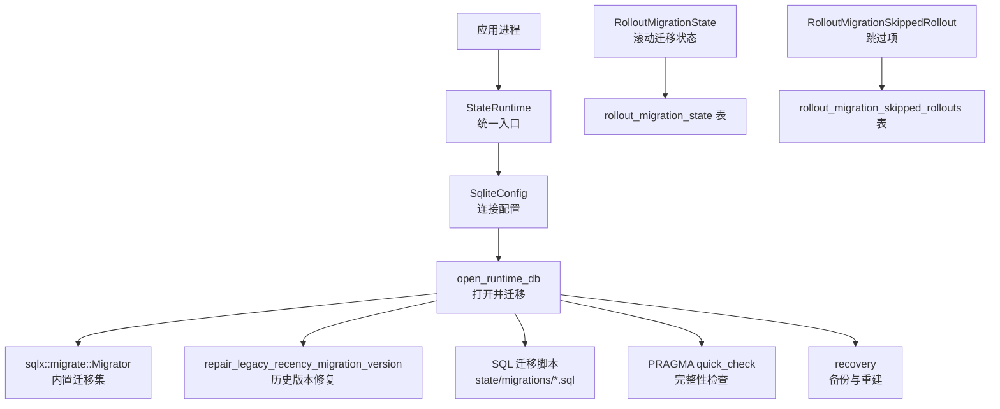
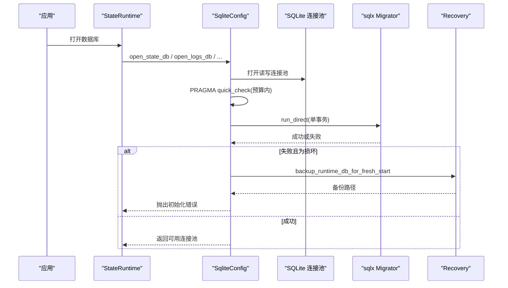
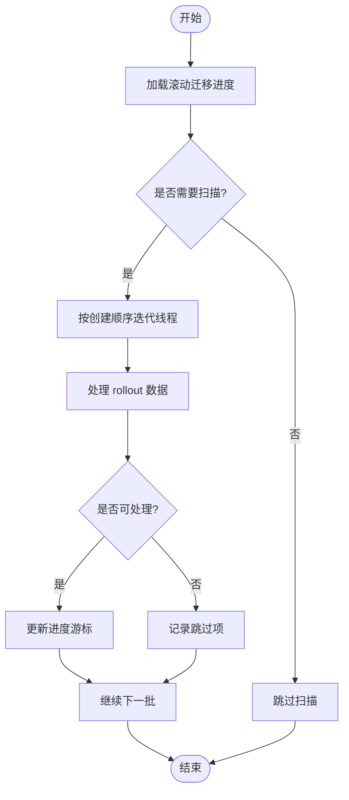
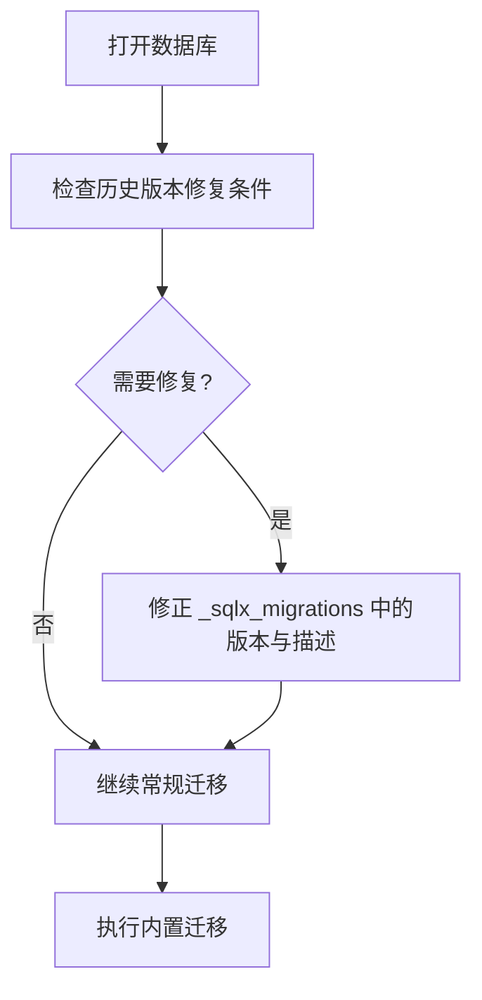
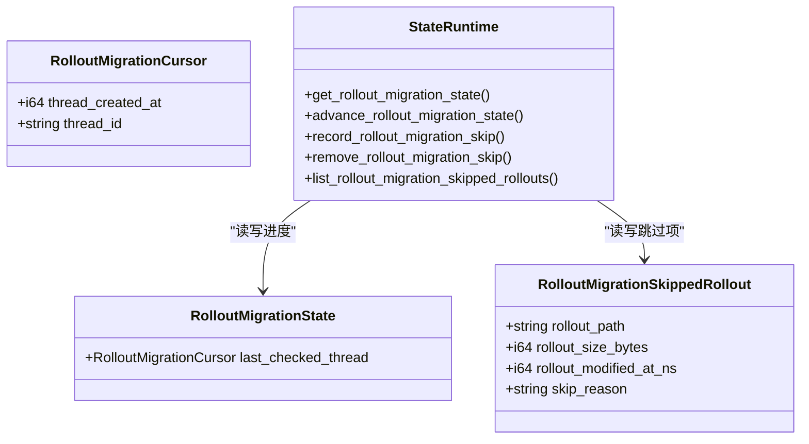
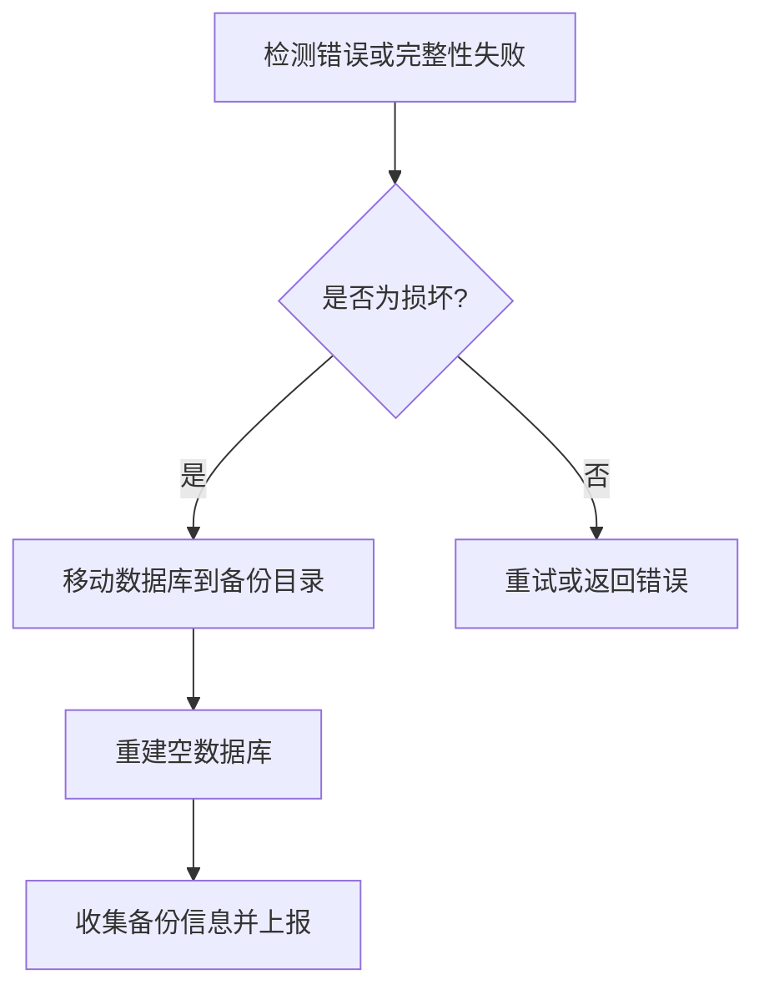
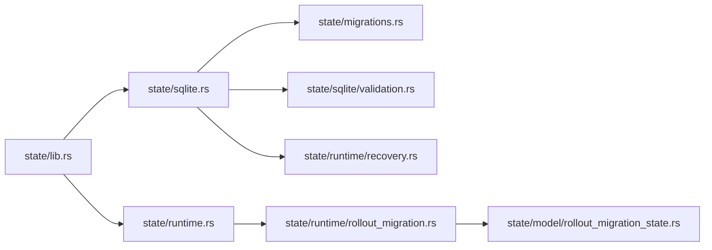

# 数据迁移

<cite>
**本文引用的文件**   
- [migrations.rs](file://codex-rs/state/src/migrations.rs)
- [sqlite.rs](file://codex-rs/state/src/sqlite.rs)
- [lib.rs](file://codex-rs/state/src/lib.rs)
- [rollout_migration.rs](file://codex-rs/state/src/runtime/rollout_migration.rs)
- [rollout_migration_state.rs](file://codex-rs/state/src/model/rollout_migration_state.rs)
- [validation.rs](file://codex-rs/state/src/sqlite/validation.rs)
- [recovery.rs](file://codex-rs/state/src/runtime/recovery.rs)
- [0047_rollout_migration_state.sql](file://codex-rs/state/migrations/0047_rollout_migration_state.sql)
- [migrations_tests.rs](file://codex-rs/state/src/migrations_tests.rs)
</cite>

## 目录
1. [引言](#引言)
2. [项目结构](#项目结构)
3. [核心组件](#核心组件)
4. [架构总览](#架构总览)
5. [详细组件分析](#详细组件分析)
6. [依赖关系分析](#依赖关系分析)
7. [性能与并发特性](#性能与并发特性)
8. [故障恢复与回滚策略](#故障恢复与回滚策略)
9. [迁移测试与验证最佳实践](#迁移测试与验证最佳实践)
10. [结论](#结论)

## 引言
本仓库的数据迁移系统围绕 SQLite 数据库版本控制、多库迁移编排、滚动迁移进度追踪，以及向后兼容和向前兼容的混合策略展开。其目标是：
- 为多个独立 SQLite 文件提供一致的版本管理和迁移执行流程；
- 允许旧二进制打开由新版本升级过的数据库，同时保证校验完整性；
- 在长耗时扫描类“滚动迁移”中维护可恢复的进度与跳过记录；
- 在启动阶段进行轻量完整性检查，并在发现损坏时实现单库级备份重建；
- 通过事务化迁移和重试机制，降低并发竞争和锁冲突的影响。

## 项目结构
状态持久层位于 `codex-rs/state` 模块，主要涉及：
- SQL 迁移脚本目录：`state/migrations`，按版本号命名，如 `0001_threads.sql`、`0047_rollout_migration_state.sql` 等；
- 迁移注册器：`state/src/migrations.rs`，集中声明各数据库的内置迁移集；
- 运行时连接与迁移编排：`state/src/sqlite.rs`，负责连接池、NFS 策略、初始化、迁移执行与错误封装；
- 滚动迁移状态模型：`state/src/model/rollout_migration_state.rs`，定义迁移游标与跳过项；
- 滚动迁移持久化接口：`state/src/runtime/rollout_migration.rs`，提供进度推进、跳过记录与查询；
- 完整性检查：`state/src/sqlite/validation.rs`，使用 PRAGMA quick_check 进行预算内检测；
- 故障恢复：`state/src/runtime/recovery.rs`，实现单库备份、重建路径与错误分类；
- 公开能力与常量：`state/src/lib.rs`，导出运行时入口、指标常量、最大容量限制等。

**图表来源**
- [sqlite.rs:300-460](file://codex-rs/state/src/sqlite.rs#L300-L460)
- [migrations.rs:1-59](file://codex-rs/state/src/migrations.rs#L1-L59)
- [validation.rs:1-80](file://codex-rs/state/src/sqlite/validation.rs#L1-L80)
- [recovery.rs:1-200](file://codex-rs/state/src/runtime/recovery.rs#L1-L200)
- [0047_rollout_migration_state.sql:1-16](file://codex-rs/state/migrations/0047_rollout_migration_state.sql#L1-L16)

**章节来源**
- [lib.rs:1-173](file://codex-rs/state/src/lib.rs#L1-L173)
- [sqlite.rs:1-200](file://codex-rs/state/src/sqlite.rs#L1-L200)
- [migrations.rs:1-123](file://codex-rs/state/src/migrations.rs#L1-L123)

## 核心组件
- 迁移注册器：集中声明 state、logs、goals、memories、queue、thread_history 六个数据库的内置迁移集合，并提供运行时适配版本。
- 运行时数据库管理器：负责根据标签选择文件名、决定 WAL 或 DELETE 日志模式、处理 NFS 环境、执行迁移、度量初始化耗时。
- 滚动迁移状态：以“创建时间+线程 ID”作为单调游标，记录每个滚动迁移的检查边界；另有一张表记录被跳过的 rollout 元数据，用于增量重试。
- 完整性检查：对每个进程内同一路径只执行一次 quick_check，返回完成、未完成、损坏需修复、已跳过四种结果。
- 故障恢复：将单个损坏数据库移动到带唯一名的备份目录，保留其他运行库不变，并暴露错误分类工具函数。

**章节来源**
- [migrations.rs:1-59](file://codex-rs/state/src/migrations.rs#L1-L59)
- [sqlite.rs:1-200](file://codex-rs/state/src/sqlite.rs#L1-L200)
- [rollout_migration_state.rs:1-67](file://codex-rs/state/src/model/rollout_migration_state.rs#L1-L67)
- [validation.rs:1-80](file://codex-rs/state/src/sqlite/validation.rs#L1-L80)
- [recovery.rs:1-200](file://codex-rs/state/src/runtime/recovery.rs#L1-L200)

## 架构总览
整体迁移流程从 `StateRuntime` 或上层调用方开始，经 `SqliteConfig` 打开连接池，再进入 `open_runtime_db` 的统一迁移流程。该流程包含：
- 可选的历史版本修复；
- 单次事务内的迁移执行；
- 迁移失败时的连接关闭与错误封装；
- 针对损坏错误的路径分类与备份重建。

**图表来源**
- [sqlite.rs:300-460](file://codex-rs/state/src/sqlite.rs#L300-L460)
- [recovery.rs:1-200](file://codex-rs/state/src/runtime/recovery.rs#L1-L200)

## 详细组件分析

### 数据库版本控制与迁移脚本管理
- 迁移脚本以 `NNNN_name.sql` 形式存放在对应目录，例如 `state/migrations`、`state/logs_migrations`、`state/goals_migrations`、`state/memory_migrations`、`state/queue_migrations`、`state/thread_history_migrations`。
- `STATE_MIGRATOR`、`LOGS_MIGRATOR`、`GOALS_MIGRATOR`、`MEMORIES_MIGRATOR`、`QUEUE_MIGRATOR`、`THREAD_HISTORY_MIGRATOR` 分别绑定到这些目录。
- 运行时通过 `runtime_*_migrator` 包装基础 `Migrator`，启用 `ignore_missing`，从而允许旧二进制打开已由新版本升级过的数据库。
- 所有迁移通过 `run_direct` 在单个事务中执行，并使用 `retry_on_busy` 重试 SQLite_BUSY 场景，避免并发启动导致的锁竞争。

向后兼容性与向前兼容性：
- 向前兼容：旧二进制能打开新数据库，因为运行时 migrator 忽略未知更高版本，但仍会校验已存在迁移的 checksum。
- 向后兼容：新增字段通常采用默认值或可选字段；历史版本修复逻辑可修正遗留版本标记，使旧代码继续工作。

示例：滚动迁移状态表由 `0047_rollout_migration_state.sql` 创建，提供迁移进度与跳过记录的持久化基座。

**章节来源**
- [migrations.rs:1-59](file://codex-rs/state/src/migrations.rs#L1-L59)
- [sqlite.rs:300-460](file://codex-rs/state/src/sqlite.rs#L300-L460)
- [0047_rollout_migration_state.sql:1-16](file://codex-rs/state/migrations/0047_rollout_migration_state.sql#L1-L16)

### 滚动迁移 Rollout Migration 实现原理
滚动迁移用于扫描大量 rollout 数据（例如 JSONL 文件）并将元数据抽取到 SQLite。为避免每次启动都重复扫描，系统在状态库中维护：
- 单调游标：`last_checked_thread_created_at` 与 `last_checked_thread_id`，表示“该时间点之前及该线程之前的全部条目均已检查”。
- 跳过项：对无法处理的 rollout 记录路径、大小、修改时间戳、跳过原因，以便后续变化后重试。

关键行为：
- `get_rollout_migration_state` 读取某 migration_id 的当前进度；
- `advance_rollout_migration_state` 使用 UPSERT 与比较条件确保进度不会因并发而倒退；
- `record_rollout_migration_skip` 与 `remove_rollout_migration_skip` 支持增量重试；
- `list_rollout_migration_skipped_rollouts` 供上层决定是否重新尝试。

**图表来源**
- [rollout_migration.rs:1-150](file://codex-rs/state/src/runtime/rollout_migration.rs#L1-L150)
- [rollout_migration_state.rs:1-67](file://codex-rs/state/src/model/rollout_migration_state.rs#L1-L67)

**章节来源**
- [rollout_migration.rs:1-150](file://codex-rs/state/src/runtime/rollout_migration.rs#L1-L150)
- [rollout_migration_state.rs:1-67](file://codex-rs/state/src/model/rollout_migration_state.rs#L1-L67)
- [0047_rollout_migration_state.sql:1-16](file://codex-rs/state/migrations/0047_rollout_migration_state.sql#L1-L16)

### 向后兼容性与向前兼容性策略
- 向前兼容：`runtime_migrator` 将基础 `Migrator` 包装为 `ignore_missing=true`，允许数据库版本高于当前二进制内置迁移版本。
- 历史版本修复：`repair_legacy_recency_migration_version` 在 state 库打开时，检测是否存在旧版 recency 迁移残留，并将其修正为目标版本，以避免后续迁移误判。
- 测试覆盖：`migrations_tests.rs` 中包含通过不同版本构建 `Migrator` 的辅助函数，用以模拟旧二进制场景。

**图表来源**
- [migrations.rs:60-123](file://codex-rs/state/src/migrations.rs#L60-L123)
- [sqlite.rs:410-430](file://codex-rs/state/src/sqlite.rs#L410-L430)

**章节来源**
- [migrations.rs:21-59](file://codex-rs/state/src/migrations.rs#L21-L59)
- [migrations.rs:60-123](file://codex-rs/state/src/migrations.rs#L60-L123)
- [migrations_tests.rs:1-250](file://codex-rs/state/src/migrations_tests.rs#L1-L250)

### 迁移进度跟踪与错误处理
- 进度跟踪：滚动迁移使用 `RolloutMigrationCursor` 与 `RolloutMigrationState`，并以原子 UPSERT 推进进度，防止并发启动导致进度回退。
- 跳过记录：对暂时不可处理的 rollout 写入 `rollout_migration_skipped_rollouts`，包含路径、大小、时间戳、原因；后续可通过删除或变更触发重试。
- 错误处理：
  - 迁移失败时关闭连接并返回封装后的 `RuntimeDbInitError`；
  - 完整性检查失败时返回 `CorruptedNeedsFixed`，配合 recovery 模块移动文件并重建；
  - 提供 `is_sqlite_corruption_error`、`sqlite_error_detail_is_lock` 等判断函数。

**图表来源**
- [rollout_migration_state.rs:1-67](file://codex-rs/state/src/model/rollout_migration_state.rs#L1-L67)
- [rollout_migration.rs:1-150](file://codex-rs/state/src/runtime/rollout_migration.rs#L1-L150)

**章节来源**
- [rollout_migration_state.rs:1-67](file://codex-rs/state/src/model/rollout_migration_state.rs#L1-L67)
- [rollout_migration.rs:1-150](file://codex-rs/state/src/runtime/rollout_migration.rs#L1-L150)
- [sqlite.rs:300-460](file://codex-rs/state/src/sqlite.rs#L300-L460)
- [recovery.rs:1-200](file://codex-rs/state/src/runtime/recovery.rs#L1-L200)

### 回滚与故障恢复机制
- 不直接回滚迁移脚本：系统采用“迁移即追加”的模式，通过事务执行和错误分类控制一致性。
- 单库备份重建：当检测到 SQLite 损坏或非数据库错误时，recovery 模块将目标数据库及其旁路文件移动到 `db-backups` 下的唯一子目录，然后让上层重新创建空库。
- 错误分类：
  - `is_sqlite_corruption_error` 识别数据库损坏、非数据库类型等错误；
  - `runtime_db_path_for_corruption_error` 从错误链中提取具体数据库路径；
  - `sqlite_error_detail_is_lock` 识别锁冲突，便于上层区分可重试与不可重试错误。

**图表来源**
- [recovery.rs:1-200](file://codex-rs/state/src/runtime/recovery.rs#L1-L200)
- [validation.rs:1-80](file://codex-rs/state/src/sqlite/validation.rs#L1-L80)

**章节来源**
- [recovery.rs:1-200](file://codex-rs/state/src/runtime/recovery.rs#L1-L200)
- [validation.rs:1-80](file://codex-rs/state/src/sqlite/validation.rs#L1-L80)

## 依赖关系分析
- `SqliteConfig` 依赖 `migrations` 提供的运行时 migrator；
- `StateRuntime` 依赖 `migrations` 与 `sqlite`，并组合 `recovery` 与 `telemetry`；
- `runtime/rollout_migration.rs` 依赖状态模型与 sqlite 写扩展；
- `sqlite/validation.rs` 与 `sqlite/busy_retry.rs` 支撑初始化与迁移阶段的健壮性；
- 迁移脚本与表结构由 sqlx 在编译期或运行期集成，并通过 `sqlx_macros::migrate!` 注册。

**图表来源**
- [lib.rs:1-173](file://codex-rs/state/src/lib.rs#L1-L173)
- [sqlite.rs:1-200](file://codex-rs/state/src/sqlite.rs#L1-L200)
- [migrations.rs:1-59](file://codex-rs/state/src/migrations.rs#L1-L59)
- [rollout_migration.rs:1-150](file://codex-rs/state/src/runtime/rollout_migration.rs#L1-L150)
- [rollout_migration_state.rs:1-67](file://codex-rs/state/src/model/rollout_migration_state.rs#L1-L67)
- [validation.rs:1-80](file://codex-rs/state/src/sqlite/validation.rs#L1-L80)
- [recovery.rs:1-200](file://codex-rs/state/src/runtime/recovery.rs#L1-L200)

**章节来源**
- [lib.rs:1-173](file://codex-rs/state/src/lib.rs#L1-L173)
- [sqlite.rs:1-200](file://codex-rs/state/src/sqlite.rs#L1-L200)
- [migrations.rs:1-59](file://codex-rs/state/src/migrations.rs#L1-L59)
- [rollout_migration.rs:1-150](file://codex-rs/state/src/runtime/rollout_migration.rs#L1-L150)

## 性能与并发特性
- 迁移事务化：所有迁移在一个事务内执行，减少部分提交开销并简化失败回滚。
- 并发安全：使用 `retry_on_busy` 重试 SQLITE_BUSY，避免多实例启动竞争。
- 快速完整性检查：quick_check 设置进度处理器，按操作数回调超时，避免长时间阻塞。
- 滚动迁移优化：通过游标与跳过表避免全量重扫；仅当文件或时间戳变化时才重新处理。

[本节为通用性能讨论，不直接分析特定文件]

## 故障恢复与回滚策略
- 启动阶段：
  - 先 quick_check，若损坏则分类为 `CorruptedNeedsFixed`；
  - 迁移失败时关闭连接并返回 `RuntimeDbInitError`，上层可根据错误类型决定备份重建。
- 恢复流程：
  - 将目标数据库移动到 `db-backups` 的唯一目录；
  - 如果 sqlite_home 不存在则创建；
  - 返回原始路径与备份路径，供上层通知用户或归档。
- 回滚策略：
  - 不支持对历史迁移脚本的自动回滚；
  - 推荐通过新增迁移修复问题，或使用备份重建获得干净状态。

**章节来源**
- [sqlite.rs:300-460](file://codex-rs/state/src/sqlite.rs#L300-L460)
- [recovery.rs:1-200](file://codex-rs/state/src/runtime/recovery.rs#L1-L200)
- [validation.rs:1-80](file://codex-rs/state/src/sqlite/validation.rs#L1-L80)

## 迁移测试与验证最佳实践
- 使用 `migrator_through(version)` 构造截断迁移集，模拟旧二进制行为，验证向前兼容；
- 对历史版本修复逻辑编写单元测试，确保 `_sqlx_migrations` 表中的版本与描述能被正确修正；
- 在测试中插入旧格式数据，验证清理与迁移后字段语义保持不变；
- 对滚动迁移进度与跳过项进行端到端验证，包括并发推进、跳过重试、游标不回退；
- 对完整性检查与恢复路径使用 mock 或临时目录，确认损坏错误分类与备份路径生成正确。

**章节来源**
- [migrations_tests.rs:1-250](file://codex-rs/state/src/migrations_tests.rs#L1-L250)
- [migrations.rs:60-123](file://codex-rs/state/src/migrations.rs#L60-L123)
- [rollout_migration.rs:1-150](file://codex-rs/state/src/runtime/rollout_migration.rs#L1-L150)

## 结论
该数据迁移系统通过多库迁移注册、运行时兼容包装、事务化迁移与重试、滚动迁移进度追踪、快速完整性检查与单库备份重建，构建了稳健的版本控制与滚动数据处理框架。其设计强调：
- 向前兼容：旧二进制可安全打开新版数据库；
- 渐进演进：滚动迁移具备可中断、可恢复、可重试的特性；
- 故障隔离：单个数据库损坏不影响其他运行库；
- 可观测性：初始化与迁移阶段均埋点统计，便于定位问题。

对于新增迁移，建议遵循：
- 保持向后兼容：新增字段可选或有默认值；
- 使用事务化迁移，避免部分失败；
- 为长耗时任务提供滚动迁移进度与跳过记录；
- 补充测试覆盖旧版本、并发与恢复路径。

[本节为总结性内容，不直接分析特定文件]