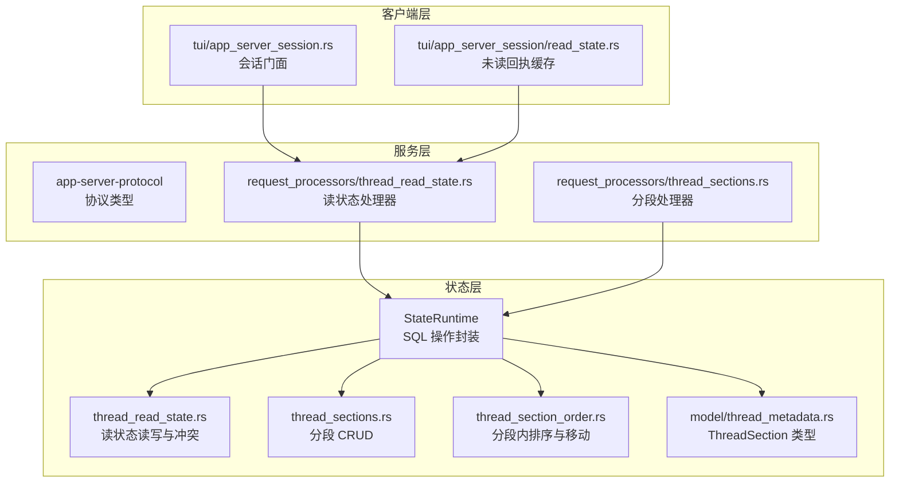
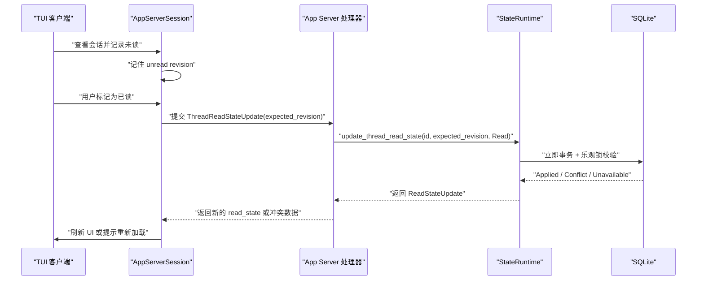
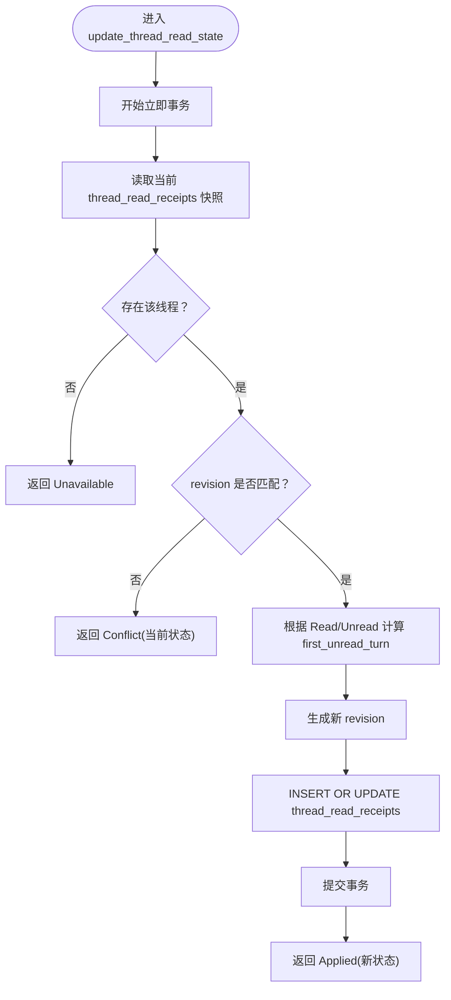
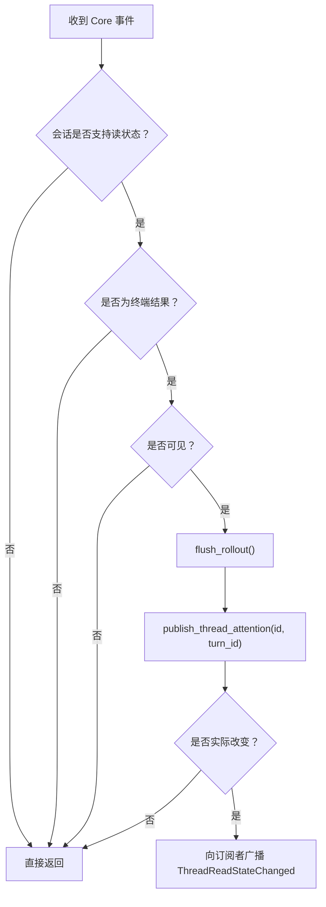
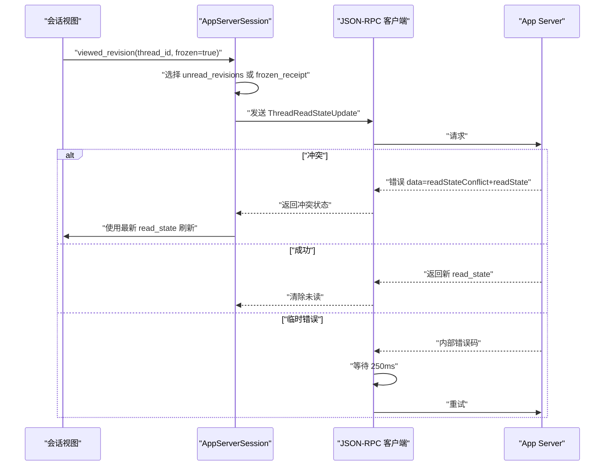
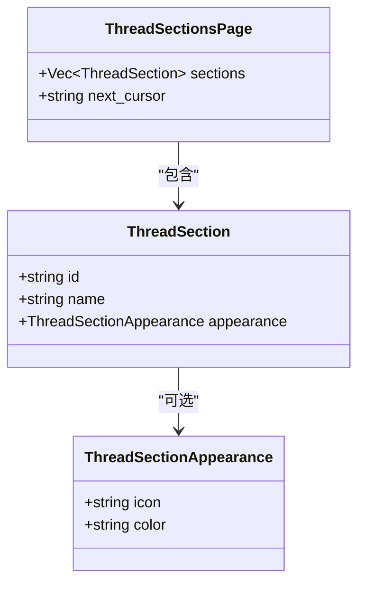
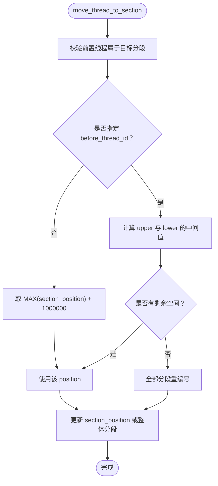
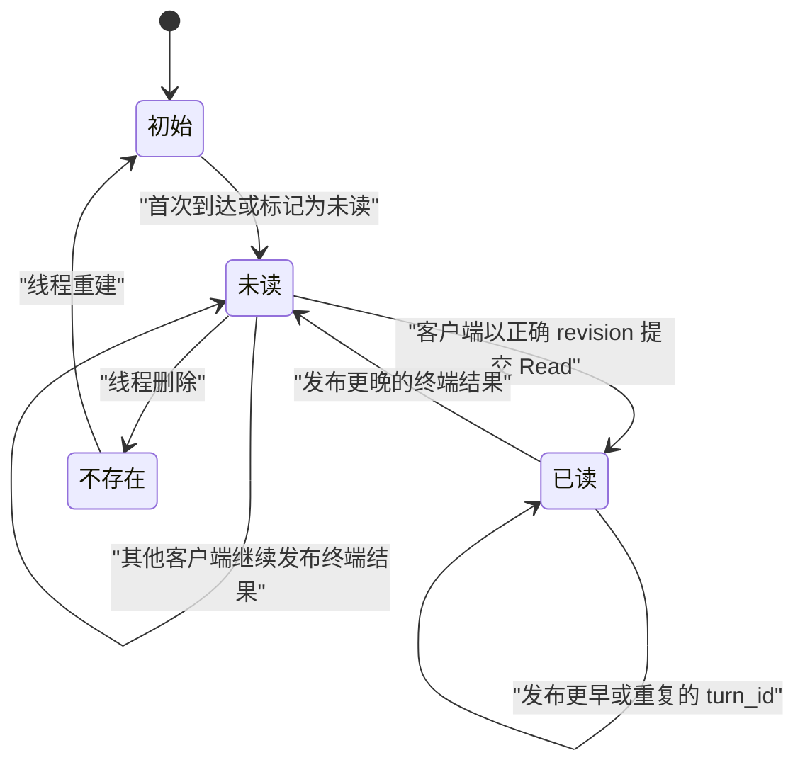
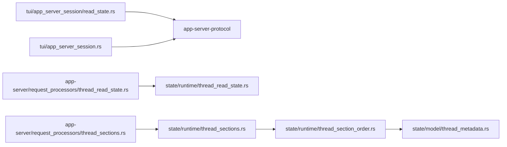

# 会话状态管理

<cite>
**本文引用的文件**   
- [codex-rs/state/src/runtime/thread_read_state.rs](file://codex-rs/state/src/runtime/thread_read_state.rs)
- [codex-rs/state/src/runtime/thread_section_order.rs](file://codex-rs/state/src/runtime/thread_section_order.rs)
- [codex-rs/state/src/runtime/thread_sections.rs](file://codex-rs/state/src/runtime/thread_sections.rs)
- [codex-rs/state/src/model/thread_metadata.rs](file://codex-rs/state/src/model/thread_metadata.rs)
- [codex-rs/state/src/lib.rs](file://codex-rs/state/src/lib.rs)
- [codex-rs/state/src/runtime.rs](file://codex-rs/state/src/runtime.rs)
- [codex-rs/app-server/src/request_processors/thread_read_state.rs](file://codex-rs/app-server/src/request_processors/thread_read_state.rs)
- [codex-rs/app-server/src/request_processors/thread_sections.rs](file://codex-rs/app-server/src/request_processors/thread_sections.rs)
- [codex-rs/tui/src/app_server_session/read_state.rs](file://codex-rs/tui/src/app_server_session/read_state.rs)
- [codex-rs/tui/src/app_server_session.rs](file://codex-rs/tui/src/app_server_session.rs)
- [codex-rs/state/src/runtime/thread_read_state_tests.rs](file://codex-rs/state/src/runtime/thread_read_state_tests.rs)
</cite>

## 目录
1. [引言](#引言)
2. [项目结构](#项目结构)
3. [核心组件](#核心组件)
4. [架构总览](#架构总览)
5. [详细组件分析](#详细组件分析)
6. [依赖关系分析](#依赖关系分析)
7. [性能考虑](#性能考虑)
8. [故障排查指南](#故障排查指南)
9. [结论](#结论)

## 引言
本文聚焦 Codex 后端与客户端中的“会话状态管理系统”，围绕以下目标展开：
- 解释 `ThreadReadState` 的设计模式、不可变快照、版本冲突与幂等更新机制。
- 说明会话分段 `ThreadSections` 的持久化模型、创建/重命名/删除以及线程在分段内的排序算法。
- 描述会话顺序管理的空间留白、重编号和跨会话导航逻辑。
- 解释会话历史的实时注意力通知与增量读状态同步。
- 给出一致性保证、冲突解决策略，以及面向生产环境的分析与调优建议。

本系统由三层组成：
- 状态层（`state`）：SQLite 持久化、事务、并发控制、分页与元数据。
- 服务层（`app-server`）：协议转换、权限过滤、订阅广播、错误映射。
- 客户端层（`tui`）：视图内未读状态缓存、冻结回执、重试与冲突恢复。

## 项目结构
会话状态相关代码主要分布在三个模块中：

**图表来源**
- [codex-rs/state/src/runtime.rs:100-170](file://codex-rs/state/src/runtime.rs#L100-L170)
- [codex-rs/state/src/runtime/thread_read_state.rs:1-146](file://codex-rs/state/src/runtime/thread_read_state.rs#L1-L146)
- [codex-rs/state/src/runtime/thread_sections.rs:1-95](file://codex-rs/state/src/runtime/thread_sections.rs#L1-L95)
- [codex-rs/state/src/runtime/thread_section_order.rs:1-200](file://codex-rs/state/src/runtime/thread_section_order.rs#L1-L200)
- [codex-rs/state/src/model/thread_metadata.rs:1-120](file://codex-rs/state/src/model/thread_metadata.rs#L1-L120)
- [codex-rs/app-server/src/request_processors/thread_read_state.rs:1-200](file://codex-rs/app-server/src/request_processors/thread_read_state.rs#L1-L200)
- [codex-rs/app-server/src/request_processors/thread_sections.rs:1-200](file://codex-rs/app-server/src/request_processors/thread_sections.rs#L1-L200)
- [codex-rs/tui/src/app_server_session/read_state.rs:1-87](file://codex-rs/tui/src/app_server_session/read_state.rs#L1-L87)

**章节来源**
- [codex-rs/state/src/runtime.rs:100-170](file://codex-rs/state/src/runtime.rs#L100-L170)
- [codex-rs/state/src/lib.rs:1-173](file://codex-rs/state/src/lib.rs#L1-L173)

## 核心组件
本节从数据结构与职责角度梳理关键对象。

| 组件 | 职责 | 关键属性或行为 | 复杂度特征 |
|---|---|---|---|
| `ThreadReadState` | 表示单个本地线程的持久化“未读起点” | `first_unread_turn`：空字符串表示整段会话未读；`revision`：每次变更生成新 UUID 作为快照版本 | 读取 O(1)；写入通过行级锁与版本号比较避免脏写 |
| `ReadStateOperation` | 声明读状态变更意图 | `Read`、`Unread` | 常量枚举，无额外开销 |
| `ReadStateUpdate` | 表达服务端对读状态更新的语义结果 | `Applied`、`Conflict`、`Unavailable` | 将乐观锁失败与资源不存在区分到调用方 |
| `ThreadSection` | 独立于名称的稳定分段标识 | `id`（UUIDv7）、`name`、`appearance` | 分页查询按 id 稳定排序 |
| `ThreadSectionsPage` | 分段分页结果 | `sections`、`next_cursor` | 游标基于最大 id，O(log n) 扫描 |
| `StateRuntime` | SQLite 连接池、迁移、指标与所有运行时方法入口 | 持有多个数据库池并暴露批量查询、事务 API | 初始化成本较高，但后续 IO 复用连接池 |

**章节来源**
- [codex-rs/state/src/runtime/thread_read_state.rs:16-48](file://codex-rs/state/src/runtime/thread_read_state.rs#L16-L48)
- [codex-rs/state/src/model/thread_metadata.rs:60-120](file://codex-rs/state/src/model/thread_metadata.rs#L60-L120)
- [codex-rs/state/src/lib.rs:1-173](file://codex-rs/state/src/lib.rs#L1-L173)

## 架构总览
会话状态管理采用“协议—处理器—状态层”的分层设计：

**图表来源**
- [codex-rs/tui/src/app_server_session/read_state.rs:18-87](file://codex-rs/tui/src/app_server_session/read_state.rs#L18-L87)
- [codex-rs/app-server/src/request_processors/thread_read_state.rs:130-205](file://codex-rs/app-server/src/request_processors/thread_read_state.rs#L130-L205)
- [codex-rs/state/src/runtime/thread_read_state.rs:70-119](file://codex-rs/state/src/runtime/thread_read_state.rs#L70-L119)

## 详细组件分析

### 读状态 `ThreadReadState` 的设计模式
`ThreadReadState` 是“每个线程一个持久化未读位置”的最小可验证状态单元。其设计重点有三点：

1. **不可变快照 + 版本号**  
   每次有效读状态更新都会生成新的 `revision`。客户端必须携带观察到的 `expected_revision` 提交变更，服务器仅在版本一致时应用，否则返回 `Conflict`。这避免了多窗口、多设备之间的覆盖式写入。

2. **三种更新语义**  
   - `Applied`：成功应用，返回最新状态。
   - `Conflict`：客户端看到的快照已过期，应使用返回的最新状态重新计算。
   - `Unavailable`：线程不存在或当前上下文不支持读状态。

3. **首条未读条目编码**  
   - `None`：表示已读。
   - `Some("")`：表示整段会话未读，即使没有对话轮次。
   - `Some(turn_id)`：表示指定轮次为第一条未读。

**图表来源**
- [codex-rs/state/src/runtime/thread_read_state.rs:70-119](file://codex-rs/state/src/runtime/thread_read_state.rs#L70-L119)

**章节来源**
- [codex-rs/state/src/runtime/thread_read_state.rs:1-146](file://codex-rs/state/src/runtime/thread_read_state.rs#L1-L146)
- [codex-rs/state/src/runtime/thread_read_state_tests.rs:1-167](file://codex-rs/state/src/runtime/thread_read_state_tests.rs#L1-L167)

### 实时注意力发布与增量同步
服务器不会对所有事件都推送未读提醒。只有“终端结果”才可能触发注意力发布，且需满足以下条件：

- 会话不是临时的。
- 会话来源不是子代理或未知来源。
- 线程来源为用户或默认值。
- 最后消息不为空，或未明确排除通知。
- 活跃目标未完成时不视为终端结果。
- 必须先持久化 rollout，再写入 `last_published_turn`。

**图表来源**
- [codex-rs/app-server/src/request_processors/thread_read_state.rs:44-129](file://codex-rs/app-server/src/request_processors/thread_read_state.rs#L44-L129)

关键点：
- `publish_thread_attention` 使用 `ON CONFLICT` 与 `last_published_turn` 字段去重：同一轮次不会重复提升未读位置。
- 如果新轮次的 `turn_id` 比已有未读更早，也不会后退未读起点。
- 客户端收到通知后刷新列表，而不是反复轮询。

**章节来源**
- [codex-rs/app-server/src/request_processors/thread_read_state.rs:1-205](file://codex-rs/app-server/src/request_processors/thread_read_state.rs#L1-L205)
- [codex-rs/state/src/runtime/thread_read_state.rs:49-69](file://codex-rs/state/src/runtime/thread_read_state.rs#L49-L69)

### 客户端未读回执与冲突恢复
TUI 侧维护三类状态：

| 字段 | 含义 | 生命周期 |
|---|---|---|
| `unread_revisions` | 每个线程当前的未读快照版本 | 会话期间保留 |
| `frozen_receipt` | 冻结的已尝试回执 | 单视图访问周期 |
| `attempted_revision` | 最近一次发送的回执版本 | 防止重复提交 |

客户端流程：
1. 从服务端列表或通知中获取 `ThreadReadState`。
2. 若存在未读，则保存其 `revision`。
3. 用户点击“查看”时，先冻结当前未读回执。
4. 提交 `ThreadReadStateUpdate`，带上 `expected_revision`。
5. 若服务端返回冲突，客户端用返回的最新 `read_state` 重新渲染。
6. 若网络错误码表明服务端内部错误，短暂等待并重试一次。

**图表来源**
- [codex-rs/tui/src/app_server_session/read_state.rs:18-87](file://codex-rs/tui/src/app_server_session/read_state.rs#L18-L87)

**章节来源**
- [codex-rs/tui/src/app_server_session/read_state.rs:1-87](file://codex-rs/tui/src/app_server_session/read_state.rs#L1-L87)
- [codex-rs/tui/src/app_server_session.rs:1-120](file://codex-rs/tui/src/app_server_session.rs#L1-L120)

### 会话分段 `ThreadSections` 的组织结构
分段是独立于线程存在的实体，用于组织会话列表：

| 操作 | 约束 | 副作用 |
|---|---|---|
| 创建分段 | 名称非空 | 分配 UUIDv7 的 `id` |
| 重命名分段 | 不能修改内置“置顶”分段 | 可选替换外观样式 |
| 删除分段 | 不能删除内置“置顶”分段 | 将被删除分段中的线程移出分段 |
| 移动线程 | 必须在目标分段中存在前置线程 | 更新 `section_position`、`section_entered_at_ms` |

分段外观 `ThreadSectionAppearance` 包含可选图标与颜色，用于前端展示。

**图表来源**
- [codex-rs/state/src/model/thread_metadata.rs:60-120](file://codex-rs/state/src/model/thread_metadata.rs#L60-L120)

**章节来源**
- [codex-rs/state/src/runtime/thread_sections.rs:1-95](file://codex-rs/state/src/runtime/thread_sections.rs#L1-L95)
- [codex-rs/state/src/model/thread_metadata.rs:60-120](file://codex-rs/state/src/model/thread_metadata.rs#L60-L120)
- [codex-rs/app-server/src/request_processors/thread_sections.rs:1-200](file://codex-rs/app-server/src/request_processors/thread_sections.rs#L1-L200)

### 会话顺序管理与分段内排序算法
分段内排序采用“整数位置 + 大间隙”的策略：

- 初始位置间隔 `SECTION_POSITION_GAP = 1_000_000`。
- 插入到末尾时取最大值加间隔。
- 插入到某线程之前时，在该线程与前一个线程之间取中间值。
- 当空间不足时，对整个分段执行 `ROW_NUMBER()` 重编号。

**图表来源**
- [codex-rs/state/src/runtime/thread_section_order.rs:120-285](file://codex-rs/state/src/runtime/thread_section_order.rs#L120-L285)

性能要点：
- 普通移动为 O(1) SQL 查询。
- 重编号是一次性全部分段更新，时间复杂度近似 O(n)，但在频繁编辑后自动恢复足够间距。
- 游标分页按 `id` 升序，适合稳定遍历分段集合。

**章节来源**
- [codex-rs/state/src/runtime/thread_section_order.rs:1-285](file://codex-rs/state/src/runtime/thread_section_order.rs#L1-L285)

### 会话历史与读状态的一致性
读状态与可重建元数据解耦：

- 读状态只关心“某个线程是否存在一条有效的未读记录”。
- 即使元数据被回滚或重建，只要 `thread_read_receipts` 仍然存在，未读位置就保持。
- 如果线程被删除后重建，客户端需要再次确认未读位置仍有效。
- 测试覆盖了“旧读状态无法擦除后续完成结果”“重放不会重复投递”“删除后恢复仍保持一致”等边界场景。

**图表来源**
- [codex-rs/state/src/runtime/thread_read_state_tests.rs:20-167](file://codex-rs/state/src/runtime/thread_read_state_tests.rs#L20-L167)

**章节来源**
- [codex-rs/state/src/runtime/thread_read_state_tests.rs:1-167](file://codex-rs/state/src/runtime/thread_read_state_tests.rs#L1-L167)

## 依赖关系分析

**图表来源**
- [codex-rs/tui/src/app_server_session/read_state.rs:1-87](file://codex-rs/tui/src/app_server_session/read_state.rs#L1-L87)
- [codex-rs/app-server/src/request_processors/thread_read_state.rs:1-205](file://codex-rs/app-server/src/request_processors/thread_read_state.rs#L1-L205)
- [codex-rs/app-server/src/request_processors/thread_sections.rs:1-200](file://codex-rs/app-server/src/request_processors/thread_sections.rs#L1-L200)
- [codex-rs/state/src/runtime/thread_sections.rs:1-95](file://codex-rs/state/src/runtime/thread_sections.rs#L1-L95)
- [codex-rs/state/src/runtime/thread_section_order.rs:1-285](file://codex-rs/state/src/runtime/thread_section_order.rs#L1-L285)
- [codex-rs/state/src/model/thread_metadata.rs:60-120](file://codex-rs/state/src/model/thread_metadata.rs#L60-L120)

耦合性评估：
- `state` 模块是纯数据与事务实现，不依赖 UI 或 HTTP 层，耦合度低。
- `app-server` 负责协议适配、权限过滤与通知，是状态层与客户端之间的缓冲层。
- `tui` 仅依赖 JSON-RPC 接口与协议类型，便于替换传输层。

潜在风险：
- 读状态与服务端通知强依赖事件流顺序，若通知丢失，客户端可能延迟感知未读。
- 分段重编号会锁定整个分段的排序列，高频拖拽排序可能产生短时抖动。

## 性能考虑

### 读状态性能
- 批量读取使用每批最多 998 个线程 ID，避免超大 IN 列表。
- 首次读取不会写数据库，只有在真实终端结果发布或客户端显式更新时才写入。
- `publish_thread_attention` 使用 `execute_with_busy_retry`，提高 SQLite 忙锁下的成功率。
- 客户端冲突处理包含有限重试，减少瞬时网络抖动导致的失败。

优化建议：
- 对长列表页面，优先只拉取当前页线程的读状态，避免一次性加载全部会话。
- 对频繁切换但未真正查看的会话，不要立即提交已读回执，可延迟到视图真正聚焦时。

### 分段排序性能
- 正常插入使用整数间隙，无需全表扫描。
- 重编号只在空间耗尽时发生，并且使用窗口函数一次完成。
- 分页使用 `id` 游标，避免偏移量放大带来的性能退化。

优化建议：
- 限制单次拖拽操作的频率，合并多次移动到一次批量更新。
- 对大型分段，避免频繁在中间插入；优先在末尾追加，减少重编号概率。

### 实时通知性能
- 注意力发布前强制 flush rollout，确保客户端看到的数据与通知一致。
- 通知只发送给订阅了该线程的连接，避免广播风暴。
- 对于非用户来源或子代理会话，直接跳过读状态相关逻辑。

优化建议：
- 对高吞吐会话，合并短时间内的多次终端结果通知。
- 对离线恢复场景，优先通过增量事件补齐，而非全量重拉取。

## 故障排查指南

| 现象 | 可能原因 | 排查步骤 | 修复建议 |
|---|---|---|---|
| 已读后又显示未读 | 新版本终端结果发布，或客户端使用了过期的 `expected_revision` | 检查服务端通知是否送达；确认客户端提交的 revision 是否与当前列表一致 | 客户端收到冲突时应使用返回的最新 `read_state` 刷新 |
| 从未出现未读通知 | 会话为临时会话、子代理会话，或最后消息为空/被排除 | 检查会话来源、线程来源、goal 状态与消息内容 | 调整业务规则或使用明确的用户输入作为终端结果 |
| 标记为未读无效 | 客户端传入了旧的 `expected_revision` | 对比当前列表中的 `revision` | 重新拉取会话列表或接收最新通知后重试 |
| 分段移动失败 | 前置线程不在目标分段，或目标分段不存在 | 检查 `before_thread_id` 所在分段与目标分段是否一致 | 先移动前置线程，或重新选择目标分段 |
| 分段排序异常 | 分段内大量插入导致空间耗尽并触发重编号 | 检查是否存在高频拖拽排序 | 降低交互频率，或在批量操作后统一刷新 |
| 删除分段后线程仍在列表中 | 分段删除只清空位置字段，线程本身仍存在 | 确认是“移出分段”而非“删除线程” | 如需删除线程，应调用线程删除接口 |

**章节来源**
- [codex-rs/state/src/runtime/thread_read_state_tests.rs:20-167](file://codex-rs/state/src/runtime/thread_read_state_tests.rs#L20-L167)
- [codex-rs/app-server/src/request_processors/thread_read_state.rs:130-205](file://codex-rs/app-server/src/request_processors/thread_read_state.rs#L130-L205)
- [codex-rs/app-server/src/request_processors/thread_sections.rs:150-236](file://codex-rs/app-server/src/request_processors/thread_sections.rs#L150-L236)

## 结论
会话状态管理系统通过“读状态快照 + 版本号”“分段稳定标识 + 整数位置排序”“服务端终端结果过滤 + 订阅通知”三层机制，实现了可扩展、可回放、可冲突恢复的会话体验。其核心优势在于：

- 读状态与可重建元数据解耦，支持会话回滚与重启后恢复。
- 客户端与服务端共同维护未读快照，避免重复通知与覆盖写入。
- 分段与排序分离，既支持稳定分页，又允许灵活组织会话。
- 通过事务、乐观锁与错误分类，将并发问题收敛到可观测的 `Applied`/`Conflict`/`Unavailable` 语义中。

在生产环境中，建议重点关注通知可靠性、客户端 revision 一致性、分段高频移动的性能，并通过监控与日志追踪 `publish_thread_attention`、`update_thread_read_state` 与分段重编号路径。