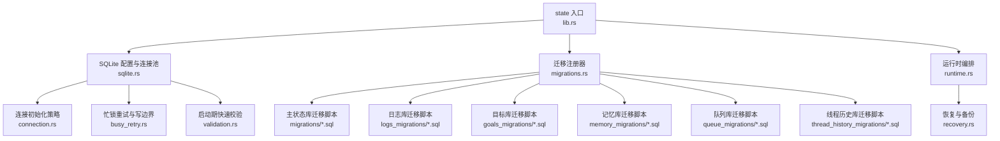
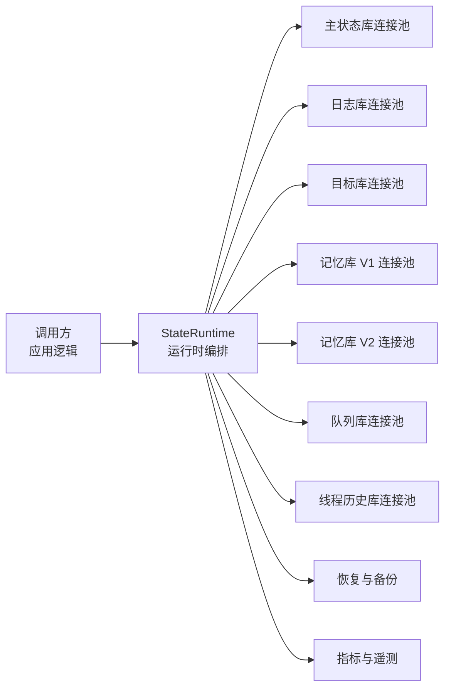
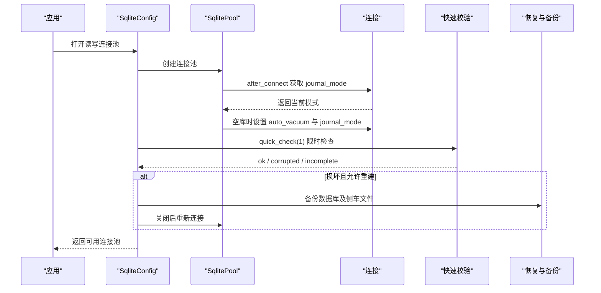
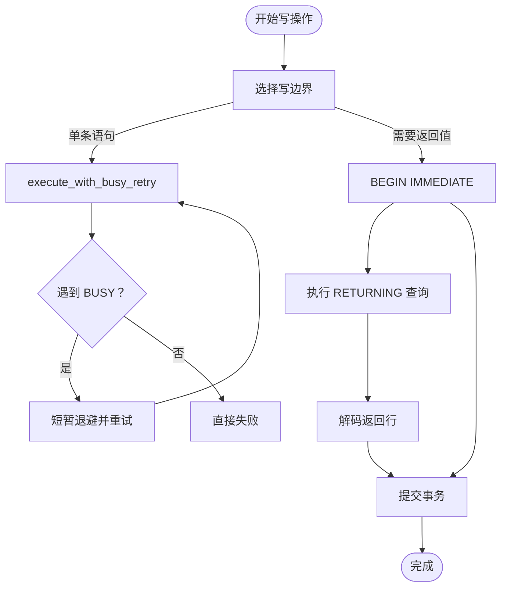
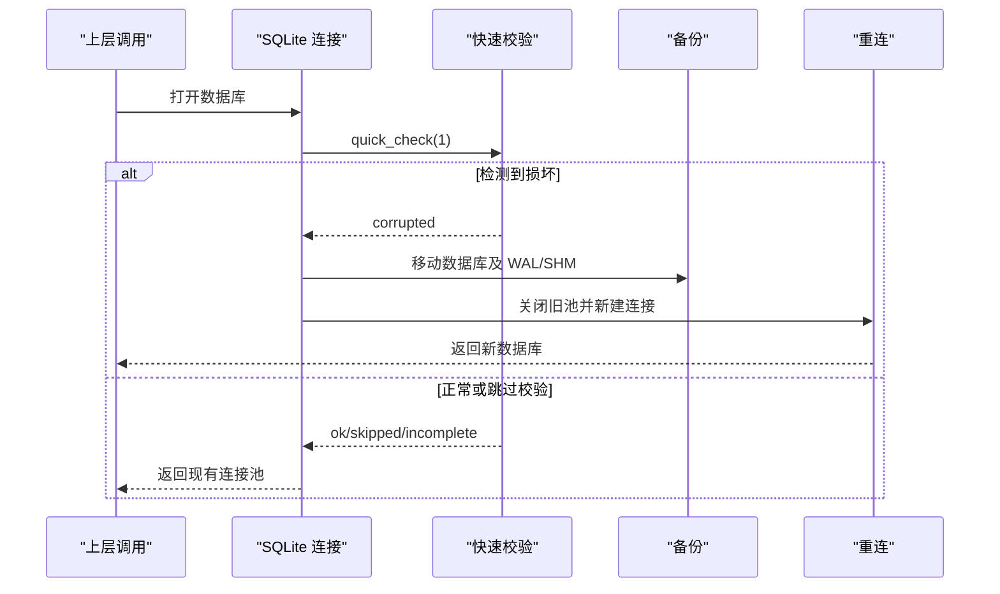
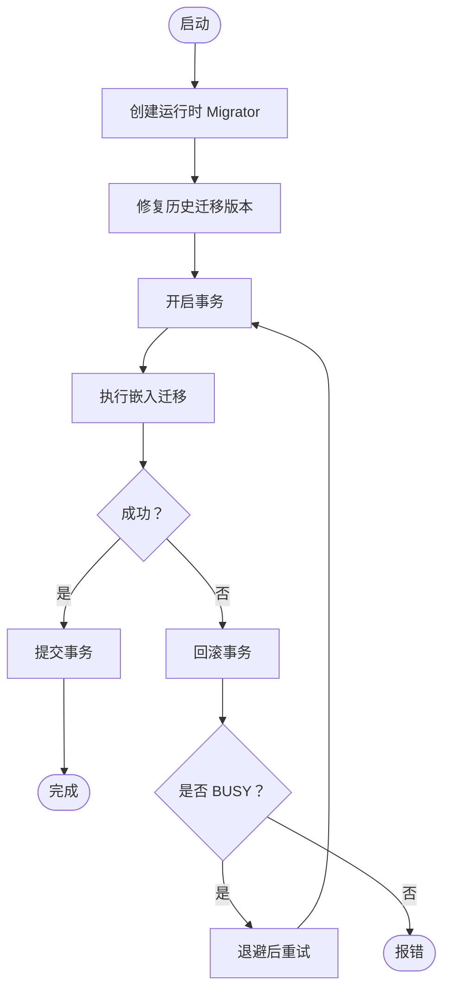
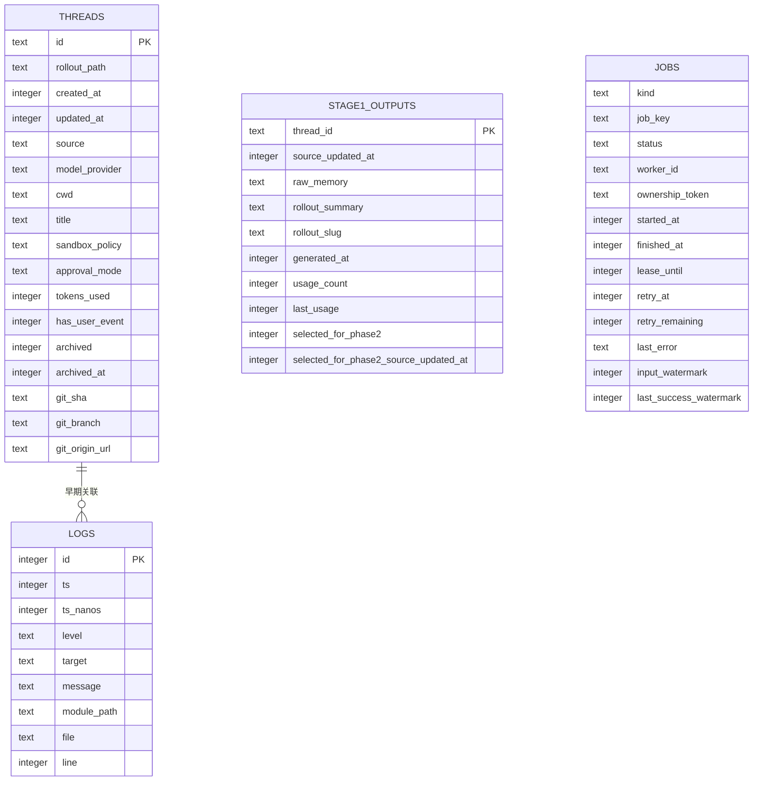
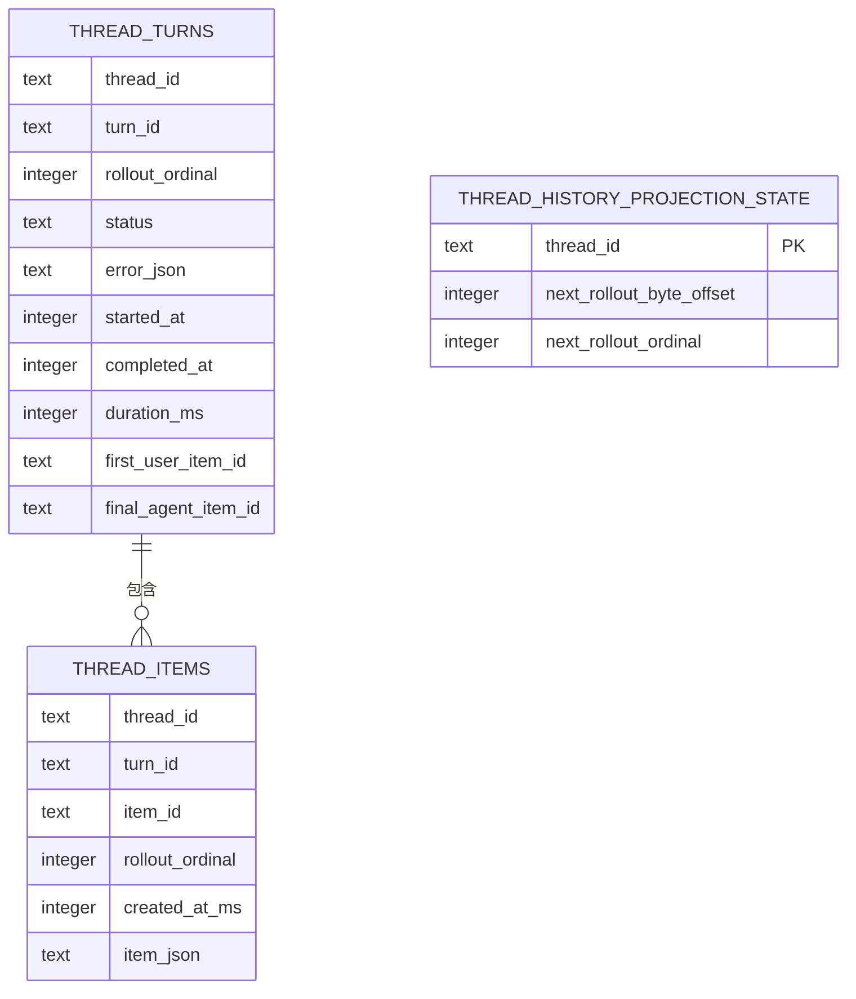
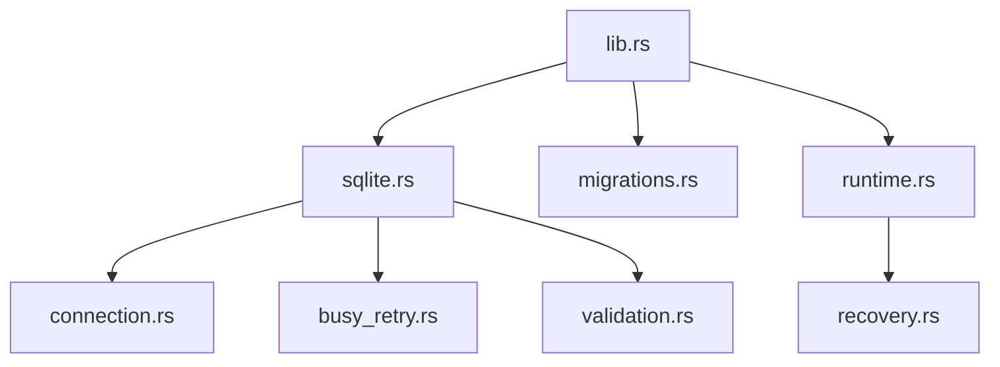

# 状态持久化

<cite>
**本文引用的文件**   
- [lib.rs](file://codex-rs/state/src/lib.rs)
- [sqlite.rs](file://codex-rs/state/src/sqlite.rs)
- [connection.rs](file://codex-rs/state/src/sqlite/connection.rs)
- [busy_retry.rs](file://codex-rs/state/src/sqlite/busy_retry.rs)
- [validation.rs](file://codex-rs/state/src/sqlite/validation.rs)
- [migrations.rs](file://codex-rs/state/src/migrations.rs)
- [runtime.rs](file://codex-rs/state/src/runtime.rs)
- [recovery.rs](file://codex-rs/state/src/runtime/recovery.rs)
- [0001_threads.sql](file://codex-rs/state/migrations/0001_threads.sql)
- [0002_logs.sql](file://codex-rs/state/migrations/0002_logs.sql)
- [0001_logs.sql](file://codex-rs/state/logs_migrations/0001_logs.sql)
- [0001_thread_goals.sql](file://codex-rs/state/goals_migrations/0001_thread_goals.sql)
- [0001_memories.sql](file://codex-rs/state/memory_migrations/0001_memories.sql)
- [0001_queued_items.sql](file://codex-rs/state/queue_migrations/0001_queued_items.sql)
- [0001_thread_history.sql](file://codex-rs/state/thread_history_migrations/0001_thread_history.sql)
</cite>

## 目录
1. [引言](#引言)
2. [项目结构](#项目结构)
3. [核心组件](#核心组件)
4. [架构总览](#架构总览)
5. [详细组件分析](#详细组件分析)
6. [依赖关系分析](#依赖关系分析)
7. [性能与容量规划](#性能与容量规划)
8. [故障诊断与监控](#故障诊断与监控)
9. [结论](#结论)
10. [附录：数据库迁移与兼容性](#附录数据库迁移与兼容性)

## 引言
本文件面向 Codex 的状态持久化子系统，聚焦 `codex-state` crate。该子系统基于 SQLite，负责线程、日志、目标、记忆、队列以及分页线程历史等运行时状态的持久化，同时提供数据库连接管理、迁移、备份恢复、NFS 适配、快速校验、重试和可观测性能力。读者可以据此理解 SQLite 表结构、事务一致性、恢复策略、迁移版本管理、备份还原以及性能优化方法。

## 项目结构
状态持久化代码位于 `codex-rs/state`，采用“配置与运行时入口 + SQL 驱动 + 多库分区”的组织方式：

**图表来源**
- [lib.rs:1-173](file://codex-rs/state/src/lib.rs#L1-L173)
- [sqlite.rs:1-200](file://codex-rs/state/src/sqlite.rs#L1-L200)
- [connection.rs:1-122](file://codex-rs/state/src/sqlite/connection.rs#L1-L122)
- [busy_retry.rs:1-191](file://codex-rs/state/src/sqlite/busy_retry.rs#L1-L191)
- [validation.rs:1-80](file://codex-rs/state/src/sqlite/validation.rs#L1-L80)
- [migrations.rs:1-123](file://codex-rs/state/src/migrations.rs#L1-L123)
- [runtime.rs:1-200](file://codex-rs/state/src/runtime.rs#L1-L200)
- [recovery.rs:1-200](file://codex-rs/state/src/runtime/recovery.rs#L1-L200)

**章节来源**
- [lib.rs:1-173](file://codex-rs/state/src/lib.rs#L1-L173)
- [sqlite.rs:1-200](file://codex-rs/state/src/sqlite.rs#L1-L200)

## 核心组件
- **SQLite 配置与路径**：集中定义所有运行时数据库文件名、位置、NFS 探测、WAL/DELETE 模式选择、日志目录隔离。
- **连接池初始化**：控制 `journal_mode`、`synchronous`、自动清理、空闲连接初始化行为。
- **忙锁重试层**：对 SQLite BUSY 相关错误做有限重试，限定可重试边界，避免重复提交或丢失结果。
- **启动期快速校验**：使用 `PRAGMA quick_check(1)` 在极短预算内检测损坏并触发恢复。
- **迁移系统**：为多个独立 SQLite 文件分别维护迁移集，支持旧二进制打开被新二进制升级过的数据库。
- **运行时编排**：按顺序打开并迁移各库，构建共享的 `StateRuntime`，暴露线程、日志、目标、记忆、队列等存储接口。
- **恢复与备份**：将损坏库及其 WAL/SHM 移动到带时间戳的备份目录，保留其他库数据；支持将整个 SQLite home 作为单个对象备份。
- **可观测性**：记录初始化阶段、回填、日志写入、失败原因等指标。

**章节来源**
- [sqlite.rs:201-613](file://codex-rs/state/src/sqlite.rs#L201-L613)
- [connection.rs:1-122](file://codex-rs/state/src/sqlite/connection.rs#L1-L122)
- [busy_retry.rs:1-191](file://codex-rs/state/src/sqlite/busy_retry.rs#L1-L191)
- [validation.rs:1-80](file://codex-rs/state/src/sqlite/validation.rs#L1-L80)
- [migrations.rs:1-123](file://codex-rs/state/src/migrations.rs#L1-L123)
- [runtime.rs:1-200](file://codex-rs/state/src/runtime.rs#L1-L200)
- [recovery.rs:1-200](file://codex-rs/state/src/runtime/recovery.rs#L1-L200)

## 架构总览
Codex 的状态持久化不是单一数据库，而是按职责拆分的多个 SQLite 文件：

| 数据库 | 文件名 | 主要用途 | 是否可重建 | NFS 默认模式 |
|---|---|---|---|---|
| 主状态库 | `state_5.sqlite` | 线程、项目、回填状态、扩展元数据等 | 是 | 根据 NFS 探测决定 WAL 或 DELETE |
| 日志库 | `logs_2.sqlite` | 高吞吐日志条目，含进程和线程维度索引 | 是 | 允许后台回收，仍受 WAL/DELETE 策略约束 |
| 目标库 | `goals_1.sqlite` | 线程目标、状态、预算与计时 | 是 | WAL 或 DELETE |
| 记忆库 V1 | `memories_1.sqlite` | 阶段一输出、任务调度 | 是 | WAL 或 DELETE |
| 记忆库 V2 | `memories_v2_1.sqlite` | 新版记忆存储（按需懒加载） | 是 | WAL 或 DELETE |
| 队列库 | `queue_1.sqlite` | 用户消息持久化队列 | 是 | WAL 或 DELETE |
| 线程历史库 | `thread_history_1.sqlite` | 分页读取线程回放事件 | 否 | 不可用恢复模式 |

**图表来源**
- [runtime.rs:1-200](file://codex-rs/state/src/runtime.rs#L1-L200)
- [sqlite.rs:1-200](file://codex-rs/state/src/sqlite.rs#L1-L200)
- [recovery.rs:1-200](file://codex-rs/state/src/runtime/recovery.rs#L1-L200)

## 详细组件分析

### SQLite 连接与一致性模型
- 每个运行时数据库由 `SqliteConfig` 统一解析路径，并按目录区分本地日志目录与主状态目录。
- 连接池创建时：
  - 若目录处于 NFS，优先使用 DELETE 模式；非 NFS 则默认使用 WAL。
  - DELETE 模式启用 `EXTRA` 同步级别，以增强目录级落盘语义。
  - WAL 模式使用 `NORMAL` 同步级别，兼顾性能与安全。
  - 空数据库会设置增量自动清理，减少后续碎片。
- 启动期通过 `quick_check(1)` 进行限时完整性检查；若发现损坏且允许重建，则先备份再重新创建。
- 所有写操作应通过 `BEGIN IMMEDIATE` 或专用写辅助函数进入，避免普通事务在竞争下产生不一致。

**图表来源**
- [sqlite.rs:201-613](file://codex-rs/state/src/sqlite.rs#L201-L613)
- [connection.rs:1-122](file://codex-rs/state/src/sqlite/connection.rs#L1-L122)
- [validation.rs:1-80](file://codex-rs/state/src/sqlite/validation.rs#L1-L80)
- [recovery.rs:1-200](file://codex-rs/state/src/runtime/recovery.rs#L1-L200)

**章节来源**
- [sqlite.rs:201-613](file://codex-rs/state/src/sqlite.rs#L201-L613)
- [connection.rs:1-122](file://codex-rs/state/src/sqlite/connection.rs#L1-L122)
- [validation.rs:1-80](file://codex-rs/state/src/sqlite/validation.rs#L1-L80)

### 事务处理与一致性保证
- **迁移事务**：每个数据库的迁移都在一个显式事务中执行；若迁移失败则回滚，并通过忙锁重试机制重新尝试。
- **写边界限制**：`SqliteWriteQueryExt` 只允许对单条预编译语句进行重试，且必须确保返回值解码发生在提交之前，以避免重复提交。
- **立即事务**：`begin_immediate()` 在获得写锁后再执行业务语句，降低快照冲突概率。
- **NFS 一致性**：在 NFS 上强制使用 DELETE 模式，并在需要时拒绝已使用 WAL 的连接，以减少跨主机并发导致的 WAL 可见性问题。

**图表来源**
- [busy_retry.rs:1-191](file://codex-rs/state/src/sqlite/busy_retry.rs#L1-L191)
- [sqlite.rs:201-613](file://codex-rs/state/src/sqlite.rs#L201-L613)

**章节来源**
- [busy_retry.rs:1-191](file://codex-rs/state/src/sqlite/busy_retry.rs#L1-L191)
- [sqlite.rs:201-613](file://codex-rs/state/src/sqlite.rs#L201-L613)

### 数据恢复策略与错误处理
- **损坏检测**：
  - 启动期 `quick_check(1)` 超时或返回异常时视为可能损坏。
  - 上层也支持运行时的完整性检查，可设置截止时间并中断长时间扫描。
- **备份策略**：
  - 正常情况：移动目标数据库及其 `-wal`、`-shm` 到 `db-backups` 下的唯一子目录。
  - 特殊情况：当 SQLite home 本身是一个文件而非目录时，整个 home 会被重命名为带 `.db-backups` 后缀的唯一目录。
- **恢复流程**：
  - 标记损坏 → 关闭原连接池 → 备份相关文件 → 重新建立连接池。
  - 线程历史库使用“不可用”恢复模式，不会自动重建。
- **错误分类**：
  - 损坏错误：识别 `DatabaseCorrupt`、`NotADatabase`。
  - 锁冲突：识别 `database is locked`、`database is busy`。
  - 初始化错误：封装 label、operation、path 和原始错误，便于定位。

**图表来源**
- [sqlite.rs:201-613](file://codex-rs/state/src/sqlite.rs#L201-L613)
- [recovery.rs:1-270](file://codex-rs/state/src/runtime/recovery.rs#L1-L270)

**章节来源**
- [recovery.rs:1-270](file://codex-rs/state/src/runtime/recovery.rs#L1-L270)
- [sqlite.rs:201-613](file://codex-rs/state/src/sqlite.rs#L201-L613)

### 数据库迁移的版本管理与兼容性
- **迁移注册**：每个数据库都有独立的静态 `Migrator`，由内置迁移目录编译进二进制。
- **向后兼容**：
  - 旧二进制可以打开已被新二进制升级过的数据库，忽略更高版本迁移，但已知迁移版本仍按校验和验证。
  - 针对历史遗留问题，提供修复函数用于修正迁移表中低版本记录的版本号与描述。
- **迁移事务**：
  - 迁移在一个事务中运行，失败时回滚。
  - 迁移开始前会先尝试修复历史遗留版本，再进行正式迁移。

**图表来源**
- [migrations.rs:1-123](file://codex-rs/state/src/migrations.rs#L1-L123)
- [sqlite.rs:201-613](file://codex-rs/state/src/sqlite.rs#L201-L613)

**章节来源**
- [migrations.rs:1-123](file://codex-rs/state/src/migrations.rs#L1-L123)
- [sqlite.rs:201-613](file://codex-rs/state/src/sqlite.rs#L201-L613)

### 数据模型与表结构概览
以下表来自各迁移脚本，代表当前持久化模型的关键部分。

#### 主状态库核心表
- `threads`：线程元数据、创建时间、更新时间、来源、模型提供者、工作目录、标题、沙箱策略、审批模式、Token 用量、归档状态、Git 信息、索引等。
- `logs`：旧版日志表，后续迁移拆出独立日志库。
- `stage1_outputs`：记忆阶段一输出、摘要、轮次 slug、生成时间、使用计数、第二阶段选择状态。
- `jobs`：分布式任务、状态、租约、重试、水位线。

**图表来源**
- [0001_threads.sql:1-25](file://codex-rs/state/migrations/0001_threads.sql#L1-L25)
- [0002_logs.sql:1-13](file://codex-rs/state/migrations/0002_logs.sql#L1-L13)
- [0001_memories.sql:1-35](file://codex-rs/state/memory_migrations/0001_memories.sql#L1-L35)

#### 独立日志库
- 新的 `logs` 表增加 `thread_id`、`process_uuid`、`estimated_bytes`，并提供按时间、线程、进程维度的复合索引，支持按分区大小和行数限制进行日志清理。

**章节来源**
- [0001_logs.sql:1-21](file://codex-rs/state/logs_migrations/0001_logs.sql#L1-L21)

#### 目标库
- `thread_goals`：按线程主键保存目标 ID、目标描述、状态枚举、Token 预算、已用 Token、耗时、创建和更新时间。

**章节来源**
- [0001_thread_goals.sql:1-18](file://codex-rs/state/goals_migrations/0001_thread_goals.sql#L1-L18)

#### 队列库
- `queued_items`：用户消息持久化队列，包含线程 ID、JSON 负载、队列序号、创建和更新时间，并对 `(thread_id, queue_order)` 建立唯一索引。

**章节来源**
- [0001_queued_items.sql:1-11](file://codex-rs/state/queue_migrations/0001_queued_items.sql#L1-L11)

#### 线程历史库
- `thread_turns`：回合信息，包括回合 ID、轮次序号、状态、错误 JSON、开始和结束时间、首条用户项与最终代理项。
- `thread_items`：事件项，包含项 ID、轮次序号、创建时间、JSON 内容。
- `thread_history_projection_state`：投影状态，记录下一次读取偏移和轮次序号。

**图表来源**
- [0001_thread_history.sql:1-38](file://codex-rs/state/thread_history_migrations/0001_thread_history.sql#L1-L38)

**章节来源**
- [0001_thread_history.sql:1-38](file://codex-rs/state/thread_history_migrations/0001_thread_history.sql#L1-L38)

## 依赖关系分析
- `lib.rs` 导出公共 API、常量、类型和可观测性标识，不直接持有数据库连接。
- `sqlite.rs` 承担连接池生命周期、NFS 判断、WAL/DELETE 模式、快速校验、恢复开关、路径解析。
- `connection.rs` 封装 `after_connect` 钩子，确保连接级别的 journal 模式和同步级别一致。
- `busy_retry.rs` 提供可重试写边界和 BUSY 错误识别。
- `validation.rs` 维护单次启动的文件级校验缓存，避免重复检查。
- `migrations.rs` 绑定各迁移目录，并包装运行时兼容逻辑。
- `runtime.rs` 协调所有库的初始化、回填状态、后台清理、日志维护与资源关闭。
- `recovery.rs` 实现备份目录命名、文件移动、损坏错误分类和任务局部备份收集。

**图表来源**
- [lib.rs:1-173](file://codex-rs/state/src/lib.rs#L1-L173)
- [sqlite.rs:1-200](file://codex-rs/state/src/sqlite.rs#L1-L200)
- [connection.rs:1-122](file://codex-rs/state/src/sqlite/connection.rs#L1-L122)
- [busy_retry.rs:1-191](file://codex-rs/state/src/sqlite/busy_retry.rs#L1-L191)
- [validation.rs:1-80](file://codex-rs/state/src/sqlite/validation.rs#L1-L80)
- [migrations.rs:1-123](file://codex-rs/state/src/migrations.rs#L1-L123)
- [runtime.rs:1-200](file://codex-rs/state/src/runtime.rs#L1-L200)
- [recovery.rs:1-200](file://codex-rs/state/src/runtime/recovery.rs#L1-L200)

**章节来源**
- [lib.rs:1-173](file://codex-rs/state/src/lib.rs#L1-L173)
- [sqlite.rs:1-200](file://codex-rs/state/src/sqlite.rs#L1-L200)
- [runtime.rs:1-200](file://codex-rs/state/src/runtime.rs#L1-L200)

## 性能与容量规划
- **分库设计**：日志、目标、记忆、队列、线程历史与主状态分离，减少锁竞争和单库膨胀。
- **WAL 与 DELETE 选择**：
  - 非 NFS 环境默认 WAL，提高读并发。
  - NFS 环境倾向 DELETE，配合 `EXTRA` 同步，提升跨主机一致性。
- **连接池参数**：
  - 通用池最大连接数为 5。
  - 只读池最大连接数为 1，适合完整性检查和离线工具。
- **日志分区与清理**：
  - 日志按线程或进程维度分区，单分区上限约 10 MiB，最多保留 1000 行。
  - 运行时启动周期性日志维护任务，避免无界增长。
- **自动清理**：
  - 空库启用增量自动清理，减少后续碎片。
  - 全量 VACUUM 不在启动期执行，避免阻塞前台写入。
- **NFS 场景**：
  - 可通过配置强制迁移已有 WAL 数据库为 DELETE，但需停止其他客户端。
  - 日志目录与主状态目录可分开，避免登录等轻量流程被日志目录可用性阻塞。

[本节为通用性能建议，未直接分析具体代码片段]

## 故障诊断与监控
- **关键指标**：
  - 数据库错误计数。
  - 回填状态与耗时。
  - SQLite 初始化次数、阶段、延迟、错误。
  - 损坏数量。
  - 回退尝试次数。
  - 日志写入次数、延迟、字节数、条目数、丢弃原因。
- **常见错误**：
  - 损坏：`DatabaseCorrupt`、`NotADatabase`。
  - 锁冲突：`database is locked`、`database is busy`。
  - NFS 模式不符：要求 DELETE 但当前为 WAL。
- **诊断步骤**：
  1. 查看启动阶段指标，确认 `open_*` 和 `migrate_*` 阶段是否成功。
  2. 若出现损坏，检查 `db-backups` 下是否有备份文件。
  3. 使用只读连接运行完整性检查，必要时缩短超时。
  4. 若 NFS 环境出现问题，确认是否启用了 DELETE 模式，并检查是否存在 WAL 残留。
  5. 检查日志库是否因磁盘空间不足导致写入失败。

**章节来源**
- [lib.rs:1-173](file://codex-rs/state/src/lib.rs#L1-L173)
- [recovery.rs:1-270](file://codex-rs/state/src/runtime/recovery.rs#L1-L270)
- [sqlite.rs:201-613](file://codex-rs/state/src/sqlite.rs#L201-L613)

## 结论
Codex 的状态持久化层以 SQLite 为基础，通过多库拆分、严格的事务边界、NFS 适配、启动期快速校验、有限重试和自动备份恢复，构建了兼顾性能和可靠性的运行时存储。迁移系统既保证向前兼容，又通过校验和防止未知篡改。运维侧可通过指标、备份目录、完整性检查和日志分区策略进行监控、排障与容量治理。

[本节为总结性内容，不包含具体代码引用]

## 附录：数据库迁移与兼容性

### 迁移目录与职责
| 迁移目录 | 对应数据库 | 说明 |
|---|---|---|
| `migrations` | `state_5.sqlite` | 线程、日志、回填、项目、附件、目标、记忆、远控、滚动迁移状态等 |
| `logs_migrations` | `logs_2.sqlite` | 独立日志库结构与索引 |
| `goals_migrations` | `goals_1.sqlite` | 线程目标状态与预算 |
| `memory_migrations` | `memories_1.sqlite` | 记忆阶段一输出与任务 |
| `queue_migrations` | `queue_1.sqlite` | 用户消息队列 |
| `thread_history_migrations` | `thread_history_1.sqlite` | 分页线程历史回放 |

**章节来源**
- [migrations.rs:1-123](file://codex-rs/state/src/migrations.rs#L1-L123)

### 兼容性规则
- 旧二进制可打开被新二进制升级过的数据库。
- 已知迁移版本仍通过校验和验证。
- 对历史遗留的低版本迁移记录，提供修复函数将其升级到预期版本和描述。

**章节来源**
- [migrations.rs:1-123](file://codex-rs/state/src/migrations.rs#L1-L123)