# 状态管理

<cite>
**本文引用的文件**   
- [state/lib.rs](file://codex-rs/state/src/lib.rs)
- [state/runtime.rs](file://codex-rs/state/src/runtime.rs)
- [state/sqlite.rs](file://codex-rs/state/src/sqlite.rs)
- [state/model/thread_metadata.rs](file://codex-rs/state/src/model/thread_metadata.rs)
- [state/runtime/threads.rs](file://codex-rs/state/src/runtime/threads.rs)
- [state/runtime/projects.rs](file://codex-rs/state/src/runtime/projects.rs)
- [state/runtime/recovery.rs](file://codex-rs/state/src/runtime/recovery.rs)
- [state/migrations.rs](file://codex-rs/state/src/migrations.rs)
- [thread-store/lib.rs](file://codex-rs/thread-store/src/lib.rs)
- [thread-store/store.rs](file://codex-rs/thread-store/src/store.rs)
- [thread-store/local/mod.rs](file://codex-rs/thread-store/src/local/mod.rs)
- [core/state/session.rs](file://codex-rs/core/src/state/session.rs)
- [core/state/mod.rs](file://codex-rs/core/src/state/mod.rs)
- [app-server/thread_state.rs](file://codex-rs/app-server/src/thread_state.rs)
</cite>

## 目录
1. [引言](#引言)
2. [项目结构](#项目结构)
3. [核心组件](#核心组件)
4. [架构总览](#架构总览)
5. [详细组件分析](#详细组件分析)
6. [依赖关系分析](#依赖关系分析)
7. [性能考虑](#性能考虑)
8. [故障排查指南](#故障排查指南)
9. [结论](#结论)

## 引言
本文面向 Codex 的状态管理系统，重点解释三类关键状态的管理方式：线程状态、会话状态与项目状态。文档从持久化存储、内存缓存、一致性保证、并发控制、版本迁移、恢复机制以及监控调试等方面展开，帮助读者理解状态在进程内外的生命周期、读写路径和容错策略。

本仓库中的状态体系由三层组成：
- 运行时状态层（`codex-state`）：基于 SQLite 的元数据、日志、目标、记忆、队列等持久化实现。
- 线程存储抽象层（`codex-thread-store`）：屏蔽底层实现的线程级持久化接口，提供本地 JSONL+SQLite 实现、内存实现与外部回退能力。
- 会话与线程运行态（`codex-core`、`app-server`）：进程内可变状态、事件监听、线程运行上下文及用户交互状态。

## 项目结构
状态相关代码主要分布在以下模块：
- `codex-rs/state`：SQLite 状态运行时、模型定义、迁移、恢复、遥测。
- `codex-rs/thread-store`：线程存储抽象、本地文件系统与 SQLite 实现、回放与迁移。
- `codex-rs/core`：会话状态、自动压缩窗口、轮次状态等进程内状态。
- `codex-rs/app-server`：线程运行期状态、监听器、中断与网络审批、历史构建等。

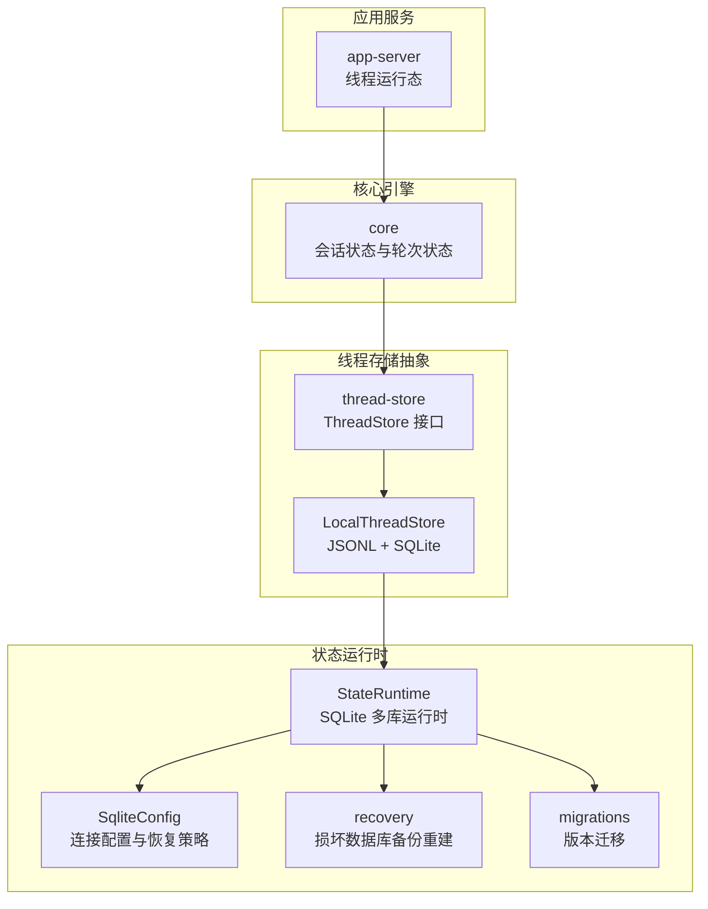

**图示来源**
- [thread-store/lib.rs:1-126](file://codex-rs/thread-store/src/lib.rs#L1-L126)
- [thread-store/store.rs:1-200](file://codex-rs/thread-store/src/store.rs#L1-L200)
- [thread-store/local/mod.rs:1-200](file://codex-rs/thread-store/src/local/mod.rs#L1-L200)
- [state/runtime.rs:1-200](file://codex-rs/state/src/runtime.rs#L1-L200)
- [state/sqlite.rs:1-200](file://codex-rs/state/src/sqlite.rs#L1-L200)
- [state/runtime/recovery.rs:1-270](file://codex-rs/state/src/runtime/recovery.rs#L1-L270)
- [state/migrations.rs:1-123](file://codex-rs/state/src/migrations.rs#L1-L123)

**章节来源**
- [state/lib.rs:1-173](file://codex-rs/state/src/lib.rs#L1-L173)
- [thread-store/lib.rs:1-126](file://codex-rs/thread-store/src/lib.rs#L1-L126)

## 核心组件
本节聚焦三类状态及其管理机制：
- 线程状态：包括线程元数据、历史模式、归属项目、分区与排序、父子关系、附件、目标、记忆等。
- 会话状态：会话配置、上下文管理器、令牌用量、速率限制、动态工具、自动压缩窗口、预启动预热等。
- 项目状态：项目实体、根路径、成员线程、幂等创建键、更新与查询。

### 线程状态
线程状态以 `ThreadMetadata` 为核心数据结构，包含线程标识、创建时间、更新时间、产品最近使用时间、来源、历史模式、模型信息、工作目录、标题、预览、沙箱策略、审批模式、令牌用量、归档时间、用户选择分区、项目 ID、Git 信息等字段。它通过 `StateRuntime` 暴露的 SQL 操作进行增删改查，并通过 `thread_store` 与本地 JSONL 回放格式保持一致。

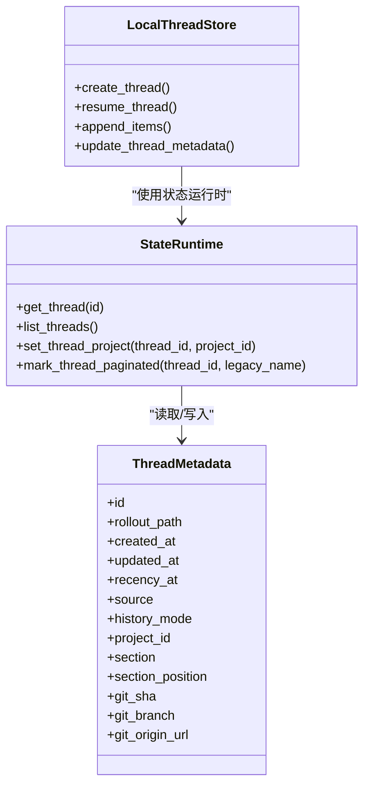

**图示来源**
- [state/model/thread_metadata.rs:1-260](file://codex-rs/state/src/model/thread_metadata.rs#L1-L260)
- [state/runtime/threads.rs:1-260](file://codex-rs/state/src/runtime/threads.rs#L1-L260)
- [thread-store/local/mod.rs:1-200](file://codex-rs/thread-store/src/local/mod.rs#L1-L200)

**章节来源**
- [state/model/thread_metadata.rs:1-260](file://codex-rs/state/src/model/thread_metadata.rs#L1-L260)
- [state/runtime/threads.rs:1-260](file://codex-rs/state/src/runtime/threads.rs#L1-L260)

### 会话状态
会话状态由 `SessionState` 维护，封装了会话配置、上下文管理器、令牌用量、速率限制、动态工具、自动压缩窗口、预启动预热、当前时间提醒、连接器选择、任务路由等信息。它不是直接持久化的，而是随会话生命周期存在；部分字段会被序列化到线程或上下文中，并在恢复时重建。

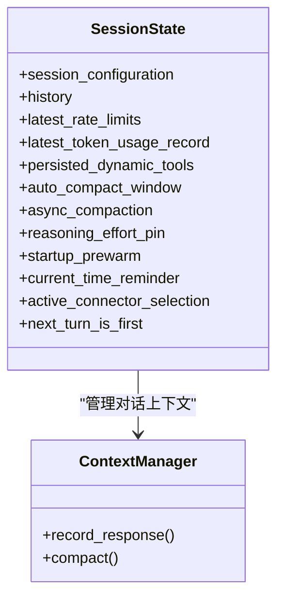

**图示来源**
- [core/state/session.rs:1-200](file://codex-rs/core/src/state/session.rs#L1-L200)

**章节来源**
- [core/state/session.rs:1-200](file://codex-rs/core/src/state/session.rs#L1-L200)
- [core/state/mod.rs:1-25](file://codex-rs/core/src/state/mod.rs#L1-L25)

### 项目状态
项目状态通过 `StateRuntime::projects` 模块管理，支持项目的创建、更新、查询、分页、根路径管理，以及与线程的双向关联。项目创建使用幂等键，避免重复创建；线程与项目的绑定在一个事务中完成，确保一致性。

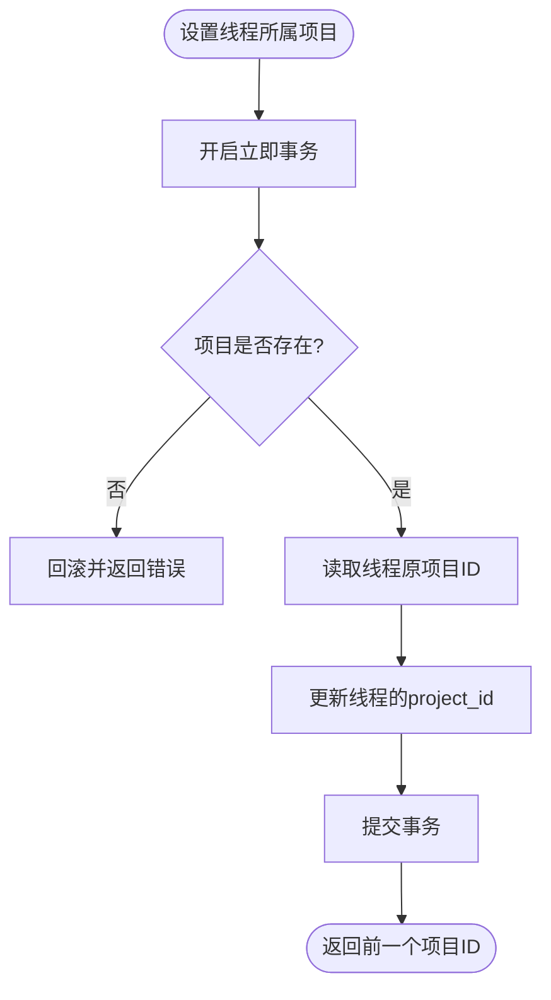

**图示来源**
- [state/runtime/projects.rs:1-260](file://codex-rs/state/src/runtime/projects.rs#L1-L260)

**章节来源**
- [state/runtime/projects.rs:1-260](file://codex-rs/state/src/runtime/projects.rs#L1-L260)

## 架构总览
状态管理的整体架构如下：
- 上层应用（app-server、tui、cli）调用 core 提供的会话与线程 API。
- core 持有 `SessionState` 和线程运行上下文，并通过 `ThreadStore` 访问持久化层。
- `ThreadStore` 默认实现为 `LocalThreadStore`，负责 JSONL 回放文件与 SQLite 索引的一致性。
- `StateRuntime` 管理多个 SQLite 数据库（状态、日志、目标、记忆、队列、线程历史），并提供迁移、恢复、遥测与并发控制。
- `SqliteConfig` 统一配置数据库路径、WAL/DELETE 策略、NFS 环境处理与快速检查。
- `recovery` 模块检测 SQLite 损坏并执行单库备份重建，不影响其他数据库。
- `migrations` 模块按数据库分别维护 schema 升级逻辑，允许旧二进制打开较新数据库。

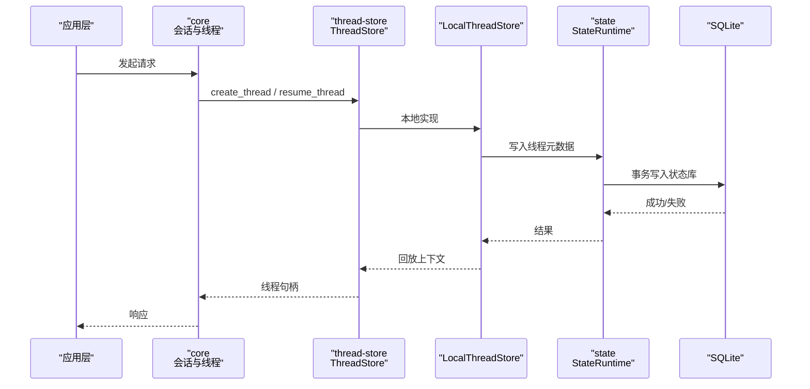

**图示来源**
- [thread-store/store.rs:1-200](file://codex-rs/thread-store/src/store.rs#L1-L200)
- [thread-store/local/mod.rs:1-200](file://codex-rs/thread-store/src/local/mod.rs#L1-L200)
- [state/runtime.rs:1-200](file://codex-rs/state/src/runtime.rs#L1-L200)

**章节来源**
- [thread-store/store.rs:1-200](file://codex-rs/thread-store/src/store.rs#L1-L200)
- [state/runtime.rs:1-200](file://codex-rs/state/src/runtime.rs#L1-L200)

## 详细组件分析

### 线程状态管理
线程状态由 `ThreadMetadata` 表示，并由 `StateRuntime` 提供 SQL 操作。`LocalThreadStore` 将 JSONL 回放作为权威记录，同时用 SQLite 维护可查询索引。两者通过追加式写入与投影重建保持一致性。

关键点：
- 线程元数据包含历史模式、来源、项目归属、分区、Git 信息等。
- 列表与分页使用锚点与排序键，保证稳定顺序。
- 父子关系通过 `thread_spawn_edges` 表维护，支持直接子节点与后代遍历。
- 当线程从“传统”升级为“分页”模式时，会保留显式名称与 Git 信息。

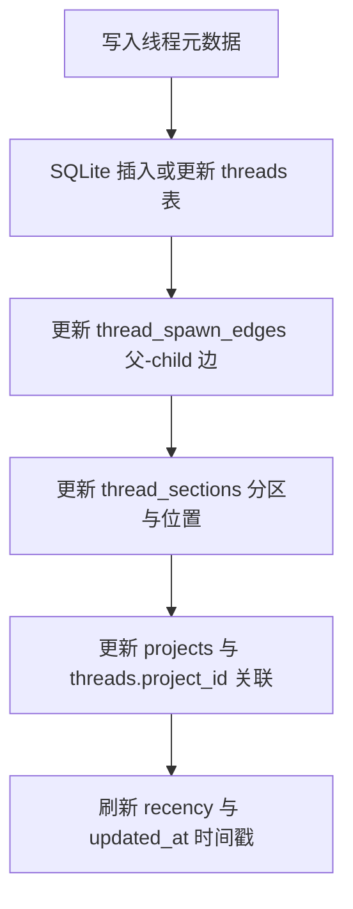

**图示来源**
- [state/model/thread_metadata.rs:1-260](file://codex-rs/state/src/model/thread_metadata.rs#L1-L260)
- [state/runtime/threads.rs:1-260](file://codex-rs/state/src/runtime/threads.rs#L1-L260)
- [state/runtime/projects.rs:1-260](file://codex-rs/state/src/runtime/projects.rs#L1-L260)

**章节来源**
- [state/model/thread_metadata.rs:1-260](file://codex-rs/state/src/model/thread_metadata.rs#L1-L260)
- [state/runtime/threads.rs:1-260](file://codex-rs/state/src/runtime/threads.rs#L1-L260)
- [state/runtime/projects.rs:1-260](file://codex-rs/state/src/runtime/projects.rs#L1-L260)

### 会话状态管理
`SessionState` 维护会话生命周期内的可变状态，包括上下文管理、令牌用量、速率限制、动态工具、自动压缩窗口、预启动预热、时间提醒、连接器选择等。这些状态通常不直接持久化，而是通过会话启动参数、线程元数据或历史记录间接恢复。

关键点：
- 会话配置与上下文管理器贯穿会话生命周期。
- 令牌用量与速率限制用于节流与统计。
- 自动压缩窗口用于控制上下文大小增长。
- 预启动预热用于减少首次延迟。

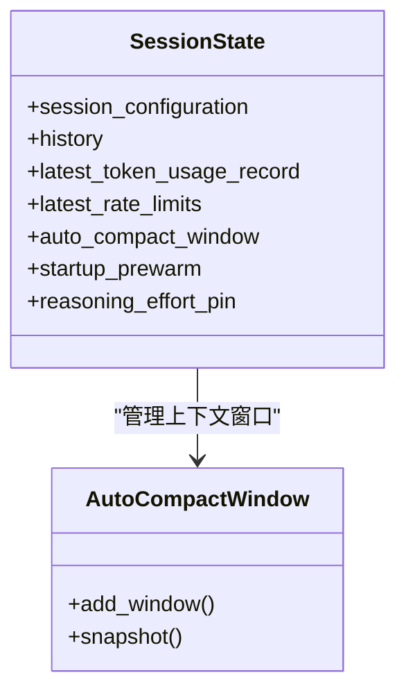

**图示来源**
- [core/state/session.rs:1-200](file://codex-rs/core/src/state/session.rs#L1-L200)

**章节来源**
- [core/state/session.rs:1-200](file://codex-rs/core/src/state/session.rs#L1-L200)

### 项目状态管理
项目状态通过 `StateRuntime::projects` 管理，支持幂等创建、更新、查询、分页、根路径管理与线程关联。

关键点：
- 项目创建使用幂等键，避免重复创建。
- 线程与项目关联在同一事务中更新，保证一致性。
- 项目列表计算成员线程的最近使用时间。

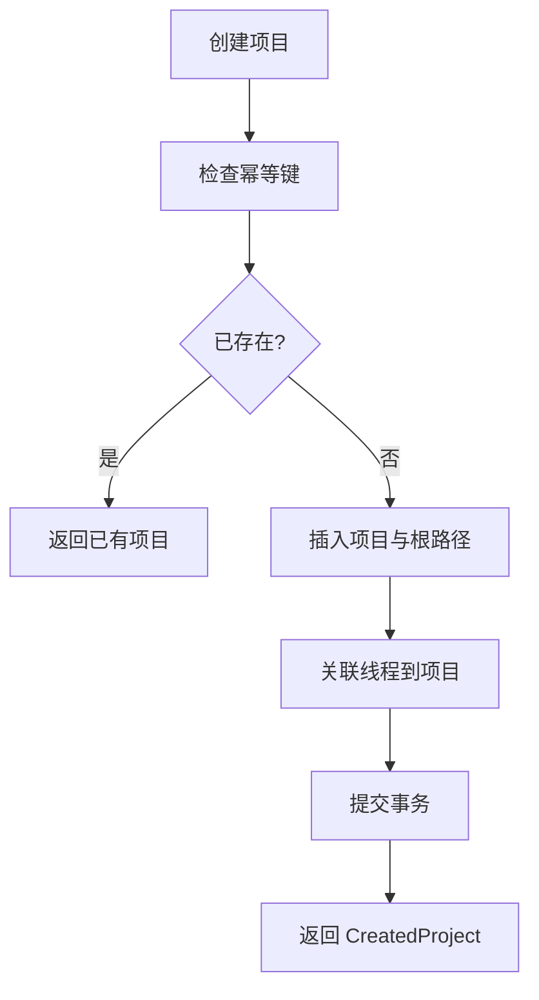

**图示来源**
- [state/runtime/projects.rs:1-260](file://codex-rs/state/src/runtime/projects.rs#L1-L260)

**章节来源**
- [state/runtime/projects.rs:1-260](file://codex-rs/state/src/runtime/projects.rs#L1-L260)

### 线程运行期状态
`ThreadState` 位于 app-server 中，管理单个线程的运行期状态，包括监听器、中断队列、网络审批、轮次摘要、历史构建器、设置基线、生成计数器等。它通过命令通道串行化处理目标更新、队列变更、警告与请求解析。

关键点：
- 目标编辑、冷恢复与终端清理通过互斥锁串行化。
- 监听器替换时使用弱引用与生成计数避免悬挂引用。
- 历史模式影响是否驱逐过时代理文本。
- 支持关闭排水，等待旧监听器处理完 `ShutdownComplete`。

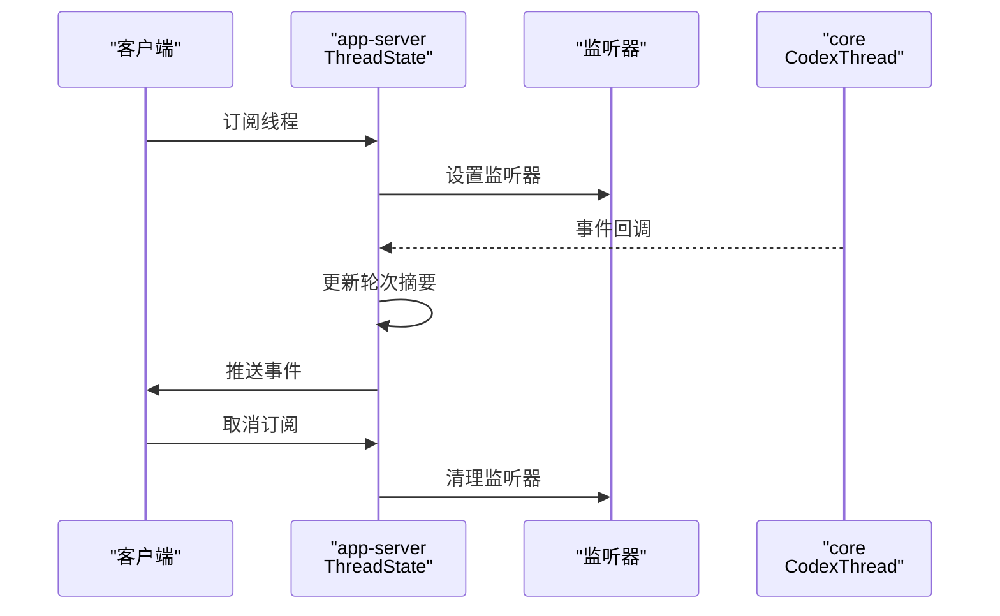

**图示来源**
- [app-server/thread_state.rs:1-200](file://codex-rs/app-server/src/thread_state.rs#L1-L200)

**章节来源**
- [app-server/thread_state.rs:1-200](file://codex-rs/app-server/src/thread_state.rs#L1-L200)

## 依赖关系分析
状态系统的依赖关系如下：
- `app-server` 依赖 `core` 的线程与会话状态。
- `core` 依赖 `thread-store` 的线程持久化接口。
- `thread-store` 默认实现依赖 `state` 的 SQLite 运行时。
- `state` 依赖 SQLite 驱动与迁移系统。
- `sqlite.rs` 统一管理连接池、JOURNAL_MODE、NFS 策略与快速检查。
- `recovery.rs` 检测损坏并备份重建单库。
- `migrations.rs` 为每个数据库维护迁移器，允许旧二进制兼容新数据库。

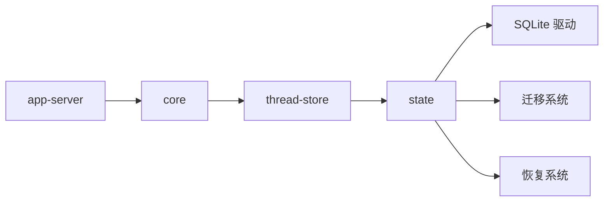

**图示来源**
- [thread-store/lib.rs:1-126](file://codex-rs/thread-store/src/lib.rs#L1-L126)
- [state/lib.rs:1-173](file://codex-rs/state/src/lib.rs#L1-L173)

**章节来源**
- [thread-store/lib.rs:1-126](file://codex-rs/thread-store/src/lib.rs#L1-L126)
- [state/lib.rs:1-173](file://codex-rs/state/src/lib.rs#L1-L173)

## 性能考虑
- **分库设计**：状态、日志、目标、记忆、队列、线程历史分别使用独立 SQLite 文件，降低锁竞争。
- **WAL 与 DELETE 策略**：根据 NFS 环境与写者行为选择 WAL 或 DELETE，减少跨进程冲突。
- **后台回收**：日志库允许后台回收，避免阻塞写入。
- **忙重试**：对 SQLITE_BUSY 错误进行重试，提高并发下的成功率。
- **分页与锚点**：线程列表与项目列表使用游标分页，避免全表扫描。
- **异步压缩**：会话上下文支持异步压缩，减少主路径延迟。

[本节为通用指导，不直接分析具体文件]

## 故障排查指南
### SQLite 损坏恢复
当 SQLite 报告数据库损坏时，`recovery` 模块会将该数据库及其 WAL/SHM 文件移动到备份目录，然后重建空数据库，其他数据库不受影响。

步骤：
1. 检测错误是否为 SQLite 损坏。
2. 收集需要备份的文件路径。
3. 创建唯一备份目录并移动文件。
4. 重建空数据库。
5. 上报备份路径供用户审计。

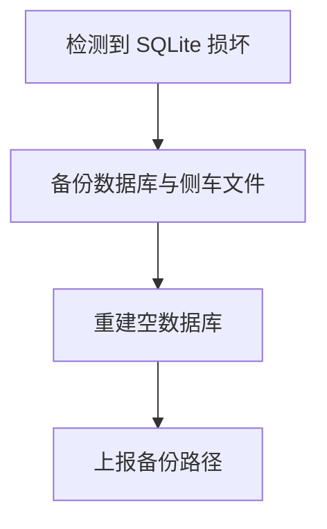

**图示来源**
- [state/runtime/recovery.rs:1-270](file://codex-rs/state/src/runtime/recovery.rs#L1-L270)

**章节来源**
- [state/runtime/recovery.rs:1-270](file://codex-rs/state/src/runtime/recovery.rs#L1-L270)

### 版本迁移
每个数据库有独立的迁移器，允许旧二进制打开已被新版本迁移过的数据库。迁移器忽略缺失迁移，但校验已知迁移的校验和。

要点：
- 状态、日志、目标、记忆、队列、线程历史各有迁移器。
- 修复旧版 recency 迁移版本号，防止版本错位。
- 迁移在数据库初始化阶段执行。

**章节来源**
- [state/migrations.rs:1-123](file://codex-rs/state/src/migrations.rs#L1-L123)

### 并发访问控制
- `LocalThreadStore` 使用每线程协调对象，分离 writer 与 lifecycle 锁，允许 fork 期间源线程继续写入。
- `ThreadState` 使用全局互斥锁串行化目标编辑、冷恢复与终端清理。
- SQLite 层通过 `SqlitePoolWriteExt` 与忙重试降低锁冲突。

**章节来源**
- [thread-store/local/mod.rs:1-200](file://codex-rs/thread-store/src/local/mod.rs#L1-L200)
- [app-server/thread_state.rs:1-200](file://codex-rs/app-server/src/thread_state.rs#L1-L200)

### 状态监控与调试
- `StateRuntime` 暴露多种指标常量，如数据库错误、回填、初始化耗时、回退次数、日志写入批次大小等。
- `DbTelemetry` 与 `install_process_db_telemetry` 提供进程级遥测安装。
- `audit.rs` 提供线程状态审计行与 rollout 路径读取。
- `delegated_preview.rs` 提供委托输出预览。

**章节来源**
- [state/lib.rs:1-173](file://codex-rs/state/src/lib.rs#L1-L173)

## 结论
Codex 的状态管理系统通过分层设计实现了线程、会话与项目状态的可靠管理：
- `state` 提供 SQLite 驱动的持久化运行时，支持分库、迁移、恢复与遥测。
- `thread-store` 提供线程级持久化抽象，默认实现兼顾 JSONL 回放与 SQLite 索引。
- `core` 与 `app-server` 管理进程内会话与线程运行态，协调持久化与事件流。

该系统通过事务、锁、分页、忙重试与损坏恢复保障一致性与可用性，同时通过指标与审计支持监控与调试。对于新增状态类型，建议遵循现有模式：定义模型、实现运行时操作、添加迁移、集成恢复与遥测，并在测试中覆盖并发与异常路径。