# 线程状态管理

<cite>
**本文引用的文件**
- [lib.rs](file://codex-rs/thread-store/src/lib.rs)
- [store.rs](file://codex-rs/thread-store/src/store.rs)
- [live_thread.rs](file://codex-rs/thread-store/src/live_thread.rs)
- [types.rs](file://codex-rs/thread-store/src/types.rs)
- [local/mod.rs](file://codex-rs/thread-store/src/local/mod.rs)
- [local/create_thread.rs](file://codex-rs/thread-store/src/local/create_thread.rs)
- [local/read_thread.rs](file://codex-rs/thread-store/src/local/read_thread.rs)
- [local/delete_thread.rs](file://codex-rs/thread-store/src/local/delete_thread.rs)
- [local/archive_thread.rs](file://codex-rs/thread-store/src/local/archive_thread.rs)
- [local/unarchive_thread.rs](file://codex-rs/thread-store/src/local/unarchive_thread.rs)
- [local/rollout_migration.rs](file://codex-rs/thread-store/src/local/rollout_migration.rs)
- [local/history_revision.rs](file://codex-rs/thread-store/src/local/history_revision.rs)
- [local/live_writer.rs](file://codex-rs/thread-store/src/local/live_writer.rs)
- [local/rollout_lineage.rs](file://codex-rs/thread-store/src/local/rollout_lineage.rs)
- [thread_metadata_sync.rs](file://codex-rs/thread-store/src/thread_metadata_sync.rs)
- [in_memory.rs](file://codex-rs/thread-store/src/in_memory.rs)
</cite>

## 目录
1. [引言](#引言)
2. [项目结构](#项目结构)
3. [核心组件](#核心组件)
4. [架构总览](#架构总览)
5. [详细组件分析](#详细组件分析)
6. [依赖关系分析](#依赖关系分析)
7. [性能与并发特性](#性能与并发特性)
8. [故障排查指南](#故障排查指南)
9. [结论](#结论)
10. [附录：API 与数据模型速查](#附录api-与数据模型速查)

## 引言
本文围绕 Codex 的线程状态管理系统展开，重点说明以下方面：
- `ThreadStore` 接口设计及其职责边界。
- `LiveThread` 的生命周期管理与活跃会话持久化策略。
- 线程的创建、读取、更新和删除在本地实现中的细节。
- 线程历史记录的存储结构、分页回放与查询优化。
- 线程元数据的同步机制、合并策略与并发访问控制。
- 线程归档、恢复（取消归档）以及从旧版 Rollout 到分页历史的迁移流程。
- 线程状态监控与调试工具的使用方式。

该系统以“存储中立”的接口为边界，将上层会话逻辑与底层 JSONL 回放文件和 SQLite 索引解耦，使本地实现可以演进而不影响调用方。

## 项目结构
`codex-thread-store` 模块提供线程存储的抽象、本地实现和内存实现：
- 抽象层：`ThreadStore` trait、类型定义、错误类型、附件与分区等公共 API。
- 本地实现：基于 `codex-rollout` JSONL 回放文件和可选 SQLite 状态数据库。
- 内存实现：用于测试和轻量场景的内存态线程存储。

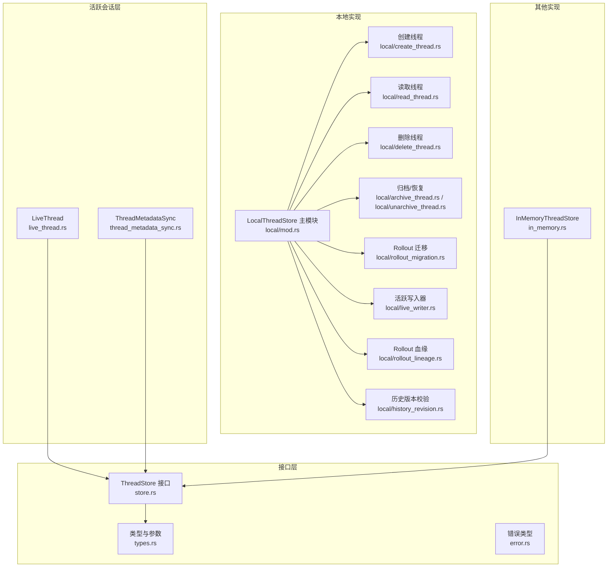

**图示来源**
- [store.rs:1-200](file://codex-rs/thread-store/src/store.rs#L1-L200)
- [types.rs:1-200](file://codex-rs/thread-store/src/types.rs#L1-L200)
- [live_thread.rs:1-200](file://codex-rs/thread-store/src/live_thread.rs#L1-L200)
- [local/mod.rs:1-200](file://codex-rs/thread-store/src/local/mod.rs#L1-L200)

**章节来源**
- [lib.rs:1-126](file://codex-rs/thread-store/src/lib.rs#L1-L126)
- [README.md:1-35](file://codex-rs/thread-store/README.md#L1-L35)

## 核心组件
### ThreadStore 接口
`ThreadStore` 是线程持久化的存储中立边界，对外暴露：
- 线程生命周期：创建、恢复、追加历史、重放上下文。
- 查询与列表：按线程 ID 或条件读取线程、列出线程、加载历史、分页项与对话轮次。
- 元数据更新：统一的元数据补丁写入入口。
- 高级能力：附件、项目、分区、搜索、归档、恢复、迁移等扩展点。

该接口通过 `ThreadStoreFuture` 返回异步结果，并提供 `PersistContext` 表达不同持久化时机；部分操作支持后台持久化，由实现决定是否延迟落盘。

**章节来源**
- [store.rs:1-200](file://codex-rs/thread-store/src/store.rs#L1-L200)

### LiveThread 与生命周期
`LiveThread` 是活跃线程的持久化句柄，封装了：
- 创建线程与带继承上下文子线程创建。
- 恢复已有线程并获取权威回放历史。
- 维护 `ThreadMetadataSync`，根据追加的历史事件推导元数据变更。
- 使用 `LiveThreadInitGuard` 安全处理初始化失败时的资源清理。

`LiveThread` 不直接决定持久化策略，而是委托给 `ThreadStore`；本地实现中，它协调 Rollout 写入器和 SQLite 元数据同步。

**章节来源**
- [live_thread.rs:1-200](file://codex-rs/thread-store/src/live_thread.rs#L1-L200)

### 类型与参数
`types.rs` 集中定义线程相关的数据结构，包括：
- 线程持久化元数据、创建/恢复/追加参数。
- 分页项、对话轮次、搜索结果、时间线条目。
- 历史模式、来源、Git 信息、权限配置等协议字段。

这些类型贯穿接口与本地实现，保证存储契约的一致性。

**章节来源**
- [types.rs:1-200](file://codex-rs/thread-store/src/types.rs#L1-L200)

## 架构总览
下图展示一次典型的“创建活跃线程并追加历史”的流程，以及元数据同步与本地持久化路径。

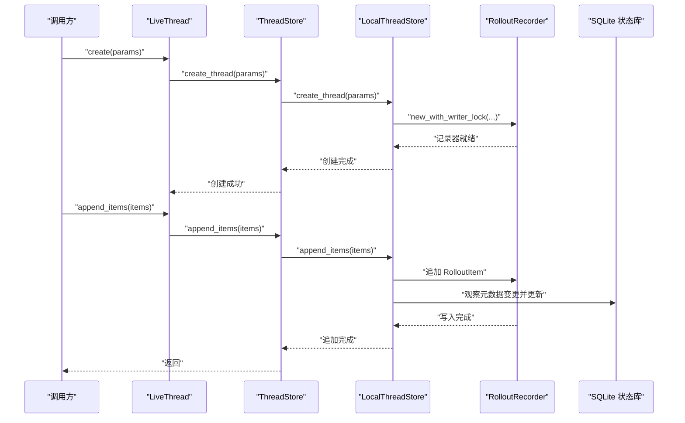

**图示来源**
- [live_thread.rs:1-200](file://codex-rs/thread-store/src/live_thread.rs#L1-L200)
- [local/live_writer.rs:1-200](file://codex-rs/thread-store/src/local/live_writer.rs#L1-L200)
- [local/create_thread.rs:1-73](file://codex-rs/thread-store/src/local/create_thread.rs#L1-L73)
- [thread_metadata_sync.rs:1-200](file://codex-rs/thread-store/src/thread_metadata_sync.rs#L1-L200)

## 详细组件分析

### ThreadStore 接口设计与职责
`ThreadStore` 的职责边界清晰：
- 不推断元数据；元数据统一通过 `update_thread_metadata` 写入。
- 支持可复用的恢复准备对象，避免重复加载历史。
- 暴露默认历史模式，允许实现覆盖以适配分页历史。
- 提供未持久化的待处理元数据暂存接口，供外部宿主在启动前预留元数据。

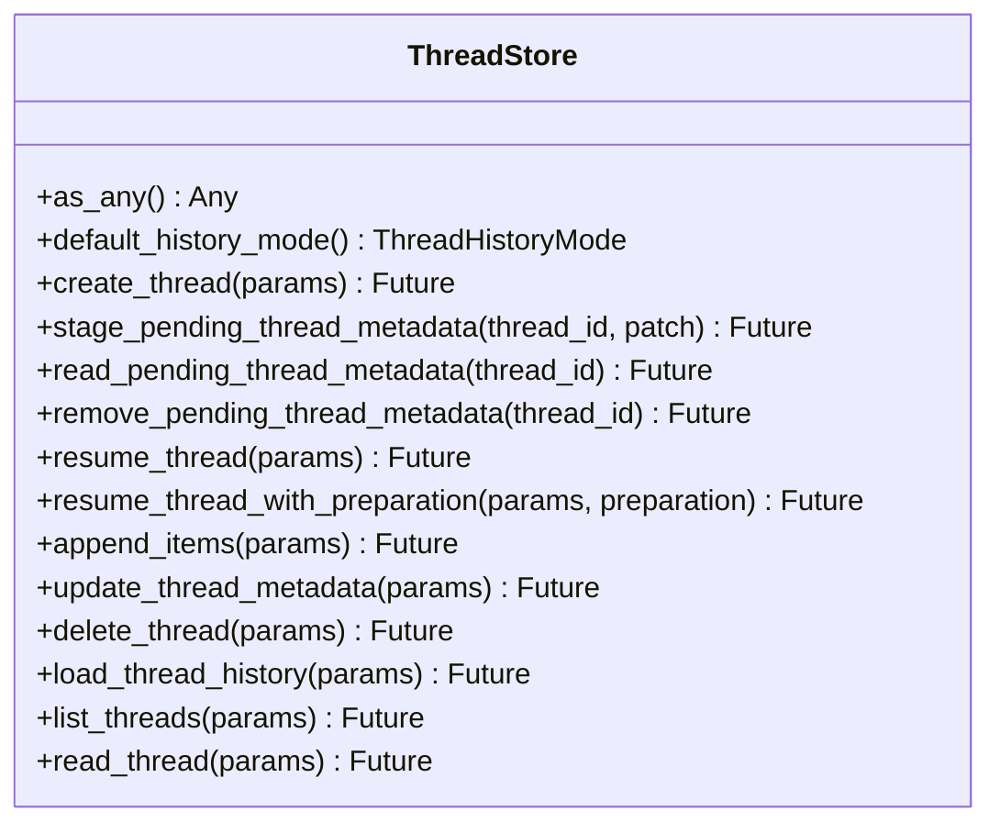

**图示来源**
- [store.rs:1-200](file://codex-rs/thread-store/src/store.rs#L1-L200)

**章节来源**
- [store.rs:1-200](file://codex-rs/thread-store/src/store.rs#L1-L200)

### LiveThread 生命周期管理
`LiveThread` 负责活跃会话的持久化编排：
- 创建时构造 `ThreadMetadataSync`，并记录持久化遥测。
- 支持“继承模型上下文”的子线程创建，先持久化父上下文再附加子历史。
- 恢复时根据历史模式和本地实现能力选择是否从 SQLite 读取线程元数据。
- 通过 `LiveThreadInitGuard` 保证初始化失败时不会泄露已打开的写入器。

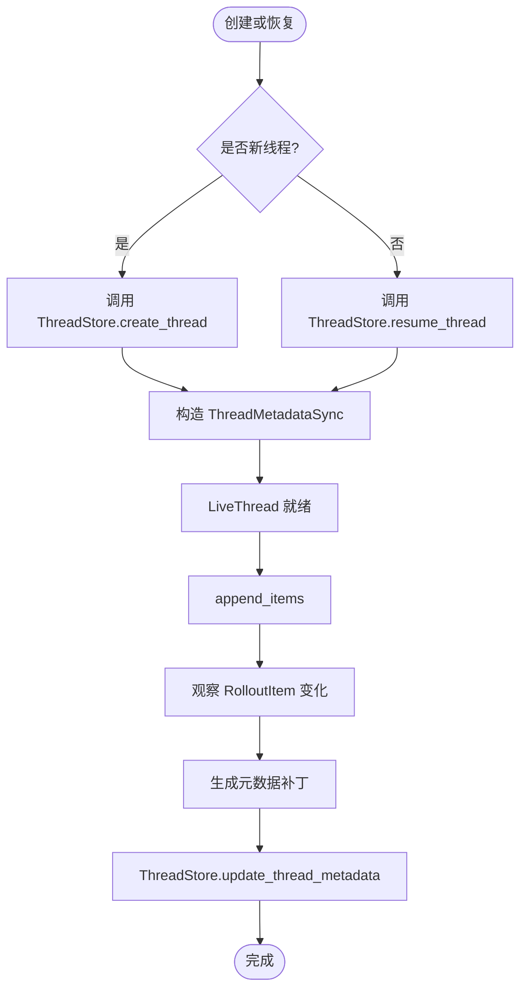

**图示来源**
- [live_thread.rs:1-200](file://codex-rs/thread-store/src/live_thread.rs#L1-L200)
- [thread_metadata_sync.rs:1-200](file://codex-rs/thread-store/src/thread_metadata_sync.rs#L1-L200)

**章节来源**
- [live_thread.rs:1-200](file://codex-rs/thread-store/src/live_thread.rs#L1-L200)

### 本地实现：LocalThreadStore
`LocalThreadStore` 是主要本地实现，关键特性：
- 使用 `codex-rollout` JSONL 作为可回放的主存储。
- 使用 SQLite 作为可查询的元数据和投影索引。
- 区分“活跃写入器”和“冷线程”，并通过锁协调避免并发写入冲突。
- 支持归档/恢复、Rollout 迁移、附件、项目、分区、搜索等扩展功能。

#### 创建线程
本地创建线程会：
1. 校验工作目录存在。
2. 构建 `RolloutConfig` 和 `RolloutRecorderParams`。
3. 设置创建者、会话 ID、多智能体版本、历史模式、历史基址等信息。
4. 通过 `RolloutRecorder::new_with_writer_lock` 创建持久化写入器。

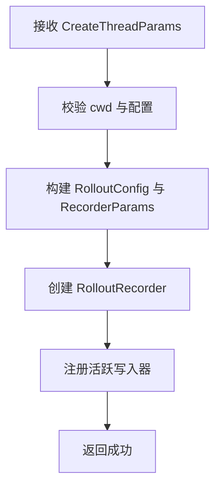

**图示来源**
- [local/create_thread.rs:1-73](file://codex-rs/thread-store/src/local/create_thread.rs#L1-L73)
- [local/live_writer.rs:1-200](file://codex-rs/thread-store/src/local/live_writer.rs#L1-L200)

**章节来源**
- [local/create_thread.rs:1-73](file://codex-rs/thread-store/src/local/create_thread.rs#L1-L73)

#### 读取线程
读取线程优先走 SQLite 元数据缓存，必要时回退到 Rollout 文件解析：
- 若请求不包含历史且存在活跃写入器的未持久化 SessionMeta，则优先返回最新元数据。
- 对分页历史模式，显示元数据主要来自 SQLite，因为 Rollout 可能只保留后缀片段。
- 对传统历史模式，可从 Rollout 文件中重建完整线程。
- 包含历史时，验证 Rollout 路径有效性并附加历史。

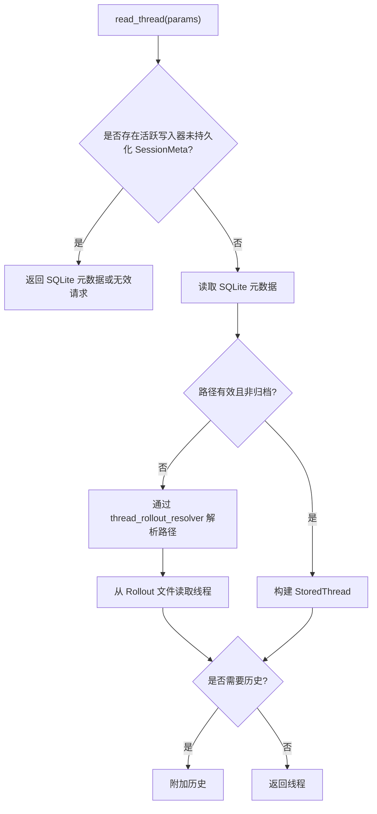

**图示来源**
- [local/read_thread.rs:1-200](file://codex-rs/thread-store/src/local/read_thread.rs#L1-L200)

**章节来源**
- [local/read_thread.rs:1-200](file://codex-rs/thread-store/src/local/read_thread.rs#L1-L200)

#### 删除线程
删除线程遵循严格的安全顺序：
1. 检查诊断日志可用性，防止破坏性操作在无诊断能力下进行。
2. 扫描引用索引，确认无附属线程或外部引用。
3. 执行宿主数据清理。
4. 删除 Rollout 文件，再删除 SQLite 行。
5. 批量删除多个线程时，先排序并锁定生命周期和写入器，确保一致性。

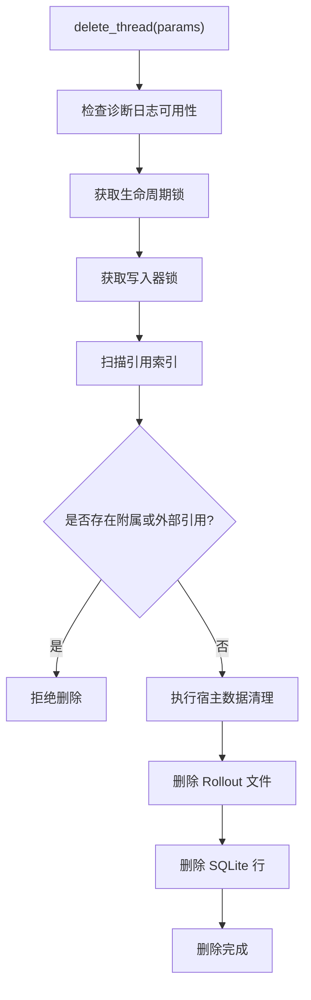

**图示来源**
- [local/delete_thread.rs:1-200](file://codex-rs/thread-store/src/local/delete_thread.rs#L1-L200)

**章节来源**
- [local/delete_thread.rs:1-200](file://codex-rs/thread-store/src/local/delete_thread.rs#L1-L200)

#### 归档与恢复
归档与恢复是对 Rollout 文件的物理移动与 SQLite 状态同步：
- 归档：将选定 Rollout 移动到归档目录，更新 SQLite 归档标记，失败时回滚已移动文件。
- 恢复：从归档目录移回 sessions 目录，更新修改时间并清除归档标记，失败时同样回滚。

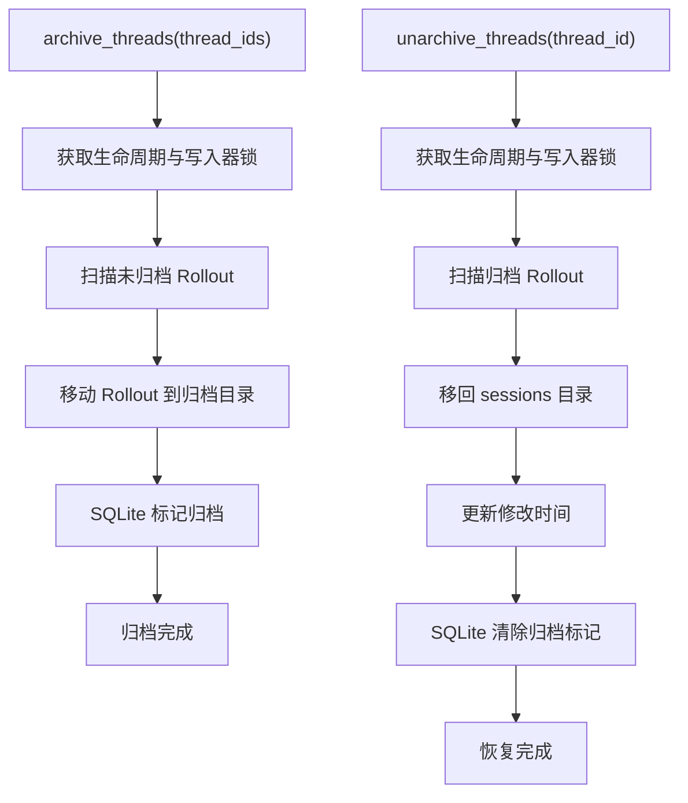

**图示来源**
- [local/archive_thread.rs:1-200](file://codex-rs/thread-store/src/local/archive_thread.rs#L1-L200)
- [local/unarchive_thread.rs:1-200](file://codex-rs/thread-store/src/local/unarchive_thread.rs#L1-L200)

**章节来源**
- [local/archive_thread.rs:1-200](file://codex-rs/thread-store/src/local/archive_thread.rs#L1-L200)
- [local/unarchive_thread.rs:1-200](file://codex-rs/thread-store/src/local/unarchive_thread.rs#L1-L200)

#### Rollout 迁移
Rollout 迁移是将旧版 JSONL 转换为分页历史并进行 SQLite 投影的过程：
- 发现 eligible 的 Rollout 文件。
- 取得维护锁和写入器锁。
- 规范化到暂存文件，投影到 SQLite。
- 验证投影后原子发布，保留 `.pending` 日志以便中断恢复。
- 支持限速、干运行、失败原因分类和回滚计划。

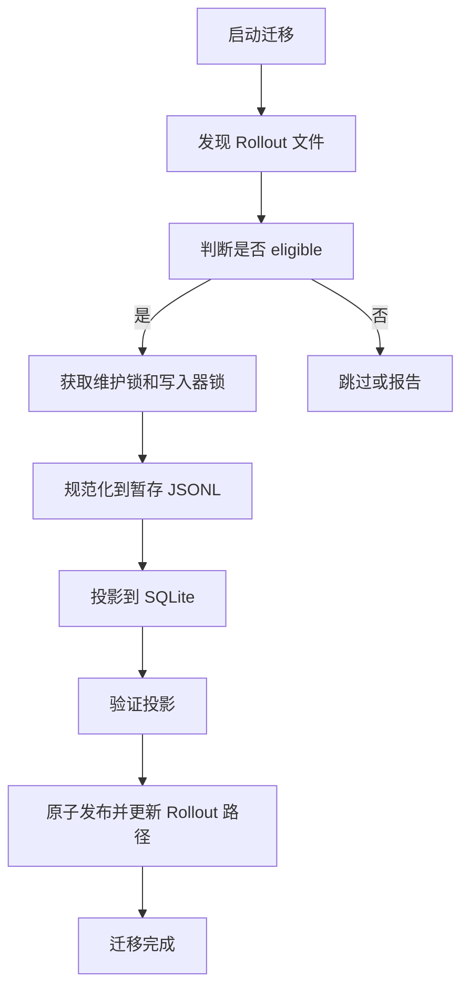

**图示来源**
- [local/rollout_migration.rs:1-200](file://codex-rs/thread-store/src/local/rollout_migration.rs#L1-L200)

**章节来源**
- [local/rollout_migration.rs:1-200](file://codex-rs/thread-store/src/local/rollout_migration.rs#L1-L200)

### 线程历史记录存储结构与查询优化
- 主存储：`codex-rollout` JSONL 文件，提供可回放的历史。
- 投影索引：SQLite 中存储分页历史投影、元数据和查询辅助信息。
- 分页回放：对于分页历史模式，Rollout 可能仅保留后缀片段，显示元数据来自 SQLite。
- 历史版本复用：本地实现通过 `history_revision` 校验 Rollout 文件标识，避免在不安全情况下复用缓存历史。
- 血缘解析：`rollout_lineage` 解析 fork 链中的 `SessionMeta.history_base`，组合多个 Rollout 段形成完整视图。

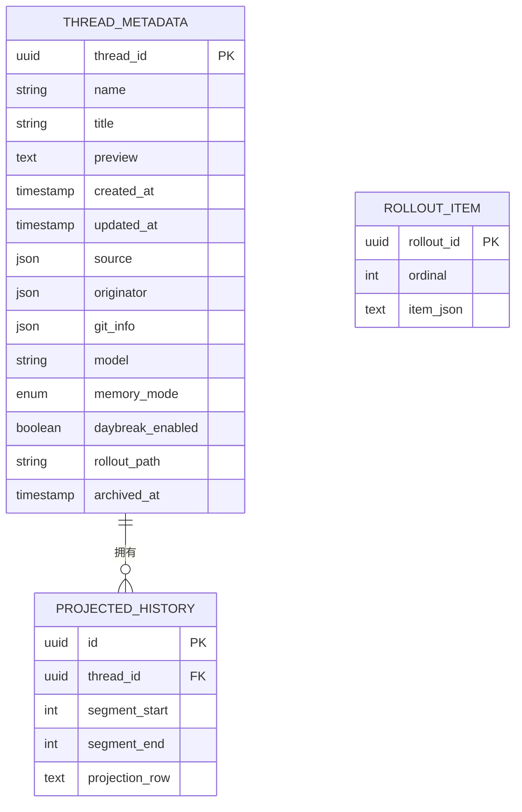

**图示来源**
- [local/read_thread.rs:1-200](file://codex-rs/thread-store/src/local/read_thread.rs#L1-L200)
- [local/rollout_lineage.rs:1-200](file://codex-rs/thread-store/src/local/rollout_lineage.rs#L1-L200)

**章节来源**
- [local/history_revision.rs:1-28](file://codex-rs/thread-store/src/local/history_revision.rs#L1-L28)
- [local/rollout_lineage.rs:1-200](file://codex-rs/thread-store/src/local/rollout_lineage.rs#L1-L200)

### 线程元数据同步机制与并发控制
`ThreadMetadataSync` 负责从 RolloutItem 观测元数据变化，并生成补丁：
- 创建时收集 Git 信息、来源、代理昵称与角色等初始值。
- 恢复时根据已有历史预观测，并延迟直到首次追加生效。
- 追加历史时检测是否影响元数据，并推进最近更新时间。
- 合并多次补丁，避免丢失更新，同时避免重复应用。

并发控制方面：
- `LocalThreadStore` 使用 `LiveWriterLocks` 维护每个线程的生命周期锁和写入器锁。
- 归档/恢复/删除等操作先获取生命周期锁，再获取写入器锁，确保一致快照。
- 队列式 writer 获取与 SQLite 连接池分离，避免单写者阻塞读者。

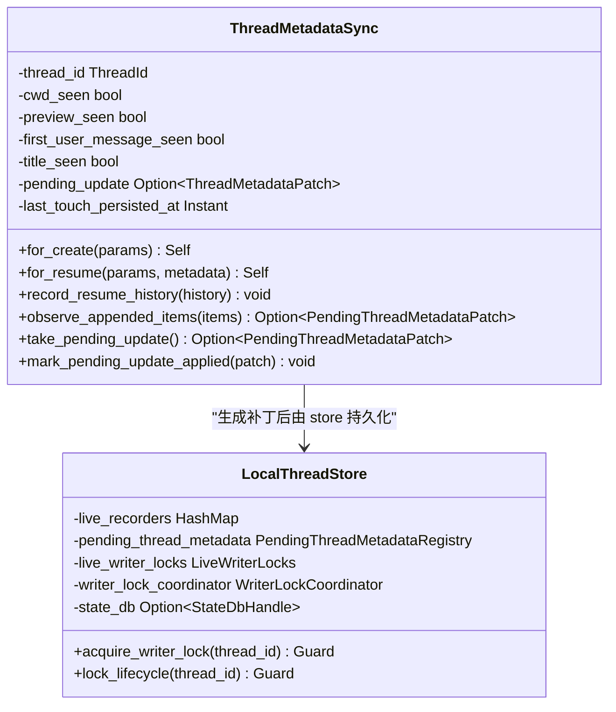

**图示来源**
- [thread_metadata_sync.rs:1-200](file://codex-rs/thread-store/src/thread_metadata_sync.rs#L1-L200)
- [local/mod.rs:1-200](file://codex-rs/thread-store/src/local/mod.rs#L1-L200)

**章节来源**
- [thread_metadata_sync.rs:1-200](file://codex-rs/thread-store/src/thread_metadata_sync.rs#L1-L200)
- [local/mod.rs:1-200](file://codex-rs/thread-store/src/local/mod.rs#L1-L200)

### 线程归档、恢复与迁移的处理流程
- 归档：扫描未归档 Rollout，移动到归档目录，更新 SQLite 归档标记；失败时回滚。
- 恢复：扫描归档 Rollout，移回 sessions 目录，更新修改时间并清除归档标记；失败时回滚。
- 迁移：发现 eligible 的 Rollout，规范化、投影、验证并发布；支持限速、干运行、中断恢复。

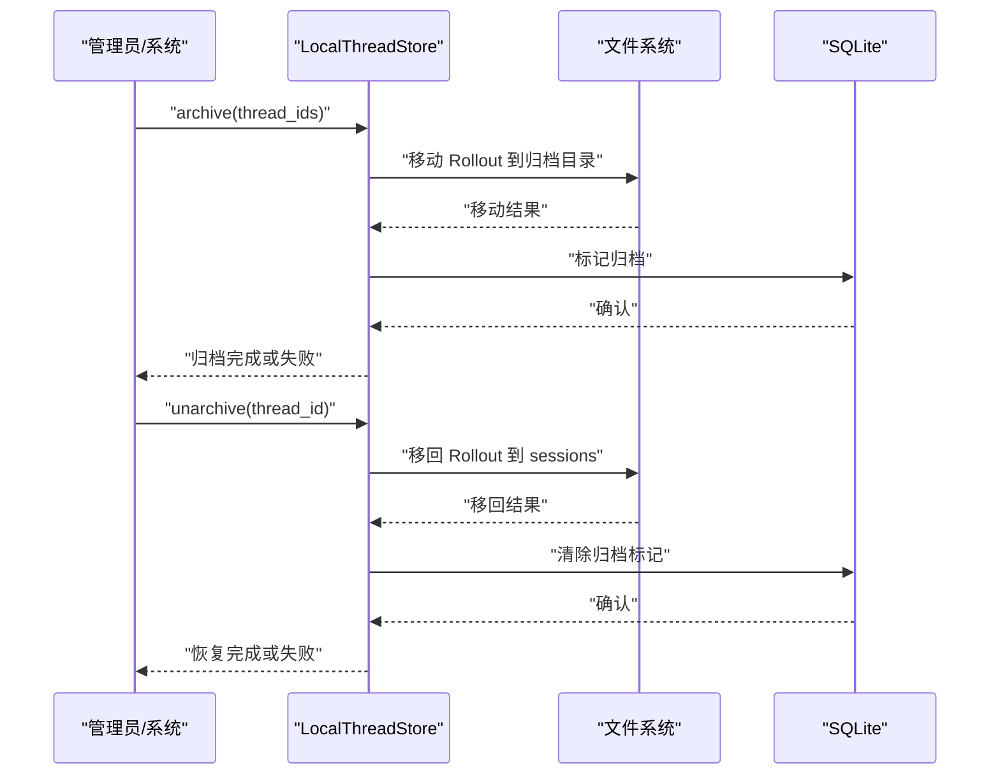

**图示来源**
- [local/archive_thread.rs:1-200](file://codex-rs/thread-store/src/local/archive_thread.rs#L1-L200)
- [local/unarchive_thread.rs:1-200](file://codex-rs/thread-store/src/local/unarchive_thread.rs#L1-L200)

**章节来源**
- [local/rollout_migration.rs:1-200](file://codex-rs/thread-store/src/local/rollout_migration.rs#L1-L200)

### 线程状态监控与调试工具
- 诊断日志保护：删除等破坏性操作前检查诊断日志可用性，避免在无诊断能力下执行。
- 持久化遥测：`LiveThread` 使用 `RolloutPersistenceTelemetry` 记录持久化指标。
- 迁移遥测：Rollout 迁移过程暴露进度、字节数和失败原因，便于定位瓶颈。
- 测试与断言：内存实现提供大量测试用例，覆盖删除清理、分页方法不支持、父子线程关系过滤等场景。

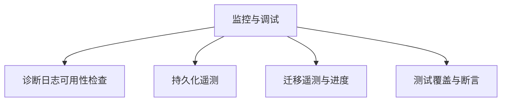

**图示来源**
- [local/delete_thread.rs:1-200](file://codex-rs/thread-store/src/local/delete_thread.rs#L1-L200)
- [live_thread.rs:1-200](file://codex-rs/thread-store/src/live_thread.rs#L1-L200)
- [local/rollout_migration.rs:1-200](file://codex-rs/thread-store/src/local/rollout_migration.rs#L1-L200)
- [in_memory.rs:1-200](file://codex-rs/thread-store/src/in_memory.rs#L1-L200)

**章节来源**
- [in_memory.rs:1-200](file://codex-rs/thread-store/src/in_memory.rs#L1-L200)

## 依赖关系分析
- `ThreadStore` 是所有实现的共同契约，上层代码不应关心具体后端。
- `LiveThread` 依赖 `ThreadStore` 进行持久化，并组合 `ThreadMetadataSync` 做元数据同步。
- `LocalThreadStore` 依赖 `codex-rollout` 进行 JSONL 读写，依赖 `codex-state` 的 SQLite 状态库。
- `thread_metadata_sync` 依赖 Git 工具和协议类型来采集仓库信息和来源。
- `rollout_lineage` 依赖协议中的历史位置指针，以组合分页历史。

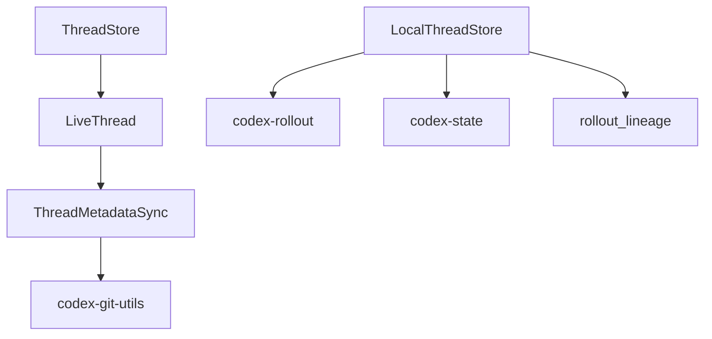

**图示来源**
- [store.rs:1-200](file://codex-rs/thread-store/src/store.rs#L1-L200)
- [live_thread.rs:1-200](file://codex-rs/thread-store/src/live_thread.rs#L1-L200)
- [thread_metadata_sync.rs:1-200](file://codex-rs/thread-store/src/thread_metadata_sync.rs#L1-L200)
- [local/mod.rs:1-200](file://codex-rs/thread-store/src/local/mod.rs#L1-L200)
- [local/rollout_lineage.rs:1-200](file://codex-rs/thread-store/src/local/rollout_lineage.rs#L1-L200)

**章节来源**
- [store.rs:1-200](file://codex-rs/thread-store/src/store.rs#L1-L200)
- [local/mod.rs:1-200](file://codex-rs/thread-store/src/local/mod.rs#L1-L200)

## 性能与并发特性
- 后台持久化：`PersistContext` 允许在特定上下文中延迟持久化，减少热点路径阻塞。
- 写入器锁与生命周期锁分离：允许子线程初始化期间父线程继续写入，提升并发吞吐。
- SQLite 连接池与写入者信号量：队列式 writer 获取连接，避免单写者阻塞读者。
- Rollout 迁移限速：可按 I/O 速率限制迁移速度，避免影响在线服务。
- 历史版本复用：通过文件身份校验安全复用历史快照，减少重复读取成本。

[本节为通用指导，无需文件来源]

## 故障排查指南
常见问题与定位要点：
- 无法删除线程：检查是否存在附属线程或外部引用，查看诊断日志可用性。
- 归档失败：确认 Rollout 路径合法，检查归档目录创建与文件移动回滚。
- 恢复失败：检查归档 Rollout 文件名时间戳、目录结构和 SQLite 标记。
- 读取线程报错：确认 Rollout 路径与线程 ID 匹配，分页模式下检查 SQLite 元数据。
- 元数据未更新：检查 `ThreadMetadataSync` 是否延迟到首次追加，确认补丁合并与持久化。

**章节来源**
- [local/delete_thread.rs:1-200](file://codex-rs/thread-store/src/local/delete_thread.rs#L1-L200)
- [local/archive_thread.rs:1-200](file://codex-rs/thread-store/src/local/archive_thread.rs#L1-L200)
- [local/unarchive_thread.rs:1-200](file://codex-rs/thread-store/src/local/unarchive_thread.rs#L1-L200)
- [local/read_thread.rs:1-200](file://codex-rs/thread-store/src/local/read_thread.rs#L1-L200)
- [thread_metadata_sync.rs:1-200](file://codex-rs/thread-store/src/thread_metadata_sync.rs#L1-L200)

## 结论
`codex-thread-store` 通过清晰的接口分层与本地实现，提供了健壮、可扩展且可演进的线程状态管理能力。`ThreadStore` 作为存储中立边界，`LiveThread` 作为活跃会话编排者，配合 `ThreadMetadataSync` 的元数据同步、`LocalThreadStore` 的并发控制和 Rollout 迁移机制，能够支撑从传统 JSONL 到分页历史的平滑过渡。系统在归档、恢复、删除、搜索和历史回放等场景中具备完善的错误处理与可观测性，适合在生产环境中稳定运行。

[本节为总结，无需文件来源]

## 附录：API 与数据模型速查
- 线程创建：`CreateThreadParams`、`ThreadPersistenceMetadata`。
- 线程恢复：`ResumeThreadParams`、`ThreadStoreResumePreparation`。
- 追加历史：`AppendThreadItemsParams`。
- 元数据更新：`UpdateThreadMetadataParams`、`ThreadMetadataPatch`。
- 线程读取：`ReadThreadParams`、`StoredThread`、`StoredThreadHistory`。
- 分页与轮次：`ListItemsParams`、`ListTurnsParams`、`ItemSortKey`、`TurnPage`。
- 搜索与时间线：`SearchThreadsParams`、`ListTimelineParams`、`ThreadSearchPage`、`TimelinePage`。

**章节来源**
- [types.rs:1-200](file://codex-rs/thread-store/src/types.rs#L1-L200)