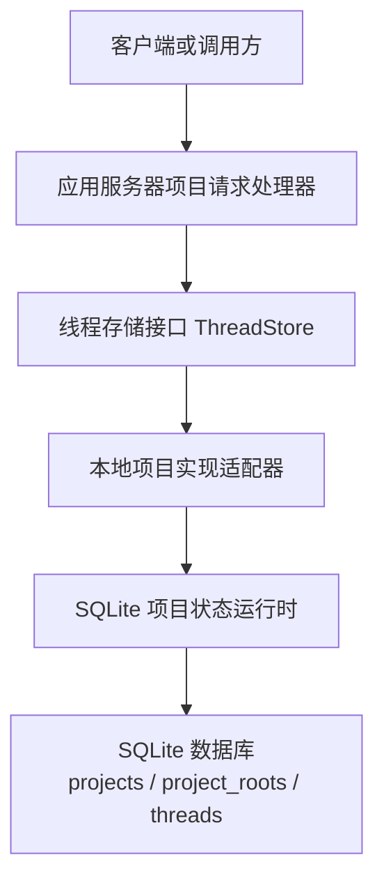
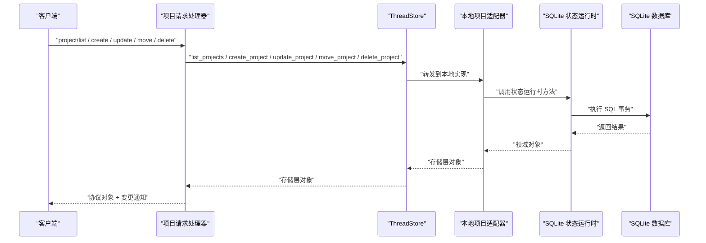
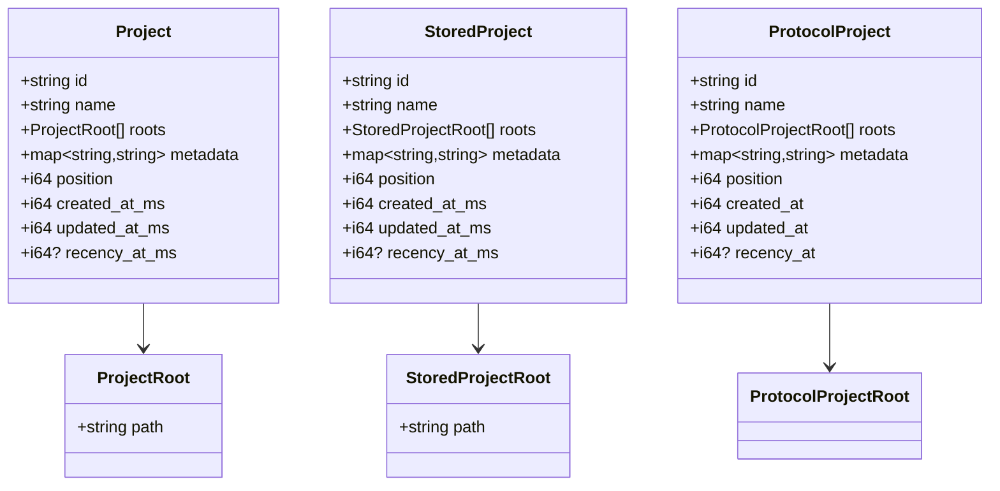
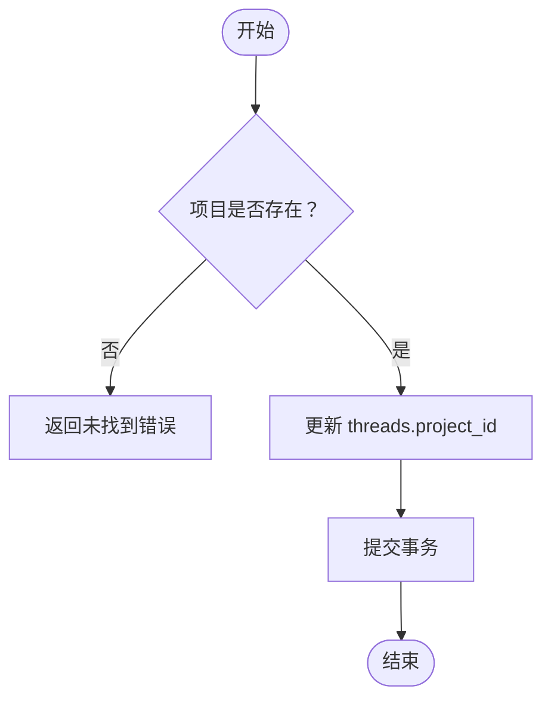
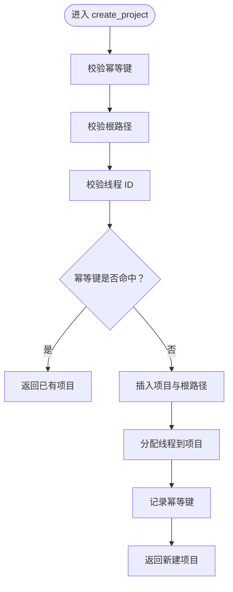
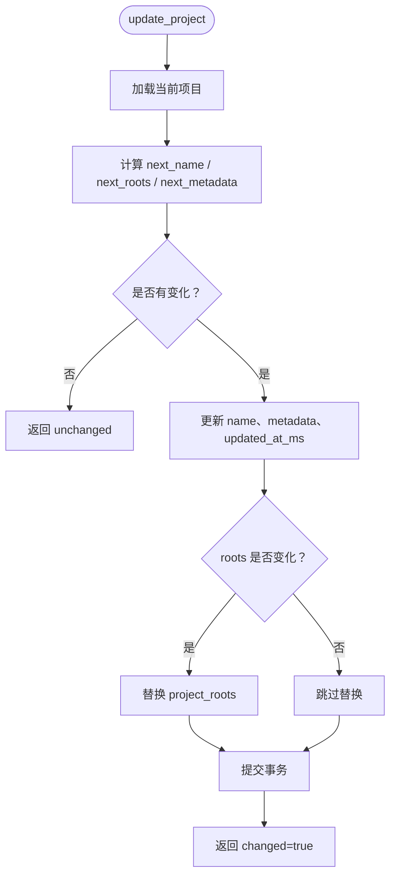
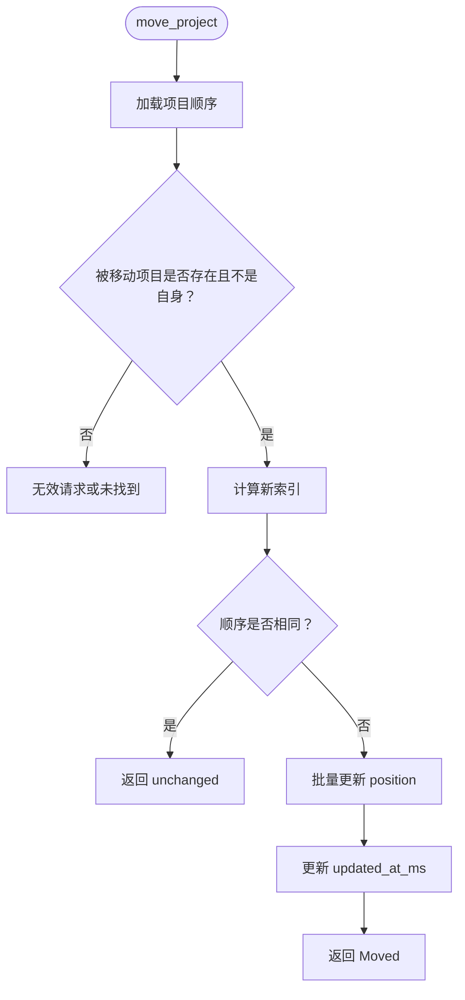
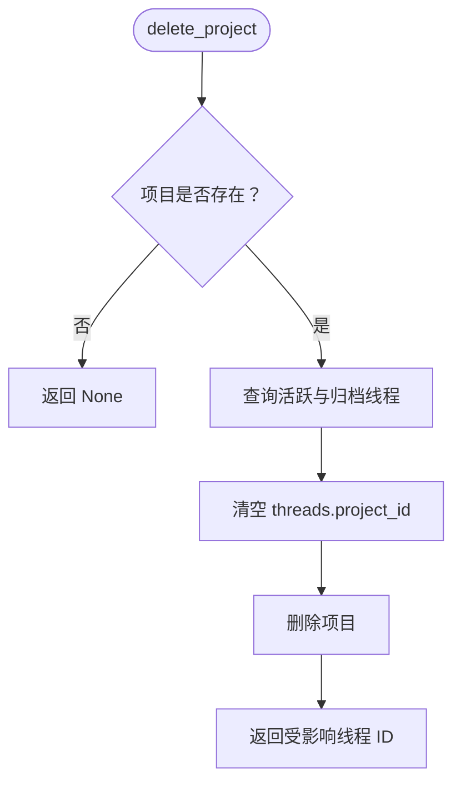
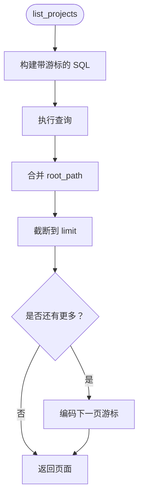

# 项目状态管理

<cite>
**本文引用的文件**   
- [project.rs](file://codex-rs/state/src/model/project.rs)
- [projects.rs（状态运行时）](file://codex-rs/state/src/runtime/projects.rs)
- [0049_projects.sql](file://codex-rs/state/migrations/0049_projects.sql)
- [0052_projects_recency.sql](file://codex-rs/state/migrations/0052_projects_recency.sql)
- [projects.rs（线程存储类型）](file://codex-rs/thread-store/src/projects.rs)
- [store.rs（ThreadStore 接口）](file://codex-rs/thread-store/src/store.rs)
- [projects.rs（本地实现适配器）](file://codex-rs/thread-store/src/local/projects.rs)
- [project.rs（应用服务器协议）](file://codex-rs/app-server-protocol/src/protocol/v2/project.rs)
- [projects.rs（项目请求处理器）](file://codex-rs/app-server/src/request_processors/projects.rs)
</cite>

## 目录
1. [引言](#引言)
2. [项目结构](#项目结构)
3. [核心组件](#核心组件)
4. [架构总览](#架构总览)
5. [详细组件分析](#详细组件分析)
6. [依赖关系分析](#依赖关系分析)
7. [性能与查询优化](#性能与查询优化)
8. [一致性检查与数据完整性](#一致性检查与数据完整性)
9. [备份、恢复与迁移最佳实践](#备份恢复与迁移最佳实践)
10. [故障排查指南](#故障排查指南)
11. [结论](#结论)

## 引言
本文聚焦于项目状态管理系统，围绕 ProjectStore 抽象、项目实体模型、项目的创建/更新/移动/删除操作、项目与线程的关联关系及层级结构、项目元数据存储格式与查询优化策略、一致性校验与完整性验证，以及备份、恢复和迁移实践进行系统化说明。系统采用分层设计：上层通过 JSON-RPC 风格的应用服务器请求处理器暴露对外接口；中间层由线程存储接口统一抽象项目持久化能力；底层使用 SQLite 作为项目与线程关系的权威持久化后端，并通过数据库迁移维护数据结构演进。

## 项目结构
项目状态管理主要涉及四层代码：
- 领域模型层：定义项目、根路径、分页等数据结构。
- 持久化运行时层：基于 SQLite 实现项目的增删改查、排序分页、幂等创建、移动和删除。
- 线程存储抽象层：将项目能力封装为 ThreadStore 的可插拔接口。
- 应用服务层：对外暴露项目列表、读取、创建、导入、更新、移动、删除等 RPC 方法，并负责参数校验、错误映射和变更通知。

**图表来源**  
- [projects.rs（项目请求处理器）](file://codex-rs/app-server/src/request_processors/projects.rs)
- [store.rs（ThreadStore 接口）](file://codex-rs/thread-store/src/store.rs)
- [projects.rs（本地实现适配器）](file://codex-rs/thread-store/src/local/projects.rs)
- [projects.rs（状态运行时）](file://codex-rs/state/src/runtime/projects.rs)
- [0049_projects.sql](file://codex-rs/state/migrations/0049_projects.sql)

**章节来源**  
- [projects.rs（项目请求处理器）](file://codex-rs/app-server/src/request_processors/projects.rs)
- [store.rs（ThreadStore 接口）](file://codex-rs/thread-store/src/store.rs)
- [projects.rs（本地实现适配器）](file://codex-rs/thread-store/src/local/projects.rs)
- [projects.rs（状态运行时）](file://codex-rs/state/src/runtime/projects.rs)
- [0049_projects.sql](file://codex-rs/state/migrations/0049_projects.sql)

## 核心组件
- 领域模型 Project：包含项目标识、名称、根路径集合、元数据、位置、创建时间、更新时间、最近活跃时间等字段，用于表示一个逻辑工作区。
- 存储模型 StoredProject：与领域模型相近，但属于线程存储层内部表示，便于在不同层之间传递。
- 协议模型 Project：应用服务器对外序列化模型，字段命名遵循 camelCase，并对毫秒级时间戳转换为秒级时间戳输出。
- 线程存储接口 ThreadStore：提供 supports_projects 开关和 list/read/create/update/move/delete 等方法，默认返回不支持，由具体实现启用项目能力。
- 本地项目适配器：将 ThreadStore 的项目方法与底层 StateDbHandle 对应起来，负责类型转换和错误映射。
- SQLite 项目状态运行时：实现具体的 SQL 查询、事务、游标分页、幂等键校验、根路径替换、项目移动与删除等操作。

**章节来源**  
- [project.rs（领域模型）](file://codex-rs/state/src/model/project.rs)
- [projects.rs（线程存储类型）](file://codex-rs/thread-store/src/projects.rs)
- [project.rs（应用服务器协议）](file://codex-rs/app-server-protocol/src/protocol/v2/project.rs)
- [store.rs（ThreadStore 接口）](file://codex-rs/thread-store/src/store.rs)
- [projects.rs（本地实现适配器）](file://codex-rs/thread-store/src/local/projects.rs)
- [projects.rs（状态运行时）](file://codex-rs/state/src/runtime/projects.rs)

## 架构总览
项目状态管理的调用链如下：
1. 客户端发起项目相关 RPC 请求。
2. 应用服务器项目请求处理器解析参数、执行校验、调用线程存储接口。
3. 若后端支持项目能力，则由本地适配器转调 SQLite 状态运行时。
4. 状态运行时在事务中读写 projects、project_roots、threads 表，并返回结果。
5. 处理器根据结果构造响应，并在变更时广播项目或线程项目变更通知。

**图表来源**  
- [projects.rs（项目请求处理器）](file://codex-rs/app-server/src/request_processors/projects.rs)
- [store.rs（ThreadStore 接口）](file://codex-rs/thread-store/src/store.rs)
- [projects.rs（本地实现适配器）](file://codex-rs/thread-store/src/local/projects.rs)
- [projects.rs（状态运行时）](file://codex-rs/state/src/runtime/projects.rs)

## 详细组件分析

### 项目实体模型与元数据存储
项目实体在三层有对应的表示：
- 领域模型 Project：面向状态运行时和测试，使用毫秒级时间戳。
- 存储模型 StoredProject：面向线程存储层，用于跨层传递。
- 协议模型 Project：面向外部客户端，使用 camelCase 命名，并将毫秒时间戳转换为秒。

项目元数据以 BTreeMap 形式存储，序列化为 JSON 字符串存入 projects.metadata 列。根路径存储在独立的 project_roots 表中，按 position 排序，确保同一项目的多个根路径顺序稳定。

**图表来源**  
- [project.rs（领域模型）](file://codex-rs/state/src/model/project.rs)
- [projects.rs（线程存储类型）](file://codex-rs/thread-store/src/projects.rs)
- [project.rs（应用服务器协议）](file://codex-rs/app-server-protocol/src/protocol/v2/project.rs)

**章节来源**  
- [project.rs（领域模型）](file://codex-rs/state/src/model/project.rs)
- [projects.rs（线程存储类型）](file://codex-rs/thread-store/src/projects.rs)
- [project.rs（应用服务器协议）](file://codex-rs/app-server-protocol/src/protocol/v2/project.rs)

### 项目与线程的关联关系
项目与线程的关系通过 threads.project_id 外键建立：
- 创建项目时可批量将已有线程归属到该项目。
- 设置线程项目时，会校验目标项目是否存在，并原子更新线程的 project_id。
- 删除项目时，会将所有线程的 project_id 置空，并返回受影响的活跃线程与归档线程 ID，供上层通知前端刷新。

**图表来源**  
- [projects.rs（状态运行时）](file://codex-rs/state/src/runtime/projects.rs)
- [0049_projects.sql](file://codex-rs/state/migrations/0049_projects.sql)

**章节来源**  
- [projects.rs（状态运行时）](file://codex-rs/state/src/runtime/projects.rs)
- [0049_projects.sql](file://codex-rs/state/migrations/0049_projects.sql)

### 项目创建与幂等控制
项目创建流程：
1. 校验幂等键非空且长度不超过限制。
2. 校验根路径合法、逻辑唯一且规范化后唯一。
3. 可选地校验待关联线程 ID 存在且无重复。
4. 通过幂等键查找是否已存在同名项目，若存在则直接返回已有项目。
5. 否则生成新项目 ID、计算下一个 position、写入 projects 与 project_roots，并记录幂等键。
6. 将指定线程归属到该项目。
7. 返回 CreatedProject，包含是否新建标志。

**图表来源**  
- [projects.rs（项目请求处理器）](file://codex-rs/app-server/src/request_processors/projects.rs)
- [projects.rs（状态运行时）](file://codex-rs/state/src/runtime/projects.rs)

**章节来源**  
- [projects.rs（项目请求处理器）](file://codex-rs/app-server/src/request_processors/projects.rs)
- [projects.rs（状态运行时）](file://codex-rs/state/src/runtime/projects.rs)

### 项目更新与增量比较
项目更新允许选择性更新 name、roots、metadata：
- 若所有字段均未变化，则直接回滚事务并返回 changed=false。
- 否则更新 name、metadata 和 updated_at_ms。
- 仅当 roots 发生变化时，才替换 project_roots 子表。
- 返回值包含是否发生变化的布尔标志，以便上层决定是否广播变更通知。

**图表来源**  
- [projects.rs（状态运行时）](file://codex-rs/state/src/runtime/projects.rs)

**章节来源**  
- [projects.rs（状态运行时）](file://codex-rs/state/src/runtime/projects.rs)

### 项目移动与层级顺序管理
项目移动支持将一个项目移动到另一个项目之前，或追加到末尾：
- 先按 position 与 id 升序加载所有项目 ID 列表。
- 校验被移动项目存在且不会移动到自身之前。
- 根据 before_project_id 确定新索引，重建顺序列表。
- 如果顺序未变化，则返回 no-op。
- 否则批量更新 position，并更新 moved 项目的 updated_at_ms。

**图表来源**  
- [projects.rs（状态运行时）](file://codex-rs/state/src/runtime/projects.rs)

**章节来源**  
- [projects.rs（状态运行时）](file://codex-rs/state/src/runtime/projects.rs)

### 项目删除与影响面传播
项目删除流程：
1. 校验项目存在。
2. 查询该项目下所有活跃线程和归档线程 ID。
3. 将 threads.project_id 置空。
4. 删除项目记录。
5. 返回受影响线程 ID 列表，供上层通知前端刷新。

**图表来源**  
- [projects.rs（状态运行时）](file://codex-rs/state/src/runtime/projects.rs)

**章节来源**  
- [projects.rs（状态运行时）](file://codex-rs/state/src/runtime/projects.rs)

### 项目列表与游标分页
项目列表支持两种排序键：
- position：按项目显示顺序排序。
- recency_at：按项目内最新非归档线程的最近活跃时间排序，空项目始终排在最后。

分页采用游标方式，游标编码包含排序键、方向、值与项目 ID，支持向后兼容旧版 position 升序游标格式。查询时使用 CTE 计算每个项目的 recency_at，并按排序键和 ID 进行稳定排序，再左连接 project_roots 以填充根路径。

**图表来源**  
- [projects.rs（状态运行时）](file://codex-rs/state/src/runtime/projects.rs)

**章节来源**  
- [projects.rs（状态运行时）](file://codex-rs/state/src/runtime/projects.rs)

## 依赖关系分析
- 应用服务器项目请求处理器依赖线程存储接口，并通过 OutgoingMessageSender 发送项目变更和线程项目变更通知。
- 线程存储接口默认不提供项目能力，需由本地实现启用。
- 本地项目适配器依赖 SQLite 状态运行时，负责错误分类：无效请求、内部错误、不支持。
- 状态运行时依赖 SQLite 池和 SQLx，使用立即事务保证并发写安全。
- 数据库迁移定义了 projects、project_roots、project_idempotency_keys 表和 threads.project_id 外键，并建立索引优化排序和查询。

**图表来源**  
- [projects.rs（项目请求处理器）](file://codex-rs/app-server/src/request_processors/projects.rs)
- [store.rs（ThreadStore 接口）](file://codex-rs/thread-store/src/store.rs)
- [projects.rs（本地实现适配器）](file://codex-rs/thread-store/src/local/projects.rs)
- [0049_projects.sql](file://codex-rs/state/migrations/0049_projects.sql)

**章节来源**  
- [projects.rs（项目请求处理器）](file://codex-rs/app-server/src/request_processors/projects.rs)
- [store.rs（ThreadStore 接口）](file://codex-rs/thread-store/src/store.rs)
- [projects.rs（本地实现适配器）](file://codex-rs/thread-store/src/local/projects.rs)
- [0049_projects.sql](file://codex-rs/state/migrations/0049_projects.sql)

## 性能与查询优化
- 项目列表查询通过 CTE 预先计算每个项目的 recency_at，避免 N+1 查询。
- 针对 position 与 recency_at 排序建立了复合索引，包括 position 主索引和按 project_id、archived、created_at_ms、id 的线程索引，提高项目下线程扫描效率。
- recency_at 查询还使用了过滤条件 archived=0 且 project_id 非空的索引，减少归档线程干扰。
- 游标分页避免全表扫描，通过有序比较和 ID 二次排序保证稳定分页。
- 根路径按需左连接，避免对每个项目都强制加载根路径时的额外开销。

建议：
- 保持 limit 合理上限，避免过大页面导致内存与网络压力。
- 对于高频按 recency 排序的场景，确保 recency_at 及时更新。
- 避免频繁大范围移动项目，因为移动会批量更新 position。

**章节来源**  
- [projects.rs（状态运行时）](file://codex-rs/state/src/runtime/projects.rs)
- [0049_projects.sql](file://codex-rs/state/migrations/0049_projects.sql)
- [0052_projects_recency.sql](file://codex-rs/state/migrations/0052_projects_recency.sql)

## 一致性检查与数据完整性
一致性保障点：
- 幂等键：create_project 使用 project_idempotency_keys 表保证同一幂等键只创建一个项目；若幂等键指向已删除项目，会返回明确错误。
- 外键约束：threads.project_id 引用 projects.id，删除项目时先将线程 project_id 置空，避免外键冲突。
- 根路径唯一性：应用服务器层校验逻辑唯一性和规范化后唯一性，防止重复根路径。
- 移动自引用保护：move_project 禁止项目移动到自身之前。
- 项目不存在保护：read、update、move、delete 均对缺失项目返回无效请求错误。
- 线程存在性保护：创建项目时校验 thread_ids 存在且无重复。

完整性验证建议：
- 定期检查 project_idempotency_keys 与 projects 的一致性，清理悬挂键。
- 校验 threads.project_id 是否存在于 projects，发现悬挂外键应修复或删除。
- 校验 project_roots.position 连续且与项目数量一致。
- 校验 recency_at 是否与 threads.recency_at_ms 的最大非归档值一致。

**章节来源**  
- [projects.rs（项目请求处理器）](file://codex-rs/app-server/src/request_processors/projects.rs)
- [projects.rs（状态运行时）](file://codex-rs/state/src/runtime/projects.rs)
- [0049_projects.sql](file://codex-rs/state/migrations/0049_projects.sql)

## 备份、恢复与迁移最佳实践
备份：
- 使用 SQLite 支持的物理或逻辑备份方式导出整个数据库，确保包含 projects、project_roots、project_idempotency_keys 和 threads 表。
- 如需只备份项目相关数据，至少导出上述三张表及 threads.project_id 列。

恢复：
- 恢复后执行一致性校验，确保外键完整、幂等键不悬挂、根路径位置连续。
- 如 threads.project_id 出现悬挂外键，应根据业务策略将其置空或修正。

迁移：
- 新增项目字段或索引时，应编写向上迁移脚本，例如为 recency_at 添加索引。
- 对历史数据进行回填时，注意分批更新，避免长时间锁表。
- 若变更项目排序规则，应在低峰期执行批量 position 重算，并考虑并发移动操作的幂等性。

最佳实践：
- 迁移前做快照，迁移后运行一致性检查脚本。
- 对大表更新使用分批次事务，降低锁竞争。
- 保留旧版本游标格式的兼容性，避免客户端重连失败。

**章节来源**  
- [0049_projects.sql](file://codex-rs/state/migrations/0049_projects.sql)
- [0052_projects_recency.sql](file://codex-rs/state/migrations/0052_projects_recency.sql)
- [projects.rs（状态运行时）](file://codex-rs/state/src/runtime/projects.rs)

## 故障排查指南
常见问题与定位思路：
- 项目不存在：read、update、move、delete 返回无效请求错误，检查 project_id 是否正确。
- 根路径重复：创建或更新时报错，检查传入根路径是否逻辑重复或规范化后重复。
- 幂等键异常：创建项目时报“幂等键指向已删除项目”，检查幂等键是否复用或项目是否已被删除。
- 线程未找到：创建项目时绑定线程失败，检查 thread_ids 是否有效。
- 不支持项目功能：若 ThreadStore 未启用项目能力，会返回不支持错误，确认本地实现已启用 supports_projects。
- 游标无效：列表分页报游标错误，检查客户端传参 sort_key 与 direction 是否与游标一致。

错误映射：
- 应用服务器将 ThreadStoreError 中的 Unsupported 映射为方法不可用，InvalidRequest 映射为参数错误，Internal 映射为内部错误。
- 本地适配器将底层错误分类为 InvalidRequest 或 Internal，便于上层统一处理。

**章节来源**  
- [projects.rs（项目请求处理器）](file://codex-rs/app-server/src/request_processors/projects.rs)
- [projects.rs（本地实现适配器）](file://codex-rs/thread-store/src/local/projects.rs)
- [store.rs（ThreadStore 接口）](file://codex-rs/thread-store/src/store.rs)

## 结论
项目状态管理系统通过清晰的层次划分和稳定的数据模型，实现了项目的创建、更新、移动和删除，以及与线程的关联管理。SQLite 作为权威持久化后端，配合迁移和索引，提供了可靠的排序、分页和查询性能。应用服务器层负责参数校验、错误映射和变更通知，使前端能够实时感知项目和线程项目的变化。在生产环境中，应重视幂等性、外键完整性、根路径唯一性和 recency 一致性，并结合备份、恢复与迁移策略，确保系统在扩展与维护过程中的稳定性与可观测性。