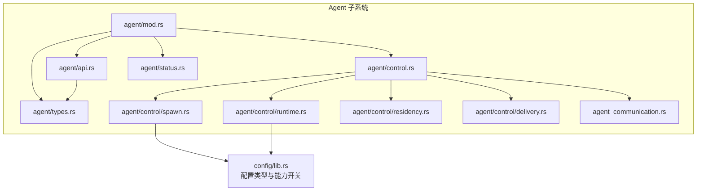
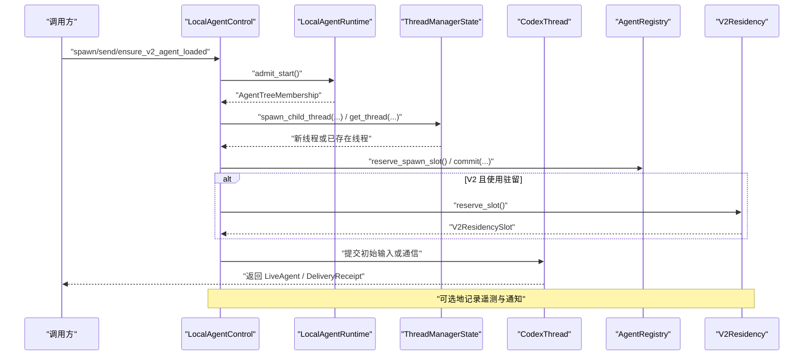
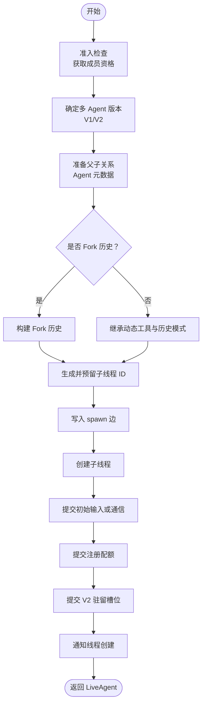
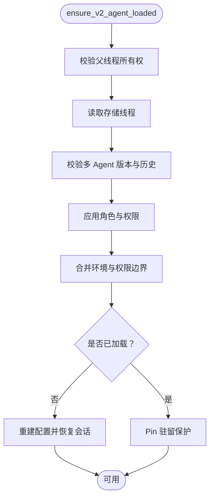
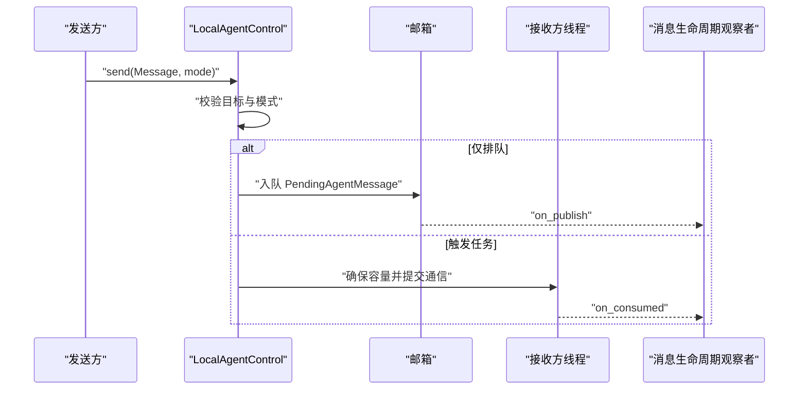
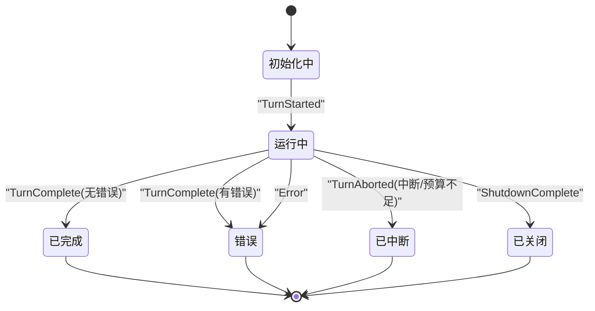
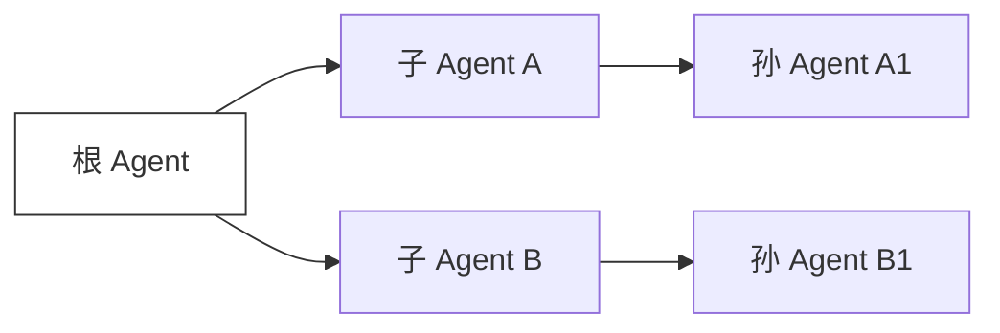
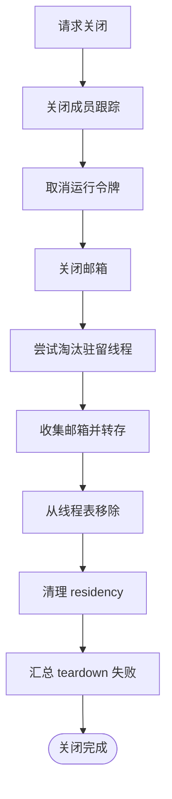
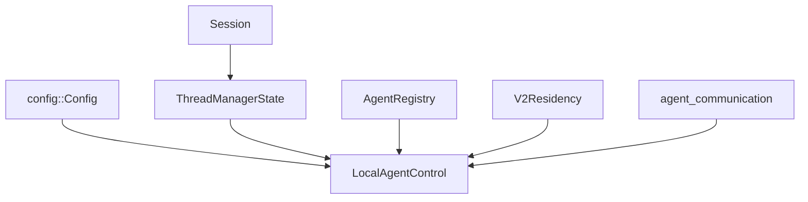

# Agent 生命周期管理

<cite>
**本文引用的文件**   
- [agent/mod.rs](file://codex-rs/core/src/agent/mod.rs)
- [agent/types.rs](file://codex-rs/core/src/agent/types.rs)
- [agent/status.rs](file://codex-rs/core/src/agent/status.rs)
- [agent/api.rs](file://codex-rs/core/src/agent/api.rs)
- [agent/control.rs](file://codex-rs/core/src/agent/control.rs)
- [agent/control/spawn.rs](file://codex-rs/core/src/agent/control/spawn.rs)
- [agent/control/runtime.rs](file://codex-rs/core/src/agent/control/runtime.rs)
- [agent/control/residency.rs](file://codex-rs/core/src/agent/control/residency.rs)
- [agent/control/delivery.rs](file://codex-rs/core/src/agent/control/delivery.rs)
- [agent_communication.rs](file://codex-rs/core/src/agent_communication.rs)
- [config/lib.rs](file://codex-rs/config/src/lib.rs)
</cite>

## 目录
1. [引言](#引言)
2. [项目结构](#项目结构)
3. [核心组件](#核心组件)
4. [架构总览](#架构总览)
5. [详细组件分析](#详细组件分析)
6. [依赖关系分析](#依赖关系分析)
7. [性能与容量特性](#性能与容量特性)
8. [故障排查指南](#故障排查指南)
9. [结论](#结论)
10. [附录：配置参考](#附录配置参考)

## 引言
本文围绕 Codex Core 中的 Agent 生命周期管理进行系统性说明。重点覆盖以下方面：
- Agent 的创建、启动、运行和销毁流程；
- AgentConfig 的关键配置维度，包括模型选择、权限、网络策略、沙箱等；
- Agent 状态转换机制，从初始化到活跃再到终止；
- Agent 与宿主环境的交互模式，包括消息传递、事件订阅、资源管理与驻留淘汰；
- 多 Agent 架构下的父子关系、资源共享和通信协议；
- 生命周期钩子与扩展点，以及最佳实践建议。

本说明以 `codex-rs/core/src/agent` 为核心，结合 `config` 层对外暴露的配置类型，面向具备基础异步 Rust 知识的读者，同时尽量用概念化图示帮助非深度实现者理解。

## 项目结构
Agent 子系统位于 `codex-rs/core/src/agent`，采用模块分层组织：
- `mod.rs` 暴露公共子模块和导出项；
- `types.rs` 定义跨控制器共享的数据结构和枚举；
- `api.rs` 定义统一的 `AgentControl` 接口契约；
- `control.rs` 提供会话级本地控制器句柄 `LocalAgentControl`；
- `control/*` 子模块负责运行时、派生、投递、驻留、预算、中断等具体能力；
- `host/*` 面向外部 Host 侧的代理接入能力；
- `status.rs` 将底层事件映射为 Agent 状态；
- 配套通信基础设施在 `core/src/agent_communication.rs`。

**图表来源**  
- [agent/mod.rs:1-16](file://codex-rs/core/src/agent/mod.rs#L1-L16)
- [agent/types.rs:1-91](file://codex-rs/core/src/agent/types.rs#L1-L91)
- [agent/api.rs:1-200](file://codex-rs/core/src/agent/api.rs#L1-L200)
- [agent/control.rs:1-200](file://codex-rs/core/src/agent/control.rs#L1-L200)
- [agent/control/spawn.rs:600-972](file://codex-rs/core/src/agent/control/spawn.rs#L600-L972)
- [agent/control/runtime.rs:1-200](file://codex-rs/core/src/agent/control/runtime.rs#L1-L200)
- [agent/control/residency.rs:1-200](file://codex-rs/core/src/agent/control/residency.rs#L1-L200)
- [agent/control/delivery.rs:1-45](file://codex-rs/core/src/agent/control/delivery.rs#L1-L45)
- [agent_communication.rs:1-189](file://codex-rs/core/src/agent_communication.rs#L1-L189)
- [config/lib.rs:1-252](file://codex-rs/config/src/lib.rs#L1-L252)

**章节来源**  
- [agent/mod.rs:1-16](file://codex-rs/core/src/agent/mod.rs#L1-L16)

## 核心组件
本节聚焦 Agent 生命周期相关的最关键抽象。

| 组件 | 职责 | 关键行为 |
|---|---|---|
| `AgentMetadata` / `LiveAgent` | 描述 Agent 的身份、路径、角色、当前状态 | 注册后拥有 `ThreadId`，未加载时仍保留元数据 |
| `SpawnAgentOptions` | 控制子 Agent 派生时的上下文继承 | 支持父线程/轮次 ID、环境快照、插件禁用列表、多 Agent 使用提示等 |
| `AgentControl` | 统一 Agent 操作接口 | 解析目标、派生子 Agent、发送输入或消息、取邮箱、观察邮箱、中断、列举、容量检查、用量上报、完成回调等 |
| `LocalAgentControl` | 本地 Agent 树控制器 | 持有 `LocalAgentRuntime`，封装会话级生命周期管理 |
| `LocalAgentRuntime` | 本地运行时共享状态 | 注册表、邮箱、驻留、执行限制器、关闭令牌、服务层级、Rollout 预算等 |
| `V2Residency` | V2 多 Agent 驻留与淘汰 | 维护常驻工作集，按 LRU 风格触达并尝试淘汰空闲线程 |
| `AgentMessage` / `MessageDeliveryMode` | 区分明文/加密消息及投递模式 | QueueOnly 不唤醒工作，TriggerTurn 可触发新轮次 |
| `PendingAgentMessage` / `MessageDelivery` | 持久化的待投递消息及其发布/消费生命周期 | 通过观察者回调记录消息生命周期 |
| `AgentStatus` 映射 | 根据事件推导 Agent 状态 | 从 TurnStarted/TurnComplete/TurnAborted/Error/ShutdownComplete 推导 |

**章节来源**  
- [agent/types.rs:1-91](file://codex-rs/core/src/agent/types.rs#L1-L91)
- [agent/api.rs:1-200](file://codex-rs/core/src/agent/api.rs#L1-L200)
- [agent/control.rs:1-200](file://codex-rs/core/src/agent/control.rs#L1-L200)
- [agent/control/runtime.rs:1-200](file://codex-rs/core/src/agent/control/runtime.rs#L1-L200)
- [agent/control/residency.rs:1-200](file://codex-rs/core/src/agent/control/residency.rs#L1-L200)
- [agent/control/delivery.rs:1-45](file://codex-rs/core/src/agent/control/delivery.rs#L1-L45)
- [agent_communication.rs:1-189](file://codex-rs/core/src/agent_communication.rs#L1-L189)
- [agent/status.rs:1-31](file://codex-rs/core/src/agent/status.rs#L1-L31)

## 架构总览
Agent 的生命周期由三层协作驱动：
1. 调用方通过 `AgentControl` 发起派生或消息；
2. `LocalAgentControl` 在本地运行时中准备父子关系、历史、工具、权限、执行策略等；
3. `ThreadManagerState` 创建实际线程，并通过事件流驱动状态更新。

**图表来源**  
- [agent/control.rs:1-200](file://codex-rs/core/src/agent/control.rs#L1-L200)
- [agent/control/spawn.rs:600-972](file://codex-rs/core/src/agent/control/spawn.rs#L600-L972)
- [agent/control/runtime.rs:200-385](file://codex-rs/core/src/agent/control/runtime.rs#L200-L385)
- [agent/control/residency.rs:200-350](file://codex-rs/core/src/agent/control/residency.rs#L200-L350)

## 详细组件分析

### Agent 创建与启动流程
Agent 的创建入口集中在 `LocalAgentControl::spawn_agent_internal`。其核心步骤如下：
- 进入运行时准入检查，获取 `AgentTreeMembership`；
- 确定多 Agent 版本（V1/V2）、是否启用 V2 驻留、最大线程数；
- 准备父子 SessionSource、Agent 元数据、继承的环境和执行策略；
- 若 fork 模式，准备初始历史；否则继承父线程历史模式与动态工具；
- 生成并预留子线程 ID，写入 spawn edge；
- 调用 `ThreadManagerState::spawn_child_thread` 创建线程；
- 向子线程提交初始输入或跨 Agent 通信；
- 提交注册配额、提交驻留槽位；
- 通知线程创建，必要时启动完成观察器；
- 返回 `LiveAgent` 和最终配置快照。

**图表来源**  
- [agent/control/spawn.rs:600-972](file://codex-rs/core/src/agent/control/spawn.rs#L600-L972)

**章节来源**  
- [agent/control/spawn.rs:600-972](file://codex-rs/core/src/agent/control/spawn.rs#L600-L972)

### Agent 恢复与加载
对于 V2 Agent，系统支持“冷启动恢复”和“热驻留”两种模式：
- `ensure_v2_agent_loaded` 会校验父线程所有权、读取存储线程、恢复历史、应用角色与权限、合并环境绑定；
- 如果目标线程已在内存中且满足驻留条件，则直接 pin 住其 residency；
- 如果线程被卸载但仍在注册表中，则重建其配置、权限和网络策略，并从存储中恢复会话；
- 恢复成功后，允许后续消息投递而不必重新完整加载。

**图表来源**  
- [agent/control/spawn.rs:237-600](file://codex-rs/core/src/agent/control/spawn.rs#L237-L600)

**章节来源**  
- [agent/control/spawn.rs:237-600](file://codex-rs/core/src/agent/control/spawn.rs#L237-L600)

### Agent 运行与消息传递
Agent 的运行由线程内的 turn 循环驱动，外部通过两类方式与 Agent 交互：
- 用户输入：`send_input` 启动或引导一个 turn；
- 跨 Agent 通信：`send_inter_agent_communication` 投递 `InterAgentCommunication`，可选择仅排队或触发新任务。

消息投递的关键约束：
- `MessageDeliveryMode::QueueOnly` 不会启动 idle Agent；
- `MessageDeliveryMode::TriggerTurn` 可以触发新轮次，但禁止 follow-up 消息直接指向根 Agent；
- 加密消息与普通消息在投递前会被转换为协议对象；
- 投递生命周期通过 `MessageDelivery` 和观察者回调记录发送与消费。

**图表来源**  
- [agent/control/delivery.rs:1-45](file://codex-rs/core/src/agent/control/delivery.rs#L1-L45)
- [agent_communication.rs:1-189](file://codex-rs/core/src/agent_communication.rs#L1-L189)
- [agent/api.rs:1-200](file://codex-rs/core/src/agent/api.rs#L1-L200)

**章节来源**  
- [agent/control/delivery.rs:1-45](file://codex-rs/core/src/agent/control/delivery.rs#L1-L45)
- [agent_communication.rs:1-189](file://codex-rs/core/src/agent_communication.rs#L1-L189)
- [agent/api.rs:1-200](file://codex-rs/core/src/agent/api.rs#L1-L200)

### Agent 状态转换
Agent 的状态由底层事件推导，主要状态包括：
- 初始化中；
- 运行中；
- 已完成；
- 错误；
- 已中断；
- 已关闭。

**图表来源**  
- [agent/status.rs:1-31](file://codex-rs/core/src/agent/status.rs#L1-L31)

**章节来源**  
- [agent/status.rs:1-31](file://codex-rs/core/src/agent/status.rs#L1-L31)

### 多 Agent 协调与父子关系
多 Agent 场景下，父子关系通过 `SessionSource::SubAgent` 表达：
- 子 Agent 继承父线程的 history_mode、动态工具、环境变量、执行策略和插件选择；
- V2 引入驻留机制，允许空闲子 Agent 卸载但仍保持身份与邮箱；
- 父子间通信通过 `InterAgentCommunication` 携带作者、收件人、内容、是否触发任务等语义；
- 资源隔离体现在权限配置文件、工作区根、网络策略和环境绑定上；
- 根 Agent 不能成为 follow-up 的目标，避免循环唤醒。

**图表来源**  
- [agent/control/spawn.rs:600-972](file://codex-rs/core/src/agent/control/spawn.rs#L600-L972)
- [agent_communication.rs:1-189](file://codex-rs/core/src/agent_communication.rs#L1-L189)

**章节来源**  
- [agent/control/spawn.rs:600-972](file://codex-rs/core/src/agent/control/spawn.rs#L600-L972)
- [agent_communication.rs:1-189](file://codex-rs/core/src/agent_communication.rs#L1-L189)

### Agent 销毁与关闭
Agent 树的关闭由 `LocalAgentRuntime` 管理：
- 关闭入口关闭 TaskTracker、取消 Token、关闭邮箱；
- 每个子线程通过 `AgentTreeTeardownGuard` 记录 teardown 阶段失败；
- V2 驻留线程可被主动淘汰：系统尝试停止线程、收集邮箱、保存环境绑定、从线程表移除并清理 residency。

**图表来源**  
- [agent/control/runtime.rs:200-385](file://codex-rs/core/src/agent/control/runtime.rs#L200-L385)
- [agent/control/residency.rs:1-200](file://codex-rs/core/src/agent/control/residency.rs#L1-L200)

**章节来源**  
- [agent/control/runtime.rs:200-385](file://codex-rs/core/src/agent/control/runtime.rs#L200-L385)
- [agent/control/residency.rs:1-200](file://codex-rs/core/src/agent/control/residency.rs#L1-L200)

## 依赖关系分析
Agent 生命周期涉及的核心依赖包括：
- `config::Config`：决定模型、权限、网络、沙箱、功能开关等；
- `thread_manager`：线程创建、状态同步、通知；
- `session`：会话上下文、历史、动态工具、Rollout 追踪；
- `registry`：Agent 注册、配额、路径解析；
- `residency`：V2 驻留与淘汰；
- `communication`：跨 Agent 消息与生命周期观测。

**图表来源**  
- [agent/control.rs:1-200](file://codex-rs/core/src/agent/control.rs#L1-L200)
- [agent/control/runtime.rs:1-200](file://codex-rs/core/src/agent/control/runtime.rs#L1-L200)
- [agent/control/residency.rs:1-200](file://codex-rs/core/src/agent/control/residency.rs#L1-L200)
- [agent_communication.rs:1-189](file://codex-rs/core/src/agent_communication.rs#L1-L189)

**章节来源**  
- [agent/control.rs:1-200](file://codex-rs/core/src/agent/control.rs#L1-L200)
- [agent/control/runtime.rs:1-200](file://codex-rs/core/src/agent/control/runtime.rs#L1-L200)

## 性能与容量特性
- 执行限制器：`AgentExecutionLimiter` 用于限制并发 turn 数量，防止过度负载；
- 驻留容量：V2 驻留槽位受 `effective_agent_max_threads` 限制，超出时会尝试淘汰最久未使用的空闲线程；
- 邮箱容量：邮箱支持 watch 与 take，避免丢失未读消息；
- 资源隔离：权限与环境绑定在恢复与 fork 过程中严格校验，避免越权；
- 遥测：派生成功时记录多种耗时指标，便于诊断瓶颈。

**章节来源**  
- [agent/control/runtime.rs:200-385](file://codex-rs/core/src/agent/control/runtime.rs#L200-L385)
- [agent/control/residency.rs:200-350](file://codex-rs/core/src/agent/control/residency.rs#L200-L350)
- [agent/control/spawn.rs:600-972](file://codex-rs/core/src/agent/control/spawn.rs#L600-L972)

## 故障排查指南
常见问题与定位建议：
- 子线程 ID 冲突：创建前会检查是否已存在对应 ID；
- 无法恢复子 Agent：检查父线程所有权、历史记录版本、环境绑定是否一致；
- 消息投递失败：确认接收方是否已加载、是否为 root、投递模式是否合法；
- 驻留淘汰失败：查看线程是否处于 Busy 状态、是否有未完成的 durable sleep 或待处理 trigger mail；
- 关闭未完成：检查 teardown guard 是否记录失败，关注 phase 与 error_kind。

**章节来源**  
- [agent/control/spawn.rs:600-972](file://codex-rs/core/src/agent/control/spawn.rs#L600-L972)
- [agent/control/residency.rs:200-350](file://codex-rs/core/src/agent/control/residency.rs#L200-L350)
- [agent/control/runtime.rs:200-385](file://codex-rs/core/src/agent/control/runtime.rs#L200-L385)

## 结论
Agent 生命周期管理在 Codex Core 中通过清晰的接口契约、严格的父子关系与权限继承、以及 V2 驻留机制实现高内聚、可扩展的设计。`AgentControl` 提供统一入口，`LocalAgentControl` 与 `LocalAgentRuntime` 管理本地运行时，`ThreadManagerState` 负责线程调度，`V2Residency` 保障多 Agent 场景下的资源效率。通过事件驱动的状态映射、消息生命周期的可观测性，以及对模型、权限、网络、沙箱的统一配置，系统既能满足复杂多 Agent 协作需求，又能在大规模部署中保持稳定与可观测。

## 附录：配置参考
Agent 的配置来源于 `config` 层，关键维度包括：
- 模型选择：模型名称、模型提供者、推理强度；
- 权限配置：权限配置文件、审批策略、审批审查者、工作区根；
- 网络策略：域名许可、Unix Socket 许可、MCP 服务器策略、网络头注入；
- 沙箱模式：沙箱实现、远程沙箱配置、Windows 沙箱实现；
- 功能开关：多 Agent V2、动态工具、Web Search 模式、浏览器使用要求等；
- 其他：Hook 配置、Skills 配置、OTel 配置、TUI 渲染设置等。

这些配置在 Agent 派生、恢复、fork 和权限交叉时被严格应用，以确保子 Agent 的行为符合安全策略与业务需求。

**章节来源**  
- [config/lib.rs:1-252](file://codex-rs/config/src/lib.rs#L1-L252)