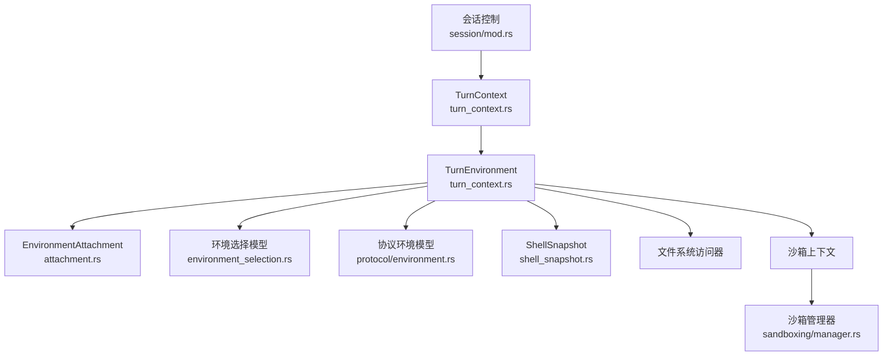
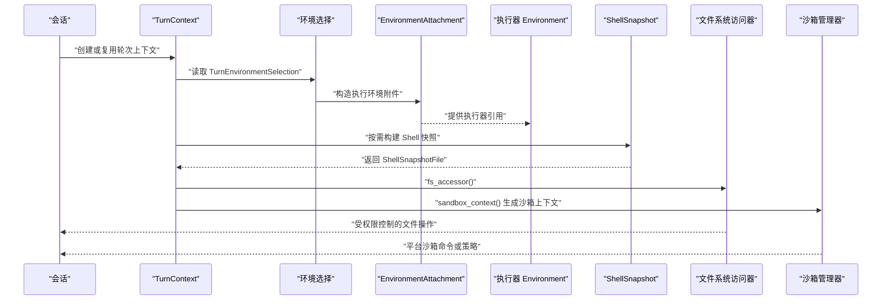
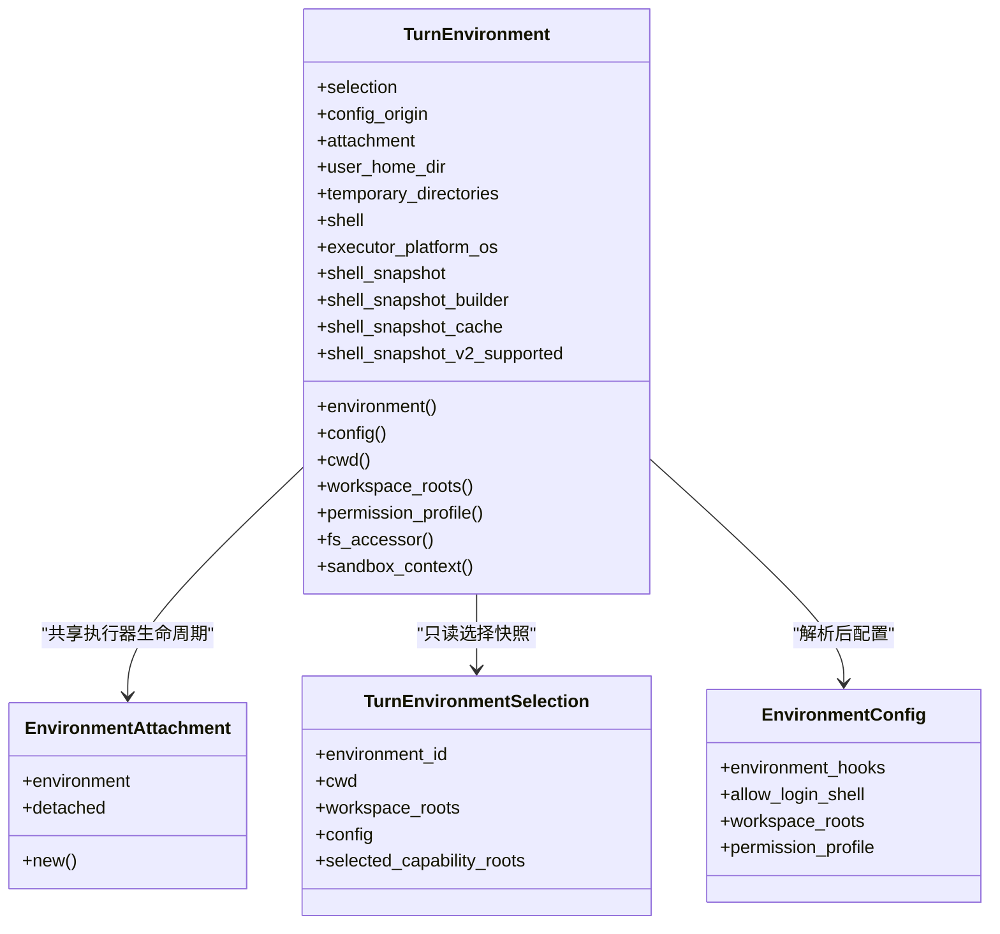
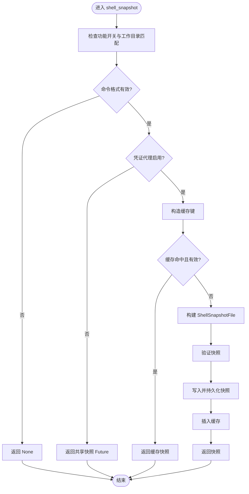
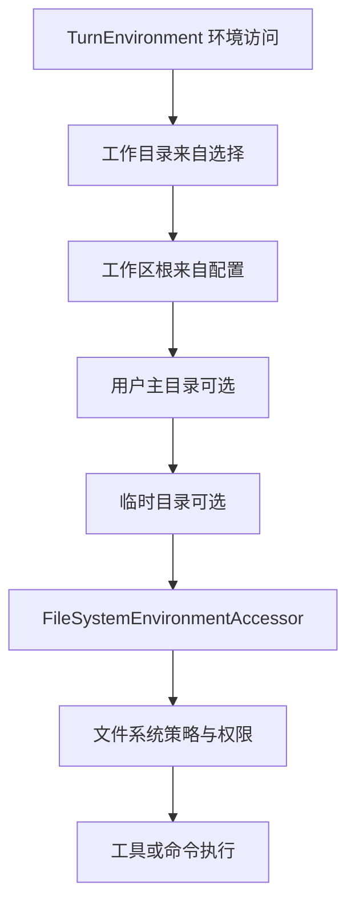
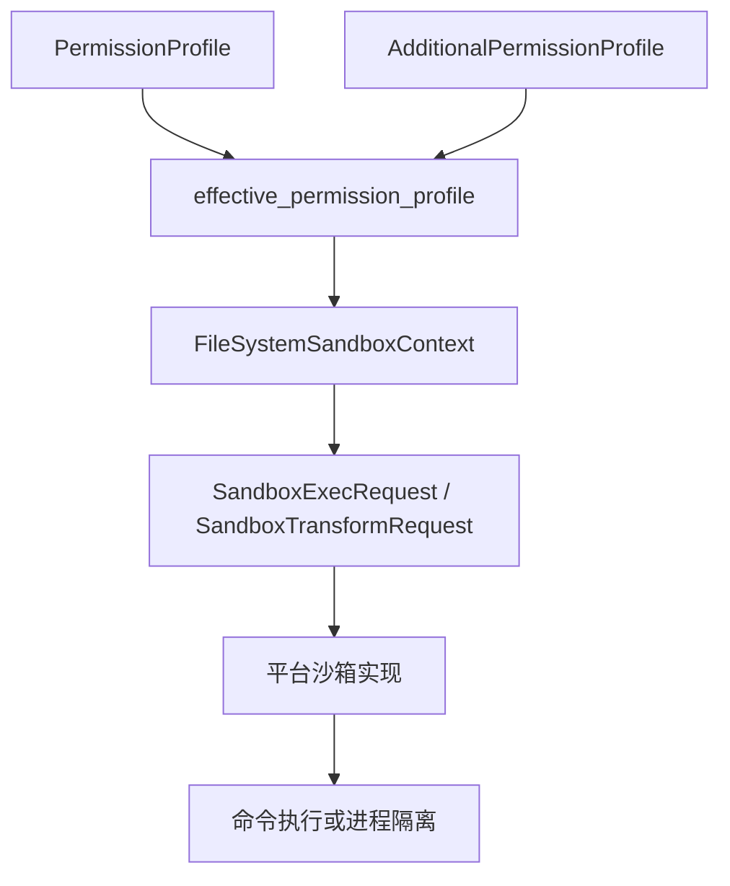
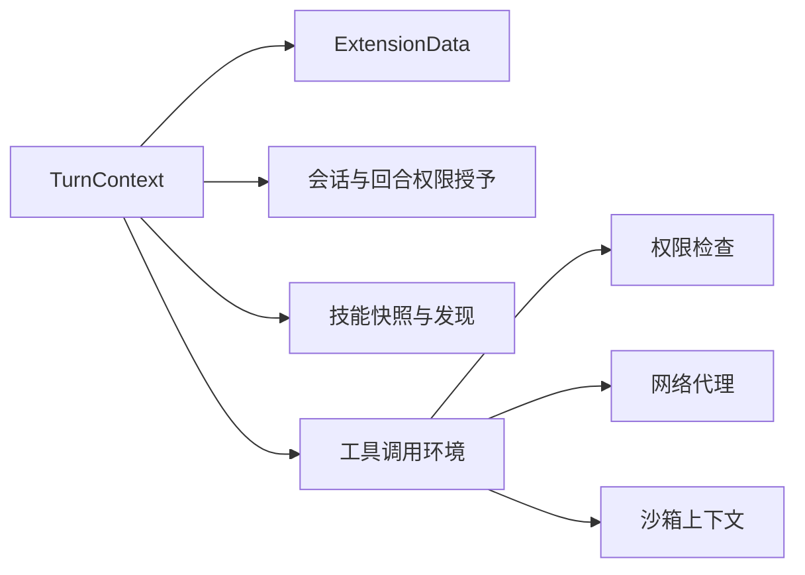
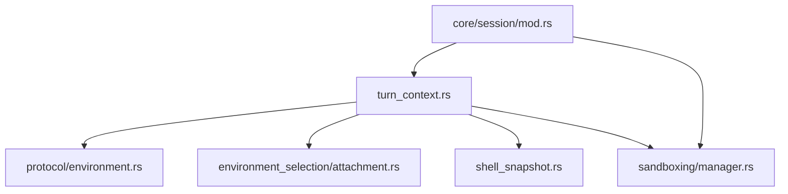

# TurnContext 上下文系统

<cite>
**本文引用的文件**
- [turn_context.rs](file://codex-rs/core/src/session/turn_context.rs)
- [mod.rs（会话模块）](file://codex-rs/core/src/session/mod.rs)
- [environment.rs（协议环境模型）](file://codex-rs/protocol/src/environment.rs)
- [attachment.rs（执行环境附件）](file://codex-rs/core/src/environment_selection/attachment.rs)
- [environment_selection.rs（环境选择与快照）](file://codex-rs/core/src/environment_selection.rs)
- [shell_snapshot.rs（Shell 快照）](file://codex-rs/core/src/shell_snapshot.rs)
- [manager.rs（沙箱管理器）](file://codex-rs/sandboxing/src/manager.rs)
</cite>

## 目录
1. [引言](#引言)
2. [项目结构与定位](#项目结构与定位)
3. [核心组件总览](#核心组件总览)
4. [架构概览](#架构概览)
5. [TurnEnvironment 设计模式](#turnenvironment-设计模式)
6. [Shell 快照机制](#shell-快照机制)
7. [环境变量管理](#环境变量管理)
8. [沙箱策略与安全边界](#沙箱策略与安全边界)
9. [上下文扩展点](#上下文扩展点)
10. [依赖关系分析](#依赖关系分析)
11. [性能与缓存特性](#性能与缓存特性)
12. [使用示例](#使用示例)
13. [故障排查指南](#故障排查指南)
14. [结论](#结论)

## 引言
TurnContext 上下文系统是 Codex 核心会话层中的运行时装配中心。它负责把一次“对话轮次”所需的环境、权限、网络代理、插件能力、沙箱策略和 Shell 快照等运行时资源组合起来，并通过 TurnEnvironment 暴露稳定的执行环境视图。该体系将“请求方选择的环境”“线程级能力根”“执行器报告的工作目录、用户主目录、临时目录”以及“权限配置”解耦，从而支持本地与远程执行器、凭证代理、平台沙箱和工具调用环境的统一抽象。

## 项目结构与定位
TurnContext 位于 Rust 核心包 `codex-rs/core` 的会话模块中；TurnEnvironment 是 TurnContext 为每个执行环境提供的快照式视图；协议层的 `TurnEnvironmentRequest` / `TurnEnvironmentSelection` / `EnvironmentConfigState` 描述环境选择的输入、绑定和执行期配置；`EnvironmentAttachment` 封装执行器的生命周期、连接事件和分离信号；`ShellSnapshot` 负责捕获可重复使用的命令执行环境；`SandboxManager` 负责把权限配置转换为平台沙箱执行请求。

**图示来源**
- [turn_context.rs:1-200](file://codex-rs/core/src/session/turn_context.rs#L1-L200)
- [attachment.rs:1-102](file://codex-rs/core/src/environment_selection/attachment.rs#L1-L102)
- [environment.rs:1-200](file://codex-rs/protocol/src/environment.rs#L1-L200)
- [shell_snapshot.rs:1-200](file://codex-rs/core/src/shell_snapshot.rs#L1-L200)
- [manager.rs:1-200](file://codex-rs/sandboxing/src/manager.rs#L1-L200)

**章节来源**
- [turn_context.rs:1-200](file://codex-rs/core/src/session/turn_context.rs#L1-L200)
- [mod.rs:1-200](file://codex-rs/core/src/session/mod.rs#L1-L200)

## 核心组件总览
- **TurnContext**：表示一次被 admit 的对话轮次上下文，包含配置、模型提供者、网络代理、权限授予、插件身份、回合计时、错误状态、初始环境快照等。
- **TurnEnvironment**：表示一个已解析的执行环境快照，持有选择信息、配置来源、附件、工作目录、工作区根、权限配置、用户主目录、临时目录、Shell、平台操作系统信息和 Shell 快照任务。
- **EnvironmentAttachment**：包装单个执行器，提供连接状态事件转发和分离取消令牌。
- **TurnEnvironmentRequest / TurnEnvironmentSelection**：分别表示“未绑定能力根的请求”和“已绑定能力根的选择”。
- **EnvironmentConfigState**：描述环境配置的线程继承、等待就绪、已就绪和失败状态。
- **ShellSnapshot / ShellSnapshotFile**：描述 Shell 执行环境的构建、验证、缓存、凭证恢复和失效策略。
- **SandboxExecRequest / SandboxTransformRequest**：描述沙箱化命令执行的参数、权限、网络和平台选项。

**章节来源**
- [turn_context.rs:1-200](file://codex-rs/core/src/session/turn_context.rs#L1-L200)
- [environment.rs:1-200](file://codex-rs/protocol/src/environment.rs#L1-L200)
- [attachment.rs:1-102](file://codex-rs/core/src/environment_selection/attachment.rs#L1-L102)
- [shell_snapshot.rs:1-200](file://codex-rs/core/src/shell_snapshot.rs#L1-L200)
- [manager.rs:1-200](file://codex-rs/sandboxing/src/manager.rs#L1-L200)

## 架构概览
TurnContext 不是单一职责对象，而是会话生命周期的运行时装配点。它保存 TurnEnvironmentSnapshot，并允许步骤或工具通过 TurnEnvironment 获取当前环境的文件系统访问、权限配置、沙箱上下文和网络代理。TurnEnvironment 则进一步把协议层的环境选择、执行器附件、Shell 快照和沙箱策略整合成可调用的执行视图。

**图示来源**
- [turn_context.rs:1-200](file://codex-rs/core/src/session/turn_context.rs#L1-L200)
- [attachment.rs:1-102](file://codex-rs/core/src/environment_selection/attachment.rs#L1-L102)
- [shell_snapshot.rs:1-200](file://codex-rs/core/src/shell_snapshot.rs#L1-L200)
- [manager.rs:1-200](file://codex-rs/sandboxing/src/manager.rs#L1-L200)

## TurnEnvironment 设计模式
TurnEnvironment 采用“快照 + 附件”的模式：
- 快照字段固定了选择结果、配置来源、工作目录、工作区根、权限配置、用户主目录、临时目录、Shell、平台操作系统信息和 Shell 快照任务。
- 附件字段指向共享的 `EnvironmentAttachment`，用于观察执行器是否断开、是否重新连接。
- 配置来自 `TurnEnvironmentSelection.config`，并且要求进入运行时的 TurnEnvironment 必须处于 `Ready` 状态。
- 工作目录来自选择项；工作区根、权限配置来自已解析的 `EnvironmentConfig`。
- 用户主目录和临时目录由所选执行器报告，可能为空。
- Shell 快照任务使用共享 Future 实现并发安全缓存；凭证代理启用时还维护按键值化的 `ShellSnapshotCache`。

### 关键行为
- `environment()` 返回底层执行器。
- `config()` 返回已就绪的环境配置。
- `cwd()` 返回选择的工作目录。
- `workspace_roots()` 返回已解析的工作区根。
- `permission_profile()` 返回权限配置。
- `fs_accessor()` 基于执行器文件系统引用和沙箱上下文构造文件系统访问器。
- `sandbox_context()` 计算有效权限配置、工作目录、工作区根、用户主目录、临时目录、Windows 沙箱选择、Legacy Landlock 标志等。

**图示来源**
- [turn_context.rs:1-200](file://codex-rs/core/src/session/turn_context.rs#L1-L200)
- [attachment.rs:1-102](file://codex-rs/core/src/environment_selection/attachment.rs#L1-L102)
- [environment_selection.rs:1257-1262](file://codex-rs/core/src/environment_selection.rs#L1257-L1262)
- [environment.rs:1-200](file://codex-rs/protocol/src/environment.rs#L1-L200)

**章节来源**
- [turn_context.rs:1-200](file://codex-rs/core/src/session/turn_context.rs#L1-L200)
- [environment.rs:1-200](file://codex-rs/protocol/src/environment.rs#L1-L200)
- [attachment.rs:1-102](file://codex-rs/core/src/environment_selection/attachment.rs#L1-L102)

## Shell 快照机制
Shell 快照的目标是让后续命令在接近原始 Shell 的环境中执行，同时避免直接泄露敏感凭据。其流程包括：

1. **触发条件**：只有当功能开关启用、工作目录匹配选择、命令长度足够、命令形式符合预期、或者启用了凭证代理且满足额外条件时，才尝试构建快照。
2. **凭证代理集成**：如果启用了凭证代理，则根据命令类型决定使用登录 Shell 还是非登录 Shell，并从 `ShellSnapshotBuilder` 构建快照；否则回退到共享 Future 缓存。
3. **缓存策略**：凭证代理启用时，使用 `ShellSnapshotCacheKey` 缓存快照文件；缓存超过限制时会清理旧条目。
4. **构建与验证**：`ShellSnapshot::build` 在非远端执行器上启动脚本捕获 Shell 声明、环境变量和凭据信息；随后写入临时文件、校验、重命名为正式快照。
5. **凭据恢复**：`ShellSnapshotFile::restore_credentials` 根据策略恢复凭据环境变量、上下文变量、失败打开别名和凭证代理激活标记。

**图示来源**
- [turn_context.rs:201-564](file://codex-rs/core/src/session/turn_context.rs#L201-L564)
- [shell_snapshot.rs:1-200](file://codex-rs/core/src/shell_snapshot.rs#L1-L200)
- [shell_snapshot.rs:201-623](file://codex-rs/core/src/shell_snapshot.rs#L201-L623)

**章节来源**
- [turn_context.rs:201-564](file://codex-rs/core/src/session/turn_context.rs#L201-L564)
- [shell_snapshot.rs:1-200](file://codex-rs/core/src/shell_snapshot.rs#L1-L200)
- [shell_snapshot.rs:201-623](file://codex-rs/core/src/shell_snapshot.rs#L201-L623)

## 环境变量管理
TurnEnvironment 不直接修改宿主进程的全局环境变量，而是通过以下方式管理执行环境：
- **工作目录**：来自 `TurnEnvironmentSelection.cwd`，并由 `cwd()` 暴露给文件系统访问器和沙箱上下文。
- **工作区根**：来自 `EnvironmentConfig.workspace_roots`，用于文件系统规则、项目根映射和权限材料化。
- **用户主目录**：由所选执行器报告，可能为空；若为空，沙箱上下文仍可使用默认路径处理逻辑。
- **临时目录**：由执行器报告，供需要临时文件的工具使用。
- **Shell 快照环境变量**：通过 `ShellSnapshotFile::restore_credentials` 注入或过滤凭据相关变量，并根据策略决定是否保留上下文变量。
- **凭证代理激活标记**：恢复凭据时设置代理激活环境变量，使子进程知道当前处于代理上下文中。

**图示来源**
- [turn_context.rs:201-564](file://codex-rs/core/src/session/turn_context.rs#L201-L564)
- [environment.rs:1-200](file://codex-rs/protocol/src/environment.rs#L1-L200)
- [shell_snapshot.rs:201-623](file://codex-rs/core/src/shell_snapshot.rs#L201-L623)

**章节来源**
- [turn_context.rs:201-564](file://codex-rs/core/src/session/turn_context.rs#L201-L564)
- [environment.rs:1-200](file://codex-rs/protocol/src/environment.rs#L1-L200)
- [shell_snapshot.rs:201-623](file://codex-rs/core/src/shell_snapshot.rs#L201-L623)

## 沙箱策略与安全边界
TurnEnvironment 的沙箱上下文由 `sandbox_context()` 构造，核心思路是：
- **基础权限**：来自 `permission_profile()`。
- **附加权限**：可通过 `additional_permissions` 合并，形成更高权限的生效配置。
- **文件系统沙箱上下文**：包含覆盖策略、权限、工作目录、工作区根、用户主目录、临时目录、Windows 沙箱选择、Legacy Landlock 标志等。
- **Windows 沙箱选择**：远端执行器和本地执行器使用不同选择函数。
- **权限材料化**：通过 `permission_profile_with_workspace_roots()` 把工作区根转换为可执行权限配置。

沙箱管理器进一步负责把策略转换为具体平台执行请求，例如 Linux Seccomp、macOS Seatbelt、Windows 受限令牌等，并处理网络代理、MITM CA 可读根、命令工作目录和策略工作目录的转换。

**图示来源**
- [turn_context.rs:201-564](file://codex-rs/core/src/session/turn_context.rs#L201-L564)
- [manager.rs:1-200](file://codex-rs/sandboxing/src/manager.rs#L1-L200)

**章节来源**
- [turn_context.rs:201-564](file://codex-rs/core/src/session/turn_context.rs#L201-L564)
- [manager.rs:1-200](file://codex-rs/sandboxing/src/manager.rs#L1-L200)

## 上下文扩展点
TurnContext 提供多个扩展位置：
- **插件钩子**：通过 `extension_data` 注入技能快照、主机技能发现等扩展数据；回合构建时也会传播技能快照和发现能力。
- **工具调用环境**：工具路由、网络审批、MCP 运行时、代码模式等组件都接收 TurnContext 或 TurnEnvironment，以获取权限、网络代理、沙箱上下文和工作目录。
- **权限检查机制**：TurnContext 维护会话级和回合级的权限授予；`granted_permissions()` 合并两者；`record_granted_permissions()` 记录回合内授予；技能文件系统授予通过 `turn_skill_filesystem_grants()` 暴露给技能扩展。
- **能力根绑定**：协议层 `TurnEnvironmentSelection` 在构造时绑定 `SelectedCapabilityRoot`，保证环境选择不会跨线程误用能力根。

**图示来源**
- [turn_context.rs:201-564](file://codex-rs/core/src/session/turn_context.rs#L201-L564)
- [environment.rs:1-200](file://codex-rs/protocol/src/environment.rs#L1-L200)

**章节来源**
- [turn_context.rs:201-564](file://codex-rs/core/src/session/turn_context.rs#L201-L564)
- [environment.rs:1-200](file://codex-rs/protocol/src/environment.rs#L1-L200)

## 依赖关系分析
TurnContext 和 TurnEnvironment 的核心依赖如下：
- **会话模块**：负责会话生命周期、回合调度、历史、遥测、审批、模型和工具编排。
- **协议环境模型**：定义环境请求、选择、配置状态、全权限判断和环境配置结构。
- **环境选择附件**：封装执行器连接事件和分离信号。
- **Shell 快照**：依赖 Shell、网络代理、凭证代理、状态数据库和文件系统。
- **沙箱管理器**：依赖协议权限模型、网络代理、平台沙箱类型和路径 URI 转换。

**图示来源**
- [mod.rs:1-200](file://codex-rs/core/src/session/mod.rs#L1-L200)
- [turn_context.rs:1-200](file://codex-rs/core/src/session/turn_context.rs#L1-L200)
- [environment.rs:1-200](file://codex-rs/protocol/src/environment.rs#L1-L200)
- [attachment.rs:1-102](file://codex-rs/core/src/environment_selection/attachment.rs#L1-L102)
- [shell_snapshot.rs:1-200](file://codex-rs/core/src/shell_snapshot.rs#L1-L200)
- [manager.rs:1-200](file://codex-rs/sandboxing/src/manager.rs#L1-L200)

**章节来源**
- [mod.rs:1-200](file://codex-rs/core/src/session/mod.rs#L1-L200)
- [turn_context.rs:1-200](file://codex-rs/core/src/session/turn_context.rs#L1-L200)

## 性能与缓存特性
- **Shell 快照共享 Future**：非凭证代理路径下，快照任务使用共享 Future，避免重复构建。
- **凭证代理快照缓存**：凭证代理启用时使用 `ShellSnapshotCache`，键包含工作目录、Shell 路径、是否登录 Shell 和沙箱缓存键；缓存超过 32 条时清理旧条目。
- **快照保留时间**：快照文件默认保留 3 天，并在后台清理过期快照。
- **权限合并开销低**：附加权限与基础权限合并发生在文件系统访问和沙箱上下文构造处，通常只在需要时计算。
- **远端执行器限制**：远端执行器不会构建本地 Shell 快照，避免无意义的本地脚本执行。

**章节来源**
- [turn_context.rs:201-564](file://codex-rs/core/src/session/turn_context.rs#L201-L564)
- [shell_snapshot.rs:201-623](file://codex-rs/core/src/shell_snapshot.rs#L201-L623)

## 使用示例
以下示例仅说明 API 语义和使用场景，不直接展示源码内容。

### 示例一：选择执行环境
- 构造 `TurnEnvironmentRequest`，指定 `environment_id`、`cwd`、`workspace_roots` 和 `config`。
- 调用 `TurnEnvironmentSelection::new`，传入请求和线程的能力根数组，得到 `TurnEnvironmentSelection`。
- 使用 `from_attachment` 或测试构造方法构造 `TurnEnvironment`。
- 通过 `cwd()`、`workspace_roots()`、`permission_profile()` 获取执行环境基本信息。

参考路径：
- [environment.rs:1-200](file://codex-rs/protocol/src/environment.rs#L1-L200)
- [turn_context.rs:1-200](file://codex-rs/core/src/session/turn_context.rs#L1-L200)

### 示例二：申请附加权限
- 在工具调用或审批流程中，向 TurnContext 申请 `AdditionalPermissionProfile`。
- 使用 `record_granted_permissions_for_turn` 记录回合级权限授予。
- 通过 `granted_permissions(environment_id)` 获取会话级与回合级合并后的权限。
- 调用 `fs_accessor(additional_permissions)` 获得带增强权限的文件系统访问器。

参考路径：
- [turn_context.rs:201-564](file://codex-rs/core/src/session/turn_context.rs#L201-L564)

### 示例三：处理错误与权限不足
- 当权限不足时，应拒绝直接访问敏感文件或外部网络。
- 使用 `sandbox_context()` 构造沙箱上下文，让底层执行器进行平台级隔离。
- 如果凭证代理不可用或快照构建失败，应降级为无快照执行，并记录诊断信息。
- 对远端执行器，不要假设本地 Shell 快照可用。

参考路径：
- [turn_context.rs:201-564](file://codex-rs/core/src/session/turn_context.rs#L201-L564)
- [shell_snapshot.rs:201-623](file://codex-rs/core/src/shell_snapshot.rs#L201-L623)
- [manager.rs:1-200](file://codex-rs/sandboxing/src/manager.rs#L1-L200)

## 故障排查指南
- **Shell 快照未生成**：检查功能开关、命令格式、工作目录是否匹配、凭证代理是否启用、执行器是否为远端。
- **快照缓存无效**：确认缓存键中的工作目录、Shell 路径、登录 Shell 标志和沙箱标识是否与当前执行一致。
- **凭据未恢复**：检查 `ShellEnvironmentPolicy`、凭证代理激活标记、显式环境变量覆盖和上下文变量允许列表。
- **权限不足**：检查 `permission_profile`、附加权限、工作区根材料化和沙箱上下文是否正确传递。
- **远端执行器异常**：远端执行器不会返回本地 Shell 快照，应使用远端执行能力而非本地凭证代理。

**章节来源**
- [turn_context.rs:201-564](file://codex-rs/core/src/session/turn_context.rs#L201-L564)
- [shell_snapshot.rs:201-623](file://codex-rs/core/src/shell_snapshot.rs#L201-L623)

## 结论
TurnContext 和 TurnEnvironment 共同构成了 Codex 会话层的环境与权限中枢。TurnEnvironment 以快照方式冻结执行环境的关键属性，并通过附件机制与执行器生命周期解耦；Shell 快照机制在保证可重复执行的同时，谨慎管理凭据和安全边界；沙箱策略把协议层权限配置落地为平台隔离能力。对于扩展开发者而言，TurnContext 的扩展点适合接入插件钩子、工具调用环境和权限检查机制，但应避免绕过沙箱上下文和权限合并逻辑。