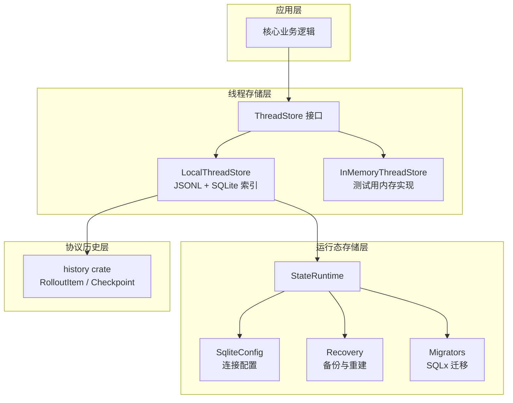
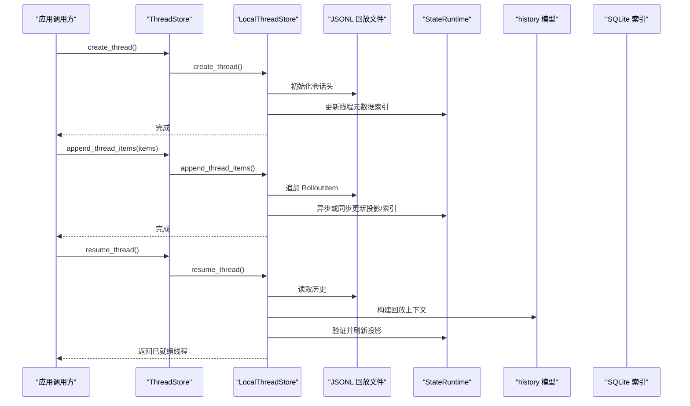
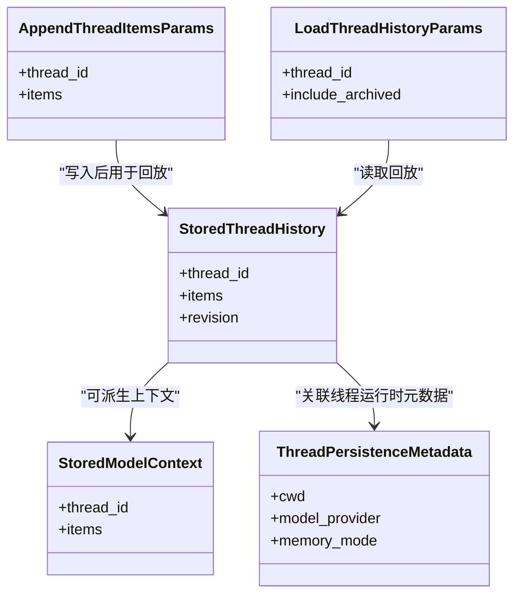
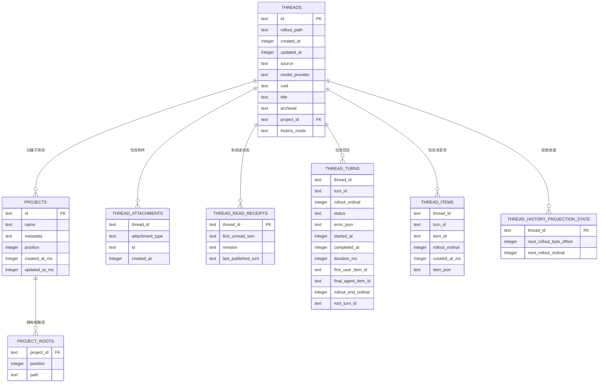
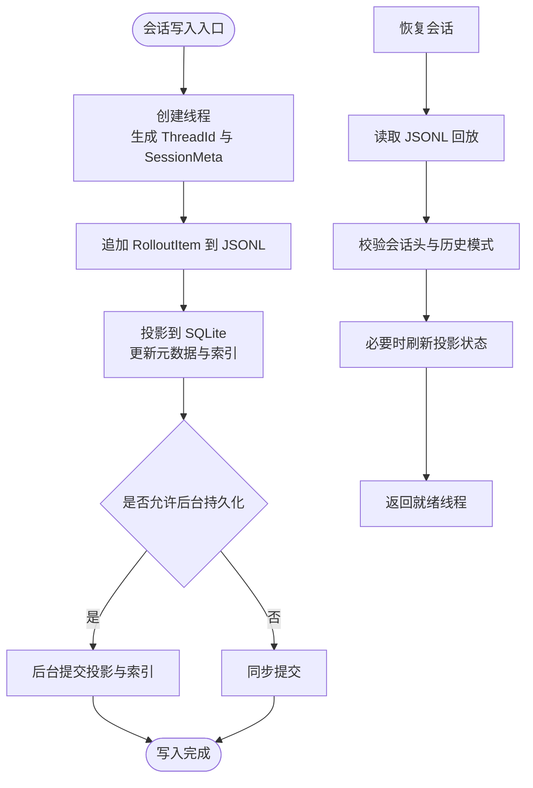
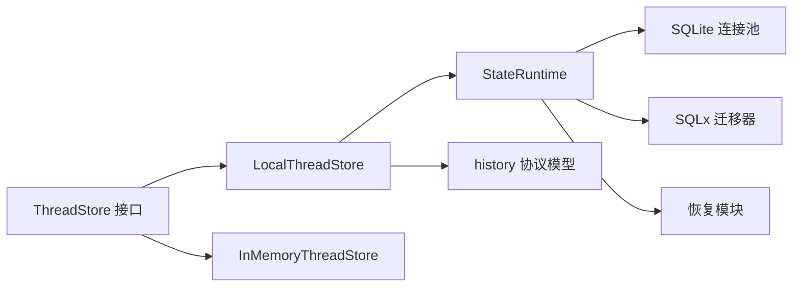
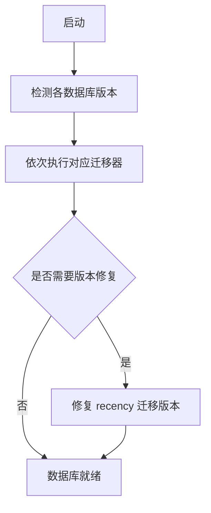
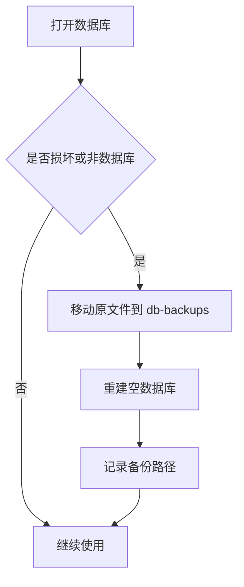

# 会话持久化存储

<cite>
**本文引用的文件**   
- [codex-rs/thread-store/src/lib.rs](file://codex-rs/thread-store/src/lib.rs)
- [codex-rs/thread-store/src/store.rs](file://codex-rs/thread-store/src/store.rs)
- [codex-rs/thread-store/src/types.rs](file://codex-rs/thread-store/src/types.rs)
- [codex-rs/thread-store/src/local/mod.rs](file://codex-rs/thread-store/src/local/mod.rs)
- [codex-rs/thread-store/src/in_memory.rs](file://codex-rs/thread-store/src/in_memory.rs)
- [codex-rs/state/src/lib.rs](file://codex-rs/state/src/lib.rs)
- [codex-rs/state/src/sqlite.rs](file://codex-rs/state/src/sqlite.rs)
- [codex-rs/state/src/runtime.rs](file://codex-rs/state/src/runtime.rs)
- [codex-rs/state/src/migrations.rs](file://codex-rs/state/src/migrations.rs)
- [codex-rs/state/src/runtime/recovery.rs](file://codex-rs/state/src/runtime/recovery.rs)
- [codex-rs/state/migrations/0001_threads.sql](file://codex-rs/state/migrations/0001_threads.sql)
- [codex-rs/state/migrations/0040_threads_history_mode.sql](file://codex-rs/state/migrations/0040_threads_history_mode.sql)
- [codex-rs/state/migrations/0049_projects.sql](file://codex-rs/state/migrations/0049_projects.sql)
- [codex-rs/state/migrations/0055_thread_attachments.sql](file://codex-rs/state/migrations/0055_thread_attachments.sql)
- [codex-rs/state/migrations/0061_thread_read_state.sql](file://codex-rs/state/migrations/0061_thread_read_state.sql)
- [codex-rs/state/thread_history_migrations/0001_thread_history.sql](file://codex-rs/state/thread_history_migrations/0001_thread_history.sql)
- [codex-rs/state/thread_history_migrations/0006_thread_turn_ends.sql](file://codex-rs/state/thread_history_migrations/0006_thread_turn_ends.sql)
- [codex-rs/state/thread_history_migrations/0008_thread_turn_root.sql](file://codex-rs/state/thread_history_migrations/0008_thread_turn_root.sql)
</cite>

## 目录
1. [引言](#引言)
2. [项目结构](#项目结构)
3. [核心组件](#核心组件)
4. [架构总览](#架构总览)
5. [详细组件分析](#详细组件分析)
6. [依赖关系分析](#依赖关系分析)
7. [性能与一致性](#性能与一致性)
8. [数据迁移策略](#数据迁移策略)
9. [备份恢复机制](#备份恢复机制)
10. [数据操作 API 参考](#数据操作-api-参考)
11. [故障排查](#故障排查)
12. [结论](#结论)

## 引言
本文件面向“会话持久化存储”的完整技术文档，覆盖以下目标：
- 解释会话数据的序列化格式，包括消息历史、元数据和状态信息的存储结构。
- 详细说明数据库表设计，包括 threads、messages、history 等表的关系和约束。
- 说明数据迁移策略，包括版本升级、向后兼容性和数据修复机制。
- 描述缓存层设计，包括内存缓存、磁盘缓存和一致性保证。
- 说明备份恢复机制，包括全量备份、增量备份和数据导入导出能力。
- 提供数据操作 API，包含会话保存、加载、查询和清理的示例路径。

该仓库采用 Rust 多 crate 架构：`thread-store` 定义线程持久化的抽象接口和本地实现；`state` 提供基于 SQLite 的运行态状态、日志、队列、记忆体及线程历史投影；`history` 提供协议层的历史模型与压缩检查点类型。实际持久化由 `LocalThreadStore`（文件系统 JSONL + SQLite 索引）与 `StateRuntime`（SQLite）共同承担。

## 项目结构
围绕会话持久化的关键代码位于三个 crate：
- `codex-rs/thread-store`：线程存储抽象、本地实现、内存实现、类型定义。
- `codex-rs/state`：SQLite 连接池、运行时状态、迁移、恢复、审计、遥测等。
- `codex-rs/history`：协议历史模型、心跳、保留上下文、压缩检查点等。

**图示来源**
- [codex-rs/thread-store/src/lib.rs:1-126](file://codex-rs/thread-store/src/lib.rs#L1-L126)
- [codex-rs/thread-store/src/local/mod.rs:1-200](file://codex-rs/thread-store/src/local/mod.rs#L1-L200)
- [codex-rs/thread-store/src/in_memory.rs:1-200](file://codex-rs/thread-store/src/in_memory.rs#L1-L200)
- [codex-rs/state/src/lib.rs:1-173](file://codex-rs/state/src/lib.rs#L1-L173)
- [codex-rs/state/src/sqlite.rs:1-200](file://codex-rs/state/src/sqlite.rs#L1-L200)
- [codex-rs/state/src/runtime.rs:1-200](file://codex-rs/state/src/runtime.rs#L1-L200)
- [codex-rs/history/src/lib.rs:1-200](file://codex-rs/history/src/lib.rs#L1-L200)

**章节来源**
- [codex-rs/thread-store/src/lib.rs:1-126](file://codex-rs/thread-store/src/lib.rs#L1-L126)
- [codex-rs/state/src/lib.rs:1-173](file://codex-rs/state/src/lib.rs#L1-L173)

## 核心组件
本节聚焦与会话持久化直接相关的核心对象及其职责。

### 线程存储抽象
- `ThreadStore`：存储中立接口，负责创建、恢复、追加、读取、归档、搜索、分页、项目与分区管理等。
- `PersistContext`：控制持久化时机，例如线程准备、标准写入、子代理生成、轮次开始、用户输入记录等，部分场景允许后台持久化。
- `ThreadStoreResumePreparation`：为恢复线程提供可复用的一次性预加载状态，避免重复加载历史。

关键行为包括：
- `create_thread`、`resume_thread`、`append_thread_items`、`load_thread_history`、`list_threads`、`search_threads`、`archive_thread`、`delete_thread` 等。
- 默认历史模式为 `Legacy`，可由具体实现覆盖。

**章节来源**
- [codex-rs/thread-store/src/store.rs:1-200](file://codex-rs/thread-store/src/store.rs#L1-L200)

### 本地线程存储
`LocalThreadStore` 是生产级实现，结合两种持久化形式：
- JSONL 回放文件：作为主回放格式，独立于 SQLite，便于旧文件兼容和离线修复。
- SQLite 索引：用于快速查找、列表、搜索、附件、项目、分区、阅读状态等。

它维护：
- 活跃录制器映射、待处理元数据注册表、写锁协调器、可选状态数据库句柄、线程历史数据库连接池、并发信号量、清理回调等。
- 每线程写锁与生命周期锁分离，支持子代理初始化期间的长耗时读锁保护。

**章节来源**
- [codex-rs/thread-store/src/local/mod.rs:1-200](file://codex-rs/thread-store/src/local/mod.rs#L1-L200)

### 内存线程存储
`InMemoryThreadStore` 用于测试与无需磁盘的场景，模拟基本创建、恢复、删除、列表等操作，并暴露与状态库交互的钩子。

**章节来源**
- [codex-rs/thread-store/src/in_memory.rs:1-200](file://codex-rs/thread-store/src/in_memory.rs#L1-L200)

### 运行态状态
`StateRuntime` 统一初始化多个 SQLite 数据库：
- state、logs、goals、memories、queue、thread_history 等。
- 通过 `SqliteConfig` 管理连接池、NFS 检测、WAL/DELETE 策略、忙重试、校验、遥测等。
- 暴露线程元数据、日志、队列、记忆体、目标、远程控制和审计等能力。

**章节来源**
- [codex-rs/state/src/runtime.rs:1-200](file://codex-rs/state/src/runtime.rs#L1-L200)
- [codex-rs/state/src/sqlite.rs:1-200](file://codex-rs/state/src/sqlite.rs#L1-L200)

### 协议历史模型
`history` crate 定义历史相关类型，如心跳、压缩检查点、保留上下文、原始助手消息等，供回放和压缩使用。

**章节来源**
- [codex-rs/history/src/lib.rs:1-200](file://codex-rs/history/src/lib.rs#L1-L200)

## 架构总览
下图展示一次会话保存与恢复的核心流程。

**图示来源**
- [codex-rs/thread-store/src/store.rs:1-200](file://codex-rs/thread-store/src/store.rs#L1-L200)
- [codex-rs/thread-store/src/local/mod.rs:1-200](file://codex-rs/thread-store/src/local/mod.rs#L1-L200)
- [codex-rs/state/src/runtime.rs:1-200](file://codex-rs/state/src/runtime.rs#L1-L200)
- [codex-rs/history/src/lib.rs:1-200](file://codex-rs/history/src/lib.rs#L1-L200)

## 详细组件分析

### 序列化格式：消息历史、元数据与状态
会话的持久化分为三类数据：

| 类别 | 主要载体 | 用途 | 关键字段或语义 |
|---|---|---|---|
| 消息历史 | JSONL 回放文件 + thread_history SQLite 投影 | 会话回放、断点续写、压缩 | `RolloutItem`、回合 `turn_id`、项 `item_id`、时间戳、位置序数 |
| 线程元数据 | SQLite `threads` 表 | 列表、搜索、排序、归档、项目归属 | `id`、`rollout_path`、`created_at`、`updated_at`、`source`、`model_provider`、`archived`、`project_id`、`history_mode` 等 |
| 状态信息 | SQLite `thread_read_receipts`、`thread_history_projection_state` | 阅读状态、投影进度 | `first_unread_turn`、`revision`、`last_published_turn`、`next_rollout_byte_offset`、`next_rollout_ordinal` |

- `RolloutItem` 来自协议层，表示一条有序事件，包括会话元数据、用户输入、助手响应、工具调用、心跳等。
- `StoredThreadHistory`、`StoredModelContext`、`AppendThreadItemsParams`、`LoadThreadHistoryParams` 等类型定义了加载、追加和回放的数据契约。
- `ThreadPersistenceMetadata` 保存线程级运行时元数据，例如工作目录、模型提供者、记忆模式等。

**图示来源**
- [codex-rs/thread-store/src/types.rs:1-200](file://codex-rs/thread-store/src/types.rs#L1-L200)

**章节来源**
- [codex-rs/thread-store/src/types.rs:1-200](file://codex-rs/thread-store/src/types.rs#L1-L200)
- [codex-rs/history/src/lib.rs:1-200](file://codex-rs/history/src/lib.rs#L1-L200)

### 数据库表设计与关系
`state` crate 的 SQLite 表主要用于线程元数据、项目、附件、阅读状态等；`thread_history` 专用数据库用于回合与项的分页投影。

#### 主状态表 `threads`
初始结构包含线程标识、回放路径、创建与更新时间、来源、模型提供者、工作目录、标题、沙箱策略、审批模式、令牌用量、是否含用户事件、归档标记、归档时间、Git 信息等，并附带按时间、归档、来源、提供者等索引。后续演进增加历史模式、名称、固定段、项目关联、附件、创建者身份、Daybreak 开关、最近可见时间、附件反向索引等。

| 列名 | 含义 |
|---|---|
| `id` | 线程唯一标识 |
| `rollout_path` | JSONL 回放文件路径 |
| `created_at` | 创建时间 |
| `updated_at` | 更新时间 |
| `source` | 线程来源 |
| `model_provider` | 模型提供者 |
| `cwd` | 工作目录 |
| `title` | 标题 |
| `sandbox_policy` | 沙箱策略 |
| `approval_mode` | 审批模式 |
| `tokens_used` | 累计令牌用量 |
| `has_user_event` | 是否包含用户事件 |
| `archived` | 是否归档 |
| `archived_at` | 归档时间 |
| `git_sha` | Git SHA |
| `git_branch` | Git 分支 |
| `git_origin_url` | Git 源地址 |
| `project_id` | 所属项目外键 |
| `history_mode` | 历史模式 |
| `name` | 名称 |
| `is_pinned` | 是否固定到置顶段 |
| `section` | 所属段 |
| `originator` | 发起者 |
| `daybreak_enabled` | Daybreak 功能开关 |
| `creator_account_id` / `creator_user_id` | 创建者账号与用户 |

**章节来源**
- [codex-rs/state/migrations/0001_threads.sql:1-25](file://codex-rs/state/migrations/0001_threads.sql#L1-L25)
- [codex-rs/state/migrations/0040_threads_history_mode.sql:1-1](file://codex-rs/state/migrations/0040_threads_history_mode.sql#L1-L1)

#### 项目与根路径表
`projects` 表示项目，`project_roots` 表示项目根路径集合，`project_idempotency_keys` 提供幂等键，`threads.project_id` 作为外键引用。

| 表名 | 主要列 | 关系 |
|---|---|---|
| `projects` | `id`、`name`、`metadata`、`position`、`created_at_ms`、`updated_at_ms` | 主表 |
| `project_roots` | `project_id`、`position`、`path` | 一对多，`project_id` 外键 |
| `project_idempotency_keys` | `key`、`project_id`、`created_at_ms` | 幂等键 |
| `threads` | `project_id` | 多对一，可空，删除项目时置空 |

**章节来源**
- [codex-rs/state/migrations/0049_projects.sql:1-30](file://codex-rs/state/migrations/0049_projects.sql#L1-L30)

#### 附件表
附件表由原 `thread_artifacts` 重命名为 `thread_attachments`，并将 `artifact_type` 重命名为 `attachment_type`，同时调整索引。

| 表名 | 主要变化 |
|---|---|
| `thread_attachments` | 原 `thread_artifacts`，字段更名，索引优化 |

**章节来源**
- [codex-rs/state/migrations/0055_thread_attachments.sql:1-6](file://codex-rs/state/migrations/0055_thread_attachments.sql#L1-L6)

#### 阅读状态表
`thread_read_receipts` 维护每个线程的阅读状态，包括首个未读回合、修订号和最后发布回合。NULL 表示已读，空字符串表示从开始手动标记为未读。

| 列名 | 含义 |
|---|---|
| `thread_id` | 线程标识 |
| `first_unread_turn` | 首个未读回合 |
| `revision` | 投影修订号 |
| `last_published_turn` | 最后发布回合 |

**章节来源**
- [codex-rs/state/migrations/0061_thread_read_state.sql:1-8](file://codex-rs/state/migrations/0061_thread_read_state.sql#L1-L8)

#### 历史投影表 `thread_history`
线程历史投影数据库包含回合表、项表和投影状态表：

| 表名 | 作用 | 关键列 |
|---|---|---|
| `thread_turns` | 回合投影 | `thread_id`、`turn_id`、`rollout_ordinal`、`status`、`error_json`、时间戳、首用户项、末助手项、结束序数、根回合 |
| `thread_items` | 消息项投影 | `thread_id`、`turn_id`、`item_id`、`rollout_ordinal`、`created_at_ms`、`item_json` |
| `thread_history_projection_state` | 投影进度 | `thread_id`、`next_rollout_byte_offset`、`next_rollout_ordinal` |

约束与索引：
- `thread_turns` 主键为 `(thread_id, turn_id)`，并按 `(thread_id, rollout_ordinal)` 建立唯一索引。
- `thread_items` 主键为 `(thread_id, turn_id, item_id)`，并按 `(thread_id, rollout_ordinal)` 和 `(thread_id, turn_id, rollout_ordinal)` 建索引。
- 后续增加回合结束序数索引和根回合列，以支持更高效翻页和回溯。

**图示来源**
- [codex-rs/state/migrations/0001_threads.sql:1-25](file://codex-rs/state/migrations/0001_threads.sql#L1-L25)
- [codex-rs/state/migrations/0049_projects.sql:1-30](file://codex-rs/state/migrations/0049_projects.sql#L1-L30)
- [codex-rs/state/migrations/0055_thread_attachments.sql:1-6](file://codex-rs/state/migrations/0055_thread_attachments.sql#L1-L6)
- [codex-rs/state/migrations/0061_thread_read_state.sql:1-8](file://codex-rs/state/migrations/0061_thread_read_state.sql#L1-L8)
- [codex-rs/state/thread_history_migrations/0001_thread_history.sql:1-38](file://codex-rs/state/thread_history_migrations/0001_thread_history.sql#L1-L38)
- [codex-rs/state/thread_history_migrations/0006_thread_turn_ends.sql:1-3](file://codex-rs/state/thread_history_migrations/0006_thread_turn_ends.sql#L1-L3)
- [codex-rs/state/thread_history_migrations/0008_thread_turn_root.sql:1-1](file://codex-rs/state/thread_history_migrations/0008_thread_turn_root.sql#L1-L1)

**章节来源**
- [codex-rs/state/migrations/0001_threads.sql:1-25](file://codex-rs/state/migrations/0001_threads.sql#L1-L25)
- [codex-rs/state/migrations/0049_projects.sql:1-30](file://codex-rs/state/migrations/0049_projects.sql#L1-L30)
- [codex-rs/state/migrations/0055_thread_attachments.sql:1-6](file://codex-rs/state/migrations/0055_thread_attachments.sql#L1-L6)
- [codex-rs/state/migrations/0061_thread_read_state.sql:1-8](file://codex-rs/state/migrations/0061_thread_read_state.sql#L1-L8)
- [codex-rs/state/thread_history_migrations/0001_thread_history.sql:1-38](file://codex-rs/state/thread_history_migrations/0001_thread_history.sql#L1-L38)
- [codex-rs/state/thread_history_migrations/0006_thread_turn_ends.sql:1-3](file://codex-rs/state/thread_history_migrations/0006_thread_turn_ends.sql#L1-L3)
- [codex-rs/state/thread_history_migrations/0008_thread_turn_root.sql:1-1](file://codex-rs/state/thread_history_migrations/0008_thread_turn_root.sql#L1-L1)

### 数据流与处理逻辑

**图示来源**
- [codex-rs/thread-store/src/store.rs:1-200](file://codex-rs/thread-store/src/store.rs#L1-L200)
- [codex-rs/thread-store/src/local/mod.rs:1-200](file://codex-rs/thread-store/src/local/mod.rs#L1-L200)
- [codex-rs/state/src/runtime.rs:1-200](file://codex-rs/state/src/runtime.rs#L1-L200)

**章节来源**
- [codex-rs/thread-store/src/store.rs:1-200](file://codex-rs/thread-store/src/store.rs#L1-L200)
- [codex-rs/thread-store/src/local/mod.rs:1-200](file://codex-rs/thread-store/src/local/mod.rs#L1-L200)
- [codex-rs/state/src/runtime.rs:1-200](file://codex-rs/state/src/runtime.rs#L1-L200)

## 依赖关系分析
线程存储与运行态存储之间的依赖如下：

- `ThreadStore` 将上层应用与具体存储解耦。
- `LocalThreadStore` 依赖 `StateRuntime` 进行元数据投影、队列、日志、记忆体和线程历史管理。
- `StateRuntime` 依赖 `SqliteConfig` 打开并迁移多个数据库。
- `history` crate 提供协议模型，确保回放数据一致。

**图示来源**
- [codex-rs/thread-store/src/lib.rs:1-126](file://codex-rs/thread-store/src/lib.rs#L1-L126)
- [codex-rs/state/src/sqlite.rs:1-200](file://codex-rs/state/src/sqlite.rs#L1-L200)
- [codex-rs/state/src/runtime.rs:1-200](file://codex-rs/state/src/runtime.rs#L1-L200)

**章节来源**
- [codex-rs/thread-store/src/lib.rs:1-126](file://codex-rs/thread-store/src/lib.rs#L1-L126)
- [codex-rs/state/src/sqlite.rs:1-200](file://codex-rs/state/src/sqlite.rs#L1-L200)
- [codex-rs/state/src/runtime.rs:1-200](file://codex-rs/state/src/runtime.rs#L1-L200)

## 性能与一致性
- **连接池与忙重试**：`SqliteConfig` 集中管理 SQLite 连接选项、忙超时、WAL/DELETE 策略，并在 NFS 上可能强制 DELETE 策略，减少跨网络锁竞争。
- **写入批量化**：日志写入有批量度量，包括尝试次数、延迟、字节数和条目数，有助于评估吞吐和瓶颈。
- **回退与降级**：当日志数据库无法打开但其他数据库可用时，系统会记录诊断错误，而不是整体失败。
- **一致性保证**：
  - JSONL 为主回放格式，SQLite 为索引与投影，两者可独立存在，便于修复与迁移。
  - 写锁分离：每线程写锁与生命周期锁分离，避免长耗时初始化阻塞正常写入。
  - 投影状态表记录回放偏移和序数，确保中断后可继续投影。
- **内存缓存**：
  - `InMemoryThreadStore` 提供进程内缓存，适合测试与短生命周期任务。
  - 本地实现中，活跃录制器和线程协调结构在进程内存中维护，减少频繁 IO。

**章节来源**
- [codex-rs/state/src/sqlite.rs:1-200](file://codex-rs/state/src/sqlite.rs#L1-L200)
- [codex-rs/state/src/lib.rs:1-173](file://codex-rs/state/src/lib.rs#L1-L173)
- [codex-rs/thread-store/src/local/mod.rs:1-200](file://codex-rs/thread-store/src/local/mod.rs#L1-L200)
- [codex-rs/thread-store/src/in_memory.rs:1-200](file://codex-rs/thread-store/src/in_memory.rs#L1-L200)

## 数据迁移策略
迁移体系由 SQLx Migrator 驱动，按数据库分目录组织：
- `migrations`：状态主库迁移。
- `logs_migrations`：日志库迁移。
- `goals_migrations`：目标库迁移。
- `memory_migrations`：记忆体库迁移。
- `queue_migrations`：队列库迁移。
- `thread_history_migrations`：线程历史投影库迁移。

关键特性：
- **向后兼容**：运行时 migrator 包裹基础 migrator，设置 `ignore_missing: true`，允许旧二进制打开已被新二进制迁移过的数据库。
- **版本修复**：提供 `repair_legacy_recency_migration_version`，修复特定历史迁移版本不一致问题。
- **分库迁移**：每个数据库独立迁移器，避免跨库耦合。

**图示来源**
- [codex-rs/state/src/migrations.rs:1-123](file://codex-rs/state/src/migrations.rs#L1-L123)

**章节来源**
- [codex-rs/state/src/migrations.rs:1-123](file://codex-rs/state/src/migrations.rs#L1-L123)

## 备份恢复机制
恢复模块提供单库级别的自动备份与重建：
- 当 SQLite 报告损坏或不是有效数据库时，系统会将该数据库及其附属文件移动到 `db-backups` 目录，然后重建空库。
- 支持收集任务局部范围内的备份记录，以便启动完成后向用户报告。
- 提供判断函数识别 SQLite 损坏错误和锁错误。

**图示来源**
- [codex-rs/state/src/runtime/recovery.rs:1-200](file://codex-rs/state/src/runtime/recovery.rs#L1-L200)

**章节来源**
- [codex-rs/state/src/runtime/recovery.rs:1-200](file://codex-rs/state/src/runtime/recovery.rs#L1-L200)

## 数据操作 API 参考
以下为常用操作的 API 入口与典型用法说明。为避免泄露内部实现细节，这里给出参数结构与调用路径，而非代码内容。

### 创建会话
- 接口：`ThreadStore::create_thread`
- 参数结构：`CreateThreadParams`
- 关键参数：
  - `session_id`、`thread_id`
  - `source`、`originator`、`base_instructions`
  - `dynamic_tools`、`selected_capability_roots`
  - `multi_agent_version`、`history_mode`、`history_base`
  - `subagent_history_start_ordinal`、`initial_window_id`
  - `runtime_workspace_roots`、`metadata`
- 行为：
  - 初始化 JSONL 回放文件与会话头。
  - 在 SQLite 中创建或更新线程元数据索引。

**章节来源**
- [codex-rs/thread-store/src/store.rs:1-200](file://codex-rs/thread-store/src/store.rs#L1-L200)
- [codex-rs/thread-store/src/types.rs:1-200](file://codex-rs/thread-store/src/types.rs#L1-L200)

### 追加消息
- 接口：`ThreadStore::append_thread_items`
- 参数结构：`AppendThreadItemsParams`
- 关键参数：
  - `thread_id`
  - `items`：按顺序追加的 `RolloutItem` 列表
- 行为：
  - 将事件追加到 JSONL。
  - 根据 `PersistContext` 决定是否允许后台持久化。
  - 更新 SQLite 投影、索引与元数据。

**章节来源**
- [codex-rs/thread-store/src/store.rs:1-200](file://codex-rs/thread-store/src/store.rs#L1-L200)
- [codex-rs/thread-store/src/types.rs:1-200](file://codex-rs/thread-store/src/types.rs#L1-L200)

### 恢复会话
- 接口：`ThreadStore::resume_thread`
- 参数结构：`ResumeThreadParams`
- 关键参数：
  - `thread_id`
  - `rollout_path`：指定本地回放路径
  - `history`：可选已加载回放历史
  - `history_revision`：快照修订号
  - `include_archived`：是否包含归档线程
  - `metadata`：未来写入的线程持久化元数据
- 行为：
  - 从 JSONL 读取回放。
  - 校验会话头和历史模式。
  - 必要时刷新 SQLite 投影状态。
  - 返回可用于继续追加的线程上下文。

**章节来源**
- [codex-rs/thread-store/src/store.rs:1-200](file://codex-rs/thread-store/src/store.rs#L1-L200)
- [codex-rs/thread-store/src/types.rs:1-200](file://codex-rs/thread-store/src/types.rs#L1-L200)

### 加载历史
- 接口：`ThreadStore::load_thread_history`
- 参数结构：`LoadThreadHistoryParams`
- 返回值：`StoredThreadHistory`
- 行为：
  - 返回线程的回放项序列，供内存构建、fork、记忆任务等使用。
  - 支持归档过滤。

**章节来源**
- [codex-rs/thread-store/src/types.rs:1-200](file://codex-rs/thread-store/src/types.rs#L1-L200)

### 查询与列表
- 接口：`ThreadStore::list_threads`、`search_threads`
- 参数结构：`ListThreadsParams`、`SearchThreadsParams`
- 行为：
  - 基于 SQLite 索引进行分页、排序、过滤。
  - 支持项目、归档、来源、提供者、历史模式等维度。

**章节来源**
- [codex-rs/thread-store/src/store.rs:1-200](file://codex-rs/thread-store/src/store.rs#L1-L200)

### 清理与删除
- 接口：`ThreadStore::delete_thread`、`archive_thread`、`unarchive_thread`
- 行为：
  - 删除线程时，清理 JSONL、SQLite 元数据、投影状态和相关索引。
  - 归档线程不会删除回放文件，而是修改状态并影响列表与搜索。
  - 内存实现中删除还会清理关联的状态库条目与共享内存历史。

**章节来源**
- [codex-rs/thread-store/src/store.rs:1-200](file://codex-rs/thread-store/src/store.rs#L1-L200)
- [codex-rs/thread-store/src/in_memory.rs:1-200](file://codex-rs/thread-store/src/in_memory.rs#L1-L200)

## 故障排查
常见故障与定位方法：

| 现象 | 可能原因 | 排查建议 |
|---|---|---|
| 启动时报 SQLite 损坏 | 数据库文件损坏或不是有效数据库 | 使用恢复模块检查错误类型，查看 `db-backups` 中的备份文件 |
| 日志数据库无法打开 | 日志库损坏或权限问题 | 查看 `StateRuntime` 初始化日志，确认是否仅日志库失败 |
| 写入频繁出现忙错误 | 写锁冲突或 WAL 配置不当 | 检查 SQLite 忙超时、NFS 策略、写并发度 |
| 回放不完整 | 投影未完成或历史模式不一致 | 检查 `thread_history_projection_state` 和项目、历史模式字段 |
| 列表查询缓慢 | 缺少索引或数据量大 | 检查 `threads` 与投影表的索引，考虑分页和过滤条件 |

关键辅助函数：
- `is_sqlite_corruption_error`：判断是否为 SQLite 损坏错误。
- `sqlite_error_detail_is_lock`：判断是否为锁相关错误。
- `backup_runtime_db_for_fresh_start`：触发单库备份与重建。
- `collect_runtime_db_backups`：收集启动过程中的备份记录。

**章节来源**
- [codex-rs/state/src/runtime/recovery.rs:1-200](file://codex-rs/state/src/runtime/recovery.rs#L1-L200)
- [codex-rs/state/src/sqlite.rs:1-200](file://codex-rs/state/src/sqlite.rs#L1-L200)

## 结论
本项目的会话持久化采用“JSONL 回放 + SQLite 投影”的双层设计：
- JSONL 提供强一致、可独立修复的主回放格式。
- SQLite 提供高效查询、索引、项目与附件、阅读状态、投影进度等能力。
- 迁移系统按数据库分目录管理，支持向后兼容和版本修复。
- 恢复系统提供单库级别备份与重建，避免全局数据丢失。
- 线程存储抽象屏蔽底层实现差异，本地实现提供生产级行为，内存实现用于测试。

对于扩展与维护：
- 新增字段优先通过 SQL 迁移添加，保持默认值与兼容性。
- 新增投影或索引需同步更新迁移脚本和相应查询。
- 对历史模式、归档、项目、附件、阅读状态等高级能力，应明确其一致性边界与回滚策略。
- 监控 SQLite 忙错误、损坏错误与投影进度，确保回放与索引保持一致。