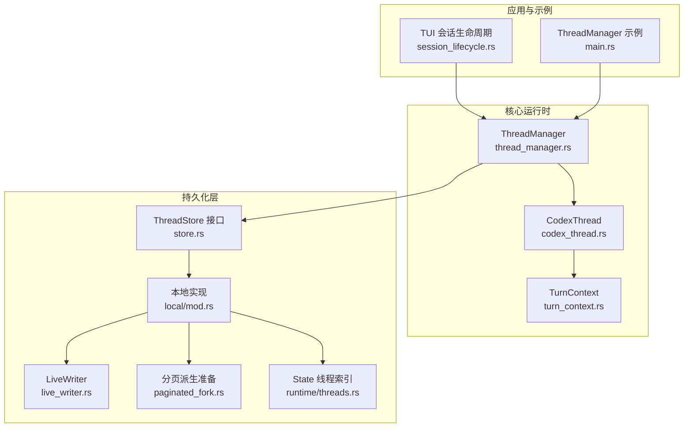
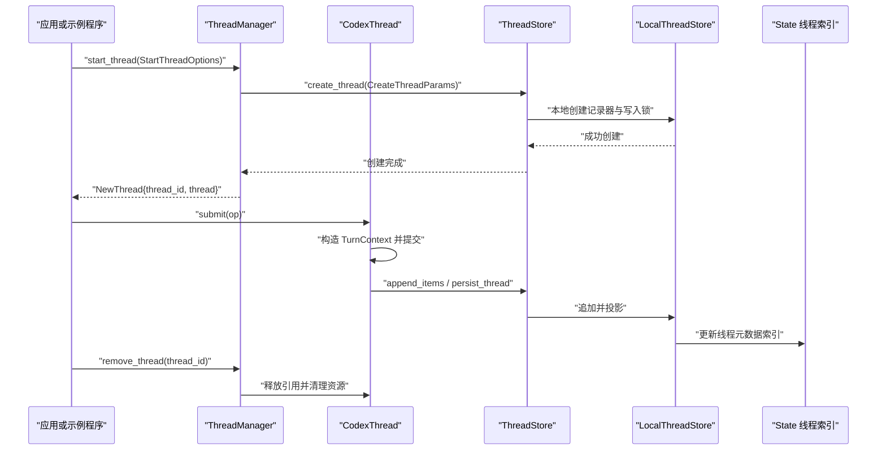
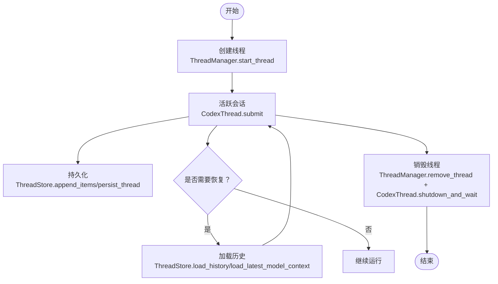
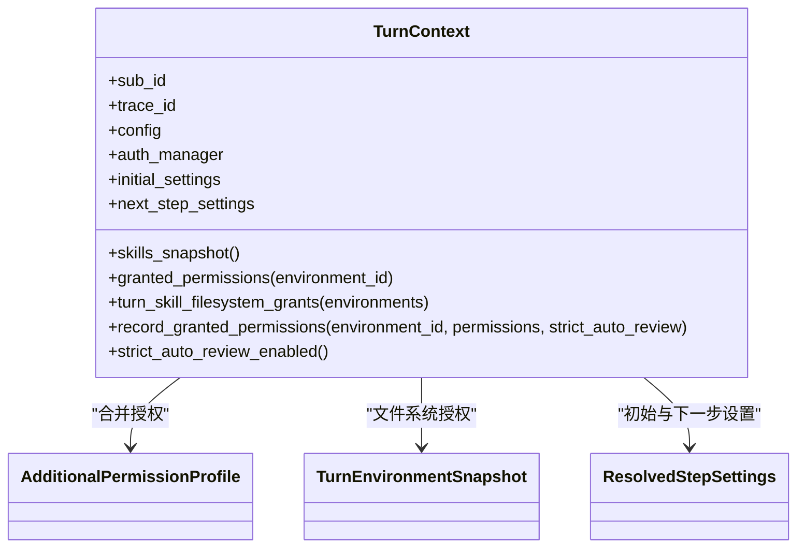
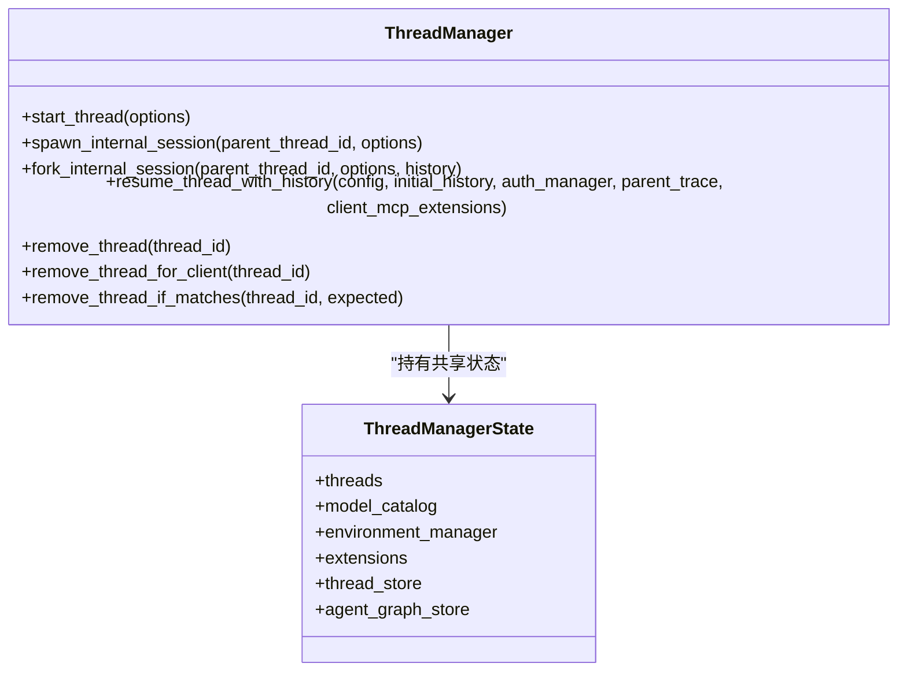
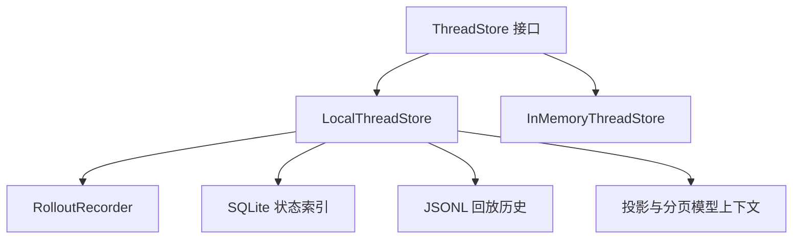
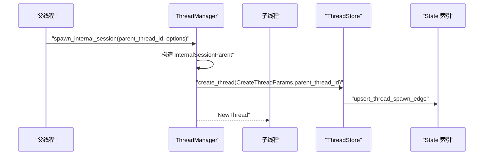
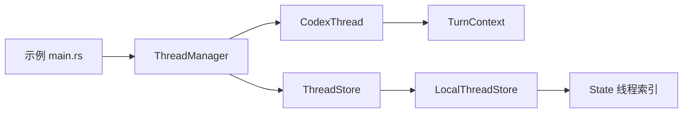

# 会话管理

<cite>
**本文引用的文件**   
- [codex-rs/core/src/thread_manager.rs](file://codex-rs/core/src/thread_manager.rs)
- [codex-rs/core/src/codex_thread.rs](file://codex-rs/core/src/codex_thread.rs)
- [codex-rs/core/src/session/turn_context.rs](file://codex-rs/core/src/session/turn_context.rs)
- [codex-rs/thread-store/src/store.rs](file://codex-rs/thread-store/src/store.rs)
- [codex-rs/thread-store/src/types.rs](file://codex-rs/thread-store/src/types.rs)
- [codex-rs/thread-store/src/local/mod.rs](file://codex-rs/thread-store/src/local/mod.rs)
- [codex-rs/thread-store/src/local/live_writer.rs](file://codex-rs/thread-store/src/local/live_writer.rs)
- [codex-rs/thread-store/src/local/paginated_fork.rs](file://codex-rs/thread-store/src/local/paginated_fork.rs)
- [codex-rs/state/src/runtime/threads.rs](file://codex-rs/state/src/runtime/threads.rs)
- [codex-rs/tui/src/app/session_lifecycle.rs](file://codex-rs/tui/src/app/session_lifecycle.rs)
- [codex-rs/thread-manager-sample/src/main.rs](file://codex-rs/thread-manager-sample/src/main.rs)
</cite>

## 目录
1. [引言](#引言)
2. [项目结构](#项目结构)
3. [核心组件](#核心组件)
4. [架构总览](#架构总览)
5. [详细组件分析](#详细组件分析)
6. [依赖关系分析](#依赖关系分析)
7. [性能与并发特性](#性能与并发特性)
8. [故障排查指南](#故障排查指南)
9. [结论](#结论)
10. [附录：会话管理 API 参考](#附录会话管理-api-参考)

## 引言
本文件系统性地说明仓库中的“会话管理”体系。在该代码库中，“会话”以线程（Thread）为核心抽象，围绕 ThreadManager、CodexThread、TurnContext 和 ThreadStore 四个层次组织：
- ThreadManager 负责线程的创建、注册、查找、移除和生命周期协调。
- CodexThread 是单个活跃会话的运行时句柄，封装了消息提交、子会话创建、工具调用上下文访问和关闭流程。
- TurnContext 描述单次对话轮次的环境、权限、模型选择、插件与技能快照等运行时信息。
- ThreadStore 提供与存储无关的线程持久化接口，由本地实现和内存实现分别落地到 JSONL/SQLite 或进程内状态。

此外，state 层维护线程元数据的 SQLite 索引，TUI 应用层管理前端视角的会话切换、恢复、派生和子代理展示；thread-manager-sample 则演示如何从零构建 ThreadManager 并运行一次完整对话轮次。

## 项目结构
从会话管理的角度，关键模块分布如下：

**图表来源**
- [codex-rs/tui/src/app/session_lifecycle.rs:1-60](file://codex-rs/tui/src/app/session_lifecycle.rs#L1-L60)
- [codex-rs/thread-manager-sample/src/main.rs:1-120](file://codex-rs/thread-manager-sample/src/main.rs#L1-L120)
- [codex-rs/core/src/thread_manager.rs:300-380](file://codex-rs/core/src/thread_manager.rs#L300-L380)
- [codex-rs/core/src/codex_thread.rs:198-260](file://codex-rs/core/src/codex_thread.rs#L198-L260)
- [codex-rs/core/src/session/turn_context.rs:345-430](file://codex-rs/core/src/session/turn_context.rs#L345-L430)
- [codex-rs/thread-store/src/store.rs:1-60](file://codex-rs/thread-store/src/store.rs#L1-L60)
- [codex-rs/thread-store/src/local/mod.rs:1-60](file://codex-rs/thread-store/src/local/mod.rs#L1-L60)

**章节来源**
- [codex-rs/tui/src/app/session_lifecycle.rs:1-120](file://codex-rs/tui/src/app/session_lifecycle.rs#L1-L120)
- [codex-rs/thread-manager-sample/src/main.rs:1-200](file://codex-rs/thread-manager-sample/src/main.rs#L1-L200)
- [codex-rs/core/src/thread_manager.rs:300-420](file://codex-rs/core/src/thread_manager.rs#L300-L420)
- [codex-rs/thread-store/src/store.rs:1-120](file://codex-rs/thread-store/src/store.rs#L1-L120)
- [codex-rs/thread-store/src/local/mod.rs:1-120](file://codex-rs/thread-store/src/local/mod.rs#L1-L120)

## 核心组件
### ThreadManager：线程管理器
ThreadManager 是会话的生命周期中心。它持有共享状态 ThreadManagerState，包括：
- 活跃线程映射：ThreadId 到 Arc<CodexThread>。
- 认证、模型目录、MCP 管理、插件、技能服务、扩展注册表。
- ThreadStore 引用，用于创建、恢复和持久化线程历史。
- 事件广播通道，用于通知新线程创建。

主要职责包括：
- start_thread：启动新根线程。
- spawn_internal_session / fork_internal_session：在已有父线程下创建内部子会话。
- resume_legacy_thread_from_rollout / resume_thread_with_history：从历史恢复线程。
- remove_thread / remove_thread_for_client / remove_thread_if_matches：安全移除线程。
- shutdown_all_threads_bounded：批量关闭所有线程。

**章节来源**
- [codex-rs/core/src/thread_manager.rs:300-420](file://codex-rs/core/src/thread_manager.rs#L300-L420)
- [codex-rs/core/src/thread_manager.rs:1381-1420](file://codex-rs/core/src/thread_manager.rs#L1381-L1420)
- [codex-rs/core/src/thread_manager.rs:1670-1720](file://codex-rs/core/src/thread_manager.rs#L1670-L1720)

### CodexThread：会话运行时句柄
CodexThread 表示一个已加载并可交互的会话。它封装 Session、SessionIo、agent_tree_id、rollout_path、tool_invocation、create_child、prepare_child、shutdown_and_wait 等能力。对外暴露的主要操作：
- submit：提交一条操作。
- current_turn_extension_data / current_turn_model：读取当前活动轮次的扩展数据和模型信息。
- create_child / prepare_child：在当前工具调用上下文中创建子会话。
- prewarm / prewarm_with_history：空闲预热。
- shutdown_and_wait / wait_until_terminated：关闭和等待终止。

**章节来源**
- [codex-rs/core/src/codex_thread.rs:198-260](file://codex-rs/core/src/codex_thread.rs#L198-L260)
- [codex-rs/core/src/codex_thread.rs:260-450](file://codex-rs/core/src/codex_thread.rs#L260-L450)

### TurnContext：单轮上下文
TurnContext 描述一次对话轮次所需的所有上下文信息，包括：
- 配置、权限、模型提供者、会话来源、历史模式。
- 初始设置、技能快照、扩展数据、时间统计、终端错误。
- 会话级授权与本轮级授权的合并查询。
- 工作目录、日期时区、网络代理、沙箱级别等环境信息。
- 支持为审查轮次复制上下文，保留会话授权但重建本轮状态。

**章节来源**
- [codex-rs/core/src/session/turn_context.rs:345-430](file://codex-rs/core/src/session/turn_context.rs#L345-L430)
- [codex-rs/core/src/session/turn_context.rs:430-650](file://codex-rs/core/src/session/turn_context.rs#L430-L650)

### ThreadStore：持久化抽象
ThreadStore 是与后端无关的线程持久化接口，定义：
- create_thread、resume_thread、append_items、persist_thread、flush_thread、shutdown_thread、discard_thread。
- load_history、read_original_history、load_latest_model_context、is_model_context_current。
- read_thread、list_threads、search_threads、list_turns、list_items、list_timeline。
- thread sections、attachments、projects、archive/revert 等高级能力。

默认实现将不支持的操作返回 ThreadStoreError::Unsupported，便于按需扩展。

**章节来源**
- [codex-rs/thread-store/src/store.rs:1-120](file://codex-rs/thread-store/src/store.rs#L1-L120)
- [codex-rs/thread-store/src/store.rs:201-400](file://codex-rs/thread-store/src/store.rs#L201-L400)
- [codex-rs/thread-store/src/store.rs:400-631](file://codex-rs/thread-store/src/store.rs#L400-L631)

## 架构总览
下图展示从应用层到持久化的整体调用链：

**图表来源**
- [codex-rs/thread-manager-sample/src/main.rs:120-200](file://codex-rs/thread-manager-sample/src/main.rs#L120-L200)
- [codex-rs/core/src/thread_manager.rs:1381-1420](file://codex-rs/core/src/thread_manager.rs#L1381-L1420)
- [codex-rs/core/src/codex_thread.rs:260-340](file://codex-rs/core/src/codex_thread.rs#L260-L340)
- [codex-rs/thread-store/src/local/live_writer.rs:1-80](file://codex-rs/thread-store/src/local/live_writer.rs#L1-L80)
- [codex-rs/state/src/runtime/threads.rs:1-60](file://codex-rs/state/src/runtime/threads.rs#L1-L60)

## 详细组件分析

### 会话（Thread）概念与生命周期
会话在系统中对应 Thread/CodexThread。其生命周期分为：
- 创建：通过 ThreadManager.start_thread 分配 ThreadId，构造 StartThreadOptions，最终生成 NewThread。
- 活跃：通过 CodexThread.submit 提交操作，内部构建 TurnContext，执行模型请求、工具调用、审批与环境准备。
- 恢复：通过 ThreadStore.resume_thread 或 ThreadManager.resume_thread_with_history 从持久历史重新激活。
- 销毁：ThreadManager.remove_thread 移除活跃引用；CodexThread.shutdown_and_wait 等待底层会话循环结束。

**图表来源**
- [codex-rs/core/src/thread_manager.rs:1381-1420](file://codex-rs/core/src/thread_manager.rs#L1381-L1420)
- [codex-rs/thread-store/src/store.rs:201-300](file://codex-rs/thread-store/src/store.rs#L201-L300)
- [codex-rs/core/src/codex_thread.rs:260-340](file://codex-rs/core/src/codex_thread.rs#L260-L340)

**章节来源**
- [codex-rs/core/src/thread_manager.rs:1381-1720](file://codex-rs/core/src/thread_manager.rs#L1381-L1720)
- [codex-rs/core/src/codex_thread.rs:198-450](file://codex-rs/core/src/codex_thread.rs#L198-L450)
- [codex-rs/thread-store/src/store.rs:201-400](file://codex-rs/thread-store/src/store.rs#L201-L400)

### TurnContext 设计模式与权限检查
TurnContext 的设计遵循“一次性构建、多步复用”的模式：
- 构建时冻结初始配置、技能快照、权限策略、模型元信息等。
- 通过 next_step_settings 支持后续步骤使用不同的 StepSettings，而不破坏首轮语义。
- granted_permissions 合并会话级授权与会话内本轮授权，供工具和环境判断是否允许访问。
- turn_skill_filesystem_grants 根据本轮授权动态决定技能文件系统的可见范围。
- for_review 可基于现有上下文克隆审查轮次，保持会话授权但重置本轮状态。

**图表来源**
- [codex-rs/core/src/session/turn_context.rs:345-650](file://codex-rs/core/src/session/turn_context.rs#L345-L650)

**章节来源**
- [codex-rs/core/src/session/turn_context.rs:345-650](file://codex-rs/core/src/session/turn_context.rs#L345-L650)

### 线程管理器与并发控制
ThreadManager 通过 ThreadManagerState 集中管理活跃线程，并使用以下机制控制并发和资源：
- threads：Arc<RwLock<HashMap<ThreadId, Arc<CodexThread>>>> 保证多线程安全地读写活跃会话。
- broadcast channel：通知新线程创建。
- agent_control_factory、mcp_manager、plugins_manager、skills_service：集中管理外部依赖。
- start_thread_inner 与 spawn_thread：组合 StartThreadOptions、InternalSessionParent、ThreadSpawnRequest，统一调度。
- remove_thread_for_client：阻止外部客户端删除内部线程，避免资源泄漏。

**图表来源**
- [codex-rs/core/src/thread_manager.rs:300-420](file://codex-rs/core/src/thread_manager.rs#L300-L420)
- [codex-rs/core/src/thread_manager.rs:1381-1720](file://codex-rs/core/src/thread_manager.rs#L1381-L1720)

**章节来源**
- [codex-rs/core/src/thread_manager.rs:300-420](file://codex-rs/core/src/thread_manager.rs#L300-L420)
- [codex-rs/core/src/thread_manager.rs:1381-1720](file://codex-rs/core/src/thread_manager.rs#L1381-L1720)

### 会话状态持久化策略
ThreadStore 抽象了不同持久化后端：
- LocalThreadStore：本地 JSONL 回放格式与 SQLite 索引并存，支持历史回放、原历史读取、模型上下文加载、分页派生、附件、分区、归档、撤销等。
- InMemoryThreadStore：进程内缓存，适合测试和轻量场景，也支持与 state DB 集成。
- 通用接口：create_thread、resume_thread、append_items、persist_thread、flush_thread、shutdown_thread、discard_thread、load_history、load_latest_model_context、is_model_context_current、prepare_fork、revert_thread、read_thread、list_threads、search_threads、list_turns、list_items、list_timeline。

LocalThreadStore 内部使用 LiveRecorderEntry 和 WriterLockCoordinator 管理活写器和写入锁；LocalThreadStoreConfig 控制 codex_home、sqlite、cwd 等参数。

**图表来源**
- [codex-rs/thread-store/src/store.rs:1-120](file://codex-rs/thread-store/src/store.rs#L1-L120)
- [codex-rs/thread-store/src/local/mod.rs:1-120](file://codex-rs/thread-store/src/local/mod.rs#L1-L120)
- [codex-rs/thread-store/src/local/live_writer.rs:1-80](file://codex-rs/thread-store/src/local/live_writer.rs#L1-L80)

**章节来源**
- [codex-rs/thread-store/src/store.rs:201-631](file://codex-rs/thread-store/src/store.rs#L201-L631)
- [codex-rs/thread-store/src/local/mod.rs:1-120](file://codex-rs/thread-store/src/local/mod.rs#L1-L120)
- [codex-rs/thread-store/src/local/live_writer.rs:1-200](file://codex-rs/thread-store/src/local/live_writer.rs#L1-L200)

### 会话间的依赖关系与数据共享
系统支持父线程与子线程的关系：
- InternalSessionParent 保存父线程 ID、认证管理器、AgentControl、originator、继承指令。
- ThreadManager.spawn_internal_session 与 fork_internal_session 确保内部子会话继承父线程的认证和预算，同时可选择传入历史进行分支。
- LocalThreadStore 的 attached_thread 与 parent_thread_id 字段用于记录父子边；state.runtime.threads 提供 upsert_thread_spawn_edge 和 list_thread_spawn_children_with_status 等方法。
- paginated_fork.prepare 通过 RolloutLineage 解析源历史边界，计算 history_base 与 model_context，保证分页线程的派生一致性。

**图表来源**
- [codex-rs/core/src/thread_manager.rs:300-420](file://codex-rs/core/src/thread_manager.rs#L300-L420)
- [codex-rs/core/src/thread_manager.rs:1420-1520](file://codex-rs/core/src/thread_manager.rs#L1420-L1520)
- [codex-rs/thread-store/src/types.rs:60-120](file://codex-rs/thread-store/src/types.rs#L60-L120)
- [codex-rs/state/src/runtime/threads.rs:120-200](file://codex-rs/state/src/runtime/threads.rs#L120-L200)
- [codex-rs/thread-store/src/local/paginated_fork.rs:1-120](file://codex-rs/thread-store/src/local/paginated_fork.rs#L1-L120)

**章节来源**
- [codex-rs/core/src/thread_manager.rs:300-420](file://codex-rs/core/src/thread_manager.rs#L300-L420)
- [codex-rs/core/src/thread_manager.rs:1420-1520](file://codex-rs/core/src/thread_manager.rs#L1420-L1520)
- [codex-rs/thread-store/src/types.rs:60-120](file://codex-rs/thread-store/src/types.rs#L60-L120)
- [codex-rs/state/src/runtime/threads.rs:120-200](file://codex-rs/state/src/runtime/threads.rs#L120-L200)
- [codex-rs/thread-store/src/local/paginated_fork.rs:1-120](file://codex-rs/thread-store/src/local/paginated_fork.rs#L1-L120)

### TUI 会话生命周期与前端展示
TUI 的 session_lifecycle 模块负责：
- 打开代理选择器并刷新代理线程列表。
- 根据活跃轮次和终端快照标记代理运行状态。
- 填充子代理线程的活动性，避免重复请求。
- 与 AgentNavigation 协作维护可见线程集合。

该模块体现上层应用对会话状态的观察和展示逻辑，而非直接修改会话内核。

**章节来源**
- [codex-rs/tui/src/app/session_lifecycle.rs:1-120](file://codex-rs/tui/src/app/session_lifecycle.rs#L1-L120)

## 依赖关系分析

**图表来源**
- [codex-rs/thread-manager-sample/src/main.rs:120-200](file://codex-rs/thread-manager-sample/src/main.rs#L120-L200)
- [codex-rs/core/src/thread_manager.rs:1381-1420](file://codex-rs/core/src/thread_manager.rs#L1381-L1420)
- [codex-rs/core/src/codex_thread.rs:260-340](file://codex-rs/core/src/codex_thread.rs#L260-L340)
- [codex-rs/thread-store/src/local/mod.rs:1-120](file://codex-rs/thread-store/src/local/mod.rs#L1-L120)
- [codex-rs/state/src/runtime/threads.rs:1-60](file://codex-rs/state/src/runtime/threads.rs#L1-L60)

**章节来源**
- [codex-rs/thread-manager-sample/src/main.rs:120-200](file://codex-rs/thread-manager-sample/src/main.rs#L120-L200)
- [codex-rs/core/src/thread_manager.rs:1381-1720](file://codex-rs/core/src/thread_manager.rs#L1381-L1720)
- [codex-rs/thread-store/src/local/mod.rs:1-120](file://codex-rs/thread-store/src/local/mod.rs#L1-L120)

## 性能与并发特性
- 写入顺序与投影：ThreadStore.append_items 要求先应用共享的回放持久化策略，再写入持久回放历史和实现侧投影，保证一致性和可读性。
- 后台持久化：PersistContext 区分 ThreadPreparation、Standard、SubagentSpawn、TurnStart、SteeredUserInput，其中 SubagentSpawn、TurnStart、SteuredUserInput 允许后台持久化并在 flush/shutdown 栅栏中确认。
- 本地写锁协调：LocalThreadStore 使用 LiveWriterLocks 和 ThreadCoordination 分离 writer 与 lifecycle 锁，避免 fork 源被长时间独占，允许子代理初始化期间持续写入。
- 历史回读优化：LocalThreadStore.read_original_history 针对分页根采用追加模式；其他后端必须显式失败以避免静默省略原始数据。
- 模型上下文校验：is_model_context_current 允许存储后端用不透明 revision 验证快照是否仍有效，避免重复读取。

这些机制共同保证在高并发工具调用、子代理生成和长会话场景中，历史回放与模型上下文的一致性与性能。

**章节来源**
- [codex-rs/thread-store/src/store.rs:201-300](file://codex-rs/thread-store/src/store.rs#L201-L300)
- [codex-rs/thread-store/src/local/mod.rs:120-220](file://codex-rs/thread-store/src/local/mod.rs#L120-L220)
- [codex-rs/thread-store/src/local/live_writer.rs:120-200](file://codex-rs/thread-store/src/local/live_writer.rs#L120-L200)

## 故障排查指南
常见错误与处理建议：
- 未支持的持久化操作：当调用 ThreadStore 上未实现的可选方法（如 read_original_history、prepare_fork、list_turns）时，会返回 ThreadStoreError::Unsupported。应检查后端是否启用相应功能或使用兼容路径。
- 归档线程恢复失败：resume_thread 在不包含归档线程时尝试恢复归档路径会返回无效请求错误。需明确 include_archived 标志。
- 内部线程删除限制：ThreadManager.remove_thread_for_client 禁止外部客户端删除内部线程，以避免内部工作者丢失所有者。应通过拥有者移除。
- 子代理历史边界非法：paginated_fork.history_base_at_boundary 对进行中轮次或缺少起始边界的情况返回无效请求错误。需确保分叉边界指向已完成且具备位置信息的轮次。
- 本地存储缺少 cwd：LocalThreadStore.resume_thread 需要 cwd；若缺失将返回无效请求错误。应在恢复前注入工作目录。

**章节来源**
- [codex-rs/thread-store/src/local/live_writer.rs:80-160](file://codex-rs/thread-store/src/local/live_writer.rs#L80-L160)
- [codex-rs/core/src/thread_manager.rs:1670-1720](file://codex-rs/core/src/thread_manager.rs#L1670-L1720)
- [codex-rs/thread-store/src/local/paginated_fork.rs:120-210](file://codex-rs/thread-store/src/local/paginated_fork.rs#L120-L210)

## 结论
会话管理系统以 ThreadManager 为中心，通过 CodexThread 暴露运行时操作，通过 TurnContext 提供轮次级环境与权限视图，并通过 ThreadStore 抽象持久化实现。LocalThreadStore 与 InMemoryThreadStore 提供了本地与内存两种存储路径；state 层维护线程元数据索引，TUI 层负责前端会话展示与切换。系统在并发控制、历史回放、分页派生、权限合并等方面提供了丰富的机制，适合复杂的多代理、工具调用和长会话场景。

## 附录：会话管理 API 参考

### ThreadManager API
- start_thread(options)
  - 用途：启动新根线程。
  - 输入：StartThreadOptions（包含 config、prompt_cache_key、initial_history、session_source、history_mode、attached_thread、dynamic_tools、parent_trace、environments、reserved_thread_id、disabled_plugin_ids 等）。
  - 输出：NewThread{thread_id, thread}。
  - 错误：无效请求、启动失败、持久化失败。
- spawn_internal_session(parent_thread_id, options)
  - 用途：在父线程下创建内部子会话。
  - 约束：options.session_source 必须是 Internal。
- fork_internal_session(parent_thread_id, options, history)
  - 用途：从指定历史分支内部会话。
- resume_thread_with_history(config, initial_history, auth_manager, parent_trace, client_mcp_extensions)
  - 用途：从历史恢复会话。
- remove_thread(thread_id)
  - 用途：从管理器移除线程。
- remove_thread_for_client(thread_id)
  - 用途：客户端删除线程，内部线程不允许删除。
- remove_thread_if_matches(thread_id, expected)
  - 用途：原子替换时按预期值移除。
- shutdown_all_threads_bounded(timeout)
  - 用途：批量关闭所有线程。

**章节来源**
- [codex-rs/core/src/thread_manager.rs:1381-1720](file://codex-rs/core/src/thread_manager.rs#L1381-L1720)

### CodexThread API
- submit(op)
  - 用途：提交操作。
- tool_invocation(turn_id, call_id)
  - 用途：查找工具调用上下文。
- create_child(invocation, request, reservation)
  - 用途：在当前工具调用中创建子会话。
- prepare_child(invocation)
  - 用途：获取子会话准备上下文。
- prewarm() / prewarm_with_history()
  - 用途：空闲预热。
- shutdown_and_wait() / wait_until_terminated()
  - 用途：关闭会话并等待终止。

**章节来源**
- [codex-rs/core/src/codex_thread.rs:260-450](file://codex-rs/core/src/codex_thread.rs#L260-L450)

### TurnContext API
- skills_snapshot()
  - 用途：返回主机技能快照。
- granted_permissions(environment_id)
  - 用途：合并会话与本轮授权。
- turn_skill_filesystem_grants(environments)
  - 用途：返回本轮文件系统授权范围。
- record_granted_permissions(environment_id, permissions, strict_auto_review)
  - 用途：记录本轮授权与严格自动审查标志。
- for_review(sub_id, config, step_settings, available_models, turn_metadata_state)
  - 用途：构造审查轮次上下文。

**章节来源**
- [codex-rs/core/src/session/turn_context.rs:345-650](file://codex-rs/core/src/session/turn_context.rs#L345-L650)

### ThreadStore API
- create_thread(params)
- resume_thread(params)
- append_items(params)
- persist_thread(thread_id, context)
- flush_thread(thread_id)
- shutdown_thread(thread_id)
- discard_thread(thread_id)
- load_history(params)
- read_original_history(thread_id, request)
- load_latest_model_context(params)
- is_model_context_current(params, revision)
- prepare_fork(params)
- revert_thread(params)
- read_thread(params)
- list_threads(params)
- search_threads(params)
- list_turns(params)
- list_items(params)
- list_timeline(params)

**章节来源**
- [codex-rs/thread-store/src/store.rs:201-631](file://codex-rs/thread-store/src/store.rs#L201-L631)

### 示例用法
thread-manager-sample 展示了完整的 ThreadManager 构建与一次对话轮次运行流程：
- 初始化配置、状态数据库、认证管理器、环境变量、线程存储。
- 构建 ThreadManager。
- start_thread 启动根线程。
- 调用 run_turn 执行一轮对话。
- shutdown_and_wait 关闭线程。
- remove_thread 清理管理器引用。

**章节来源**
- [codex-rs/thread-manager-sample/src/main.rs:120-200](file://codex-rs/thread-manager-sample/src/main.rs#L120-L200)