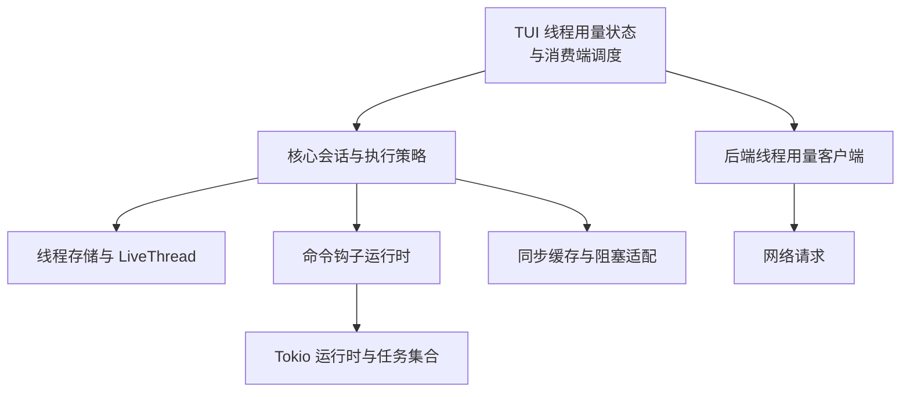
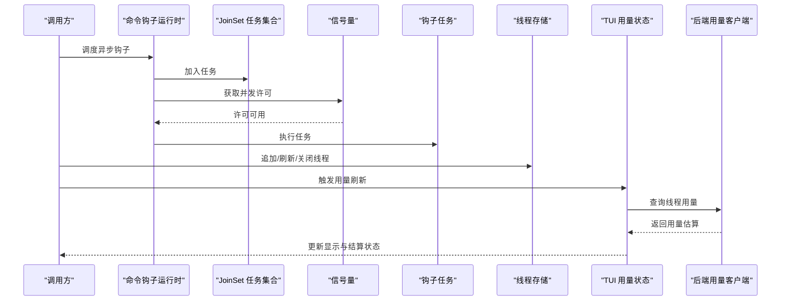
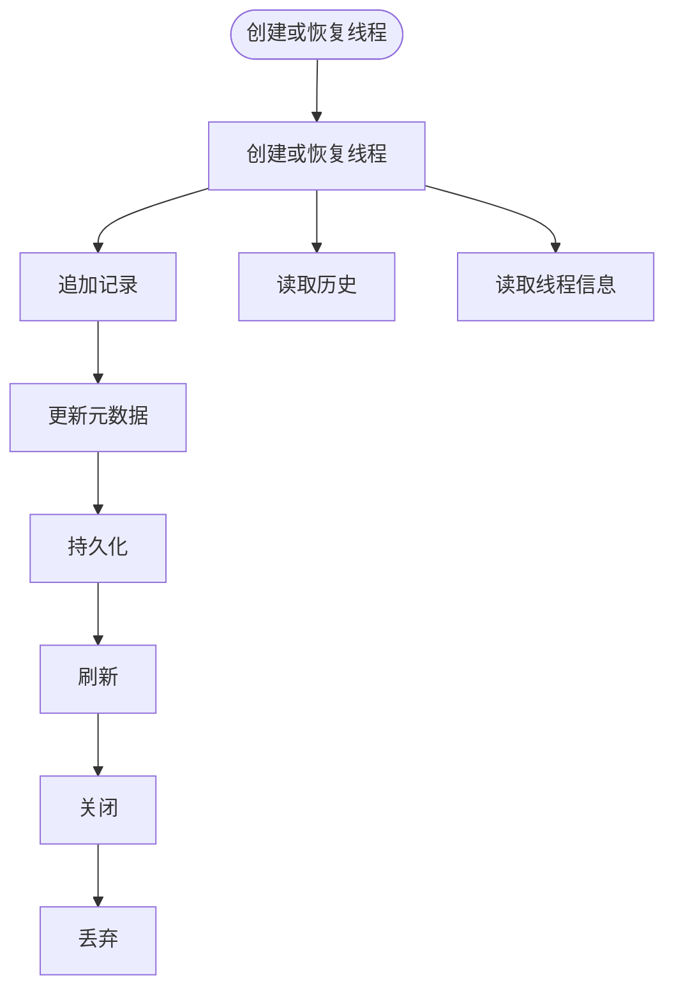
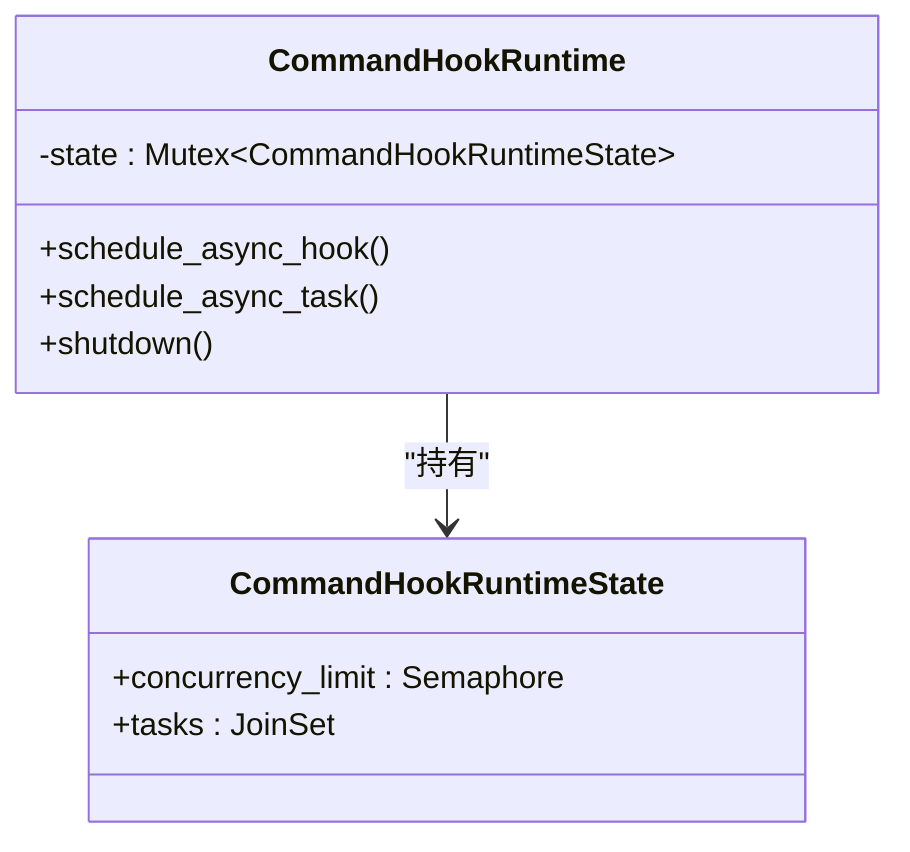
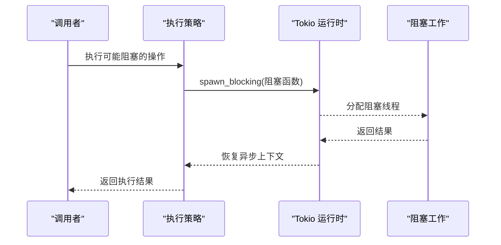
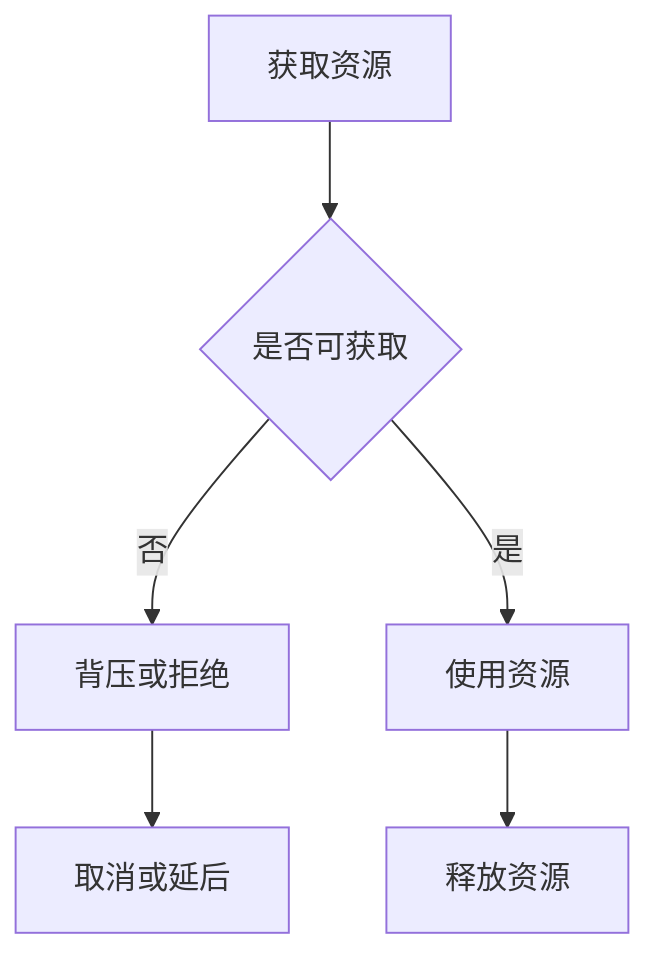
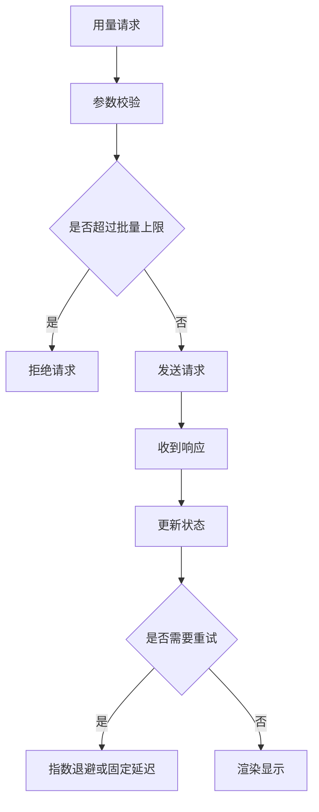
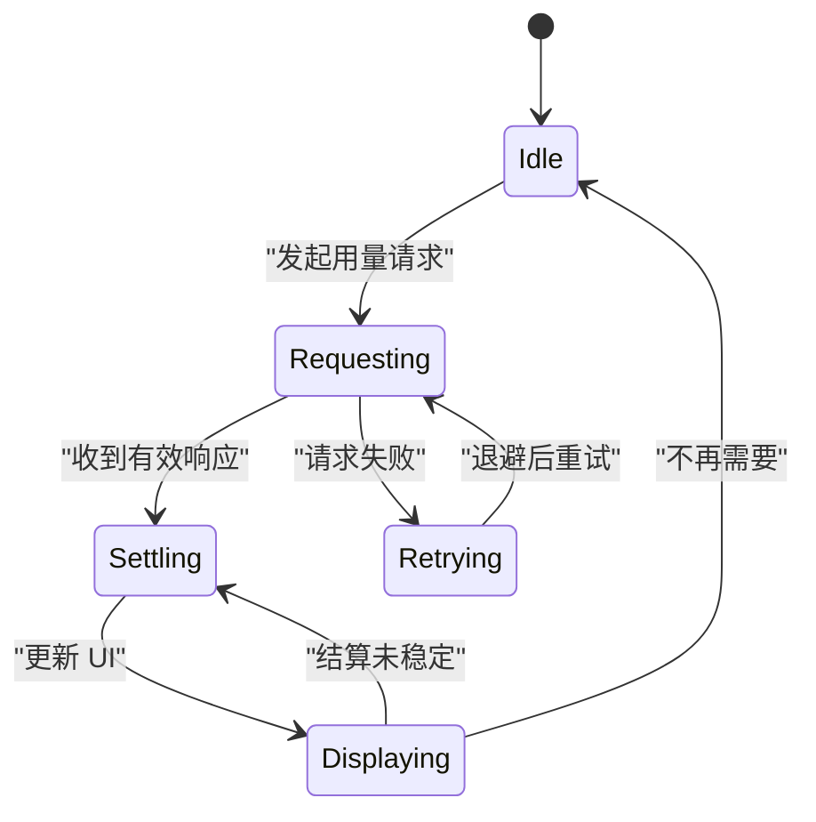
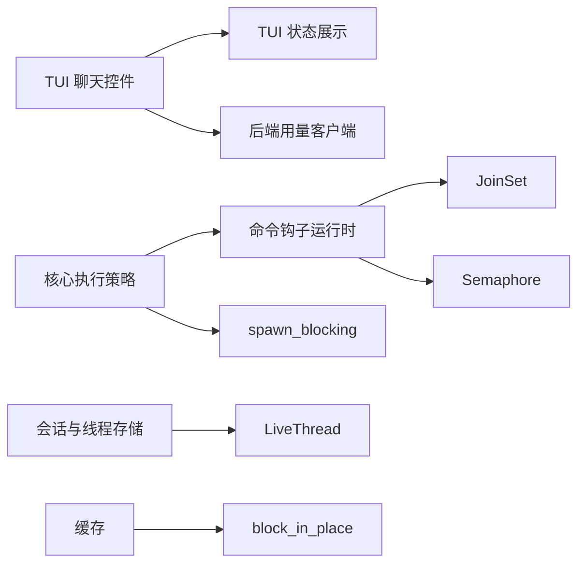

# 线程并发控制

<cite>
**本文引用的文件**   
- [live_thread.rs](file://codex-rs/thread-store/src/live_thread.rs)
- [thread_usage.rs（状态展示）](file://codex-rs/tui/src/status/thread_usage.rs)
- [thread_usage.rs（聊天控件）](file://codex-rs/tui/src/chatwidget/thread_usage.rs)
- [thread_usage.rs（后端客户端）](file://codex-rs/backend-client/src/client/thread_usage.rs)
- [command_runner.rs](file://codex-rs/hooks/src/engine/command_runner.rs)
- [exec_policy.rs](file://codex-rs/core/src/exec_policy.rs)
- [lib.rs（缓存）](file://codex-rs/utils/cache/src/lib.rs)
</cite>

## 目录
1. [引言](#引言)
2. [项目结构中的并发相关位置](#项目结构中的并发相关位置)
3. [核心组件](#核心组件)
4. [架构总览](#架构总览)
5. [详细组件分析](#详细组件分析)
6. [依赖关系分析](#依赖关系分析)
7. [性能与资源约束](#性能与资源约束)
8. [故障排查指南](#故障排查指南)
9. [结论](#结论)
10. [附录：并发编程模式参考](#附录并发编程模式参考)

## 引言
本文件围绕“线程并发控制”这一目标，从仓库中实际实现出发，解释以下方面：
- 线程池管理与最大并发数限制。
- 任务队列、调度与优先级策略。
- 异步任务协调：Future 组合、取消传播与超时处理。
- 资源竞争控制：锁、信号量、死锁预防。
- 背压与缓冲管理：流量控制、内存保护。
- 监控与诊断：指标收集、阻塞检测与恢复。
- 并发编程示例：提交任务、获取结果、异常处理的正确模式。

本项目是 Rust 多 crate 工程，使用 Tokio 运行时执行异步任务；线程级并发通常通过 Tokio 的多线程运行时、阻塞任务池以及 `tokio::sync` 原语组合实现。真正的“全局线程池管理器”并不存在单一集中式类，而是由运行时构建、子系统内的任务集合和信号量共同构成。

## 项目结构中的并发相关位置
仓库中与线程并发控制直接相关的代码主要分布在以下模块：
- 会话持久化与线程生命周期：`codex-rs/thread-store`
- 命令钩子与异步任务集合：`codex-rs/hooks`
- 执行策略与阻塞任务派发：`codex-rs/core`
- 用户界面中的线程用量监控：`codex-rs/tui`
- 后端线程用量查询客户端：`codex-rs/backend-client`
- 同步缓存与阻塞访问封装：`codex-rs/utils/cache`

[此图为概念结构图，不直接映射到具体源码行]

**章节来源**
- [live_thread.rs:1-466](file://codex-rs/thread-store/src/live_thread.rs#L1-L466)
- [command_runner.rs:1-210](file://codex-rs/hooks/src/engine/command_runner.rs#L1-L210)
- [exec_policy.rs:30-120](file://codex-rs/core/src/exec_policy.rs#L30-L120)
- [thread_usage.rs（聊天控件）:1-432](file://codex-rs/tui/src/chatwidget/thread_usage.rs#L1-L432)
- [thread_usage.rs（后端客户端）:1-130](file://codex-rs/backend-client/src/client/thread_usage.rs#L1-L130)
- [lib.rs（缓存）:130-150](file://codex-rs/utils/cache/src/lib.rs#L130-L150)

## 核心组件
本节归纳线程并发控制的关键角色：

| 组件 | 职责 | 并发机制 | 关键行为 |
|---|---|---|---|
| `LiveThread` | 表示一个活跃线程的持久化生命周期，负责追加记录、刷新、关闭、丢弃、读取等。 | 使用 Tokio 异步方法；内部用 `tokio::sync::Mutex` 保护元数据同步状态。 | 在追加项后更新元数据；持久化和刷新操作委托给底层线程存储；关闭时合并元数据更新错误。 |
| `CommandHookRuntime` | 为一次会话调度命令钩子异步任务，维护任务集合与并发上限。 | `JoinSet` 管理任务句柄；`Semaphore` 限制同时执行的钩子数量；支持关闭后拒绝新任务。 | 每次调度前清理已完成的 JoinSet 任务；任务先申请许可，再执行；关闭时停止接受新任务并中止所有任务。 |
| `Client::get_thread_usage` / `get_threads_usage` | 向后端查询单个或多个线程的用量估算。 | 异步 HTTP 请求；对输入进行批大小和去重校验。 | 最多允许 100 个不同线程 ID；返回响应后校验线程 ID 是否合法且无重复。 |
| `StatusThreadUsage` | TUI 中用于展示线程用量估算的状态对象。 | `RwLock<Option<ThreadUsage>>` + `AtomicBool`。 | 安全更新估算值；预留标签宽度；按模型、推理强度、速度维度分组展示。 |
| `ThreadUsageState` | TUI 聊天控件中的线程用量请求、重试、结算与显示状态机。 | 帧调度器、即时时间戳、递增请求 ID。 | 延迟重试、退避结算；防止旧响应覆盖新状态；失败时安排重试或终止重试。 |
| 缓存访问封装 | 提供阻塞场景下的缓存访问入口。 | `block_in_place` + `Mutex`。 | 在需要阻塞的地方调用缓存初始化或锁定逻辑，避免误入阻塞陷阱。 |

**章节来源**
- [live_thread.rs:1-466](file://codex-rs/thread-store/src/live_thread.rs#L1-L466)
- [command_runner.rs:1-210](file://codex-rs/hooks/src/engine/command_runner.rs#L1-L210)
- [thread_usage.rs（后端客户端）:1-130](file://codex-rs/backend-client/src/client/thread_usage.rs#L1-L130)
- [thread_usage.rs（状态展示）:1-200](file://codex-rs/tui/src/status/thread_usage.rs#L1-L200)
- [thread_usage.rs（聊天控件）:1-432](file://codex-rs/tui/src/chatwidget/thread_usage.rs#L1-L432)
- [lib.rs（缓存）:130-150](file://codex-rs/utils/cache/src/lib.rs#L130-L150)

## 架构总览
线程并发控制在仓库中呈现为“运行时驱动 + 子系统内限流 + 可观测性消费”的分层结构：

**图表来源**
- [command_runner.rs:60-210](file://codex-rs/hooks/src/engine/command_runner.rs#L60-L210)
- [live_thread.rs:100-350](file://codex-rs/thread-store/src/live_thread.rs#L100-L350)
- [thread_usage.rs（聊天控件）:200-432](file://codex-rs/tui/src/chatwidget/thread_usage.rs#L200-L432)
- [thread_usage.rs（后端客户端）:1-130](file://codex-rs/backend-client/src/client/thread_usage.rs#L1-L130)

## 详细组件分析

### 线程存储与活跃线程生命周期
`LiveThread` 不是传统意义上的线程池控制器，而是线程级会话的生命周期抽象。它把“线程创建、恢复、追加记录、持久化、刷新、关闭、丢弃、读取历史”等动作统一暴露给上层会话代码，同时通过 `ThreadMetadataSync` 与底层存储解耦。

关键点：
- 创建和恢复路径分别构造不同的元数据同步上下文。
- 追加记录后，会尝试将必要的元数据变更写入存储。
- `persist` 与 `flush` 会区分“后台持久化”与标准持久化上下文。
- `shutdown` 同时处理元数据更新与线程关闭两个副作用，并将多个错误合并报告。
- 初始化守卫 `LiveThreadInitGuard` 保证即使初始化中途失败，也能等待正在进行的获取操作完成后再释放资源。

**图表来源**
- [live_thread.rs:100-466](file://codex-rs/thread-store/src/live_thread.rs#L100-L466)

**章节来源**
- [live_thread.rs:1-466](file://codex-rs/thread-store/src/live_thread.rs#L1-L466)

### 命令钩子并发控制
`CommandHookRuntime` 是仓库中最接近“线程并发控制”的子系统组件。它负责：
- 使用 `JoinSet` 管理当前会话的所有钩子任务。
- 使用 `Semaphore` 限制同时运行的异步钩子数量。
- 在调度任务前先清理已完成任务。
- 关闭时关闭信号量、拒绝新任务、中止所有任务并等待结束。

**图表来源**
- [command_runner.rs:1-210](file://codex-rs/hooks/src/engine/command_runner.rs#L1-L210)

并发策略说明：
- 最大并发数由常量定义并通过 `Semaphore` 控制。
- 任务本身是 `Future`，由 Tokio 调度；`JoinSet` 只负责跟踪句柄。
- 取消传播通过 `abort_all` 和 `join_next` 完成。
- 关闭流程先关闭信号量，使后续 `acquire_owned` 失败，从而阻止新任务进入。

**章节来源**
- [command_runner.rs:1-210](file://codex-rs/hooks/src/engine/command_runner.rs#L1-L210)

### 异步任务协调：Future 组合、取消与超时
仓库中常见的 Future 协调模式包括：
- 使用 `JoinSet` 聚合多个异步任务。
- 使用 `Semaphore` 限制并发度。
- 使用 Tokio 的超时、取消通道和 `AbortHandle` 等机制进行外部控制。
- 使用 `spawn_blocking` 将阻塞工作移出异步任务。

例如，执行策略中会使用 `spawn_blocking` 包装阻塞逻辑，避免阻塞 Tokio 事件循环。测试中也常见 `max_blocking_threads` 配置，用于限制阻塞线程池规模。

**图表来源**
- [exec_policy.rs:30-120](file://codex-rs/core/src/exec_policy.rs#L30-L120)

**章节来源**
- [exec_policy.rs:30-120](file://codex-rs/core/src/exec_policy.rs#L30-L120)

### 资源竞争控制：锁、信号量与死锁预防
仓库中出现的并发同步原语主要包括：
- `tokio::sync::Mutex`：用于异步上下文中的互斥访问。
- `std::sync::Mutex`：用于同步上下文中的互斥访问。
- `tokio::sync::Semaphore`：用于异步任务并发度限制。
- `RwLock` + `AtomicBool`：用于 UI 状态的可读多写少共享数据。

死锁预防策略体现在设计层面：
- 命令钩子运行时将“任务集合”与“并发信号量”放在同一个状态结构中，并在关闭时原子性地关闭信号量并中止任务，避免任务长期持有锁。
- `LiveThread` 在关闭时合并元数据更新与线程关闭的错误，避免部分成功导致状态不一致。
- 缓存访问通过 `block_in_place` 明确标记阻塞点，降低误用风险。

**图表来源**
- [command_runner.rs:60-210](file://codex-rs/hooks/src/engine/command_runner.rs#L60-L210)
- [live_thread.rs:200-466](file://codex-rs/thread-store/src/live_thread.rs#L200-L466)
- [lib.rs（缓存）:130-150](file://codex-rs/utils/cache/src/lib.rs#L130-L150)

**章节来源**
- [command_runner.rs:60-210](file://codex-rs/hooks/src/engine/command_runner.rs#L60-L210)
- [live_thread.rs:200-466](file://codex-rs/thread-store/src/live_thread.rs#L200-L466)
- [lib.rs（缓存）:130-150](file://codex-rs/utils/cache/src/lib.rs#L130-L150)

### 背压处理与流量控制
背压在仓库中表现为多种形态：

| 场景 | 机制 | 效果 |
|---|---|---|
| 钩子任务过多 | `Semaphore` 限制同时执行数量 | 防止一次性启动过多钩子导致资源耗尽。 |
| 任务集合积压 | `JoinSet` + 关闭后拒绝新任务 | 关闭阶段逐步清理，避免无限增长。 |
| 用量查询频率 | 重试延迟与结算延迟数组 | 避免频繁请求后端，减少 UI 抖动。 |
| 批量用量查询 | 最多 100 个线程 ID | 防止单次请求过大。 |
| 阻塞缓存访问 | `block_in_place` | 明确阻塞边界，避免误阻塞事件循环。 |

**图表来源**
- [thread_usage.rs（聊天控件）:200-432](file://codex-rs/tui/src/chatwidget/thread_usage.rs#L200-L432)
- [thread_usage.rs（后端客户端）:1-130](file://codex-rs/backend-client/src/client/thread_usage.rs#L1-L130)

**章节来源**
- [thread_usage.rs（聊天控件）:200-432](file://codex-rs/tui/src/chatwidget/thread_usage.rs#L200-L432)
- [thread_usage.rs（后端客户端）:1-130](file://codex-rs/backend-client/src/client/thread_usage.rs#L1-L130)

### 监控与诊断
线程并发控制的监控主要体现在“线程用量估算”和 UI 状态上：
- `StatusThreadUsage` 保存可选的 `ThreadUsage`，并按模型、推理强度、速度分组展示。
- `ThreadUsageState` 维护请求 ID、重试次数、结算基线、下次重试时间与结算时间。
- 后端客户端负责按协议格式请求用量，并对非法响应做防御性校验。

**图表来源**
- [thread_usage.rs（聊天控件）:200-432](file://codex-rs/tui/src/chatwidget/thread_usage.rs#L200-L432)
- [thread_usage.rs（状态展示）:1-200](file://codex-rs/tui/src/status/thread_usage.rs#L1-L200)

**章节来源**
- [thread_usage.rs（聊天控件）:200-432](file://codex-rs/tui/src/chatwidget/thread_usage.rs#L200-L432)
- [thread_usage.rs（状态展示）:1-200](file://codex-rs/tui/src/status/thread_usage.rs#L1-L200)
- [thread_usage.rs（后端客户端）:1-130](file://codex-rs/backend-client/src/client/thread_usage.rs#L1-L130)

## 依赖关系分析
下图展示核心并发相关组件之间的依赖方向：

**图表来源**
- [thread_usage.rs（聊天控件）:1-432](file://codex-rs/tui/src/chatwidget/thread_usage.rs#L1-L432)
- [thread_usage.rs（状态展示）:1-200](file://codex-rs/tui/src/status/thread_usage.rs#L1-L200)
- [thread_usage.rs（后端客户端）:1-130](file://codex-rs/backend-client/src/client/thread_usage.rs#L1-L130)
- [command_runner.rs:1-210](file://codex-rs/hooks/src/engine/command_runner.rs#L1-L210)
- [live_thread.rs:1-466](file://codex-rs/thread-store/src/live_thread.rs#L1-L466)
- [exec_policy.rs:30-120](file://codex-rs/core/src/exec_policy.rs#L30-L120)
- [lib.rs（缓存）:130-150](file://codex-rs/utils/cache/src/lib.rs#L130-L150)

**章节来源**
- [thread_usage.rs（聊天控件）:1-432](file://codex-rs/tui/src/chatwidget/thread_usage.rs#L1-L432)
- [thread_usage.rs（状态展示）:1-200](file://codex-rs/tui/src/status/thread_usage.rs#L1-L200)
- [thread_usage.rs（后端客户端）:1-130](file://codex-rs/backend-client/src/client/thread_usage.rs#L1-L130)
- [command_runner.rs:1-210](file://codex-rs/hooks/src/engine/command_runner.rs#L1-L210)
- [live_thread.rs:1-466](file://codex-rs/thread-store/src/live_thread.rs#L1-L466)
- [exec_policy.rs:30-120](file://codex-rs/core/src/exec_policy.rs#L30-L120)
- [lib.rs（缓存）:130-150](file://codex-rs/utils/cache/src/lib.rs#L130-L150)

## 性能与资源约束
- **最大并发数限制**：命令钩子通过固定大小的信号量限制并发；测试中广泛使用 `max_blocking_threads` 限制阻塞线程池规模，避免阻塞任务抢占异步任务。
- **任务队列管理**：`JoinSet` 作为轻量任务集合，适合短生命周期任务；不适合做有优先级的长队列，但可通过外层调度器实现优先级。
- **优先级调度**：仓库中没有显式的优先级队列实现；优先级应由上层调度器决定任务提交顺序，而不是由底层运行时自动排序。
- **背压**：通过信号量、批量大小限制、重试退避和结算延迟实现软背压；没有发现基于内存阈值的硬背压。
- **内存保护**：用量查询限制单次最多 100 个线程 ID；UI 状态更新使用读写锁，避免高并发渲染竞争。
- **阻塞检测**：仓库未发现内置的阻塞检测框架；开发者需自行避免在异步上下文中执行阻塞 I/O，并使用 `block_in_place` 明确标注阻塞点。

**章节来源**
- [command_runner.rs:1-210](file://codex-rs/hooks/src/engine/command_runner.rs#L1-L210)
- [thread_usage.rs（后端客户端）:1-130](file://codex-rs/backend-client/src/client/thread_usage.rs#L1-L130)
- [lib.rs（缓存）:130-150](file://codex-rs/utils/cache/src/lib.rs#L130-L150)

## 故障排查指南
常见问题与定位建议：

| 现象 | 可能原因 | 排查步骤 |
|---|---|---|
| 钩子任务堆积 | 并发上限太小或任务耗时过长 | 检查 `MAX_CONCURRENT_ASYNC_HOOKS` 与任务耗时；观察 `JoinSet` 中未完成的任务数量。 |
| 关闭后仍有任务运行 | 关闭流程未等待任务结束 | 确认 `shutdown` 是否调用 `abort_all` 并等待 `join_next`。 |
| 用量查询频繁失败 | 后端不可用或网络异常 | 查看重试延迟与结算延迟；检查请求 ID 是否被旧响应覆盖。 |
| UI 显示用量不变 | 结算尚未稳定或特征不可用 | 检查 `settlement_baseline_credits_micros` 与 `feature_disabled`。 |
| 阻塞导致界面卡顿 | 在异步上下文中执行阻塞 I/O | 检查是否误用同步锁；确认是否应使用 `spawn_blocking` 或 `block_in_place`。 |
| 线程存储关闭失败 | 元数据更新与线程关闭均出错 | 查看 `shutdown` 合并错误信息，定位元数据更新失败原因。 |

**章节来源**
- [command_runner.rs:180-210](file://codex-rs/hooks/src/engine/command_runner.rs#L180-L210)
- [thread_usage.rs（聊天控件）:200-432](file://codex-rs/tui/src/chatwidget/thread_usage.rs#L200-L432)
- [live_thread.rs:300-466](file://codex-rs/thread-store/src/live_thread.rs#L300-L466)

## 结论
仓库中的线程并发控制并非由单一“线程池管理器”实现，而是由 Tokio 运行时、子系统内的任务集合与信号量、以及面向用户的用量监控共同组成。核心实践包括：
- 使用 `JoinSet` 管理短生命周期异步任务。
- 使用 `Semaphore` 限制并发度。
- 使用 `spawn_blocking` 隔离阻塞工作。
- 使用增量状态、请求 ID 和退避重试协调异步结果。
- 通过批量大小限制与 UI 状态保护实现背压与内存保护。
- 通过清晰的关闭流程实现取消传播与资源回收。

对于更高阶的优先级调度、全局线程池调度和阻塞检测，仓库并未提供通用基础设施，建议在业务层扩展调度器，或在测试中通过运行时配置约束资源。

## 附录：并发编程模式参考

### 任务提交与并发限制
推荐模式：
- 使用 `JoinSet` 聚合任务。
- 使用 `Semaphore` 限制并发。
- 关闭时拒绝新任务并中止旧任务。

参考实现位置：
- [command_runner.rs:60-210](file://codex-rs/hooks/src/engine/command_runner.rs#L60-L210)

### 结果获取与异常处理
推荐模式：
- 使用唯一请求 ID 匹配响应。
- 忽略过期响应。
- 失败时退避重试。
- 成功时更新状态并触发 UI 刷新。

参考实现位置：
- [thread_usage.rs（聊天控件）:200-432](file://codex-rs/tui/src/chatwidget/thread_usage.rs#L200-L432)
- [thread_usage.rs（后端客户端）:1-130](file://codex-rs/backend-client/src/client/thread_usage.rs#L1-L130)

### 超时与取消
推荐模式：
- 使用 Tokio 的超时 API 包裹外部请求。
- 使用 `AbortHandle` 或 `JoinSet::abort_all` 取消长时间任务。
- 在关闭路径中等待任务结束。

参考实现位置：
- [command_runner.rs:180-210](file://codex-rs/hooks/src/engine/command_runner.rs#L180-L210)

### 阻塞与线程池配置
推荐模式：
- 将阻塞 I/O 放入 `spawn_blocking`。
- 在测试中使用 `max_blocking_threads` 控制阻塞线程池大小。
- 必须阻塞时使用 `block_in_place` 明确语义。

参考实现位置：
- [exec_policy.rs:30-120](file://codex-rs/core/src/exec_policy.rs#L30-L120)
- [lib.rs（缓存）:130-150](file://codex-rs/utils/cache/src/lib.rs#L130-L150)