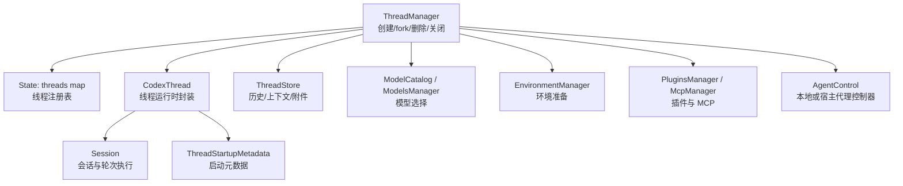
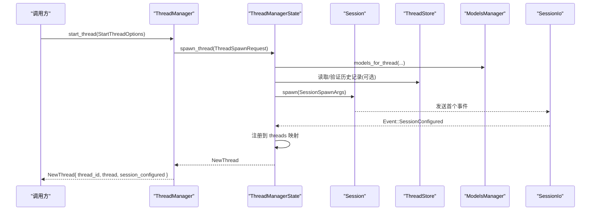
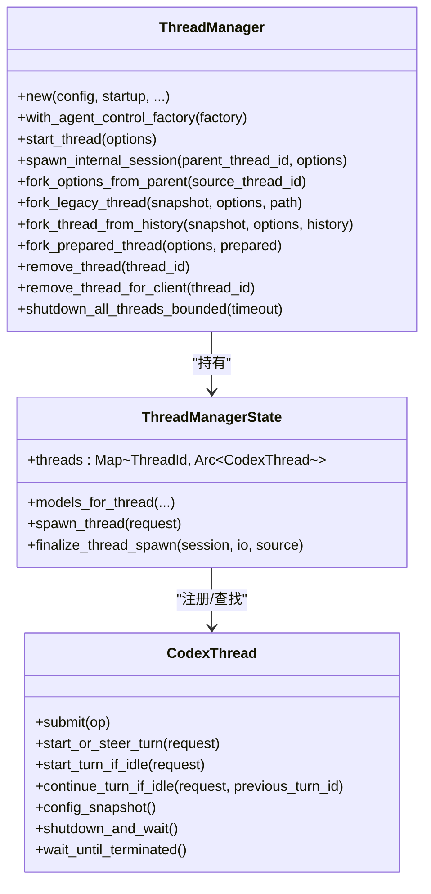
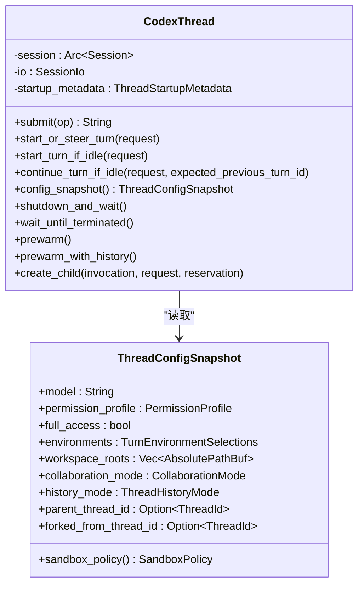
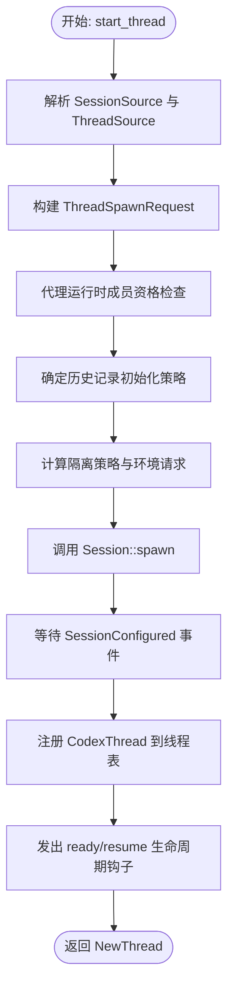
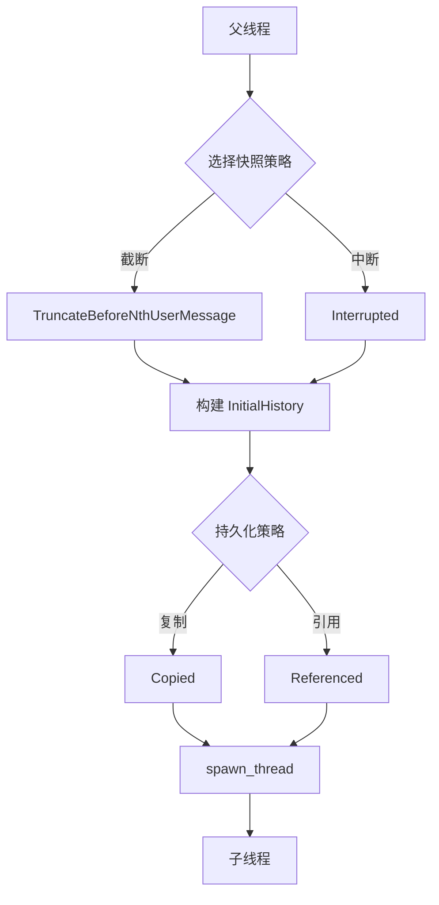
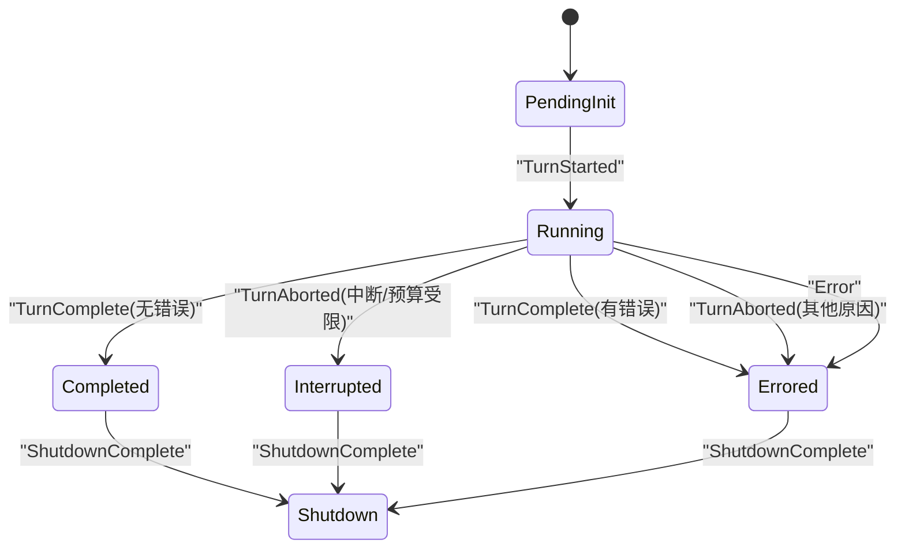
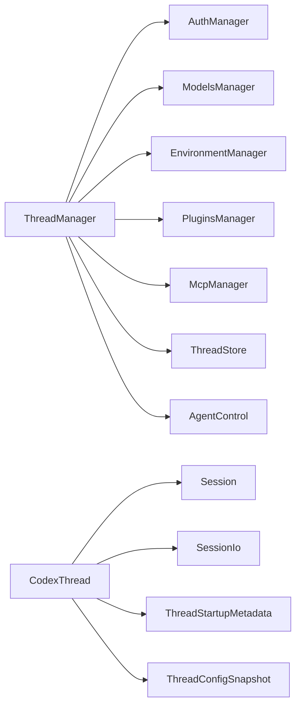

# 线程生命周期管理

<cite>
**本文引用的文件**   
- [thread_manager.rs](file://codex-rs/core/src/thread_manager.rs)
- [managed.rs](file://codex-rs/core/src/thread_manager/managed.rs)
- [codex_thread.rs](file://codex-rs/core/src/codex_thread.rs)
- [thread_spawn.rs](file://codex-rs/core/src/thread_spawn.rs)
- [thread_startup_metadata.rs](file://codex-rs/core/src/thread_startup_metadata.rs)
- [types.rs](file://codex-rs/core/src/agent/types.rs)
- [status.rs](file://codex-rs/core/src/agent/status.rs)
- [main.rs](file://codex-rs/thread-manager-sample/src/main.rs)
</cite>

## 目录
1. [引言](#引言)
2. [项目结构](#项目结构)
3. [核心组件](#核心组件)
4. [架构总览](#架构总览)
5. [详细组件分析](#详细组件分析)
6. [依赖关系分析](#依赖关系分析)
7. [性能与资源管理](#性能与资源管理)
8. [故障排查指南](#故障排查指南)
9. [结论](#结论)
10. [附录：线程操作 API 参考](#附录线程操作-api-参考)

## 引言
本文面向需要理解并正确使用 Codex Core 中“线程”抽象的开发者。这里的“线程”不是操作系统线程，而是由 `ThreadManager` 管理的逻辑执行上下文，通常对应一个对话、一次子任务或一个多智能体角色。文档重点覆盖以下方面：
- 线程对象的创建、初始化、注册和销毁。
- 线程配置快照 `ThreadConfigSnapshot` 的结构、用途及权限/环境/模型语义。
- 线程启动流程：环境准备、权限检查、模型选择和历史记录加载。
- 父子关系与 fork 机制：继承策略、数据共享与持久化模式。
- 线程状态机：空闲、运行中、暂停、完成等状态的触发条件。
- 资源管理：并发限制、内存控制、MCP/插件/附件回收。
- 面向调用方的 API 使用方式与示例路径。

## 项目结构
与线程生命周期直接相关的代码集中在 `codex-rs/core/src` 下的几个模块：
- `thread_manager.rs`：线程管理器、创建入口、fork、删除、批量关闭、内部状态表。
- `codex_thread.rs`：线程运行时封装、配置快照、输入提交、预热、生命周期事件钩子。
- `thread_spawn.rs`：子线程（子代理）创建请求、消息投递与后端分发。
- `thread_startup_metadata.rs`：线程启动时记录的元数据，用于对外报告 `SessionConfiguredEvent`。
- `thread_manager/managed.rs`：受管线程生命周期辅助函数。
- `agent/types.rs` 与 `agent/status.rs`：代理身份、状态类型与状态转换规则。
- `thread-manager-sample/src/main.rs`：通过 `ThreadManager` 启动线程的最小示例。

**图表来源**
- [thread_manager.rs:631-720](file://codex-rs/core/src/thread_manager.rs#L631-L720)
- [codex_thread.rs:200-260](file://codex-rs/core/src/codex_thread.rs#L200-L260)
- [thread_startup_metadata.rs:1-104](file://codex-rs/core/src/thread_startup_metadata.rs#L1-L104)

**章节来源**
- [thread_manager.rs:1-200](file://codex-rs/core/src/thread_manager.rs#L1-L200)
- [codex_thread.rs:1-200](file://codex-rs/core/src/codex_thread.rs#L1-L200)

## 核心组件
- `ThreadManager`：进程级线程管理器。负责线程 ID 生成、注册表维护、模型与服务装配、启动与 fork、查询与删除、批量关闭。
- `CodexThread`：线程运行时句柄。持有 `Arc<Session>`、I/O 通道、启动元数据、扩展数据、诊断指标，并提供提交输入、预热、终止等待等操作。
- `StartThreadOptions`：启动参数对象，包含配置、历史记录、隔离策略、环境、指令提供者、插件选择、追踪上下文等。
- `ThreadConfigSnapshot`：线程生效配置快照，包括模型、权限画像、沙箱策略、工作区、协作模式、父线程关系、历史模式等。
- `ThreadStartupMetadata`：线程启动后固定的元数据快照，便于向外部系统报告初始配置。
- `LiveAgent` 与 `AgentStatus`：子代理的身份与状态观察值；状态由事件流驱动。

**章节来源**
- [thread_manager.rs:631-900](file://codex-rs/core/src/thread_manager.rs#L631-L900)
- [codex_thread.rs:90-190](file://codex-rs/core/src/codex_thread.rs#L90-L190)
- [thread_startup_metadata.rs:1-104](file://codex-rs/core/src/thread_startup_metadata.rs#L1-L104)
- [types.rs:1-91](file://codex-rs/core/src/agent/types.rs#L1-L91)
- [status.rs:1-31](file://codex-rs/core/src/agent/status.rs#L1-L31)

## 架构总览
下图展示一次典型线程创建的调用链：调用方构造 `StartThreadOptions`，通过 `ThreadManager.start_thread` 进入内部启动流程，最终创建 `Session`，收到首个 `SessionConfigured` 事件后注册 `CodexThread`，并向调用方返回 `NewThread`。

**图表来源**
- [thread_manager.rs:1381-1400](file://codex-rs/core/src/thread_manager.rs#L1381-L1400)
- [thread_manager.rs:2451-3100](file://codex-rs/core/src/thread_manager.rs#L2451-L3100)
- [thread_manager.rs:3020-3085](file://codex-rs/core/src/thread_manager.rs#L3020-L3085)

**章节来源**
- [thread_manager.rs:1381-1400](file://codex-rs/core/src/thread_manager.rs#L1381-L1400)
- [thread_manager.rs:2451-3100](file://codex-rs/core/src/thread_manager.rs#L2451-L3100)

## 详细组件分析

### ThreadManager：线程生命周期中心
`ThreadManager` 是线程的工厂与登记处。它保存：
- 线程注册表：`threads: HashMap<ThreadId, Arc<CodexThread>>`。
- 模型目录、环境管理器、插件管理器、MCP 管理器、技能服务、附件存储、线程存储、认证与遥测客户端。
- 线程 ID 生成器、测试行为开关、操作日志等。

关键职责：
- 构造与注入宿主能力：`new`、`with_agent_control_factory`、`with_code_mode_session_provider`。
- 创建线程：`start_thread`、`spawn_internal_session`、`resume_thread_with_history`。
- Fork 线程：`fork_options_from_parent`、`fork_legacy_thread`、`fork_thread_from_history`、`fork_prepared_thread`。
- 查询与移除：`get_thread`、`remove_thread`、`remove_thread_for_client`、`remove_thread_if_matches`。
- 批量关闭：`shutdown_all_threads_bounded`。

**图表来源**
- [thread_manager.rs:631-720](file://codex-rs/core/src/thread_manager.rs#L631-L720)
- [thread_manager.rs:1381-1400](file://codex-rs/core/src/thread_manager.rs#L1381-L1400)
- [thread_manager.rs:1771-1900](file://codex-rs/core/src/thread_manager.rs#L1771-L1900)
- [thread_manager.rs:1980-2100](file://codex-rs/core/src/thread_manager.rs#L1980-L2100)
- [thread_manager.rs:2451-3100](file://codex-rs/core/src/thread_manager.rs#L2451-L3100)

**章节来源**
- [thread_manager.rs:631-900](file://codex-rs/core/src/thread_manager.rs#L631-L900)
- [thread_manager.rs:1381-1400](file://codex-rs/core/src/thread_manager.rs#L1381-L1400)
- [thread_manager.rs:1771-2000](file://codex-rs/core/src/thread_manager.rs#L1771-L2000)
- [thread_manager.rs:1980-2100](file://codex-rs/core/src/thread_manager.rs#L1980-L2100)
- [thread_manager.rs:2451-3100](file://codex-rs/core/src/thread_manager.rs#L2451-L3100)

### CodexThread：线程运行时封装
`CodexThread` 是上层业务操作的统一入口。它不直接持有会话循环的所有细节，而是委托给 `Session` 与 `SessionIo`。主要能力：
- 提交操作：`submit`、`submit_with_trace`。
- 轮次控制：`start_or_steer_turn`、`start_turn_if_idle`、`continue_turn_if_idle`、`wait_for_input_activity`。
- 配置访问：`config_snapshot`、`session_source`、`current_time`、`analytics_enabled`。
- 子线程：`create_child`、`prepare_child`。
- 生命周期：`shutdown_and_wait`、`wait_until_terminated`、`prewarm`、`prewarm_with_history`。
- 诊断与工具：`tool_invocation`、`item_id_generator`、`apps_tools_from_mcp_client`。

**图表来源**
- [codex_thread.rs:90-190](file://codex-rs/core/src/codex_thread.rs#L90-L190)
- [codex_thread.rs:200-300](file://codex-rs/core/src/codex_thread.rs#L200-L300)
- [codex_thread.rs:550-650](file://codex-rs/core/src/codex_thread.rs#L550-L650)
- [codex_thread.rs:1164-1220](file://codex-rs/core/src/codex_thread.rs#L1164-L1220)

**章节来源**
- [codex_thread.rs:90-190](file://codex-rs/core/src/codex_thread.rs#L90-L190)
- [codex_thread.rs:200-300](file://codex-rs/core/src/codex_thread.rs#L200-L300)
- [codex_thread.rs:550-650](file://codex-rs/core/src/codex_thread.rs#L550-L650)
- [codex_thread.rs:1164-1220](file://codex-rs/core/src/codex_thread.rs#L1164-L1220)

### ThreadConfigSnapshot：线程配置快照
`ThreadConfigSnapshot` 是线程生效配置的只读视图，用于在 turn 执行期间稳定读取模型、权限、环境和协作设置。关键字段包括：
- 模型与提供方：`model`、`model_provider_id`、`service_tier`。
- 权限与访问：`approval_policy`、`approvals_reviewer`、`permission_profile`、`active_permission_profile`、`full_access`。
- 环境与工作区：`environments`、`workspace_roots`、`profile_workspace_roots`。
- 行为与历史：`ephemeral`、`reasoning_effort`、`reasoning_summary`、`personality`、`collaboration_mode`、`history_mode`。
- 父子关系与来源：`forked_from_thread_id`、`parent_thread_id`、`thread_source`、`originator`、`disabled_plugin_ids`。
- 派生能力：`cwd()`、`environment_selections()`、`is_primary_environment_configured()`、`sandbox_policy()`。

该快照不包含每次 turn 的动态扩展数据；动态数据通过 `turn_extension_init` 和 `CodexThreadSettingsOverrides` 传递。

**章节来源**
- [codex_thread.rs:90-190](file://codex-rs/core/src/codex_thread.rs#L90-L190)

### 线程启动流程
`ThreadManager.start_thread` 会进入 `start_thread_inner`，再委托 `ThreadManagerState.spawn_thread`。启动流程可概括为：

1. **解析来源与内部父会话**  
   - 从 `InitialHistory` 恢复 `SessionSource` 与 `ThreadSource`。
   - 若存在 `InternalSessionParent`，则复用其认证、代理控制器和 originator。

2. **构建 ThreadSpawnRequest**  
   - 填充认证、代理控制器、父子关系、fork 来源、环境变量、指令、执行策略等。

3. **成员资格与会话启动**  
   - 获取代理运行时成员资格。
   - 根据历史记录决定冷 fork、热 fork 或普通初始化。
   - 解析隔离策略、环境请求、用户指令、执行策略。
   - 构建 `SessionSpawnArgs` 并调用 `Session::spawn`。

4. **等待首个事件并完成注册**  
   - 等待 `SessionConfigured` 事件。
   - 将 `CodexThread` 注册到 `threads` 映射。
   - 复制附件、刷新 MCP 失效通知、发出生命周期钩子。

5. **返回 NewThread**  
   - 包含 `thread_id`、`thread`、首次 `SessionConfiguredEvent`。

**图表来源**
- [thread_manager.rs:1381-1400](file://codex-rs/core/src/thread_manager.rs#L1381-L1400)
- [thread_manager.rs:2451-3100](file://codex-rs/core/src/thread_manager.rs#L2451-L3100)
- [thread_manager.rs:3020-3085](file://codex-rs/core/src/thread_manager.rs#L3020-L3085)

**章节来源**
- [thread_manager.rs:1381-1400](file://codex-rs/core/src/thread_manager.rs#L1381-L1400)
- [thread_manager.rs:2451-3100](file://codex-rs/core/src/thread_manager.rs#L2451-L3100)

### 环境准备、权限检查与模型选择
- 环境准备：通过 `EnvironmentManager` 与默认环境请求生成当前线程的环境选择；子线程可从父线程继承已捕获的环境快照。
- 权限检查：通过 `AskForApproval`、`PermissionProfile`、`ActivePermissionProfile`、`full_access` 表达审批策略与权限画像；沙箱策略由 `sandbox_policy()` 推导。
- 模型选择：通过 `SharedModelsManager` 与 `ModelCatalog` 按 `Config`、认证上下文、安装标识、originator 和 session source 选择模型。

**章节来源**
- [thread_manager.rs:2451-2700](file://codex-rs/core/src/thread_manager.rs#L2451-L2700)
- [codex_thread.rs:90-190](file://codex-rs/core/src/codex_thread.rs#L90-L190)

### 历史记录加载与恢复
- 新线程：`InitialHistory::New` 或 `Cleared`。
- fork 线程：`InitialHistory::Forked`，可基于 `ForkSnapshot` 截断历史或模拟中断。
- 恢复线程：`InitialHistory::Resumed`，支持从 `ThreadStore` 载入上下文，并可复用已加载会话。
- 旧版 rollout 恢复：提供专用入口从 rollout 路径读取历史并转为 `ResumedHistory`。

**章节来源**
- [thread_manager.rs:1771-1900](file://codex-rs/core/src/thread_manager.rs#L1771-L1900)
- [thread_manager.rs:1900-2000](file://codex-rs/core/src/thread_manager.rs#L1900-L2000)
- [thread_manager.rs:2451-2600](file://codex-rs/core/src/thread_manager.rs#L2451-L2600)

### 父子关系与 fork 机制
- 父子关系字段：`parent_thread_id`、`forked_from_thread_id`、`thread_source`、`originator`。
- fork 快照类型：
  - `TruncateBeforeNthUserMessage(n)`：在第 n 条用户消息前截断。
  - `Interrupted`：模拟中断点，必要时追加 `<turn_aborted>` 标记。
- 三种 fork 入口：
  - `fork_legacy_thread`：从 rollout 路径加载完整历史。
  - `fork_thread_from_history`：从已加载历史创建。
  - `fork_prepared_thread`：从 `PreparedFork` 引用式历史创建，减少拷贝。
- 数据共享策略：
  - 父线程可被热 fork 或冷 fork，取决于父线程是否仍在运行且非 `Shutdown`。
  - 可通过 `InheritedExecPolicy`、`InheritedThreadInstructions` 传递执行策略与线程指令。
  - 附件可在 fork 初始化后复制到子线程。

**图表来源**
- [thread_manager.rs:201-260](file://codex-rs/core/src/thread_manager.rs#L201-L260)
- [thread_manager.rs:1771-1900](file://codex-rs/core/src/thread_manager.rs#L1771-L1900)
- [thread_manager.rs:1900-2000](file://codex-rs/core/src/thread_manager.rs#L1900-L2000)
- [thread_manager.rs:2451-2600](file://codex-rs/core/src/thread_manager.rs#L2451-L2600)

**章节来源**
- [thread_manager.rs:201-260](file://codex-rs/core/src/thread_manager.rs#L201-L260)
- [thread_manager.rs:1771-2000](file://codex-rs/core/src/thread_manager.rs#L1771-L2000)
- [thread_manager.rs:2451-2600](file://codex-rs/core/src/thread_manager.rs#L2451-L2600)

### 线程状态机
线程的状态主要由底层代理状态机与事件流驱动。`AgentStatus` 表示代理运行状态，常见状态包括：
- `PendingInit`：尚未初始化。
- `Running`：正在执行轮次。
- `Interrupted`：被中断或预算受限。
- `Completed`：成功完成轮次。
- `Errored(...)`：发生错误。
- `Shutdown`：已完成关闭。

状态转换由事件决定：
- `TurnStarted` → `Running`。
- `TurnComplete` → `Completed` 或 `Errored`。
- `TurnAborted` → `Interrupted` 或 `Errored`。
- `Error` → `Errored`。
- `ShutdownComplete` → `Shutdown`。

注意：线程本身的“空闲/运行中/完成”概念通常由 `Session` 与 `Op` 调度实现；`ThreadManager` 更关注线程的存活、注册与生命周期钩子，而 `AgentStatus` 描述的是代理轮次的运行态。

**图表来源**
- [status.rs:1-31](file://codex-rs/core/src/agent/status.rs#L1-L31)
- [types.rs:1-91](file://codex-rs/core/src/agent/types.rs#L1-L91)

**章节来源**
- [status.rs:1-31](file://codex-rs/core/src/agent/status.rs#L1-L31)
- [types.rs:1-91](file://codex-rs/core/src/agent/types.rs#L1-L91)

### 线程资源管理
- 并发限制：通过代理运行时成员资格 `admit_start` 控制启动并发；`shutdown_all_threads_bounded` 对每个线程执行带超时的关闭。
- 内存与历史：
  - 使用 `PersistContext` 控制 rollout 物化时机。
  - fork 支持引用式历史以减少重复拷贝。
  - 背景压缩与 flush 由 `Session` 与 `CodexThread` 暴露的辅助方法协调。
- 插件与 MCP：
  - 每个线程可拥有独立或共享的 `PluginsManager`、`McpManager`。
  - 线程注册与移除时会发布/撤销 EMA 通知，避免悬空引用。
- 附件与审计：
  - fork 时可复制线程附件。
  - 诊断仪表通过 `LIVE_THREADS` 跟踪活跃线程数。

**章节来源**
- [thread_manager.rs:1771-1850](file://codex-rs/core/src/thread_manager.rs#L1771-L1850)
- [thread_manager.rs:2451-2600](file://codex-rs/core/src/thread_manager.rs#L2451-L2600)
- [codex_thread.rs:200-300](file://codex-rs/core/src/codex_thread.rs#L200-L300)

## 依赖关系分析
- `ThreadManager` 依赖：
  - `AuthManager`、`RuntimeAuthSlot`：认证与运行时认证。
  - `ModelCatalog`、`SharedModelsManager`：模型目录与选择。
  - `EnvironmentManager`：环境准备。
  - `PluginsManager`、`McpManager`：插件与 MCP 工具。
  - `ThreadStore`：线程历史、上下文、附件。
  - `AgentControl`：本地或宿主代理控制器。
  - `ExtensionRegistry`、`UserInstructionsProvider`：扩展与指令。
- `CodexThread` 依赖：
  - `Session`、`SessionIo`：会话与 I/O。
  - `ThreadStartupMetadata`：启动元数据。
  - `ThreadConfigSnapshot`：配置快照。
  - `AgentStatus`、`AgentControl`：代理状态与控制。

**图表来源**
- [thread_manager.rs:631-720](file://codex-rs/core/src/thread_manager.rs#L631-L720)
- [codex_thread.rs:200-300](file://codex-rs/core/src/codex_thread.rs#L200-L300)

**章节来源**
- [thread_manager.rs:631-720](file://codex-rs/core/src/thread_manager.rs#L631-L720)
- [codex_thread.rs:200-300](file://codex-rs/core/src/codex_thread.rs#L200-L300)

## 性能与资源管理
- 启动阶段应避免阻塞：模型选择、历史加载、插件发现可能异步，应在 `spawn_thread` 中按顺序进行。
- 历史加载优先使用引用式历史：`fork_prepared_thread` 通过 `PreparedFork` 减少拷贝。
- 并发控制：使用代理运行时成员资格限制同时启动的线程数量。
- 资源清理：
  - 调用 `remove_thread_for_client` 或 `remove_thread_if_matches` 安全移除线程。
  - 使用 `shutdown_all_threads_bounded` 批量关闭并收集结果。
  - 注意 MCP EMA 通知的撤销，避免后台任务持有过期引用。

[本节为通用指导，不直接分析具体代码片段]

## 故障排查指南
- “无法恢复已运行的守护审查者”：如果尝试恢复已运行的 Guardian 子线程，会返回无效请求错误；应先卸载父线程或使用只读接口。
- “保留线程 ID 不能用于恢复线程”：`reserved_thread_id` 仅适用于新线程；恢复线程应复用已有 conversation_id。
- “线程已存在”：如果相同 thread_id 已注册，`finalize_thread_spawn` 会拒绝第二次注册。
- “内部线程只能由所有者移除”：`remove_thread_for_client` 不允许外部调用者删除内部线程。
- “孤立会话不能安装宿主继承设置”：当会话隔离为 `Isolated` 时，禁止注入宿主提供的执行策略或线程指令。

**章节来源**
- [thread_manager.rs:2451-2700](file://codex-rs/core/src/thread_manager.rs#L2451-L2700)
- [thread_manager.rs:3020-3085](file://codex-rs/core/src/thread_manager.rs#L3020-L3085)

## 结论
Codex Core 的线程生命周期以 `ThreadManager` 为中心，围绕 `Session` 与 `ThreadStore` 组织。`ThreadConfigSnapshot` 提供了稳定的配置视图，使线程在执行期间能够一致地访问模型、权限、环境与协作设置。fork 机制通过 `ForkSnapshot` 与多种历史持久化策略，兼顾灵活性与性能。状态机由代理事件驱动，线程的创建、恢复、删除与批量关闭均有明确的边界和错误处理。调用方应通过 `ThreadManager` 的公开 API 管理线程，而不是直接操作底层会话。

[本节为总结性内容，不直接分析具体代码片段]

## 附录：线程操作 API 参考

### 创建线程
- 入口：`ThreadManager.start_thread(StartThreadOptions)`
- 选项要点：
  - `config`：基础配置。
  - `initial_history`：新线程、fork 历史或恢复历史。
  - `session_source`、`thread_source`：线程来源与来源类型。
  - `thread_instructions_provider`、`user_instructions`：指令提供者与用户指令。
  - `environments`、`inherited_environments`：环境请求与继承环境。
  - `client_mcp_extensions`、`disabled_plugin_ids`：MCP 扩展与插件选择。
  - `reserved_thread_id`：预分配线程 ID。
- 返回：`NewThread{ thread_id, thread, session_configured }`

**章节来源**
- [thread_manager.rs:1381-1400](file://codex-rs/core/src/thread_manager.rs#L1381-L1400)
- [thread_manager.rs:2451-3100](file://codex-rs/core/src/thread_manager.rs#L2451-L3100)

### 停止线程
- 同步等待关闭：`CodexThread.shutdown_and_wait()`
- 等待底层会话终止：`CodexThread.wait_until_terminated()`
- 批量关闭：`ThreadManager.shutdown_all_threads_bounded(Duration)`

**章节来源**
- [codex_thread.rs:393-400](file://codex-rs/core/src/codex_thread.rs#L393-L400)
- [thread_manager.rs:1771-1850](file://codex-rs/core/src/thread_manager.rs#L1771-L1850)

### 重启线程
仓库中没有直接的“重启线程”API。推荐做法：
- 保存 `ThreadConfigSnapshot` 与 `ThreadStartupMetadata`。
- 从 `ThreadManager.remove_thread` 移除旧线程。
- 使用 `ThreadManager.start_thread` 重新创建线程，并在 `StartThreadOptions` 中恢复必要设置。

**章节来源**
- [codex_thread.rs:1164-1220](file://codex-rs/core/src/codex_thread.rs#L1164-L1220)
- [thread_manager.rs:1700-1750](file://codex-rs/core/src/thread_manager.rs#L1700-L1750)

### 删除线程
- 通用删除：`ThreadManager.remove_thread(&ThreadId)`
- 客户端可见删除：`ThreadManager.remove_thread_for_client(&ThreadId)`
- 原子替换删除：`ThreadManager.remove_thread_if_matches(&ThreadId, &expected)`

**章节来源**
- [thread_manager.rs:1700-1750](file://codex-rs/core/src/thread_manager.rs#L1700-L1750)

### 子线程创建与 fork
- 子线程创建：`CodexThread.create_child(invocation, request, reservation)`
- 子线程准备：`CodexThread.prepare_child(invocation)`
- 子线程请求：`ThreadCreateRequest`、`ThreadSpawnRequest`
- 父线程配置快照：`ThreadManager.fork_options_from_parent(source_thread_id)`
- 历史 fork：`fork_legacy_thread`、`fork_thread_from_history`、`fork_prepared_thread`

**章节来源**
- [codex_thread.rs:500-650](file://codex-rs/core/src/codex_thread.rs#L500-L650)
- [thread_spawn.rs:1-200](file://codex-rs/core/src/thread_spawn.rs#L1-L200)
- [thread_manager.rs:1771-2000](file://codex-rs/core/src/thread_manager.rs#L1771-L2000)

### 最小示例
仓库提供了一个通过 `ThreadManager` 启动单轮线程的二进制示例：
- 包名：`codex-thread-manager-sample`
- 入口：`thread-manager-sample/src/main.rs`
- 说明：构造 `ThreadManager`，传入配置与指令，调用 `ThreadManager::new` 后启动线程，并将映射后的通知作为换行分隔 JSON 输出。

**章节来源**
- [main.rs:1-160](file://codex-rs/thread-manager-sample/src/main.rs#L1-L160)