# MCP 协议规范

<cite>
**本文引用的文件**   
- [codex-rs/codex-mcp/README.md](file://codex-rs/codex-mcp/README.md)
- [scripts/mcp_conformance/README.md](file://scripts/mcp_conformance/README.md)
- [codex-rs/codex-mcp/src/lib.rs](file://codex-rs/codex-mcp/src/lib.rs)
- [codex-rs/codex-mcp/src/mcp/mod.rs](file://codex-rs/codex-mcp/src/mcp/mod.rs)
- [codex-rs/codex-mcp/src/client_capabilities.rs](file://codex-rs/codex-mcp/src/client_capabilities.rs)
- [codex-rs/codex-mcp/src/connection_manager.rs](file://codex-rs/codex-mcp/src/connection_manager.rs)
- [codex-rs/codex-mcp/src/rmcp_client.rs](file://codex-rs/codex-mcp/src/rmcp_client.rs)
- [codex-rs/codex-mcp/src/binding.rs](file://codex-rs/codex-mcp/src/binding.rs)
- [codex-rs/codex-mcp/src/tools.rs](file://codex-rs/codex-mcp/src/tools.rs)
- [codex-rs/codex-mcp/src/resource_client.rs](file://codex-rs/codex-mcp/src/resource_client.rs)
</cite>

## 目录
1. [简介](#简介)
2. [项目结构](#项目结构)
3. [核心组件](#核心组件)
4. [架构总览](#架构总览)
5. [详细组件分析](#详细组件分析)
6. [依赖关系分析](#依赖关系分析)
7. [性能与资源特性](#性能与资源特性)
8. [故障排查指南](#故障排查指南)
9. [版本兼容性与迁移指南](#版本兼容性与迁移指南)
10. [结论](#结论)

## 简介
本仓库中的 `codex-rs/codex-mcp` 是 Codex 对 Model Context Protocol（MCP）的客户端运行时实现。它负责：
- 管理一个或多个 MCP 服务器的连接生命周期；
- 协商协议模式、能力与扩展；
- 列出工具与资源，并调用工具；
- 提供事件订阅流；
- 为模型暴露经过命名规范化、权限过滤和沙箱元数据增强的工具定义；
- 在失败时进行重试、回退与资源清理；
- 通过一致性测试覆盖官方 MCP 客户端规约。

该实现不直接定义 MCP 协议消息格式，而是基于上游 `rmcp` 库和 `codex_rmcp_client` 提供的 RMCP 抽象完成握手、能力协商、工具列表、工具调用和资源访问。

## 项目结构
`codex-mcp` crate 按职责划分模块：
- `lib.rs`：对外公开 API、类型别名与子模块组织；
- `mcp/mod.rs`：MCP 配置、服务器发现、OAuth、快照与工具命名前缀等高层逻辑；
- `client_capabilities.rs`：从宿主端裁剪并投影可信扩展；
- `connection_manager.rs`：聚合多个服务器连接、启动状态、工具过滤与视图；
- `rmcp_client.rs`：单个 RMCP 客户端启动、初始化、工具发现、错误分类与缓存；
- `binding.rs`：面向上层的不可变绑定、已准备调用、权限来源与工具执行入口；
- `tools.rs`：工具元数据、名称规范化与过滤；
- `resource_client.rs`：资源分页、事件流、缓存键与资源访问封装。

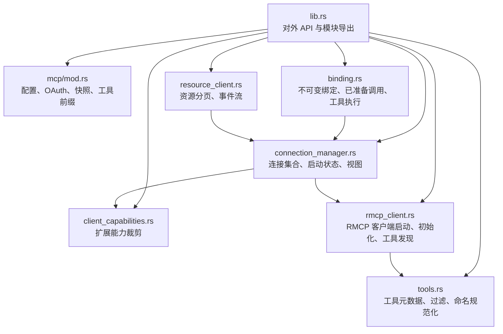

**图表来源**
- [codex-rs/codex-mcp/src/lib.rs:1-154](file://codex-rs/codex-mcp/src/lib.rs#L1-L154)
- [codex-rs/codex-mcp/src/mcp/mod.rs:1-200](file://codex-rs/codex-mcp/src/mcp/mod.rs#L1-L200)
- [codex-rs/codex-mcp/src/client_capabilities.rs:1-92](file://codex-rs/codex-mcp/src/client_capabilities.rs#L1-L92)
- [codex-rs/codex-mcp/src/connection_manager.rs:1-200](file://codex-rs/codex-mcp/src/connection_manager.rs#L1-L200)
- [codex-rs/codex-mcp/src/rmcp_client.rs:1-200](file://codex-rs/codex-mcp/src/rmcp_client.rs#L1-L200)
- [codex-rs/codex-mcp/src/binding.rs:1-120](file://codex-rs/codex-mcp/src/binding.rs#L1-L120)
- [codex-rs/codex-mcp/src/tools.rs:1-60](file://codex-rs/codex-mcp/src/tools.rs#L1-L60)
- [codex-rs/codex-mcp/src/resource_client.rs:1-120](file://codex-rs/codex-mcp/src/resource_client.rs#L1-L120)

**章节来源**
- [codex-rs/codex-mcp/src/lib.rs:1-154](file://codex-rs/codex-mcp/src/lib.rs#L1-L154)

## 核心组件
- **McpBinding**：封装一组连接、可用工具、已准备调用和权限上下文，是上层调用 MCP 工具的不可变入口。
- **McpConnectionSet**：维护多个 MCP 服务器的连接视图、启动状态、工具过滤、刷新策略和事件流连接。
- **AsyncManagedClient / ManagedClientStartup**：封装单个 RMCP 客户端的异步启动、初始化、工具列表获取、错误分类与回退。
- **PreparedMcpCall**：绑定到具体服务器、工具、目录快照、超时和权限来源的可执行调用。
- **ToolInfo**：面向模型的可见工具元数据，包含原始工具定义、可调用名称、命名空间和可选连接器信息。
- **McpResourceClient / McpEventStream**：资源分页读取与事件订阅的生命周期封装。

**章节来源**
- [codex-rs/codex-mcp/src/binding.rs:1-120](file://codex-rs/codex-mcp/src/binding.rs#L1-L120)
- [codex-rs/codex-mcp/src/connection_manager.rs:1-200](file://codex-rs/codex-mcp/src/connection_manager.rs#L1-L200)
- [codex-rs/codex-mcp/src/rmcp_client.rs:1-200](file://codex-rs/codex-mcp/src/rmcp_client.rs#L1-L200)
- [codex-rs/codex-mcp/src/tools.rs:1-120](file://codex-rs/codex-mcp/src/tools.rs#L1-L120)
- [codex-rs/codex-mcp/src/resource_client.rs:1-120](file://codex-rs/codex-mcp/src/resource_client.rs#L1-L120)

## 架构总览
Codex MCP 运行时采用分层架构：
- 上层使用 `McpBinding` 获取工具列表或发起工具调用；
- 连接管理器根据配置、协议模式和认证策略选择或复用连接；
- RMCP 客户端负责建立传输、发送 initialize、处理 server info、列出工具和缓存结果；
- 工具元数据在返回给模型前进行命名规范化、过滤和插件归属标注；
- 资源与事件通过独立通道访问，并与连接集生命周期解耦。

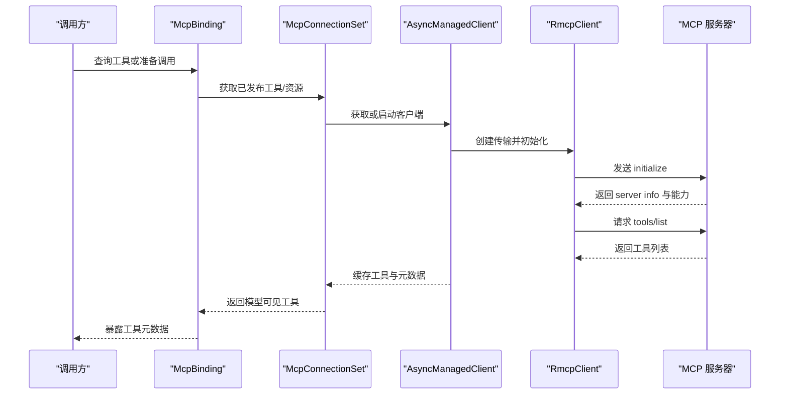

**图表来源**
- [codex-rs/codex-mcp/src/binding.rs:1-120](file://codex-rs/codex-mcp/src/binding.rs#L1-L120)
- [codex-rs/codex-mcp/src/connection_manager.rs:700-1015](file://codex-rs/codex-mcp/src/connection_manager.rs#L700-L1015)
- [codex-rs/codex-mcp/src/rmcp_client.rs:300-450](file://codex-rs/codex-mcp/src/rmcp_client.rs#L300-L450)

## 详细组件分析

### 连接建立与握手流程
连接建立由 `AsyncManagedClient` 驱动，关键步骤如下：
1. 构造 `ManagedClientStartup`，携带服务器配置、认证信息、协议模式、扩展能力和取消令牌；
2. 调用 `make_rmcp_client` 创建底层 RMCP 客户端；
3. 在启动超时内执行 `start_server_task`，完成初始化、工具列表拉取、Codex Apps 工具适配和缓存；
4. 将 `startup_complete` 标记为已完成，并把启动结果包装为共享 Future；
5. 对 Codex Apps 服务器启用后台重连机制，并在恢复后发布就绪状态。

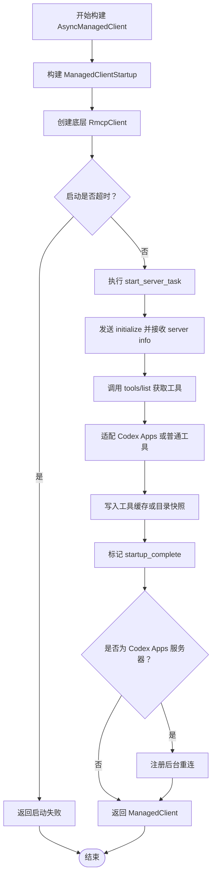

**图表来源**
- [codex-rs/codex-mcp/src/rmcp_client.rs:300-450](file://codex-rs/codex-mcp/src/rmcp_client.rs#L300-L450)
- [codex-rs/codex-mcp/src/rmcp_client.rs:450-600](file://codex-rs/codex-mcp/src/rmcp_client.rs#L450-L600)

**章节来源**
- [codex-rs/codex-mcp/src/rmcp_client.rs:300-600](file://codex-rs/codex-mcp/src/rmcp_client.rs#L300-L600)

### 能力协商与扩展投影
Codex 不会无条件接受宿主声明的所有 MCP 扩展。它在两个方向上做裁剪：
- 向下投影给 MCP 服务器：移除不受信任的网络策略扩展，并对非宿主插件服务限制 elicitation 扩展的用户验证字段；
- 向上选择宿主支持的扩展：仅保留表单、elicitation、标准表单输入和应用 UI 扩展，并将旧版 form 兼容行为映射到扩展映射中。

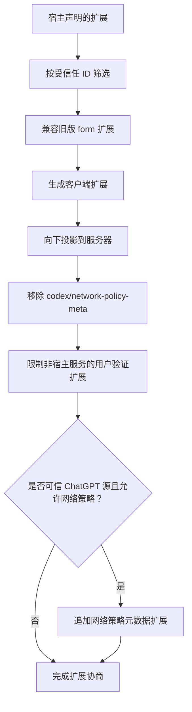

**图表来源**
- [codex-rs/codex-mcp/src/client_capabilities.rs:1-92](file://codex-rs/codex-mcp/src/client_capabilities.rs#L1-L92)

**章节来源**
- [codex-rs/codex-mcp/src/client_capabilities.rs:1-92](file://codex-rs/codex-mcp/src/client_capabilities.rs#L1-L92)

### 会话管理与生命周期
会话级状态由 `McpConnectionSet` 和 `McpServerConnection` 共同维护：
- 每个服务器对应一个 `McpServerView`，持有连接、协议模式、启动就绪状态、工具过滤器和目录项上限；
- `McpServerConnection` 保存连接身份、启动超时、启动触发器、Codex Apps 初始化通知和诊断仪表；
- 连接可以私有、共享或通过连接池复用；
- 支持延迟启动、强制重连、失败前置清理和优雅关闭；
- EMA 连接会在重新发布时尝试复用之前的权威对象，避免回调丢失。

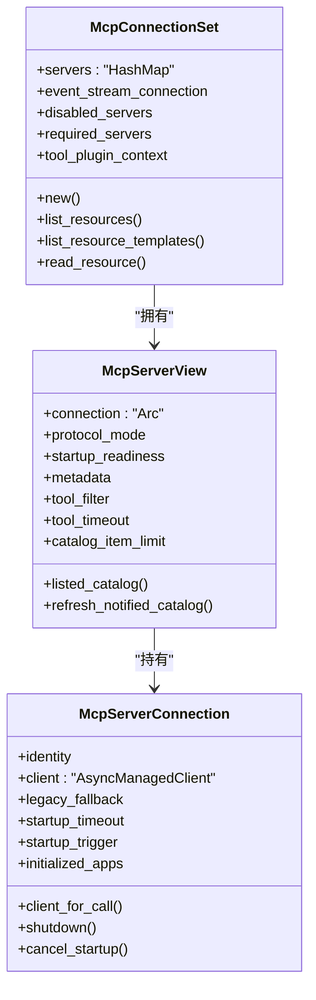

**图表来源**
- [codex-rs/codex-mcp/src/connection_manager.rs:1-200](file://codex-rs/codex-mcp/src/connection_manager.rs#L1-L200)
- [codex-rs/codex-mcp/src/connection_manager.rs:700-1015](file://codex-rs/codex-mcp/src/connection_manager.rs#L700-L1015)

**章节来源**
- [codex-rs/codex-mcp/src/connection_manager.rs:1-200](file://codex-rs/codex-mcp/src/connection_manager.rs#L1-L200)
- [codex-rs/codex-mcp/src/connection_manager.rs:700-1015](file://codex-rs/codex-mcp/src/connection_manager.rs#L700-L1015)

### 消息传递机制：请求、响应与流式传输
- **请求/响应**：工具调用通过 `PreparedMcpCall.call` 或 `call_with_preparation` 发起，最终委托给 `ManagedClient.call_tool`。调用前会计算有效超时、附加可信访问上下文，并在 catalog 快照保护下执行。
- **工具列表**：通过分页调用 `tools/list`，首次页面还收集 `meta`，用于后续模型可见的工具元数据。
- **资源访问**：`McpResourceClient.list_resources` 支持游标分页，内部转换为 RMCP 参数并转换返回内容。
- **事件流**：`McpEventStream.open` 发送事件订阅请求，`recv` 优先监听服务器移除信号，其次消费通知，最后处理句柄关闭；取消时会等待最多 30 秒完成底层 cancel。

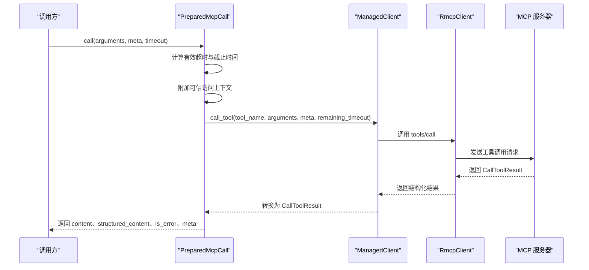

**图表来源**
- [codex-rs/codex-mcp/src/binding.rs:350-537](file://codex-rs/codex-mcp/src/binding.rs#L350-L537)

**章节来源**
- [codex-rs/codex-mcp/src/binding.rs:350-537](file://codex-rs/codex-mcp/src/binding.rs#L350-L537)
- [codex-rs/codex-mcp/src/rmcp_client.rs:840-920](file://codex-rs/codex-mcp/src/rmcp_client.rs#L840-L920)
- [codex-rs/codex-mcp/src/resource_client.rs:1-120](file://codex-rs/codex-mcp/src/resource_client.rs#L1-L120)

### 工具定义规范与参数类型系统
工具定义分为两层：
- **原始工具定义**：来自 MCP 服务器的 `Tool`，保持协议路由所需的真实名称；
- **模型可见工具定义**：经过 `ToolInfo` 封装，包含可调用名称、命名空间、描述、并行调用支持和可选连接器元数据。

命名与去重规则：
- 可调用命名空间可能添加历史 `mcp__` 前缀；
- 命名冲突时使用哈希后缀区分；
- 最终模型可见名称长度受限，并通过规范化函数保证 Responses API 兼容；
- 工具过滤支持白名单与黑名单；
- Codex Apps 工具会剥离连接器前缀并使用连接器描述作为命名空间描述；
- 普通工具会附加插件归属说明，但不会修改输入 schema。

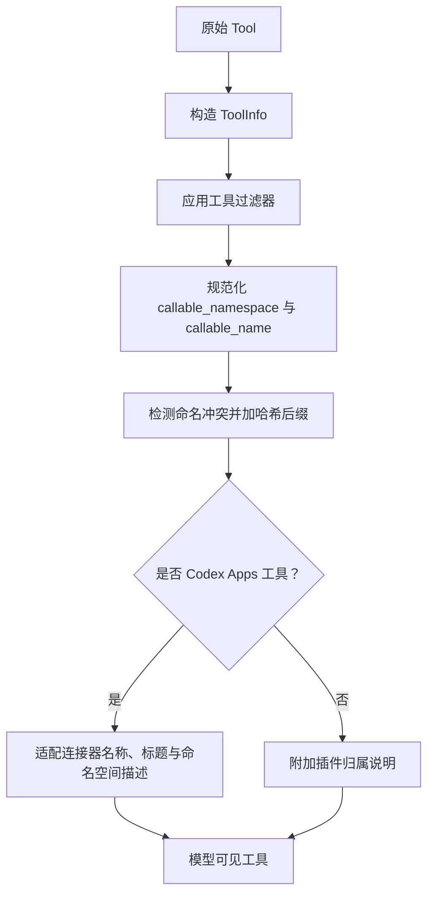

**图表来源**
- [codex-rs/codex-mcp/src/tools.rs:1-250](file://codex-rs/codex-mcp/src/tools.rs#L1-L250)
- [codex-rs/codex-mcp/src/rmcp_client.rs:920-1030](file://codex-rs/codex-mcp/src/rmcp_client.rs#L920-L1030)

**章节来源**
- [codex-rs/codex-mcp/src/tools.rs:1-250](file://codex-rs/codex-mcp/src/tools.rs#L1-L250)
- [codex-rs/codex-mcp/src/rmcp_client.rs:920-1030](file://codex-rs/codex-mcp/src/rmcp_client.rs#L920-L1030)

### 沙箱元数据与调用授权
Codex 向 MCP 工具调用注入沙箱相关元数据：
- 当服务器声明 `codex/sandbox-state` 或已废弃的 `codex/sandbox-state-meta` 能力时，Codex 会在 `_meta` 中注入沙箱策略；
- 本地 stdio 服务器可能获得 `codex/sandbox-launcher`，其中包含经校验的 Codex CLI 路径；
- HTTP 端点或远程执行器不提供共享文件系统，因此不会注入 launcher；
- 调用前会探测可执行文件的沙箱能力，并保留未知字段以避免破坏下游策略。

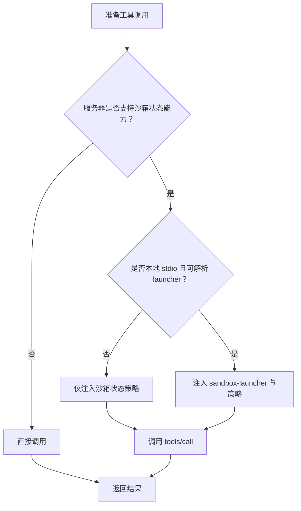

**图表来源**
- [codex-rs/codex-mcp/README.md:1-37](file://codex-rs/codex-mcp/README.md#L1-L37)
- [codex-rs/codex-mcp/src/binding.rs:350-470](file://codex-rs/codex-mcp/src/binding.rs#L350-L470)

**章节来源**
- [codex-rs/codex-mcp/README.md:1-37](file://codex-rs/codex-mcp/README.md#L1-L37)
- [codex-rs/codex-mcp/src/binding.rs:350-470](file://codex-rs/codex-mcp/src/binding.rs#L350-L470)

### 错误处理与恢复
启动阶段错误被统一封装为 `StartupOutcomeError`：
- `Cancelled`：启动被取消；
- `Failed`：包含错误字符串、是否需要认证、是否属于企业托管认证失败，以及可选的前置清理任务；
- 认证相关错误会被识别，用于决定是否需要重新认证；
- Codex Apps 服务器具备指数退避重连，最大重试间隔有上限；
- 连接关闭时等待共享租约释放或底层客户端 shutdown；
- 工具调用失败会通过上下文包装服务器名与工具名。

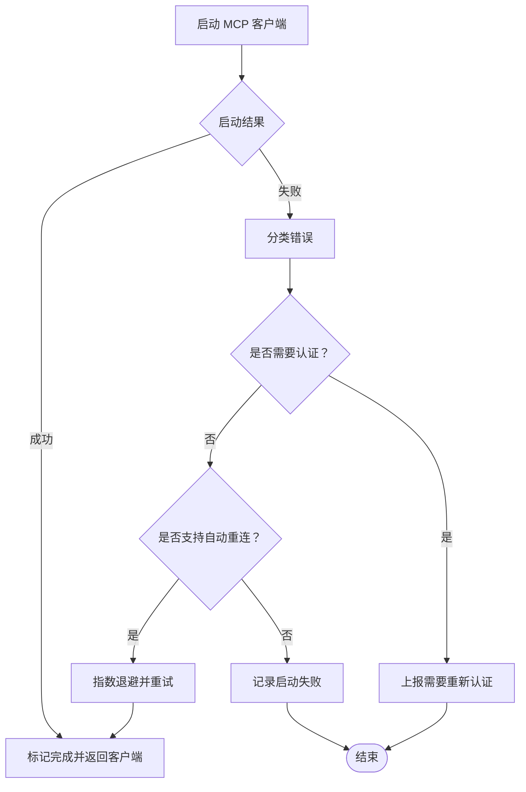

**图表来源**
- [codex-rs/codex-mcp/src/rmcp_client.rs:780-830](file://codex-rs/codex-mcp/src/rmcp_client.rs#L780-L830)
- [codex-rs/codex-mcp/src/rmcp_client.rs:200-270](file://codex-rs/codex-mcp/src/rmcp_client.rs#L200-L270)

**章节来源**
- [codex-rs/codex-mcp/src/rmcp_client.rs:780-830](file://codex-rs/codex-mcp/src/rmcp_client.rs#L780-L830)
- [codex-rs/codex-mcp/src/rmcp_client.rs:200-270](file://codex-rs/codex-mcp/src/rmcp_client.rs#L200-L270)

## 依赖关系分析
`codex-mcp` 的核心依赖包括：
- `rmcp`：提供 MCP/RMCP 模型、能力、工具定义和事件流基础；
- `codex_rmcp_client`：提供协议模式、OAuth、EMA 认证、HTTP 与 stdio 传输、请求追踪和错误辅助；
- `codex_protocol`：提供 MCP 协议结构、扩展 ID、事件和启动状态；
- `codex_config`：提供 MCP 服务器配置、传输、认证、启动就绪和工具策略；
- `codex_connectors`：提供 Codex Apps 工具运行时与连接器上下文；
- `tokio` 与 `futures`：异步运行时、共享 Future、watch channel 和并发组合。

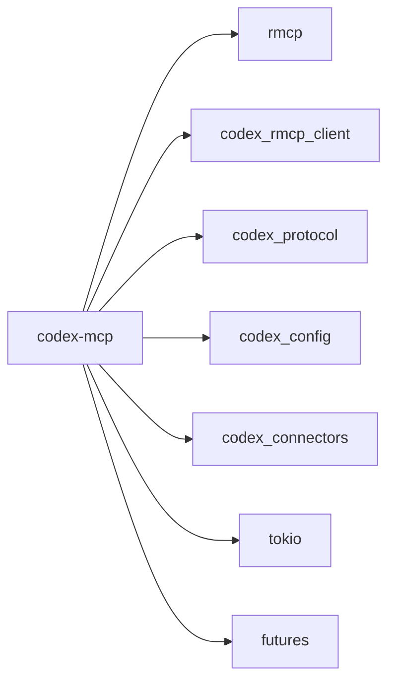

**图表来源**
- [codex-rs/codex-mcp/src/lib.rs:1-154](file://codex-rs/codex-mcp/src/lib.rs#L1-L154)
- [codex-rs/codex-mcp/src/rmcp_client.rs:1-120](file://codex-rs/codex-mcp/src/rmcp_client.rs#L1-L120)

**章节来源**
- [codex-rs/codex-mcp/src/lib.rs:1-154](file://codex-rs/codex-mcp/src/lib.rs#L1-L154)
- [codex-rs/codex-mcp/src/rmcp_client.rs:1-120](file://codex-rs/codex-mcp/src/rmcp_client.rs#L1-L120)

## 性能与资源特性
- **默认超时**：客户端启动默认超时 30 秒，工具调用默认超时 300 秒；
- **工具列表缓存**：Codex Apps 和普通 MCP 工具均可通过目录缓存减少重复 discovery；
- **分页限制**：工具列表和资源列表均有限制与游标；
- **连接共享**：对于可复用的连接，连接池可共享底层 RMCP 客户端；
- **只读工具**：可通过配置要求服务端侧只读过滤；
- **诊断指标**：工具列表拉取和 Codex Apps 刷新时间可度量；
- **事件流取消**：事件订阅关闭时异步等待底层 cancel，最长 30 秒。

这些特性表明实现关注：
- 降低不必要网络开销；
- 避免启动阻塞影响模型可见工具；
- 在失败场景下尽量保留缓存或降级能力；
- 通过明确超时防止长期挂起。

**章节来源**
- [codex-rs/codex-mcp/src/rmcp_client.rs:100-120](file://codex-rs/codex-mcp/src/rmcp_client.rs#L100-L120)
- [codex-rs/codex-mcp/src/rmcp_client.rs:840-920](file://codex-rs/codex-mcp/src/rmcp_client.rs#L840-L920)
- [codex-rs/codex-mcp/src/resource_client.rs:1-120](file://codex-rs/codex-mcp/src/resource_client.rs#L1-L120)

## 故障排查指南
常见问题与定位建议：
- **启动超时**：检查服务器是否能在规定时间内完成 initialize 和 tools/list；查看启动日志中的超时错误；
- **需要重新认证**：当启动失败被识别为需要认证时，应触发 OAuth 或 EMA 重新认证流程；
- **工具不可用**：确认工具未被工具过滤器禁用，且服务器已启用；检查模型可见名称是否与原始工具名一致；
- **事件流中断**：若托管 MCP 事件服务器被移除，`McpEventStream.recv` 会返回特定错误；
- **Catalog 变更导致调用拒绝**：`PreparedMcpCall` 在共享租约失效后会拒绝执行，需重新准备调用；
- **沙箱 launcher 缺失**：非本地 stdio 或无法解析可执行路径时不会注入 launcher，这是预期行为。

**章节来源**
- [codex-rs/codex-mcp/src/rmcp_client.rs:780-830](file://codex-rs/codex-mcp/src/rmcp_client.rs#L780-L830)
- [codex-rs/codex-mcp/src/resource_client.rs:120-220](file://codex-rs/codex-mcp/src/resource_client.rs#L120-L220)
- [codex-rs/codex-mcp/src/binding.rs:470-537](file://codex-rs/codex-mcp/src/binding.rs#L470-L537)
- [codex-rs/codex-mcp/README.md:1-37](file://codex-rs/codex-mcp/README.md#L1-L37)

## 版本兼容性与迁移指南
Codex MCP 运行时明确支持多种协议模式：
- 遗留模式；
- 中间协议 `2025-11-25`；
- 现代协议 `2026-07-28`；
- 同时覆盖 localhost HTTP 与 stdio 传输；
- 覆盖 OAuth 与企业托管认证场景。

官方一致性测试脚本会：
- 固定上游 conformance 套件提交；
- 要求 Node.js 与 Python 环境；
- 比较回归基线，不允许新增失败；
- 同时运行生产 reviewer 回归矩阵，覆盖 stdio、localhost HTTP、分页、SSE 帧与保活、目录边界等。

迁移建议：
- 新实现应优先对齐 `2026-07-28` 协议模式；
- 对 legacy 模式保持兼容，但不要假设所有能力都可用；
- 不要依赖未公开的 capability 名称，应通过 server capabilities 判断；
- 对于沙箱能力，优先使用 `codex/sandbox-state`，兼容 `codex/sandbox-state-meta`；
- 不要在 HTTP 或远程执行环境中假定存在共享文件系统；
- 不要绕过连接池或共享客户端的能力协商；
- 使用一致性测试基线而不是自行放宽断言。

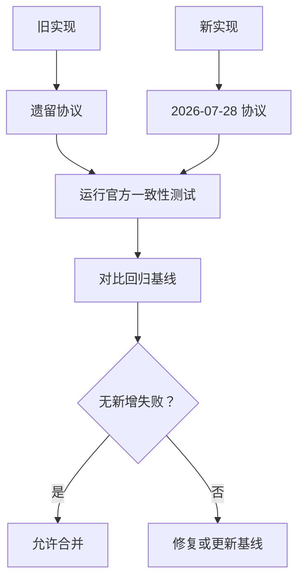

**图表来源**
- [scripts/mcp_conformance/README.md:1-121](file://scripts/mcp_conformance/README.md#L1-L121)

**章节来源**
- [scripts/mcp_conformance/README.md:1-121](file://scripts/mcp_conformance/README.md#L1-L121)

## 结论
`codex-rs/codex-mcp` 是一个以连接管理为中心、以工具发现和执行为主线的 MCP 客户端运行时。它将协议层细节隐藏在 `rmcp` 和 `codex_rmcp_client` 之上，重点解决：
- 多服务器连接的统一生命周期；
- 能力与扩展的安全裁剪；
- 工具定义的模型可见化与权限绑定；
- 沙箱元数据的精确注入；
- 启动失败、认证失败和连接重建的稳健处理；
- 通过官方一致性测试保障协议正确性。

对于集成者而言，最关键的实践是：
- 通过 `McpBinding` 暴露工具；
- 使用 `PreparedMcpCall` 执行带权限和目录快照的工具调用；
- 尊重协议模式、能力协商和沙箱能力；
- 使用一致性测试基线验证兼容性；
- 避免在非 stdio 环境下依赖本地 launcher 或共享文件系统。