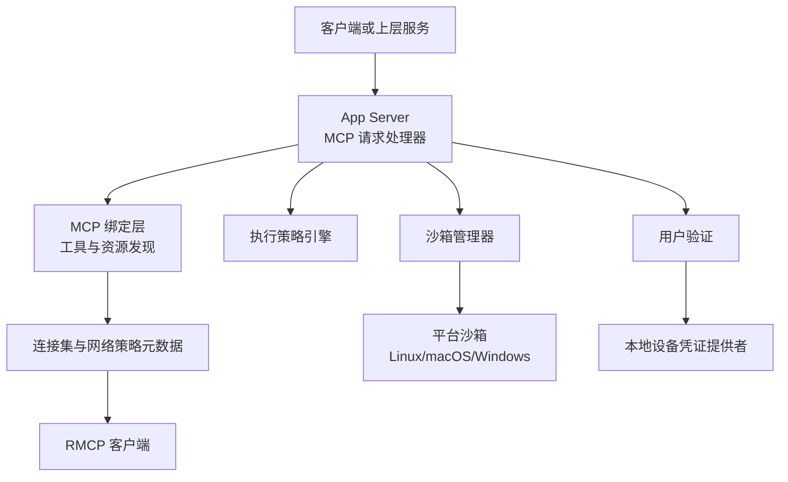
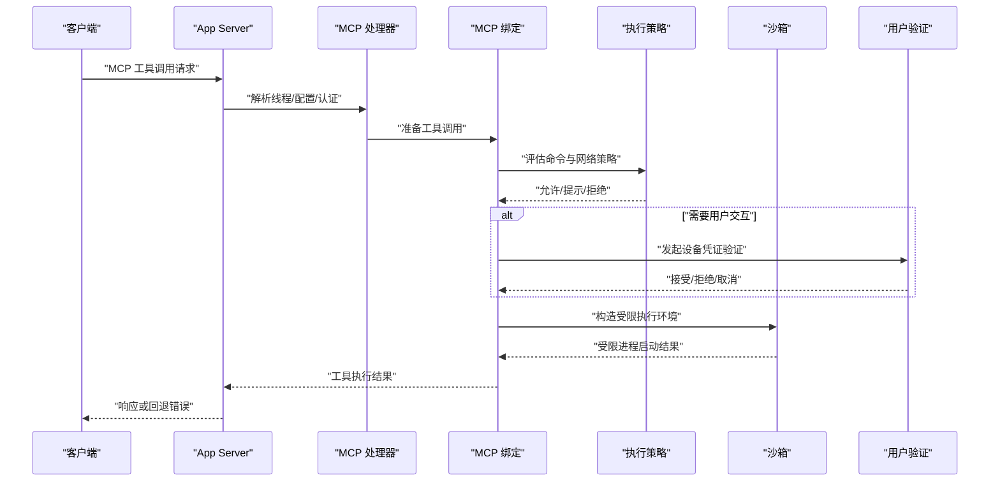
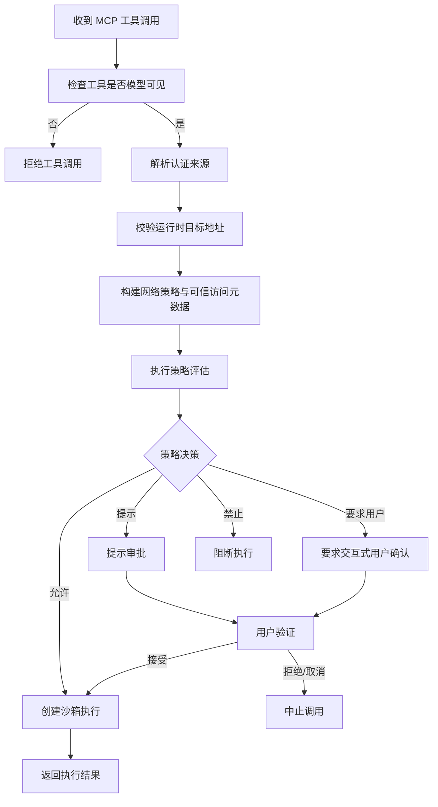
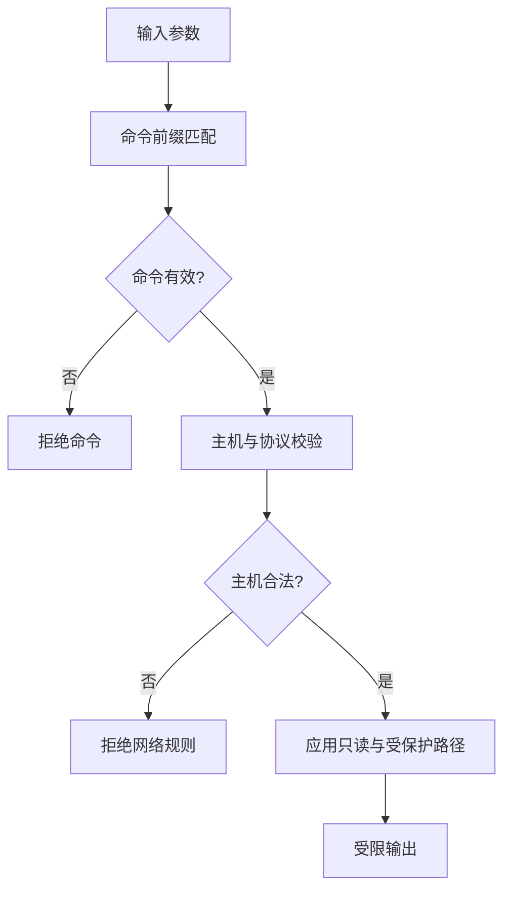
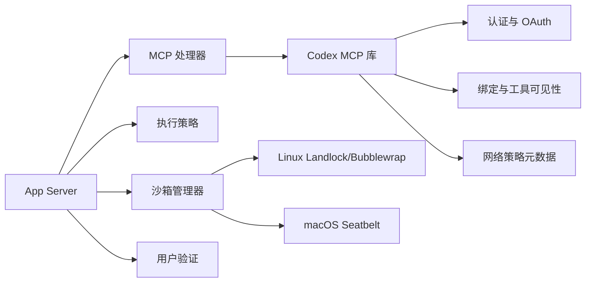

# MCP 安全控制

<cite>
**本文引用的文件**   
- [lib.rs](file://codex-rs/codex-mcp/src/lib.rs)
- [auth.rs](file://codex-rs/codex-mcp/src/auth.rs)
- [mcp/auth.rs](file://codex-rs/codex-mcp/src/mcp/auth.rs)
- [binding.rs](file://codex-rs/codex-mcp/src/binding.rs)
- [trusted_access.rs](file://codex-rs/codex-mcp/src/trusted_access.rs)
- [network_policy.rs](file://codex-rs/codex-mcp/src/connection_manager/network_policy.rs)
- [mcp_processor.rs](file://codex-rs/app-server/src/request_processors/mcp_processor.rs)
- [policy.rs](file://codex-rs/execpolicy/src/policy.rs)
- [decision.rs](file://codex-rs/execpolicy/src/decision.rs)
- [rule.rs](file://codex-rs/execpolicy/src/rule.rs)
- [manager.rs](file://codex-rs/sandboxing/src/manager.rs)
- [landlock.rs](file://codex-rs/sandboxing/src/landlock.rs)
- [seatbelt_scratch.rs](file://codex-rs/sandboxing/src/seatbelt_scratch.rs)
- [guard.rs](file://codex-rs/user-verification/src/guard.rs)
- [lib.rs](file://codex-rs/user-verification/src/lib.rs)
- [user_verification_response.rs](file://codex-rs/app-server/src/user_verification_response.rs)
- [SECURITY.md](file://SECURITY.md)
</cite>

## 目录
1. [引言](#引言)
2. [项目结构](#项目结构)
3. [核心组件](#核心组件)
4. [架构总览](#架构总览)
5. [详细组件分析](#详细组件分析)
6. [依赖关系分析](#依赖关系分析)
7. [性能与扩展性考虑](#性能与扩展性考虑)
8. [故障排查指南](#故障排查指南)
9. [结论](#结论)
10. [附录：安全配置最佳实践](#附录安全配置最佳实践)

## 引言
本文件聚焦于 Model Context Protocol（MCP）相关的安全控制体系，覆盖以下关键方面：
- 权限检查机制：用户身份验证、工具访问控制、操作授权流程。
- 审计日志与合规：事件追踪、可观测性与合规报告要点。
- 异常处理机制：错误分类、安全告警、故障隔离。
- 输入验证与输出过滤：参数白名单、数据脱敏、内容安全检查。
- 安全配置最佳实践：最小权限原则、安全边界定义、威胁防护策略。
- 漏洞检测与应急响应：基于仓库现有安全策略的披露渠道与安全运行建议。

本说明以代码仓库中 MCP 运行时、执行策略、沙箱、用户验证与 App Server 请求处理器为依据，避免臆测未实现能力。

## 项目结构
MCP 安全控制涉及多个 Rust crate 协同工作：
- `codex-mcp`：暴露 MCP 绑定、连接管理、网络策略元数据、OAuth 登录支持、可信访问上下文等。
- `app-server`：将外部请求路由到 MCP 处理器，负责线程上下文、认证模式、OAuth 登录编排。
- `execpolicy`：解析和执行命令与网络的允许/拒绝策略，提供决策类型和规则匹配。
- `sandboxing`：在 Linux/macOS/Windows 上创建受限进程、文件系统与网络隔离。
- `user-verification`：本地设备凭证与生物识别校验，提供取消守卫和失败原因。

**图表来源**
- [mcp_processor.rs:1-200](file://codex-rs/app-server/src/request_processors/mcp_processor.rs#L1-L200)
- [binding.rs:1-200](file://codex-rs/codex-mcp/src/binding.rs#L1-L200)
- [network_policy.rs:1-85](file://codex-rs/codex-mcp/src/connection_manager/network_policy.rs#L1-L85)
- [manager.rs:1-200](file://codex-rs/sandboxing/src/manager.rs#L1-L200)
- [lib.rs:1-91](file://codex-rs/user-verification/src/lib.rs#L1-L91)

**章节来源**
- [lib.rs:1-154](file://codex-rs/codex-mcp/src/lib.rs#L1-L154)
- [mcp_processor.rs:1-200](file://codex-rs/app-server/src/request_processors/mcp_processor.rs#L1-L200)

## 核心组件
- MCP 绑定与工具可见性控制：通过绑定层维护已建模可见的工具清单，并在调用前进行模型可见性过滤。
- 认证与 OAuth：支持静态凭据与运行时动态认证，并支持 Streamable HTTP OAuth 发现与回调。
- 执行策略：对命令和出站网络进行 allow/prompt/prohibit 决策，支持前缀规则和网络规则。
- 沙箱隔离：根据权限配置生成受限制的执行环境，包含文件系统读写根、只读子路径与网络代理。
- 用户验证：本地设备凭证、生物识别校验与取消守卫，确保敏感操作需要交互式确认。
- 可信访问上下文：为特定插件与只读工具注入经过验证的 entitlement 元数据。

**章节来源**
- [binding.rs:1-200](file://codex-rs/codex-mcp/src/binding.rs#L1-L200)
- [mcp/auth.rs:1-200](file://codex-rs/codex-mcp/src/mcp/auth.rs#L1-L200)
- [policy.rs:1-200](file://codex-rs/execpolicy/src/policy.rs#L1-L200)
- [manager.rs:1-200](file://codex-rs/sandboxing/src/manager.rs#L1-L200)
- [lib.rs:1-91](file://codex-rs/user-verification/src/lib.rs#L1-L91)
- [trusted_access.rs:1-200](file://codex-rs/codex-mcp/src/trusted_access.rs#L1-L200)

## 架构总览
下图展示一次 MCP 工具调用的端到端安全流程：请求进入 App Server，经 MCP 处理器完成线程与配置加载；随后由 MCP 绑定层选择工具与连接，附加认证与网络策略元数据；最终在策略引擎与沙箱约束下执行，必要时触发用户验证。

**图表来源**
- [mcp_processor.rs:1-200](file://codex-rs/app-server/src/request_processors/mcp_processor.rs#L1-L200)
- [binding.rs:1-200](file://codex-rs/codex-mcp/src/binding.rs#L1-L200)
- [policy.rs:1-200](file://codex-rs/execpolicy/src/policy.rs#L1-L200)
- [manager.rs:1-200](file://codex-rs/sandboxing/src/manager.rs#L1-L200)
- [lib.rs:1-91](file://codex-rs/user-verification/src/lib.rs#L1-L91)

## 详细组件分析

### 权限检查机制：用户验证、工具访问控制与操作授权
- 用户身份与认证模式
  - MCP 运行时支持两种认证来源：共享认证提供者与运行时动态认证。运行时认证会校验目标地址合法性、复用连接上的 TLS 后端，并在认证策略变化时拒绝变更，防止会话被劫持后改变网络策略。
  - OAuth 登录支持 Streamable HTTP 发现，支持显式作用域、配置作用域与发现作用域的优先级解析，并提供“无作用域重试”的条件判断。

- 工具访问控制
  - 绑定层维护“模型可见工具”快照，仅允许调用 `tool_is_model_visible` 判定为可见的工具。
  - 工具元数据可携带可信访问声明，但仅在满足严格条件（如标准输入传输、只读提示、默认环境等）时才注入可信上下文。

- 操作授权流程
  - 执行策略引擎返回允许、提示、要求用户决策或禁止四类决策。
  - 对于敏感工具，结合用户验证模块进行交互式确认；用户验证提供取消守卫，确保中断后不再产生副作用。

**图表来源**
- [binding.rs:1-200](file://codex-rs/codex-mcp/src/binding.rs#L1-L200)
- [auth.rs:1-118](file://codex-rs/codex-mcp/src/auth.rs#L1-L118)
- [mcp/auth.rs:1-200](file://codex-rs/codex-mcp/src/mcp/auth.rs#L1-L200)
- [decision.rs:1-30](file://codex-rs/execpolicy/src/decision.rs#L1-L30)
- [guard.rs:1-51](file://codex-rs/user-verification/src/guard.rs#L1-L51)

**章节来源**
- [auth.rs:1-118](file://codex-rs/codex-mcp/src/auth.rs#L1-L118)
- [mcp/auth.rs:1-200](file://codex-rs/codex-mcp/src/mcp/auth.rs#L1-L200)
- [binding.rs:1-200](file://codex-rs/codex-mcp/src/binding.rs#L1-L200)
- [decision.rs:1-30](file://codex-rs/execpolicy/src/decision.rs#L1-L30)
- [guard.rs:1-51](file://codex-rs/user-verification/src/guard.rs#L1-L51)

### 审计日志系统：操作记录、事件追踪与合规报告
- 事件与追踪
  - App Server 使用 OpenTelemetry 跟踪与认证存储来源标记，用于区分不同来源的认证上下文。
  - MCP 处理器在刷新、状态查询、资源读取与工具调用处封装请求 ID 与线程上下文，便于审计归因。

- 可观测性
  - 连接器与 MCP 服务器状态可通过统一快照接口获取，便于生成合规报告。
  - 认证状态计算与 OAuth 回调解析有助于审计认证生命周期。

注意：当前仓库未提供独立的审计日志写入模块；审计更多体现在可观测性、状态快照与错误上报中。

**章节来源**
- [mcp_processor.rs:1-200](file://codex-rs/app-server/src/request_processors/mcp_processor.rs#L1-L200)
- [mcp/auth.rs:1-200](file://codex-rs/codex-mcp/src/mcp/auth.rs#L1-L200)

### 异常处理机制：错误分类、安全告警与故障隔离
- 错误分类
  - 执行策略提供专用错误类型与无效规则解析错误。
  - 沙箱转换错误包含工作目录无效、策略无效等细分错误。
  - 用户验证错误包含取消、不可用、失败原因等分类。

- 安全告警
  - 当运行时认证导致网络策略变化时，明确返回构建错误，防止策略漂移。
  - OAuth 登录支持未知状态与发现失败场景，上层需按状态决定降级或告警。

- 故障隔离
  - 沙箱管理器在构造执行请求前严格校验 URI 与工作目录，失败则不继续执行。
  - 用户验证取消守卫在异步等待期间持续检查活动状态，避免过期会话产生副作用。

**章节来源**
- [policy.rs:1-200](file://codex-rs/execpolicy/src/policy.rs#L1-L200)
- [manager.rs:1-200](file://codex-rs/sandboxing/src/manager.rs#L1-L200)
- [lib.rs:1-91](file://codex-rs/user-verification/src/lib.rs#L1-L91)
- [auth.rs:1-118](file://codex-rs/codex-mcp/src/auth.rs#L1-L118)

### 输入验证与输出过滤：参数白名单、数据脱敏与内容安全检查
- 参数白名单
  - 执行策略支持前缀规则，可对命令的前若干 token 进行精确或多选匹配；网络规则限定协议与主机，且主机名必须合法（不允许 scheme、路径、非法 IPv6 后缀）。
  - MCP 绑定层仅暴露模型可见工具，避免隐藏工具被直接调用。

- 数据脱敏
  - 用户验证响应在跨 MCP 边界时剥离原始 meta，并将原因转为结构化 reason，防止诊断信息泄露。
  - 可信访问上下文的响应字节数有上限，避免大负载注入。

- 内容安全检查
  - 沙箱 scratch 访问通过排除可读根、只读子路径与受保护元数据名称来限制写扩散。
  - 网络策略元数据仅在客户端与服务端均支持相应能力时注入，避免旧客户端误用。

**图表来源**
- [rule.rs:1-200](file://codex-rs/execpolicy/src/rule.rs#L1-L200)
- [seatbelt_scratch.rs:1-80](file://codex-rs/sandboxing/src/seatbelt_scratch.rs#L1-L80)
- [user_verification_response.rs:1-63](file://codex-rs/app-server/src/user_verification_response.rs#L1-L63)
- [trusted_access.rs:1-200](file://codex-rs/codex-mcp/src/trusted_access.rs#L1-L200)

**章节来源**
- [rule.rs:1-200](file://codex-rs/execpolicy/src/rule.rs#L1-L200)
- [seatbelt_scratch.rs:1-80](file://codex-rs/sandboxing/src/seatbelt_scratch.rs#L1-L80)
- [user_verification_response.rs:1-63](file://codex-rs/app-server/src/user_verification_response.rs#L1-L63)
- [trusted_access.rs:1-200](file://codex-rs/codex-mcp/src/trusted_access.rs#L1-L200)

### 安全配置最佳实践：最小权限、安全边界与威胁防护
- 最小权限原则
  - 优先使用前缀规则精确匹配命令，避免宽泛 allow。
  - 网络规则仅开放必要主机与协议，必要时启用托管网络代理，强制出站流量走代理。
  - 沙箱文件系统仅授予工作区与临时目录的最小读写集合，其他路径保持只读或不可见。

- 安全边界定义
  - 使用沙箱管理器在进程级别隔离执行，结合 Landlock/Seatbelt/Windows Restricted Token。
  - 对用户验证敏感操作开启交互式确认，并通过取消守卫确保会话失效即停止。

- 威胁防护策略
  - 运行时认证不得改变已建立连接的底层网络策略，否则视为构建错误。
  - OAuth 作用域解析遵循显式 > 配置 > 发现 > 空，避免自动扩大权限。
  - 可信访问上下文仅在只读工具与标准输入传输条件下注入，降低滥用面。

**章节来源**
- [policy.rs:1-200](file://codex-rs/execpolicy/src/policy.rs#L1-L200)
- [manager.rs:1-200](file://codex-rs/sandboxing/src/manager.rs#L1-L200)
- [auth.rs:1-118](file://codex-rs/codex-mcp/src/auth.rs#L1-L118)
- [mcp/auth.rs:1-200](file://codex-rs/codex-mcp/src/mcp/auth.rs#L1-L200)
- [trusted_access.rs:1-200](file://codex-rs/codex-mcp/src/trusted_access.rs#L1-L200)

### 安全漏洞检测与应急响应指南
- 漏洞检测
  - 仓库提供 Cargo audit 配置，可用于扫描依赖漏洞。
  - 执行策略与沙箱策略变更应纳入 CI，通过策略指纹与规则解析测试保证变更可控。

- 应急响应
  - 若发现 MCP 工具越权调用，应立即收紧前缀规则与网络规则，禁用可疑工具或 MCP 服务器。
  - 若用户验证出现批量失败或中断，应暂停相关自动化流程并人工复核。
  - 安全问题应通过 Bugcrowd 安全披露计划报告，参考仓库安全策略文档。

**章节来源**
- [SECURITY.md:1-17](file://SECURITY.md#L1-L17)

## 依赖关系分析

**图表来源**
- [mcp_processor.rs:1-200](file://codex-rs/app-server/src/request_processors/mcp_processor.rs#L1-L200)
- [lib.rs:1-154](file://codex-rs/codex-mcp/src/lib.rs#L1-L154)
- [auth.rs:1-118](file://codex-rs/codex-mcp/src/auth.rs#L1-L118)
- [binding.rs:1-200](file://codex-rs/codex-mcp/src/binding.rs#L1-L200)
- [network_policy.rs:1-85](file://codex-rs/codex-mcp/src/connection_manager/network_policy.rs#L1-L85)
- [policy.rs:1-200](file://codex-rs/execpolicy/src/policy.rs#L1-L200)
- [manager.rs:1-200](file://codex-rs/sandboxing/src/manager.rs#L1-L200)
- [landlock.rs:1-115](file://codex-rs/sandboxing/src/landlock.rs#L1-L115)
- [lib.rs:1-91](file://codex-rs/user-verification/src/lib.rs#L1-L91)

**章节来源**
- [lib.rs:1-154](file://codex-rs/codex-mcp/src/lib.rs#L1-L154)
- [mcp_processor.rs:1-200](file://codex-rs/app-server/src/request_processors/mcp_processor.rs#L1-L200)

## 性能与扩展性考虑
- 认证缓存
  - 运行时认证使用一次性初始化结构缓存客户端认证对象，减少重复解析开销。
- 策略评估
  - 执行策略按程序名索引规则，并维护忽略大小写的规范化键，提高匹配效率。
- 网络策略元数据
  - 仅在首次需要时惰性构建策略元数据，并在重试过程中保持不变，避免重复序列化与权限源抖动。
- 沙箱启动
  - 沙箱管理器在请求阶段完成 URI 与权限转换，避免在执行阶段发生阻塞性错误。

[本节为通用性能讨论，不直接分析具体文件]

## 故障排查指南
- 工具调用被拒绝
  - 检查工具是否模型可见；确认前缀规则是否匹配命令；查看策略决策是否为禁止。
- OAuth 登录失败
  - 检查作用域解析来源；确认回调 URL 与重定向模式；查看是否支持流式 HTTP OAuth。
- 沙箱启动失败
  - 检查工作目录与策略目录是否可解析；确认托管网络上下文是否正确传递。
- 用户验证中断
  - 检查取消守卫状态；确认调用链是否在撤销或切换线程后被取消。

**章节来源**
- [binding.rs:1-200](file://codex-rs/codex-mcp/src/binding.rs#L1-L200)
- [mcp/auth.rs:1-200](file://codex-rs/codex-mcp/src/mcp/auth.rs#L1-L200)
- [manager.rs:1-200](file://codex-rs/sandboxing/src/manager.rs#L1-L200)
- [guard.rs:1-51](file://codex-rs/user-verification/src/guard.rs#L1-L51)

## 结论
MCP 安全控制通过多层防御实现端到端安全：
- 在入口层限制模型可见工具与认证来源。
- 在策略层对命令与网络进行细粒度允许/拒绝。
- 在运行时层借助沙箱与用户验证隔离执行与敏感交互。
- 在可观测层提供状态快照与错误分类，支撑审计与合规。

建议在生产环境中严格执行最小权限原则，启用托管网络与用户验证，并对策略变更引入持续集成与回归测试。

[本节为总结性内容，不直接分析具体文件]

## 附录：安全配置最佳实践
- 启用托管网络策略，限制出站流量至指定代理与域名。
- 使用显式 OAuth 作用域，避免依赖自动发现扩大权限。
- 对高风险工具启用用户验证，并结合取消守卫确保中断即停。
- 定期审查执行策略与沙箱权限，保持规则最小化与可解释性。
- 安全漏洞通过 Bugcrowd 报告，遵循仓库安全策略文档。

**章节来源**
- [SECURITY.md:1-17](file://SECURITY.md#L1-L17)