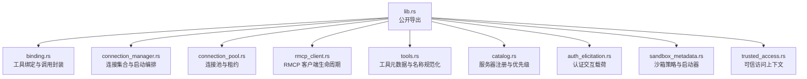
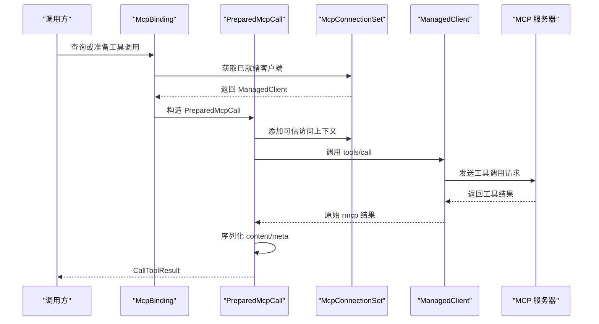
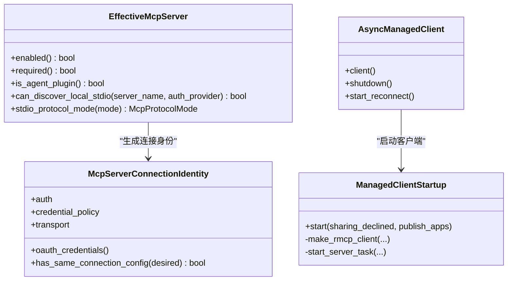
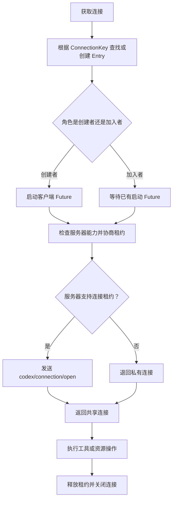
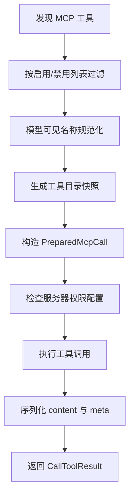
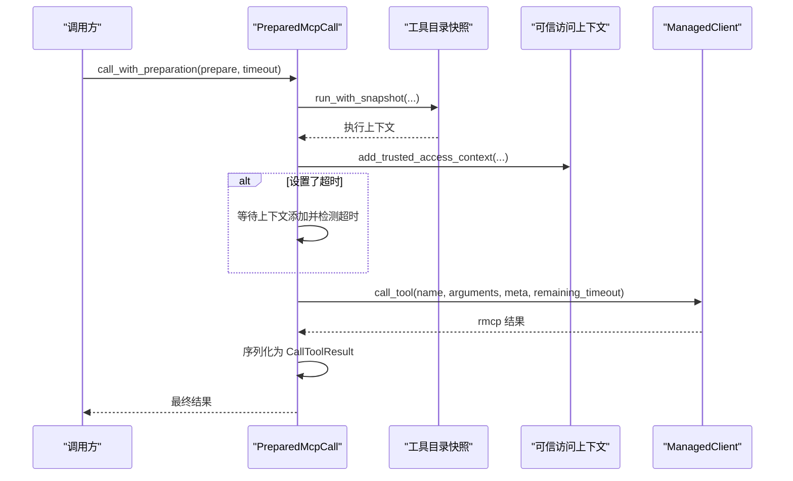
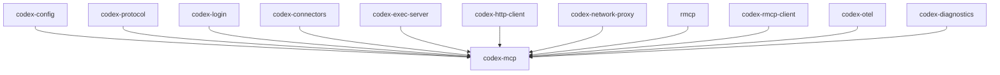

# MCP 工具

<cite>
**本文引用的文件**   
- [lib.rs](file://codex-rs/codex-mcp/src/lib.rs)
- [server.rs](file://codex-rs/codex-mcp/src/server.rs)
- [connection_manager.rs](file://codex-rs/codex-mcp/src/connection_manager.rs)
- [connection_pool.rs](file://codex-rs/codex-mcp/src/connection_pool.rs)
- [binding.rs](file://codex-rs/codex-mcp/src/binding.rs)
- [tools.rs](file://codex-rs/codex-mcp/src/tools.rs)
- [catalog.rs](file://codex-rs/codex-mcp/src/catalog.rs)
- [rmcp_client.rs](file://codex-rs/codex-mcp/src/rmcp_client.rs)
- [auth_elicitation.rs](file://codex-rs/codex-mcp/src/auth_elicitation.rs)
- [sandbox_metadata.rs](file://codex-rs/codex-mcp/src/sandbox_metadata.rs)
- [trusted_access.rs](file://codex-rs/codex-mcp/src/trusted_access.rs)
- [README.md](file://codex-rs/codex-mcp/README.md)
- [conformance README.md](file://scripts/mcp_conformance/README.md)
</cite>

## 目录
1. [简介](#简介)
2. [项目结构](#项目结构)
3. [核心组件](#核心组件)
4. [架构总览](#架构总览)
5. [详细组件分析](#详细组件分析)
6. [依赖关系分析](#依赖关系分析)
7. [性能与可扩展性](#性能与可扩展性)
8. [故障排查指南](#故障排查指南)
9. [结论](#结论)

## 简介
本仓库中的 `codex-mcp` 模块是 Codex 的 Model Context Protocol（MCP）运行时实现。它负责：
- 解析并注册 MCP 服务器配置；
- 建立和管理到 MCP 服务器的连接，支持 stdio 与 Streamable HTTP；
- 协商协议版本、能力集和会话级连接共享；
- 发现、过滤、命名规范化并暴露模型可见的工具；
- 执行工具调用，包括参数预处理、权限校验、元数据注入、远程调用与结果序列化；
- 处理认证、OAuth、交互式授权提示、审计与可信访问上下文；
- 提供连接池、重连策略、诊断指标与一致性测试基础设施。

该模块对外暴露 `McpBinding`、`McpConnectionSet`、`McpRuntime`、`McpToolCatalogCache`、事件流和资源客户端等 API，供上层运行时代码组合使用。

**章节来源**
- [lib.rs:1-154](file://codex-rs/codex-mcp/src/lib.rs#L1-L154)
- [README.md:1-37](file://codex-rs/codex-mcp/README.md#L1-L37)

## 项目结构
`codex-mcp` 是一个 Rust crate，源码集中在 `src/` 下，按职责划分：
- 协议与生命周期：`server.rs`、`rmcp_client.rs`、`connection_manager.rs`
- 连接复用与租约：`connection_pool.rs`
- 工具定义与模型可见性：`tools.rs`、`binding.rs`、`catalog.rs`
- 认证与交互：`auth_elicitation.rs`、`trusted_access.rs`
- 沙箱元数据与安全边界：`sandbox_metadata.rs`
- 公开导出入口：`lib.rs`

**图表来源**
- [lib.rs:1-154](file://codex-rs/codex-mcp/src/lib.rs#L1-L154)
- [binding.rs:1-120](file://codex-rs/codex-mcp/src/binding.rs#L1-L120)
- [connection_manager.rs:1-60](file://codex-rs/codex-mcp/src/connection_manager.rs#L1-L60)
- [connection_pool.rs:1-60](file://codex-rs/codex-mcp/src/connection_pool.rs#L1-L60)
- [rmcp_client.rs:1-60](file://codex-rs/codex-mcp/src/rmcp_client.rs#L1-L60)
- [tools.rs:1-60](file://codex-rs/codex-mcp/src/tools.rs#L1-L60)
- [catalog.rs:1-60](file://codex-rs/codex-rs/codex-mcp/src/catalog.rs#L1-L60)
- [auth_elicitation.rs:1-40](file://codex-rs/codex-mcp/src/auth_elicitation.rs#L1-L40)
- [sandbox_metadata.rs:1-40](file://codex-rs/codex-mcp/src/sandbox_metadata.rs#L1-L40)
- [trusted_access.rs:1-40](file://codex-rs/codex-mcp/src/trusted_access.rs#L1-L40)

**章节来源**
- [lib.rs:1-154](file://codex-rs/codex-mcp/src/lib.rs#L1-L154)

## 核心组件
| 组件 | 职责 | 关键行为 |
|---|---|---|
| `McpBinding` | 冻结的工具目录和执行句柄 | 提供工具查询、资源列表、预绑定调用对象 |
| `PreparedMcpCall` | 已绑定的工具调用 | 合并超时、注入可信访问上下文、调用远端工具并序列化结果 |
| `McpConnectionSet` | 连接集合与启动编排 | 管理多服务器启动、工具目录刷新、诊断事件 |
| `McpConnectionPool` | 进程内连接池 | 按连接键复用本地 stdio 连接，协商会话租约 |
| `AsyncManagedClient` / `ManagedClientStartup` | RMCP 客户端生命周期 | 构建传输、初始化、列出工具、失败重试 |
| `EffectiveMcpServer` | 生效后的服务器描述 | 决定凭据策略、协议模式、是否只读工具 |
| `ToolInfo` | 模型可见工具信息 | 包含原始 MCP 工具定义、可调用名称、命名空间 |
| `SandboxState` | 沙箱策略 | 随工具调用 `_meta` 下发，配合启动器安全执行 |
| `TrustedAccessContext` | 可信访问上下文 | 为受信任插件读取只读工具时附加审计上下文 |

**章节来源**
- [binding.rs:1-120](file://codex-rs/codex-mcp/src/binding.rs#L1-L120)
- [connection_manager.rs:1-120](file://codex-rs/codex-mcp/src/connection_manager.rs#L1-L120)
- [connection_pool.rs:1-80](file://codex-rs/codex-mcp/src/connection_pool.rs#L1-L80)
- [rmcp_client.rs:1-120](file://codex-rs/codex-mcp/src/rmcp_client.rs#L1-L120)
- [server.rs:1-60](file://codex-rs/codex-mcp/src/server.rs#L1-L60)
- [tools.rs:1-60](file://codex-rs/codex-mcp/src/tools.rs#L1-L60)
- [sandbox_metadata.rs:1-82](file://codex-rs/codex-mcp/src/sandbox_metadata.rs#L1-L82)
- [trusted_access.rs:1-80](file://codex-rs/codex-mcp/src/trusted_access.rs#L1-L80)

## 架构总览
MCP 工具的执行流程从“工具发现”开始，经过“连接建立与能力协商”，再到“模型可见工具注册”，最后进入“调用准备、参数校验、元数据注入、远端调用、结果后处理”。

**图表来源**
- [binding.rs:200-537](file://codex-rs/codex-mcp/src/binding.rs#L200-L537)
- [connection_manager.rs:200-360](file://codex-rs/codex-mcp/src/connection_manager.rs#L200-L360)
- [rmcp_client.rs:570-740](file://codex-rs/codex-mcp/src/rmcp_client.rs#L570-L740)

**章节来源**
- [binding.rs:200-537](file://codex-rs/codex-mcp/src/binding.rs#L200-L537)
- [connection_manager.rs:200-360](file://codex-rs/codex-mcp/src/connection_manager.rs#L200-L360)
- [rmcp_client.rs:570-740](file://codex-rs/codex-mcp/src/rmcp_client.rs#L570-L740)

## 详细组件分析

### 协议握手与连接管理
`EffectiveMcpServer` 表示一个已经应用运行时增强后的 MCP 服务器描述。它保留配置、凭据策略、是否为代理插件、是否要求只读工具等属性，并用于判断本地 stdio 服务器是否可以直接发现协议版本。

`McpServerConnectionIdentity` 标识一个真实连接的身份，包括认证方式、传输配置、环境、OAuth 存储、刷新模式、客户端能力、代理插件标记和只读工具要求。连接身份变化会触发重新建立连接，而不是简单重用旧连接。

`AsyncManagedClient` 包装了 RMCP 客户端的未来，并在需要时为 `CODEX_APPS` 这类内置服务器维护后台重连状态。重连采用指数退避，最大回退时间有上限，避免雪崩式重试。

**图表来源**
- [server.rs:1-200](file://codex-rs/codex-mcp/src/server.rs#L1-L200)
- [rmcp_client.rs:570-740](file://codex-rs/codex-mcp/src/rmcp_client.rs#L570-L740)

**章节来源**
- [server.rs:1-200](file://codex-rs/codex-mcp/src/server.rs#L1-L200)
- [rmcp_client.rs:1-120](file://codex-rs/codex-mcp/src/rmcp_client.rs#L1-L120)
- [rmcp_client.rs:570-740](file://codex-rs/codex-mcp/src/rmcp_client.rs#L570-L740)

### 消息传递与会话管理
MCP 的消息传递通过底层 `rmcp` 客户端完成，Codex 在之上封装了：
- 工具目录发现；
- 每服务器工具过滤；
- 模型可见工具名称规范化；
- 调用超时控制；
- 结构化结果序列化；
- 会话级能力缓存；
- 连接租约协商。

`connection_pool.rs` 实现了基于 `ConnectionKey` 的连接复用。`ConnectionKey` 包含服务器名、连接身份、账户上下文、认证状态、启动超时和目录项限制。相同 key 的多条 chat 可以共享同一个物理连接，前提是协议版本为现代版本且服务器支持连接租约。

连接共享的生命周期由 `ConnectionLease` 管理：
- 首次获取者作为创建者；
- 后续获取者作为加入者；
- 如果服务器不支持租约，则退回私有连接；
- 如果服务器支持租约，则发起 `codex/connection/open` 并携带唯一 leaseId；
- 释放时先取消请求作用域，再调用 `codex/connection/release`。

**图表来源**
- [connection_pool.rs:1-200](file://codex-rs/codex-mcp/src/connection_pool.rs#L1-L200)
- [connection_pool.rs:200-574](file://codex-rs/codex-mcp/src/connection_pool.rs#L200-L574)

**章节来源**
- [connection_pool.rs:1-200](file://codex-rs/codex-mcp/src/connection_pool.rs#L1-L200)
- [connection_pool.rs:200-574](file://codex-rs/codex-mcp/src/connection_pool.rs#L200-L574)

### MCP 工具定义规范与参数验证
`ToolInfo` 保存原始 MCP 工具定义，同时维护模型可见的可调用名称和命名空间。工具名称会进行清洗、去重、冲突哈希，必要时加上前缀，以保证 Responses API 中的工具名稳定且不超过长度限制。

`ToolFilter` 根据配置的启用和禁用列表过滤工具。`filter_tools` 将原始工具向量按 MCP 工具名过滤，随后由连接管理器对 `CODEX_APPS` 和普通 MCP 工具分别做模型可见化处理。

参数验证方面，代码未实现完整的 JSON Schema 校验器，而是通过以下方式保证安全：
- 在 `PreparedMcpCall::new` 中检查服务器权限配置；
- 使用 `permission_profile_for_server` 确保只有允许调用的服务器能生成调用句柄；
- 在执行时再次使用快照化的工具目录，防止目录变更后继续执行旧绑定；
- 将不可序列化的内容降级为字符串，避免破坏响应结构。

**图表来源**
- [tools.rs:1-200](file://codex-rs/codex-mcp/src/tools.rs#L1-L200)
- [binding.rs:200-537](file://codex-rs/codex-mcp/src/binding.rs#L200-L537)

**章节来源**
- [tools.rs:1-200](file://codex-rs/codex-mcp/src/tools.rs#L1-L200)
- [binding.rs:200-537](file://codex-rs/codex-mcp/src/binding.rs#L200-L537)

### MCP 工具执行流程
`PreparedMcpCall::call_with_preparation` 是工具执行的核心路径：
1. 计算有效超时：取服务器超时与请求超时的较小值；
2. 以快照化目录运行，防止目录变更导致语义漂移；
3. 异步准备参数和元数据；
4. 添加可信访问上下文；
5. 若设置超时，则在添加上下文阶段也受超时保护；
6. 计算剩余超时并传给远端调用；
7. 调用 `ManagedClient::call_tool`；
8. 在共享租约上下文中执行，避免与其他 chat 的并发释放产生竞态；
9. 将 `rmcp` 的结果转换为 `CallToolResult`。

**图表来源**
- [binding.rs:200-537](file://codex-rs/codex-mcp/src/binding.rs#L200-L537)
- [trusted_access.rs:1-160](file://codex-rs/codex-mcp/src/trusted_access.rs#L1-L160)

**章节来源**
- [binding.rs:200-537](file://codex-rs/codex-mcp/src/binding.rs#L200-L537)
- [trusted_access.rs:1-160](file://codex-rs/codex-mcp/src/trusted_access.rs#L1-L160)

### 安全机制
#### 权限检查
- 服务器级权限通过 `McpConfig.permission_profile_for_server` 控制；
- `PreparedMcpCall` 仅在权限允许时构造；
- `McpPermissionSource` 区分“环境权限”和“线程权限”，前者来自沙箱上下文，后者来自线程权限档案；
- 对于托管应用，即使走本地服务器，也可能使用线程规则而非本地环境规则。

#### 审计日志与可信访问
- 可信访问上下文仅适用于受信任插件、只读工具、空参数、本地 stdio 服务器；
- 它会向工具调用元数据注入 `openai/entitlementContext`；
- 对可信访问响应大小有字节限制；
- 所有启动失败都会记录警告日志，便于排查。

#### 异常处理
- 启动超时统一转为启动失败错误；
- 工具调用失败会带上服务器名和工具名上下文；
- OAuth 刷新、EMA 认证、连接关闭等情况都有明确分支；
- 连接池释放失败不会阻止主流程，但会移除条目并记录警告。

**章节来源**
- [binding.rs:200-537](file://codex-rs/codex-mcp/src/binding.rs#L200-L537)
- [trusted_access.rs:1-160](file://codex-rs/codex-mcp/src/trusted_access.rs#L1-L160)
- [rmcp_client.rs:570-740](file://codex-rs/codex-mcp/src/rmcp_client.rs#L570-L740)

### 认证与交互式授权
`auth_elicitation.rs` 提供与协议无关的认证交互载荷解析和构造逻辑：
- 从工具调用结果中提取连接器认证失败元数据；
- 构造 `CodexAppsAuthElicitationPlan`，包含失败信息和交互计划；
- 生成带 `_codex_apps` 元数据的交互消息；
- 提供识别特定连接器认证失败的便捷方法。

这些函数不直接管理会话，而是由上层运行时代码根据工具结果决定是否发起用户交互。

**章节来源**
- [auth_elicitation.rs:1-180](file://codex-rs/codex-mcp/src/auth_elicitation.rs#L1-L180)

### 沙箱策略与执行环境
`sandbox_metadata.rs` 定义了：
- `codex/sandbox-state` 和兼容别名 `codex/sandbox-state-meta`；
- `codex/sandbox-launcher`；
- `SandboxState`，包含权限档案、Linux 沙箱路径、工作目录、Landlock 标志和 MXC 标志；
- `augment_metadata`，将沙箱策略和可选启动器写入工具调用 `_meta`。

`PreparedMcpCall` 会根据服务器类型、传输方式和自身可执行路径探测是否提供本地启动器。HTTP 或远程执行器不会获得 PATH 搜索或未沙箱回退。

**章节来源**
- [sandbox_metadata.rs:1-82](file://codex-rs/codex-mcp/src/sandbox_metadata.rs#L1-L82)
- [binding.rs:200-537](file://codex-rs/codex-mcp/src/binding.rs#L200-L537)
- [README.md:1-37](file://codex-rs/codex-mcp/README.md#L1-L37)

### MCP 服务器开发指南
从现有实现出发，开发者应关注以下要点：

| 主题 | 建议 |
|---|---|
| 协议实现 | 支持现代协议版本，并通过能力协商决定是否接受连接租约；对旧协议保持私有连接行为 |
| 认证集成 | 正确传播 OAuth、EMA、Bearer Token、环境变量头部；不要假设本地 HTTP 等于本地文件系统权限 |
| 工具声明 | 使用稳定的 `tool.name`；如需模型友好名称，可在上游服务侧保持稳定映射 |
| 元数据契约 | 如需沙箱策略，声明 `codex/sandbox-state` 能力；如需可信访问，遵循只读、空参数、本地 stdio 约束 |
| 错误处理 | 返回明确的 `is_error` 和结构化内容；如为连接器认证失败，按约定填充 `_codex_apps.connector_auth_failure` |
| 性能 | 避免频繁重建连接；合理设置启动超时和工具超时；分页列出工具时遵守目录项限制 |
| 调试 | 利用启动失败日志、连接数 Gauge、工具列表耗时指标；使用一致性测试脚本验证协议兼容性 |

**章节来源**
- [rmcp_client.rs:1-120](file://codex-rs/codex-mcp/src/rmcp_client.rs#L1-L120)
- [connection_pool.rs:1-200](file://codex-rs/codex-mcp/src/connection_pool.rs#L1-L200)
- [auth_elicitation.rs:1-180](file://codex-rs/codex-mcp/src/auth_elicitation.rs#L1-L180)
- [sandbox_metadata.rs:1-82](file://codex-rs/codex-mcp/src/sandbox_metadata.rs#L1-L82)
- [conformance README.md:1-121](file://scripts/mcp_conformance/README.md#L1-L121)

## 依赖关系分析
`codex-mcp` 依赖多个内部 crate，形成清晰的分层：
- 配置层：`codex-config`、`codex-protocol`
- 认证层：`codex-login`、`codex-model-provider`、`codex-connectors`
- 执行层：`codex-exec-server`、`codex-runtime-agent-instance`
- 网络层：`codex-http-client`、`codex-network-proxy`
- 协议层：`rmcp`、`codex-rmcp-client`
- 可观测性：`codex-otel`、`codex-diagnostics`、`tracing`

**图表来源**
- [Cargo.toml:1-64](file://codex-rs/codex-mcp/Cargo.toml#L1-L64)

**章节来源**
- [Cargo.toml:1-64](file://codex-rs/codex-mcp/Cargo.toml#L1-L64)

## 性能与可扩展性
- **连接复用**：`McpConnectionPool` 通过 `ConnectionKey` 复用本地 stdio 连接，减少进程启动成本。
- **目录缓存**：工具目录在连接生命周期内缓存，支持通知刷新和共享上下文发布。
- **超时隔离**：启动超时、工具超时、请求剩余超时分层控制，避免长时间阻塞。
- **重试退避**：`CODEX_APPS` 的重连使用指数退避，限制最大间隔，降低风暴风险。
- **指标与诊断**：暴露 `mcp.connections.live` 等 Gauge，记录工具列表耗时和 Apps 刷新耗时。
- **扩展点**：可通过 `McpRuntimeInput`、`NetworkPolicyMetadataProvider`、`ElicitationLifecycle` 等接口扩展策略、网络和交互行为。

**章节来源**
- [connection_pool.rs:1-200](file://codex-rs/codex-mcp/src/connection_pool.rs#L1-L200)
- [rmcp_client.rs:1-120](file://codex-rs/codex-mcp/src/rmcp_client.rs#L1-L120)
- [connection_manager.rs:1-120](file://codex-rs/codex-mcp/src/connection_manager.rs#L1-L120)

## 故障排查指南
| 现象 | 可能原因 | 排查建议 |
|---|---|---|
| MCP 服务器启动超时 | 传输建立失败、认证未就绪、远端无响应 | 检查启动超时、认证配置、HTTP 头或环境变量 |
| 工具目录为空 | 工具被禁用、协议能力缺失、分页限制 | 查看工具过滤器、目录项限制和协议模式 |
| 连接无法复用 | 连接身份不同、协议版本不支持、服务器拒绝租约 | 比较 `McpServerConnectionIdentity`，确认协议版本 |
| 工具调用被拒绝 | 权限配置不允许、目录快照变更、服务端错误 | 检查 `permission_profile_for_server` 和调用上下文 |
| 认证交互未触发 | 工具结果未携带连接器认证失败元数据 | 检查 `_codex_apps.connector_auth_failure` 字段 |
| 沙箱策略未生效 | 服务器未声明能力、非本地 stdio、无可信启动器 | 检查 `codex/sandbox-state` 能力和执行环境 |

**章节来源**
- [binding.rs:200-537](file://codex-rs/codex-mcp/src/binding.rs#L200-L537)
- [auth_elicitation.rs:1-180](file://codex-rs/codex-mcp/src/auth_elicitation.rs#L1-L180)
- [sandbox_metadata.rs:1-82](file://codex-rs/codex-mcp/src/sandbox_metadata.rs#L1-L82)
- [conformance README.md:1-121](file://scripts/mcp_conformance/README.md#L1-L121)

## 结论
`codex-mcp` 在 `rmcp` 基础上构建了面向 Codex 的完整 MCP 运行时：它将协议握手、连接池、会话租约、工具目录、权限策略、认证交互、沙箱策略和可信访问整合为一个可组合的系统。其设计强调：
- 以连接身份为核心的连接复用；
- 以快照化工具目录为中心的调用安全性；
- 以协议能力协商为基础的现代连接共享；
- 以元数据契约承载的沙箱与审计信息；
- 以一致性测试保障的协议兼容性。

对使用者而言，最关键的实践是：明确服务器权限、正确使用预绑定调用、理解沙箱元数据契约，并通过一致性测试和诊断指标定位问题。