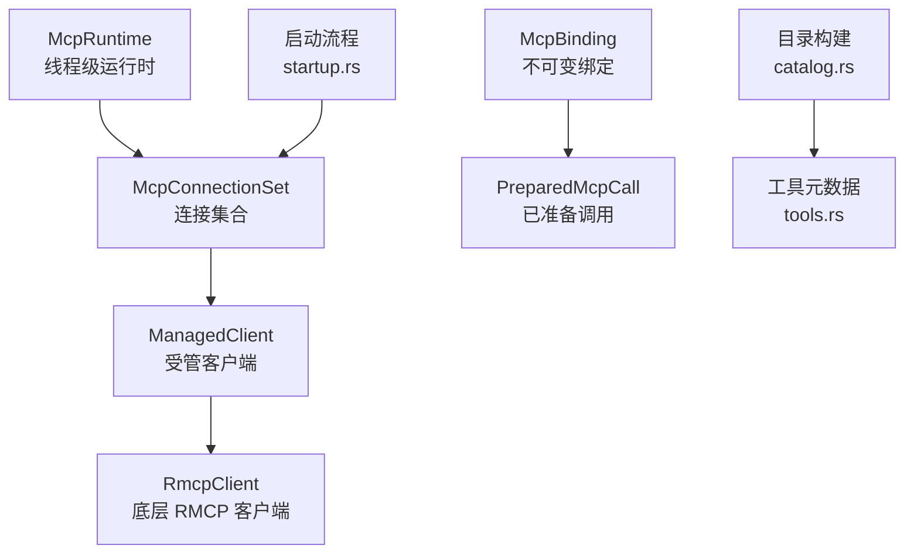
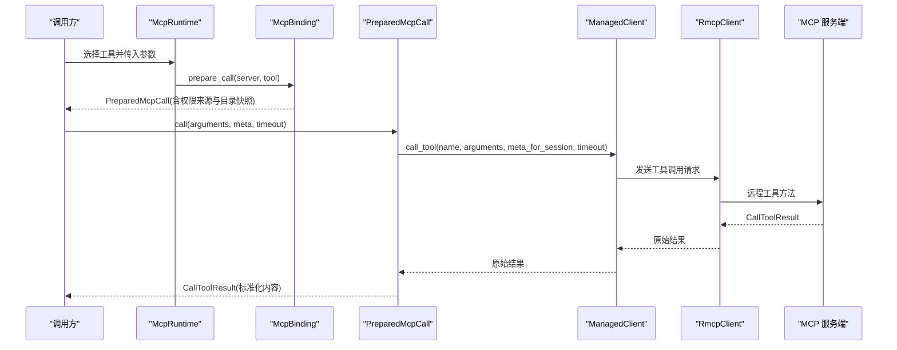
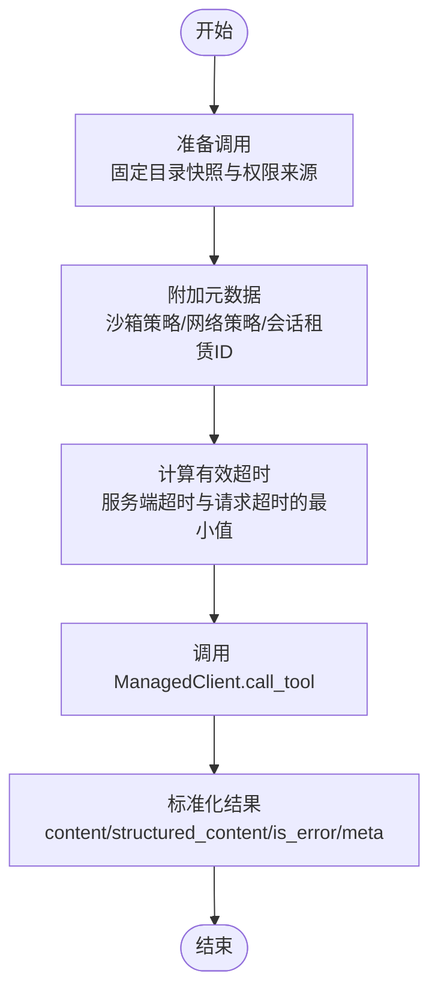
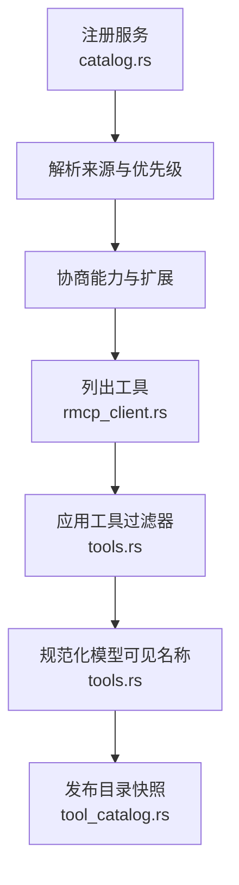
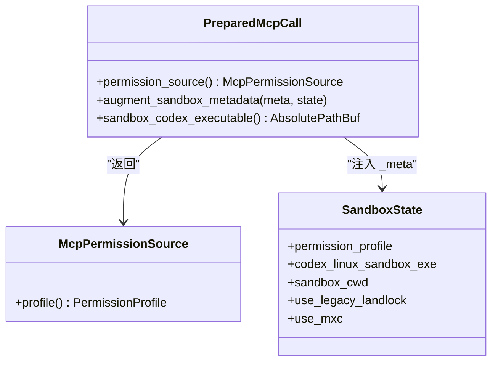
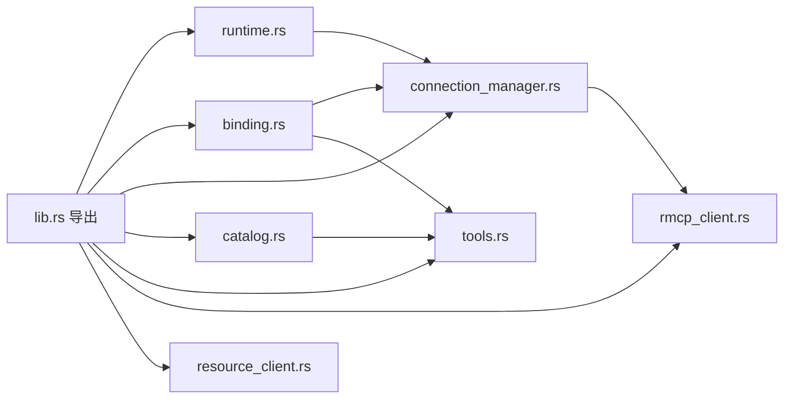

# MCP 工具执行

<cite>
**本文引用的文件**   
- [codex-mcp/lib.rs](file://codex-rs/codex-mcp/src/lib.rs)
- [codex-mcp/server.rs](file://codex-rs/codex-mcp/src/server.rs)
- [codex-mcp/tools.rs](file://codex-rs/codex-mcp/src/tools.rs)
- [codex-mcp/binding.rs](file://codex-rs/codex-mcp/src/binding.rs)
- [codex-mcp/connection_manager.rs](file://codex-rs/codex-mcp/src/connection_manager.rs)
- [codex-mcp/catalog.rs](file://codex-rs/codex-mcp/src/catalog.rs)
- [codex-mcp/rmcp_client.rs](file://codex-rs/codex-mcp/src/rmcp_client.rs)
- [codex-mcp/managed_client.rs](file://codex-rs/codex-mcp/src/rmcp_client/managed_client.rs)
- [codex-mcp/runtime.rs](file://codex-rs/codex-mcp/src/runtime.rs)
- [codex-mcp/tool_catalog.rs](file://codex-rs/codex-mcp/src/connection_manager/tool_catalog.rs)
- [codex-mcp/startup.rs](file://codex-rs/codex-mcp/src/connection_manager/startup.rs)
- [codex-mcp/sandbox_metadata.rs](file://codex-rs/codex-mcp/src/sandbox_metadata.rs)
- [codex-mcp/resource_client.rs](file://codex-rs/codex-mcp/src/resource_client.rs)
- [codex-mcp/README.md](file://codex-rs/codex-mcp/README.md)
- [mcp_conformance/README.md](file://scripts/mcp_conformance/README.md)
</cite>

## 目录
1. [引言](#引言)
2. [项目结构](#项目结构)
3. [核心组件](#核心组件)
4. [架构总览](#架构总览)
5. [详细组件分析](#详细组件分析)
6. [依赖关系分析](#依赖关系分析)
7. [性能与缓存](#性能与缓存)
8. [错误处理与故障恢复](#错误处理与故障恢复)
9. [工具开发指南](#工具开发指南)
10. [测试与调试](#测试与调试)
11. [结论](#结论)

## 引言
本文件面向需要在 Codex 中理解、使用或扩展 MCP（Model Context Protocol）工具执行能力的开发者。文档围绕以下目标展开：
- 说明工具调用的完整生命周期：参数预处理、远程方法调用、结果后处理。
- 解释工具发现机制：服务注册、能力协商、动态加载与目录规范化。
- 描述工具执行环境：上下文传递、环境变量管理、权限与沙箱隔离。
- 总结结果处理策略：响应解析、数据转换、缓存和事件订阅。
- 提供工具开发指南：接口约定、错误处理、性能优化建议。
- 给出测试方法与调试技巧，包括官方一致性测试和生产回归测试。

## 项目结构
Codex 的 MCP 实现位于 `codex-rs/codex-mcp` crate 中，围绕“运行时 → 连接集合 → 客户端 → 工具目录”分层组织：
- 运行时层：线程级状态、发布/替换、环境选择、事件流。
- 连接管理层：聚合多个 MCP 服务器连接、启动顺序、能力与工具目录聚合。
- RMCP 客户端层：传输初始化、OAuth/认证、工具列表获取、调用封装。
- 绑定层：将模型可见的工具名称映射到具体服务器和连接，并固化权限来源。
- 工具元数据层：过滤、命名规范、去重与哈希后缀。
- 资源与事件层：资源列表、模板、读取与事件订阅。
- 配置与目录层：服务注册来源、优先级、协议模式与扩展能力。

**图表来源**
- [runtime.rs:1-200](file://codex-rs/codex-mcp/src/runtime.rs#L1-L200)
- [connection_manager.rs:1-200](file://codex-rs/codex-mcp/src/connection_manager.rs#L1-L200)
- [rmcp_client.rs:1-120](file://codex-rs/codex-mcp/src/rmcp_client.rs#L1-L120)
- [binding.rs:1-120](file://codex-rs/codex-mcp/src/binding.rs#L1-L120)
- [catalog.rs:1-120](file://codex-rs/codex-mcp/src/catalog.rs#L1-L120)
- [tools.rs:1-80](file://codex-rs/codex-mcp/src/tools.rs#L1-L80)
- [startup.rs:1-80](file://codex-rs/codex-mcp/src/connection_manager/startup.rs#L1-L80)

**章节来源**
- [lib.rs:1-154](file://codex-rs/codex-mcp/src/lib.rs#L1-L154)

## 核心组件
- **McpRuntime**：维护线程级 MCP 运行时，负责发布新的连接集、保留旧绑定租约、管理事件流取消和资源来源。
- **McpConnectionSet**：聚合所有 MCP 服务器的连接视图，协调启动、能力探测、工具目录刷新和就绪状态。
- **ManagedClient**：对底层 RmcpClient 的封装，包含工具目录、超时、会话授权、租赁共享和请求路由。
- **McpBinding / PreparedMcpCall**：将模型可见的工具名与具体服务器、连接、目录快照、权限来源绑定，并在调用时保证目录未变更。
- **ToolInfo / ToolFilter**：工具元数据与启用/禁用过滤；对外暴露可被模型使用的规范化名称。
- **Catalog / Server Source**：定义 MCP 服务器注册来源、优先级、协议模式和认证策略。
- **Resource Client / Event Stream**：资源分页、读取与事件订阅的生命周期管理。

**章节来源**
- [runtime.rs:1-200](file://codex-rs/codex-mcp/src/runtime.rs#L1-L200)
- [connection_manager.rs:1-200](file://codex-rs/codex-mcp/src/connection_manager.rs#L1-L200)
- [managed_client.rs:1-184](file://codex-rs/codex-mcp/src/rmcp_client/managed_client.rs#L1-L184)
- [binding.rs:1-120](file://codex-rs/codex-mcp/src/binding.rs#L1-L120)
- [tools.rs:1-80](file://codex-rs/codex-mcp/src/tools.rs#L1-L80)
- [catalog.rs:1-120](file://codex-rs/codex-mcp/src/catalog.rs#L1-L120)

## 架构总览
下图展示从模型侧发起工具调用到 MCP 服务端响应的关键路径，以及各层的职责边界。

**图表来源**
- [binding.rs:201-450](file://codex-rs/codex-mcp/src/binding.rs#L201-L450)
- [managed_client.rs:80-184](file://codex-rs/codex-mcp/src/rmcp_client/managed_client.rs#L80-L184)
- [rmcp_client.rs:1-120](file://codex-rs/codex-mcp/src/rmcp_client.rs#L1-L120)

**章节来源**
- [binding.rs:201-450](file://codex-rs/codex-mcp/src/binding.rs#L201-L450)
- [managed_client.rs:80-184](file://codex-rs/codex-mcp/src/rmcp_client/managed_client.rs#L80-L184)

## 详细组件分析

### 工具调用流程
工具调用分为三个阶段：参数预处理、远程调用、结果后处理。

- **参数预处理**
  - 通过 `McpBinding.prepare_call` 根据模型可见名称查找对应服务器与工具。
  - `PreparedMcpCall.new` 固化目录快照、权限来源、服务器元数据和插件信息。
  - 可选的 `augment_sandbox_metadata` 注入沙箱策略与本地启动器路径。
- **远程方法调用**
  - `call_with_preparation` 计算有效超时，添加可信访问上下文，并按剩余时间限制远端调用。
  - `ManagedClient.call_tool` 在共享租赁范围内执行，必要时附加租赁 ID 到 `_meta`。
- **结果后处理**
  - `call_tool_result_from_rmcp` 将 RMCP 结果转换为 Codex 协议中的 `CallToolResult`，并对内容做 JSON 序列化容错。

**图表来源**
- [binding.rs:201-450](file://codex-rs/codex-mcp/src/binding.rs#L201-L450)
- [managed_client.rs:80-184](file://codex-rs/codex-mcp/src/rmcp_client/managed_client.rs#L80-L184)

**章节来源**
- [binding.rs:201-450](file://codex-rs/codex-mcp/src/binding.rs#L201-L450)
- [managed_client.rs:80-184](file://codex-rs/codex-mcp/src/rmcp_client/managed_client.rs#L80-L184)

### 工具发现与服务注册
工具发现由目录构建与连接管理协同完成：

- **服务注册来源**
  - 支持插件、显式选择、配置、兼容性与扩展等多种来源，并赋予不同优先级。
  - 区分主机拥有与执行器发现的配置，控制凭据解析权限。
- **能力协商**
  - 客户端能力与扩展在连接建立前根据服务器来源与网络策略生成。
  - 企业授权扩展、沙箱状态能力、工具目录缓存能力等按协议模式启用。
- **动态加载**
  - 启动阶段列出工具，应用每服务器工具过滤器，再针对 Codex Apps 或普通 MCP 工具进行规范化。
  - 支持通知驱动的目录刷新，避免频繁全量拉取。

**图表来源**
- [catalog.rs:1-200](file://codex-rs/codex-mcp/src/catalog.rs#L1-L200)
- [rmcp_client.rs:1-120](file://codex-rs/codex-mcp/src/rmcp_client.rs#L1-L120)
- [tools.rs:1-200](file://codex-rs/codex-mcp/src/tools.rs#L1-L200)
- [tool_catalog.rs:1-120](file://codex-rs/codex-mcp/src/connection_manager/tool_catalog.rs#L1-L120)

**章节来源**
- [catalog.rs:1-200](file://codex-rs/codex-mcp/src/catalog.rs#L1-L200)
- [connection_manager.rs:201-568](file://codex-rs/codex-mcp/src/connection_manager.rs#L201-L568)
- [rmcp_client.rs:1-120](file://codex-rs/codex-mcp/src/rmcp_client.rs#L1-L120)
- [tools.rs:1-200](file://codex-rs/codex-mcp/src/tools.rs#L1-L200)

### 工具执行环境与权限
- **权限来源**
  - `McpPermissionSource` 区分“环境权限”和“线程权限”，分别来自文件系统沙箱上下文或线程权限配置。
  - `PreparedMcpCall.permission_source` 在构造时锁定权限来源，避免后续配置变化提升权限。
- **环境变量管理**
  - HTTP 传输支持 bearer token 环境变量与自定义头；存在显式 Authorization 头时视为已授权。
  - 执行器发现的服务不允许回退到主机环境变量解析凭据，仅允许执行器内凭据。
- **资源隔离与沙箱**
  - 沙箱策略以 `SandboxState` 形式注入 `_meta`，包含权限配置文件、Linux 沙箱可执行文件、工作目录等。
  - 本地 stdio 服务器可能获得 `codex/sandbox-launcher`，用于以相同权限运行子进程。
  - 远程或 HTTP 端点不共享宿主文件系统，因此不提供 launcher。

**图表来源**
- [binding.rs:201-350](file://codex-rs/codex-mcp/src/binding.rs#L201-L350)
- [sandbox_metadata.rs:1-82](file://codex-rs/codex-mcp/src/sandbox_metadata.rs#L1-L82)
- [server.rs:1-120](file://codex-rs/codex-mcp/src/server.rs#L1-L120)

**章节来源**
- [binding.rs:201-350](file://codex-rs/codex-mcp/src/binding.rs#L201-L350)
- [sandbox_metadata.rs:1-82](file://codex-rs/codex-mcp/src/sandbox_metadata.rs#L1-L82)
- [server.rs:1-120](file://codex-rs/codex-mcp/src/server.rs#L1-L120)

### 工具结果处理与缓存策略
- **响应解析**
  - RMCP 的 `CallToolResult` 被转换为 Codex 协议的 `CallToolResult`，内容项逐一序列化为 JSON 值，失败时使用占位字符串。
  - 结构化内容与错误标志直接透传，元数据也尝试序列化。
- **工具目录缓存**
  - 支持 `codex/tool-catalog-cache` 能力，按可缓存属性决定是否跨连接复用工具定义。
  - Codex Apps 工具在连接尚未就绪时可共享启动期快照，避免阻塞调用。
- **资源与事件缓存**
  - 资源分页读取与事件订阅均附带租赁 ID，确保生命周期一致。
  - 事件订阅在服务器移除或连接关闭时主动取消。

**章节来源**
- [binding.rs:450-537](file://codex-rs/codex-mcp/src/binding.rs#L450-L537)
- [rmcp_client.rs:1-120](file://codex-rs/codex-mcp/src/rmcp_client.rs#L1-L120)
- [resource_client.rs:1-150](file://codex-rs/codex-mcp/src/resource_client.rs#L1-L150)

## 依赖关系分析
MCP 模块之间的依赖关系如下：

**图表来源**
- [lib.rs:1-154](file://codex-rs/codex-mcp/src/lib.rs#L1-L154)
- [runtime.rs:1-200](file://codex-rs/codex-mcp/src/runtime.rs#L1-L200)
- [connection_manager.rs:1-200](file://codex-rs/codex-mcp/src/connection_manager.rs#L1-L200)
- [binding.rs:1-120](file://codex-rs/codex-mcp/src/binding.rs#L1-L120)
- [catalog.rs:1-120](file://codex-rs/codex-mcp/src/catalog.rs#L1-L120)
- [tools.rs:1-80](file://codex-rs/codex-mcp/src/tools.rs#L1-L80)
- [rmcp_client.rs:1-120](file://codex-rs/codex-mcp/src/rmcp_client.rs#L1-L120)
- [resource_client.rs:1-150](file://codex-rs/codex-mcp/src/resource_client.rs#L1-L150)

**章节来源**
- [lib.rs:1-154](file://codex-rs/codex-mcp/src/lib.rs#L1-L154)

## 性能与缓存
- **默认超时**
  - 启动超时默认为 30 秒，工具调用超时默认也为 300 秒。
  - 调用时可进一步缩小超时为服务端配置与请求超时的较小值。
- **工具目录缓存**
  - 支持可缓存目录的能力协商；Codex Apps 工具在启动期间可使用共享快照。
  - 通知驱动刷新避免每次全量拉取，仅在收到变更时更新。
- **连接共享与租赁**
  - 共享连接上的请求通过租赁 ID 路由回原会话，防止并发混淆。
  - 共享租赁取消时会拒绝操作，避免悬空请求。
- **指标与遥测**
  - 工具列表时长、Codex Apps 刷新时长等指标用于定位慢路径。
  - 启动就绪状态会记录是否缓存可用、是否为必需服务器。

**章节来源**
- [rmcp_client.rs:1-120](file://codex-rs/codex-mcp/src/rmcp_client.rs#L1-L120)
- [managed_client.rs:1-184](file://codex-rs/codex-mcp/src/rmcp_client/managed_client.rs#L1-L184)
- [tool_catalog.rs:1-120](file://codex-rs/codex-mcp/src/connection_manager/tool_catalog.rs#L1-L120)

## 错误处理与故障恢复
- **认证与登录**
  - 启动失败若需要认证，会输出可读提示：GitHub MCP OAuth 不支持、企业授权需重新登录、远程服务器走 OAuth、本地服务器可通过命令登录。
  - EMA 认证失败会标记为需要重新认证。
- **超时与重试**
  - 启动超时会在错误消息中提示调整 `startup_timeout_sec`。
  - Codex Apps 的重连采用指数退避，最大退避时间为 30 秒。
- **目录变更保护**
  - `PreparedMcpCall.call_with_preparation` 在目录变更后拒绝执行，保证调用始终基于准备的快照。
- **资源与事件错误**
  - 资源读取与事件订阅在连接关闭、取消或服务错误时返回明确错误。
  - 事件订阅在托管 MCP 事件服务器移除时主动取消。

**章节来源**
- [startup.rs:1-143](file://codex-rs/codex-mcp/src/connection_manager/startup.rs#L1-L143)
- [rmcp_client.rs:1-120](file://codex-rs/codex-mcp/src/rmcp_client.rs#L1-L120)
- [binding.rs:201-450](file://codex-rs/codex-mcp/src/binding.rs#L201-L450)
- [resource_client.rs:1-150](file://codex-rs/codex-mcp/src/resource_client.rs#L1-L150)

## 工具开发指南

### 接口与元数据约定
- **工具元数据**
  - 使用 `ToolInfo` 表达服务器名、并行能力、模型可见名称、命名空间、原始 MCP 工具定义、连接器信息等。
  - 模型可见名称经过清洗、去重与哈希后缀，确保唯一且不超过 API 长度限制。
- **可见性控制**
  - 工具可通过 `ui.visibility` 字段声明是否对模型可见；未声明则默认可见。
- **文件名参数**
  - Codex Apps 工具支持 `openai/fileParams` 可选字段，用于描述每个文件输入参数的额外元数据。

**章节来源**
- [tools.rs:1-200](file://codex-rs/codex-mcp/src/tools.rs#L1-L200)
- [tool_catalog.rs:1-120](file://codex-rs/codex-mcp/src/connection_manager/tool_catalog.rs#L1-L120)

### 错误处理最佳实践
- **认证失败**
  - 明确区分 OAuth、Bearer Token、EMA 认证失败，并在提示中给出恢复步骤。
- **超时与取消**
  - 调用应尊重服务端配置的超时，并在请求侧设置更严格的截止时间。
  - 共享租赁取消时立即失败，避免悬挂任务。
- **目录变更**
  - 如果工具调用需要强一致性，应在准备阶段捕获目录快照并在执行前校验。

**章节来源**
- [startup.rs:1-143](file://codex-rs/codex-mcp/src/connection_manager/startup.rs#L1-L143)
- [managed_client.rs:80-184](file://codex-rs/codex-mcp/src/rmcp_client/managed_client.rs#L80-L184)
- [binding.rs:201-450](file://codex-rs/codex-mcp/src/binding.rs#L201-L450)

### 性能优化建议
- **减少工具列表频率**
  - 利用通知驱动的目录刷新，仅在服务器通知变更时重新拉取。
- **复用连接与缓存**
  - 使用共享连接并在同一会话内复用；对于 Codex Apps 工具，优先使用启动期快照。
- **限制输出大小**
  - 可为特定工具配置 `output_token_limit`，限制单次调用的输出预算。
- **避免不必要的全量扫描**
  - 使用 `list_all_tools` 与过滤器结合，只收集模型可见工具。

**章节来源**
- [connection_manager.rs:201-568](file://codex-rs/codex-mcp/src/connection_manager.rs#L201-L568)
- [managed_client.rs:1-184](file://codex-rs/codex-mcp/src/rmcp_client/managed_client.rs#L1-L184)
- [binding.rs:201-350](file://codex-rs/codex-mcp/src/binding.rs#L201-L350)

## 测试与调试

### 官方一致性测试
Codex 的可执行程序通过 Python 脚本接入 Model Context Protocol 官方一致性套件，覆盖：
- 传统、中间与现代协议版本。
- localhost HTTP 与 stdio 传输。
- OAuth 认证与附加安全回归夹具。

运行方式要点：
- 安装冻结的工作区依赖并构建 Codex。
- 使用仓库中锁定的 Node.js 版本与 Python 3.10+。
- 指定已构建的 Codex 二进制与上游 JavaScript 测试运行器。
- 基线报告用于断言无新增失败；不得通过再生成基线来隐藏回归。

**章节来源**
- [mcp_conformance/README.md:1-121](file://scripts/mcp_conformance/README.md#L1-L121)

### 调试技巧
- **查看启动就绪状态**
  - 通过连接集合记录每个服务器的启动阶段、是否缓存可用、是否为必需服务器。
- **检查沙箱策略与启动器**
  - 确认 MCP 服务端是否声明 `codex/sandbox-state` 能力；检查 `_meta` 中是否注入策略与 launcher。
- **定位认证问题**
  - 根据错误提示判断是否需要 GitHub Personal Access Token、企业登录或本地登录命令。
- **追踪目录刷新**
  - 观察工具列表时长指标与通知刷新日志，识别缓慢或失败的目录拉取。

**章节来源**
- [tool_catalog.rs:1-120](file://codex-rs/codex-mcp/src/connection_manager/tool_catalog.rs#L1-L120)
- [sandbox_metadata.rs:1-82](file://codex-rs/codex-mcp/src/sandbox_metadata.rs#L1-L82)
- [startup.rs:1-143](file://codex-rs/codex-mcp/src/connection_manager/startup.rs#L1-L143)

## 结论
Codex 的 MCP 工具执行体系以“运行时—连接集合—客户端—绑定—工具目录”为主线，提供了安全的权限隔离、灵活的认证协商、稳定的目录缓存与可靠的错误恢复。对开发者而言，理解工具元数据、权限来源、沙箱策略与目录规范化是正确集成与扩展 MCP 工具的关键。配合官方一致性测试与生产回归基线，可在保证协议合规的同时持续改进稳定性与性能。