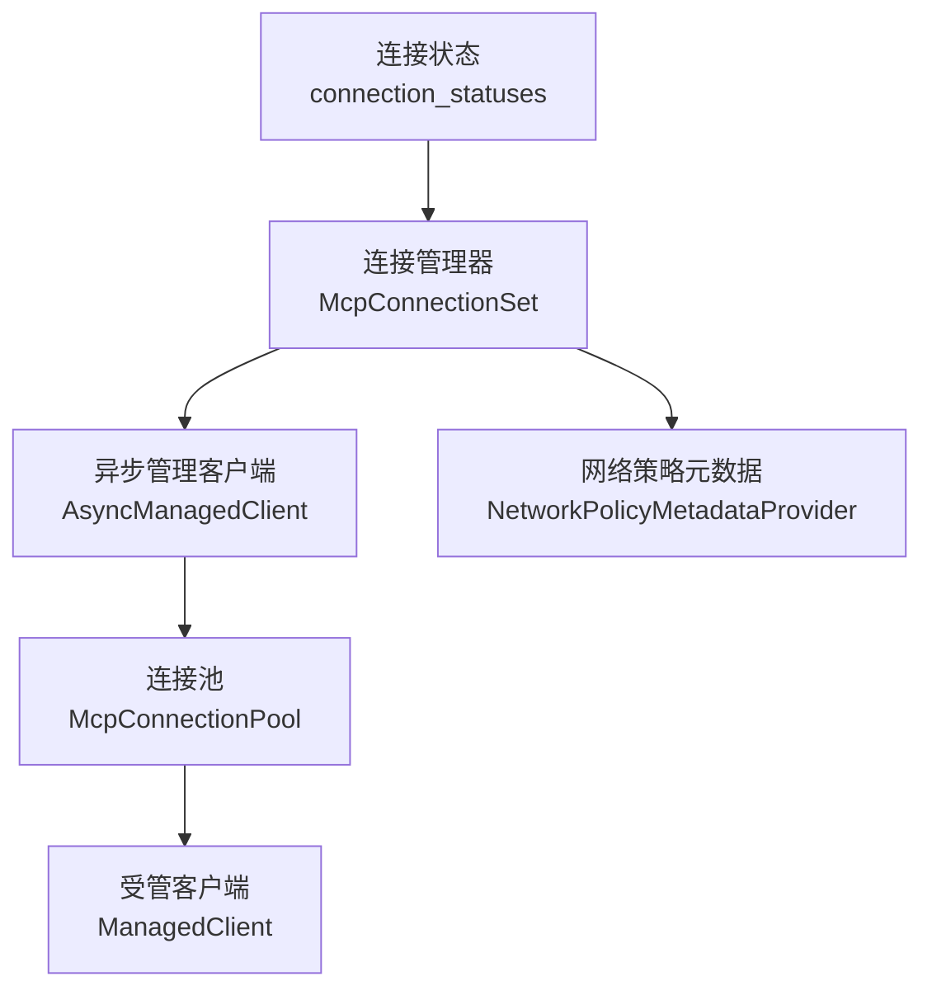
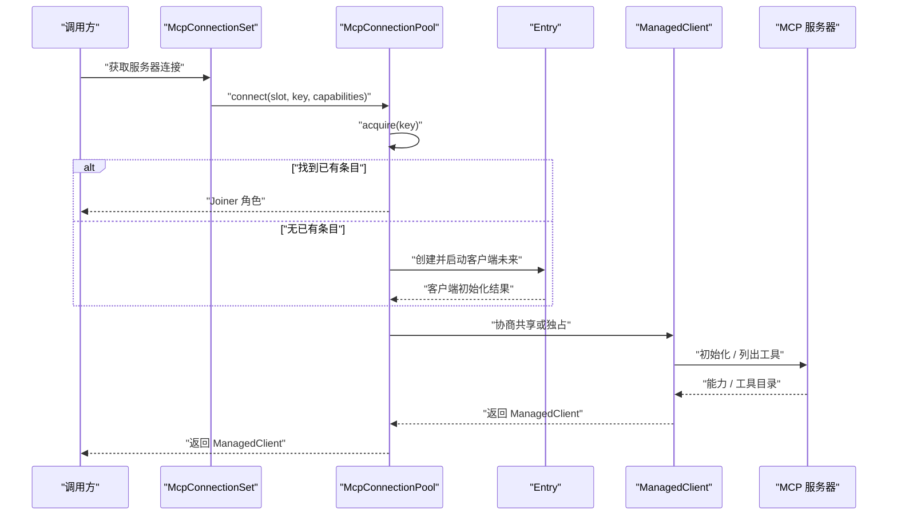
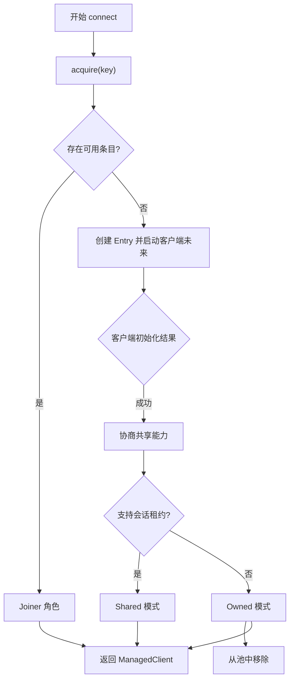
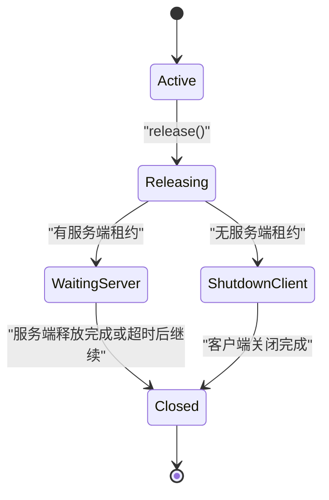
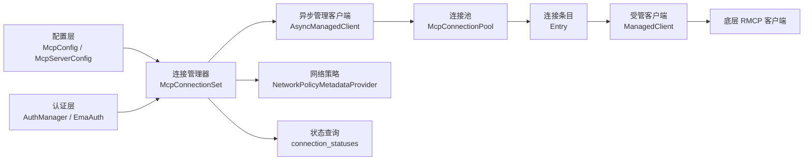
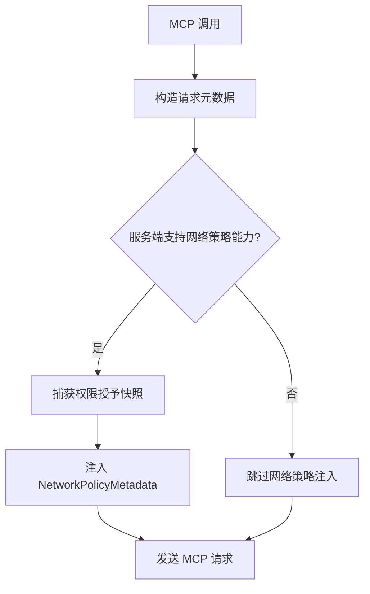
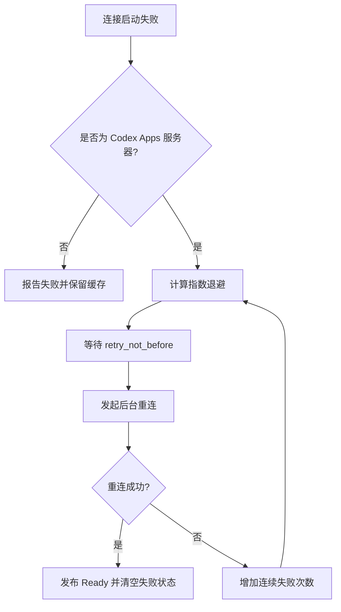

# MCP 连接管理

<cite>
**本文引用的文件**   
- [connection_pool.rs](file://codex-rs/codex-mcp/src/connection_pool.rs)
- [rmcp_client.rs](file://codex-rs/codex-mcp/src/rmcp_client.rs)
- [managed_client.rs](file://codex-rs/codex-mcp/src/rmcp_client/managed_client.rs)
- [connection_manager.rs](file://codex-rs/codex-mcp/src/connection_manager.rs)
- [startup.rs](file://codex-rs/codex-mcp/src/connection_manager/startup.rs)
- [network_policy.rs](file://codex-rs/codex-mcp/src/connection_manager/network_policy.rs)
- [status.rs](file://codex-rs/codex-mcp/src/connection_manager/status.rs)
</cite>

## 目录
1. [引言](#引言)
2. [项目结构](#项目结构)
3. [核心组件](#核心组件)
4. [架构总览](#架构总览)
5. [详细组件分析](#详细组件分析)
6. [依赖关系分析](#依赖关系分析)
7. [性能与监控](#性能与监控)
8. [安全配置](#安全配置)
9. [负载均衡与健康检查](#负载均衡与健康检查)
10. [重连与恢复策略](#重连与恢复策略)
11. [故障排查指南](#故障排查指南)
12. [结论](#结论)

## 引言
本文件聚焦于 Codex MCP 模块中的“MCP 连接管理”能力，围绕连接池、连接复用、资源回收、重连退避、健康状态、负载均衡与安全等维度进行系统化说明。该子系统由以下关键层次组成：
- 连接层：基于 `codex_rmcp_client::RmcpClient` 的底层 RMCP 客户端生命周期。
- 管理封装层：`ManagedClient` 和 `AsyncManagedClient` 负责工具发现、指标、缓存、超时、重试与通知。
- 连接池层：`McpConnectionPool` 在进程内按服务器身份共享连接，并在支持协议版本时协商会话级租约。
- 连接聚合层：`McpConnectionSet` 聚合多个服务器的连接、启动策略、工具过滤、认证来源和事件上报。

## 项目结构
MCP 连接管理相关代码主要位于 `codex-rs/codex-mcp/src` 下，关键文件如下：
- `connection_pool.rs`：进程内连接池、会话租约、共享能力协商与释放。
- `rmcp_client.rs`：RMCP 客户端创建、初始化、工具列表获取、失败统计、指数退避重连。
- `rmcp_client/managed_client.rs`：面向业务调用的封装，包含工具调用、资源访问、租约作用域。
- `connection_manager.rs`：多服务器连接集合、复用判定、启动调度、诊断指标。
- `connection_manager/startup.rs`：启动失败原因、错误展示、认证恢复提示。
- `connection_manager/network_policy.rs`：网络策略元数据注入。
- `connection_manager/status.rs`：只读连接状态查询。

**图示来源**
- [connection_pool.rs:1-200](file://codex-rs/codex-mcp/src/connection_pool.rs#L1-L200)
- [rmcp_client.rs:457-640](file://codex-rs/codex-mcp/src/rmcp_client.rs#L457-L640)
- [connection_manager.rs:200-568](file://codex-rs/codex-mcp/src/connection_manager.rs#L200-L568)
- [status.rs:1-30](file://codex-rs/codex-mcp/src/connection_manager/status.rs#L1-L30)

**章节来源**
- [connection_pool.rs:1-200](file://codex-rs/codex-mcp/src/connection_pool.rs#L1-L200)
- [rmcp_client.rs:117-145](file://codex-rs/codex-mcp/src/rmcp_client.rs#L117-L145)
- [connection_manager.rs:200-568](file://codex-rs/codex-mcp/src/connection_manager.rs#L200-L568)
- [status.rs:1-30](file://codex-rs/codex-mcp/src/connection_manager/status.rs#L1-L30)

## 核心组件
- `McpConnectionPool`：进程内共享相同身份与传输配置的本地 stdio 或可协商协议连接，避免重复创建；对不支持共享的连接降级为独占。
- `ConnectionKey`：用于匹配可复用连接的键，包括服务器名称、连接身份、账户上下文、认证状态、启动超时、工具目录项上限等。
- `Entry`：连接池内部条目，持有运行时句柄、客户端未来、能力集、工具目录快照、取消令牌、所有者弱引用和池弱引用。
- `ConnectionLease`：聊天会话的租约，拥有独立的取消令牌和服务端租约标识；负责打开服务端租约、释放租约并触发物理连接关闭。
- `ManagedClient`：面向上层 API 的封装，提供带租约的工具调用和资源读写，确保输入请求路由到发起方聊天。
- `AsyncManagedClient`：包装单个服务器连接的未来，支持延迟启动、缓存工具、失败后自动重连、等待前驱失败清理。
- `McpServerConnection`：连接视图，保留旧版回退连接、启动触发器、初始 Apps 发布通道和诊断 Gauge。
- `McpConnectionSet`：连接集合，组织多个服务器的启动、复用、工具过滤、网络策略、事件上报和状态查询。

**章节来源**
- [connection_pool.rs:1-200](file://codex-rs/codex-mcp/src/connection_pool.rs#L1-L200)
- [managed_client.rs:1-184](file://codex-rs/codex-mcp/src/rmcp_client/managed_client.rs#L1-L184)
- [rmcp_client.rs:457-640](file://codex-rs/codex-mcp/src/rmcp_client.rs#L457-L640)
- [connection_manager.rs:200-568](file://codex-rs/codex-mcp/src/connection_manager.rs#L200-L568)

## 架构总览
连接管理的总体流程是：
1. 高层通过 `McpConnectionSet` 为每个 MCP 服务器构建连接视图。
2. 根据配置选择是否使用连接池；若允许且条件满足，则进入 `McpConnectionPool.connect`。
3. 连接池查找已有可用条目；若无则创建 `ManagedClientFuture` 并启动连接。
4. 如果服务器支持协商能力，则启用会话租约；否则将连接标记为独占。
5. 工具目录和权限策略随调用注入，必要时刷新目录。
6. 连接失败时，Apps 服务器会尝试指数退避重连；其他服务器可选择回退到已缓存目录或失败报告。

**图示来源**
- [connection_pool.rs:201-574](file://codex-rs/codex-mcp/src/connection_pool.rs#L201-L574)
- [rmcp_client.rs:310-450](file://codex-rs/codex-mcp/src/rmcp_client.rs#L310-L450)
- [connection_manager.rs:870-1233](file://codex-rs/codex-mcp/src/connection_manager.rs#L870-L1233)

**章节来源**
- [connection_pool.rs:201-574](file://codex-rs/codex-mcp/src/connection_pool.rs#L201-L574)
- [rmcp_client.rs:310-450](file://codex-rs/codex-mcp/src/rmcp_client.rs#L310-L450)
- [connection_manager.rs:870-1233](file://codex-rs/codex-mcp/src/connection_manager.rs#L870-L1233)

## 详细组件分析

### 连接池实现机制
连接池的核心目标是减少相同身份 MCP 服务器的重复创建成本，同时保持每个聊天对输入处理能力和上下文的所有权独立。其机制如下：

- **连接键匹配**：`ConnectionKey` 比较服务器名、连接身份、账户上下文、认证状态、启动超时和目录项限制。认证状态不仅比较对象指针，还比较生成号，确保认证刷新后不会错误复用旧连接。
- **槽位状态**：`ConnectionSlot` 维护 Available、Acquired、Retired 三种状态；当槽位被回收时，会从池中移除对应条目。
- **条目复用**：连接池遍历 `entries` 中强引用计数大于零的弱引用，筛选出具有相同键、未声明放弃共享、且客户端尚未成功或处于 Negotiated 状态的条目。
- **角色区分**：首次创建的条目称为 Creator；后续加入者称为 Joiner。Joiner 会在 Creator 完成初始化后共享能力与工具目录。
- **共享协商**：如果服务器能力包含 `codex/connection-lease`，则启用会话租约；否则将连接改为 Owned（独占），并从池中移除。
- **租约生命周期**：`ConnectionLease` 在服务端支持时发送 `codex/connection/open`，携带唯一 leaseId；关闭时发送 `codex/connection/release`，并等待服务端确认或在超时时降级处理。

**图示来源**
- [connection_pool.rs:201-574](file://codex-rs/codex-mcp/src/connection_pool.rs#L201-L574)

**章节来源**
- [connection_pool.rs:1-200](file://codex-rs/codex-mcp/src/connection_pool.rs#L1-L200)
- [connection_pool.rs:201-574](file://codex-rs/codex-mcp/src/connection_pool.rs#L201-L574)

### 连接复用策略
连接复用发生在两个层面：
1. **进程内连接池复用**：相同 `ConnectionKey` 的连接会被合并，避免重复启动本地 stdio 进程。
2. **连接视图中复用**：`McpServerConnection.reusable_client` 检查当前连接身份是否与期望一致、是否已完成启动、客户端是否关闭、OAuth 凭据是否相同。若 OAuth 凭据发生变化，则拒绝复用。

此外，`McpConnectionSet` 在重建连接时优先复用之前的连接，条件是：
- 工具目录刷新开关一致。
- 不强制要求替换旧连接。
- 身份、协议模式、启动超时、catalog 项限制一致。
- 客户端处于 pending startup、ready 或认证失败但可重新触发的状态。

这种策略降低了热路径上的连接抖动，同时保证认证变更能够触发必要的重新初始化。

**章节来源**
- [connection_manager.rs:200-568](file://codex-rs/codex-mcp/src/connection_manager.rs#L200-L568)
- [connection_manager.rs:569-869](file://codex-rs/codex-mcp/src/connection_manager.rs#L569-L869)
- [connection_manager.rs:870-1233](file://codex-rs/codex-mcp/src/connection_manager.rs#L870-L1233)

### 资源回收与释放
资源回收贯穿连接池、会话租约和物理连接三个层次：
- **槽位回收**：`ConnectionSlot.retire` 将槽位置为 Retired，并移除对应的 Entry。
- **租约释放**：`ConnectionLease.release` 取消租约取消令牌，取走所有者记录，如果是最后一个所有者则取消 Entry 启动令牌并从池中移除；随后在后台任务中等待客户端完成 shutdown 或服务端 release。
- **服务端租约释放**：如果协商了会话租约，则调用 `ServerLease.release`，向服务端发送 `codex/connection/release`；失败时会从池中移除条目并记录警告。
- **连接关闭**：如果不存在服务端租约，则直接调用底层 `RmcpClient.shutdown`。
- **兜底等待**：`ConnectionSlot.wait_for_shutdown` 通过 `TaskTracker` 等待所有释放任务完成，确保上层 shutdown 可以同步观察连接最终状态。

**图示来源**
- [connection_pool.rs:201-574](file://codex-rs/codex-mcp/src/connection_pool.rs#L201-L574)

**章节来源**
- [connection_pool.rs:201-574](file://codex-rs/codex-mcp/src/connection_pool.rs#L201-L574)

### 工具目录与会话隔离
连接池为每个聊天提供独立的工具目录快照：
- Creator 直接使用客户端目录。
- Joiner 通过 `list_tools_for_client_uncached` 拉取目录，并可写入共享的 `McpToolCatalogCacheContext`。
- 如果目录发生变化，则更新共享快照；否则保留旧快照，避免不同聊天互相干扰。
- 工具目录读取和刷新都绑定到 `with_active_shared_lease`，确保共享连接上的操作在租约有效期内执行。

**章节来源**
- [connection_pool.rs:1-200](file://codex-rs/codex-mcp/src/connection_pool.rs#L1-L200)
- [managed_client.rs:1-184](file://codex-rs/codex-mcp/src/rmcp_client/managed_client.rs#L1-L184)

## 依赖关系分析
连接管理涉及的多层依赖如下：

**图示来源**
- [connection_manager.rs:200-568](file://codex-rs/codex-mcp/src/connection_manager.rs#L200-L568)
- [rmcp_client.rs:457-640](file://codex-rs/codex-mcp/src/rmcp_client.rs#L457-L640)
- [connection_pool.rs:201-574](file://codex-rs/codex-mcp/src/connection_pool.rs#L201-L574)
- [network_policy.rs:1-85](file://codex-rs/codex-mcp/src/connection_manager/network_policy.rs#L1-L85)
- [status.rs:1-30](file://codex-rs/codex-mcp/src/connection_manager/status.rs#L1-L30)

**章节来源**
- [connection_manager.rs:200-568](file://codex-rs/codex-mcp/src/connection_manager.rs#L200-L568)
- [rmcp_client.rs:457-640](file://codex-rs/codex-mcp/src/rmcp_client.rs#L457-L640)
- [connection_pool.rs:201-574](file://codex-rs/codex-mcp/src/connection_pool.rs#L201-L574)
- [network_policy.rs:1-85](file://codex-rs/codex-mcp/src/connection_manager/network_policy.rs#L1-L85)
- [status.rs:1-30](file://codex-rs/codex-mcp/src/connection_manager/status.rs#L1-L30)

## 性能与监控
连接管理暴露了多种性能和行为观测点：

- **活跃连接数**：`LIVE_CONNECTIONS` 全局 Gauge 跟踪当前活跃的 MCP 连接。
- **工具列表耗时**：
  - `codex.mcp.tools.list.duration_ms`：`ManagedClient.listed_catalog` 使用缓存时的总耗时。
  - `codex.mcp.tools.fetch_uncached.duration_ms`：未命中缓存时拉取工具列表的耗时。
- **Codex Apps 刷新耗时**：`codex.apps.refresh.duration_ms` 记录初始或历史路径下的工具刷新耗时。
- **协议发现指标**：`record_protocol_discovery_metrics` 通过 OTel 上报协议发现次数和耗时标签。
- **诊断守卫**：`GaugeGuard` 在连接生命周期内自动登记和释放指标。

这些指标可用于：
- 判断连接池是否有效复用连接。
- 评估工具目录缓存命中率。
- 观察启动超时和网络往返时间。
- 追踪协议版本协商结果。

**章节来源**
- [connection_manager.rs:200-240](file://codex-rs/codex-mcp/src/connection_manager.rs#L200-L240)
- [rmcp_client.rs:117-145](file://codex-rs/codex-mcp/src/rmcp_client.rs#L117-L145)
- [rmcp_client.rs:1297-1349](file://codex-rs/codex-mcp/src/rmcp_client.rs#L1297-L1349)
- [managed_client.rs:1-184](file://codex-rs/codex-mcp/src/rmcp_client/managed_client.rs#L1-L184)

## 安全配置
连接安全主要由认证来源、凭据传递和网络策略三部分组成：

- **认证来源**：
  - ChatGPT 认证：仅对明确 opt-in 且本地环境的服务器提供。
  - EmaAuth：企业托管认证模式下强制使用 V20260728 协议，并注入企业授权扩展。
  - 环境变量 Bearer Token：对 StreamableHttp 传输可通过环境变量注入，但会绕过某些共享缓存逻辑。
- **凭据传播**：
  - `McpCredentialPolicy` 控制凭据解析策略；`ExecutorOnly` 模式下不允许主机回退，避免敏感凭据泄露。
  - OAuth 凭据存储模式、密钥环后端、刷新模式均参与连接身份比较，防止凭据不一致导致的错误复用。
- **网络策略**：
  - 通过 `NetworkPolicyMetadataProvider` 在每个调用时注入网络模式、允许域名、拒绝域名和硬拒绝策略。
  - 策略仅在客户端与服务端均支持 `codex/network-policy-meta` 时生效，并使用 `OnceLock` 捕获一次可变权限授予快照。

**图示来源**
- [network_policy.rs:1-85](file://codex-rs/codex-mcp/src/connection_manager/network_policy.rs#L1-L85)

**章节来源**
- [connection_manager.rs:569-869](file://codex-rs/codex-mcp/src/connection_manager.rs#L569-L869)
- [network_policy.rs:1-85](file://codex-rs/codex-mcp/src/connection_manager/network_policy.rs#L1-L85)
- [rmcp_client.rs:1080-1132](file://codex-rs/codex-mcp/src/rmcp_client.rs#L1080-L1132)

## 负载均衡与健康检查
当前实现的“负载均衡”更准确地说是“连接复用与可用性选择”，而非传统意义上的多实例轮询或权重分配：

- **连接复用即负载集中**：相同身份的服务器连接被合并，降低进程数和端口占用，提升资源利用率。
- **健康检查体现为可用性探测**：
  - 客户端关闭检测：`client.client.is_closed()` 用于剔除无效连接。
  - 启动完成标志：`startup_complete` 原子标志决定是否可复用。
  - 协议模式校验：期望协议模式与实际协议模式不一致时拒绝复用。
  - 认证凭据一致性：OAuth 凭据变化导致连接不可复用。
- **回退策略**：
  - 如果协商共享失败或服务器不支持租约，则切换为 Owned 独占连接。
  - 如果 discovery 失败，可能保留 legacy fallback 连接以避免单例无法启动第二个进程。
- **健康状态查询**：`connection_statuses` 提供禁用、未启动、启动中和就绪等状态，便于上层 UI 或监控系统展示。

需要注意的是，仓库中没有实现显式的多后端轮询、加权分发或主动心跳探测；健康检查主要通过连接状态和启动结果推断。

**章节来源**
- [connection_manager.rs:200-568](file://codex-rs/codex-mcp/src/connection_manager.rs#L200-L568)
- [connection_manager.rs:870-1233](file://codex-rs/codex-mcp/src/connection_manager.rs#L870-L1233)
- [status.rs:1-30](file://codex-rs/codex-mcp/src/connection_manager/status.rs#L1-L30)

## 重连与恢复策略
重连策略主要针对 Codex Apps MCP 服务器，普通 MCP 服务器以失败报告和缓存工具为主：

- **失败分类**：`StartupOutcomeError` 区分 Cancelled 和 Failed；Failed 中包含错误字符串、是否要求认证、是否为企业托管认证，以及可选的前驱 shutdown 任务。
- **指数退避算法**：
  - 初始退避间隔为 1 秒。
  - 连续失败次数减 1 作为指数幂次，最大指数为 5。
  - 最大退避间隔为 30 秒。
  - 每次失败后设置 `retry_not_before`，避免短时间内重复尝试。
- **并发保护**：`reconnect_in_flight` 保证同一时刻只有一个重连任务；新调用可直接 join 现有任务。
- **恢复信号**：成功后清除最后错误、重置连续失败计数和重试时间，并发布 Ready 事件。
- **失败路径**：失败时记录日志，继续使用缓存工具；上层可通过 `reconnect_failed_startup` 触发后台重连。

**图示来源**
- [rmcp_client.rs:140-269](file://codex-rs/codex-mcp/src/rmcp_client.rs#L140-L269)
- [rmcp_client.rs:686-710](file://codex-rs/codex-mcp/src/rmcp_client.rs#L686-L710)

**章节来源**
- [rmcp_client.rs:140-269](file://codex-rs/codex-mcp/src/rmcp_client.rs#L140-L269)
- [rmcp_client.rs:686-710](file://codex-rs/codex-mcp/src/rmcp_client.rs#L686-L710)
- [rmcp_client.rs:780-828](file://codex-rs/codex-mcp/src/rmcp_client.rs#L780-L828)

## 故障排查指南
常见问题和定位方法如下：

- **启动超时**：
  - 现象：MCP 客户端在指定时间内未完成握手或初始化。
  - 排查：查看启动超时配置 `startup_timeout_sec`，调整默认值；注意 GitHub MCP 不支持 OAuth 的错误提示会引导配置 Bearer Token。
- **认证失败**：
  - 现象：错误标记为需要认证，可能是未登录、OAuth 过期或企业托管认证未配置。
  - 排查：根据 `mcp_init_error_display` 输出提示执行登录或重新认证；企业环境需通过 Codex 登录。
- **连接未复用**：
  - 现象：相同服务器多次创建连接。
  - 排查：检查 `ConnectionKey` 差异，尤其是账户上下文、认证状态生成号、启动超时、目录项限制和协议模式。
- **租约泄漏或释放失败**：
  - 现象：共享连接未及时释放，或服务端租约超时。
  - 排查：确认 `codex/connection/open` 和 `codex/connection/release` 是否被正确发送；关注 `LEASE_REQUEST_TIMEOUT` 行为。
- **工具目录异常**：
  - 现象：工具列表为空或模型可见性不符合预期。
  - 排查：检查工具过滤器、插件成员关系、Codex Apps 工具规范化逻辑和缓存上下文。
- **网络策略未生效**：
  - 现象：MCP 调用未携带网络策略元数据。
  - 排查：确认客户端和服务端均支持 `codex/network-policy-meta`，并检查权限授予快照是否正确捕获。

**章节来源**
- [startup.rs:1-143](file://codex-rs/codex-mcp/src/connection_manager/startup.rs#L1-L143)
- [connection_pool.rs:201-574](file://codex-rs/codex-mcp/src/connection_pool.rs#L201-L574)
- [connection_manager.rs:870-1233](file://codex-rs/codex-mcp/src/connection_manager.rs#L870-L1233)
- [network_policy.rs:1-85](file://codex-rs/codex-mcp/src/connection_manager/network_policy.rs#L1-L85)

## 结论
Codex 的 MCP 连接管理以“进程内连接池 + 会话租约 + 异步管理封装 + 连接聚合视图”为核心架构，强调：
- 通过 `ConnectionKey` 精确复用连接，避免重复启动本地进程。
- 通过 `ConnectionLease` 保证会话级隔离和可靠释放。
- 通过 `AsyncManagedClient` 统一处理启动、缓存、超时、指标和失败重连。
- 通过 `McpConnectionSet` 聚合多服务器启动、复用、认证来源、工具过滤和网络策略。
- 通过指数退避重连保障 Codex Apps 的高可用体验。
- 通过只读状态查询和全局 Gauge 提供基础监控能力。

对于生产部署，建议重点关注启动超时、认证配置、工具目录缓存命中率和连接复用率；如需更强的负载均衡和健康检查，可在现有连接复用基础上扩展多实例选择器和主动探针。