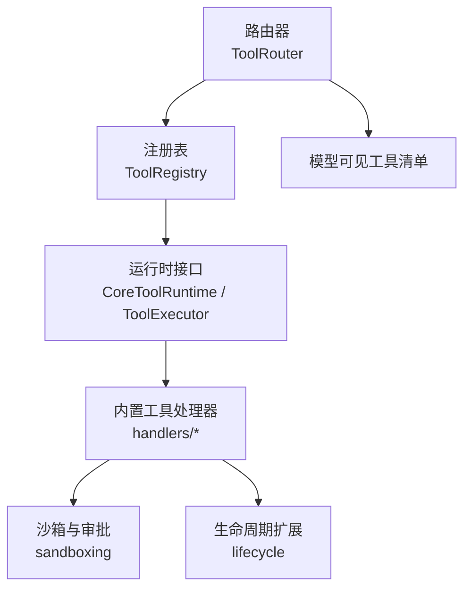
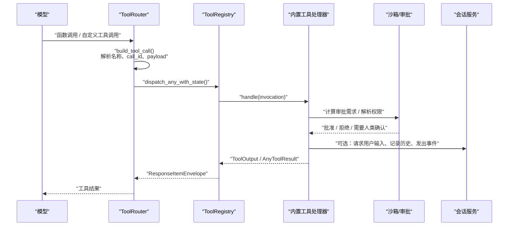
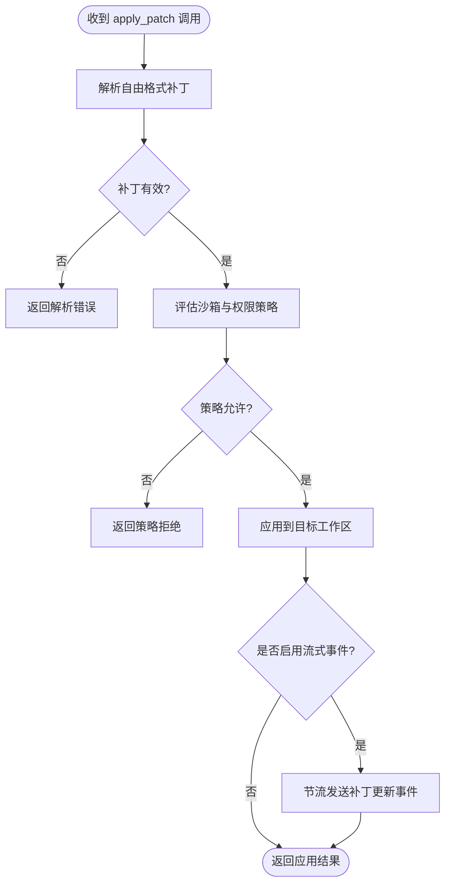
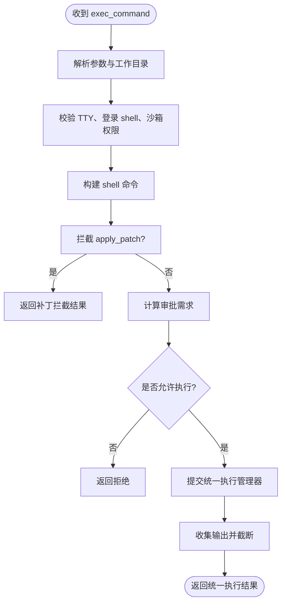
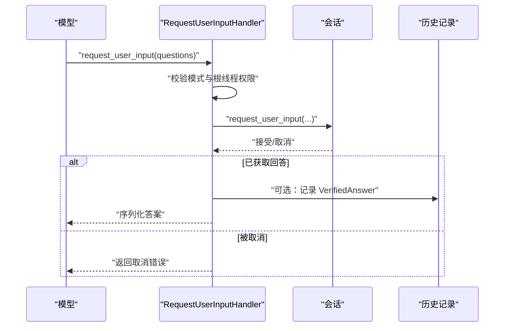
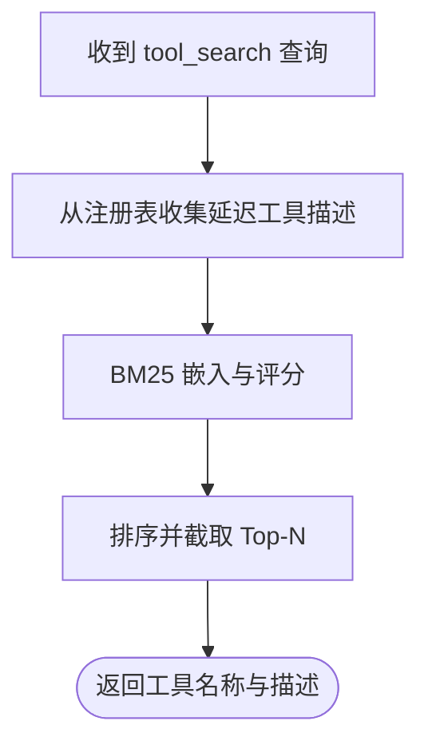
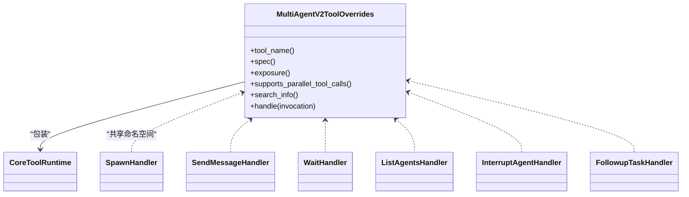
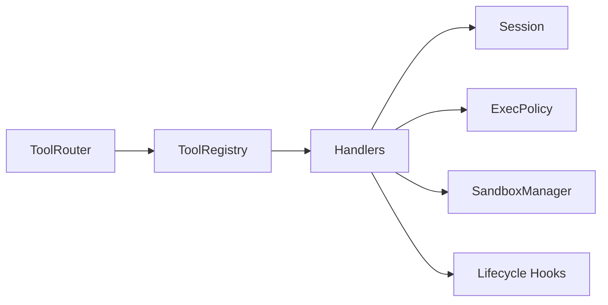
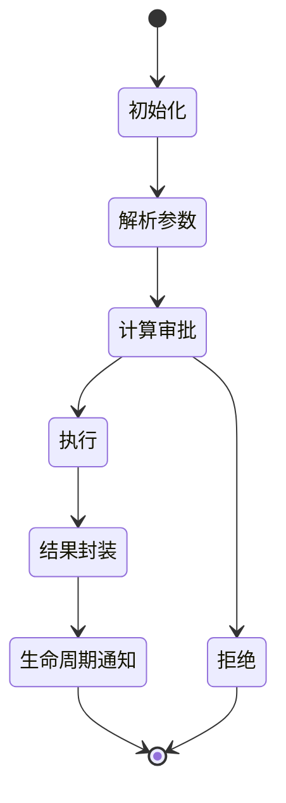

# 内置工具

<cite>
**本文引用的文件**   
- [mod.rs](file://codex-rs/core/src/tools/mod.rs)
- [registry.rs](file://codex-rs/core/src/tools/registry.rs)
- [router.rs](file://codex-rs/core/src/tools/router.rs)
- [handlers/mod.rs](file://codex-rs/core/src/tools/handlers/mod.rs)
- [apply_patch.rs](file://codex-rs/core/src/tools/handlers/apply_patch.rs)
- [apply_patch_spec.rs](file://codex-rs/core/src/tools/handlers/apply_patch_spec.rs)
- [unified_exec.rs](file://codex-rs/core/src/tools/handlers/unified_exec.rs)
- [exec_command.rs](file://codex-rs/core/src/tools/handlers/unified_exec/exec_command.rs)
- [preparation.rs](file://codex-rs/core/src/tools/handlers/unified_exec/preparation.rs)
- [request_user_input.rs](file://codex-rs/core/src/tools/handlers/request_user_input.rs)
- [request_user_input_spec.rs](file://codex-rs/core/src/tools/handlers/request_user_input_spec.rs)
- [tool_search.rs](file://codex-rs/core/src/tools/handlers/tool_search.rs)
- [multi_agent_tool.rs](file://codex-rs/core/src/tools/multi_agent_tool.rs)
- [multi_agents_v2.rs](file://codex-rs/core/src/tools/handlers/multi_agents_v2.rs)
- [sandboxing.rs](file://codex-rs/core/src/tools/sandboxing.rs)
- [lifecycle.rs](file://codex-rs/core/src/tools/lifecycle.rs)
</cite>

## 目录
1. [引言](#引言)
2. [项目结构](#项目结构)
3. [核心组件](#核心组件)
4. [架构总览](#架构总览)
5. [详细组件分析](#详细组件分析)
6. [依赖关系分析](#依赖关系分析)
7. [性能考虑](#性能考虑)
8. [故障排查指南](#故障排查指南)
9. [结论](#结论)
10. [附录：工具生命周期与最佳实践](#附录工具生命周期与最佳实践)

## 引言
本文面向 Codex CLI 的“内置工具”子系统，系统性说明其实现机制、接口约定、安全边界、配置注入、生命周期管理以及开发最佳实践。Codex 的工具系统既包括直接可执行命令（如 `exec_command`）、补丁应用（`apply_patch`）、用户输入请求（`request_user_input`），也包括搜索发现（`tool_search`）和多智能体协作（Multi-Agent V1/V2）等高级能力。所有工具都通过统一的注册表、路由器和运行时契约进行编排，并受沙箱策略、审批流、Hook 扩展和遥测体系约束。

## 项目结构
Codex 工具的 Rust 源码主要集中在 `codex-rs/core/src/tools` 及其子模块中，采用“分层 + 按领域拆分”的组织方式：
- `tools/mod.rs`：顶层工具层公共逻辑、输出格式化、模式选择。
- `tools/registry.rs`：工具注册、暴露面控制、Hook 前后处理、差异消费者、结果封装。
- `tools/router.rs`：模型可见工具清单构建、调用分发、并行支持、命名空间与 Code Mode 适配。
- `tools/handlers`：各具体内置工具的处理器与参数规范定义。
- `tools/sandboxing.rs`：通用审批、沙箱策略、权限请求。
- `tools/lifecycle.rs`：扩展生命周期钩子通知。

**图示来源**
- [router.rs:1-120](file://codex-rs/core/src/tools/router.rs#L1-L120)
- [registry.rs:480-695](file://codex-rs/core/src/tools/registry.rs#L480-L695)
- [handlers/mod.rs:1-80](file://codex-rs/core/src/tools/handlers/mod.rs#L1-L80)

**章节来源**
- [mod.rs:1-140](file://codex-rs/core/src/tools/mod.rs#L1-L140)

## 核心组件
- **工具运行时接口**：`CoreToolRuntime` 在 `ToolExecutor` 基础上增加元数据、等待就绪、环境解析、MCP 信息、Hook 载荷、差异消费、并行支持等能力；每个内置工具以实现该接口的处理器形式存在。
- **工具注册表**：维护 `RegisteredTool`，保存运行时、暴露面、本地覆盖 spec、原生审查策略；提供信任注册、外部注册、冲突检测、搜索索引生成、前置 Hook 参数重写等功能。
- **工具路由器**：根据会话上下文、功能开关、Code Mode 和模型能力，决定哪些工具对模型可见；负责将协议中的函数调用、自定义调用、客户端发起的 `tool_search` 转换为内部 `ToolCall`，再委派给注册表执行。
- **处理器集合**：`handlers/*` 下包含文件补丁、统一命令执行、用户输入、插件安装、上下文窗口、MCP 资源、多智能体等工具实现。
- **沙箱与审批**：集中表达命令执行的审批需求、缓存审批决策、构造权限请求载荷，并与 execpolicy 集成。
- **生命周期扩展**：向扩展贡献者广播工具开始、命令开始、MCP 工具结果、工具完成或中止事件，便于审计、日志和监控。

**章节来源**
- [registry.rs:1-200](file://codex-rs/core/src/tools/registry.rs#L1-L200)
- [registry.rs:480-695](file://codex-rs/core/src/tools/registry.rs#L480-L695)
- [router.rs:1-200](file://codex-rs/core/src/tools/router.rs#L1-L200)
- [handlers/mod.rs:1-80](file://codex-rs/core/src/tools/handlers/mod.rs#L1-L80)
- [sandboxing.rs:1-120](file://codex-rs/core/src/tools/sandboxing.rs#L1-L120)
- [lifecycle.rs:1-120](file://codex-rs/core/src/tools/lifecycle.rs#L1-L120)

## 架构总览
下图展示一次典型内置工具调用的端到端流程：模型返回函数调用 → 路由器解析 → 注册表调度 → 处理器校验与准备 → 沙箱与审批 → 实际执行 → 结果回写模型。

**图示来源**
- [router.rs:201-490](file://codex-rs/core/src/tools/router.rs#L201-L490)
- [registry.rs:201-500](file://codex-rs/core/src/tools/registry.rs#L201-L500)
- [lifecycle.rs:120-186](file://codex-rs/core/src/tools/lifecycle.rs#L120-L186)

## 详细组件分析

### 文件补丁工具 `apply_patch`
- **职责**：接收自由格式补丁描述，解析为增量变更，并在经过安全审查后应用到目标工作区的文件系统。
- **接口**：
  - 工具规格使用 Lark 语法定义的自由格式工具，可通过是否包含环境标识符生成不同模板。
  - 处理器支持流式参数差异消费，将补丁分块逐步转换为协议级 `PatchApplyUpdatedEvent`，并以节流策略避免频繁事件风暴。
- **关键参数**：
  - 补丁正文由自由格式语法驱动，通常表示新增、删除、更新文件的统一 diff 或等价结构。
  - 当启用流式补丁事件时，处理器会缓冲短间隔内的变更，最终完成时发送剩余累积事件。
- **返回值**：
  - 成功时返回补丁应用结果；失败时返回模型可读错误，包含解析异常或策略拒绝原因。
- **安全与控制**：
  - 补丁会被拦截检查，结合当前环境的沙箱策略、权限配置文件和会话策略决定是否放行。
  - 支持追加额外权限资料、工作目录、TTY、超时等上下文。
- **使用示例（概念）**：
  - 向模型提示使用 `apply_patch` 工具，传入补丁文本；系统返回已应用的文件变更摘要或错误。

**图示来源**
- [apply_patch.rs:1-200](file://codex-rs/core/src/tools/handlers/apply_patch.rs#L1-L200)
- [apply_patch_spec.rs:1-32](file://codex-rs/core/src/tools/handlers/apply_patch_spec.rs#L1-L32)

**章节来源**
- [apply_patch.rs:1-200](file://codex-rs/core/src/tools/handlers/apply_patch.rs#L1-L200)
- [apply_patch_spec.rs:1-32](file://codex-rs/core/src/tools/handlers/apply_patch_spec.rs#L1-L32)

### 统一命令执行工具 `exec_command` 与终端写入 `write_stdin`
- **职责**：在当前或指定环境中执行命令，支持交互式 TTY、登录 shell、超时、最大输出 token 限制、沙箱权限升级、附加权限资料、前缀规则等。
- **接口**：
  - `ExecCommandArgs` 包含命令、shell、login、tty、yield_time_ms、timeout_ms、max_output_tokens、sandbox_permissions、additional_permissions、justification、prefix_rule。
  - 工作目录通过 `ExecCommandWorkdirArgs.workdir` 相对于选定环境 cwd 解析。
  - 支持通过 `terminal_session_for_input` 把已有终端进程作为后续 `write_stdin` 的目标。
- **关键参数**：
  - `cmd`：待执行命令。
  - `shell`：可选 shell 路径；未提供时使用会话默认 shell。
  - `login`：是否使用登录 shell，受配置限制。
  - `tty`：是否开启 TTY，受功能开关控制。
  - `timeout_ms`：命令完成超时。
  - `max_output_tokens`：输出截断上限。
  - `sandbox_permissions`：沙箱权限等级，配合 `justification` 使用。
  - `additional_permissions`：附加权限资料。
  - `prefix_rule`：execpolicy 前缀规则。
- **返回值**：
  - 统一命令执行输出封装为 `ExecCommandToolOutput`，包含事件 ID、chunk ID、耗时、原始输出、是否被 `apply_patch` 拦截等信息。
- **安全与控制**：
  - 预处理阶段解析工作目录、沙箱类型、TTY 合法性、权限升级合理性。
  - 执行前调用 execpolicy 计算 `ExecApprovalRequirement`，可能跳过沙箱、要求人类审批或直接禁止。
  - 支持拦截 `apply_patch` 调用，将其转化为补丁事件而非真实命令。
- **使用示例（概念）**：
  - 在代码仓库中运行测试或构建命令，设置超时与输出 token 上限；如需交互则启用 TTY 并通过 `write_stdin` 写入标准输入。

**图示来源**
- [unified_exec.rs:1-182](file://codex-rs/core/src/tools/handlers/unified_exec.rs#L1-L182)
- [exec_command.rs:1-200](file://codex-rs/core/src/tools/handlers/unified_exec/exec_command.rs#L1-L200)
- [preparation.rs:1-200](file://codex-rs/core/src/tools/handlers/unified_exec/preparation.rs#L1-L200)
- [sandboxing.rs:120-250](file://codex-rs/core/src/tools/sandboxing.rs#L120-L250)

**章节来源**
- [unified_exec.rs:1-182](file://codex-rs/core/src/tools/handlers/unified_exec.rs#L1-L182)
- [exec_command.rs:1-200](file://codex-rs/core/src/tools/handlers/unified_exec/exec_command.rs#L1-L200)
- [preparation.rs:1-200](file://codex-rs/core/src/tools/handlers/unified_exec/preparation.rs#L1-L200)

### 用户输入请求工具 `request_user_input`
- **职责**：向用户提出结构化问题并等待回答，常用于计划模式或协作模式下的人机确认。
- **接口**：
  - 参数为问题列表，每个问题包含稳定 id、标题、问题文本、互斥选项；处理器会自动标记 `is_other` 以便客户端添加“其他”选项。
  - 仅在允许的协作模式中可用；根线程受限时会拒绝调用。
- **关键参数**：
  - `questions`：至少一个、最多三个问题的数组；每个问题必须包含非空选项。
- **返回值**：
  - 序列化后的用户答案；若用户取消或无响应，返回模型可读错误。
  - 在启用 Guardian 审批特性时，会将已验证问答写入保留上下文。
- **使用示例（概念）**：
  - 在计划模式下询问用户选择某个分支策略，选项标注推荐项；用户确认后继续自动化流程。

**图示来源**
- [request_user_input.rs:1-163](file://codex-rs/core/src/tools/handlers/request_user_input.rs#L1-L163)
- [request_user_input_spec.rs:1-146](file://codex-rs/core/src/tools/handlers/request_user_input_spec.rs#L1-L146)

**章节来源**
- [request_user_input.rs:1-163](file://codex-rs/core/src/tools/handlers/request_user_input.rs#L1-L163)
- [request_user_input_spec.rs:1-146](file://codex-rs/core/src/tools/handlers/request_user_input_spec.rs#L1-L146)

### 工具搜索工具 `tool_search`
- **职责**：根据模型语义查询当前注册表中可延迟加载的工具，返回名称、描述等搜索结果。
- **接口**：
  - 使用 BM25 嵌入器与评分器对工具描述语料建立索引，支持并行调用。
  - 缓存构建器会根据注册表的延迟工具源重建处理器，避免重复计算。
- **关键参数**：
  - 查询字符串；默认限制数量。
- **返回值**：
  - 匹配工具的名称与描述；可用于 Code Mode 动态发现工具定义。
- **使用示例（概念）**：
  - 模型用自然语言描述任务，系统返回相关工具名；随后按需加载工具定义并调用。

**图示来源**
- [tool_search.rs:1-200](file://codex-rs/core/src/tools/handlers/tool_search.rs#L1-L200)

**章节来源**
- [tool_search.rs:1-200](file://codex-rs/core/src/tools/handlers/tool_search.rs#L1-L200)

### 多智能体协作工具 Multi-Agent V2
- **职责**：提供创建子代理、发送消息、监听活动、中断、跟进任务等协作能力；同时提供命名空间包装器，可在宿主扩展中覆盖描述与参数 schema。
- **接口**：
  - `multi_agent_v2_handler` 包裹原生处理器，可选择性修改工具命名空间、描述与参数 schema，但保持执行不变。
  - V2 工具集包含 spawn、send_message、list_agents、wait、interrupt_agent、followup_task、analytics 等子处理器。
- **关键参数**：
  - 子代理目标、消息内容、ReasoningEffort、AgentStatus 等字段由子处理器定义。
- **返回值**：
  - 子代理活动事件、消息状态、任务结果等；消息传输区分明文与加密，取决于调用来源。
- **使用示例（概念）**：
  - 主代理创建一个子代理执行独立任务，通过消息工具传递指令，并通过 wait/followup_task 跟踪进展。

**图示来源**
- [multi_agent_tool.rs:1-134](file://codex-rs/core/src/tools/multi_agent_tool.rs#L1-L134)
- [multi_agents_v2.rs:1-67](file://codex-rs/core/src/tools/handlers/multi_agents_v2.rs#L1-L67)

**章节来源**
- [multi_agent_tool.rs:1-134](file://codex-rs/core/src/tools/multi_agent_tool.rs#L1-L134)
- [multi_agents_v2.rs:1-67](file://codex-rs/core/src/tools/handlers/multi_agents_v2.rs#L1-L67)

## 依赖关系分析
- **路由器依赖注册表**：路由器依据注册表提供的暴露面和模型可见 spec 判断工具可用性；同时统计注册分布用于遥测。
- **处理器依赖会话与环境**：处理器普遍依赖 `Session`、`StepContext`、`TurnEnvironment`，以访问 shell、execpolicy、unified_exec_manager、文件系统等能力。
- **沙箱与审批依赖 execpolicy**：命令执行前通过 execpolicy 计算审批需求，支持自动跳过、建议策略改写、人类审批和禁止。
- **生命周期扩展依赖扩展贡献者**：工具开始、命令开始、MCP 结果、工具完成/中止均广播给扩展贡献者，便于审计、日志、监控和第三方集成。

**图示来源**
- [router.rs:201-490](file://codex-rs/core/src/tools/router.rs#L201-L490)
- [registry.rs:480-695](file://codex-rs/core/src/tools/registry.rs#L480-L695)
- [sandboxing.rs:120-250](file://codex-rs/core/src/tools/sandboxing.rs#L120-L250)
- [lifecycle.rs:120-186](file://codex-rs/core/src/tools/lifecycle.rs#L120-L186)

**章节来源**
- [router.rs:201-490](file://codex-rs/core/src/tools/router.rs#L201-L490)
- [registry.rs:480-695](file://codex-rs/core/src/tools/registry.rs#L480-L695)

## 性能考虑
- **输出截断**：统一命令执行输出在返回模型前进行安全截断，并附带退出码、耗时、行数等元信息，避免长输出影响模型上下文。
- **搜索缓存**：`tool_search` 使用缓存构建器复用延迟工具源，减少重复索引构建成本。
- **补丁流式事件节流**：`apply_patch` 的流式事件以固定时间间隔聚合，避免高频事件造成 UI 抖动或遥测压力。
- **并行工具调用**：`tool_search` 和 `exec_command` 明确声明支持并行工具调用，提升吞吐。
- **遥测与指标**：路由器统计工具注册分布；审批流程计数；命令执行埋点到 OTel 指标。

[本节为一般性指导，不直接分析具体文件]

## 故障排查指南
- **参数解析失败**：常见于 JSON 参数无效、必填字段缺失、工作目录 URI 与主机路径约定不一致。应检查参数结构、相对路径解析、远程执行器的路径语义。
- **TTY 或登录 shell 被禁用**：配置关闭了 TTY 或登录 shell 时，需移除对应参数或显式设为 false。
- **沙箱策略拒绝**：命令被 execpolicy 判定为危险或缺少必要权限；查看审批请求、附加权限资料、前缀规则及 Windows 沙箱级别。
- **用户输入被取消**：`request_user_input` 可能在用户取消或协作模式不可用时返回错误；确认模式支持与根线程权限。
- **补丁解析失败**：`apply_patch` 自由格式语法错误或分块不完整；检查 Lark 语法与补丁一致性。
- **多智能体消息传输异常**：注意调用来源决定消息明文或加密；检查代理目标、消息内容和状态回调。

**章节来源**
- [preparation.rs:120-200](file://codex-rs/core/src/tools/handlers/unified_exec/preparation.rs#L120-L200)
- [sandboxing.rs:120-250](file://codex-rs/core/src/tools/sandboxing.rs#L120-L250)
- [request_user_input.rs:80-163](file://codex-rs/core/src/tools/handlers/request_user_input.rs#L80-L163)
- [apply_patch.rs:1-200](file://codex-rs/core/src/tools/handlers/apply_patch.rs#L1-L200)

## 结论
Codex 的内置工具系统围绕统一运行时契约、注册表和路由器构建，既保证工具的可发现性与可扩展性，又通过沙箱策略、审批流和生命周期钩子提供强安全边界。`exec_command`、`apply_patch`、`request_user_input`、`tool_search` 和 Multi-Agent V2 等工具覆盖了命令执行、文件编辑、人机协作、工具发现和智能体编排等核心场景。开发者应遵循统一的处理器接口、参数规范、错误处理和遥测埋点，优先使用注册表与路由器进行工具编排，并在沙箱策略范围内谨慎提升权限。

[本节为总结性内容，不直接分析具体文件]

## 附录：工具生命周期与最佳实践

### 生命周期管理
- **初始化**：处理器实现 `ToolExecutor` 与 `CoreToolRuntime`，提供工具名、规格、暴露面、并行支持和可选的搜索索引。
- **执行**：路由器将模型调用转为 `ToolCall`，注册表分发到处理器；处理器解析参数、选择环境、计算审批、执行逻辑。
- **清理与通知**：完成后通过生命周期钩子通知扩展贡献者，记录工具完成或中止；MCP 工具结果也经过生命周期处理。

**图示来源**
- [lifecycle.rs:1-120](file://codex-rs/core/src/tools/lifecycle.rs#L1-L120)
- [registry.rs:201-500](file://codex-rs/core/src/tools/registry.rs#L201-L500)

### 安全边界控制
- **文件系统权限**：补丁和命令执行基于环境的工作目录与沙箱策略，必要时要求人类审批或提升权限。
- **网络访问限制**：execpolicy 与 Windows 沙箱级别共同决定命令的网络行为；远程执行器自身也实施 URI 原生策略。
- **命令执行沙箱**：通过 `SandboxManager` 选择沙箱类型，结合 `SandboxablePreference` 和会话网络状态决定初始沙箱。

**章节来源**
- [sandboxing.rs:1-120](file://codex-rs/core/src/tools/sandboxing.rs#L1-L120)
- [preparation.rs:120-200](file://codex-rs/core/src/tools/handlers/unified_exec/preparation.rs#L120-L200)

### 依赖注入与配置选项
- **环境变量与配置**：工具行为受会话配置、功能开关、协作模式、execpolicy 和前缀规则影响；例如 TTY、登录 shell、Code Mode、Guardian 审批。
- **用户设置影响**：`additional_permissions`、`justification`、`prefix_rule` 可改变审批与沙箱决策；`max_output_tokens` 影响输出截断。
- **注册表覆盖**：函数命名空间前缀可重写模型可见 spec 的描述与参数，不影响执行语义。

**章节来源**
- [registry.rs:521-580](file://codex-rs/core/src/tools/registry.rs#L521-L580)
- [request_user_input_spec.rs:1-146](file://codex-rs/core/src/tools/handlers/request_user_input_spec.rs#L1-L146)

### 工具开发最佳实践
- **错误处理**：使用 `FunctionCallError::RespondToModel` 返回模型可读错误，避免泄露敏感信息；对参数解析、策略拒绝、取消等情况给出清晰消息。
- **日志记录**：借助 `tracing` 与 OTel 指标记录工具调用、审批、命令执行和遥测数据；避免记录明文敏感参数。
- **性能优化**：
  - 对大输出进行截断，避免上下文膨胀。
  - 对搜索和重复计算进行缓存。
  - 合理使用并行工具调用。
  - 对高频事件做节流聚合。
- **安全优先**：默认最小权限，仅在必要时申请升级；对用户输入和工作目录进行严格校验；尊重远程执行器的路径与策略语义。

[本节为一般性指导，不直接分析具体文件]