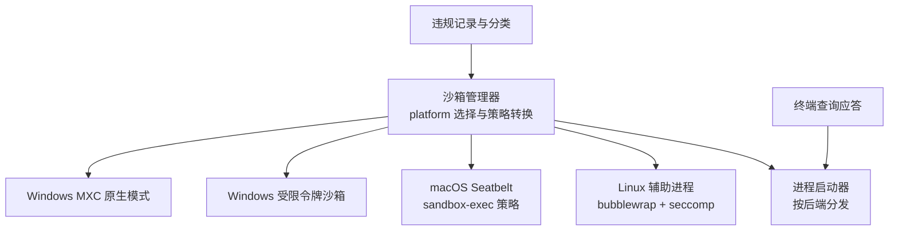
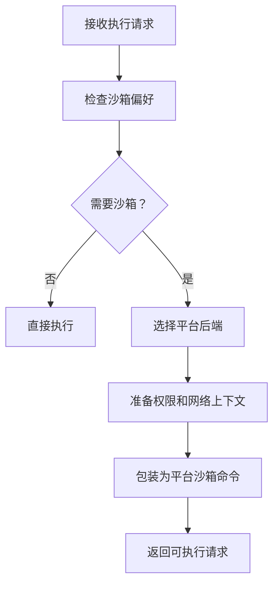
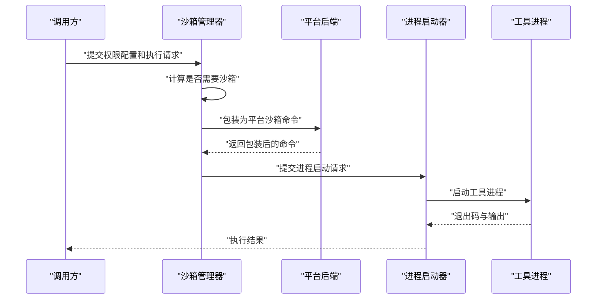
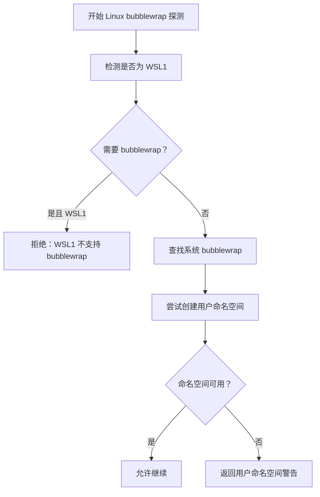
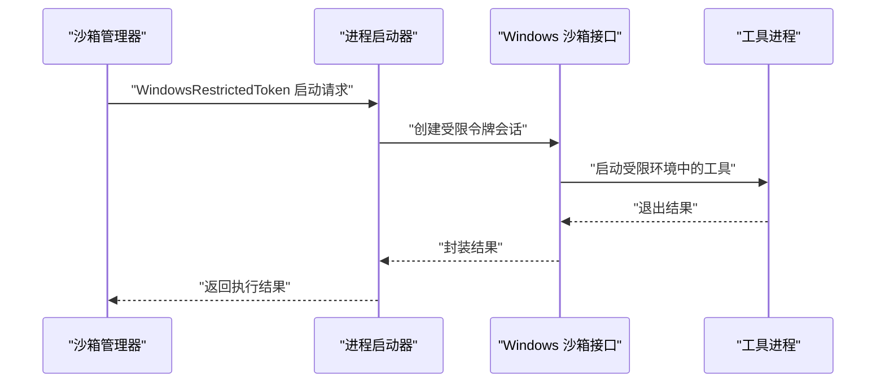
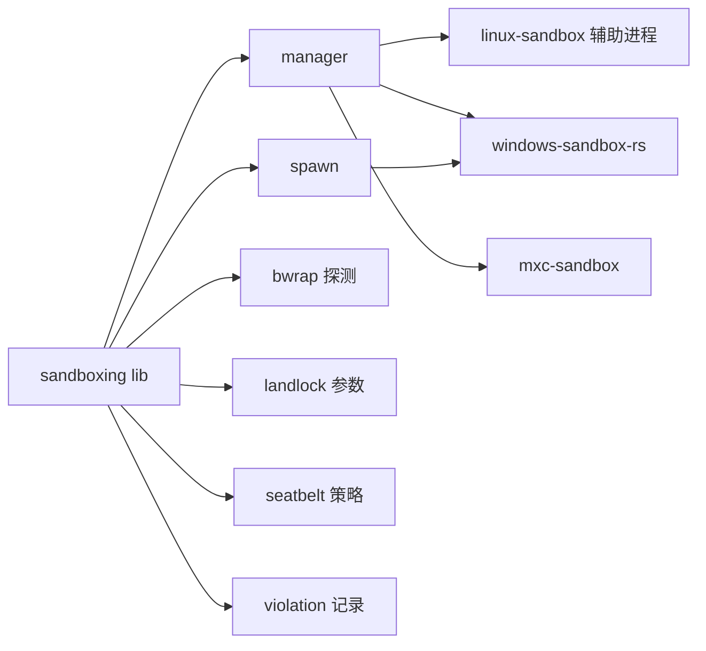
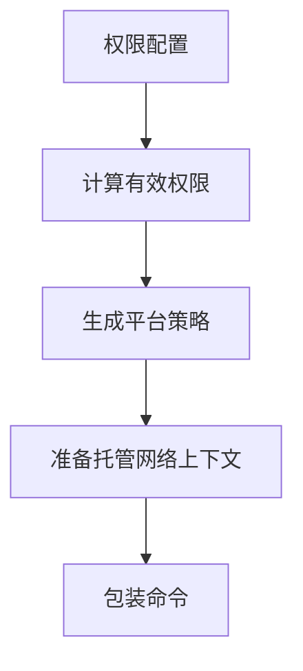
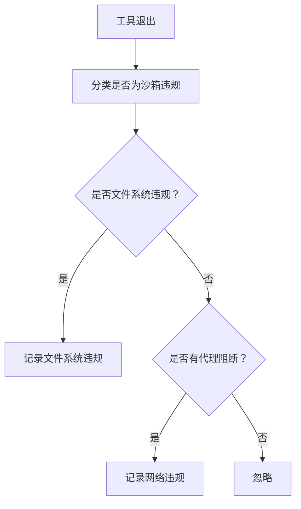

# 工具沙箱

<cite>
**本文引用的文件**   
- [lib.rs](file://codex-rs/sandboxing/src/lib.rs)
- [manager.rs](file://codex-rs/sandboxing/src/manager.rs)
- [spawn.rs](file://codex-rs/sandboxing/src/spawn.rs)
- [bwrap.rs](file://codex-rs/sandboxing/src/bwrap.rs)
- [landlock.rs](file://codex-rs/sandboxing/src/landlock.rs)
- [seatbelt.rs](file://codex-rs/sandboxing/src/seatbelt.rs)
- [violation.rs](file://codex-rs/sandboxing/src/violation.rs)
- [terminal_queries.rs](file://codex-rs/sandboxing/src/terminal_queries.rs)
- [main.rs](file://codex-rs/linux-sandbox/src/main.rs)
- [linux_bwrap.rs](file://codex-rs/linux-sandbox/src/bwrap.rs)
- [windows_sandbox_lib.rs](file://codex-rs/windows-sandbox-rs/src/lib.rs)
- [mxc_sandbox_lib.rs](file://codex-rs/mxc-sandbox/src/lib.rs)
- [execpolicy_lib.rs](file://codex-rs/execpolicy/src/lib.rs)
- [sandbox.md](file://docs/sandbox.md)
</cite>

## 目录
1. [简介](#简介)
2. [项目结构](#项目结构)
3. [核心组件](#核心组件)
4. [架构总览](#架构总览)
5. [详细组件分析](#详细组件分析)
6. [依赖关系分析](#依赖关系分析)
7. [执行策略与权限模型](#执行策略与权限模型)
8. [资源管理与限制](#资源管理与限制)
9. [监控、审计与违规处理](#监控审计与违规处理)
10. [平台实现差异](#平台实现差异)
11. [故障处理与恢复](#故障处理与恢复)
12. [配置指导原则](#配置指导原则)
13. [结论](#结论)

## 简介
本仓库为 Codex 提供“工具沙箱”能力，用于在不可信工具或命令执行时隔离进程、限制文件系统访问、控制网络访问，并对违规行为进行记录。沙箱不是单一实现，而是由统一的沙箱管理器协调多个后端：Linux 上的 seccomp + bubblewrap（或 Landlock）、macOS 上的 Seatbelt、Windows 上的受限令牌 Windows Sandbox 以及原生 MXC 模式。

顶层文档仅指向官方安全说明，因此本文以源码中的沙箱模块为依据，系统解释其设计目标、安全模型、平台实现、执行策略、资源管理、监控审计、故障处理和配置建议。

**章节来源**
- [sandbox.md:1-3](file://docs/sandbox.md#L1-L3)

## 项目结构
沙箱相关代码主要分布在以下 Rust crate 中：

| 模块 | 职责 |
|---|---|
| `codex-rs/sandboxing` | 沙箱统一入口、策略转换、平台选择、终端查询应答、违规记录 |
| `codex-rs/linux-sandbox` | Linux 专用辅助进程，负责 bubblewrap 挂载、seccomp、WSL/WSLg 适配 |
| `codex-rs/windows-sandbox-rs` | Windows 受限令牌沙箱的公共 API、ACL、WFP、服务、安装和运行逻辑 |
| `codex-rs/mxc-sandbox` | Windows 原生 MXC 辅助进程的跨平台参数构造与可用性判断 |
| `codex-rs/execpolicy` | 执行策略解析、规则类型和匹配结果（与沙箱策略共同决定是否启用沙箱） |

**图表来源**
- [manager.rs:1-200](file://codex-rs/sandboxing/src/manager.rs#L1-L200)
- [spawn.rs:1-142](file://codex-rs/sandboxing/src/spawn.rs#L1-L142)
- [violation.rs:1-200](file://codex-rs/sandboxing/src/violation.rs#L1-L200)
- [terminal_queries.rs:1-104](file://codex-rs/sandboxing/src/terminal_queries.rs#L1-L104)

**章节来源**
- [lib.rs:1-110](file://codex-rs/sandboxing/src/lib.rs#L1-L110)
- [manager.rs:1-200](file://codex-rs/sandboxing/src/manager.rs#L1-L200)
- [spawn.rs:1-142](file://codex-rs/sandboxing/src/spawn.rs#L1-L142)

## 核心组件
### 沙箱管理器
`SandboxManager` 是沙箱系统的编排中心。它根据权限配置、用户偏好、托管网络需求和当前平台决定使用哪个后端，并把原始命令包装成可执行的沙箱命令。

关键职责包括：
- 计算是否需要沙箱：支持自动、强制、禁止三种偏好。
- 选择后端：macOS 默认 Seatbelt，Linux 默认 seccomp，Windows 可选受限令牌或 MXC。
- 准备权限：将工作区根路径、只读/可写根、敏感路径拒绝等转换为运行时策略。
- 包装命令：把原始命令嵌入到具体平台的沙箱前端之后。
- 错误映射：把策略错误、路径错误、环境代理错误、平台不可用错误映射为统一错误。

**图表来源**
- [manager.rs:1-200](file://codex-rs/sandboxing/src/manager.rs#L1-L200)
- [manager.rs:501-883](file://codex-rs/sandboxing/src/manager.rs#L501-L883)

**章节来源**
- [manager.rs:1-200](file://codex-rs/sandboxing/src/manager.rs#L1-L200)
- [manager.rs:201-500](file://codex-rs/sandboxing/src/manager.rs#L201-L500)
- [manager.rs:501-883](file://codex-rs/sandboxing/src/manager.rs#L501-L883)

### 进程启动器
`spawn_process` 是最终调用平台后端的进程创建点。它区分 Windows 受限令牌模式和其他模式，并支持 TTY、管道、标准输入打开和继承文件描述符。

关键点：
- Windows 受限令牌模式通过 `spawn_windows_sandbox_session_for_level` 启动会话。
- 非 Windows 模式复用通用的 pty 或 pipe 启动方式。
- 如果启用了终端，则对输出流应用终端查询应答器，避免未仿真终端导致的异常行为。

**章节来源**
- [spawn.rs:1-142](file://codex-rs/sandboxing/src/spawn.rs#L1-L142)
- [terminal_queries.rs:1-104](file://codex-rs/sandboxing/src/terminal_queries.rs#L1-L104)

### Linux 辅助进程
Linux 端不直接把 bubblewrap 和 seccomp 全部塞进主流程，而是通过 `codex-linux-sandbox` 辅助进程执行真实隔离。上层管理器生成命令行参数，传入权限配置、工作目录、托管网络上下文等；辅助进程再调用 bubblewrap 并应用 seccomp。

辅助进程入口非常薄，主要负责转发到内部实现。

**章节来源**
- [landlock.rs:1-115](file://codex-rs/sandboxing/src/landlock.rs#L1-L115)
- [main.rs:1-6](file://codex-rs/linux-sandbox/src/main.rs#L1-L6)
- [linux_bwrap.rs:1-200](file://codex-rs/linux-sandbox/src/bwrap.rs#L1-L200)

### macOS Seatbelt
macOS 使用 `/usr/bin/sandbox-exec` 作为固定路径，避免被 PATH 注入替换。Seatbelt 策略由多个内嵌策略模板组合而成，包括基础策略、网络策略、偏好策略和平台默认只读策略。

Seatbelt 准备过程会：
- 解析托管网络上下文中允许的环回端口和本地绑定策略。
- 根据 Unix Domain Socket 白名单构建 socket 策略。
- 向 `sandbox-exec` 传递文件系统策略和网络策略。

**章节来源**
- [seatbelt.rs:1-200](file://codex-rs/sandboxing/src/seatbelt.rs#L1-L200)

### Windows 受限令牌沙箱
Windows 受限令牌沙箱通过 `WindowsRestrictedToken` 后端实现。管理器会把权限、工作区根、环境变量、代理设置、读写根、拒绝路径等打包成 Windows 沙箱命令；实际进程创建由 `spawn_process` 调用 Windows 专用接口完成。

该模式支持：
- 管理员提升级别下的受限令牌执行。
- 托管网络代理限制。
- 文件系统 ACL、WFP 防火墙、桌面隔离等 Windows 特有机制。

**章节来源**
- [windows_sandbox_lib.rs:1-200](file://codex-rs/windows-sandbox-rs/src/lib.rs#L1-L200)
- [manager.rs:501-883](file://codex-rs/sandboxing/src/manager.rs#L501-L883)

### Windows MXC 原生模式
MXC 模式是另一种 Windows 原生安全上下文实现。上层先检测可用性，再构造 MXC 命令参数，并通过 Codex 自身可执行文件的特殊入口进入 MXC 分支。

MXC 对托管网络有额外约束：必须存在专用代理端口、端口不能为零，并且不允许关闭本地环回双向访问。

**章节来源**
- [mxc_sandbox_lib.rs:1-166](file://codex-rs/mxc-sandbox/src/lib.rs#L1-L166)
- [manager.rs:201-500](file://codex-rs/sandboxing/src/manager.rs#L201-L500)

## 架构总览
从调用方视角看，工具执行流程分为三个阶段：策略决策、命令包装、进程启动。

**图表来源**
- [manager.rs:1-200](file://codex-rs/sandboxing/src/manager.rs#L1-L200)
- [spawn.rs:1-142](file://codex-rs/sandboxing/src/spawn.rs#L1-L142)

## 详细组件分析

### 沙箱类型与平台选择
沙箱类型包含无沙箱、Linux seccomp、macOS Seatbelt、Windows 受限令牌、Windows MXC 等。平台默认后端如下：

| 平台 | 默认后端 | 说明 |
|---|---|---|
| Linux | `LinuxSeccomp` | 通过辅助进程调用 bubblewrap 和 seccomp |
| macOS | `MacosSeatbelt` | 通过 `sandbox-exec` 应用 Seatbelt 策略 |
| Windows | 可选 `WindowsRestrictedToken` 或 `WindowsMxc` | 取决于配置和可用性 |
| 其他 | 无沙箱 | 不支持的平台不会自动启用沙箱 |

**章节来源**
- [manager.rs:1-200](file://codex-rs/sandboxing/src/manager.rs#L1-L200)
- [lib.rs:1-110](file://codex-rs/sandboxing/src/lib.rs#L1-L110)

### Linux bubblewrap 与安全探测
Linux 端对 bubblewrap 的支持做了显式探测，包括：
- 是否在 WSL1 上运行。
- PATH 中是否存在 bubblewrap。
- 是否具备创建用户命名空间的能力。
- 当需要受管网络或完整磁盘写入受限时，是否必须使用 bubblewrap。

这些探测结果会影响警告信息和是否允许继续执行。

**图表来源**
- [bwrap.rs:1-200](file://codex-rs/sandboxing/src/bwrap.rs#L1-L200)

**章节来源**
- [bwrap.rs:1-200](file://codex-rs/sandboxing/src/bwrap.rs#L1-L200)

### macOS Seatbelt 策略组合
Seatbelt 策略由多段模板组成：
- 基础策略。
- 网络策略。
- 偏好策略。
- 平台默认只读策略。

Seatbelt 还会从托管网络配置中提取允许的环回端口和 Unix Domain Socket 列表，从而精细控制网络访问。

**章节来源**
- [seatbelt.rs:1-200](file://codex-rs/sandboxing/src/seatbelt.rs#L1-L200)

### Windows 沙箱启动流程
Windows 受限令牌模式的启动流程如下：

**图表来源**
- [spawn.rs:1-142](file://codex-rs/sandboxing/src/spawn.rs#L1-L142)
- [windows_sandbox_lib.rs:1-200](file://codex-rs/windows-sandbox-rs/src/lib.rs#L1-L200)

**章节来源**
- [spawn.rs:1-142](file://codex-rs/sandboxing/src/spawn.rs#L1-L142)
- [manager.rs:501-883](file://codex-rs/sandboxing/src/manager.rs#L501-L883)

### 终端查询应答
当工具期望与伪终端交互时，沙箱层会为没有真实终端的工具提供最小化的 ANSI 查询应答。这样可以在不模拟完整终端的情况下减少攻击面。

支持的查询包括设备状态、窗口大小、光标位置以及部分私有模式查询。

**章节来源**
- [terminal_queries.rs:1-104](file://codex-rs/sandboxing/src/terminal_queries.rs#L1-L104)

## 依赖关系分析
沙箱模块之间的依赖关系如下：

**图表来源**
- [lib.rs:1-110](file://codex-rs/sandboxing/src/lib.rs#L1-L110)
- [manager.rs:1-200](file://codex-rs/sandboxing/src/manager.rs#L1-L200)
- [spawn.rs:1-142](file://codex-rs/sandboxing/src/spawn.rs#L1-L142)

**章节来源**
- [lib.rs:1-110](file://codex-rs/sandboxing/src/lib.rs#L1-L110)
- [manager.rs:1-200](file://codex-rs/sandboxing/src/manager.rs#L1-L200)

## 执行策略与权限模型
沙箱策略来源于权限配置，而不是任意命令或仓库设置。管理器会：
- 解析权限配置。
- 合并附加权限。
- 计算有效权限。
- 将工作区根转换为平台策略。
- 为托管中间人信任包添加可读根。

执行策略还包括：
- 是否要求平台沙箱。
- 是否强制托管网络。
- 是否使用旧版 Landlock。
- Windows 沙箱级别。
- 是否保留 PID 命名空间继承。

**图表来源**
- [manager.rs:1-200](file://codex-rs/sandboxing/src/manager.rs#L1-L200)
- [manager.rs:501-883](file://codex-rs/sandboxing/src/manager.rs#L501-L883)

**章节来源**
- [manager.rs:1-200](file://codex-rs/sandboxing/src/manager.rs#L1-L200)
- [manager.rs:501-883](file://codex-rs/sandboxing/src/manager.rs#L501-L883)
- [execpolicy_lib.rs:1-33](file://codex-rs/execpolicy/src/lib.rs#L1-L33)

## 资源管理与限制
沙箱的资源管理体现在三个层面：

| 维度 | 实现方式 | 说明 |
|---|---|---|
| 进程隔离 | Linux 用户命名空间、PID 命名空间；Windows 受限令牌；macOS Seatbelt | 不同平台使用各自内核或系统 API 实现隔离 |
| 文件系统限制 | 只读根、可写根、敏感路径拒绝、符号链接策略 | Linux bubblewrap 与 macOS Seatbelt 都强调默认只读 |
| 网络限制 | 托管代理、环回端口白名单、Unix Domain Socket 白名单、WSL/WSLg 隐藏路径 | 托管网络模式下，网络访问通常走代理 |

需要注意：
- 代码中没有看到 CPU 配额、内存上限或精确超时控制字段。
- 时间限制更可能由上层调度器或进程生命周期管理承担，而不是沙箱模块本身。
- 文件系统策略可以限制写入范围，但不会单独限制 I/O 速率或文件大小。

**章节来源**
- [bwrap.rs:1-200](file://codex-rs/sandboxing/src/bwrap.rs#L1-L200)
- [linux_bwrap.rs:1-200](file://codex-rs/linux-sandbox/src/bwrap.rs#L1-L200)
- [seatbelt.rs:1-200](file://codex-rs/sandboxing/src/seatbelt.rs#L1-L200)
- [windows_sandbox_lib.rs:1-200](file://codex-rs/windows-sandbox-rs/src/lib.rs#L1-L200)

## 监控、审计与违规处理
沙箱对违规行为的处理分为两类：文件系统违规和网络违规。

### 文件系统违规
文件系统违规会从工具的输出和退出码中推断。它会：
- 忽略正常退出。
- 排除常见 shell 错误码。
- 在 Linux seccomp 场景下识别信号调用违规。
- 提取拒绝路径片段。
- 记录后端名称、原因、路径和输出摘要。

### 网络违规
网络违规来自托管网络代理的阻断事件，包含主机、方法、协议、端口、决策和来源等信息。

**图表来源**
- [violation.rs:1-200](file://codex-rs/sandboxing/src/violation.rs#L1-L200)

**章节来源**
- [violation.rs:1-200](file://codex-rs/sandboxing/src/violation.rs#L1-L200)

## 平台实现差异

### Linux
- 使用辅助进程 `codex-linux-sandbox` 执行 bubblewrap 和 seccomp。
- 支持 legacy Landlock 标志和托管网络上下文。
- 在 WSL1 上禁用 bubblewrap，因为无法创建所需用户命名空间。
- 隐藏 WSL interop 和 WSLg distro 根，防止绕过文件策略。

**章节来源**
- [landlock.rs:1-115](file://codex-rs/sandboxing/src/landlock.rs#L1-L115)
- [bwrap.rs:1-200](file://codex-rs/sandboxing/src/bwrap.rs#L1-L200)
- [linux_bwrap.rs:1-200](file://codex-rs/linux-sandbox/src/bwrap.rs#L1-L200)

### macOS
- 固定使用 `/usr/bin/sandbox-exec`。
- 使用 Seatbelt 策略模板组合文件系统、网络和偏好策略。
- 支持 Unix Domain Socket 白名单。
- 支持继承终端场景。

**章节来源**
- [seatbelt.rs:1-200](file://codex-rs/sandboxing/src/seatbelt.rs#L1-L200)

### Windows
- 支持两种后端：受限令牌 Windows Sandbox 和原生 MXC。
- 受限令牌模式适合大多数 Windows 沙箱需求。
- MXC 模式要求更高的安全环境可用性，并对托管网络有更严格校验。
- 提供安装、ACL、WFP、服务诊断等配套能力。

**章节来源**
- [windows_sandbox_lib.rs:1-200](file://codex-rs/windows-sandbox-rs/src/lib.rs#L1-L200)
- [mxc_sandbox_lib.rs:1-166](file://codex-rs/mxc-sandbox/src/lib.rs#L1-L166)
- [manager.rs:201-500](file://codex-rs/sandboxing/src/manager.rs#L201-L500)

## 故障处理与恢复
沙箱的错误处理集中在几个方向：

| 错误类型 | 处理方式 |
|---|---|
| 策略无效 | 转为无效请求错误 |
| 命令工作目录无效 | 携带 URI 和底层 IO 错误 |
| 沙箱策略工作目录无效 | 携带 URI 和底层 IO 错误 |
| Linux 缺少辅助程序 | 报告缺失 |
| Windows MXC 不可用 | 报告准备失败 |
| 托管网络代理准备失败 | 报告环境代理错误 |
| macOS Seatbelt 不可用或非 macOS | 报告平台不可用 |
| WSL1 不支持 bubblewrap | 返回明确警告和错误 |
| Windows 沙箱准备失败 | 报告准备错误 |

对于进程级超时、资源泄漏和异常恢复，沙箱模块本身主要提供：
- 进程启动时的 TTY/pipe 模式选择。
- 终端查询的最小化响应。
- 违规事件的标准化记录。

更细粒度的超时、内存限制和进程清理通常由上层 exec-server 或调度器承担。

**章节来源**
- [manager.rs:201-500](file://codex-rs/sandboxing/src/manager.rs#L201-L500)
- [spawn.rs:1-142](file://codex-rs/sandboxing/src/spawn.rs#L1-L142)
- [terminal_queries.rs:1-104](file://codex-rs/sandboxing/src/terminal_queries.rs#L1-L104)

## 配置指导原则

### 安全最佳实践
- 默认开启平台沙箱，除非明确允许不受限执行。
- 文件系统策略采用“默认只读 + 显式可写根”。
- 敏感目录如 `.git`、`.agents`、`.codex` 应保持只读。
- 托管网络模式下，应限制环回端口并启用代理。
- macOS 不要修改 `/usr/bin/sandbox-exec`。
- Linux 上优先使用 bubblewrap 的用户命名空间能力；WSL1 不适合受控工具执行。
- Windows 上优先使用受限令牌或 MXC，避免让工具直接获得高权限环境。

### 性能调优建议
- 避免过度扩大可写根。
- 谨慎放宽 Unix Domain Socket 白名单。
- 不在非必要场景启用完整磁盘写入。
- 使用托管网络时，确保代理可用且延迟可控。
- 减少不必要的 bubblewrap 或 Seatbelt 策略复杂度。
- 对频繁调用的工具，尽量复用已就绪的工作区和缓存目录。

### 推荐配置思路
- 普通工具：默认只读文件系统 + 受限网络。
- 需要写项目的工具：显式授予项目目录写入，但仍保持系统目录只读。
- 需要联网的工具：强制托管代理，只允许必要域名和端口。
- 需要交互式终端的工具：启用 TTY 和终端查询应答，但不开放任意终端控制序列。
- 高风险工具：启用平台沙箱、最小权限、最短生命周期。

[本节为通用指导，不直接分析具体代码行]

## 结论
Codex 的工具沙箱以“统一策略、多后端实现”为核心：上层管理器负责策略解析和平台选择，下层各平台后端负责真正的隔离和权限控制。Linux 使用 bubblewrap 和 seccomp，macOS 使用 Seatbelt，Windows 使用受限令牌或 MXC。网络访问通过托管代理和白名单控制，文件系统访问通过只读默认值加显式授权控制。违规事件会被分类并记录，便于审计和排查。

在实际部署中，应优先选择最严格的可用后端，遵循最小权限原则，并结合上层调度器的超时、资源限制和生命周期管理，形成完整的工具执行安全闭环。

[本节为总结性内容，不直接分析具体代码行]