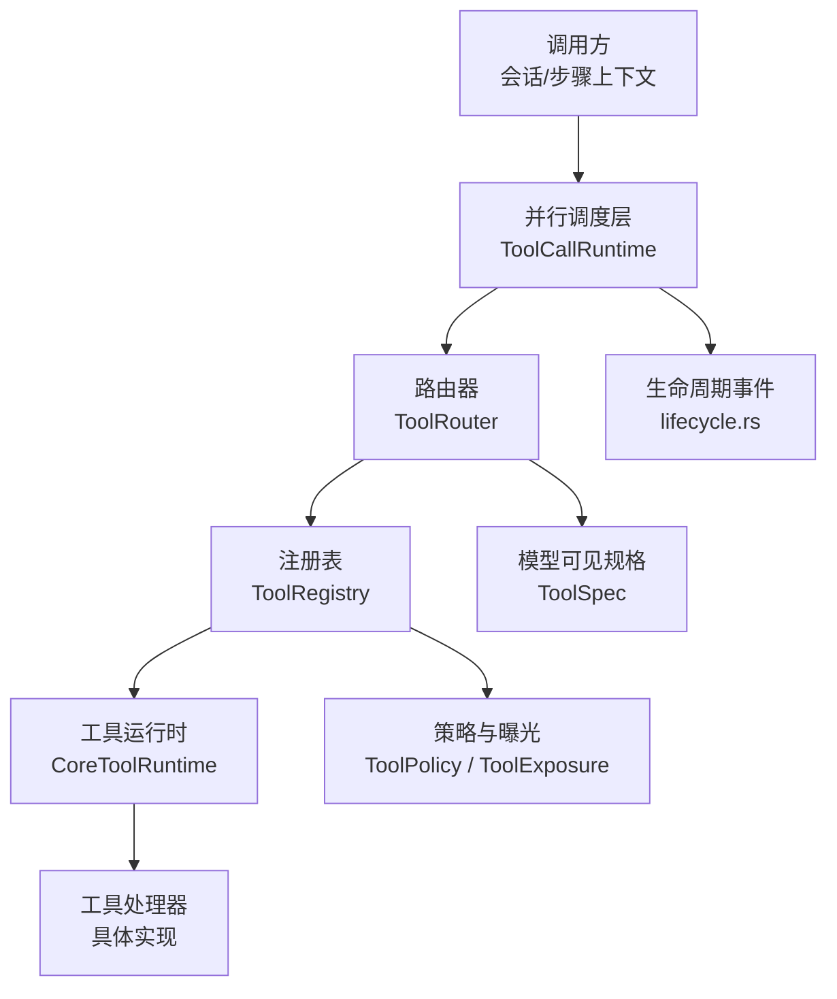
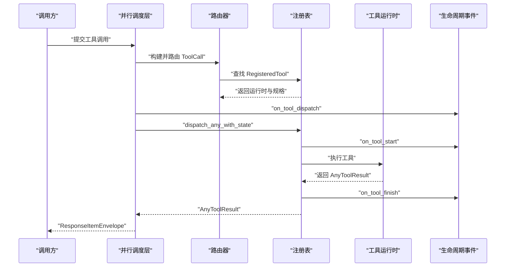
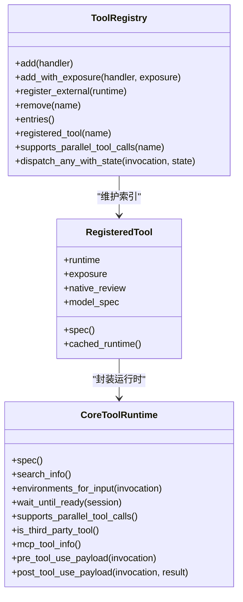
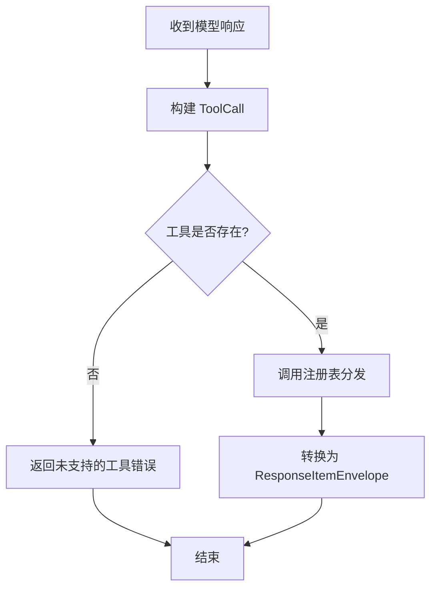
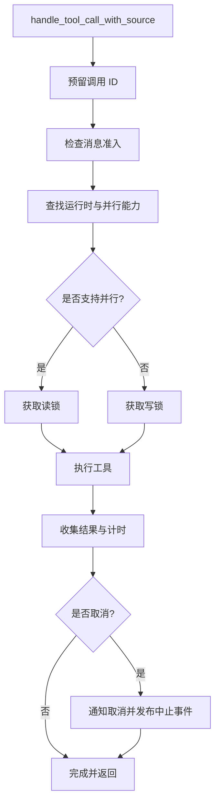
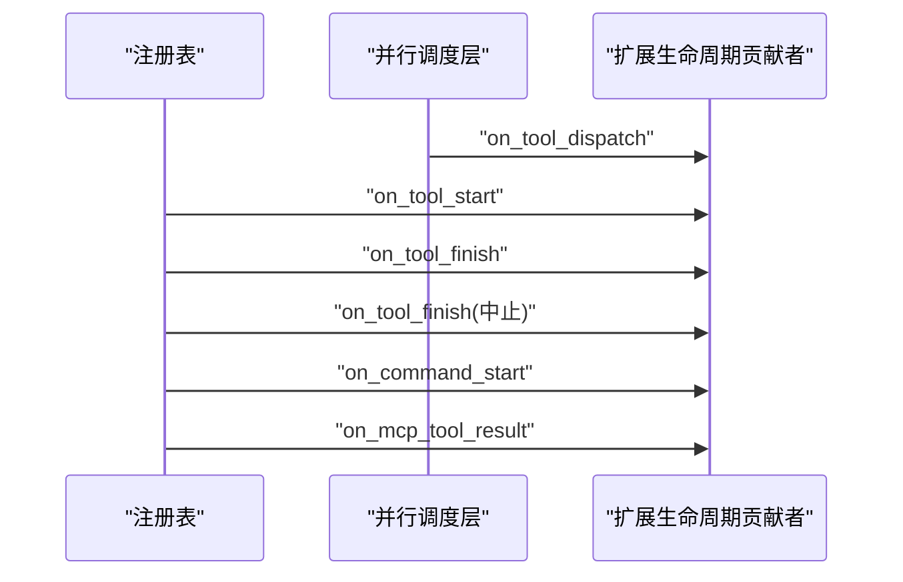
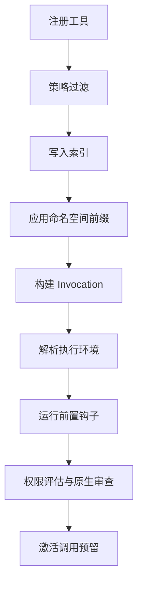
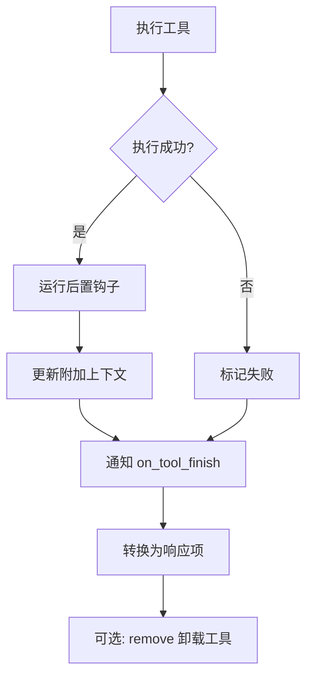
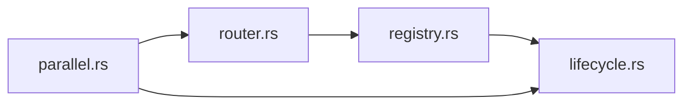

# 工具生命周期

<cite>
**本文引用的文件**
- [codex-rs/core/src/tools/mod.rs](file://codex-rs/core/src/tools/mod.rs)
- [codex-rs/core/src/tools/registry.rs](file://codex-rs/core/src/tools/registry.rs)
- [codex-rs/core/src/tools/router.rs](file://codex-rs/core/src/tools/router.rs)
- [codex-rs/core/src/tools/parallel.rs](file://codex-rs/core/src/tools/parallel.rs)
- [codex-rs/core/src/tools/lifecycle.rs](file://codex-rs/core/src/tools/lifecycle.rs)
- [codex-rs/core/tests/suite/tool_lifecycle.rs](file://codex-rs/core/tests/suite/tool_lifecycle.rs)
- [codex-rs/tui/src/chatwidget/tool_lifecycle.rs](file://codex-rs/tui/src/chatwidget/tool_lifecycle.rs)
</cite>

## 目录
1. [引言](#引言)
2. [项目结构](#项目结构)
3. [核心组件](#核心组件)
4. [架构总览](#架构总览)
5. [详细组件分析](#详细组件分析)
6. [依赖关系分析](#依赖关系分析)
7. [性能与并发特性](#性能与并发特性)
8. [故障排查指南](#故障排查指南)
9. [最佳实践](#最佳实践)
10. [结论](#结论)

## 引言
本文面向 Codex 代码仓库中的“工具系统”，系统化说明一个工具从注册、发现、初始化、准备、执行、清理到卸载的完整生命周期，并围绕以下关键问题展开：
- 工具编排器如何调度任务、解析依赖并控制并发。
- 工具注册表如何维护索引、元数据与版本相关行为。
- 路由器如何实现路径匹配、参数绑定和响应转换。
- 事件系统在生命周期钩子、状态变更通知和错误传播中的作用。
- 在资源管理、错误恢复与性能优化方面的工程最佳实践。

该文档以 `codex-rs/core/src/tools` 为核心实现区域，结合测试与 TUI 渲染逻辑，提供从代码到概念的完整映射。

## 项目结构
Codex 的工具子系统主要位于 `codex-rs/core/src/tools`，其中：
- `mod.rs` 暴露公共类型、工具模式选择以及输出格式化等横切能力。
- `registry.rs` 实现工具运行时抽象、注册表、预/后处理钩子、策略与分发前校验。
- `router.rs` 将模型响应或外部请求转换为统一的 `ToolCall`，并按工具名称查找可执行运行时。
- `parallel.rs` 封装工具调度的并发入口、门控、计时、取消与结果组装。
- `lifecycle.rs` 统一向扩展生命周期贡献者发送开始、结束、命令启动、MCP 结果等事件。
- 测试与 UI 分别验证生命周期语义与用户界面展示。

**图表来源**
- [codex-rs/core/src/tools/parallel.rs:1-120](file://codex-rs/core/src/tools/parallel.rs#L1-L120)
- [codex-rs/core/src/tools/router.rs:1-120](file://codex-rs/core/src/tools/router.rs#L1-L120)
- [codex-rs/core/src/tools/registry.rs:1-120](file://codex-rs/core/src/tools/registry.rs#L1-L120)
- [codex-rs/core/src/tools/lifecycle.rs:1-80](file://codex-rs/core/src/tools/lifecycle.rs#L1-L80)

**章节来源**
- [codex-rs/core/src/tools/mod.rs:1-79](file://codex-rs/core/src/tools/mod.rs#L1-L79)

## 核心组件
- 工具运行时抽象 `CoreToolRuntime`：定义工具的统一接口，包括规格、搜索信息、环境解析、就绪等待、遥测标签、预处理/后处理载荷、是否支持并行、是否为第三方工具、MCP 信息等。
- 已注册工具 `RegisteredTool`：封装运行时、曝光级别、原生审查策略以及每步覆盖的模型规格。
- 工具注册表 `ToolRegistry`：维护工具索引、去重、冲突记录、外部工具注入、移除、查询、并行能力与分发入口。
- 工具路由器 `ToolRouter`：根据模型返回或外部请求构建 `ToolCall`，判断工具是否对外暴露，并将调用委托给注册表。
- 并行调度器 `ToolCallRuntime`：负责调用入口、取消、门控、计时、追踪、结果包装与失败响应。
- 生命周期通知器：统一发出 `on_tool_start`、`on_tool_finish`、`on_command_start`、`on_mcp_tool_result`、`on_tool_dispatch` 等事件。

**章节来源**
- [codex-rs/core/src/tools/registry.rs:1-200](file://codex-rs/core/src/tools/registry.rs#L1-L200)
- [codex-rs/core/src/tools/router.rs:1-120](file://codex-rs/core/src/tools/router.rs#L1-L120)
- [codex-rs/core/src/tools/parallel.rs:1-120](file://codex-rs/core/src/tools/parallel.rs#L1-L120)
- [codex-rs/core/src/tools/lifecycle.rs:1-80](file://codex-rs/core/src/tools/lifecycle.rs#L1-L80)

## 架构总览
工具生命周期可以划分为六个阶段：
1. **注册**：通过 `ToolRegistry` 注册内置、受信任或外部工具；应用命名空间前缀、策略过滤、冲突检测。
2. **发现**：`ToolRouter` 基于模型可见规格、延迟工具与 MCP 命名空间，决定哪些工具对模型或客户端可见。
3. **初始化与准备**：构造 `ToolInvocation`，解析环境、运行前置钩子、权限评估、原生审查。
4. **执行**：按工具并行能力获取共享锁或独占锁，执行运行时，收集遥测与追踪。
5. **清理**：运行后置钩子、更新附加上下文、计算最终生命周期结果。
6. **卸载**：从注册表中移除工具（主要用于动态场景），释放引用。

**图表来源**
- [codex-rs/core/src/tools/parallel.rs:200-550](file://codex-rs/core/src/tools/parallel.rs#L200-L550)
- [codex-rs/core/src/tools/router.rs:200-490](file://codex-rs/core/src/tools/router.rs#L200-L490)
- [codex-rs/core/src/tools/registry.rs:601-1004](file://codex-rs/core/src/tools/registry.rs#L601-L1004)
- [codex-rs/core/src/tools/lifecycle.rs:1-186](file://codex-rs/core/src/tools/lifecycle.rs#L1-L186)

## 详细组件分析

### 工具运行时与注册表
`CoreToolRuntime` 是工具系统的运行时契约。它定义了工具如何声明规格、如何被搜索、如何解析执行环境、是否需要在执行前等待就绪、是否支持并行、是否属于 MCP 工具、以及如何生成前置和后置钩子的输入输出载荷。

`RegisteredTool` 把运行时与其曝光策略绑定起来，并在某些情况下为当前步骤覆盖模型可见规格。`ToolRegistry` 使用有序映射维护工具索引，支持：
- 添加可信工具、带曝光级别的工具、带原生审查的工具。
- 外部工具注册时跳过保留名称，记录冲突。
- 应用函数命名空间前缀，影响模型规格但不改变执行行为。
- 移除工具、查询工具、枚举条目、获取 MCP 命名空间。
- 判断工具是否支持并行调用。
- 分发前的统一校验、环境解析、前置钩子、权限评估、原生审查、后置钩子与生命周期结果。

**图表来源**
- [codex-rs/core/src/tools/registry.rs:1-200](file://codex-rs/core/src/tools/registry.rs#L1-L200)
- [codex-rs/core/src/tools/registry.rs:201-600](file://codex-rs/core/src/tools/registry.rs#L201-L600)
- [codex-rs/core/src/tools/registry.rs:601-1004](file://codex-rs/core/src/tools/registry.rs#L601-L1004)

**章节来源**
- [codex-rs/core/src/tools/registry.rs:1-200](file://codex-rs/core/src/tools/registry.rs#L1-L200)
- [codex-rs/core/src/tools/registry.rs:201-600](file://codex-rs/core/src/tools/registry.rs#L201-L600)
- [codex-rs/core/src/tools/registry.rs:601-1004](file://codex-rs/core/src/tools/registry.rs#L601-L1004)

### 路由器：路径匹配、参数绑定与响应转换
`ToolRouter` 持有注册表、模型可见规格集合、工具模式、Code Mode 工具名映射、执行定义与命名空间信息。它的职责包括：
- 判断工具是否暴露给模型、延迟工具命名空间、MCP 命名空间。
- 从模型响应中构建 `ToolCall`，区分函数调用、工具搜索调用与自定义工具调用。
- 保留原生调用对象用于需要原生审查的工具。
- 将调用委托给注册表的统一分发流程。

路由器的“路径匹配”体现在工具名称规范化、命名空间匹配、延迟工具与 Code Mode 工具名映射上；“参数绑定”体现在把模型响应中的 `name`、`namespace`、`arguments`、`call_id`、`encrypted_function_args` 转换成内部 `ToolCall`；“响应转换”体现在 `AnyToolResult.into_response()` 将工具输出包装为协议层响应项。

**图表来源**
- [codex-rs/core/src/tools/router.rs:120-260](file://codex-rs/core/src/tools/router.rs#L120-L260)
- [codex-rs/core/src/tools/router.rs:260-490](file://codex-rs/core/src/tools/router.rs#L260-L490)
- [codex-rs/core/src/tools/registry.rs:201-400](file://codex-rs/core/src/tools/registry.rs#L201-L400)

**章节来源**
- [codex-rs/core/src/tools/router.rs:1-200](file://codex-rs/core/src/tools/router.rs#L1-L200)
- [codex-rs/core/src/tools/router.rs:200-490](file://codex-rs/core/src/tools/router.rs#L200-L490)

### 并行调度与并发控制
`ToolCallRuntime` 是工具调度的实际入口。它负责：
- 记录调用、创建调用状态、确定直接路径支持情况。
- 通过 `tool_supports_parallel` 判断是否允许并行。
- 获取并行读锁或独占写锁，确保同一时刻同一工具的并发访问受控。
- 捕获工具调度与执行计时，并向扩展生命周期贡献者发送 `on_tool_dispatch`。
- 在取消发生时，区分“处理器自身完成取消”“主动中止”“正常完成”。
- 将工具执行结果转换为统一 `AnyToolResult`，必要时生成失败响应。

**图表来源**
- [codex-rs/core/src/tools/parallel.rs:120-550](file://codex-rs/core/src/tools/parallel.rs#L120-L550)

**章节来源**
- [codex-rs/core/src/tools/parallel.rs:1-200](file://codex-rs/core/src/tools/parallel.rs#L1-L200)
- [codex-rs/core/src/tools/parallel.rs:200-550](file://codex-rs/core/src/tools/parallel.rs#L200-L550)

### 生命周期事件系统
生命周期事件贯穿工具从开始到结束的整个过程：
- `notify_tool_start`：在工具实际执行前，向扩展贡献者发送工具开始事件，附带会话、线程、回合、调用 ID、工具名、权限上下文、负载、对话历史快照与来源。
- `notify_command_start`：命令启动时通知扩展贡献者。
- `process_mcp_tool_result`：MCP 工具结果处理后通知扩展贡献者。
- `notify_tool_finish`：工具成功完成时通知。
- `notify_tool_aborted`：工具被中止时通知。
- `on_tool_dispatch`：由并行调度层在工具调度前触发，用于观测调度时机。

**图表来源**
- [codex-rs/core/src/tools/lifecycle.rs:1-186](file://codex-rs/core/src/tools/lifecycle.rs#L1-L186)
- [codex-rs/core/src/tools/parallel.rs:200-350](file://codex-rs/core/src/tools/parallel.rs#L200-L350)

**章节来源**
- [codex-rs/core/src/tools/lifecycle.rs:1-186](file://codex-rs/core/src/tools/lifecycle.rs#L1-L186)
- [codex-rs/core/tests/suite/tool_lifecycle.rs:1-200](file://codex-rs/core/tests/suite/tool_lifecycle.rs#L1-L200)

### 工具注册、初始化与准备
注册阶段的关键点：
- 内置工具和受信任工具通过 `add` 或 `add_with_exposure` 注册。
- 外部工具通过 `register_external` 注入，但保留名称如 `exec_command`、`shell_command` 会被跳过。
- 重复注册会记录冲突；受策略拒绝的工具不会进入索引。
- 注册后可应用函数命名空间前缀，影响模型规格但不影响执行。
- 工具规格可通过 `immutable_spec` 或 `spec` 暴露；部分工具提供缓存的 Code Mode 定义。

初始化与准备阶段的关键点：
- 构建 `ToolInvocation`，携带会话、回合、步骤上下文、取消令牌、追踪器、调用 ID、工具名、来源、负载与原生调用。
- 解析工具执行环境，支持函数参数环境、MCP 服务器环境与终端会话环境。
- 运行前置钩子，阻止或修改输入；若被阻止则报告阻塞。
- 进行权限评估与原生审查；未通过则提前失败。
- 激活调用预留，避免并发竞争导致的状态不一致。

**图表来源**
- [codex-rs/core/src/tools/registry.rs:201-600](file://codex-rs/core/src/tools/registry.rs#L201-L600)
- [codex-rs/core/src/tools/registry.rs:601-1004](file://codex-rs/core/src/tools/registry.rs#L601-L1004)

**章节来源**
- [codex-rs/core/src/tools/registry.rs:201-600](file://codex-rs/core/src/tools/registry.rs#L201-L600)
- [codex-rs/core/src/tools/registry.rs:601-1004](file://codex-rs/core/src/tools/registry.rs#L601-L1004)

### 工具执行、清理与卸载
执行阶段：
- 注册表查找工具，校验负载兼容性与工具种类。
- 若工具是内置控制工具，记录控制工具调用分析。
- 解析 shell 脚本类别，补充遥测标签。
- 调用工具运行时，收集成功标志与输出。

清理阶段：
- 根据成功与否计算最终生命周期结果：已完成、失败、中止。
- 运行后置钩子，更新附加上下文。
- 通知扩展生命周期贡献者工具完成。
- 将 `AnyToolResult` 转换为协议响应项。

卸载阶段：
- 通过 `remove` 从注册表移除工具，释放运行时引用。

**图表来源**
- [codex-rs/core/src/tools/registry.rs:601-1004](file://codex-rs/core/src/tools/registry.rs#L601-L1004)
- [codex-rs/core/src/tools/registry.rs:1-200](file://codex-rs/core/src/tools/registry.rs#L1-L200)

**章节来源**
- [codex-rs/core/src/tools/registry.rs:601-1004](file://codex-rs/core/src/tools/registry.rs#L601-L1004)
- [codex-rs/core/src/tools/registry.rs:1-200](file://codex-rs/core/src/tools/registry.rs#L1-L200)

## 依赖关系分析
工具子系统内部存在清晰的层次依赖：
- `parallel.rs` 依赖 `router.rs` 与 `registry.rs` 完成调度与分发。
- `router.rs` 依赖 `registry.rs` 获取工具规格与运行时。
- `registry.rs` 依赖 `lifecycle.rs` 发送生命周期事件，依赖策略与钩子系统完成前后处理。
- `lifecycle.rs` 依赖会话、回合、扩展系统与 MCP 上下文。

**图表来源**
- [codex-rs/core/src/tools/parallel.rs:1-120](file://codex-rs/core/src/tools/parallel.rs#L1-L120)
- [codex-rs/core/src/tools/router.rs:1-120](file://codex-rs/core/src/tools/router.rs#L1-L120)
- [codex-rs/core/src/tools/registry.rs:1-120](file://codex-rs/core/src/tools/registry.rs#L1-L120)
- [codex-rs/core/src/tools/lifecycle.rs:1-80](file://codex-rs/core/src/tools/lifecycle.rs#L1-L80)

**章节来源**
- [codex-rs/core/src/tools/parallel.rs:1-200](file://codex-rs/core/src/tools/parallel.rs#L1-L200)
- [codex-rs/core/src/tools/router.rs:1-200](file://codex-rs/core/src/tools/router.rs#L1-L200)
- [codex-rs/core/src/tools/registry.rs:1-200](file://codex-rs/core/src/tools/registry.rs#L1-L200)
- [codex-rs/core/src/tools/lifecycle.rs:1-120](file://codex-rs/core/src/tools/lifecycle.rs#L1-L120)

## 性能与并发特性
- 并行门控：支持并行的工具使用读锁，不支持并行的工具使用写锁，避免无界并发导致的资源竞争。
- 直接路径优化：非 Code Mode 且非特定工具可直接走本地路径，减少额外开销。
- 计时与遥测：记录工具调度、准入、执行耗时，并通过 OpenTelemetry 上报。
- 输出截断：工具执行输出按策略截断，防止大响应影响模型消费。
- 控制工具分析：内置控制工具调用状态单独统计。
- 命名空间前缀：仅影响模型可见规格，不增加执行成本。

[本节为通用性能讨论，不直接分析具体文件]

## 故障排查指南
常见问题与定位方式：
- 工具未找到：检查 `ToolRouter.build_tool_call` 是否正确构建工具名，确认 `ToolRegistry.registered_tool` 是否能查到工具。
- 负载不兼容：注册表会检查工具匹配的负载类型，若不匹配会返回致命错误。
- 前置钩子阻止：如果前置钩子返回阻塞，工具会被标记为阻塞并记录分析。
- 取消与中止：并行层在取消时会区分处理器是否完成取消；若未完成，会主动中止并通知生命周期事件。
- 外部工具冲突：重复的外部工具会记录警告与首次冲突名称。
- MCP 工具结果：通过 `process_mcp_tool_result` 观察 MCP 结果是否被扩展正确消费。

**章节来源**
- [codex-rs/core/src/tools/router.rs:260-490](file://codex-rs/core/src/tools/router.rs#L260-L490)
- [codex-rs/core/src/tools/registry.rs:601-1004](file://codex-rs/core/src/tools/registry.rs#L601-L1004)
- [codex-rs/core/src/tools/parallel.rs:200-550](file://codex-rs/core/src/tools/parallel.rs#L200-L550)
- [codex-rs/core/src/tools/lifecycle.rs:1-186](file://codex-rs/core/src/tools/lifecycle.rs#L1-L186)

## 最佳实践
- 资源管理
  - 在工具运行时中实现 `wait_until_ready`，避免工具在未就绪时被调度。
  - 对于长生命周期工具，明确实现取消语义；若处理器需要自己完成取消，设置 `finishes_on_cancellation`。
  - 使用后置钩子清理临时文件或释放外部连接。

- 错误恢复
  - 对前置钩子、环境解析、权限评估进行容错处理，避免工具执行被不可预期地阻断。
  - 对取消路径提供明确的中止消息，便于用户理解工具为何中断。
  - 对控制工具调用记录成功、失败、拒绝状态，便于分析与审计。

- 性能优化
  - 尽可能提供 `immutable_spec`，减少规格重建与序列化开销。
  - 合理使用并行能力，避免全局串行化导致吞吐下降。
  - 使用 `cached_code_mode_definitions` 缓存 Code Mode 工具定义，避免每次渲染都重新生成。
  - 控制输出大小，配合输出截断策略，降低模型侧负担。

[本节为通用指导，不直接分析具体文件]

## 结论
Codex 的工具生命周期以 `CoreToolRuntime` 为运行时契约，以 `ToolRegistry` 为索引与分发中枢，以 `ToolRouter` 为请求路由与参数绑定层，以 `ToolCallRuntime` 为并发调度与计时入口，并以生命周期事件贯穿整个执行过程。这一设计使得工具能够以一致的接口接入不同来源（内置、外部、MCP、Code Mode），同时保证调度可控、状态可观测、错误可恢复、性能可度量。

在实际工程中，建议优先关注工具规格的稳定性、环境的可解析性、钩子的幂等性、取消的可预测性以及输出的可观测性。通过这些机制，工具系统能够在复杂的多代理、多会话、多工具场景中保持清晰的生命周期边界与可靠的执行语义。