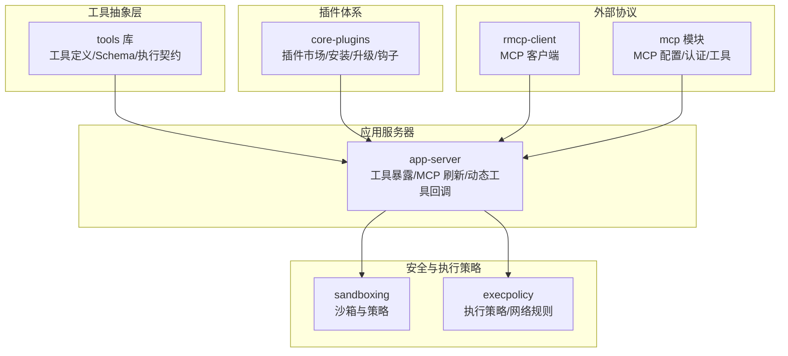
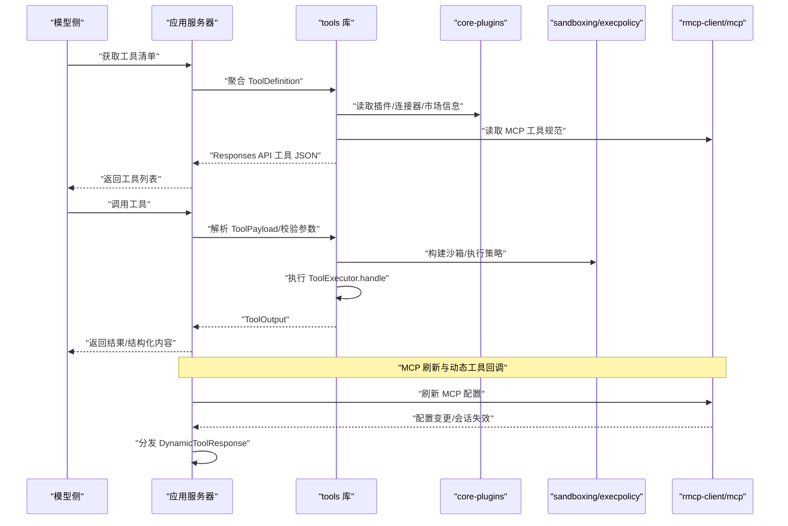
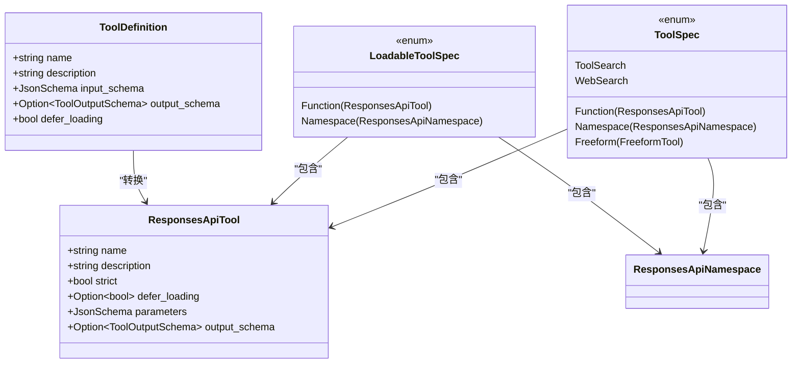
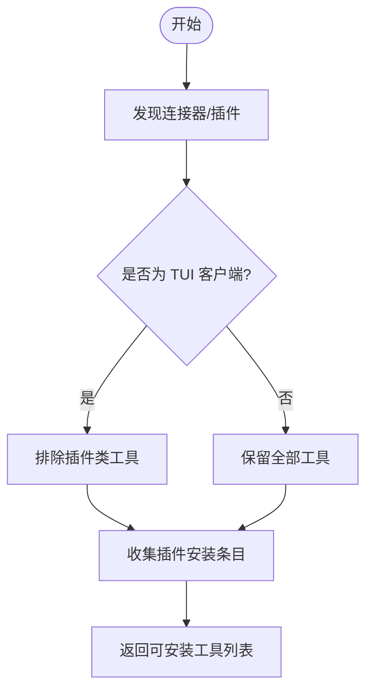
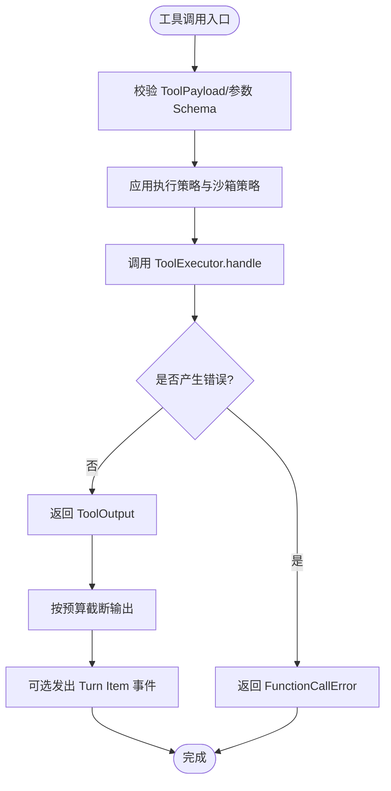
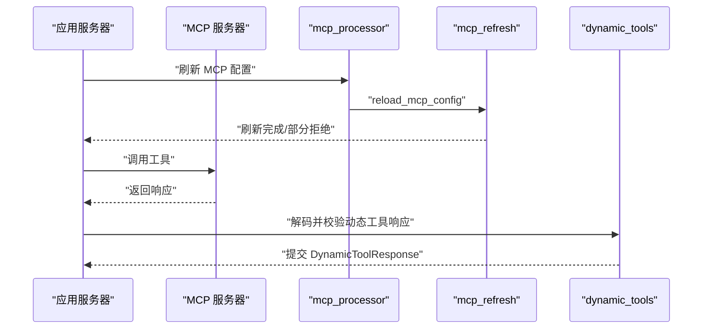
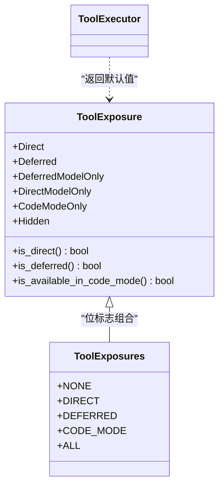
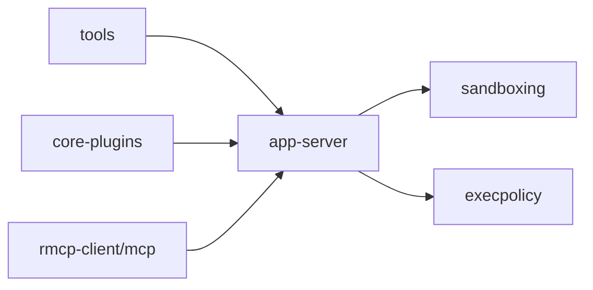
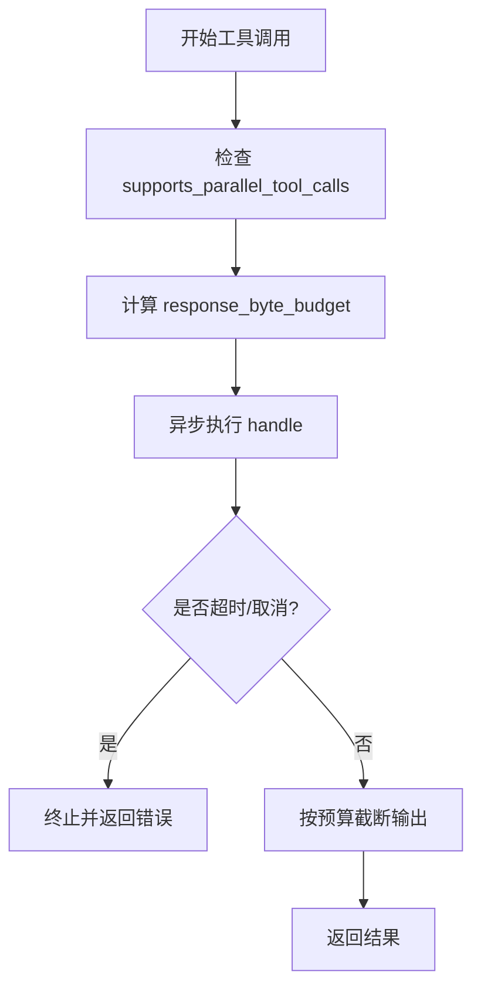
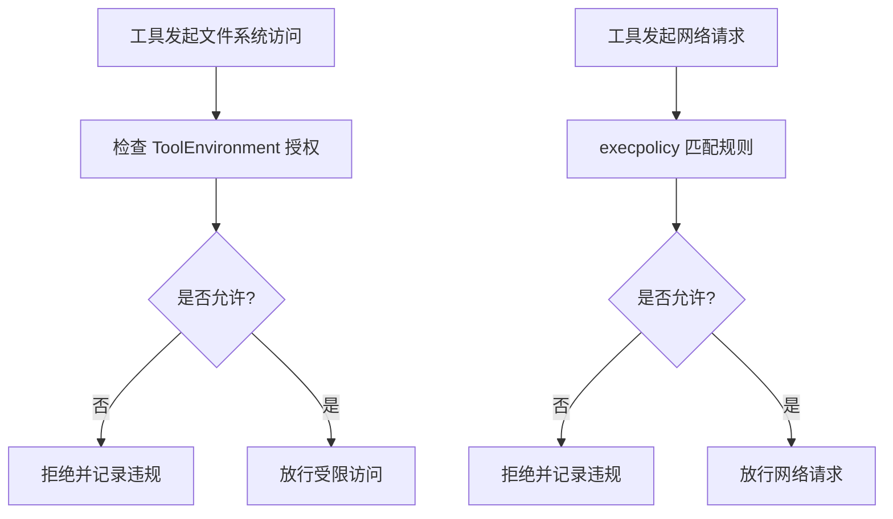

# 工具调用系统

<cite>
**本文引用的文件**
- [lib.rs](file://codex-rs/tools/src/lib.rs)
- [tool_definition.rs](file://codex-rs/tools/src/tool_definition.rs)
- [dynamic_tool.rs](file://codex-rs/tools/src/dynamic_tool.rs)
- [mcp_tool.rs](file://codex-rs/tools/src/mcp_tool.rs)
- [responses_api.rs](file://codex-rs/tools/src/responses_api.rs)
- [tool_spec.rs](file://codex-rs/tools/src/tool_spec.rs)
- [tool_discovery.rs](file://codex-rs/tools/src/tool_discovery.rs)
- [tool_executor.rs](file://codex-rs/tools/src/tool_executor.rs)
- [tool_call.rs](file://codex-rs/tools/src/tool_call.rs)
- [tool_config.rs](file://codex-rs/tools/src/tool_config.rs)
- [dynamic_tools.rs](file://codex-rs/app-server/src/dynamic_tools.rs)
- [mcp_refresh.rs](file://codex-rs/app-server/src/mcp_refresh.rs)
- [mcp_processor.rs](file://codex-rs/app-server/src/request_processors/mcp_processor.rs)
- [lib.rs](file://codex-rs/core-plugins/src/lib.rs)
- [lib.rs](file://codex-rs/sandboxing/src/lib.rs)
- [policy.rs](file://codex-rs/execpolicy/src/policy.rs)
</cite>

## 目录
1. [引言](#引言)
2. [项目结构](#项目结构)
3. [核心组件](#核心组件)
4. [架构总览](#架构总览)
5. [详细组件分析](#详细组件分析)
6. [依赖关系分析](#依赖关系分析)
7. [性能与并发控制](#性能与并发控制)
8. [沙箱与安全边界](#沙箱与安全边界)
9. [故障排查指南](#故障排查指南)
10. [结论](#结论)
11. [附录：工具开发指南](#附录工具开发指南)

## 引言
本文件面向“工具调用系统”的设计与实现，覆盖以下目标：
- 统一解释内置工具、插件工具与 MCP 工具的注册、发现与执行机制。
- 完整描述工具调用的生命周期：参数校验、权限检查、执行、结果返回。
- 说明工具沙箱隔离机制，包括文件系统、网络请求和安全边界。
- 解释工具依赖管理与版本兼容性处理，以及动态加载与热更新支持。
- 说明工具调用的并发控制与资源限制。
- 提供面向工具开发者的接口定义、测试方法与部署流程建议。

该系统的核心由 `tools` 库中的抽象契约、协议适配层与暴露策略组成；`app-server` 负责将模型侧工具清单下发给客户端或运行时，并协调 MCP 刷新、动态工具响应等宿主逻辑；`core-plugins` 负责插件市场、安装、升级与生命周期；`sandboxing` 与 `execpolicy` 提供进程级安全与执行策略；MCP 相关能力由 `rmcp-client`、`mcp` 模块及应用服务器处理器共同协作。

## 项目结构
围绕工具调用系统的关键目录与职责如下：
- `codex-rs/tools/src`：工具元数据、Schema 转换、统一执行契约、发现与搜索、输出格式。
- `codex-rs/app-server/src`：服务端工具暴露、MCP 刷新、动态工具回调、线程上下文集成。
- `codex-rs/core-plugins/src`：插件目录、市场、安装/卸载、度量、钩子与执行器提供者。
- `codex-rs/sandboxing/src`：Linux/macOS/Windows 沙箱抽象、策略转换、违规记录。
- `codex-rs/execpolicy/src`：可执行文件与网络访问规则、策略指纹与匹配。

**图表来源**
- [lib.rs:1-115](file://codex-rs/tools/src/lib.rs#L1-L115)
- [mcp_refresh.rs:1-200](file://codex-rs/app-server/src/mcp_refresh.rs#L1-L200)
- [lib.rs:1-136](file://codex-rs/core-plugins/src/lib.rs#L1-L136)
- [lib.rs:1-110](file://codex-rs/sandboxing/src/lib.rs#L1-L110)
- [policy.rs:1-200](file://codex-rs/execpolicy/src/policy.rs#L1-L200)

**章节来源**
- [lib.rs:1-115](file://codex-rs/tools/src/lib.rs#L1-L115)
- [mcp_refresh.rs:1-200](file://codex-rs/app-server/src/mcp_refresh.rs#L1-L200)
- [lib.rs:1-136](file://codex-rs/core-plugins/src/lib.rs#L1-L136)
- [lib.rs:1-110](file://codex-rs/sandboxing/src/lib.rs#L1-L110)
- [policy.rs:1-200](file://codex-rs/execpolicy/src/policy.rs#L1-L200)

## 核心组件
本节从“统一契约”的角度梳理工具系统的核心数据结构与接口。

- 工具定义与延迟加载
  - `ToolDefinition`：包含名称、描述、输入 Schema、可选输出 Schema 以及是否延迟加载。
  - `parse_dynamic_tool`：将动态工具函数规范转换为 `ToolDefinition`。
  - `parse_mcp_tool` / `parse_agent_plugin_mcp_tool`：解析 MCP 工具为 `ToolDefinition`，并对描述长度和 Schema 大小做限制。

- 协议适配
  - `ResponsesApiTool` / `LoadableToolSpec` / `ResponsesApiNamespace`：将内部工具定义适配到 OpenAI Responses API 的工具清单。
  - `tool_definition_to_responses_api_tool`：统一入口，将任意来源的 `ToolDefinition` 转为 Responses API 工具。
  - `mcp_tool_to_responses_api_tool` / `agent_plugin_mcp_tool_to_responses_api_tool` / `mcp_tool_to_deferred_responses_api_tool`：不同来源 MCP 工具的适配分支。
  - `create_tools_json_for_responses_api` / `create_tools_json_for_responses_lite`：生成模型侧可用的工具 JSON。

- 工具执行契约
  - `ToolExecutor` trait：定义工具名、规范、暴露面、并行能力、环境参数提取与异步执行入口。
  - `ToolExposure` / `ToolExposures`：控制工具对模型可见性、搜索可见性与 Code Mode 嵌套调用。
  - `ToolCall` / `ToolEnvironment` / `ConversationHistory` / `TurnItemEmitter`：封装一次工具调用的上下文、会话历史、可见项事件与受限的文件系统视图。

- 工具发现与搜索
  - `DiscoverableTool` / `DiscoverablePluginInfo`：表示可发现的连接器或插件。
  - `collect_request_plugin_install_entries` / `filter_request_plugin_install_discoverable_tools_for_client`：用于插件安装请求的条目收集与客户端过滤。

- 工具配置
  - `ToolEnvironmentMode`：根据环境数量选择 None/Single/Multiple，影响执行上下文。
  - `request_user_input_available_modes`：决定 TUI 中允许的用户输入模式集合。

**章节来源**
- [tool_definition.rs:1-30](file://codex-rs/tools/src/tool_definition.rs#L1-L30)
- [dynamic_tool.rs:1-19](file://codex-rs/tools/src/dynamic_tool.rs#L1-L19)
- [mcp_tool.rs:1-109](file://codex-rs/tools/src/mcp_tool.rs#L1-L109)
- [responses_api.rs:1-177](file://codex-rs/tools/src/responses_api.rs#L1-L177)
- [tool_spec.rs:1-193](file://codex-rs/tools/src/tool_spec.rs#L1-L193)
- [tool_executor.rs:1-139](file://codex-rs/tools/src/tool_executor.rs#L1-L139)
- [tool_call.rs:1-213](file://codex-rs/tools/src/tool_call.rs#L1-L213)
- [tool_discovery.rs:1-150](file://codex-rs/tools/src/tool_discovery.rs#L1-L150)
- [tool_config.rs:1-40](file://codex-rs/tools/src/tool_config.rs#L1-L40)

## 架构总览
下图展示工具从注册、发现、暴露到执行的端到端路径，以及 MCP 刷新与动态工具回调如何融入宿主。

**图表来源**
- [responses_api.rs:1-177](file://codex-rs/tools/src/responses_api.rs#L1-L177)
- [tool_spec.rs:1-193](file://codex-rs/tools/src/tool_spec.rs#L1-L193)
- [mcp_refresh.rs:1-200](file://codex-rs/app-server/src/mcp_refresh.rs#L1-L200)
- [dynamic_tools.rs:1-111](file://codex-rs/app-server/src/dynamic_tools.rs#L1-L111)
- [lib.rs:1-110](file://codex-rs/sandboxing/src/lib.rs#L1-L110)
- [policy.rs:1-200](file://codex-rs/execpolicy/src/policy.rs#L1-L200)

## 详细组件分析

### 工具定义与协议适配
- `ToolDefinition` 是统一的中间表示，屏蔽了动态工具、MCP 工具与自定义工具的差异。
- `responses_api.rs` 将 `ToolDefinition` 转换为 `ResponsesApiTool`，并通过命名空间与函数类型暴露给模型侧。
- 针对 MCP 工具：
  - 如果输入 Schema 缺少 `properties`，会自动注入空对象以兼容 OpenAI 模型。
  - 支持对 MCP 描述字节数与 Schema 最大字节数的限制，避免过大负载影响模型理解。
  - 当序列化后 MCP 工具过大时，会降级参数 Schema 为宽松结构。

**图表来源**
- [tool_definition.rs:1-30](file://codex-rs/tools/src/tool_definition.rs#L1-L30)
- [responses_api.rs:1-177](file://codex-rs/tools/src/responses_api.rs#L1-L177)
- [tool_spec.rs:1-193](file://codex-rs/tools/src/tool_spec.rs#L1-L193)

**章节来源**
- [tool_definition.rs:1-30](file://codex-rs/tools/src/tool_definition.rs#L1-L30)
- [dynamic_tool.rs:1-19](file://codex-rs/tools/src/dynamic_tool.rs#L1-L19)
- [mcp_tool.rs:1-109](file://codex-rs/tools/src/mcp_tool.rs#L1-L109)
- [responses_api.rs:1-177](file://codex-rs/tools/src/responses_api.rs#L1-L177)
- [tool_spec.rs:1-193](file://codex-rs/tools/src/tool_spec.rs#L1-L193)

### 工具发现与插件管理
- `tool_discovery.rs` 定义了连接器与插件的可发现信息，并支持将可发现工具转换为插件安装请求条目。
- `core-plugins` 提供插件目录、市场、安装、升级、指标、钩子与执行器提供者，是工具生态的承载层。
- 客户端侧可通过工具搜索与安装请求工具进行交互，TUI 与非 TUI 客户端的行为有所区分。

**图表来源**
- [tool_discovery.rs:1-150](file://codex-rs/tools/src/tool_discovery.rs#L1-L150)
- [lib.rs:1-136](file://codex-rs/core-plugins/src/lib.rs#L1-L136)

**章节来源**
- [tool_discovery.rs:1-150](file://codex-rs/tools/src/tool_discovery.rs#L1-L150)
- [lib.rs:1-136](file://codex-rs/core-plugins/src/lib.rs#L1-L136)

### 工具执行契约与生命周期
- `ToolExecutor` 是工具实现的统一接口，要求实现工具名、规范、暴露面、并行能力与环境参数映射。
- `ToolCall` 封装了一次调用的上下文：会话 ID、调用 ID、工具名、模型、截断策略、来源（直接调用或 Code Mode）、对话历史快照、可见项发射器、附件存储、环境列表与载荷。
- `ToolEnvironment` 提供受控的 `EnvironmentAccess`，限制工具只能访问当前工作目录与已授权的文件系统范围。
- `ToolOutput` 与 `FunctionCallError` 定义了成功与失败的结果形态。

**图表来源**
- [tool_executor.rs:1-139](file://codex-rs/tools/src/tool_executor.rs#L1-L139)
- [tool_call.rs:1-213](file://codex-rs/tools/src/tool_call.rs#L1-L213)

**章节来源**
- [tool_executor.rs:1-139](file://codex-rs/tools/src/tool_executor.rs#L1-L139)
- [tool_call.rs:1-213](file://codex-rs/tools/src/tool_call.rs#L1-L213)

### MCP 工具与动态工具
- MCP 工具通过 `mcp_tool.rs` 解析为 `ToolDefinition`，再经由 `responses_api.rs` 转为 Responses API 工具。
- 当 MCP 工具序列化体积过大时，会降级参数 Schema 为宽松结构，保证模型能接收工具定义。
- 动态工具在应用服务器侧通过 `dynamic_tools.rs` 解码响应，校验图片 URL 与音频 URL 的安全性，并将响应提交到线程上下文中。

**图表来源**
- [mcp_tool.rs:1-109](file://codex-rs/tools/src/mcp_tool.rs#L1-L109)
- [responses_api.rs:1-177](file://codex-rs/tools/src/responses_api.rs#L1-L177)
- [mcp_processor.rs:1-200](file://codex-rs/app-server/src/request_processors/mcp_processor.rs#L1-L200)
- [mcp_refresh.rs:1-200](file://codex-rs/app-server/src/mcp_refresh.rs#L1-L200)
- [dynamic_tools.rs:1-111](file://codex-rs/app-server/src/dynamic_tools.rs#L1-L111)

**章节来源**
- [mcp_tool.rs:1-109](file://codex-rs/tools/src/mcp_tool.rs#L1-L109)
- [responses_api.rs:1-177](file://codex-rs/tools/src/responses_api.rs#L1-L177)
- [mcp_processor.rs:1-200](file://codex-rs/app-server/src/request_processors/mcp_processor.rs#L1-L200)
- [mcp_refresh.rs:1-200](file://codex-rs/app-server/src/mcp_refresh.rs#L1-L200)
- [dynamic_tools.rs:1-111](file://codex-rs/app-server/src/dynamic_tools.rs#L1-L111)

### 工具暴露面与可见性
- `ToolExposure` 控制工具是否直接可见、延迟发现、仅模型可见或仅限 Code Mode。
- `ToolExposures` 使用位标志表示支持的模型侧暴露面集合。
- `ToolExecutor::exposure` 提供默认的直接暴露行为，具体工具可覆盖。

**图表来源**
- [tool_executor.rs:1-139](file://codex-rs/tools/src/tool_executor.rs#L1-L139)

**章节来源**
- [tool_executor.rs:1-139](file://codex-rs/tools/src/tool_executor.rs#L1-L139)

## 依赖关系分析
工具调用系统的关键依赖如下：
- `tools` 库对外暴露统一的工具定义、协议适配与执行契约。
- `app-server` 使用 `tools` 构建模型侧工具清单，并协调 MCP 刷新与动态工具回调。
- `core-plugins` 提供插件生态能力，被 `app-server` 与工具发现逻辑引用。
- `sandboxing` 与 `execpolicy` 提供进程级隔离与策略判断。
- `rmcp-client` 与 `mcp` 模块协同完成 MCP 服务器的认证、工具调用与配置刷新。

**图表来源**
- [lib.rs:1-115](file://codex-rs/tools/src/lib.rs#L1-L115)
- [lib.rs:1-136](file://codex-rs/core-plugins/src/lib.rs#L1-L136)
- [lib.rs:1-110](file://codex-rs/sandboxing/src/lib.rs#L1-L110)
- [policy.rs:1-200](file://codex-rs/execpolicy/src/policy.rs#L1-L200)

**章节来源**
- [lib.rs:1-115](file://codex-rs/tools/src/lib.rs#L1-L115)
- [lib.rs:1-136](file://codex-rs/core-plugins/src/lib.rs#L1-L136)
- [lib.rs:1-110](file://codex-rs/sandboxing/src/lib.rs#L1-L110)
- [policy.rs:1-200](file://codex-rs/execpolicy/src/policy.rs#L1-L200)

## 性能与并发控制
- 工具执行返回的是异步 Future，由 `ToolExecutorFuture` 类型表达，便于宿主进行超时、取消与并发调度。
- `ToolExecutor::supports_parallel_tool_calls` 允许工具声明自身是否支持并行调用；默认关闭以避免不可控的资源竞争。
- `ToolCall::response_byte_budget` 会根据调用来源（直接调用或 Code Mode）与截断策略计算响应字节预算，防止超大输出拖慢链路。
- MCP 刷新采用重试与严格/尽力两种策略，限制重试次数，避免无限等待或长期占用请求栈。

**图表来源**
- [tool_executor.rs:1-139](file://codex-rs/tools/src/tool_executor.rs#L1-L139)
- [tool_call.rs:1-213](file://codex-rs/tools/src/tool_call.rs#L1-L213)
- [mcp_refresh.rs:1-200](file://codex-rs/app-server/src/mcp_refresh.rs#L1-L200)

**章节来源**
- [tool_executor.rs:1-139](file://codex-rs/tools/src/tool_executor.rs#L1-L139)
- [tool_call.rs:1-213](file://codex-rs/tools/src/tool_call.rs#L1-L213)
- [mcp_refresh.rs:1-200](file://codex-rs/app-server/src/mcp_refresh.rs#L1-L200)

## 沙箱与安全边界
`sandboxing` 提供跨平台沙箱能力，并导出命令构造、进程启动、违规记录与策略转换；`execpolicy` 提供基于程序名、前缀与网络规则的许可决策。

- 文件系统访问
  - 工具通过 `ToolEnvironment.fs()` 获取受限的 `EnvironmentAccess`，只能访问当前工作目录与授权路径。
  - `sandboxing` 在 Linux/macOS/Windows 上分别使用不同后端（如 bwrap、Seatbelt、Windows Sandbox），并记录违反策略的事件。
- 网络访问
  - `execpolicy` 维护网络规则，允许或拒绝特定主机与协议的访问。
  - 沙箱违规事件会被记录，供诊断与审计。
- 安全边界
  - 动态工具响应会校验图片与音频 URL，禁止远程图片与非法音频地址，降低恶意内容注入风险。
  - MCP 工具描述与 Schema 有字节限制，避免过大负载导致解析或传输问题。

**图表来源**
- [tool_call.rs:1-213](file://codex-rs/tools/src/tool_call.rs#L1-L213)
- [lib.rs:1-110](file://codex-rs/sandboxing/src/lib.rs#L1-L110)
- [policy.rs:1-200](file://codex-rs/execpolicy/src/policy.rs#L1-L200)
- [dynamic_tools.rs:1-111](file://codex-rs/app-server/src/dynamic_tools.rs#L1-L111)

**章节来源**
- [tool_call.rs:1-213](file://codex-rs/tools/src/tool_call.rs#L1-L213)
- [lib.rs:1-110](file://codex-rs/sandboxing/src/lib.rs#L1-L110)
- [policy.rs:1-200](file://codex-rs/execpolicy/src/policy.rs#L1-L200)
- [dynamic_tools.rs:1-111](file://codex-rs/app-server/src/dynamic_tools.rs#L1-L111)

## 故障排查指南
常见问题与定位建议：
- MCP 刷新失败
  - 检查 `mcp_refresh.rs` 的重试策略与严格模式返回值；若企业级配置被拒绝，会话可能回退到禁用状态。
- 动态工具响应无效
  - 检查 `dynamic_tools.rs` 的解码与 URL 校验逻辑，远程图片与非法音频地址会导致回退响应。
- 工具输出过大
  - 检查 `ToolCall::response_byte_budget` 与截断策略；确认工具是否遵循预算并减少序列化开销。
- 沙箱违规
  - 查看 `sandboxing` 的违规记录与 `execpolicy` 的网络规则；确认是否遗漏必要的前缀或网络白名单。
- 工具不可见
  - 检查 `ToolExposure` 与 `ToolExposures`；确认工具是否被设置为隐藏、仅 Code Mode 或延迟发现。

**章节来源**
- [mcp_refresh.rs:1-200](file://codex-rs/app-server/src/mcp_refresh.rs#L1-L200)
- [dynamic_tools.rs:1-111](file://codex-rs/app-server/src/dynamic_tools.rs#L1-L111)
- [tool_call.rs:1-213](file://codex-rs/tools/src/tool_call.rs#L1-L213)
- [lib.rs:1-110](file://codex-rs/sandboxing/src/lib.rs#L1-L110)
- [policy.rs:1-200](file://codex-rs/execpolicy/src/policy.rs#L1-L200)
- [tool_executor.rs:1-139](file://codex-rs/tools/src/tool_executor.rs#L1-L139)

## 结论
工具调用系统通过 `tools` 库建立统一契约，将内置工具、插件工具与 MCP 工具归一化为 `ToolDefinition`，再通过 `responses_api.rs` 暴露给模型侧。`app-server` 承担工具清单聚合、MCP 刷新与动态工具回调的职责；`core-plugins` 提供插件生态；`sandboxing` 与 `execpolicy` 提供进程级隔离与策略控制。整体设计强调可发现性、可观察性、可伸缩性与安全性，适合扩展新的工具类型与执行后端。

## 附录：工具开发指南

### 工具接口定义
- 实现 `ToolExecutor` trait：
  - 提供 `tool_name`、`spec`、`exposure`、`search_info`、`environment_arguments` 与 `handle`。
  - 如需并行调用，重写 `supports_parallel_tool_calls`。
- 使用 `ToolPayload` 与 `ToolOutput` 作为输入输出契约。
- 如需受限文件系统访问，使用 `ToolEnvironment.fs()` 获取 `EnvironmentAccess`。

**章节来源**
- [tool_executor.rs:1-139](file://codex-rs/tools/src/tool_executor.rs#L1-L139)
- [tool_call.rs:1-213](file://codex-rs/tools/src/tool_call.rs#L1-L213)

### 测试方法
- 单元测试
  - 针对工具 Schema 解析与转换，参考 `tool_definition_tests`、`dynamic_tool_tests`、`mcp_tool_tests`、`responses_api_tests`、`tool_spec_tests`、`tool_discovery_tests`、`tool_output_tests`、`tool_search_tests`、`tool_config_tests`。
- 集成测试
  - 针对 MCP 刷新、动态工具回调与沙箱策略，参考 `mcp_refresh` 测试、`dynamic_tools` 相关逻辑与 `sandboxing` 的测试模块。

**章节来源**
- [tool_definition.rs:1-30](file://codex-rs/tools/src/tool_definition.rs#L1-L30)
- [dynamic_tool.rs:1-19](file://codex-rs/tools/src/dynamic_tool.rs#L1-L19)
- [mcp_tool.rs:1-109](file://codex-rs/tools/src/mcp_tool.rs#L1-L109)
- [responses_api.rs:1-177](file://codex-rs/tools/src/responses_api.rs#L1-L177)
- [tool_spec.rs:1-193](file://codex-rs/tools/src/tool_spec.rs#L1-L193)
- [tool_discovery.rs:1-150](file://codex-rs/tools/src/tool_discovery.rs#L1-L150)
- [tool_output_tests.rs:1-200](file://codex-rs/tools/src/tool_output_tests.rs#L1-L200)
- [tool_search_tests.rs:1-200](file://codex-rs/tools/src/tool_search_tests.rs#L1-L200)
- [tool_config_tests.rs:1-200](file://codex-rs/tools/src/tool_config_tests.rs#L1-L200)
- [mcp_refresh.rs:1-200](file://codex-rs/app-server/src/mcp_refresh.rs#L1-L200)
- [dynamic_tools.rs:1-111](file://codex-rs/app-server/src/dynamic_tools.rs#L1-L111)

### 部署流程
- 内置工具
  - 在 `tools` 库中实现 `ToolExecutor`，并通过 `responses_api.rs` 暴露为 Responses API 工具。
- 插件工具
  - 通过 `core-plugins` 的市场与安装机制发布；使用 `discoverable` 与 `executor_provider` 暴露执行器。
- MCP 工具
  - 配置 MCP 服务器并在 `mcp_processor.rs` 与 `mcp_refresh.rs` 中刷新；确保工具描述与 Schema 符合字节限制。
- 沙箱与策略
  - 在 `sandboxing` 中选择合适的后端；在 `execpolicy` 中添加必要的程序前缀与网络规则。

**章节来源**
- [lib.rs:1-115](file://codex-rs/tools/src/lib.rs#L1-L115)
- [lib.rs:1-136](file://codex-rs/core-plugins/src/lib.rs#L1-L136)
- [mcp_processor.rs:1-200](file://codex-rs/app-server/src/request_processors/mcp_processor.rs#L1-L200)
- [mcp_refresh.rs:1-200](file://codex-rs/app-server/src/mcp_refresh.rs#L1-L200)
- [lib.rs:1-110](file://codex-rs/sandboxing/src/lib.rs#L1-L110)
- [policy.rs:1-200](file://codex-rs/execpolicy/src/policy.rs#L1-L200)