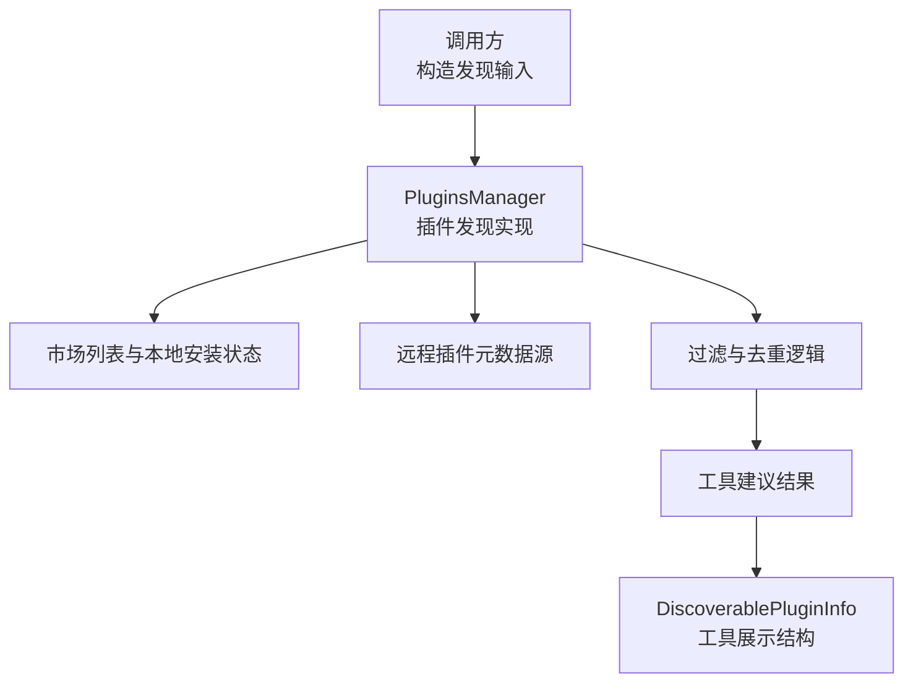
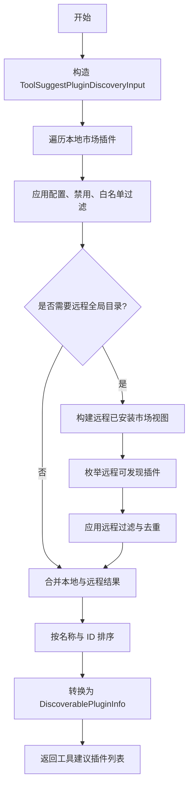
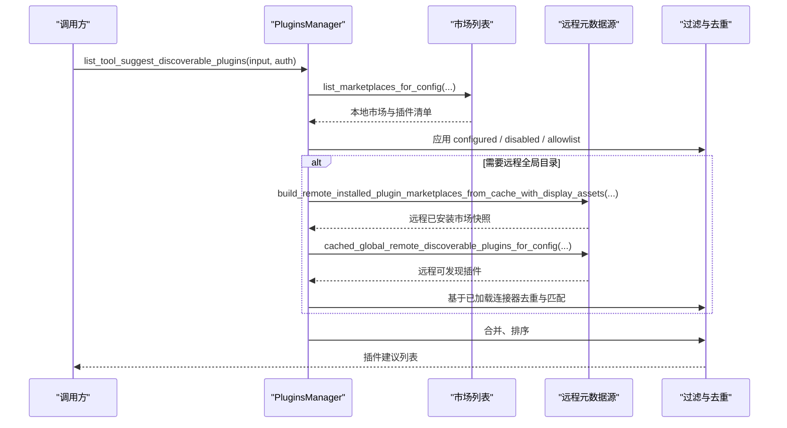
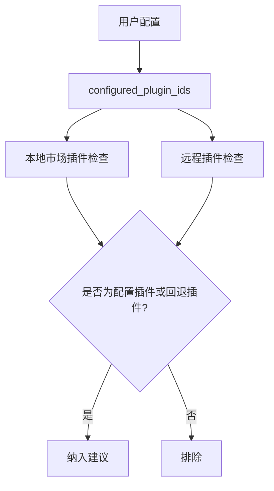
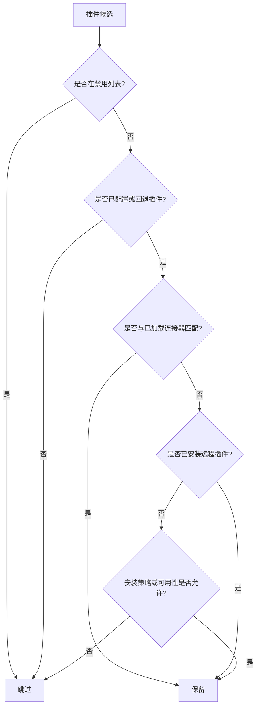
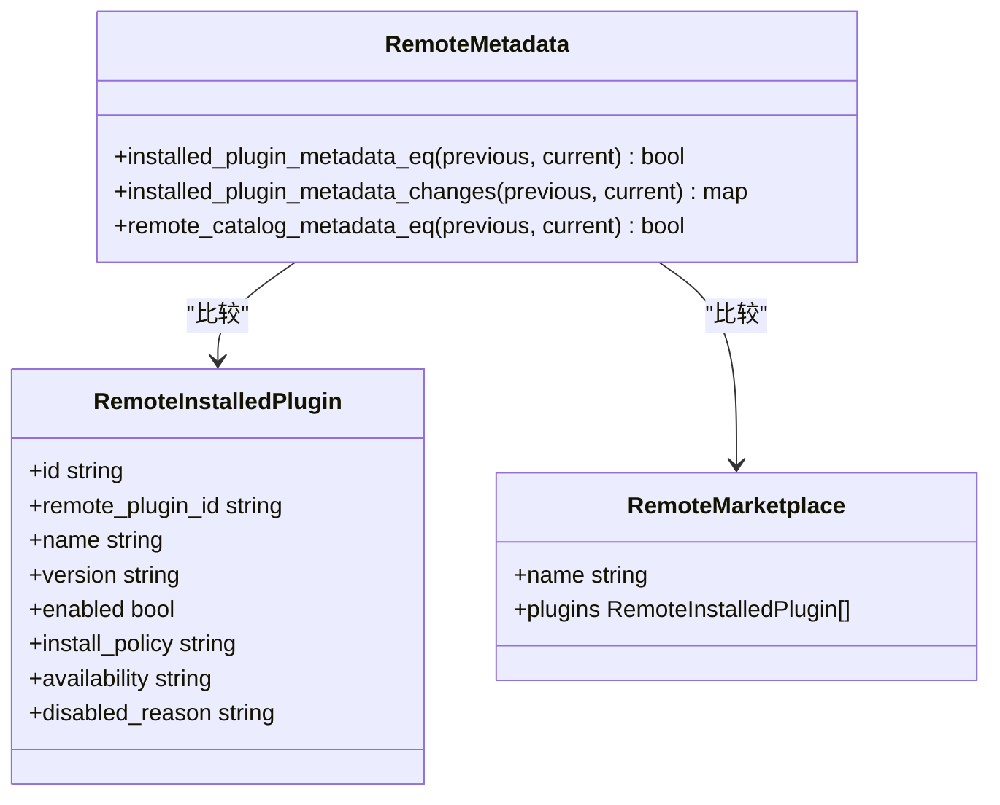

# 插件发现机制

<cite>
**本文引用的文件**   
- [codex-rs/core/src/plugins/discoverable.rs](file://codex-rs/core/src/plugins/discoverable.rs)
- [codex-rs/tools/src/tool_discovery.rs](file://codex-rs/tools/src/tool_discovery.rs)
- [codex-rs/core-plugins/src/discoverable.rs](file://codex-rs/core-plugins/src/discoverable.rs)
- [codex-rs/core-plugins/src/remote_metadata.rs](file://codex-rs/core-plugins/src/remote_metadata.rs)
</cite>

## 目录
1. [引言](#引言)
2. [项目结构定位](#项目结构定位)
3. [核心组件与数据模型](#核心组件与数据模型)
4. [架构总览](#架构总览)
5. [自动发现流程](#自动发现流程)
6. [手动配置发现流程](#手动配置发现流程)
7. [过滤逻辑详解](#过滤逻辑详解)
8. [远程插件元数据与缓存机制](#远程插件元数据与缓存机制)
9. [市场集成与版本兼容性](#市场集成与版本兼容性)
10. [配置示例](#配置示例)
11. [调试方法](#调试方法)
12. [性能优化建议](#性能优化建议)
13. [故障排查指南](#故障排查指南)
14. [结论](#结论)

## 引言
本文面向希望理解并定制 Codex 插件发现行为的开发者与运维人员，重点解释以下能力：
- 插件的自动发现与手动配置发现如何协同工作。
- `DiscoverablePluginInfo` 结构体字段含义及在工具建议场景中的作用。
- `ToolSuggestPluginDiscoveryInput` 输入参数的作用，包括 `plugins`、`configured_plugin_ids`、`disabled_plugin_ids`、`loaded_plugin_app_connector_ids`。
- 插件发现的过滤逻辑，包括工具建议类型过滤、禁用工具处理、已加载连接器去重。
- 远程插件元数据的获取、比较与缓存策略，以及与 Marketplace 的集成和版本相关行为。
- 可操作的配置示例、日志分析与性能优化建议。

## 项目结构定位
插件发现涉及三个主要层次：
- 上层调用层：根据运行时配置构造发现输入，并转换为工具侧可见的结构。
- 插件管理器层：负责读取市场列表、应用过滤规则、拉取或缓存远程元数据。
- 工具表示层：将最终结果封装为 UI 与工具链可用的数据结构。

**图示来源**
- [codex-rs/core/src/plugins/discoverable.rs:1-59](file://codex-rs/core/src/plugins/discoverable.rs#L1-L59)
- [codex-rs/core-plugins/src/discoverable.rs:1-231](file://codex-rs/core-plugins/src/discoverable.rs#L1-L231)
- [codex-rs/tools/src/tool_discovery.rs:1-150](file://codex-rs/tools/src/tool_discovery.rs#L1-L150)

**章节来源**
- [codex-rs/core/src/plugins/discoverable.rs:1-59](file://codex-rs/core/src/plugins/discoverable.rs#L1-L59)
- [codex-rs/tools/src/tool_discovery.rs:1-150](file://codex-rs/tools/src/tool_discovery.rs#L1-L150)
- [codex-rs/core-plugins/src/discoverable.rs:1-231](file://codex-rs/core-plugins/src/discoverable.rs#L1-L231)

## 核心组件与数据模型
### DiscoverablePluginInfo
这是工具建议层对外暴露的插件信息结构，用于向工具链和界面呈现插件的基本能力。其字段含义如下：
- `id`：插件的配置标识，通常对应工具建议中的稳定键值。
- `remote_plugin_id`：可选的远程插件标识；当插件来自远程全局目录时存在该值。
- `name`：插件名称，用于显示与排序。
- `description`：可选描述，帮助理解插件用途。
- `has_skills`：是否包含技能能力，影响后续技能相关建议。
- `mcp_server_names`：关联的 MCP 服务器名称集合，用于工具建议与连接管理。
- `app_connector_ids`：应用连接器标识集合，用于判断与应用连接的匹配关系。

**章节来源**
- [codex-rs/tools/src/tool_discovery.rs:1-150](file://codex-rs/tools/src/tool_discovery.rs#L1-L150)
- [codex-rs/core/src/plugins/discoverable.rs:1-59](file://codex-rs/core/src/plugins/discoverable.rs#L1-L59)

### ToolSuggestPluginDiscoveryInput
这是插件管理器执行工具建议发现时的输入参数对象，关键字段与作用如下：
- `plugins`：插件配置输入，决定插件功能开关、市场来源、远程目录开关等。
- `configured_plugin_ids`：用户显式配置的插件 ID 集合，用于允许非默认来源插件出现在工具建议中。
- `disabled_plugin_ids`：被禁用的插件 ID 集合，无论是否配置都必须从建议中排除。
- `loaded_plugin_app_connector_ids`：当前已加载的应用连接器 ID 集合，用于远程插件的去重与匹配。

**章节来源**
- [codex-rs/core-plugins/src/discoverable.rs:1-231](file://codex-rs/core-plugins/src/discoverable.rs#L1-L231)
- [codex-rs/core/src/plugins/discoverable.rs:1-59](file://codex-rs/core/src/plugins/discoverable.rs#L1-L59)

### 其他辅助结构
- `ToolSuggestDiscoverablePlugin`：插件管理器内部用于组装工具建议插件的对象，与 `DiscoverablePluginInfo` 字段高度对应。
- `DiscoverableToolType`、`DiscoverableTool`：工具建议层对连接器与插件的统一抽象，便于前端与工具链消费。

**章节来源**
- [codex-rs/core-plugins/src/discoverable.rs:1-231](file://codex-rs/core-plugins/src/discoverable.rs#L1-L231)
- [codex-rs/tools/src/tool_discovery.rs:1-150](file://codex-rs/tools/src/tool_discovery.rs#L1-L150)

## 架构总览
插件发现的整体流程分为两个阶段：
1. 本地市场与已安装插件的发现。
2. 远程全局目录插件的发现与去重。

**图示来源**
- [codex-rs/core-plugins/src/discoverable.rs:1-231](file://codex-rs/core-plugins/src/discoverable.rs#L1-L231)
- [codex-rs/core/src/plugins/discoverable.rs:1-59](file://codex-rs/core/src/plugins/discoverable.rs#L1-L59)

**章节来源**
- [codex-rs/core-plugins/src/discoverable.rs:1-231](file://codex-rs/core-plugins/src/discoverable.rs#L1-L231)
- [codex-rs/core/src/plugins/discoverable.rs:1-59](file://codex-rs/core/src/plugins/discoverable.rs#L1-L59)

## 自动发现流程
自动发现的核心目标是找出用户环境中“可用且值得建议”的插件，而不要求用户提前显式配置。

关键步骤：
- 如果插件功能未启用，直接返回空列表。
- 若使用远程全局目录且认证后端支持，则启用远程市场视图。
- 遍历本地市场中的每个插件，跳过已安装、不可安装或被禁用的插件。
- 仅保留“已配置插件”或“回退插件”，避免无关插件污染工具建议。
- 对于本地插件，通过工具建议元数据函数获取 `mcp_server_names`、`has_skills` 等信息。
- 如果启用远程全局目录，再叠加远程可发现插件，并根据已加载连接器进行去重与匹配。

**图示来源**
- [codex-rs/core-plugins/src/discoverable.rs:1-231](file://codex-rs/core-plugins/src/discoverable.rs#L1-L231)

**章节来源**
- [codex-rs/core-plugins/src/discoverable.rs:1-231](file://codex-rs/core-plugins/src/discoverable.rs#L1-L231)

## 手动配置发现流程
手动配置发现依赖 `configured_plugin_ids`，即用户在配置中显式启用的插件 ID。这些插件即使不在默认允许列表中，也会被纳入工具建议。

关键点：
- 配置层会筛选出类型为插件的发现项，并将其 ID 放入 `configured_plugin_ids`。
- 插件管理器在处理本地市场插件时，若插件 ID 属于 `configured_plugin_ids`，则不会被“非配置且非回退”条件过滤掉。
- 远程插件也支持以 `config_id` 或 `remote_plugin_id` 匹配配置，从而让远程插件进入建议列表。

**图示来源**
- [codex-rs/core/src/plugins/discoverable.rs:1-59](file://codex-rs/core/src/plugins/discoverable.rs#L1-L59)
- [codex-rs/core-plugins/src/discoverable.rs:1-231](file://codex-rs/core-plugins/src/discoverable.rs#L1-L231)

**章节来源**
- [codex-rs/core/src/plugins/discoverable.rs:1-59](file://codex-rs/core/src/plugins/discoverable.rs#L1-L59)
- [codex-rs/core-plugins/src/discoverable.rs:1-231](file://codex-rs/core-plugins/src/discoverable.rs#L1-L231)

## 过滤逻辑详解
### 工具建议类型过滤
- 工具建议只关注插件类型，连接器由 `DiscoverableTool::Connector` 单独处理。
- 在非 TUI 客户端或非特定场景下，插件列表不会主动过滤连接器；但 TUI 客户端会排除插件类型的安装入口，以便区分连接器安装与插件安装。

### 禁用工具处理
- `disabled_plugin_ids` 来自配置中的禁用工具列表。
- 无论是本地市场插件还是远程插件，只要 ID 命中禁用集合就会被排除。
- 禁用判断同时覆盖插件配置 ID 与远程插件 ID，确保管理员策略生效。

### 已加载连接器去重
- `loaded_plugin_app_connector_ids` 用于识别当前已加载的应用连接器。
- 远程插件若与已加载连接器对应的应用 ID 匹配，则被视为“已安装应用关联”，从而降低重复推荐概率。
- 已安装的远程插件 ID 会被记录，避免同一远程插件再次出现。

### 白名单与回退插件
- 系统维护一个工具建议允许列表，包含若干内置与官方策划市场插件。
- 对于官方策划市场的插件，还会将远程市场名映射为默认市场名作为回退判断，使某些插件即使市场名变化仍可被建议。

**图示来源**
- [codex-rs/core-plugins/src/discoverable.rs:1-231](file://codex-rs/core-plugins/src/discoverable.rs#L1-L231)

**章节来源**
- [codex-rs/core-plugins/src/discoverable.rs:1-231](file://codex-rs/core-plugins/src/discoverable.rs#L1-L231)

## 远程插件元数据与缓存机制
远程插件元数据主要用于两类目的：
1. 获取远程全局目录中的可发现插件列表。
2. 比较已安装插件与市场快照的行为相关字段，用于更新与诊断。

### 远程已安装市场视图
- 当使用远程全局目录且认证后端支持时，系统会从缓存构建远程已安装插件市场视图。
- 该视图用于快速判断哪些远程插件已经安装，从而避免重复建议。

### 远程可发现插件缓存
- 系统提供缓存函数来获取远程全局目录中的可发现插件。
- 该缓存结合认证上下文，减少重复网络请求。

### 元数据比较
远程元数据比较模块专注于“行为相关字段”，例如市场名、ID、名称、版本、安装时间、启用状态、安装策略、可用性、禁用原因等。它不比较纯展示字段，因为展示字段可能频繁变化但不影响运行行为。

**图示来源**
- [codex-rs/core-plugins/src/remote_metadata.rs:1-131](file://codex-rs/core-plugins/src/remote_metadata.rs#L1-L131)

**章节来源**
- [codex-rs/core-plugins/src/remote_metadata.rs:1-131](file://codex-rs/core-plugins/src/remote_metadata.rs#L1-L131)
- [codex-rs/core-plugins/src/discoverable.rs:1-231](file://codex-rs/core-plugins/src/discoverable.rs#L1-L231)

## 市场集成与版本兼容性
### 市场列表来源
- 插件管理器根据 `plugins` 配置列出市场，包括本地策划市场与远程全局目录。
- 是否包含 OpenAI 策划市场取决于是否使用远程全局目录以及认证后端类型。

### 版本与安装策略
- 插件元数据包含版本号、本地版本、安装策略、可用性、禁用原因等。
- 安装策略为“不可用”的插件不会被建议。
- 可用性为“管理员禁用”的远程插件也不会被建议。
- 元数据比较会将版本、安装状态、策略与可用性差异纳入变更检测，便于更新与诊断。

### 兼容性说明
- 代码中没有硬编码语义化的“版本兼容范围”判断，而是通过版本字段、安装策略与可用性字段共同表达兼容性语义。
- 实际兼容决策应由上游市场与服务端控制，本地仅负责展示与过滤。

**章节来源**
- [codex-rs/core-plugins/src/discoverable.rs:1-231](file://codex-rs/core-plugins/src/discoverable.rs#L1-L231)
- [codex-rs/core-plugins/src/remote_metadata.rs:1-131](file://codex-rs/core-plugins/src/remote_metadata.rs#L1-L131)

## 配置示例
以下为典型配置思路（不粘贴具体代码内容，仅说明字段与组合方式）：

- 启用插件功能：
  - 设置插件配置输入中的插件功能开关为启用。
- 指定手动配置插件：
  - 在工具建议发现配置中添加插件类型发现项，并填写插件 ID。
  - 这些 ID 会进入 `configured_plugin_ids`，使插件进入建议列表。
- 禁用插件：
  - 在禁用工具列表中添加插件类型禁用项，并填写插件 ID。
  - 这些 ID 会进入 `disabled_plugin_ids`，确保插件不会出现在建议中。
- 启用远程全局目录：
  - 开启远程插件功能，并使用支持的后端认证。
  - 系统将尝试使用远程全局目录，并结合已加载连接器进行去重。

**章节来源**
- [codex-rs/core/src/plugins/discoverable.rs:1-59](file://codex-rs/core/src/plugins/discoverable.rs#L1-L59)
- [codex-rs/core-plugins/src/discoverable.rs:1-231](file://codex-rs/core-plugins/src/discoverable.rs#L1-L231)

## 调试方法
### 日志分析
- 插件发现过程使用 trace 级别日志记录整体调用。
- 当某个插件的工具建议元数据加载失败时，会记录警告日志，包含插件 ID 与错误信息。
- 远程元数据比较模块可用于分析已安装插件与市场快照的差异，适合排查“插件突然不可见”或“状态不一致”问题。

### 常见排查点
- 插件未被建议：
  - 检查是否被加入 `disabled_plugin_ids`。
  - 检查是否既不是 `configured_plugin_ids` 也不是回退插件。
  - 检查安装策略是否为“不可用”。
  - 检查远程插件是否被管理员禁用。
- 远程插件重复建议：
  - 检查 `loaded_plugin_app_connector_ids` 是否正确传入。
  - 检查远程插件的应用 ID 是否与已加载连接器匹配。
  - 检查远程已安装插件 ID 是否已被记录。

**章节来源**
- [codex-rs/core/src/plugins/discoverable.rs:1-59](file://codex-rs/core/src/plugins/discoverable.rs#L1-L59)
- [codex-rs/core-plugins/src/discoverable.rs:1-231](file://codex-rs/core-plugins/src/discoverable.rs#L1-L231)
- [codex-rs/core-plugins/src/remote_metadata.rs:1-131](file://codex-rs/core-plugins/src/remote_metadata.rs#L1-L131)

## 性能优化建议
- 复用已加载连接器集合：
  - 将 `loaded_plugin_app_connector_ids` 作为输入传入，避免重复查询当前已加载插件的能力摘要。
- 减少远程请求：
  - 利用远程元数据缓存与远程已安装市场视图，避免每次发现都重新拉取完整目录。
- 控制市场数量：
  - 合理配置市场来源，避免过多市场导致遍历开销过大。
- 使用哈希集合：
  - `configured_plugin_ids`、`disabled_plugin_ids`、`loaded_plugin_app_connector_ids` 均使用集合结构，提高查找效率。
- 排序成本可控：
  - 最终结果按名称与 ID 排序，规模通常在插件数量范围内，开销较小。

**章节来源**
- [codex-rs/core-plugins/src/discoverable.rs:1-231](file://codex-rs/core-plugins/src/discoverable.rs#L1-L231)

## 故障排查指南
### 插件完全不出现在工具建议中
- 确认插件功能已启用。
- 确认插件未被禁用。
- 确认插件属于已配置插件或回退插件，或与已加载连接器匹配。
- 确认插件安装策略允许安装且未被管理员禁用。

### 远程插件反复出现
- 检查是否已将远程插件 ID 标记为已安装。
- 检查 `loaded_plugin_app_connector_ids` 是否包含对应应用连接器。
- 检查远程插件的应用 ID 是否匹配已加载连接器。

### 元数据不一致
- 使用远程元数据比较函数分析前后快照差异。
- 关注版本、安装状态、策略、可用性、禁用原因等字段变化。
- 注意纯展示字段变化不会影响行为，但可能影响 UI 显示。

**章节来源**
- [codex-rs/core-plugins/src/discoverable.rs:1-231](file://codex-rs/core-plugins/src/discoverable.rs#L1-L231)
- [codex-rs/core-plugins/src/remote_metadata.rs:1-131](file://codex-rs/core-plugins/src/remote_metadata.rs#L1-L131)

## 结论
插件发现机制通过“本地市场 + 远程全局目录”的双通道设计，兼顾灵活性与安全性。`ToolSuggestPluginDiscoveryInput` 提供了明确的配置边界，`configured_plugin_ids` 与 `disabled_plugin_ids` 分别控制“允许建议”和“强制排除”，而 `loaded_plugin_app_connector_ids` 则保障已加载连接器的去重与匹配。远程元数据缓存与比较能力进一步提升了稳定性与可观测性。在实际使用中，应优先通过配置明确插件范围，借助日志与元数据比较快速定位异常，并通过合理市场与缓存策略优化性能。