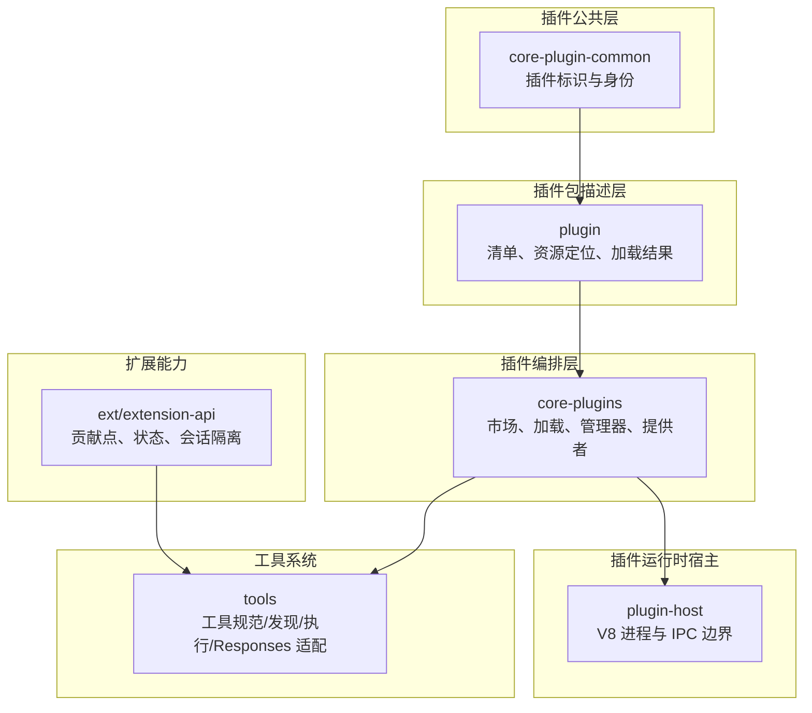
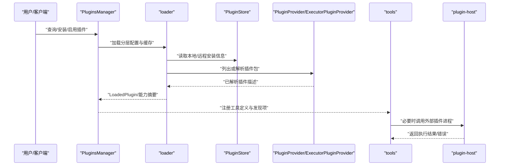
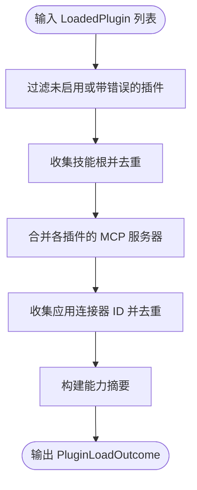
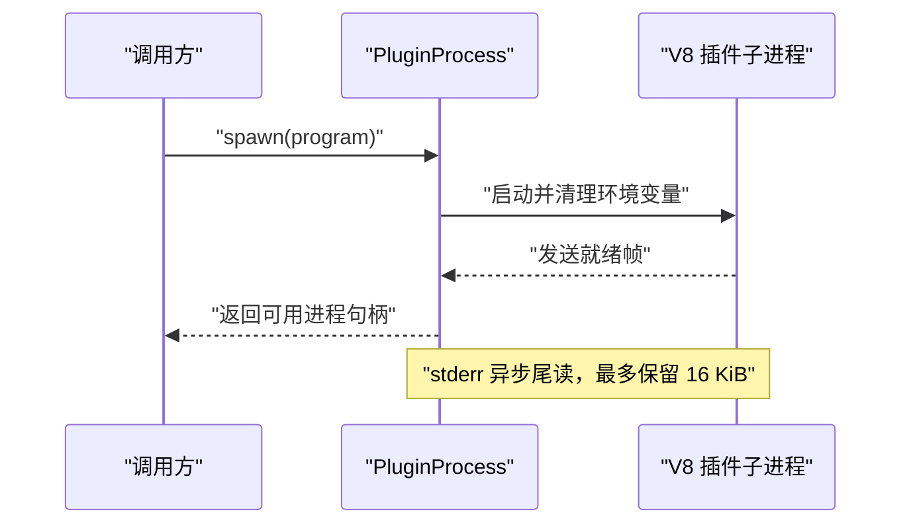
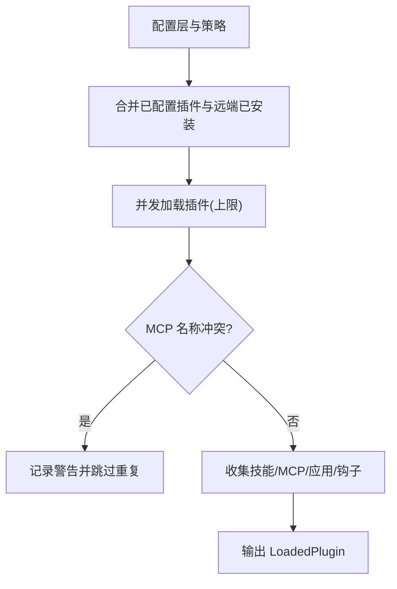
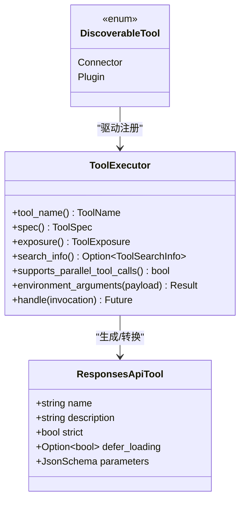
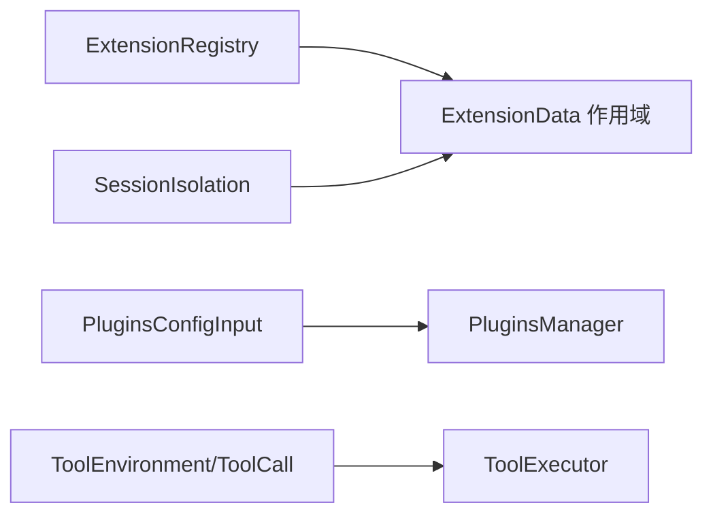
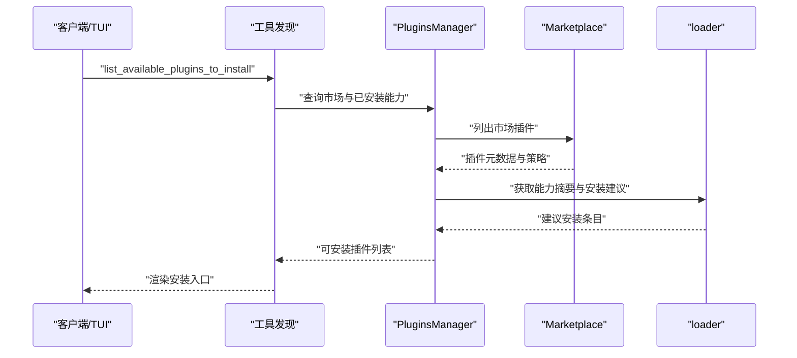
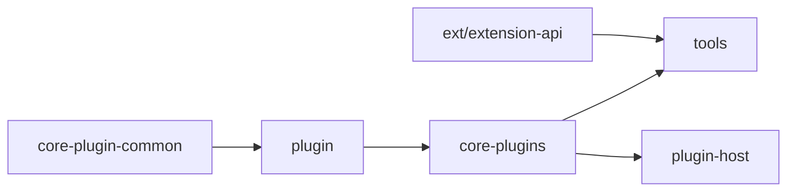

# 插件工具

<cite>
**本文引用的文件**   
- [codex-rs/core-plugin-common/src/lib.rs](file://codex-rs/core-plugin-common/src/lib.rs)
- [codex-rs/core-plugin-common/src/plugin_id.rs](file://codex-rs/core-plugin-common/src/plugin_id.rs)
- [codex-rs/core-plugin-common/src/identity.rs](file://codex-rs/core-plugin-common/src/identity.rs)
- [codex-rs/plugin/src/lib.rs](file://codex-rs/plugin/src/lib.rs)
- [codex-rs/plugin/src/manifest.rs](file://codex-rs/plugin/src/manifest.rs)
- [codex-rs/plugin/src/provider.rs](file://codex-rs/plugin/src/provider.rs)
- [codex-rs/plugin/src/load_outcome.rs](file://codex-rs/plugin/src/load_outcome.rs)
- [codex-rs/plugin-host/src/lib.rs](file://codex-rs/plugin-host/src/lib.rs)
- [codex-rs/plugin-host/src/process.rs](file://codex-rs/plugin-host/src/process.rs)
- [codex-rs/core-plugins/src/lib.rs](file://codex-rs/core-plugins/src/lib.rs)
- [codex-rs/core-plugins/src/loader.rs](file://codex-rs/core-plugins/src/loader.rs)
- [codex-rs/core-plugins/src/manager.rs](file://codex-rs/core-plugins/src/manager.rs)
- [codex-rs/core-plugins/src/provider.rs](file://codex-rs/core-plugins/src/provider.rs)
- [codex-rs/core-plugins/src/discoverable.rs](file://codex-rs/core-plugins/src/discoverable.rs)
- [codex-rs/core-plugins/src/executor_provider.rs](file://codex-rs/core-plugins/src/executor_provider.rs)
- [codex-rs/core-plugins/src/marketplace.rs](file://codex-rs/core-plugins/src/marketplace.rs)
- [codex-rs/tools/src/lib.rs](file://codex-rs/tools/src/lib.rs)
- [codex-rs/tools/src/tool_discovery.rs](file://codex-rs/tools/src/tool_discovery.rs)
- [codex-rs/tools/src/responses_api.rs](file://codex-rs/tools/src/responses_api.rs)
- [codex-rs/tools/src/tool_executor.rs](file://codex-rs/tools/src/tool_executor.rs)
- [codex-rs/ext/extension-api/src/lib.rs](file://codex-rs/ext/extension-api/src/lib.rs)
- [codex-rs/ext/extension-api/src/state.rs](file://codex-rs/ext/extension-api/src/state.rs)
- [codex-rs/ext/extension-api/src/session_isolation.rs](file://codex-rs/ext/extension-api/src/session_isolation.rs)
</cite>

## 目录
1. [简介](#简介)
2. [项目结构](#项目结构)
3. [核心组件](#核心组件)
4. [架构总览](#架构总览)
5. [详细组件分析](#详细组件分析)
6. [依赖关系分析](#依赖关系分析)
7. [性能与可扩展性](#性能与可扩展性)
8. [故障排查与安全边界](#故障排查与安全边界)
9. [插件开发指南](#插件开发指南)
10. [安装、部署与管理流程](#安装部署与管理流程)
11. [结论](#结论)

## 简介
本文面向插件开发者与维护者，系统性说明 Codex 中“插件工具”的体系：从插件标识、清单与资源定位，到插件发现、加载、注册、执行；从工具接口定义、生命周期、状态保持，到依赖注入（服务、配置、上下文）；从动态发现、热更新与版本兼容，到权限模型、安全隔离；最后给出插件模板、调试、测试以及市场集成和自动更新的实践路径。

该体系以 Rust 多 crate 形式组织，核心职责分布在以下模块：
- `core-plugin-common`：稳定的插件标识与身份抽象。
- `plugin`：插件包元数据、清单、资源定位与已加载结果。
- `plugin-host`：独立 V8 插件进程的边界管理。
- `core-plugins`：插件市场、仓库、缓存、加载管线、管理器与执行器提供者。
- `tools`：工具规范、工具发现、工具执行与 Responses API 适配。
- `ext/extension-api`：扩展能力、贡献点、会话隔离与类型化状态容器。

## 项目结构
下图展示插件相关 crate 的高层分工与主要入口：



图表来源
- [codex-rs/core-plugin-common/src/lib.rs:1-7](file://codex-rs/core-plugin-common/src/lib.rs#L1-L7)
- [codex-rs/plugin/src/lib.rs:1-97](file://codex-rs/plugin/src/lib.rs#L1-L97)
- [codex-rs/plugin-host/src/lib.rs:1-14](file://codex-rs/plugin-host/src/lib.rs#L1-L14)
- [codex-rs/core-plugins/src/lib.rs:1-136](file://codex-rs/core-plugins/src/lib.rs#L1-L136)
- [codex-rs/tools/src/lib.rs:1-115](file://codex-rs/tools/src/lib.rs#L1-L115)
- [codex-rs/ext/extension-api/src/lib.rs:1-137](file://codex-rs/ext/extension-api/src/lib.rs#L1-L137)

章节来源
- [codex-rs/core-plugin-common/src/lib.rs:1-7](file://codex-rs/core-plugin-common/src/lib.rs#L1-L7)
- [codex-rs/plugin/src/lib.rs:1-97](file://codex-rs/plugin/src/lib.rs#L1-L97)
- [codex-rs/plugin-host/src/lib.rs:1-14](file://codex-rs/plugin-host/src/lib.rs#L1-L14)
- [codex-rs/core-plugins/src/lib.rs:1-136](file://codex-rs/core-plugins/src/lib.rs#1-L136)
- [codex-rs/tools/src/lib.rs:1-115](file://codex-rs/tools/src/lib.rs#L1-L115)
- [codex-rs/ext/extension-api/src/lib.rs:1-137](file://codex-rs/ext/extension-api/src/lib.rs#L1-L137)

## 核心组件
- 插件标识与身份
  - `PluginId`：稳定键 `<plugin>@<marketplace>`，含校验与解析。
  - `PluginIdentity`：跨来源统一逻辑标识，支持远程 ID 或本地配置键。
- 插件包与清单
  - `PluginManifest`：声明技能、MCP 服务器、应用连接器、钩子及界面元数据。
  - `ResolvedPlugin`：将清单资源绑定到环境所有权，防止路径逃逸。
  - `LoadedPlugin` / `PluginLoadOutcome`：合并后的已加载插件视图与能力摘要。
- 插件进程宿主
  - `PluginProcess`：启动、握手、限流、stderr 截断、退出诊断。
  - 常量：最大实例数、就绪帧、辅助参数。
- 插件编排
  - `PluginsManager`：市场、缓存、安装、启用/禁用、能力聚合。
  - `loader`：分层配置加载、并发加载、重复 MCP 名称去重、钩子与技能扫描。
  - `provider`：插件目录列出接口，用于云侧或执行器侧元数据快照。
  - `ExecutorPluginProvider`：通过执行环境文件系统解析插件根，并保留文件系统绑定。
- 工具系统
  - `ToolSpec` / `ResponsesApiTool` / `LoadableToolSpec`：工具定义与 Responses API 转换。
  - `tool_discovery`：可发现工具与插件条目，供 TUI/客户端消费。
  - `ToolExecutor`：工具执行契约、暴露面、并行能力与环境参数解析。
- 扩展能力
  - `ExtensionRegistry` / `ExtensionData`：类型化扩展状态容器。
  - `SessionIsolation`：会话级能力继承策略。

章节来源
- [codex-rs/core-plugin-common/src/plugin_id.rs:1-83](file://codex-rs/core-plugin-common/src/plugin_id.rs#L1-L83)
- [codex-rs/core-plugin-common/src/identity.rs:1-20](file://codex-rs/core-plugin-common/src/identity.rs#L1-L20)
- [codex-rs/plugin/src/manifest.rs:1-194](file://codex-rs/plugin/src/manifest.rs#L1-L194)
- [codex-rs/plugin/src/provider.rs:1-108](file://codex-rs/plugin/src/provider.rs#L1-L108)
- [codex-rs/plugin/src/load_outcome.rs:1-200](file://codex-rs/plugin/src/load_outcome.rs#L1-L200)
- [codex-rs/plugin-host/src/process.rs:1-200](file://codex-rs/plugin-host/src/process.rs#L1-L200)
- [codex-rs/core-plugins/src/loader.rs:1-220](file://codex-rs/core-plugins/src/loader.rs#L1-L220)
- [codex-rs/core-plugins/src/provider.rs:1-46](file://codex-rs/core-plugins/src/provider.rs#L1-L46)
- [codex-rs/core-plugins/src/executor_provider.rs:1-200](file://codex-rs/core-plugins/src/executor_provider.rs#L1-L200)
- [codex-rs/tools/src/responses_api.rs:1-177](file://codex-rs/tools/src/responses_api.rs#L1-L177)
- [codex-rs/tools/src/tool_discovery.rs:1-150](file://codex-rs/tools/src/tool_discovery.rs#L1-L150)
- [codex-rs/tools/src/tool_executor.rs:1-139](file://codex-rs/tools/src/tool_executor.rs#L1-L139)
- [codex-rs/ext/extension-api/src/state.rs:1-160](file://codex-rs/ext/extension-api/src/state.rs#L1-L160)
- [codex-rs/ext/extension-api/src/session_isolation.rs:1-24](file://codex-rs/ext/extension-api/src/session_isolation.rs#L1-L24)

## 架构总览
插件系统的运行主链路分为四层：
- 元数据与标识层：`PluginId` / `PluginIdentity` 提供稳定键与身份。
- 包与清单层：`PluginManifest` 与 `ResolvedPlugin` 描述插件内容并将资源绑定到环境。
- 编排与加载层：`PluginsManager` + `loader` 负责发现、缓存、安装、加载、能力聚合。
- 执行与工具层：`ToolExecutor` 暴露工具，`responses_api` 把 MCP/动态工具转为模型可见工具。



图表来源
- [codex-rs/core-plugins/src/manager.rs:1-260](file://codex-rs/core-plugins/src/manager.rs#L1-L260)
- [codex-rs/core-plugins/src/loader.rs:1-220](file://codex-rs/core-plugins/src/loader.rs#L1-L220)
- [codex-rs/core-plugins/src/provider.rs:1-46](file://codex-rs/core-plugins/src/provider.rs#L1-L46)
- [codex-rs/core-plugins/src/executor_provider.rs:1-200](file://codex-rs/core-plugins/src/executor_provider.rs#L1-L200)
- [codex-rs/tools/src/lib.rs:1-115](file://codex-rs/tools/src/lib.rs#L1-L115)
- [codex-rs/plugin-host/src/process.rs:1-200](file://codex-rs/plugin-host/src/process.rs#L1-L200)

## 详细组件分析

### 插件标识与身份
- `PluginId` 是持久化的插件键，格式为 `<plugin>@<marketplace>`，包含严格的段字符校验，禁止路径遍历。
- `PluginIdentity` 屏蔽来源差异，既能表示远程服务分配的 ID，也能表示本地配置键，便于合并不同来源的发现。

```mermaid
classDiagram
    class PluginId {
        +string plugin_name
        +string marketplace_name
        +new(plugin_name, marketplace_name) Result
        +parse(key) Result
        +as_key() string
    }
    class PluginIdentity {
        <<enum>>
        Remote{remote_plugin_id}
        Local{plugin_id}
        +as_str() string
    }
```

图表来源
- [codex-rs/core-plugin-common/src/plugin_id.rs:1-83](file://codex-rs/core-plugin-common/src/plugin_id.rs#L1-L83)
- [codex-rs/core-plugin-common/src/identity.rs:1-20](file://codex-rs/core-plugin-common/src/identity.rs#L1-L20)

章节来源
- [codex-rs/core-plugin-common/src/plugin_id.rs:1-83](file://codex-rs/core-plugin-common/src/plugin_id.rs#L1-L83)
- [codex-rs/core-plugin-common/src/identity.rs:1-20](file://codex-rs/core-plugin-common/src/identity.rs#L1-L20)

### 插件清单与资源定位
- `PluginManifest` 统一描述技能目录、MCP 服务器、应用连接器、钩子与界面元数据。它提供资源映射函数，允许在“绝对路径”和“权威绑定的 URI”之间转换。
- `ResolvedPlugin` 将清单资源转换为 `PluginResourceLocator`，强制所有资源位于所选包根之下，拒绝越界路径。
- `ResolvedPluginLocation` 指明包根属于哪个执行环境，从而把文件系统访问权与插件绑定。

```mermaid
classDiagram
    class PluginManifest~Resource~ {
        +string name
        +Option~string~ version
        +Option~string~ description
        +Vec~string~ keywords
        +PluginManifestPaths~Resource~ paths
        +Option~PluginManifestInterface~ interface
        +display_name() string
        +try_map_resources(map) Result
    }
    class ResolvedPlugin {
        +selected_root_id() string
        +location() ResolvedPluginLocation
        +manifest_path() PluginResourceLocator
        +manifest() PluginManifest
    }
    class PluginResourceLocator {
        <<enum>>
        Environment{environment_id,path}
    }
    class ResolvedPluginLocation {
        <<enum>>
        Environment{environment_id,root}
    }
    ResolvedPlugin --> PluginManifest : "持有"
    PluginManifest --> PluginResourceLocator : "资源引用"
    ResolvedPlugin --> ResolvedPluginLocation : "包根归属"
```

图表来源
- [codex-rs/plugin/src/manifest.rs:1-194](file://codex-rs/plugin/src/manifest.rs#L1-L194)
- [codex-rs/plugin/src/provider.rs:1-108](file://codex-rs/plugin/src/provider.rs#L1-L108)

章节来源
- [codex-rs/plugin/src/manifest.rs:1-194](file://codex-rs/plugin/src/manifest.rs#L1-L194)
- [codex-rs/plugin/src/provider.rs:1-108](file://codex-rs/plugin/src/provider.rs#L1-L108)

### 已加载插件与能力摘要
- `LoadedPlugin` 保存单个插件的配置名、远程 ID、命名空间、技能根、是否启用、MCP 服务器集合、应用连接器、钩子来源与加载警告。
- `PluginLoadOutcome` 对多个 `LoadedPlugin` 做去重与筛选，生成：
  - 有效技能根列表（按路径排序）。
  - 合并后的 MCP 服务器映射。
  - 应用连接器 ID 列表。
  - 能力摘要，用于向模型与 UI 暴露插件能力。



图表来源
- [codex-rs/plugin/src/load_outcome.rs:1-200](file://codex-rs/plugin/src/load_outcome.rs#L1-L200)

章节来源
- [codex-rs/plugin/src/load_outcome.rs:1-200](file://codex-rs/plugin/src/load_outcome.rs#L1-L200)

### 插件进程宿主与隔离
- `PluginProcess` 负责启动独立 V8 插件进程，使用长度分隔编解码器进行 IPC，限制 stderr 捕获大小，并在 Windows 上通过 JobObject 约束进程组。
- 启动失败会区分“启动错误”和“握手错误”，并附带进程关闭结果，避免泄露不可信日志。
- 最大实例数与就绪帧常量保证资源上限与协议一致性。



图表来源
- [codex-rs/plugin-host/src/process.rs:1-200](file://codex-rs/plugin-host/src/process.rs#L1-L200)
- [codex-rs/plugin-host/src/lib.rs:1-14](file://codex-rs/plugin-host/src/lib.rs#L1-L14)

章节来源
- [codex-rs/plugin-host/src/process.rs:1-200](file://codex-rs/plugin-host/src/process.rs#L1-L200)
- [codex-rs/plugin-host/src/lib.rs:1-14](file://codex-rs/plugin-host/src/lib.rs#L1-L14)

### 插件发现与加载管线
- `PluginsManager` 是对外编排入口，组合配置栈、市场、存储、远端同步、指标、推荐安装等能力。
- `loader` 负责：
  - 从配置层合并本地/远端已安装插件。
  - 并发加载插件（有上限），并按配置顺序消费结果，确保 MCP 名称冲突可检测且顺序确定。
  - 扫描技能、MCP 服务器、应用连接器和钩子，记录加载警告。
- `provider` 定义插件目录列出接口，`executor_provider` 通过执行环境的文件系统解析插件根，同时保留文件系统绑定。



图表来源
- [codex-rs/core-plugins/src/loader.rs:1-220](file://codex-rs/core-plugins/src/loader.rs#L1-L220)
- [codex-rs/core-plugins/src/provider.rs:1-46](file://codex-rs/core-plugins/src/provider.rs#L1-L46)
- [codex-rs/core-plugins/src/executor_provider.rs:1-200](file://codex-rs/core-plugins/src/executor_provider.rs#L1-L200)

章节来源
- [codex-rs/core-plugins/src/loader.rs:1-220](file://codex-rs/core-plugins/src/loader.rs#L1-L220)
- [codex-rs/core-plugins/src/provider.rs:1-46](file://codex-rs/core-plugins/src/provider.rs#L1-L46)
- [codex-rs/core-plugins/src/executor_provider.rs:1-200](file://codex-rs/core-plugins/src/executor_provider.rs#L1-L200)

### 工具接口定义与执行
- 工具定义经过 `responses_api` 转换为 `ResponsesApiTool`，支持延迟加载、MCP 工具转换、动态工具转换，并对过大的 MCP 工具 schema 做降级处理。
- `ToolExecutor` 是统一的工具执行契约，决定工具名称、规格、暴露面、搜索信息、并行能力与环境参数解析。
- `tool_discovery` 暴露给客户端的可发现工具条目，包括连接器与插件的安装建议。



图表来源
- [codex-rs/tools/src/responses_api.rs:1-177](file://codex-rs/tools/src/responses_api.rs#L1-L177)
- [codex-rs/tools/src/tool_executor.rs:1-139](file://codex-rs/tools/src/tool_executor.rs#L1-L139)
- [codex-rs/tools/src/tool_discovery.rs:1-150](file://codex-rs/tools/src/tool_discovery.rs#L1-L150)

章节来源
- [codex-rs/tools/src/responses_api.rs:1-177](file://codex-rs/tools/src/responses_api.rs#L1-L177)
- [codex-rs/tools/src/tool_executor.rs:1-139](file://codex-rs/tools/src/tool_executor.rs#L1-L139)
- [codex-rs/tools/src/tool_discovery.rs:1-150](file://codex-rs/tools/src/tool_discovery.rs#L1-L150)

### 依赖注入机制
插件系统的依赖注入围绕三类对象展开：
- 服务注入
  - 通过 `ExtensionRegistry` 注册扩展实现，由宿主在会话或调用上下文中解析。
  - 插件可通过扩展贡献点接入审批、提示词、线程生命周期、工具生命周期等能力。
- 配置注入
  - `PluginsConfigInput` 携带配置层栈、插件开关、远端配置、HTTP 客户端工厂等。
  - `PluginLoadOutcome` 与 `LoadedPlugin` 暴露合并后的 MCP 服务器配置与应用连接器。
- 上下文注入
  - `ExtensionData` 提供类型化附加数据，按作用域隔离，支持初始值、惰性初始化与条件插入。
  - `SessionIsolation` 控制会话级继承策略，隔离模式可排除隐式能力但不会授予额外权限。



图表来源
- [codex-rs/ext/extension-api/src/lib.rs:1-137](file://codex-rs/ext/extension-api/src/lib.rs#L1-L137)
- [codex-rs/ext/extension-api/src/state.rs:1-160](file://codex-rs/ext/extension-api/src/state.rs#L1-L160)
- [codex-rs/ext/extension-api/src/session_isolation.rs:1-24](file://codex-rs/ext/extension-api/src/session_isolation.rs#L1-L24)
- [codex-rs/core-plugins/src/manager.rs:1-260](file://codex-rs/core-plugins/src/manager.rs#L1-L260)
- [codex-rs/tools/src/tool_executor.rs:1-139](file://codex-rs/tools/src/tool_executor.rs#L1-L139)

章节来源
- [codex-rs/ext/extension-api/src/lib.rs:1-137](file://codex-rs/ext/extension-api/src/lib.rs#L1-L137)
- [codex-rs/ext/extension-api/src/state.rs:1-160](file://codex-rs/ext/extension-api/src/state.rs#L1-L160)
- [codex-rs/ext/extension-api/src/session_isolation.rs:1-24](file://codex-rs/ext/extension-api/src/session_isolation.rs#L1-L24)
- [codex-rs/core-plugins/src/manager.rs:1-260](file://codex-rs/core-plugins/src/manager.rs#L1-L260)
- [codex-rs/tools/src/tool_executor.rs:1-139](file://codex-rs/tools/src/tool_executor.rs#L1-L139)

### 动态发现与热更新
- 动态发现
  - `discoverable` 提供“工具建议”场景下的可发现插件列表，支持白名单、已安装应用连接器匹配、远程全局目录与本地市场混合。
  - `tool_discovery` 暴露 `list_available_plugins_to_install` 与 `request_plugin_install` 等工具动作，供客户端呈现安装入口。
- 热更新与市场升级
  - `manager` 与 `marketplace_upgrade` 负责已配置市场的升级、Git 市场模式与配置层重载。
  - `loader` 对非 curated 市场支持增量刷新与强制重装。
- 版本兼容与安全验证
  - `PluginId` 严格校验插件与市场段，阻止路径遍历与非法字符。
  - `ResolvedPlugin` 强制资源位于包根下，拒绝越界路径。
  - 市场插件源支持本地、Git、NPM，并提供安装与认证策略。



图表来源
- [codex-rs/core-plugins/src/discoverable.rs:1-200](file://codex-rs/core-plugins/src/discoverable.rs#L1-L200)
- [codex-rs/tools/src/tool_discovery.rs:1-150](file://codex-rs/tools/src/tool_discovery.rs#L1-L150)
- [codex-rs/core-plugins/src/marketplace.rs:1-220](file://codex-rs/core-plugins/src/marketplace.rs#L1-L220)
- [codex-rs/core-plugins/src/loader.rs:1-220](file://codex-rs/core-plugins/src/loader.rs#L1-L220)

章节来源
- [codex-rs/core-plugins/src/discoverable.rs:1-200](file://codex-rs/core-plugins/src/discoverable.rs#L1-L200)
- [codex-rs/tools/src/tool_discovery.rs:1-150](file://codex-rs/tools/src/tool_discovery.rs#L1-L150)
- [codex-rs/core-plugins/src/marketplace.rs:1-220](file://codex-rs/core-plugins/src/marketplace.rs#L1-L220)
- [codex-rs/core-plugins/src/loader.rs:1-220](file://codex-rs/core-plugins/src/loader.rs#L1-L220)

### 权限模型与安全边界
- 标识与路径安全
  - `PluginId` 对插件名与市场名做字符集与路径遍历校验。
  - `ResolvedPlugin::from_environment` 校验所有资源位于包根之下。
- 执行隔离
  - `plugin-host` 使用独立子进程与受限 stderr 捕获，限制资源与诊断泄漏。
  - `SessionIsolation.Isolated` 排除继承指令提供者与扩展，仅保留受控执行规则。
- 资源访问控制
  - `ExecutorPluginProvider` 通过执行环境提供的 `ExecutorFileSystem` 访问插件文件，不直接暴露宿主文件系统。
  - 市场插件源策略控制安装与认证时机。

章节来源
- [codex-rs/core-plugin-common/src/plugin_id.rs:1-83](file://codex-rs/core-plugin-common/src/plugin_id.rs#L1-L83)
- [codex-rs/plugin/src/provider.rs:1-108](file://codex-rs/plugin/src/provider.rs#L1-L108)
- [codex-rs/plugin-host/src/process.rs:1-200](file://codex-rs/plugin-host/src/process.rs#L1-L200)
- [codex-rs/ext/extension-api/src/session_isolation.rs:1-24](file://codex-rs/ext/extension-api/src/session_isolation.rs#L1-L24)
- [codex-rs/core-plugins/src/executor_provider.rs:1-200](file://codex-rs/core-plugins/src/executor_provider.rs#L1-L200)
- [codex-rs/core-plugins/src/marketplace.rs:1-220](file://codex-rs/core-plugins/src/marketplace.rs#L1-L220)

## 依赖关系分析


图表来源
- [codex-rs/core-plugin-common/src/lib.rs:1-7](file://codex-rs/core-plugin-common/src/lib.rs#L1-L7)
- [codex-rs/plugin/src/lib.rs:1-97](file://codex-rs/plugin/src/lib.rs#L1-L97)
- [codex-rs/core-plugins/src/lib.rs:1-136](file://codex-rs/core-plugins/src/lib.rs#L1-L136)
- [codex-rs/tools/src/lib.rs:1-115](file://codex-rs/tools/src/lib.rs#L1-L115)
- [codex-rs/plugin-host/src/lib.rs:1-14](file://codex-rs/plugin-host/src/lib.rs#L1-L14)
- [codex-rs/ext/extension-api/src/lib.rs:1-137](file://codex-rs/ext/extension-api/src/lib.rs#L1-L137)

章节来源
- [codex-rs/core-plugin-common/src/lib.rs:1-7](file://codex-rs/core-plugin-common/src/lib.rs#L1-L7)
- [codex-rs/plugin/src/lib.rs:1-97](file://codex-rs/plugin/src/lib.rs#L1-L97)
- [codex-rs/core-plugins/src/lib.rs:1-136](file://codex-rs/core-plugins/src/lib.rs#L1-L136)
- [codex-rs/tools/src/lib.rs:1-115](file://codex-rs/tools/src/lib.rs#L1-L115)
- [codex-rs/plugin-host/src/lib.rs:1-14](file://codex-rs/plugin-host/src/lib.rs#L1-L14)
- [codex-rs/ext/extension-api/src/lib.rs:1-137](file://codex-rs/ext/extension-api/src/lib.rs#L1-L137)

## 性能与可扩展性
- 并发加载
  - 插件加载设置并发上限，避免大量插件同时扫描造成 I/O 风暴。
  - 技能根与 MCP 服务器合并采用去重与排序，保证确定性输出。
- 资源边界
  - 子进程 stderr 只保留尾部固定字节，避免大日志阻塞握手。
  - 插件资源必须位于包根下，减少路径解析成本与安全风险。
- 可扩展点
  - `PluginProvider` 接口允许云侧或执行器侧提供不同的目录列表实现。
  - `ToolExecutor` 允许自定义工具暴露面与并行行为。
  - `ExtensionRegistry` 允许扩展能力横向接入，不影响核心加载路径。

[本节为通用指导，无需特定文件引用]

## 故障排查与安全边界
- 常见加载问题
  - 重复 MCP 服务器名称：加载阶段记录警告并跳过重复项。
  - 插件描述过长：能力摘要会对描述做截断与空白归一化。
- 进程启动失败
  - 区分启动错误与握手错误，附带子进程关闭状态与可能的组终止错误。
  - Windows 下 JobObject 失败会影响进程组清理。
- 路径与权限
  - 若资源不在包根下，构造 `ResolvedPlugin` 会报错。
  - 执行环境不可用或目录非目录时，执行器提供者会返回明确错误。
- 调试建议
  - 查看 `PluginExit.stderr_tail` 与 `stderr_read_error`。
  - 检查 `LoadedPlugin.error` 与 `hook_load_warnings`。
  - 确认 `PluginId` 是否符合规范，避免非法字符导致缓存或安装失败。

章节来源
- [codex-rs/core-plugins/src/loader.rs:1-220](file://codex-rs/core-plugins/src/loader.rs#L1-L220)
- [codex-rs/plugin/src/load_outcome.rs:1-200](file://codex-rs/plugin/src/load_outcome.rs#L1-L200)
- [codex-rs/plugin-host/src/process.rs:1-200](file://codex-rs/plugin-host/src/process.rs#L1-L200)
- [codex-rs/plugin/src/provider.rs:1-108](file://codex-rs/plugin/src/provider.rs#L1-L108)
- [codex-rs/core-plugins/src/executor_provider.rs:1-200](file://codex-rs/core-plugins/src/executor_provider.rs#L1-L200)
- [codex-rs/core-plugin-common/src/plugin_id.rs:1-83](file://codex-rs/core-plugin-common/src/plugin_id.rs#L1-L83)

## 插件开发指南
- 插件模板与清单
  - 在插件包根提供清单，声明技能目录、MCP 服务器、应用连接器与钩子。
  - 如需界面元数据，填充显示名、类别、网站、隐私政策、默认提示等字段。
  - 确保所有资源位于包根下，避免被 `ResolvedPlugin` 拒绝。
- 工具与能力
  - 将 MCP 工具或动态工具通过 `responses_api` 转换为 `ResponsesApiTool`。
  - 使用 `ToolExecutor` 暴露工具，合理选择 `ToolExposure`，控制直接暴露、延迟发现与 Code Mode 可用性。
- 状态保持与依赖注入
  - 使用 `ExtensionData` 维护扩展状态，注意作用域与类型安全。
  - 通过 `PluginsConfigInput` 注入 HTTP 客户端、产品 SKU、认证模式等。
- 调试技巧
  - 启用日志后关注加载错误、钩子警告与重复 MCP 名称。
  - 对 V8 插件进程，捕获 stderr 尾部与退出状态。
- 测试方法
  - 针对清单解析与资源映射，构造最小包根进行测试。
  - 针对 `ToolExecutor`，覆盖直接、延迟、Code Mode 与隐藏暴露面。
  - 针对会话隔离，分别验证 Inherit 与 Isolated 的行为差异。

[本节为通用指导，无需特定文件引用]

## 安装、部署与管理流程
- 市场集成
  - 支持本地市场、Git 市场与 NPM 市场，每个市场提供插件策略与认证策略。
  - 市场清单可回退解析插件元数据，以便在未安装状态下预览基本信息。
- 安装与升级
  - `PluginsManager` 协调安装、卸载、启用/禁用、背景任务与缓存。
  - 支持 Git 市场升级与配置层重载，区分按需刷新与强制重装。
- 自动更新
  - 结合远端已安装插件同步与推荐安装，提供自动更新候选。
  - 对于非 curated 市场，支持基于版本变化的增量刷新。
- 客户端交互
  - 通过 `list_available_plugins_to_install` 与 `request_plugin_install` 暴露安装入口。
  - TUI 与非 TUI 客户端在安装条目过滤上存在差异。

章节来源
- [codex-rs/core-plugins/src/marketplace.rs:1-220](file://codex-rs/core-plugins/src/marketplace.rs#L1-L220)
- [codex-rs/core-plugins/src/manager.rs:1-260](file://codex-rs/core-plugins/src/manager.rs#L1-L260)
- [codex-rs/core-plugins/src/loader.rs:1-220](file://codex-rs/core-plugins/src/loader.rs#L1-L220)
- [codex-rs/tools/src/tool_discovery.rs:1-150](file://codex-rs/tools/src/tool_discovery.rs#L1-L150)

## 结论
Codex 的插件工具体系以“稳定标识 + 权威资源绑定 + 分层加载 + 统一工具执行 + 扩展状态注入”为核心设计原则。它在保障安全边界的同時，提供了丰富的动态发现、市场集成与工具暴露能力。插件开发者应重点关注清单正确性、资源边界、工具暴露策略与扩展状态管理；运维与平台侧应关注并发加载、市场策略与会话隔离配置，以获得稳定、安全、可扩展的插件生态。

[本节为总结性内容，无需特定文件引用]