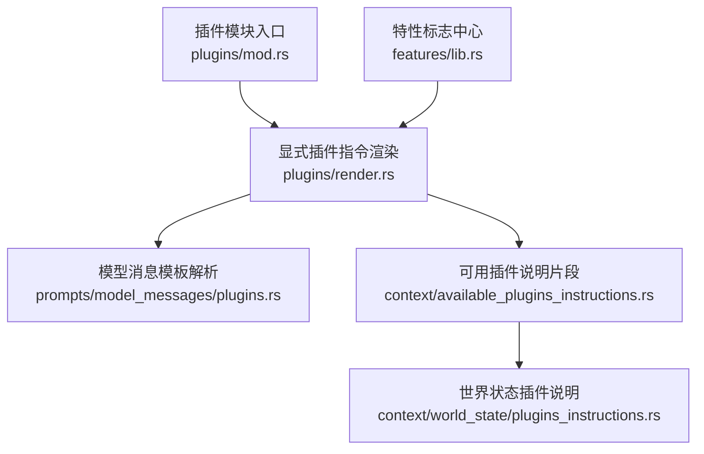
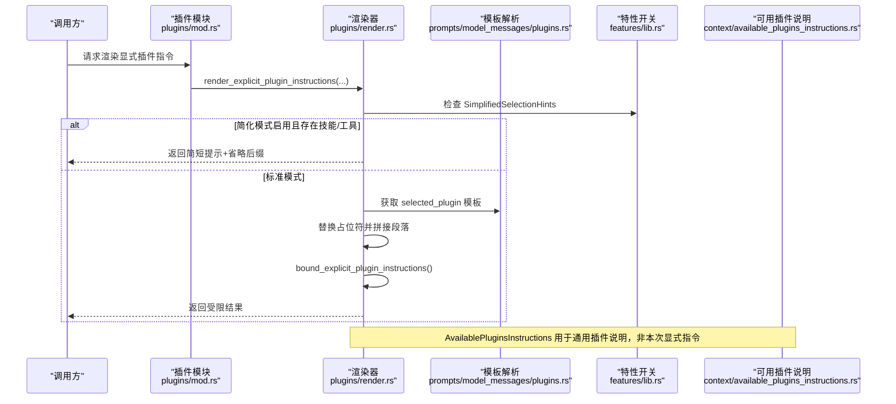
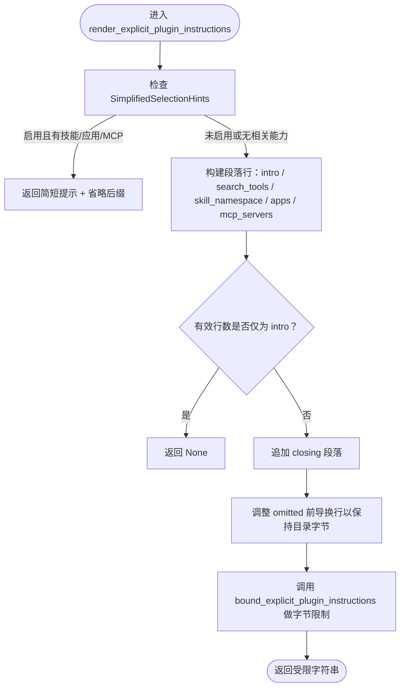
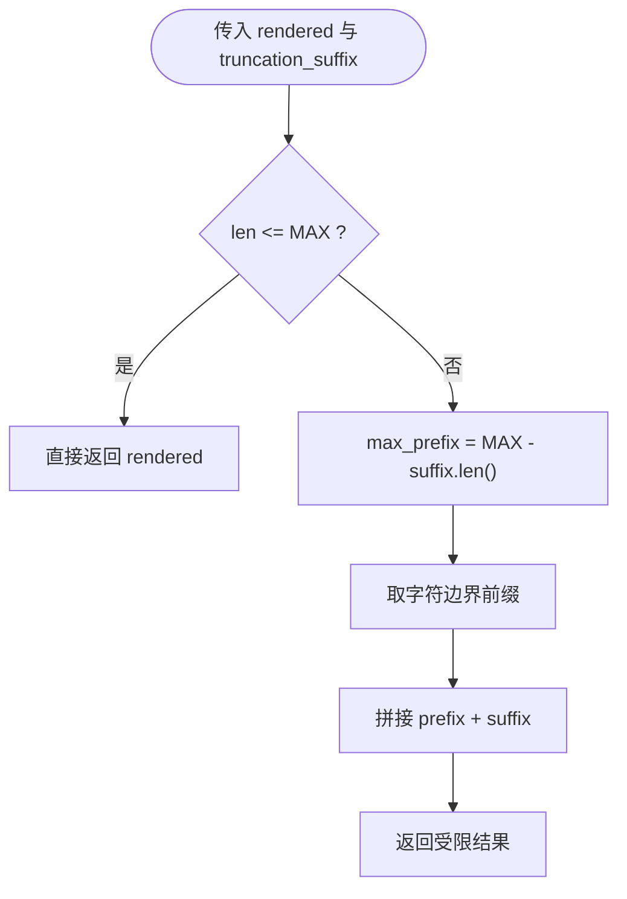
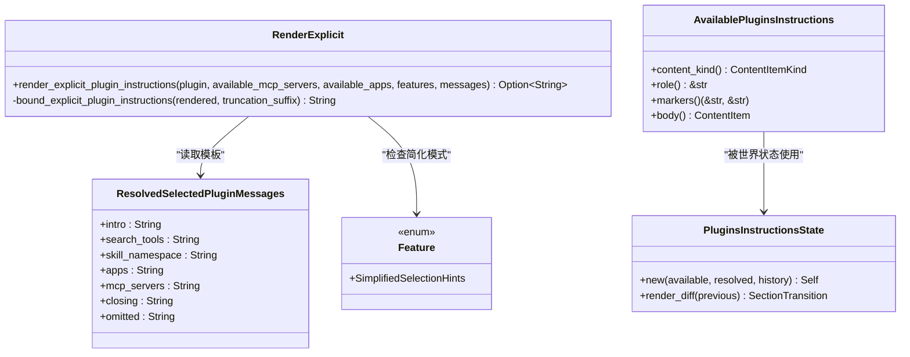

# 插件指令渲染

<cite>
**本文引用的文件**   
- [render.rs](file://codex-rs/core/src/plugins/render.rs)
- [available_plugins_instructions.rs](file://codex-rs/core/src/context/available_plugins_instructions.rs)
- [plugins_instructions.rs](file://codex-rs/core/src/context/world_state/plugins_instructions.rs)
- [plugins.rs](file://codex-rs/prompts/src/model_messages/plugins.rs)
- [lib.rs（特性标志）](file://codex-rs/features/src/lib.rs)
- [mod.rs（插件模块入口）](file://codex-rs/core/src/plugins/mod.rs)
- [render_tests.rs](file://codex-rs/core/src/plugins/render_tests.rs)
- [plugins_instructions_tests.rs](file://codex-rs/core/src/context/world_state/plugins_instructions_tests.rs)
</cite>

## 目录
1. [引言](#引言)
2. [项目结构](#项目结构)
3. [核心组件](#核心组件)
4. [架构总览](#架构总览)
5. [详细组件分析](#详细组件分析)
6. [依赖关系分析](#依赖关系分析)
7. [性能与优化](#性能与优化)
8. [故障排查](#故障排查)
9. [结论](#结论)
10. [附录：模板开发与测试指南](#附录模板开发与测试指南)

## 引言
本文聚焦“插件指令渲染”子系统，目标是帮助读者理解如何把“已选择插件的能力信息”安全、高效、可本地化地注入到模型上下文。重点包括：
- `render_explicit_plugin_instructions` 的完整渲染流程、简化模式快速路径和优化策略。
- `AvailablePluginsInstructions` 在通用插件使用说明中的作用、占位符替换和边界控制。
- `MAX_EXPLICIT_PLUGIN_INSTRUCTIONS_BYTES` 字节限制、UTF-8 字符边界截断与省略后缀处理。
- 特性标志对行为的影响，特别是 `Feature::SimplifiedSelectionHints`。
- 多语言支持与消息模板管理、更新机制。
- 性能优化建议、自定义模板开发指南与测试方法。

## 项目结构
该功能横跨多个 crate：
- `codex-rs/core/src/plugins/render.rs`：实现显式插件指令渲染主逻辑与字节边界控制。
- `codex-rs/core/src/context/available_plugins_instructions.rs`：定义通用插件使用说明片段，并为其打上内容标记。
- `codex-rs/core/src/context/world_state/plugins_instructions.rs`：维护通用插件使用说明的世界状态、历史回退与差异注入。
- `codex-rs/prompts/src/model_messages/plugins.rs`：从模型目录解析并校验插件消息模板，提供默认值与占位符校验。
- `codex-rs/features/src/lib.rs`：集中声明特性标志，包括 `SimplifiedSelectionHints`。
- `codex-rs/core/src/plugins/mod.rs`：对外暴露 `render_explicit_plugin_instructions` 等能力。

图表来源
- [mod.rs:1-81](file://codex-rs/core/src/plugins/mod.rs#L1-L81)
- [render.rs:1-124](file://codex-rs/core/src/plugins/render.rs#L1-L124)
- [plugins.rs:1-192](file://codex-rs/prompts/src/model_messages/plugins.rs#L1-L192)
- [available_plugins_instructions.rs:1-51](file://codex-rs/core/src/context/available_plugins_instructions.rs#L1-L51)
- [plugins_instructions.rs:1-173](file://codex-rs/core/src/context/world_state/plugins_instructions.rs#L1-L173)
- [lib.rs（特性标志）:320-375](file://codex-rs/features/src/lib.rs#L320-L375)

章节来源
- [mod.rs:1-81](file://codex-rs/core/src/plugins/mod.rs#L1-L81)

## 核心组件
- 显式插件指令渲染器：负责根据所选插件、可用应用与 MCP 服务器列表，结合消息模板生成面向模型的指令片段，并进行字节边界裁剪。
- 通用插件使用说明片段：将“什么是插件”“如何使用插件”等内容包装为带标记的用户输入片段，供世界状态管理。
- 世界状态中的插件说明：负责比较历史快照、决定是否注入或移除通用插件说明，并在目录变更时进行回退与退休处理。
- 模型消息模板解析：从模型目录加载插件消息模板，执行大小、格式与占位符校验，并提供安全的默认值。
- 特性开关：通过 `Features` 启用简化提示等渲染策略。

章节来源
- [render.rs:1-124](file://codex-rs/core/src/plugins/render.rs#L1-L124)
- [available_plugins_instructions.rs:1-51](file://codex-rs/core/src/context/available_plugins_instructions.rs#L1-L51)
- [plugins_instructions.rs:1-173](file://codex-rs/core/src/context/world_state/plugins_instructions.rs#L1-L173)
- [plugins.rs:1-192](file://codex-rs/prompts/src/model_messages/plugins.rs#L1-L192)
- [lib.rs（特性标志）:320-375](file://codex-rs/features/src/lib.rs#L320-L375)

## 架构总览
下面的时序图展示了一次显式插件指令渲染的主要调用链：

图表来源
- [mod.rs:1-81](file://codex-rs/core/src/plugins/mod.rs#L1-L81)
- [render.rs:1-124](file://codex-rs/core/src/plugins/render.rs#L1-L124)
- [plugins.rs:1-192](file://codex-rs/prompts/src/model_messages/plugins.rs#L1-L192)
- [lib.rs（特性标志）:320-375](file://codex-rs/features/src/lib.rs#L320-L375)
- [available_plugins_instructions.rs:1-51](file://codex-rs/core/src/context/available_plugins_instructions.rs#L1-L51)

## 详细组件分析

### 显式插件指令渲染函数 `render_explicit_plugin_instructions`
该函数是插件指令渲染的核心入口，主要职责：
- 根据 `Features` 判断是否进入简化模式快速路径。
- 在标准模式下，基于 `ResolvedSelectedPluginMessages` 模板填充占位符，按条件追加“搜索工具”“技能命名空间”“应用列表”“MCP 服务器列表”等段落。
- 使用 `bound_explicit_plugin_instructions` 对最终文本进行字节级限制，确保不超过 `MAX_EXPLICIT_PLUGIN_PLUGIN_INSTRUCTIONS_BYTES`。
- 保证省略后缀保留目录原始字节，同时保持 UTF-8 字符边界。

关键要点：
- 简化模式快速路径：当 `Feature::SimplifiedSelectionHints` 启用，并且插件具有技能、或存在可用应用、或存在可用 MCP 服务器时，直接返回一句简短提示，后接固定省略后缀。这能显著降低大列表场景下的渲染开销。
- 占位符替换：仅对模板中指定的占位符进行替换，例如 `{{ plugin_name }}`、`{{ skill_namespace }}`、`{{ apps }}`、`{{ mcp_servers }}`；其他字面量原样保留。
- 空结果处理：如果拼接后的有效行数只有引导语，则返回 `None`，避免无意义的空指令。
- 分隔符保护：省略后缀前会检测其首行换行风格，必要时补齐换行，以保留目录提供的精确字节。

图表来源
- [render.rs:1-124](file://codex-rs/core/src/plugins/render.rs#L1-L124)

章节来源
- [render.rs:1-124](file://codex-rs/core/src/plugins/render.rs#L1-L124)

### 字节限制与 UTF-8 字符边界
`MAX_EXPLICIT_PLUGIN_INSTRUCTIONS_BYTES` 用于防止单条插件指令过长导致上下文溢出。实现策略：
- 若渲染结果长度小于等于上限，直接返回。
- 否则计算最大前缀字节数：上限减去省略后缀长度。
- 使用 `take_bytes_at_char_boundary` 在 Unicode 字符边界处截断前缀，避免破坏 UTF-8 序列。
- 最终拼接前缀与省略后缀，形成受控长度的输出。

该设计保证了：
- 输出永远不超过限制。
- 不会截断多字节字符。
- 省略后缀始终位于末尾，便于下游识别被截断的情况。

图表来源
- [render.rs:1-124](file://codex-rs/core/src/plugins/render.rs#L1-L124)

章节来源
- [render.rs:1-124](file://codex-rs/core/src/plugins/render.rs#L1-L124)

### `AvailablePluginsInstructions` 模板的使用
`AvailablePluginsInstructions` 表示“通用插件使用说明”，它不是针对某个具体插件的指令，而是向模型说明插件的概念、命名规则、触发规则以及其与能力的关系。

关键点：
- 构造方式：由 `ResolvedGenericPluginMessages` 组装成一段包含“什么是插件”“如何使用插件”的结构化文本。
- 内容标记：使用 `PLUGINS_INSTRUCTIONS_OPEN_TAG` 与 `PLUGINS_INSTRUCTIONS_CLOSE_TAG` 包裹，以便世界状态对比和替换。
- 角色与类型：作为开发者角色的用户输入片段，类型为 `plugins.usage_instructions`。
- 默认值：如果未配置，则使用内置模板。

注意：`AvailablePluginsInstructions` 主要用于世界状态的通用插件说明注入，而不是 `render_explicit_plugin_instructions` 的输出。后者使用的是 `ResolvedSelectedPluginMessages`。

章节来源
- [available_plugins_instructions.rs:1-51](file://codex-rs/core/src/context/available_plugins_instructions.rs#L1-L51)
- [plugins_instructions.rs:1-173](file://codex-rs/core/src/context/world_state/plugins_instructions.rs#L1-L173)

### 不同特性标志对渲染行为的影响
当前直接影响显式插件指令渲染的特性标志是：
- `Feature::SimplifiedSelectionHints`：启用后进入简化模式，返回一句更短的选择提示，不再展开技能、应用、MCP 服务器列表。

该特性定义为“处于开发阶段”，默认不启用，通过配置开启后可减少大型环境下的模板渲染成本。

章节来源
- [lib.rs（特性标志）:320-375](file://codex-rs/features/src/lib.rs#L320-L375)
- [render.rs:1-124](file://codex-rs/core/src/plugins/render.rs#L1-L124)

### 多语言支持和本地化机制
插件指令的多语言支持主要由模板解析层承担：
- 模型目录中可以包含 `plugins.generic` 与 `plugins.selected` 两类消息。
- `generic_plugin()` 负责解析通用插件说明的 `intro` 与 `usage_instructions`，并对长度、空白、控制字符、标签注入等进行校验。
- `selected_plugin()` 负责解析针对已选插件的模板字段，包括 `intro`、`search_tools`、`skill_namespace`、`apps`、`mcp_servers`、`closing`、`omitted`。
- 模板中的占位符必须存在且不含非法字符；否则回退到内置默认值。
- 所有模板都受最大字节数限制，防止目录注入过大文本。

这意味着：
- 新增语言时，应在模型目录中提供对应插件消息。
- 模板可以完全覆盖默认文案，但必须符合长度与格式约束。
- 若模板无效，系统会优雅降级到内置英文默认值。

章节来源
- [plugins.rs:1-192](file://codex-rs/prompts/src/model_messages/plugins.rs#L1-L192)

## 依赖关系分析

图表来源
- [render.rs:1-124](file://codex-rs/core/src/plugins/render.rs#L1-L124)
- [plugins.rs:1-192](file://codex-rs/prompts/src/model_messages/plugins.rs#L1-L192)
- [available_plugins_instructions.rs:1-51](file://codex-rs/core/src/context/available_plugins_instructions.rs#L1-L51)
- [plugins_instructions.rs:1-173](file://codex-rs/core/src/context/world_state/plugins_instructions.rs#L1-L173)
- [lib.rs（特性标志）:320-375](file://codex-rs/features/src/lib.rs#L320-L375)

章节来源
- [render.rs:1-124](file://codex-rs/core/src/plugins/render.rs#L1-L124)
- [plugins.rs:1-192](file://codex-rs/prompts/src/model_messages/plugins.rs#L1-L192)
- [available_plugins_instructions.rs:1-51](file://codex-rs/core/src/context/available_plugins_instructions.rs#L1-L51)
- [plugins_instructions.rs:1-173](file://codex-rs/core/src/context/world_state/plugins_instructions.rs#L1-L173)

## 性能与优化
- 简化模式快速路径：在 `SimplifiedSelectionHints` 启用时，跳过模板拼接与大列表格式化，直接返回简短提示。这对拥有大量应用或 MCP 服务器的环境尤其重要。
- 按需追加段落：只有在对应集合非空时才追加“搜索工具”“技能命名空间”“应用列表”“MCP 服务器列表”，避免无用字符串分配。
- 字节限制前置：先判断是否超限，再决定截断，减少不必要的前缀计算。
- UTF-8 安全截断：使用字符边界截取，避免重复解码或多次扫描。
- 模板复用：`ResolvedSelectedPluginMessages` 在解析阶段完成默认值和校验，渲染阶段只做一次性占位符替换。

建议：
- 在大环境场景中优先启用 `SimplifiedSelectionHints`。
- 控制应用与 MCP 服务器列表规模，避免单次渲染产生超长文本。
- 避免在模板中使用过长文案；尽量保持简洁。

[本节为通用指导，不直接分析具体代码文件]

## 故障排查
常见问题与定位思路：
- 渲染结果为空：检查是否只生成了引导语但没有其他可选段落；此时函数会返回 `None`。确认插件是否有技能，或是否存在可用应用/MCP 服务器。
- 输出被截断：检查是否超过 `MAX_EXPLICIT_PLUGIN_INSTRUCTIONS_BYTES`；查看省略后缀是否出现在末尾。
- UTF-8 字符损坏：确认截断发生在字符边界；测试用例覆盖了 emoji 和多字节字符。
- 模板未生效：检查模型目录中的插件消息是否满足长度、控制字符、标签注入与占位符要求；无效模板会回退到内置默认值。
- 通用插件说明未注入：检查世界状态历史、目录是否退休、以及 `AvailablePluginsInstructions` 的标记匹配逻辑。

章节来源
- [render_tests.rs:1-157](file://codex-rs/core/src/plugins/render_tests.rs#L1-L157)
- [plugins_instructions_tests.rs:1-300](file://codex-rs/core/src/context/world_state/plugins_instructions_tests.rs#L1-L300)

## 结论
插件指令渲染通过清晰的职责分离实现了安全、可本地化、可扩展的模型提示注入：
- 显式插件指令渲染器负责组合业务事实与模板，并以字节边界保障稳定性。
- 通用插件说明片段与世界状态协作，确保历史一致性与目录变更安全。
- 模板解析层提供严格的校验与回退，使多语言扩展具备容错性。
- 特性开关为性能敏感场景提供快速路径。

对于使用者而言，最关键的实践是：
- 在大型环境中考虑启用简化模式。
- 谨慎编写模板，遵循长度、占位符与字符限制。
- 用测试覆盖边界情况，尤其是截断、UTF-8 与模板缺失场景。

[本节为总结性内容，不直接分析具体代码文件]

## 附录：模板开发与测试指南

### 自定义模板最佳实践
- 使用 `ResolvedModelMessages::bundled().selected_plugin()` 作为基准，了解各字段用途。
- 确保每个模板字段包含所需占位符，例如 `{{ plugin_name }}`、`{{ skill_namespace }}`、`{{ apps }}`、`{{ mcp_servers }}`。
- 控制文案长度，避免超过相应上限；超出会被丢弃并回退默认值。
- 不要引入控制字符或危险标签；系统会拒绝此类模板。
- 若需要修改省略后缀，应保证它以换行开头或在前置逻辑中被正确处理。

### 测试方法
- 使用 `render_explicit_plugin_instructions` 测试函数，构造不同场景：有技能、无技能、有应用、有 MCP 服务器、超大列表等。
- 验证字节限制：确保输出不超过 `MAX_EXPLICIT_PLUGIN_INSTRUCTIONS_BYTES`。
- 验证 UTF-8 安全：包含 emoji、多字节字符，确认未被截断。
- 验证占位符替换：确保运行时事实正确注入，而模板字面量不被二次替换。
- 对通用插件说明，使用世界状态测试覆盖历史回退、目录变更与退休逻辑。

章节来源
- [render_tests.rs:1-157](file://codex-rs/core/src/plugins/render_tests.rs#L1-L157)
- [plugins_instructions_tests.rs:1-300](file://codex-rs/core/src/context/world_state/plugins_instructions_tests.rs#L1-L300)