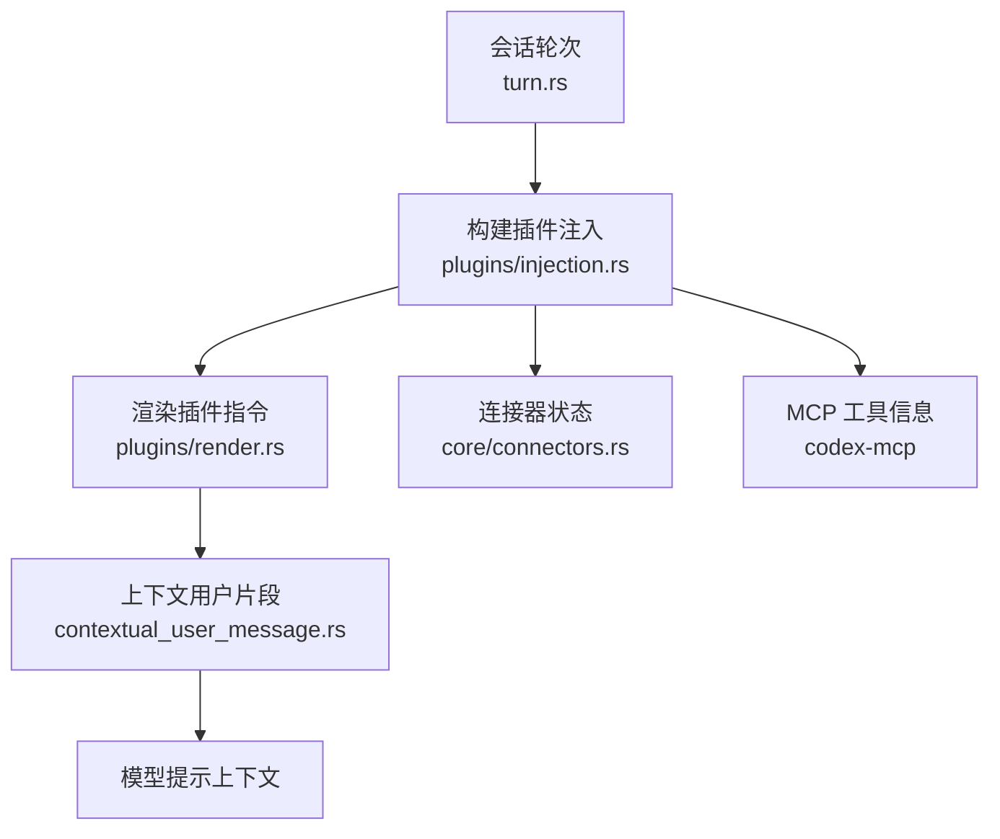
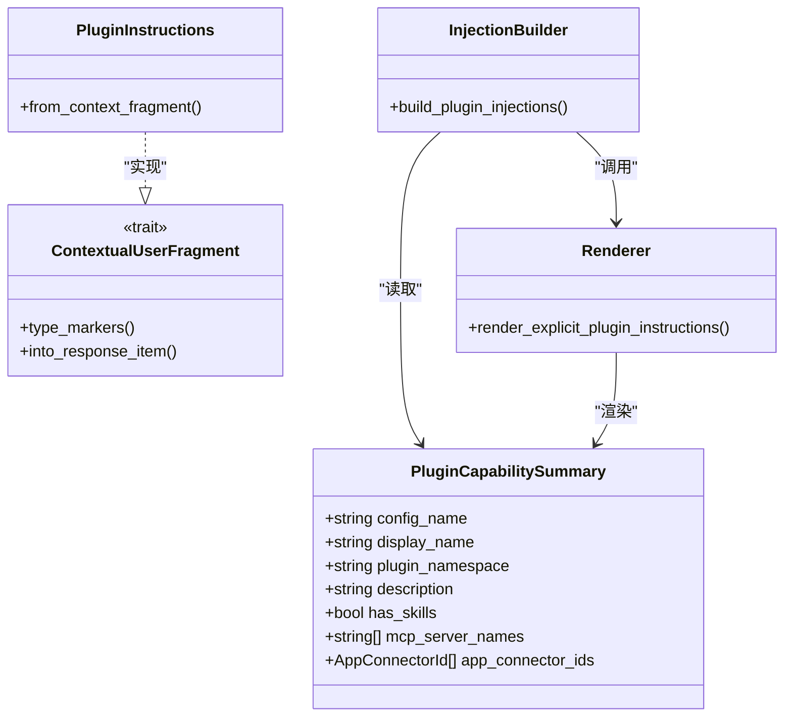
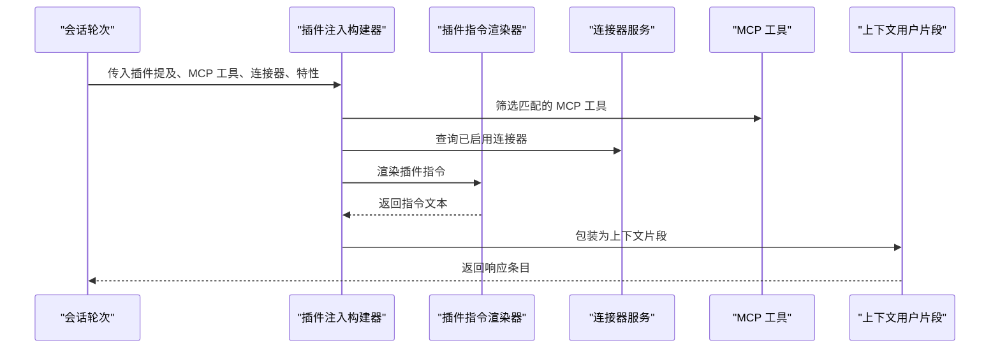
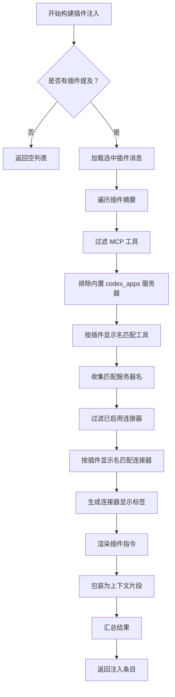
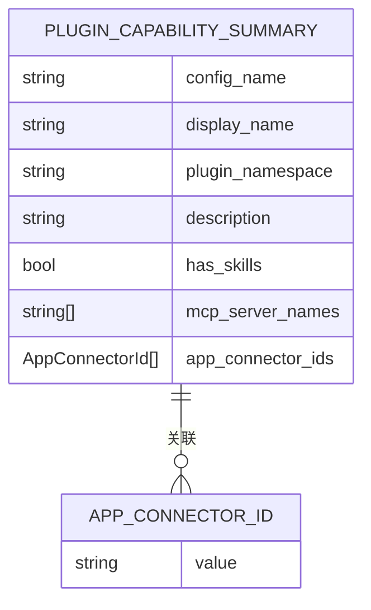
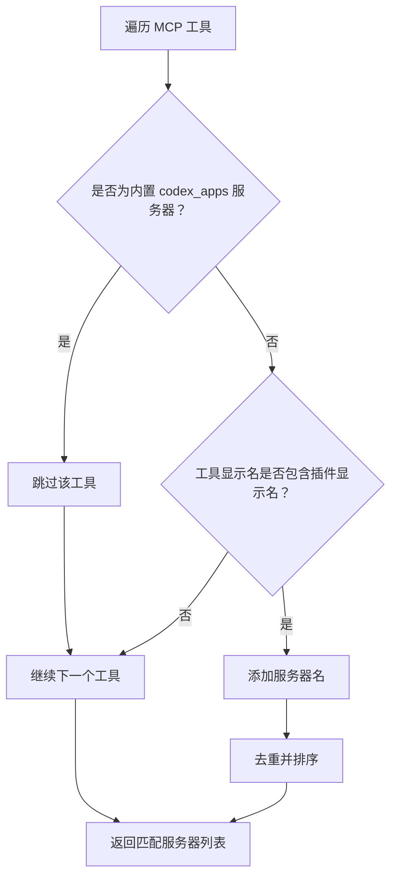
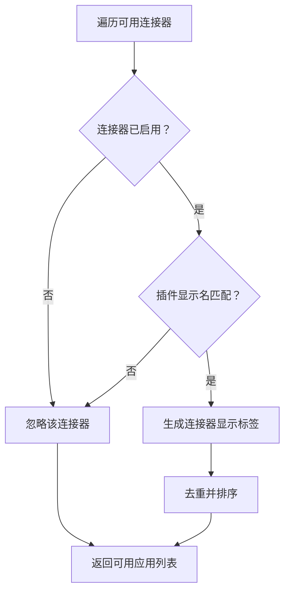
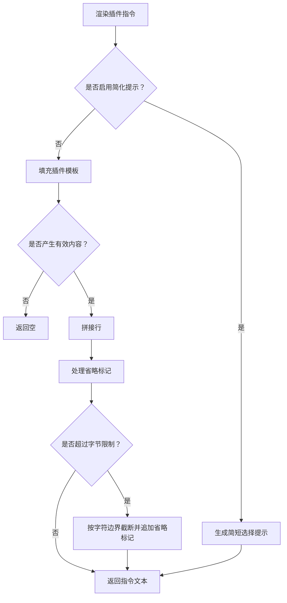

# 插件注入系统

<cite>
**本文引用的文件**   
- [injection.rs](file://codex-rs/core/src/plugins/injection.rs)
- [render.rs](file://codex-rs/core/src/plugins/render.rs)
- [mod.rs（核心插件模块）](file://codex-rs/core/src/plugins/mod.rs)
- [turn.rs（会话轮次）](file://codex-rs/core/src/session/turn.rs)
- [lib.rs（插件公共模型）](file://codex-rs/plugin/src/lib.rs)
- [connectors.rs（连接器发现）](file://codex-rs/core/src/connectors.rs)
- [mod.rs（MCP 常量与工具信息）](file://codex-rs/codex-mcp/src/mcp/mod.rs)
- [server.rs（MCP 服务器过滤）](file://codex-rs/codex-mcp/src/server.rs)
- [runtime.rs（MCP 运行时）](file://codex-rs/codex-mcp/src/runtime.rs)
- [contextual_user_message.rs（上下文用户消息）](file://codex-rs/core/src/context/contextual_user_message.rs)
- [connector_display_label.rs（连接器显示标签）](file://codex-rs/connectors/src/metadata.rs)
</cite>

## 目录
1. [引言](#引言)
2. [项目结构与职责划分](#项目结构与职责划分)
3. [核心组件总览](#核心组件总览)
4. [架构与数据流](#架构与数据流)
5. [build_plugin_injections 函数详解](#build_plugin_injections-函数详解)
6. [PluginCapabilitySummary 能力摘要](#plugincapabilitysummary-能力摘要)
7. [MCP 服务器工具匹配逻辑](#mcp-服务器工具匹配逻辑)
8. [连接器启用状态检查与显示标签生成](#连接器启用状态检查与显示标签生成)
9. [ContextualUserFragment 构建与渲染机制](#contextualuserfragment-构建与渲染机制)
10. [配置示例](#配置示例)
11. [性能与容量控制](#性能与容量控制)
12. [故障排除指南](#故障排除指南)
13. [结论](#结论)

## 引言

插件注入系统负责把“用户明确提到的插件”转化为可被模型消费的用户侧上下文片段。它不是简单地把插件名称拼进提示，而是根据当前环境中可用的能力，生成有针对性的开发指令：包括该插件暴露的 MCP 服务器、已启用的应用连接器、技能命名空间以及是否应该使用简化提示等。

该系统的入口是 `build_plugin_injections`；它的输入来自会话层对插件提及的解析结果，输出则是 `ResponseItem` 列表，这些条目会作为上下文片段进入后续提示组装流程。

## 项目结构与职责划分

| 路径 | 主要职责 |
|---|---|
| `codex-rs/core/src/plugins/injection.rs` | 根据插件提及、MCP 工具、连接器和特性开关，构建插件注入条目 |
| `codex-rs/core/src/plugins/render.rs` | 将插件能力摘要和可用资源渲染为具体指令文本，并做字节级截断 |
| `codex-rs/core/src/plugins/mod.rs` | 暴露插件相关公共类型、渲染函数和注入函数 |
| `codex-rs/core/src/session/turn.rs` | 在会话轮次中调用注入逻辑，并把插件注入加入上下文 |
| `codex-rs/plugin/src/lib.rs` | 定义跨模块共享的 `PluginCapabilitySummary` 等插件能力模型 |
| `codex-rs/core/src/connectors.rs` | 从 MCP 工具推导可访问连接器，并提供连接器元数据访问 |
| `codex-rs/codex-mcp/src/mcp/mod.rs` | 定义 `CODEX_APPS_MCP_SERVER_NAME` 等 MCP 常量 |
| `codex-rs/codex-mcp/src/server.rs` | 提供 MCP 服务器过滤逻辑，例如排除特定内置服务器 |
| `codex-rs/codex-mcp/src/runtime.rs` | 管理 MCP 运行时、工具注册、宿主应用服务器绑定和事件流 |
| `codex-rs/core/src/context/contextual_user_message.rs` | 定义 `ContextualUserFragment` trait，用于把结构化上下文转为用户侧片段 |
| `codex-rs/connectors/src/metadata.rs` | 提供连接器的显示标签生成逻辑 |

**图表来源**  
- [turn.rs:1359-1359](file://codex-rs/core/src/session/turn.rs#L1359-L1359)
- [injection.rs:15-68](file://codex-rs/core/src/plugins/injection.rs#L15-L68)
- [render.rs:30-124](file://codex-rs/core/src/plugins/render.rs#L30-L124)
- [contextual_user_message.rs:1-200](file://codex-rs/core/src/context/contextual_user_message.rs#L1-L200)

**章节来源**  
- [mod.rs（核心插件模块）:1-81](file://codex-rs/core/src/plugins/mod.rs#L1-L81)
- [injection.rs:1-68](file://codex-rs/core/src/plugins/injection.rs#L1-L68)
- [turn.rs:38-38](file://codex-rs/core/src/session/turn.rs#L38-L38)

## 核心组件总览

插件注入系统由五个关键部分组成：

1. **插件能力摘要**：描述插件的配置名、显示名、命名空间、技能、MCP 服务器和应用连接器。
2. **插件注入构建器**：根据用户提到的插件和当前环境能力，生成注入项。
3. **插件指令渲染器**：把能力摘要转换为面向模型的提示文本，支持简化模式和模板替换。
4. **连接器状态检查器**：判断应用连接器是否启用，并生成显示标签。
5. **上下文用户片段接口**：把插件注入包装成统一的上下文片段，供上层统一处理。

**图表来源**  
- [lib.rs（插件公共模型）:54-70](file://codex-rs/plugin/src/lib.rs#L54-L70)
- [injection.rs:15-68](file://codex-rs/core/src/plugins/injection.rs#L15-L68)
- [render.rs:30-124](file://codex-rs/core/src/plugins/render.rs#L30-L124)

**章节来源**  
- [lib.rs（插件公共模型）:54-70](file://codex-rs/plugin/src/lib.rs#L54-L70)
- [mod.rs（核心插件模块）:18-21](file://codex-rs/core/src/plugins/mod.rs#L18-L21)

## 架构与数据流

插件注入的整体流程如下：

1. 会话层解析用户输入中的插件提及，得到一组 `PluginCapabilitySummary`。
2. 如果没有任何插件被提到，直接返回空结果。
3. 对每个被提到的插件，收集其匹配的 MCP 服务器和已启用的应用连接器。
4. 调用渲染器生成插件指令。
5. 将指令包装为 `PluginInstructions`，再转为 `ContextualUserFragment`。
6. 最终成为 `ResponseItem`，进入模型上下文。

**图表来源**  
- [turn.rs:1359-1359](file://codex-rs/core/src/session/turn.rs#L1359-L1359)
- [injection.rs:15-68](file://codex-rs/core/src/plugins/injection.rs#L15-L68)
- [render.rs:30-124](file://codex-rs/core/src/plugins/render.rs#L30-L124)

**章节来源**  
- [turn.rs:1359-1359](file://codex-rs/core/src/session/turn.rs#L1359-L1359)
- [injection.rs:15-68](file://codex-rs/core/src/plugins/injection.rs#L15-L68)

## build_plugin_injections 函数详解

`build_plugin_injections` 的核心目标是：**只对有明确插件提及的请求注入插件上下文**，并且注入内容必须反映当前真实可用的能力。

### 参数说明

| 参数 | 含义 |
|---|---|
| `mentioned_plugins` | 用户或上游解析出的插件能力摘要列表 |
| `mcp_tools` | 当前可用的 MCP 工具集合 |
| `available_connectors` | 当前可用的应用连接器集合 |
| `features` | 功能特性开关，影响渲染策略 |
| `model_messages` | 已解析的模型消息，包含插件相关模板 |

### 执行步骤

1. **空插件快速返回**：如果没有插件被提到，直接返回空向量，避免无意义计算。
2. **获取选中插件消息**：从模型消息中提取 `selected_plugin` 模板。
3. **遍历插件摘要**：对每个插件执行能力匹配。
4. **收集 MCP 服务器**：过滤掉内置 `CODEX_APPS_MCP_SERVER_NAME`，再按插件显示名匹配工具。
5. **收集连接器应用**：仅启用且匹配插件显示名的连接器才会进入结果。
6. **渲染指令**：调用渲染器生成插件指令。
7. **包装为上下文片段**：把指令转为 `PluginInstructions`，再转为 `ContextualUserFragment`。
8. **汇总返回**：所有成功渲染的插件注入项组成最终结果。

**图表来源**  
- [injection.rs:15-68](file://codex-rs/core/src/plugins/injection.rs#L15-L68)
- [render.rs:30-124](file://codex-rs/core/src/plugins/render.rs#L30-L124)

**章节来源**  
- [injection.rs:15-68](file://codex-rs/core/src/plugins/injection.rs#L15-L68)

## PluginCapabilitySummary 能力摘要

`PluginCapabilitySummary` 是插件能力在不同模块之间传递的统一结构。它不表示插件如何加载，也不表示插件如何运行，而是表示“这个插件在当前上下文中有哪些可被发现的能力”。

### 字段含义

| 字段 | 类型 | 含义 |
|---|---|---|
| `config_name` | `String` | 插件配置名，通常用于本地识别和配置关联 |
| `display_name` | `String` | 插件显示名，用于用户可见提示和工具匹配 |
| `plugin_namespace` | `Option<String>` | 可选的技能命名空间；未设置时回退到显示名 |
| `description` | `Option<String>` | 可选插件描述，可用于 UI 展示或诊断 |
| `has_skills` | `bool` | 表示该插件是否具备技能能力 |
| `mcp_server_names` | `Vec<String>` | 插件声明的 MCP 服务器名称列表 |
| `app_connector_ids` | `Vec<AppConnectorId>` | 插件关联的应用连接器标识列表 |

### 使用场景

- 插件加载完成后生成能力摘要，供管理器、遥测、UI 和注入系统使用。
- 注入系统用 `display_name` 匹配 MCP 工具和连接器。
- 渲染系统用 `has_skills` 和 `plugin_namespace` 决定技能相关指令。
- 连接器快照、遥测、测试用例都依赖该结构表达插件能力。

**图表来源**  
- [lib.rs（插件公共模型）:54-70](file://codex-rs/plugin/src/lib.rs#L54-L70)

**章节来源**  
- [lib.rs（插件公共模型）:54-70](file://codex-rs/plugin/src/lib.rs#L54-L70)

## MCP 服务器工具匹配逻辑

MCP 工具匹配的核心规则是：**用户提到的插件必须能在当前 MCP 工具集中找到对应显示名，同时排除内置的 `CODEX_APPS_MCP_SERVER_NAME`**。

### 特殊处理：CODEX_APPS_MCP_SERVER_NAME

`CODEX_APPS_MCP_SERVER_NAME` 是一个内部常量，值为 `"codex_apps"`。它在多个位置被特殊对待：

| 位置 | 行为 |
|---|---|
| `codex-mcp/mcp/mod.rs` | 定义常量 |
| `codex-mcp/server.rs` | 过滤掉该服务器，防止将其当作普通插件服务器 |
| `codex-mcp/runtime.rs` | 管理宿主应用服务器的生命周期、事件和工具缓存 |
| `plugins/injection.rs` | 显式排除该服务器，避免把内置应用服务器误认为插件能力 |

### 匹配算法

1. 遍历所有 `ToolInfo`。
2. 跳过 `server_name == CODEX_APPS_MCP_SERVER_NAME` 的工具。
3. 检查工具的 `plugin_display_names` 是否包含当前插件的 `display_name`。
4. 如果匹配，把 `server_name` 加入结果集合。
5. 使用有序集合去重后转为向量。

**图表来源**  
- [injection.rs:28-40](file://codex-rs/core/src/plugins/injection.rs#L28-L40)
- [mod.rs（MCP 常量与工具信息）:66-66](file://codex-rs/codex-mcp/src/mcp/mod.rs#L66-L66)
- [server.rs:97-97](file://codex-rs/codex-mcp/src/server.rs#L97-L97)
- [runtime.rs:346-464](file://codex-rs/codex-mcp/src/runtime.rs#L346-L464)

**章节来源**  
- [injection.rs:28-40](file://codex-rs/core/src/plugins/injection.rs#L28-L40)
- [mod.rs（MCP 常量与工具信息）:66-66](file://codex-rs/codex-mcp/src/mcp/mod.rs#L66-L66)
- [server.rs:97-97](file://codex-rs/codex-mcp/src/server.rs#L97-L97)
- [runtime.rs:346-464](file://codex-rs/codex-mcp/src/runtime.rs#L346-L464)

## 连接器启用状态检查与显示标签生成

连接器注入的逻辑与 MCP 工具类似，但多了一个启用状态判断。

### 启用状态检查

只有满足以下条件的连接器才会出现在插件注入中：

1. 连接器的 `is_enabled` 为真。
2. 连接器的 `plugin_display_names` 中包含目标插件的 `display_name`。

### 显示标签生成

连接器不会直接暴露原始名称，而是通过 `connector_display_label` 生成可读性更好的显示标签。这样用户看到的可能是更友好的应用名，而不是内部 ID。

### 数据处理流程

**图表来源**  
- [injection.rs:41-53](file://codex-rs/core/src/plugins/injection.rs#L41-L53)
- [connector_display_label.rs:1-200](file://codex-rs/connectors/src/metadata.rs#L1-L200)

**章节来源**  
- [injection.rs:41-53](file://codex-rs/core/src/plugins/injection.rs#L41-L53)
- [connectors.rs:1-260](file://codex-rs/core/src/connectors.rs#L1-L260)

## ContextualUserFragment 构建与渲染机制

`ContextualUserFragment` 是一个抽象接口，用于把不同来源的结构化上下文统一转换为用户侧片段。插件注入最终会通过 `PluginInstructions` 实现该接口，从而进入通用的上下文处理流程。

### 构建过程

1. 渲染器生成插件指令文本。
2. 如果渲染结果为空，说明没有有效信息需要注入。
3. 非空结果被包装为 `PluginInstructions`。
4. `PluginInstructions` 转为 `ContextualUserFragment`。
5. 最终转为 `ResponseItem`，成为模型可消费的上下文条目。

### 渲染策略

渲染器支持两种模式：

#### 简化模式

当启用 `SimplifiedSelectionHints` 特性时，渲染器只输出简短提示：

- 确认用户选择了某个插件。
- 指示模型使用该插件的技能或工具完成任务。
- 不再展开详细模板。

#### 完整模式

完整模式使用 `ResolvedSelectedPluginMessages` 中的模板进行替换：

| 模板占位符 | 替换内容 |
|---|---|
| `{{ plugin_name }}` | 插件显示名 |
| `{{ skill_namespace }}` | 技能命名空间，默认回退到插件显示名 |
| `{{ apps }}` | 已启用连接器显示标签列表 |
| `{{ mcp_servers }}` | 匹配的 MCP 服务器名称列表 |
| `{{ omitted }}` | 超出长度限制时的省略标记 |

### 截断策略

插件指令有最大字节数限制。渲染器会：

1. 计算允许的前缀字节数。
2. 在字符边界处截断，避免破坏多字节字符。
3. 追加省略后缀。
4. 保证分隔符行为与提示框架一致。

**图表来源**  
- [render.rs:30-124](file://codex-rs/core/src/plugins/render.rs#L30-L124)
- [contextual_user_message.rs:1-200](file://codex-rs/core/src/context/contextual_user_message.rs#L1-L200)

**章节来源**  
- [render.rs:30-124](file://codex-rs/core/src/plugins/render.rs#L30-L124)
- [contextual_user_message.rs:1-200](file://codex-rs/core/src/context/contextual_user_message.rs#L1-L200)

## 配置示例

以下示例基于仓库中插件注入和 MCP 常量的实际行为整理，重点说明哪些配置会影响注入结果。

### 1. 启用插件能力摘要

插件能力摘要通常由插件加载或远程插件管理器生成。要让它参与注入，需要确保：

- 插件已成功加载或发现。
- 能力摘要中包含有效的 `display_name`。
- `mcp_server_names` 或 `app_connector_ids` 与实际运行时能力一致。

### 2. 配置 MCP 服务器

要让插件注入看到某个 MCP 服务器：

- 该服务器必须通过 MCP 配置生效。
- 服务器名称不能是 `CODEX_APPS_MCP_SERVER_NAME`。
- 工具的 `plugin_display_names` 必须包含插件的 `display_name`。

### 3. 配置应用连接器

要让连接器出现在插件注入中：

- 连接器必须处于启用状态。
- 连接器的 `plugin_display_names` 必须包含插件的 `display_name`。
- 连接器需要通过 MCP 工具链路被发现。

### 4. 控制渲染行为

可以通过功能特性控制渲染：

| 特性 | 效果 |
|---|---|
| `SimplifiedSelectionHints` | 使用简短插件选择提示 |
| `Apps` | 决定是否启用应用连接器能力 |
| `RuntimeAgentInstances` | 影响插件管理器初始化方式 |

### 5. 典型注入结果

一个典型的插件注入可能告诉模型：

- 用户选择了哪个插件。
- 该插件提供了哪些 MCP 服务器。
- 该插件启用了哪些应用连接器。
- 是否需要使用该插件的技能命名空间。
- 如果内容过长，是否已被截断。

**章节来源**  
- [lib.rs（插件公共模型）:54-70](file://codex-rs/plugin/src/lib.rs#L54-L70)
- [mod.rs（MCP 常量与工具信息）:66-66](file://codex-rs/codex-mcp/src/mcp/mod.rs#L66-L66)
- [render.rs:30-124](file://codex-rs/core/src/plugins/render.rs#L30-L124)
- [connectors.rs:1-260](file://codex-rs/core/src/connectors.rs#L1-L260)

## 性能与容量控制

### 时间复杂度

- 插件遍历：O(P)，P 为插件数量。
- MCP 工具过滤：O(T × N)，T 为工具数量，N 为工具显示名数量。
- 连接器过滤：O(C × M)，C 为连接器数量，M 为连接器显示名数量。
- 集合去重：使用有序集合，整体接近 O(K log K)，K 为匹配结果数量。

### 空间复杂度

- 中间集合存储匹配到的服务器名和连接器标签。
- 渲染结果受固定字节上限约束，避免无限增长。

### 容量控制

- 插件指令最大字节数为固定值。
- 截断发生在字符边界，避免损坏 UTF-8。
- 省略标记由提示模板提供，保持框架一致性。

**章节来源**  
- [render.rs:10-124](file://codex-rs/core/src/plugins/render.rs#L10-L124)
- [injection.rs:15-68](file://codex-rs/core/src/plugins/injection.rs#L15-L68)

## 故障排除指南

### 问题一：插件注入为空

**可能原因**

- 没有插件被明确提到。
- 插件摘要中没有有效的 `display_name`。
- 插件没有暴露匹配的 MCP 工具。
- 插件没有启用任何连接器。

**排查步骤**

1. 检查会话层是否正确解析出插件提及。
2. 检查 `PluginCapabilitySummary.display_name` 是否与 MCP 工具或连接器一致。
3. 检查 MCP 工具是否包含该插件显示名。
4. 检查连接器是否启用。

**章节来源**  
- [injection.rs:15-23](file://codex-rs/core/src/plugins/injection.rs#L15-L23)
- [render.rs:30-55](file://codex-rs/core/src/plugins/render.rs#L30-L55)

### 问题二：内置 codex_apps 服务器出现在插件列表中

**可能原因**

- 下游代码没有正确排除 `CODEX_APPS_MCP_SERVER_NAME`。
- 使用了错误的工具过滤逻辑。

**排查步骤**

1. 确认注入逻辑排除了 `CODEX_APPS_MCP_SERVER_NAME`。
2. 检查 MCP 工具集合是否混入内置服务器。
3. 查看 MCP 服务器过滤和运行时逻辑。

**章节来源**  
- [injection.rs:28-40](file://codex-rs/core/src/plugins/injection.rs#L28-L40)
- [server.rs:97-97](file://codex-rs/codex-mcp/src/server.rs#L97-L97)
- [runtime.rs:346-464](file://codex-rs/codex-mcp/src/runtime.rs#L346-L464)

### 问题三：连接器没有显示在注入中

**可能原因**

- 连接器未启用。
- 连接器显示名与插件显示名不匹配。
- 连接器未被 MCP 工具链路发现。

**排查步骤**

1. 检查连接器 `is_enabled`。
2. 检查连接器 `plugin_display_names`。
3. 检查连接器是否通过 MCP 工具枚举被发现。
4. 检查显示标签生成是否覆盖原始名称。

**章节来源**  
- [injection.rs:41-53](file://codex-rs/core/src/plugins/injection.rs#L41-L53)
- [connectors.rs:1-260](file://codex-rs/core/src/connectors.rs#L1-L260)

### 问题四：插件指令被截断

**可能原因**

- 插件模板内容过长。
- 大量 MCP 服务器或连接器被列出。
- 简化模式未启用，导致完整模板展开。

**排查步骤**

1. 检查是否启用 `SimplifiedSelectionHints`。
2. 减少列出的 MCP 服务器或连接器数量。
3. 检查省略标记是否正确附加。
4. 验证截断是否发生在字符边界。

**章节来源**  
- [render.rs:10-124](file://codex-rs/core/src/plugins/render.rs#L10-L124)

### 问题五：技能命名空间不正确

**可能原因**

- 插件未设置 `plugin_namespace`。
- 渲染器回退到插件显示名。
- 插件实际技能命名空间与预期不一致。

**排查步骤**

1. 检查 `PluginCapabilitySummary.plugin_namespace`。
2. 检查渲染逻辑是否正确使用命名空间。
3. 确认插件技能目录结构符合预期。

**章节来源**  
- [render.rs:56-71](file://codex-rs/core/src/plugins/render.rs#L56-L71)
- [lib.rs（插件公共模型）:54-70](file://codex-rs/plugin/src/lib.rs#L54-L70)

## 结论

插件注入系统是一个围绕“插件能力摘要”构建的上下文生成管道。它不把插件能力硬编码到提示中，而是根据会话输入、MCP 工具、应用连接器和功能特性动态生成模型可消费的指令。

关键点包括：

- 注入只在有明确插件提及时发生。
- `PluginCapabilitySummary` 是跨模块的能力契约。
- `CODEX_APPS_MCP_SERVER_NAME` 被特殊排除，避免混淆内置应用服务器和插件服务器。
- 连接器必须启用且显示名匹配才会出现。
- 渲染支持简化模式和完整模板模式，并有字节级截断保护。
- 最终结果通过 `ContextualUserFragment` 统一进入上下文处理流程。

这套设计使插件能力既能被模型理解，又能保持扩展性和可控性。