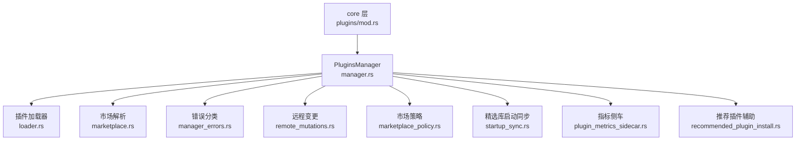
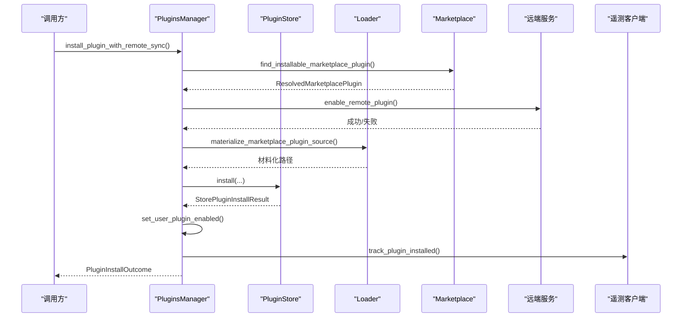
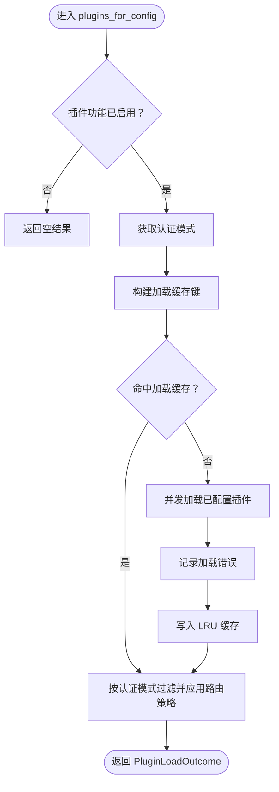
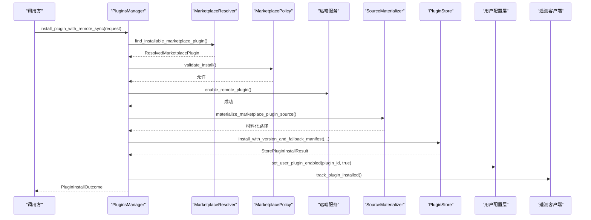
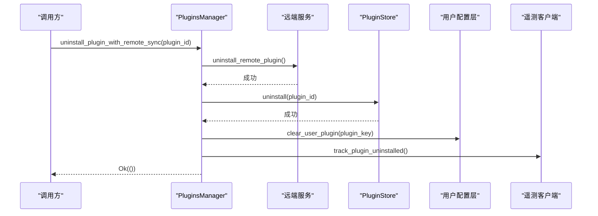
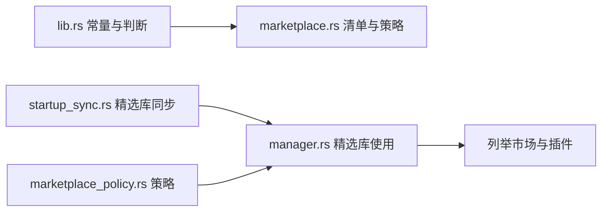
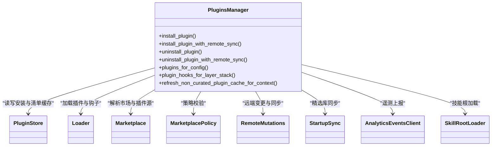

# 插件管理器

<cite>
**本文引用的文件**   
- [manager.rs](file://codex-rs/core-plugins/src/manager.rs)
- [lib.rs](file://codex-rs/core-plugins/src/lib.rs)
- [manager_errors.rs](file://codex-rs/core-plugins/src/manager_errors.rs)
- [loader.rs](file://codex-rs/core-plugins/src/loader.rs)
- [marketplace.rs](file://codex-rs/core-plugins/src/marketplace.rs)
- [mod.rs](file://codex-rs/core/src/plugins/mod.rs)
- [remote_mutations.rs](file://codex-rs/core-plugins/src/remote_mutations.rs)
- [marketplace_policy.rs](file://codex-rs/core-plugins/src/marketplace_policy.rs)
- [startup_sync.rs](file://codex-rs/core-plugins/src/startup_sync.rs)
- [plugin_metrics_sidecar.rs](file://codex-rs/core-plugins/src/plugin_metrics_sidecar.rs)
- [recommended_plugin_install.rs](file://codex-rs/core-plugins/src/recommended_plugin_install.rs)
</cite>

## 目录
1. [简介](#简介)
2. [项目结构](#项目结构)
3. [核心组件](#核心组件)
4. [架构总览](#架构总览)
5. [详细组件分析](#详细组件分析)
6. [依赖关系分析](#依赖关系分析)
7. [性能与并发特性](#性能与并发特性)
8. [故障排查指南](#故障排查指南)
9. [结论](#结论)
10. [附录：API 参考](#附录api-参考)

## 简介
本文面向插件管理器的实现使用者与维护者，系统化梳理 `PluginsManager` 的核心架构、生命周期、状态维护、安装卸载升级启用流程、市场集成方式、配置管理机制、度量与遥测，以及面向调用方的 API 约定和错误处理策略。文档以仓库中 `core-plugins` 模块为主要实现来源，并结合 `core` 层对 `PluginsManager` 的构造与使用方式进行说明。

## 项目结构
插件管理相关代码集中在以下位置：
- `codex-rs/core-plugins/src/manager.rs`：插件管理器主类、安装卸载流程、缓存、远程同步入口、推荐插件候选等。
- `codex-rs/core-plugins/src/lib.rs`：对外公开的类型、模块组织和公共常量。
- `codex-rs/core-plugins/src/loader.rs`：插件加载、能力发现、MCP 服务器去重、技能快照等。
- `codex-rs/core-plugins/src/marketplace.rs`：市场清单解析、插件源类型、可用性与认证策略。
- `codex-rs/core-plugins/src/manager_errors.rs`：安装、卸载错误分类与遥测标签映射。
- `codex-rs/core/src/plugins/mod.rs`：在 `core` 层构造独立或带运行时认证的 `PluginsManager`。
- `codex-rs/core-plugins/src/remote_mutations.rs`、`marketplace_policy.rs`、`startup_sync.rs`、`plugin_metrics_sidecar.rs`、`recommended_plugin_install.rs`：远程变更、策略、精选库启动同步、指标侧车与推荐插件辅助逻辑。

**图表来源** 
- [lib.rs:1-136](file://codex-rs/core-plugins/src/lib.rs#L1-L136)
- [manager.rs:764-900](file://codex-rs/core-plugins/src/manager.rs#L764-L900)

**章节来源**
- [lib.rs:1-136](file://codex-rs/core-plugins/src/lib.rs#L1-L136)
- [mod.rs:1-81](file://codex-rs/core/src/plugins/mod.rs#L1-L81)

## 核心组件
`PluginsManager` 是插件系统的中心协调者。它负责：
- 根据配置层栈解析已配置插件、市场根、启停开关、产品限制与远程全局目录激活状态。
- 维护本地插件安装存储 `PluginStore`、能力加载缓存、远程安装插件缓存、非精选市场缓存刷新状态。
- 提供插件安装、卸载、读取详情、列出市场、刷新缓存、查询钩子、计算有效插件列表、推荐插件候选等 API。
- 将遥测事件发送到 `AnalyticsEventsClient`，并记录安装成功、失败与卸载事件。
- 通过 `RemoteInstalledPluginsCache` 与后台任务，与远端服务保持“已安装插件”状态一致，并在变更后通知下游刷新。

关键数据结构和职责摘要：
- `PluginsConfigInput`：构造输入，包含配置层栈、插件配置、模型提供者、是否启用插件及远程插件、ChatGPT 基础地址、HTTP 客户端工厂、产品 SKU 等。
- `PluginInstallRequest` / `PluginReadRequest`：安装与读取请求体。
- `PluginInstallOutcome` / `PluginReadOutcome`：安装与读取结果。
- `PluginDetail`：插件元信息、策略、接口、技能、MCP 名称、应用连接器、钩子摘要、启用状态等。
- `EffectivePluginsChange`：有效插件变化通知，用于下游（如 MCP 刷新、技能元数据失效）消费。
- `RemoteInstalledPluginsCache`：远端已安装插件缓存，含版本生成号、身份标识、显示资产、是否需要刷新有效插件等。
- `LoadedPluginsCache`：基于配置键的已加载插件 LRU 缓存，避免重复解析和文件系统访问。

**章节来源**
- [manager.rs:1-120](file://codex-rs/core-plugins/src/manager.rs#L1-L120)
- [manager.rs:301-766](file://codex-rs/core-plugins/src/manager.rs#L301-L766)
- [manager.rs:764-1154](file://codex-rs/core-plugins/src/manager.rs#L764-L1154)

## 架构总览
插件管理器的运行期架构由多个子系统协作完成：

**图表来源** 
- [manager.rs:2291-2490](file://codex-rs/core-plugins/src/manager.rs#L2291-L2490)
- [marketplace.rs:1-250](file://codex-rs/core-plugins/src/marketplace.rs#L1-L250)
- [remote_mutations.rs](file://codex-rs/core-plugins/src/remote_mutations.rs)

该序列展示了“安装”的主要阶段：解析可安装插件、可选地同步远端标记、材料化插件源、写入本地存储、更新用户配置启用状态、上报遥测。

## 详细组件分析

### 插件生命周期与状态维护
`PluginsManager` 维护两类主要状态：
1. **本地已安装与启用状态**：由 `PluginStore` 管理插件包根、活跃版本、清单缓存；通过用户配置层启用或禁用插件。
2. **远端已安装插件状态**：由 `RemoteInstalledPluginsCache` 管理，包含认证身份、生成号、显示资产和是否需要刷新有效插件的标志。

加载有效插件时，管理器会：
- 检查配置是否启用插件。
- 从认证管理器获取当前认证模式，决定目标精选市场和远端全局目录是否激活。
- 使用 `PluginLoadCacheKey` 查询 `LoadedPluginsCache`，命中则直接返回；未命中则串行执行一次完整加载。
- 调用 `load_plugins_from_layer_stack` 解析配置层、合并远端额外插件、按配置名排序、并发加载插件、去重 MCP 服务器名称，再根据认证模式过滤精选市场适用性，并应用应用路由策略。
- 将结果写回 LRU 缓存，同时记录技能快照以便后续复用。

**图表来源** 
- [manager.rs:900-1154](file://codex-rs/core-plugins/src/manager.rs#L900-L1154)
- [loader.rs:1-250](file://codex-rs/core-plugins/src/loader.rs#L1-L250)

**章节来源**
- [manager.rs:900-1154](file://codex-rs/core-plugins/src/manager.rs#L900-L1154)
- [loader.rs:1-250](file://codex-rs/core-plugins/src/loader.rs#L1-L250)

### 插件安装流程
安装分为两条路径：
- `install_plugin`：仅执行本地安装。
- `install_plugin_with_remote_sync`：先尝试远端启用标记，再执行本地安装。

核心步骤：
1. 通过 `find_installable_marketplace_plugin` 解析插件 ID、源、策略、接口和可选清单后备内容。
2. 使用 `MarketplacePolicy::validate_install` 校验市场文件与要求。
3. 若启用远端同步，调用远端变更接口标记插件为已启用。
4. 材料化插件源（本地路径、Git 或 NPM），并通过 `PluginStore.install*` 系列方法写入本地存储。
5. 更新用户配置层中的启用状态。
6. 上报遥测事件，返回 `PluginInstallOutcome`。

**图表来源** 
- [manager.rs:2235-2490](file://codex-rs/core-plugins/src/manager.rs#L2235-L2490)
- [marketplace.rs:1-250](file://codex-rs/core-plugins/src/marketplace.rs#L1-L250)

依赖解析与冲突处理：
- 依赖解析体现在市场清单与市场策略中：`MarketplacePluginPolicy` 定义安装策略与认证策略，`MarketplacePluginSource` 描述本地/Git/NPM 源。
- 冲突处理主要体现在：
  - MCP 服务器名称去重：加载时记录已出现名称，重复插件发出警告并跳过重复项。
  - 产品限制：按 `restriction_product` 过滤不可用插件。
  - 市场策略校验：安装前校验市场文件是否符合要求。
  - 安装后启用状态：通过用户配置层统一控制启用与否。

**章节来源**
- [manager.rs:2235-2490](file://codex-rs/core-plugins/src/manager.rs#L2235-L2490)
- [marketplace.rs:1-250](file://codex-rs/core-plugins/src/marketplace.rs#L1-L250)
- [loader.rs:1-250](file://codex-rs/core-plugins/src/loader.rs#L1-L250)

### 插件卸载流程
卸载同样支持两种路径：
- `uninstall_plugin`：本地卸载。
- `uninstall_plugin_with_remote_sync`：先远端标记卸载，再本地卸载。

核心步骤：
1. 解析插件 ID。
2. 若启用远端同步，调用远端变更接口标记为已卸载。
3. 通过 `PluginStore.uninstall` 移除本地安装。
4. 清除用户配置层中的启用标记。
5. 若有遥测客户端且插件曾处于活跃状态，上报卸载事件。

**图表来源** 
- [manager.rs:2492-2610](file://codex-rs/core-plugins/src/manager.rs#L2492-L2610)

**章节来源**
- [manager.rs:2492-2610](file://codex-rs/core-plugins/src/manager.rs#L2492-L2610)

### 插件启用与禁用
启用与禁用主要通过用户配置层操作：
- 安装成功后调用 `set_user_plugin_enabled` 启用插件。
- 卸载时调用 `clear_user_plugin` 清理启用标记。
- 加载时依据 `PluginsConfigToml` 与 `configured_plugins_from_stack` 决定是否启用，并对每个插件调用 `allows_plugin` 进行策略过滤。

动态配置更新：
- 当远端已安装插件缓存刷新或市场源刷新后，管理器会清空加载缓存并触发 `EffectivePluginsChangedCallback`，让下游重新计算有效插件集合。
- 非精选市场缓存刷新支持“按需版本比较”与“强制重装”，并通过线程与 watch channel 通知完成状态。

**章节来源**
- [manager.rs:2291-2490](file://codex-rs/core-plugins/src/manager.rs#L2291-L2490)
- [manager.rs:3150-3450](file://codex-rs/core-plugins/src/manager.rs#L3150-L3450)
- [loader.rs:1-250](file://codex-rs/core-plugins/src/loader.rs#L1-L250)

### 市场集成功能
市场解析由 `marketplace.rs` 提供，支持：
- 市场清单文件路径选择与解析。
- 插件可用性、安装策略、认证策略与产品限制的枚举。
- 本地、Git、NPM 三种插件源类型。
- 清单后备机制：当材料化前无真实插件根时，可从后备内容解析元数据。

OpenAI 精选市场与第三方市场：
- `lib.rs` 定义了 OpenAI 精选与 API 精选市场名称常量，并提供判断函数。
- `startup_sync.rs` 提供精选插件 Git URL、仓库路径、SHA 读取与同步逻辑；当远端全局目录不可用时，可能启动本地精选库同步。
- `marketplace_policy.rs` 提供允许的已配置市场名称、从配置层提取已配置插件、验证安装策略等功能。
- 第三方市场通过任意市场根目录被识别与列举，并由 `list_marketplaces_with_cache` 暴露给上层。

**图表来源** 
- [lib.rs:1-136](file://codex-rs/core-plugins/src/lib.rs#L1-L136)
- [startup_sync.rs](file://codex-rs/core-plugins/src/startup_sync.rs)
- [marketplace_policy.rs](file://codex-rs/core-plugins/src/marketplace_policy.rs)
- [manager.rs:764-900](file://codex-rs/core-plugins/src/manager.rs#L764-L900)

**章节来源**
- [lib.rs:1-136](file://codex-rs/core-plugins/src/lib.rs#L1-L136)
- [marketplace.rs:1-250](file://codex-rs/core-plugins/src/marketplace.rs#L1-L250)
- [startup_sync.rs](file://codex-rs/core-plugins/src/startup_sync.rs)
- [marketplace_policy.rs](file://codex-rs/core-plugins/src/marketplace_policy.rs)

### 插件配置管理机制
配置机制围绕 `PluginsConfigInput`、`PluginsConfigToml` 与配置层栈展开：
- 构造 `PluginsConfigInput` 时要求传入已验证的策略，避免默认值导致“默认开启”的安全风险。
- 通过 `skill_config_rules_from_stack` 与 `configured_plugins_from_stack` 从配置层栈提取技能规则与已配置插件。
- 应用路由策略时，会根据认证模式与应用连接声明过滤 MCP 服务器与应用连接器。
- 动态配置更新通过远端缓存刷新、市场源刷新、非精选缓存刷新等通道触发有效插件重建。

配置验证：
- 安装前通过 `MarketplacePolicy::validate_install` 校验市场文件。
- 加载时根据 `allows_plugin` 与产品限制过滤插件。
- 远端全局目录激活条件：启用远程插件且认证模式使用后端。

**章节来源**
- [manager.rs:1-120](file://codex-rs/core-plugins/src/manager.rs#L1-L120)
- [manager.rs:764-900](file://codex-rs/core-plugins/src/manager.rs#L764-L900)
- [loader.rs:1-250](file://codex-rs/core-plugins/src/loader.rs#L1-L250)

### 插件度量收集与遥测
遥测主要由 `PluginsManager` 与遥测客户端协作完成：
- 安装成功：`track_plugin_installed`。
- 安装失败：`track_plugin_install_failed`，携带错误类型与子错误类型。
- 卸载成功：`track_plugin_uninstalled`。
- 错误类型映射：`manager_errors.rs` 将市场错误、远端变更错误、存储错误映射为稳定遥测标签。
- 指标侧车：`plugin_metrics_sidecar.rs` 提供插件指标输出环境变量、批处理输出与环境变量剥离工具，供插件进程采集指标。

最佳实践：
- 在解析失败路径也记录遥测，确保无法确定插件 ID 时仍可上报通用错误类型。
- 使用 `sub_error_type` 细化错误类别，便于数据分析与告警。

**章节来源**
- [manager.rs:2235-2490](file://codex-rs/core-plugins/src/manager.rs#L2235-L2490)
- [manager_errors.rs:1-142](file://codex-rs/core-plugins/src/manager_errors.rs#L1-L142)
- [plugin_metrics_sidecar.rs](file://codex-rs/core-plugins/src/plugin_metrics_sidecar.rs)

### 推荐插件与候选
推荐插件辅助模块提供：
- 从已加载插件中筛选未被安装、未被禁用、符合客户端名称过滤的候选。
- 将候选转换为 `DiscoverableTool`，用于前端或工具建议展示。
- 结合认证信息与产品限制，确保推荐结果安全可用。

**章节来源**
- [recommended_plugin_install.rs](file://codex-rs/core-plugins/src/recommended_plugin_install.rs)
- [manager.rs:2200-2235](file://codex-rs/core-plugins/src/manager.rs#L2200-L2235)

## 依赖关系分析
`PluginsManager` 的依赖关系如下：

**图表来源** 
- [manager.rs:764-1154](file://codex-rs/core-plugins/src/manager.rs#L764-L1154)
- [lib.rs:1-136](file://codex-rs/core-plugins/src/lib.rs#L1-L136)

耦合与内聚：
- `PluginsManager` 高内聚于插件生命周期与状态协调，低耦合于具体市场实现与存储实现。
- 通过 `PluginsConfigInput` 注入 HTTP 客户端工厂与认证上下文，减少外部依赖扩散。
- 使用信号量与 OnceCell 控制并发与懒初始化，降低竞争与重复开销。

潜在循环依赖：
- 通过模块划分避免循环导入；市场、加载器、存储、遥测均为单向依赖。

**章节来源**
- [manager.rs:764-1154](file://codex-rs/core-plugins/src/manager.rs#L764-L1154)
- [lib.rs:1-136](file://codex-rs/core-plugins/src/lib.rs#L1-L136)

## 性能与并发特性
- **并发加载**：插件加载使用缓冲流并行发起文件系统与技能解析，但按配置名顺序消费，保证 MCP 优先级与钩子警告顺序。
- **加载锁**：`loaded_plugins_load_semaphore` 串行化完整加载，防止多次认证切换导致的竞态。
- **LRU 缓存**：`LoadedPluginsCache` 保留最近使用的插件加载结果，容量有限，超限时驱逐并记录指标。
- **异步刷新**：远端已安装插件缓存刷新、远端目录缓存刷新、非精选市场缓存刷新均使用队列与 in_flight 标志，避免重复任务。
- **线程池与阻塞 IO**：材料化与安装操作通过 `spawn_blocking` 隔离，避免阻塞异步运行时。

优化建议：
- 对高频只读场景优先使用 `plugin_skill_snapshots_for_config` 复用技能快照。
- 在批量安装/卸载时合并远端同步请求，减少网络往返。
- 谨慎调整 LRU 容量，避免频繁驱逐影响冷启动性能。

[本节为通用性能讨论，不直接分析具体文件]

## 故障排查指南
常见问题与定位要点：
- 安装失败：
  - 检查市场文件是否存在、格式是否正确、插件是否可用。
  - 查看 `PluginInstallError` 的错误类型与子错误类型，区分市场错误、远端变更错误、存储错误与配置错误。
  - 确认遥测中 `error_type` 与 `sub_error_type` 字段。
- 卸载失败：
  - 检查插件 ID 是否合法。
  - 确认远端同步是否成功，以及本地存储是否可写。
- 插件未生效：
  - 检查配置层是否启用插件。
  - 检查产品限制与精选市场过滤是否排除了该插件。
  - 查看 MCP 服务器名称是否重复导致跳过。
- 远端状态不一致：
  - 检查远端已安装插件缓存刷新是否触发。
  - 观察 `needs_effective_plugins_refresh` 是否为真。
  - 确认 `EffectivePluginsChangedCallback` 是否被调用。

**章节来源**
- [manager_errors.rs:1-142](file://codex-rs/core-plugins/src/manager_errors.rs#L1-L142)
- [manager.rs:2235-2490](file://codex-rs/core-plugins/src/manager.rs#L2235-L2490)
- [manager.rs:2492-2610](file://codex-rs/core-plugins/src/manager.rs#L2492-L2610)
- [loader.rs:1-250](file://codex-rs/core-plugins/src/loader.rs#L1-L250)

## 结论
`PluginsManager` 提供了完整的插件管理能力，涵盖安装、卸载、启用、市场集成、配置管理、度量遥测与远端同步。其设计强调：
- 安全性：构造输入要求已验证策略，安装前进行市场策略校验。
- 可观测性：统一的错误分类与遥测上报。
- 可扩展性：支持本地、Git、NPM 多种插件源，并可扩展更多市场实现。
- 高性能：并发加载、LRU 缓存、异步刷新与阻塞 IO 隔离。

对于扩展与维护者，建议在新增市场源或策略时：
- 明确安装策略与认证策略。
- 遵循现有错误分类与遥测标签。
- 通过 `PluginsConfigInput` 注入必要的外部依赖。
- 在远端状态变更时触发有效插件刷新回调。

[本节为总结性内容，不直接分析具体文件]

## 附录：API 参考

### 主要方法与参数
- `new(codex_home, auth_manager, skill_root_loader)`
  - 用途：构造默认产品限制的插件管理器。
  - 参数：Codex 主目录、认证管理器、技能根加载器。
- `new_with_options(codex_home, restriction_product, auth_manager, runtime_auth, skill_root_loader)`
  - 用途：构造带产品限制与运行时认证槽的插件管理器。
- `with_plugin_install_source(source)`
  - 用途：设置插件安装来源，用于遥测分类。
- `plugins_for_config(config)`
  - 用途：根据配置加载有效插件。
  - 参数：`PluginsConfigInput`。
  - 返回：`PluginLoadOutcome`。
- `plugin_hooks_for_layer_stack(config_layer_stack, config)`
  - 用途：仅加载钩子，不加载其他能力。
- `install_plugin(config_layer_stack, request)`
  - 用途：本地安装插件。
  - 参数：配置层栈、`PluginInstallRequest`。
  - 返回：`PluginInstallOutcome` 或 `PluginInstallError`。
- `install_plugin_with_remote_sync(config, auth, request)`
  - 用途：先远端启用再本地安装。
- `uninstall_plugin(plugin_id)`
  - 用途：本地卸载。
- `uninstall_plugin_with_remote_sync(config, auth, plugin_id)`
  - 用途：先远端卸载再本地卸载。
- `list_marketplaces_for_context(context, include_openai_curated)`
  - 用途：按上下文列举市场。
- `list_marketplaces_for_config(config, additional_roots, include_openai_curated)`
  - 用途：按配置列举市场。
- `refresh_non_curated_plugin_cache_for_context(context)`
  - 用途：显式刷新非精选市场缓存。
- `plugin_skill_snapshots_for_config(config)`
  - 用途：复用技能快照以提升性能。

### 错误处理策略
- `PluginInstallError`：封装市场错误、远端变更错误、存储错误、配置错误与任务加入错误，并提供 `is_invalid_request` 与 `sub_error_type`。
- `PluginUninstallError`：封装无效插件 ID、远端变更错误、存储错误、配置错误与任务加入错误。
- 遥测标签：所有错误路径都会映射到稳定的 `error_type` 与可选 `sub_error_type`，便于分析与告警。

**章节来源**
- [manager.rs:764-1154](file://codex-rs/core-plugins/src/manager.rs#L764-L1154)
- [manager.rs:2235-2490](file://codex-rs/core-plugins/src/manager.rs#L2235-L2490)
- [manager.rs:2492-2610](file://codex-rs/core-plugins/src/manager.rs#L2492-L2610)
- [manager_errors.rs:1-142](file://codex-rs/core-plugins/src/manager_errors.rs#L1-L142)