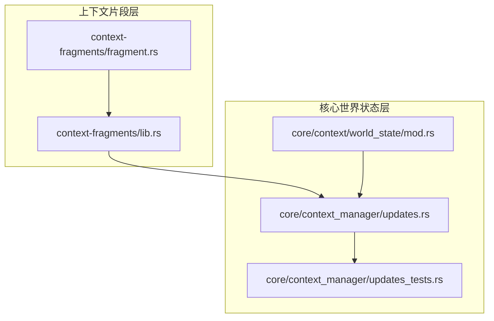
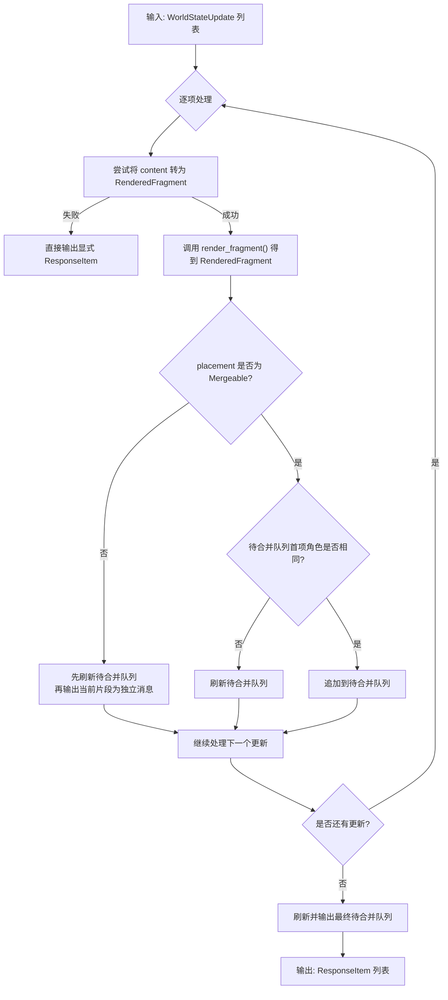
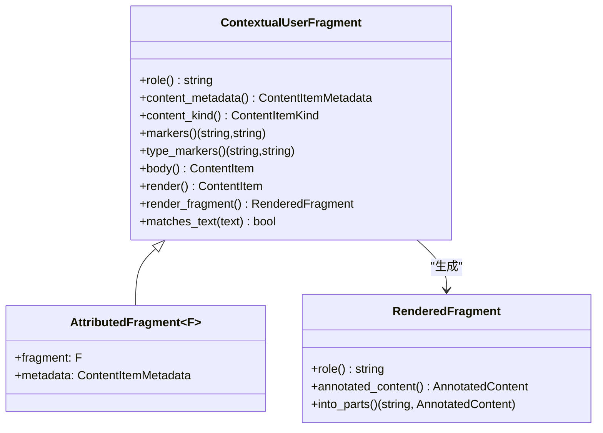
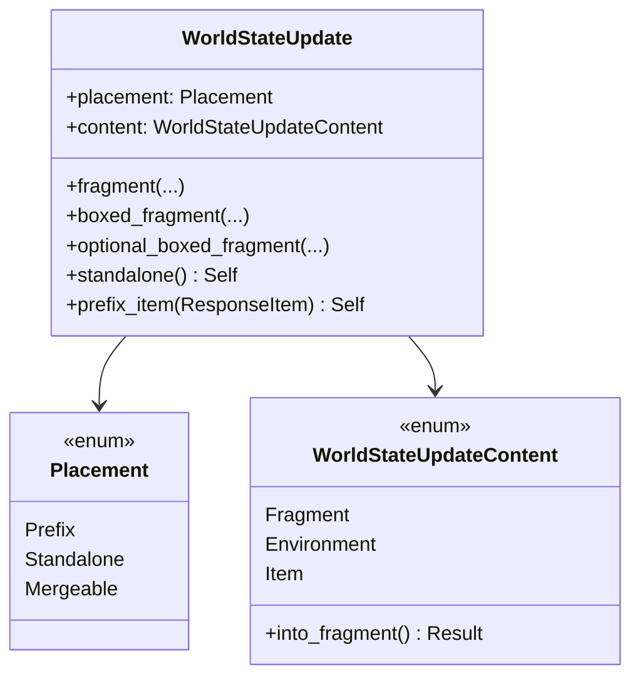
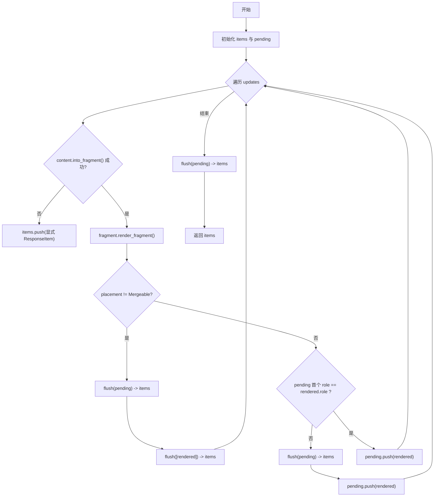
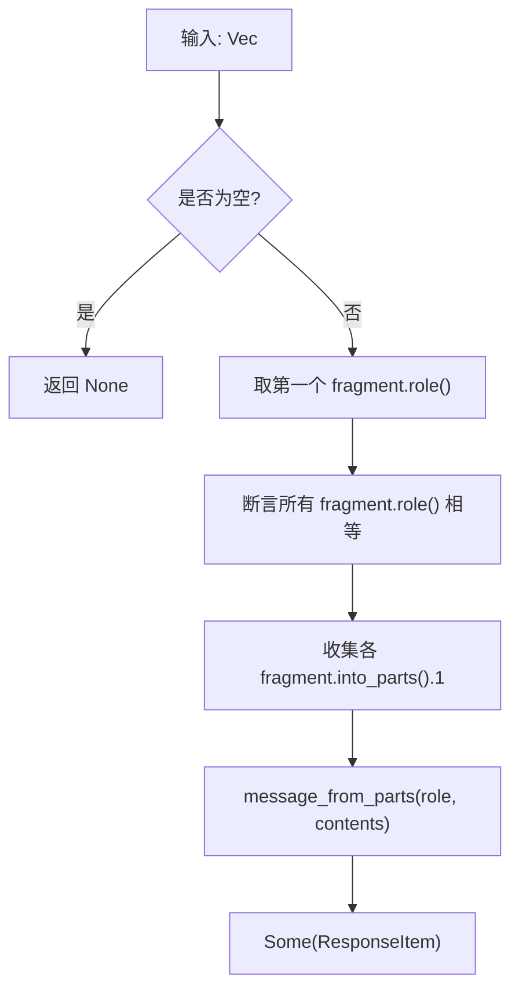
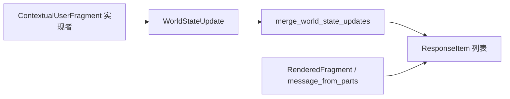

# 上下文更新合并

<cite>
**本文引用的文件**   
- [fragment.rs](file://codex-rs/context-fragments/src/fragment.rs)
- [lib.rs](file://codex-rs/context-fragments/src/lib.rs)
- [updates.rs](file://codex-rs/core/src/context_manager/updates.rs)
- [mod.rs](file://codex-rs/core/src/context/world_state/mod.rs)
- [updates_tests.rs](file://codex-rs/core/src/context_manager/updates_tests.rs)
</cite>

## 目录
1. [引言](#引言)
2. [项目结构](#项目结构)
3. [核心组件](#核心组件)
4. [架构总览](#架构总览)
5. [详细组件分析](#详细组件分析)
6. [依赖关系分析](#依赖关系分析)
7. [性能考虑](#性能考虑)
8. [故障排查指南](#故障排查指南)
9. [结论](#结论)

## 引言
本文聚焦于 Codex 中“上下文更新合并”的实现，目标是解释以下内容：
- `WorldStateUpdate` 的合并算法。
- `RenderedFragment` 的分组与渲染策略。
- `Placement::Mergeable`、`Standalone`、`Prefix` 的处理逻辑与相邻片段角色匹配规则。
- `build_rendered_message` 的内容片段组装和消息结构构建过程。
- 更新操作的原子性保证与回滚机制。
- 不同类型更新的优先级与冲突解决策略。
- 性能优化建议与调试方法。

该机制的核心思想是：将世界状态更新抽象为“可合并片段”或“显式响应项”，按放置策略进行分组、拼接，最终产出模型可见的消息列表。

## 项目结构
与上下文更新合并直接相关的代码分布在两个模块：
- `codex-rs/context-fragments`：定义渲染片段类型、标记化内容与通用消息构造。
- `codex-rs/core/src/context_manager`：负责把一组 `WorldStateUpdate` 合并为最终的 `ResponseItem` 序列。
- `codex-rs/core/src/context/world_state`：定义 `WorldStateUpdate`、`Placement`、`split_prefix_updates` 等世界状态更新基础结构。

**图示来源**
- [lib.rs:20-22](file://codex-rs/context-fragments/src/lib.rs#L20-L22)
- [fragment.rs:1-177](file://codex-rs/context-fragments/src/fragment.rs#L1-L177)
- [mod.rs:72-161](file://codex-rs/core/src/context/world_state/mod.rs#L72-L161)
- [updates.rs:1-52](file://codex-rs/core/src/context_manager/updates.rs#L1-L52)

**章节来源**
- [fragment.rs:1-177](file://codex-rs/context-fragments/src/fragment.rs#L1-L177)
- [lib.rs:20-22](file://codex-rs/context-fragments/src/lib.rs#L20-L22)
- [mod.rs:72-161](file://codex-rs/core/src/context/world_state/mod.rs#L72-L161)
- [updates.rs:1-52](file://codex-rs/core/src/context_manager/updates.rs#L1-L52)

## 核心组件
本节梳理参与合并的关键数据结构和职责边界。

- `RenderedFragment`：表示一个已渲染的上下文片段及其所属角色。它封装了“角色 + 带分类的标注内容”，并可转换为协议层的 `ResponseItem`。
- `ContextualUserFragment`：上下文片段的抽象生产者，提供角色、内容分类、起止标记、正文内容和渲染流程。其 `render_fragment` 会生成 `RenderedFragment`。
- `WorldStateUpdate`：一次世界状态贡献，包含放置策略 `placement` 和内容 `content`。
- `Placement`：决定更新如何被放置到最终消息列表中：
  - `Prefix`：作为初始窗口前缀单独输出。
  - `Standalone`：作为独立响应项输出，不与其他片段合并。
  - `Mergeable`：可与同角色的后续片段合并。
- `WorldStateUpdateContent`：三种更新内容形态——片段、环境渲染结果、显式响应项。
- `build_rendered_message`：将一批同角色的 `RenderedFragment` 组装成一条消息。
- `merge_world_state_updates`：核心合并器，遍历更新列表，依据放置策略和角色一致性进行分组与输出。

**章节来源**
- [fragment.rs:1-177](file://codex-rs/context-fragments/src/fragment.rs#L1-L177)
- [mod.rs:72-161](file://codex-rs/core/src/context/world_state/mod.rs#L72-L161)
- [updates.rs:1-52](file://codex-rs/core/src/context_manager/updates.rs#L1-L52)

## 架构总览
下图展示了从“世界状态更新集合”到“最终消息列表”的整体处理流程。

**图示来源**
- [updates.rs:12-52](file://codex-rs/core/src/context_manager/updates.rs#L12-L52)
- [mod.rs:72-101](file://codex-rs/core/src/context/world_state/mod.rs#L72-L101)

## 详细组件分析

### `RenderedFragment` 与片段渲染
`RenderedFragment` 是一个不可变的数据容器，保存：
- `role`：静态字符串，标识该片段属于哪个角色。
- `content`：`AnnotatedContent`，携带模型可见内容与分类元信息。

关键行为：
- `new`：创建未分离角色与内容的片段。
- `into_parts`：在 API 边界分离出角色与标注内容。
- `From<ResponseItem>`：将单个片段转换为协议层消息。

`ContextualUserFragment` 定义了片段的生产规范：
- `role()`：声明片段角色。
- `content_kind()`：稳定分类标签，用于追踪注入内容。
- `markers()` / `type_markers()`：用于识别注入上下文的起止标记。
- `body()`：返回模型可见正文。
- `render()`：根据标记包裹正文；若为空标记则直接返回正文。
- `render_fragment()`：组合上述信息，生成 `RenderedFragment`。
- `matches_text()`：基于类型标记判断某段文本是否属于该类注入上下文。

**图示来源**
- [fragment.rs:1-177](file://codex-rs/context-fragments/src/fragment.rs#L1-L177)

**章节来源**
- [fragment.rs:1-177](file://codex-rs/context-fragments/src/fragment.rs#L1-L177)

### `WorldStateUpdate` 与 `Placement`
`WorldStateUpdate` 由两部分组成：
- `placement`：决定如何放置该更新。
- `content`：可以是片段、环境渲染结果或显式响应项。

`Placement` 有三种值：
- `Prefix`：放入初始窗口前缀，不参与普通合并。
- `Standalone`：作为独立消息输出。
- `Mergeable`：允许与后续同角色片段合并。

辅助函数：
- `split_prefix_updates`：将 `Prefix` 更新分离出来，其余进入常规合并流程。
- `standalone`：将默认 `Mergeable` 改为 `Standalone`。
- `prefix_item`：以显式 `ResponseItem` 形式插入 `Prefix`。

**图示来源**
- [mod.rs:72-161](file://codex-rs/core/src/context/world_state/mod.rs#L72-L161)

**章节来源**
- [mod.rs:72-161](file://codex-rs/core/src/context/world_state/mod.rs#L72-L161)

### 合并算法：`merge_world_state_updates`
该函数实现以下规则：
1. 对每个 `WorldStateUpdate`，尝试将其内容转换为 `RenderedFragment`。
   - 若失败，说明是显式 `ResponseItem`，直接加入结果列表。
2. 如果转换成功，调用 `render_fragment()` 得到 `RenderedFragment`。
3. 如果 `placement` 不是 `Mergeable`（即 `Prefix` 或 `Standalone`）：
   - 先刷新并输出待合并队列。
   - 再将当前片段作为独立消息输出。
4. 如果 `placement` 是 `Mergeable`：
   - 检查待合并队列首项的 `role()` 是否与当前片段一致。
   - 不一致时，刷新并输出待合并队列。
   - 然后将当前片段追加到待合并队列。
5. 遍历结束后，刷新并输出最终待合并队列。

该算法保证了：
- 不同角色不会跨消息合并。
- 非 `Mergeable` 更新不会被隐式拼接。
- 显式响应项始终保留原位置。

**图示来源**
- [updates.rs:12-52](file://codex-rs/core/src/context_manager/updates.rs#L12-L52)

**章节来源**
- [updates.rs:12-52](file://codex-rs/core/src/context_manager/updates.rs#L12-L52)

### `build_rendered_message` 的实现
该函数的职责很明确：
- 接收一批 `RenderedFragment`。
- 断言所有片段具有相同角色。
- 提取各片段的 `AnnotatedContent`。
- 使用 `message_from_parts(role, contents)` 构造协议层消息。

这确保了：
- 同一消息内的片段共享同一个角色。
- 多个片段内容被聚合为一个消息中的多个 `ContentItem`。
- 分类与元数据随片段保留。

**图示来源**
- [updates.rs:12-20](file://codex-rs/core/src/context_manager/updates.rs#L12-L20)

**章节来源**
- [updates.rs:12-20](file://codex-rs/core/src/context_manager/updates.rs#L12-L20)

### 原子性与回滚机制
当前合并实现采用流式累积方式：
- 每次遇到需要输出的更新，都会立即写入 `items`。
- `pending` 仅用于临时缓冲待合并片段。
- 没有事务、快照或回滚机制。

这意味着：
- 合并本身是幂等的，但不会在错误后自动回滚。
- 如果在更高层的渲染或持久化过程中发生异常，需要调用方自行维护回滚语义。
- 对于“原子性”需求，应放在 `merge_world_state_updates` 的调用侧保障，例如：
  - 在应用更新前计算预期结果。
  - 使用事务或版本控制包装更新批次。
  - 对持久化层做写前校验与回滚。

因此，合并函数提供的是“确定性的顺序与分组语义”，而非数据库意义上的事务原子性。

**章节来源**
- [updates.rs:12-52](file://codex-rs/core/src/context_manager/updates.rs#L12-L52)

### 优先级与冲突解决策略
优先级体现在 `Placement`：
1. `Prefix`：最高优先级，用于初始窗口前缀，会被分离出来优先输出。
2. `Standalone`：强制独立输出，不与其它片段合并。
3. `Mergeable`：默认策略，允许与后续同角色片段合并。

冲突解决规则：
- 角色冲突：只要待合并队列首项角色与当前片段不同，就刷新队列，避免跨角色合并。
- 显式响应项冲突：显式 `ResponseItem` 不被合并，保持原始顺序。
- 非 `Mergeable` 更新：强制中断合并，确保独立性。

这些规则共同保证：
- 前缀内容最先出现。
- 独立内容不被意外拼接。
- 同类上下文片段尽可能压缩，减少消息数量。

**章节来源**
- [mod.rs:72-161](file://codex-rs/core/src/context/world_state/mod.rs#L72-L161)
- [updates.rs:12-52](file://codex-rs/core/src/context_manager/updates.rs#L12-L52)

## 依赖关系分析
合并流程依赖三类构件：
- 片段生产端：实现 `ContextualUserFragment`，负责提供角色、分类、标记与正文。
- 世界状态更新端：构造 `WorldStateUpdate`，决定放置策略。
- 合并端：`merge_world_state_updates` 与 `build_rendered_message`，负责分组、组装、输出。

**图示来源**
- [fragment.rs:1-177](file://codex-rs/context-fragments/src/fragment.rs#L1-L177)
- [mod.rs:72-161](file://codex-rs/core/src/context/world_state/mod.rs#L72-L161)
- [updates.rs:12-52](file://codex-rs/core/src/context_manager/updates.rs#L12-L52)

**章节来源**
- [fragment.rs:1-177](file://codex-rs/context-fragments/src/fragment.rs#L1-L177)
- [mod.rs:72-161](file://codex-rs/core/src/context/world_state/mod.rs#L72-L161)
- [updates.rs:12-52](file://codex-rs/core/src/context_manager/updates.rs#L12-L52)

## 性能考虑
- 时间复杂度：`merge_world_state_updates` 对更新列表进行一次线性扫描，整体为 O(n)。
- 空间复杂度：`pending` 缓存同角色片段，最坏情况下为 O(k)，k 为连续可合并片段数。
- 字符串与内容复制：`build_rendered_message` 会收集各片段的 `AnnotatedContent`，应避免频繁创建大量小片段。
- 渲染成本：每个片段调用 `render_fragment()`，其中可能涉及标记包裹与内容分类；应尽量复用已有片段对象。
- 批量合并：尽量将同角色、同用途的上下文片段设置为 `Mergeable`，减少消息数量。
- 前缀隔离：将必须出现在开头的固定上下文使用 `Prefix`，避免影响主上下文合并路径。
- 日志与度量：可在合并前后记录片段数量、消息数量、平均片段长度，用于观察热点。

[本节为一般性指导，不直接分析具体代码文件]

## 故障排查指南
常见问题与定位方法：

1. **片段未按预期合并**
   - 检查 `placement` 是否为 `Mergeable`。
   - 检查相邻片段 `role()` 是否一致。
   - 确认片段确实来自 `render_fragment()`，而不是直接传入显式 `ResponseItem`。

2. **显式响应项位置错乱**
   - 确认显式 `ResponseItem` 是通过 `WorldStateUpdateContent::Item` 插入。
   - 这类更新不会进入 `pending`，而是直接输出。

3. **前缀内容未出现在开头**
   - 确认使用了 `Placement::Prefix`。
   - 注意 `split_prefix_updates` 会把 `Prefix` 分离出来，不在普通合并流程中。

4. **角色断言失败**
   - `build_rendered_message` 会断言所有片段角色一致。
   - 检查是否有不同角色的片段被误放到同一批合并队列。

5. **调试技巧**
   - 使用测试用例模拟多种更新序列，覆盖 `Prefix`、`Standalone`、`Mergeable`、显式项、角色切换等场景。
   - 参考现有测试，验证消息边界、角色一致性和片段顺序。

**章节来源**
- [updates_tests.rs:1-124](file://codex-rs/core/src/context_manager/updates_tests.rs#L1-L124)
- [updates.rs:12-52](file://codex-rs/core/src/context_manager/updates.rs#L12-L52)

## 结论
上下文更新合并通过 `WorldStateUpdate` 的放置策略与 `RenderedFragment` 的角色一致性，实现了可控、可扩展的上下文装配机制：
- `Prefix` 保证前缀内容优先。
- `Standalone` 保证独立性。
- `Mergeable` 在同角色内最大化合并，减少消息数量。
- 显式 `ResponseItem` 保留原有语义与边界。
- 合并算法简单高效，适合高频上下文构建场景。

如需更强的原子性或回滚能力，应在调用侧引入事务或版本控制；若需更高性能，应关注片段数量、渲染开销与批量合并策略。