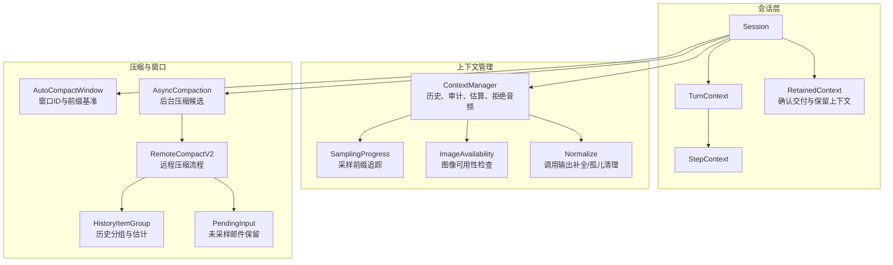
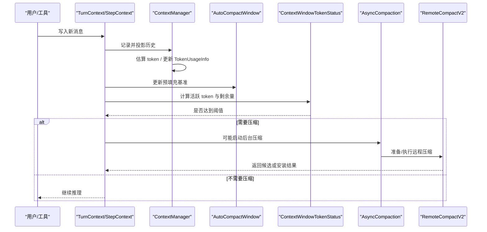
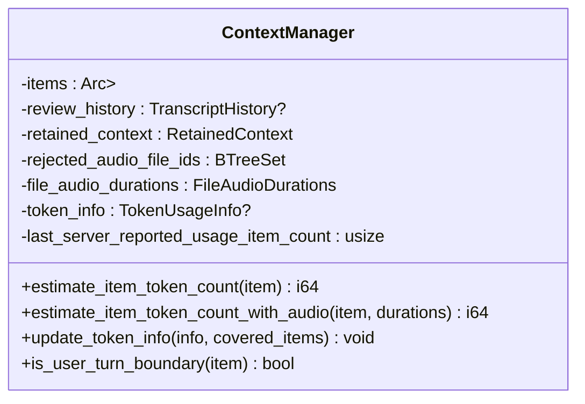
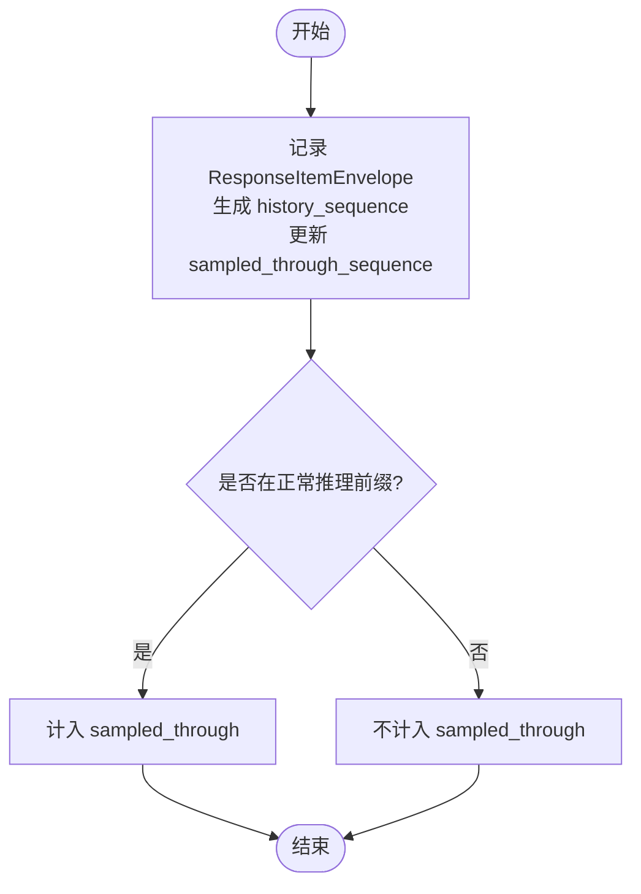
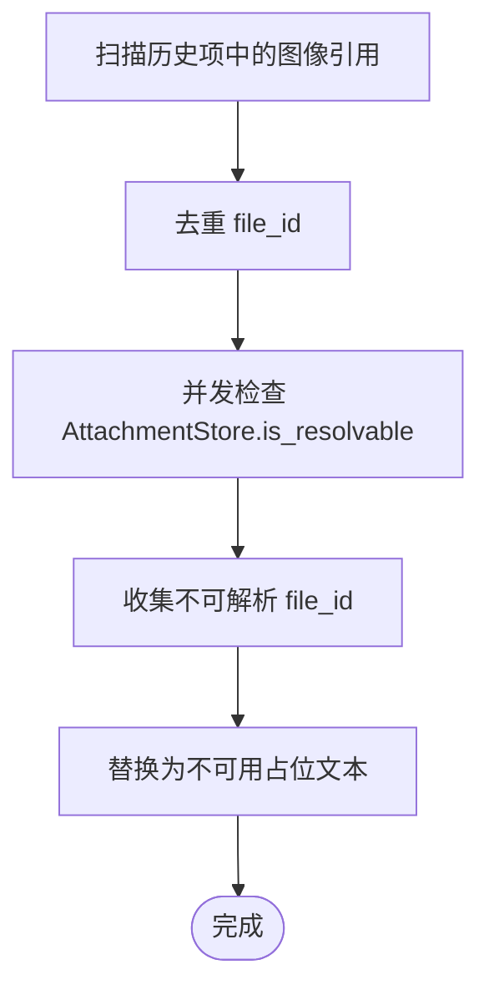
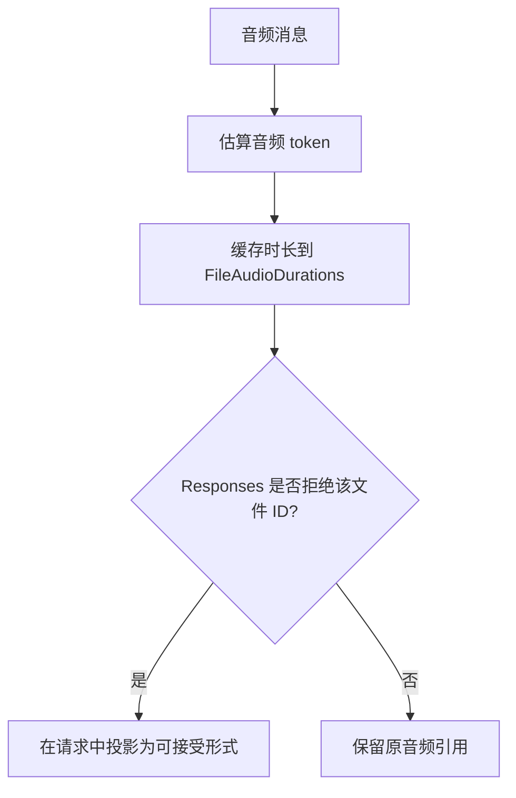
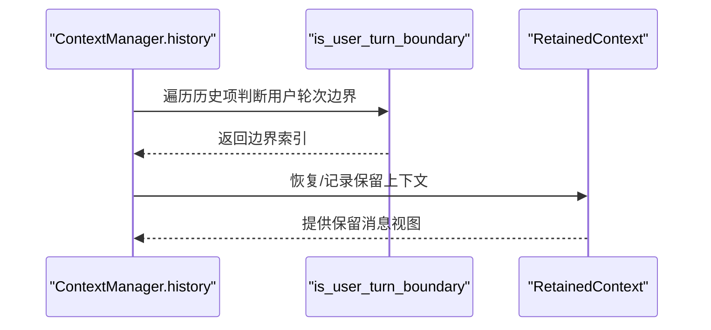
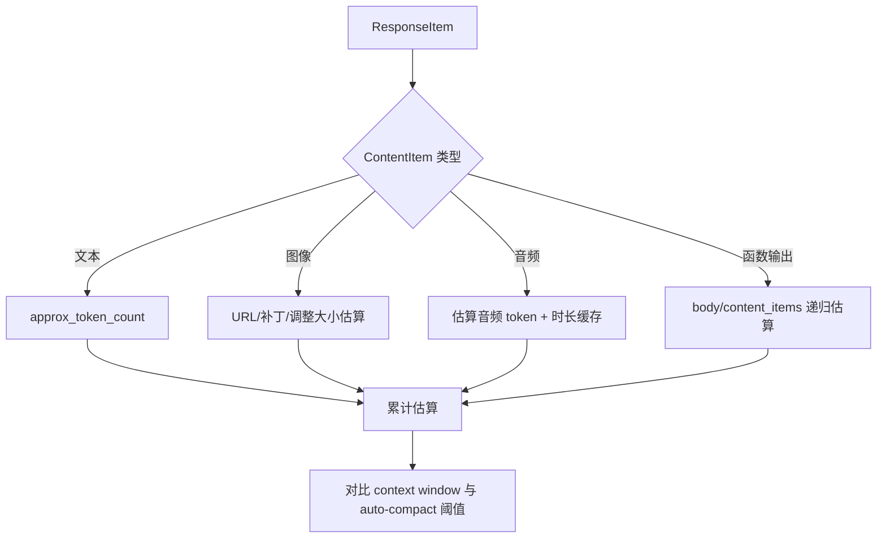
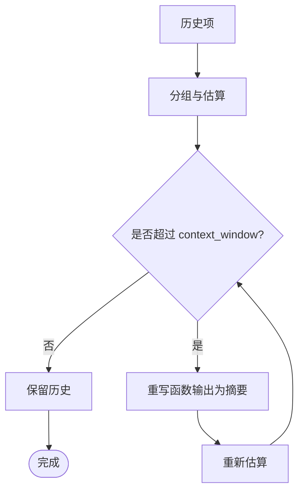
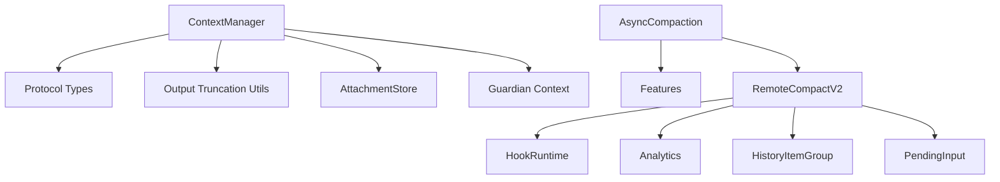

# 上下文管理

<cite>
**本文引用的文件**   
- [context_window.rs](file://codex-rs/core/src/session/context_window.rs)
- [auto_compact_window.rs](file://codex-rs/core/src/state/auto_compact_window.rs)
- [retained_context.rs](file://codex-rs/core/src/session/retained_context.rs)
- [turn_context.rs](file://codex-rs/core/src/session/turn_context.rs)
- [step_context.rs](file://codex-rs/core/src/session/step_context.rs)
- [async_compaction.rs](file://codex-rs/core/src/session/async_compaction.rs)
- [compact_remote_v2.rs](file://codex-rs/core/src/compact_remote_v2.rs)
- [compact_remote_history.rs](file://codex-rs/core/src/compact_remote_history.rs)
- [compact_pending_input.rs](file://codex-rs/core/src/compact_pending_input.rs)
- [context_manager_mod.rs](file://codex-rs/core/src/context_manager/mod.rs)
- [history.rs](file://codex-rs/core/src/context_manager/history.rs)
- [history_user_authorization.rs](file://codex-rs/core/src/context_manager/history_user_authorization.rs)
- [sampling.rs](file://codex-rs/core/src/context_manager/sampling.rs)
- [image_availability.rs](file://codex-rs/core/src/context_manager/image_availability.rs)
- [normalize.rs](file://codex-rs/core/src/context_manager/normalize.rs)
</cite>

## 目录
1. [引言](#引言)
2. [项目结构](#项目结构)
3. [核心组件](#核心组件)
4. [架构总览](#架构总览)
5. [详细组件分析](#详细组件分析)
6. [依赖关系分析](#依赖关系分析)
7. [性能与优化建议](#性能与优化建议)
8. [故障排查指南](#故障排查指南)
9. [结论](#结论)

## 引言
本文件围绕 Codex 核心中的“上下文管理”子系统展开，系统性解释：
- 历史消息如何被记录、投影、估算和压缩；
- 自动上下文窗口状态检测、回退缓冲与轮次后阈值；
- 异步远程压缩任务的生命周期与恢复语义；
- 采样进度、用户轮次边界、保留上下文与代码模式确认交付；
- 图像可用性检查与文件引用字节估算；
- 音频消息的令牌估算与拒绝处理；
- 令牌计数、字节估算和资源限制管理；
- 面向工程实践的上下文优化与性能调优建议。

## 项目结构
上下文管理相关代码主要分布在以下模块：
- `core/session`：会话级上下文窗口状态、异步压缩协调、轮次/步骤上下文。
- `core/state`：自动压缩窗口标识与前缀基准。
- `core/context_manager`：历史上下文管理器、采样进度、图像可用性、规范化与导出接口。
- `core/compact_*`：远程压缩编排、历史分组与裁剪、未采样输入保留策略。

**图表来源**  
- [context_window.rs:1-130](file://codex-rs/core/src/session/context_window.rs#L1-L130)  
- [auto_compact_window.rs:1-120](file://codex-rs/core/src/state/auto_compact_window.rs#L1-L120)  
- [retained_context.rs:1-120](file://codex-rs/core/src/session/retained_context.rs#L1-L120)  
- [async_compaction.rs:1-120](file://codex-rs/core/src/session/async_compaction.rs#L1-L120)  
- [compact_remote_v2.rs:1-120](file://codex-rs/core/src/compact_remote_v2.rs#L1-L120)  
- [compact_remote_history.rs:1-60](file://codex-rs/core/src/compact_remote_history.rs#L1-L60)  
- [compact_pending_input.rs:1-49](file://codex-rs/core/src/compact_pending_input.rs#L1-L49)  
- [context_manager_mod.rs:1-15](file://codex-rs/core/src/context_manager/mod.rs#L1-L15)

**章节来源**  
- [context_window.rs:1-130](file://codex-rs/core/src/session/context_window.rs#L1-L130)  
- [auto_compact_window.rs:1-120](file://codex-rs/core/src/state/auto_compact_window.rs#L1-L120)  
- [retained_context.rs:1-120](file://codex-rs/core/src/session/retained_context.rs#L1-L120)  
- [async_compaction.rs:1-120](file://codex-rs/core/src/session/async_compaction.rs#L1-L120)  
- [compact_remote_v2.rs:1-120](file://codex-rs/core/src/compact_remote_v2.rs#L1-L120)  
- [compact_remote_history.rs:1-60](file://codex-rs/core/src/compact_remote_history.rs#L1-L60)  
- [compact_pending_input.rs:1-49](file://codex-rs/core/src/compact_pending_input.rs#L1-L49)  
- [context_manager_mod.rs:1-15](file://codex-rs/core/src/context_manager/mod.rs#L1-L15)

## 核心组件
- ContextManager：维护线程历史、保留上下文、审核上下文、拒绝音频集合、文件音频时长缓存、TokenUsageInfo、历史版本、用户轮次修订号等，并提供估算、投影、更新与快照能力。
- SamplingProgress：记录每个 ResponseItemEnvelope 的 history_sequence 与 sampled_through_sequence，用于区分“已包含在正常推理前缀”的历史与后续追加内容。
- AutoCompactWindow：分配并跟踪自动压缩窗口 ID，记录预填充输入 token 基线（服务器观测优先于估计），支持窗口推进与标志位。
- AsyncCompactionState：保存最近一次压缩尝试、后台准备结果、任务追踪与关闭取消信号，负责启动/取回/等待后台压缩候选。
- RemoteCompactV2：远程压缩入口、流式请求、重试、分析与钩子集成。
- HistoryItemGroup：将相邻响应项分组，并对源项及附加提示合并估算 token。
- PendingInput：保留尚未采样的 AgentMessage，并在摘要插入时保持顺序。

**章节来源**  
- [history.rs:100-220](file://codex-rs/core/src/context_manager/history.rs#L100-L220)  
- [sampling.rs:1-76](file://codex-rs/core/src/context_manager/sampling.rs#L1-L76)  
- [auto_compact_window.rs:1-120](file://codex-rs/core/src/state/auto_compact_window.rs#L1-L120)  
- [async_compaction.rs:1-120](file://codex-rs/core/src/session/async_compaction.rs#L1-L120)  
- [compact_remote_v2.rs:1-120](file://codex-rs/core/src/compact_remote_v2.rs#L1-L120)  
- [compact_remote_history.rs:1-60](file://codex-rs/core/src/compact_remote_history.rs#L1-L60)  
- [compact_pending_input.rs:1-49](file://codex-rs/core/src/compact_pending_input.rs#L1-L49)

## 架构总览
上下文管理以“历史不可变 + 增量投影”的方式运行：
- 历史通过 ContextManager 维护为共享向量，快照共享底层数据。
- 估算基于 ContentItem 类型分派：文本、图像、音频、函数调用输出等分别估算。
- 自动压缩通过 AutoCompactWindow 管理窗口 ID 和前缀基线；通过 ContextWindowTokenStatus 判断是否触发压缩。
- 远程压缩由 RemoteCompactV2 编排，支持前台与后台两种通道，并通过 Hooks 与 Analytics 记录生命周期。
- 未采样输入通过 PendingInput 保护，确保摘要插入位置正确且不会越界到尚未确认的消息之前。

**图表来源**  
- [history.rs:100-220](file://codex-rs/core/src/context_manager/history.rs#L100-L220)  
- [context_window.rs:1-130](file://codex-rs/core/src/session/context_window.rs#L1-L130)  
- [auto_compact_window.rs:1-120](file://codex-rs/core/src/state/auto_compact_window.rs#L1-L120)  
- [async_compaction.rs:1-120](file://codex-rs/core/src/session/async_compaction.rs#L1-L120)  
- [compact_remote_v2.rs:1-120](file://codex-rs/core/src/compact_remote_v2.rs#L1-L120)

## 详细组件分析

### 上下文管理器 ContextManager
职责与关键点：
- 维护历史项、保留上下文、审核上下文、拒绝音频文件 ID 集合、文件音频时长、TokenUsageInfo、历史版本、用户轮次修订号等。
- 提供估算接口 estimate_item_token_count 与 estimate_item_token_count_with_audio，覆盖文本、图像、音频、函数输出、加密内容等。
- 更新 TokenUsageInfo，结合 last_server_reported_usage_item_count 精确划分“服务端已报告范围”与“需估算范围”。
- 支持对不可用图像进行投影替换，对拒绝音频进行投影，对历史中过长指令做截断备份。
- 提供 is_user_turn_boundary 识别用户轮次边界，辅助估算与切片。

**图表来源**  
- [history.rs:100-220](file://codex-rs/core/src/context_manager/history.rs#L100-L220)  
- [history.rs:1303-1631](file://codex-rs/core/src/context_manager/history.rs#L1303-L1631)

**章节来源**  
- [history.rs:100-220](file://codex-rs/core/src/context_manager/history.rs#L100-L220)  
- [history.rs:1303-1631](file://codex-rs/core/src/context_manager/history.rs#L1303-L1631)

### 采样算法与采样进度
- SamplingProgress 并不实现“重要性评估、时间衰减、语义相关性”的评分模型，而是维护 history_sequence 与 sampled_through_sequence，用以标记哪些历史项属于“已包含在正常推理前缀”。
- sampled_through(items) 返回所有条目中最大的 sampled_through_sequence，作为“前缀截止序列号”。
- 未采样邮件（AgentMessage）在 compact_pending_input 中使用 sampled_through 定位待保留的首条序列，从而保证摘要插入位置合法。

**图表来源**  
- [sampling.rs:1-76](file://codex-rs/core/src/context_manager/sampling.rs#L1-L76)  
- [compact_pending_input.rs:1-49](file://codex-rs/core/src/compact_pending_input.rs#L1-L49)

**章节来源**  
- [sampling.rs:1-76](file://codex-rs/core/src/context_manager/sampling.rs#L1-L76)  
- [compact_pending_input.rs:1-49](file://codex-rs/core/src/compact_pending_input.rs#L1-L49)

### 图像可用性检查与文件引用处理
- replace_unresolvable_image_files 并发扫描 Message 与 FunctionCallOutput/CustomToolCallOutput 中的 InputImage/File 引用，查询 AttachmentStore.is_resolvable，并将不可解析的文件图像替换为占位文本。
- 最大并发数为 8，避免过多 IO 压力。
- 图像字节估算在 estimate_image_reference_bytes 中根据 ImageReference 类型与 detail 决定使用内联 URL、原始图补丁上限还是调整大小后的固定估算值。

**图表来源**  
- [image_availability.rs:1-122](file://codex-rs/core/src/context_manager/image_availability.rs#L1-L122)  
- [history.rs:1552-1570](file://codex-rs/core/src/context_manager/history.rs#L1552-L1570)

**章节来源**  
- [image_availability.rs:1-122](file://codex-rs/core/src/context_manager/image_availability.rs#L1-L122)  
- [history.rs:1552-1570](file://codex-rs/core/src/context_manager/history.rs#L1552-L1570)

### 音频消息处理
- estimate_item_token_count_with_audio 针对 AudioReference 与 FileAudioDurations 计算音频 token，同时记录 rejected_audio_file_ids。
- 当 Responses 返回拒绝音频文件 ID 时，ContextManager 会扩展该集合，并在后续构建 prompt 时通过 rejected_audio::project_file_audio 进行投影。
- 文件音频时长缓存在 file_audio_durations 中，避免重复解码。

**图表来源**  
- [history.rs:1303-1631](file://codex-rs/core/src/context_manager/history.rs#L1303-L1631)  
- [history.rs:744-798](file://codex-rs/core/src/context_manager/history.rs#L744-L798)

**章节来源**  
- [history.rs:1303-1631](file://codex-rs/core/src/context_manager/history.rs#L1303-L1631)  
- [history.rs:744-798](file://codex-rs/core/src/context_manager/history.rs#L744-L798)

### 上下文边界检测与用户轮次识别
- is_user_turn_boundary 用于识别用户轮次边界，帮助在估算与切片时定位边界位置。
- retained_context 模块负责保留用户/助手消息的确认交付顺序，并通过 reserve_input_order 与 persistence lock 保证顺序一致性。
- history_user_authorization 负责从历史中恢复保留上下文，包括继承消息与审核上下文，同时对超长文本做截断备份。

**图表来源**  
- [history.rs:1631-1664](file://codex-rs/core/src/context_manager/history.rs#L1631-L1664)  
- [retained_context.rs:1-120](file://codex-rs/core/src/session/retained_context.rs#L1-L120)  
- [history_user_authorization.rs:1-222](file://codex-rs/core/src/context_manager/history_user_authorization.rs#L1-L222)

**章节来源**  
- [history.rs:1631-1664](file://codex-rs/core/src/context_manager/history.rs#L1631-L1664)  
- [retained_context.rs:1-120](file://codex-rs/core/src/session/retained_context.rs#L1-L120)  
- [history_user_authorization.rs:1-222](file://codex-rs/core/src/context_manager/history_user_authorization.rs#L1-L222)

### 上下文估计方法：令牌计数、字节估算与资源限制
- 令牌估算：
  - estimate_item_token_count 默认委托 estimate_item_token_count_with_audio。
  - 文本使用 approx_token_count；图像与音频按 URL 长度或缓存时长估算；函数输出按 body/content_items 分支估算。
- 字节估算：
  - approx_bytes_for_tokens 与 approx_token_count 互相近似，用于估算图像/音频的字节规模。
  - 原始图像使用 ORIGINAL_IMAGE_MAX_PATCHES 补丁上限；非原始文件图像使用 RESIZED_IMAGE_BYTES_ESTIMATE。
- 资源限制：
  - ContextWindowTokenStatus 综合 active_context_tokens、auto_compact_scope_tokens、full_context_window_limit、base_window_tokens_remaining 等指标，判断 token_limit_reached 与 turn_end_compaction_threshold_reached。
  - AutoCompactWindow 使用 prefill_input_tokens 作为 body_after_prefix 基线，服务器观测优先。

**图表来源**  
- [history.rs:1303-1631](file://codex-rs/core/src/context_manager/history.rs#L1303-L1631)  
- [context_window.rs:1-130](file://codex-rs/core/src/session/context_window.rs#L1-L130)  
- [auto_compact_window.rs:1-120](file://codex-rs/core/src/state/auto_compact_window.rs#L1-L120)

**章节来源**  
- [history.rs:1303-1631](file://codex-rs/core/src/context_manager/history.rs#L1303-L1631)  
- [context_window.rs:1-130](file://codex-rs/core/src/session/context_window.rs#L1-L130)  
- [auto_compact_window.rs:1-120](file://codex-rs/core/src/state/auto_compact_window.rs#L1-L120)

### 历史消息处理、上下文压缩与摘要生成策略
- 历史分组与裁剪：
  - history_item_groups 将相邻响应项与附加提示分组，estimated_token_count 合并源项与提示的 token。
  - trim_function_call_history_to_fit_context_window 逆向遍历历史，将函数调用输出替换为截断摘要，直到估算总量回到 context_window 以内。
- 未采样输入保留：
  - pending_mail_sequence 使用 sampled_through 找到首个未采样 AgentMessage 序列号。
  - is_retained_pending_mail 仅保留不超过 MAX_RETAINED_AGENT_MESSAGE_TOKENS 的未采样消息。
  - insert_summary 将摘要插入到未采样序列之前，保证顺序正确。
- 远程压缩流程：
  - run_remote_compact_task_inner 记录分析详情、执行前置钩子、选择候选或发起前台压缩、执行 run_compaction，并根据结果记录后置钩子与事件。

**图表来源**  
- [compact_remote_history.rs:1-213](file://codex-rs/core/src/compact_remote_history.rs#L1-L213)  
- [compact_pending_input.rs:1-49](file://codex-rs/core/src/compact_pending_input.rs#L1-L49)  
- [compact_remote_v2.rs:1-120](file://codex-rs/core/src/compact_remote_v2.rs#L1-L120)

**章节来源**  
- [compact_remote_history.rs:1-213](file://codex-rs/core/src/compact_remote_history.rs#L1-L213)  
- [compact_pending_input.rs:1-49](file://codex-rs/core/src/compact_pending_input.rs#L1-L49)  
- [compact_remote_v2.rs:1-120](file://codex-rs/core/src/compact_remote_v2.rs#L1-L120)

### 上下文边界检测、用户轮次识别与音频消息处理的协作
- ContextManager.is_user_turn_boundary 提供轮次边界检测。
- retained_context 与 history_user_authorization 负责保留上下文与继承消息，确保审核与回放的一致性。
- audio 通过 FileAudioDurations 与 rejected_audio_file_ids 与历史估算联动。

**图表来源**  
- [history.rs:1631-1664](file://codex-rs/core/src/context_manager/history.rs#L1631-L1664)  
- [history.rs:744-798](file://codex-rs/core/src/context_manager/history.rs#L744-L798)  
- [retained_context.rs:1-120](file://codex-rs/core/src/session/retained_context.rs#L1-L120)  
- [history_user_authorization.rs:1-222](file://codex-rs/core/src/context_manager/history_user_authorization.rs#L1-L222)

**章节来源**  
- [history.rs:1631-1664](file://codex-rs/core/src/context_manager/history.rs#L1631-L1664)  
- [history.rs:744-798](file://codex-rs/core/src/context_manager/history.rs#L744-L798)  
- [retained_context.rs:1-120](file://codex-rs/core/src/session/retained_context.rs#L1-L120)  
- [history_user_authorization.rs:1-222](file://codex-rs/core/src/context_manager/history_user_authorization.rs#L1-L222)

## 依赖关系分析
- ContextManager 依赖：
  - codex_protocol 的 ResponseItem、ContentItem、AudioReference、ImageReference、TokenUsage 等协议类型。
  - codex_utils_output_truncation 的 approx_token_count、approx_bytes_for_tokens。
  - codex_attachment_store 的 AttachmentStore 用于图像可用性检查。
  - codex_guardian_context 的审核上下文预算与转录历史。
- 压缩链路依赖：
  - AsyncCompaction 依赖 RemoteCompactionSupport 与 Features，决定是否启用异步远程压缩。
  - RemoteCompactV2 依赖 HookRuntime 与 Analytics，统一封装压缩生命周期。
  - HistoryItemGroup 与 PendingInput 为压缩前的历史整理与输入保护。

**图表来源**  
- [context_manager_mod.rs:1-15](file://codex-rs/core/src/context_manager/mod.rs#L1-L15)  
- [history.rs:100-220](file://codex-rs/core/src/context_manager/history.rs#L100-L220)  
- [async_compaction.rs:1-120](file://codex-rs/core/src/session/async_compaction.rs#L1-L120)  
- [compact_remote_v2.rs:1-120](file://codex-rs/core/src/compact_remote_v2.rs#L1-L120)  
- [compact_remote_history.rs:1-60](file://codex-rs/core/src/compact_remote_history.rs#L1-L60)  
- [compact_pending_input.rs:1-49](file://codex-rs/core/src/compact_pending_input.rs#L1-L49)

**章节来源**  
- [context_manager_mod.rs:1-15](file://codex-rs/core/src/context_manager/mod.rs#L1-L15)  
- [history.rs:100-220](file://codex-rs/core/src/context_manager/history.rs#L100-L220)  
- [async_compaction.rs:1-120](file://codex-rs/core/src/session/async_compaction.rs#L1-L120)  
- [compact_remote_v2.rs:1-120](file://codex-rs/core/src/compact_remote_v2.rs#L1-L120)  
- [compact_remote_history.rs:1-60](file://codex-rs/core/src/compact_remote_history.rs#L1-L60)  
- [compact_pending_input.rs:1-49](file://codex-rs/core/src/compact_pending_input.rs#L1-L49)

## 性能与优化建议
- 令牌估算优化：
  - 尽量复用 FileAudioDurations 缓存，避免重复音频解码。
  - 对大体积函数输出采用 trim_function_call_history_to_fit_context_window 提前截断，减少后续估算成本。
- 图像可用性检查：
  - 控制并发数量（当前为 8），在高延迟存储环境中可适当降低并发以避免拥塞。
  - 对频繁出现的 file_id 可在上层做缓存，减少 AttachmentStore 查询。
- 自动压缩阈值：
  - 合理设置 model_post_turn_compact_threshold_percent 与 async_compaction_threshold_percent，避免频繁触发压缩。
  - 使用 AutoCompactTokenLimitScope.BodyAfterPrefix 以减少前缀重复估算误差。
- 异步远程压缩：
  - 在长对话中启用异步压缩，但需关注 shutdown_cancellation 与 TaskTracker 的释放，避免后台任务堆积。
  - 对于 Root-only 场景注意 Feature.AsyncCompactionRootOnly 的限制。
- 历史规范化：
  - ensure_call_outputs_present 与 remove_orphan_outputs 保证调用/输出配对，避免异常导致的额外开销与错误。

[本节为通用性能指导，不直接分析具体文件]

## 故障排查指南
- 图像不可用导致渲染异常：
  - 检查 replace_unresolvable_image_files 是否正确将不可解析 image 替换为占位文本。
  - 确认 AttachmentStore.is_resolvable 返回符合预期。
- 音频被拒绝导致上下文不完整：
  - 查看 rejected_audio_file_ids 是否包含对应文件 ID，并检查 project_file_audio 投影逻辑。
  - 确认 FileAudioDurations 缓存是否命中。
- 压缩失败或超时：
  - 检查 AsyncCompaction.enabled 条件（特性开关、Provider 能力、阈值）。
  - 观察 run_remote_compact_task_inner 的分析详情与钩子返回值。
- 用户轮次边界误判：
  - 检查 is_user_turn_boundary 的判断条件与历史记录结构。
- 调用输出缺失或孤儿：
  - 使用 normalize.ensure_call_outputs_present 与 remove_orphan_outputs 修复。

**章节来源**  
- [image_availability.rs:1-122](file://codex-rs/core/src/context_manager/image_availability.rs#L1-L122)  
- [history.rs:744-798](file://codex-rs/core/src/context_manager/history.rs#L744-L798)  
- [async_compaction.rs:1-120](file://codex-rs/core/src/session/async_compaction.rs#L1-L120)  
- [compact_remote_v2.rs:1-120](file://codex-rs/core/src/compact_remote_v2.rs#L1-L120)  
- [normalize.rs:1-260](file://codex-rs/core/src/context_manager/normalize.rs#L1-L260)

## 结论
Codex 的上下文管理以 ContextManager 为核心，结合 SamplingProgress、AutoCompactWindow、AsyncCompaction 与 RemoteCompactV2，形成“历史估算 + 边界检测 + 自动压缩 + 远程压缩”的完整闭环。系统通过保守而稳定的估算策略、严格的轮次与顺序保障、以及健壮的资源限制机制，在保证模型可见上下文质量的同时，兼顾了性能与可靠性。实践中应重点关注音频与图像的估算与可用性、自动压缩阈值的配置，以及异步压缩任务的生命周期管理。