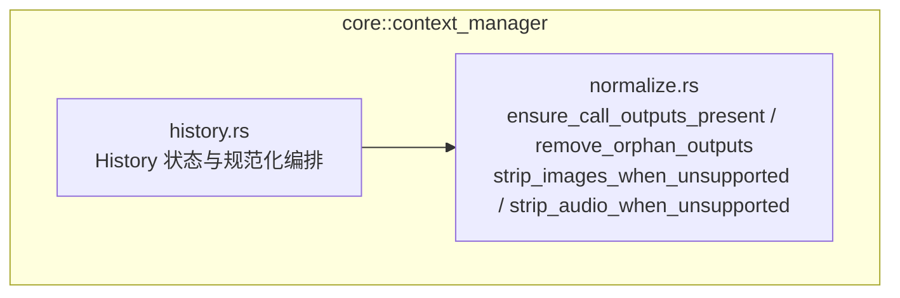
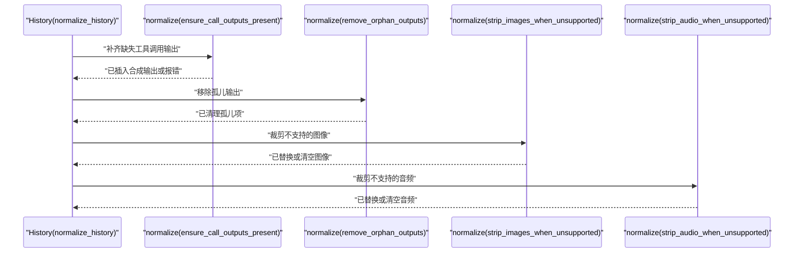
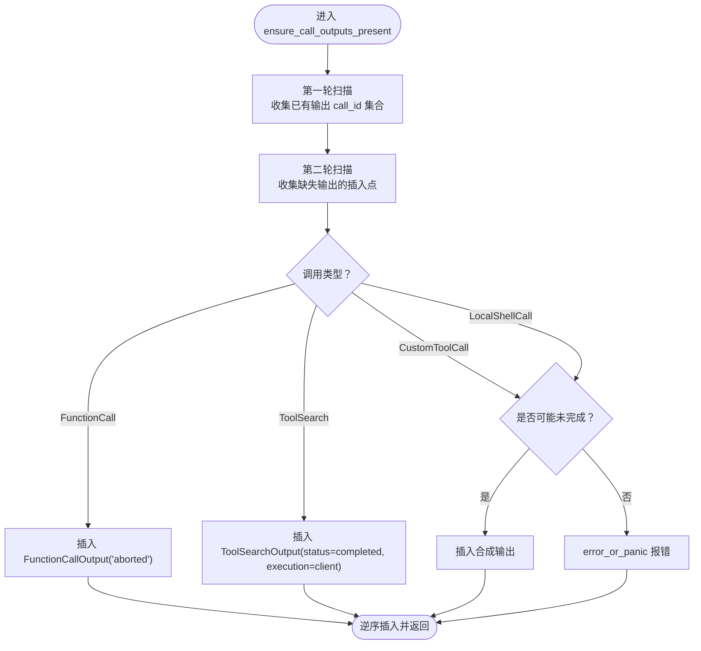
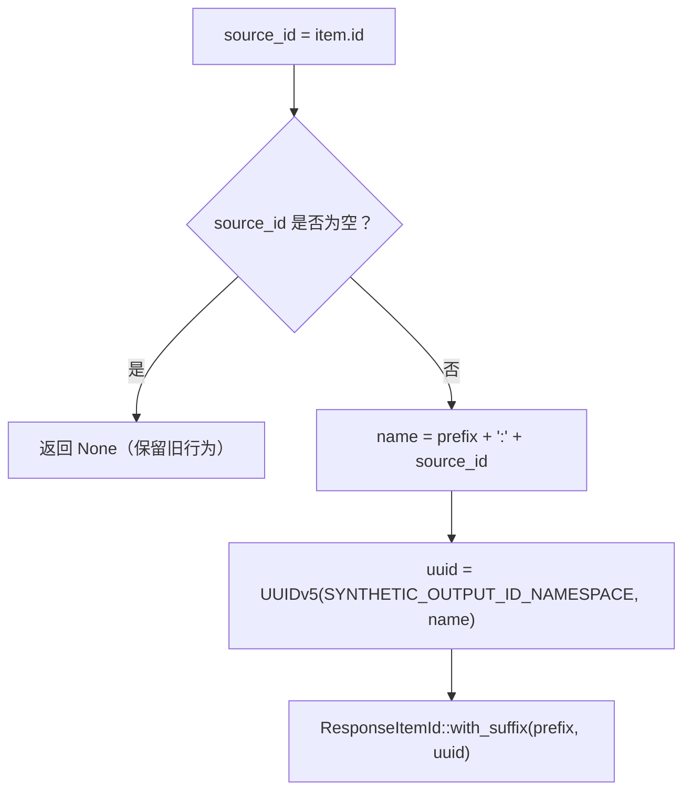
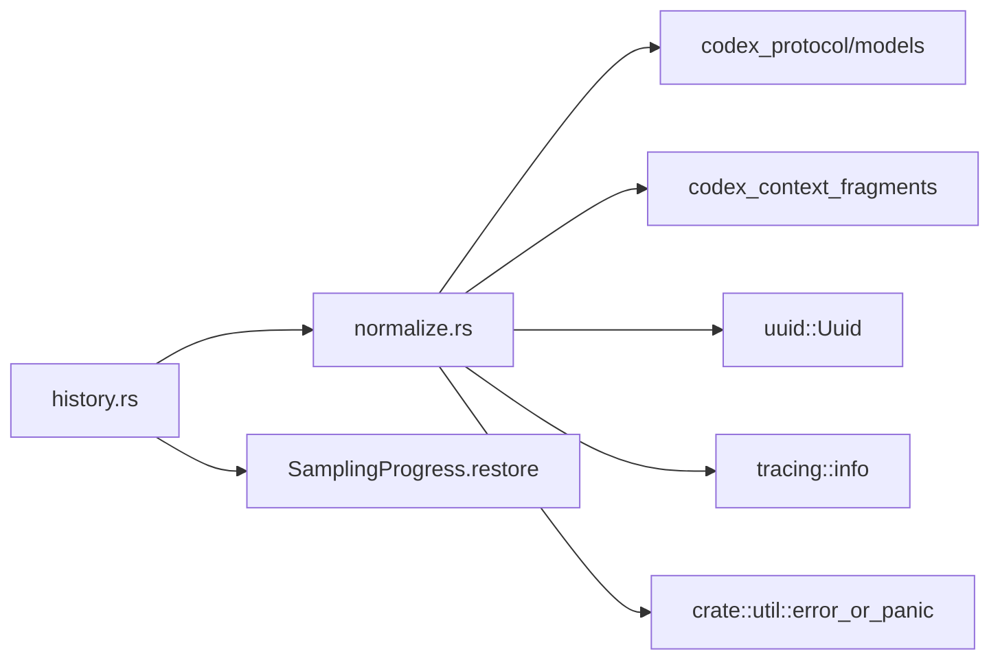

# 上下文规范化

<cite>
**本文引用的文件**
- [normalize.rs](file://codex-rs/core/src/context_manager/normalize.rs)
- [history.rs](file://codex-rs/core/src/context_manager/history.rs)
</cite>

## 目录
1. [引言](#引言)
2. [项目结构](#项目结构)
3. [核心组件](#核心组件)
4. [架构总览](#架构总览)
5. [详细组件分析](#详细组件分析)
6. [依赖分析](#依赖分析)
7. [性能考虑](#性能考虑)
8. [故障排查指南](#故障排查指南)
9. [结论](#结论)
10. [附录：完整性检查最佳实践](#附录完整性检查最佳实践)

## 引言
本文聚焦于上下文规范化流程，重点解析 ensure_call_outputs_present 函数的实现逻辑。该函数负责在对话历史中补齐缺失的工具调用输出，确保“调用—输出”成对出现；同时解释不同工具类型（FunctionCall、ToolSearch、CustomTool）的处理差异与输出验证机制；说明合成 ID 的生成策略及其命名空间管理；阐述继承用户消息与恢复序列如何共同决定“未完成调用”的容忍策略；并总结日志记录、错误处理以及上下文完整性检查的最佳实践。

## 项目结构
与上下文规范化直接相关的代码位于 core 模块的 context_manager 子系统中：
- normalize.rs：定义上下文规范化的具体算法，包括补齐缺失输出、移除孤儿输出、图像/音频内容剥离等。
- history.rs：维护对话历史状态，并在 normalize_history 中按顺序触发上述规范化步骤。

图表来源
- [history.rs:1170-1198](file://codex-rs/core/src/context_manager/history.rs#L1170-L1198)
- [normalize.rs:1-431](file://codex-rs/core/src/context_manager/normalize.rs#L1-L431)

章节来源
- [history.rs:1170-1198](file://codex-rs/core/src/context_manager/history.rs#L1170-L1198)
- [normalize.rs:1-431](file://codex-rs/core/src/context_manager/normalize.rs#L1-L431)

## 核心组件
- ensure_call_outputs_present：检测并补齐缺失的工具调用输出，保证每条“调用”都有对应“输出”。
- remove_orphan_outputs：清理无主输出，防止孤立输出污染上下文。
- strip_images_when_unsupported / strip_audio_when_unsupported：根据模型能力裁剪不支持的媒体内容。
- synthetic_output_id：为合成输出生成稳定且可复现的 ID，保障提示缓存复用。

章节来源
- [normalize.rs:1-431](file://codex-rs/core/src/context_manager/normalize.rs#L1-L431)

## 架构总览
History 在每次构建提示前执行 normalize_history，依次调用：
1. ensure_call_outputs_present：补齐缺失输出。
2. remove_orphan_outputs：移除孤儿输出。
3. strip_images_when_unsupported：裁剪不支持的图像。
4. strip_audio_when_unsupported：裁剪不支持的音频。
最后更新 last_model_output_item_count 以维持内部统计。

图表来源
- [history.rs:1170-1198](file://codex-rs/core/src/context_manager/history.rs#L1170-L1198)
- [normalize.rs:1-431](file://codex-rs/core/src/context_manager/normalize.rs#L1-L431)

## 详细组件分析

### ensure_call_outputs_present：缺失输出检测与合成输出生成
该函数通过两轮扫描完成规范化：
- 第一轮扫描收集已有输出的 call_id 集合，覆盖 FunctionCallOutput、ToolSearchOutput、CustomToolCallOutput。
- 第二轮扫描遍历所有调用项，若缺少对应输出则插入一个“合成输出”；对于某些类型，若判定为“可能未完成”，仅记录待插入；否则直接报错。

关键行为要点：
- FunctionCall：若无 FunctionCallOutput，则插入一条文本内容为“aborted”的合成输出。
- ToolSearch：若无 ToolSearchOutput，则插入一条 status=completed、execution=client、tools=[] 的合成输出。
- CustomToolCall：若无 CustomToolCallOutput，需先判断是否“可能未完成”；若是则插入合成输出，否则直接报错。
- LocalShellCall：上游流中以 FunctionCallOutput 表示，因此若无 FunctionCallOutput，也需按相同规则处理；同样遵循“可能未完成”判断。

“可能未完成”的判断依据：
- 元数据包含 inherited_user_message（继承的用户消息），或
- 历史序列号 history_sequence <= restored_through_sequence（恢复边界之前）。

这意味着来自分支或恢复会话的早期条目，允许暂时没有输出，避免将正常未完成的历史误判为异常。

插入策略：
- 先收集所有需要插入的位置与合成输出，再逆序插入，以避免索引偏移导致位置错乱。

图表来源
- [normalize.rs:1-200](file://codex-rs/core/src/context_manager/normalize.rs#L1-L200)

章节来源
- [normalize.rs:1-200](file://codex-rs/core/src/context_manager/normalize.rs#L1-L200)

### 不同工具类型的处理差异与输出验证
- FunctionCall 与 LocalShellCall：
  - 均使用 FunctionCallOutput 作为下游输出形态。
  - LocalShellCall 在上游流中以 FunctionCallOutput 呈现，因此校验与合成逻辑与 FunctionCall 一致。
- ToolSearch：
  - 输出类型为 ToolSearchOutput，具有更丰富的字段（status、execution、tools 等）。
  - 合成输出默认 status=completed、execution=client、tools=[]，体现客户端侧快速兜底语义。
- CustomToolCall：
  - 输出类型为 CustomToolCallOutput。
  - 对“未完成”场景更为敏感：若非未完成，则直接报错；若未完成，则插入合成输出。

这种差异化处理反映了各工具类型的协议契约与上游流表示差异。

章节来源
- [normalize.rs:1-200](file://codex-rs/core/src/context_manager/normalize.rs#L1-L200)

### 合成 ID 的生成策略与命名空间管理
synthetic_output_id 负责为合成输出生成稳定的 ResponseItemId：
- 输入来源：合成输出关联的原始调用 item.id。
- 名称构造："{prefix}:{source_id}"，其中 prefix 因类型而异（如 fco、tso、ctco）。
- UUID 生成：基于固定命名空间 UUID（SYNTHETIC_OUTPUT_ID_NAMESPACE）与名称计算 v5 UUID。
- 稳定性保证：即使规范化多次运行且不持久化合成输出，只要 source_id 不变，生成的 ID 就保持不变，从而复用提示缓存。

命名空间常量 SYNTHETIC_OUTPUT_ID_NAMESPACE 是全局固定值，用于区分不同类别的合成 ID 空间。

图表来源
- [normalize.rs:180-200](file://codex-rs/core/src/context_manager/normalize.rs#L180-L200)

章节来源
- [normalize.rs:180-200](file://codex-rs/core/src/context_manager/normalize.rs#L180-L200)

### 上下文一致性：继承用户消息与恢复序列控制
- inherited_user_message：当元数据标记该条目由继承用户消息产生时，视为可能未完成，避免误报。
- restored_through_sequence：在 replace_annotated 中，从采样进度 SamplingProgress.restore 中提取 last_sequence，并将其与当前 restored_through_sequence 取最小值，用于标识“恢复边界”。
- may_be_unfinished 判断：若条目带有 inherited_user_message，或其 history_sequence <= restored_through_sequence，则视为可能未完成。

这确保了在分支、恢复、回滚等复杂场景中，历史中的早期调用不会因尚未产出输出而被误判为异常。

章节来源
- [history.rs:870-890](file://codex-rs/core/src/context_manager/history.rs#L870-L890)
- [normalize.rs:1-200](file://codex-rs/core/src/context_manager/normalize.rs#L1-L200)

### 日志记录与错误处理策略
- 日志记录：当检测到缺失输出时，使用 info! 记录缺失的 call_id，便于诊断。
- 错误处理：
  - 对于 CustomToolCall 和 LocalShellCall，若被判定为“已完成但无输出”，则调用 error_or_panic 抛出致命错误。
  - 其他类型（FunctionCall、ToolSearch）采用合成输出兜底，不中断流程。
- 孤儿输出处理：remove_orphan_outputs 会识别无主的输出项并报错，随后将其从历史中移除。

章节来源
- [normalize.rs:1-200](file://codex-rs/core/src/context_manager/normalize.rs#L1-L200)
- [normalize.rs:200-431](file://codex-rs/core/src/context_manager/normalize.rs#L200-L431)

## 依赖分析
- normalize.rs 依赖：
  - codex_context_fragments：用于消息内容的注解与渲染（to_annotated_content、set_annotated_content）。
  - codex_protocol/models：ResponseItem、FunctionCallOutputPayload、ContentItem 等协议类型。
  - tracing::info：结构化日志。
  - uuid::Uuid：稳定 UUID 生成。
  - crate::util::error_or_panic：统一错误处理入口。
- history.rs 依赖：
  - 自身维护 SamplingProgress、restored_through_sequence 等状态。
  - 调用 normalize 中的多个函数以完成上下文规范化。

图表来源
- [normalize.rs:1-431](file://codex-rs/core/src/context_manager/normalize.rs#L1-L431)
- [history.rs:870-890](file://codex-rs/core/src/context_manager/history.rs#L870-L890)

章节来源
- [normalize.rs:1-431](file://codex-rs/core/src/context_manager/normalize.rs#L1-L431)
- [history.rs:870-890](file://codex-rs/core/src/context_manager/history.rs#L870-L890)

## 性能考虑
- 时间复杂度：
  - ensure_call_outputs_present 进行两次线性扫描，并使用 HashSet 存储 call_id，整体 O(n)。
  - remove_orphan_outputs 同样线性扫描并维护有序删除位置，整体 O(n)。
  - strip_images_when_unsupported / strip_audio_when_unsupported 逐条处理内容，O(n)，并对每个消息内容进行内容级过滤。
- 内存占用：
  - 中间集合（function_output_ids、tool_search_output_ids、custom_tool_output_ids）大小与输出项数量成正比。
  - 合成输出插入列表 size 不超过调用项数量。
- 优化建议：
  - 若历史规模持续增长，可考虑分块规范化，减少单次处理的内存峰值。
  - 对于频繁重放提示的场景，尽量保持 source_id 稳定，充分利用合成 ID 的缓存友好性。

[本节为通用性能讨论，未直接分析具体代码片段]

## 故障排查指南
常见问题与定位方法：
- “Custom tool call output is missing for call id: ...”
  - 原因：自定义工具调用被认为已完成，但未找到对应输出。
  - 处理：检查上游流是否正确发送 CustomToolCallOutput；确认 may_be_unfinished 条件是否合理（是否误判为已完成）。
  - 相关路径：[normalize.rs:100-160](file://codex-rs/core/src/context_manager/normalize.rs#L100-L160)
- “Local shell call output is missing for call id: ...”
  - 原因：LocalShellCall 在上游以 FunctionCallOutput 表示，但缺少对应输出。
  - 处理：确认上游流中是否遗漏 FunctionCallOutput；检查恢复边界与继承标记。
  - 相关路径：[normalize.rs:140-180](file://codex-rs/core/src/context_manager/normalize.rs#L140-L180)
- “Orphan function/tool/custom tool call output for call id: ...”
  - 原因：存在无主的输出项，找不到对应调用。
  - 处理：检查历史中是否存在重复或缺失的调用项；必要时使用 remove_orphan_outputs 清理。
  - 相关路径：[normalize.rs:200-260](file://codex-rs/core/src/context_manager/normalize.rs#L200-L260)
- 图像/音频未被正确剥离
  - 原因：input_modalities 包含 Image/Audio，或内容未走 to_annotated_content 路径。
  - 处理：确认 input_modalities 配置与内容类型匹配；检查消息内容是否经过注解转换。
  - 相关路径：[normalize.rs:260-431](file://codex-rs/core/src/context_manager/normalize.rs#L260-L431)

章节来源
- [normalize.rs:1-431](file://codex-rs/core/src/context_manager/normalize.rs#L1-L431)

## 结论
ensure_call_outputs_present 通过严格的“调用—输出”配对检测与可控的合成输出注入，保证了上下文的一致性与鲁棒性。结合 removed_orphan_outputs 与媒体内容剥离，History 能在分支、恢复、回滚等复杂场景中提供稳定、可缓存的上下文视图。合成 ID 的稳定命名空间策略进一步提升了提示缓存命中率。实践中应重点关注上游流的完整性与 may_be_unfinished 的判断逻辑，以确保异常能被准确捕获与修复。

[本节为总结性内容，未直接分析具体代码片段]

## 附录：完整性检查最佳实践
- 上游流完整性：
  - 确保所有 FunctionCall、ToolSearchCall、CustomToolCall、LocalShellCall 都能产出对应的输出项。
  - 若上游可能延迟产出，请保证 inherited_user_message 或 history_sequence 能正确反映“未完成”状态。
- 恢复与分支：
  - 在 replace_annotated 中，SamplingProgress.restore 的 last_sequence 应准确设置 restored_through_sequence，避免误判未完成为异常。
- 提示缓存：
  - 保持 source_id 稳定，使 synthetic_output_id 能够命中缓存。
- 日志与告警：
  - 对 error_or_panic 的路径建立监控告警，快速发现上游流缺失问题。
- 媒体支持：
  - 根据模型能力正确设置 input_modalities，避免不必要的图像/音频传输。

[本节为通用实践建议，未直接分析具体代码片段]